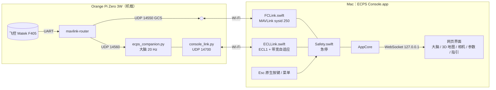
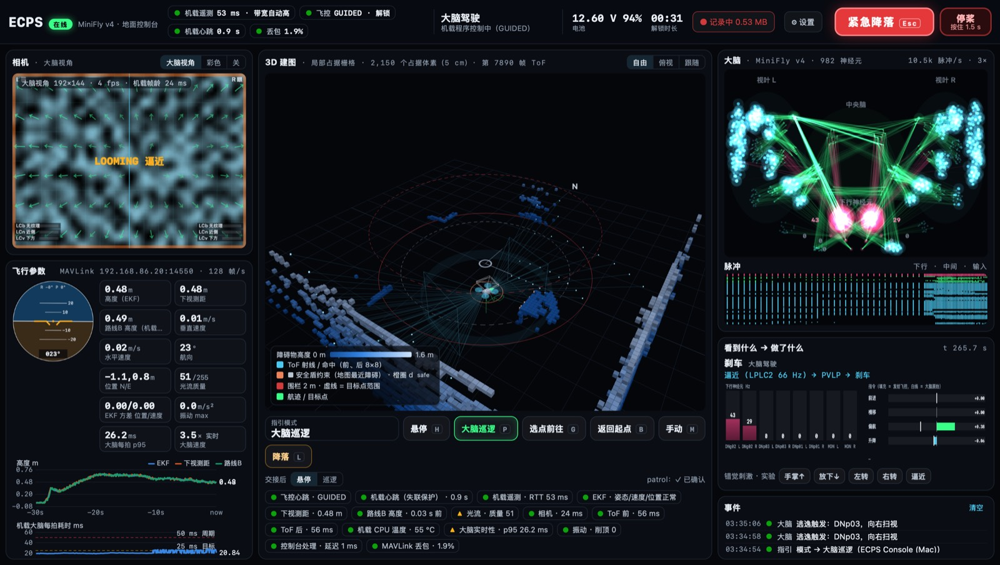
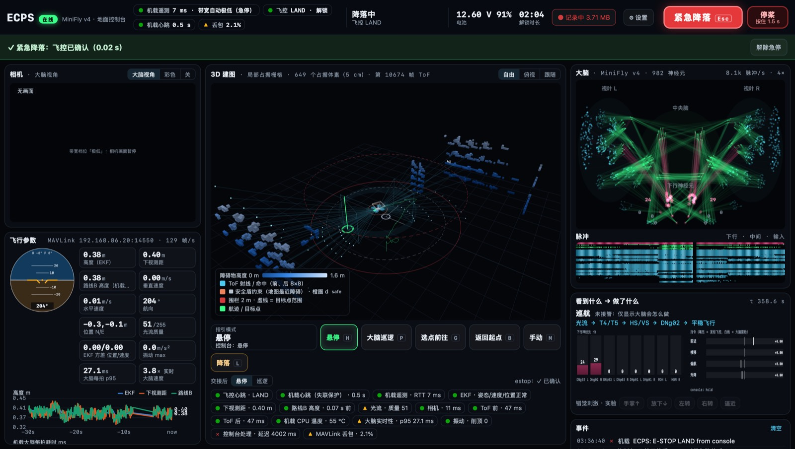
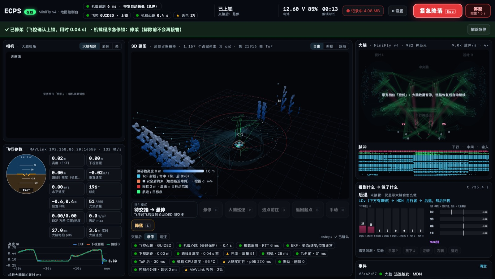
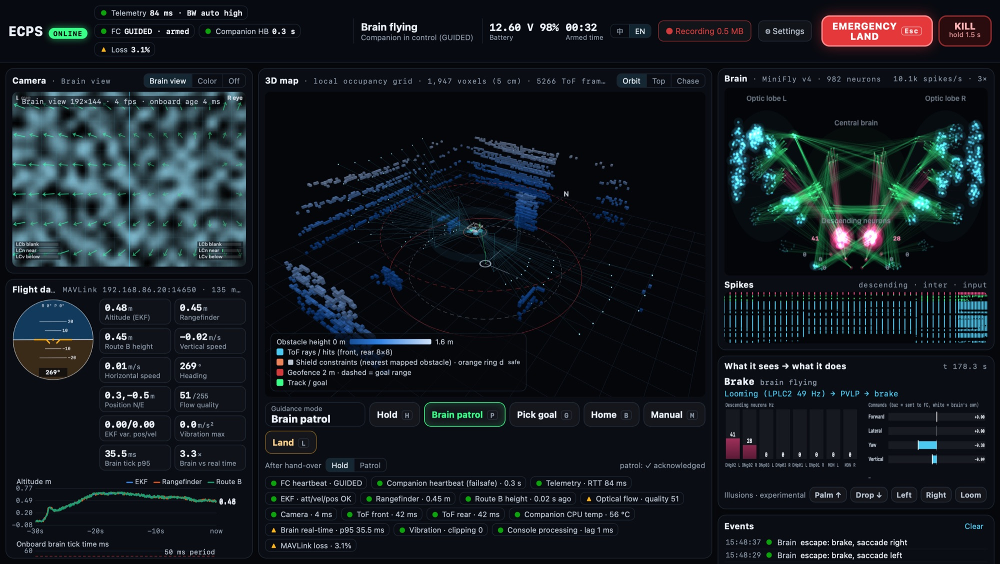
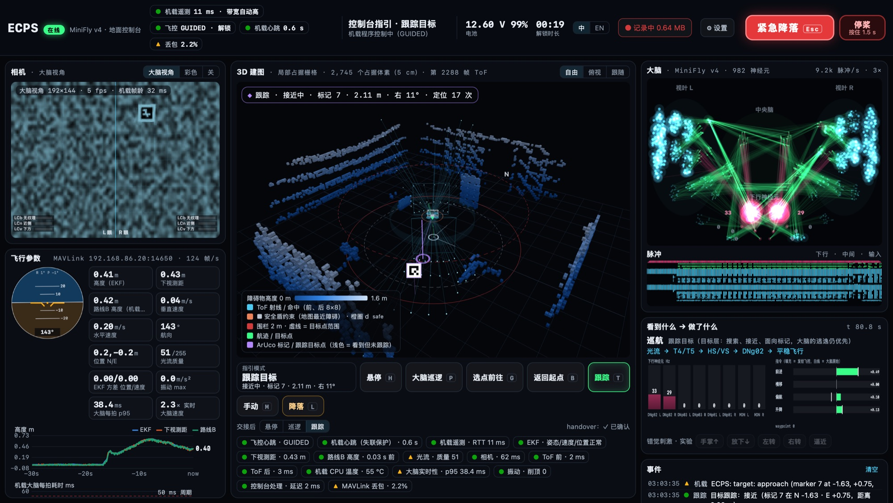
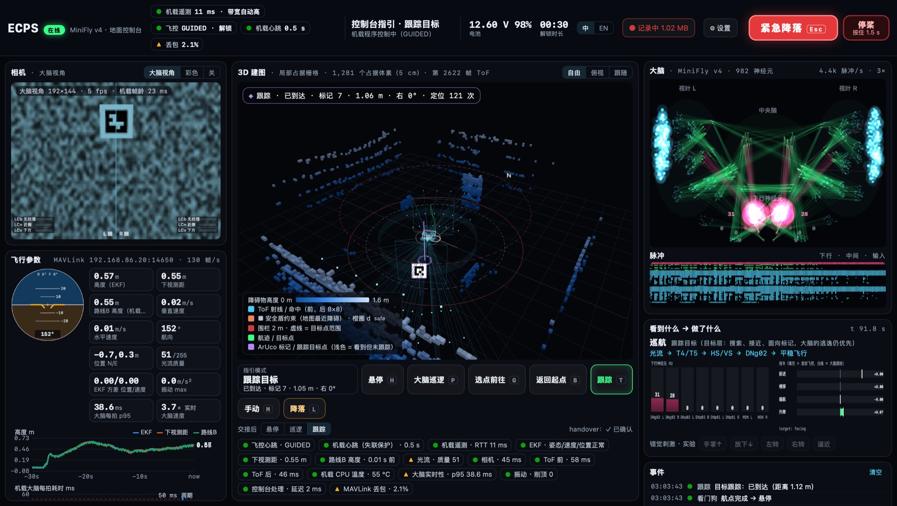
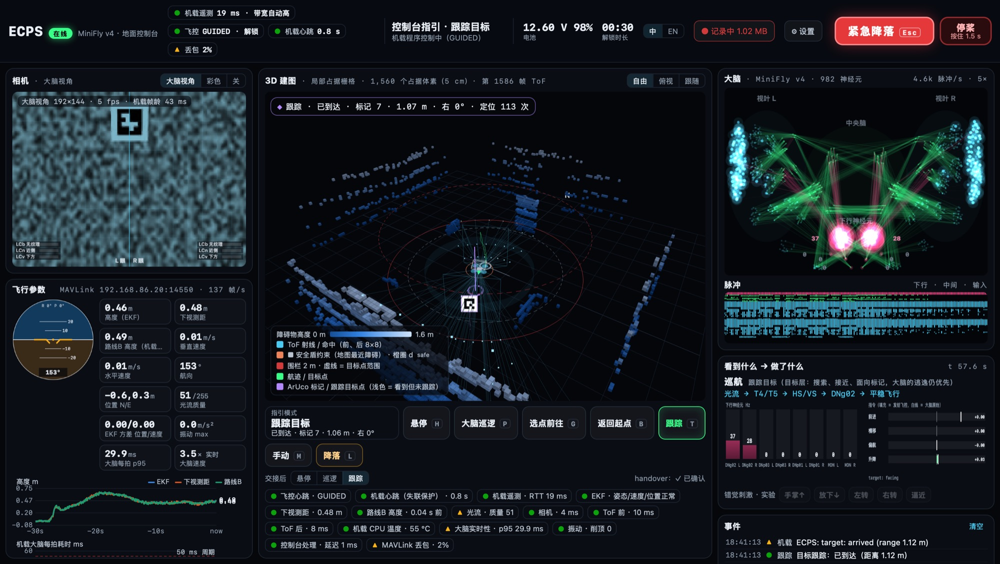

# ECPS295 地面控制台（Mac）设计与测试报告

> 2026-10-17 · 代码：`deploy/console/`（Mac 应用 + 测试工具）、`deploy/orangepi/companion/console_link.py`（机载端）·
> 安装：`/Applications/ECPS Console.app` · 状态：**10-17 03:16 已部署到 Pi 的 `/opt/ecps295`**，部署后的局域网端到端测试见第 6 节；
> **未上真机**（Pi 目前没接飞控、相机和 ToF）· 界面可切换中文 / 英文（第 8 节）·
> 10-18：急停确认修复已部署并复测（第 6.5、6.6 节）· 跟踪模式 TRACK（第 9 节）**10-19 已部署到 `/opt`**，部署后复测见第 9.5 节 ·
> 10-20：最高档相机帧率提到 20 fps，已在测试台测过；**22:58 已部署到 `/opt`**，新应用已安装，部署后的复测还没做（第 10 节）

## 0. 结论

- 控制台是一个原生 macOS 应用（Swift 外壳 + 内嵌网页界面，1.8 MB，只用 Command Line Tools 构建），一屏内同时显示：
  大脑实时状态（FlyDrones Live 风格）、机载 3D 建图、机载相机、飞行参数与健康检查，并提供指引飞行和两级急停。
- 机载端是一个新模块 `console_link.py`，默认关闭；打开但没有控制台连接时，控制路径与原来逐位一致。
  连上控制台时（最高带宽档位，约 59 kB/s）大脑每拍平均多 0.57 ms（+1.9%），p99 多 0.25 ms，无超时。
- 安全边界按你的选择：**遥控起飞 + 控制台指引**（控制台从不解锁、不起飞），**两级急停**（紧急降落 / 按住 1.5 s 停桨）。
  所有指引都插在大脑输出与安全调速器之间，下游的安全调速、看门狗、围栏掉头、安全盾（局部 3D 地图）全部照常生效。
- 在 Pi 上的 ArduPilot SITL（无 GPS、光流 + 下视测距 + 路线 B，与真机同样的导航）里，13 项端到端检查全部通过：
  交接 ≤ 0.2 s、悬停零指令、大脑巡逻、地图点选目标（航点层，到达误差 0.34 m）、返回起点、键盘手动、链路中断转悬停、
  紧急降落（飞控 0.20 s 进入 LAND）、急停后飞手可接管、普通降落（0.06 s）、空中停桨（0.55 s 内上锁）。
  经由 Mac 应用本身：紧急降落从按下到飞控确认 0.07 s，停桨 0.04 s。
- **部署与局域网端到端测试（03:16–03:46）**：机载端已装进 Pi 的 `/opt/ecps295`（被替换的文件已备份），系统服务没有改。
  测试时按系统服务的方式启动部署后的机载程序（SITL 代替飞控，正式端口），Mac 应用用默认设置直连。
  13 项自动检查全部通过。经由应用按钮通道的实操测试（A1–A10 含 A7b，每轮 11 项）跑了两轮，每轮各有 1 项未过，原因都已查清：
  一项是围栏掉头安全层按设计生效，另一项是测试注入摇杆的方式与网页自身的摇杆消息冲突。其余全部通过：
  紧急降落 0.02–0.05 s、停桨 0.04–0.07 s 得到飞控确认，应用卡死 4 s 时机载程序转为悬停，恢复后自动重连。
- **10-18 复测**（另一会话 10-17 17:39 改了围栏掉头之后）：部署模式自动测试 12/13 通过。
  未过的 P9b 暴露了控制台机载端急停确认的一个竞态：飞控进入 LAND 后约 0.25 s 内飞手拨模式开关，会被拉回 LAND 一次。
  已修复（第 6.5 节），**02:26 部署到 Pi**，部署后自动测试 13/13，P9b 在出问题的那种时序下通过（第 6.6 节）。
  经由应用跑了三轮，每轮 10/11，三次未过各有原因（大脑逃逸导致前往超时、测试脚本的截图时序、Pi 的 Wi-Fi 卡住），
  都不在控制台和机载程序；急停相关各项三轮都通过。围栏修复经离线对比确认：在围栏边上悬停时不再原地掉头。
- **跟踪模式（TRACK，10-18）**：指引栏「跟踪 T」和「交接后：跟踪」，用另一会话做的 ArUco 标记检测和目标层。
  原地转动搜索，找到后飞到标记前约 1 m，悬停并面向它。机载端对航点层和目标层的改动都放到控制循环的线程里，在两拍之间执行。
  离线测试 14/14；Pi 上的 SITL（相机画面带标记，背对标记起飞）跟踪场景 9/9：交接后 6.7 s 看到标记，13.9 s 到达，
  离标记 1.05 m、朝向误差 0.1°；经由应用 5/5，地图上画出标记、跟踪目标点和视线。**10-19 已部署到 Pi 的 `/opt`**，在已部署的运行时上跟踪 9/9、经由应用 5/5（第 9.5 节）。
- 测试中发现的最大现实约束：**Pi Zero 3W 的 Wi-Fi（AIC8800，SDIO）上行超过约 40 kB/s 就会卡顿数秒**（与之前 PIL 的现象一致）。
  控制台因此按往返延迟自动调节遥测带宽（4 档），急停相关报文走语音优先级。**遥控器仍然是第一道急停。**
  10-18 04:17 另一会话查明原因并修好：网卡驱动的 802.11ax（HE）模式和家里的路由器配合不好，改回 11ac 后不再卡顿（第 5.4 节）。
  10-19 修复后的第一次控制台测试：应用两次连接共约 10 分钟，升到最高档后没有一次自动降档（第 9.5 节）。
- **相机 20 fps（10-20）**：最高档的相机上限从 10 提到 20 fps，同时修正了发送节拍（以前设 5 / 10 fps 实际只有 4.4 / 7.7 fps）。
  测试台实测正好 20.0 fps；总流量大脑视角约 113 kB/s、480 px 彩色约 307 kB/s，机载控制周期耗时不变；
  经由应用 `app_full` 11/11，彩色 20 fps 连续 3 分钟没有掉档。**10-20 22:58 已部署到 `/opt`**，新应用已安装，部署后的复测还没做（第 10.5 节）。

## 1. 需求与设计选择

| 需求 | 实现 |
|---|---|
| Mac 上的应用 | 原生 AppKit 外壳 + WKWebView 界面。磁盘只剩约 2.4 GB、没有 Xcode，所以没有用 Tauri / Electron（依赖上百 MB）；三维和大脑画面直接复用 FlyDrones 的 three.js r170 与画布绘制方式 |
| 实时看大脑（参考 FlyDrones 原项目 UI） | 移植 FlyDrones Live 的「Brain」面板：按果蝇头部正视图布局的细胞群（视叶 L/R、中央脑、下行神经元），每个神经元按脉冲点亮，发放的神经元沿连接发出脉冲；新增 ECPS 的 LCb / LCn / LCv / MDN 细胞群；连接组（982 神经元、6,115 连接）由机载程序在连接时发送。另有脉冲栅格、下行神经元发放率柱、指令条（填充 = 发给飞控，白线 = 大脑原始）和「看到什么 → 做了什么」行为链 |
| 指引飞行和降落 | 悬停 / 大脑巡逻 / 地图点选目标 / 返回起点 / 键盘手动 / 降落；交接后模式可选（默认悬停）；另加 FlyDrones 的「错觉刺激」（给大脑看假光流，由它自己的反射转向、升降、逃逸） |
| 安全急停 | 紧急降落（大红按钮、Esc、菜单）+ 停桨（按住 1.5 s、菜单需确认），见第 4 节 |
| 3D 建图实时画面 | 机载 `LocalMap`（5 cm 体素、log-odds、EKF 坐标系）的占据体素，按高度着色；两块 8×8 ToF 的实时射线与命中点；安全盾的约束（每个扇区最近的地图障碍）、查询范围、d_safe 圈；围栏、目标点范围、航迹、目标；SITL 下还显示真值位置（看 EKF 漂移） |
| 机载摄像头画面 | 「大脑视角」：视网膜实际得到的 192×144 灰度图 + 小眼网格 + 每个小眼的光流箭头 + 逼近告警 + LCb/LCn/LCv 指示；「彩色」：原始 640×480（可缩到 480/320 宽） |
| 相关飞行参数 | 姿态仪、EKF 高度 / 下视测距 / 路线 B 高度（同一坐标轴的图表）、速度、航向、位置、光流质量、EKF 方差、振动、电池、大脑每拍耗时图；健康检查：飞控心跳、机载心跳（失联保护）、遥测链路、EKF、测距、路线 B、光流、相机、前后 ToF、Pi 温度、大脑实时性、振动、丢包、控制台处理延迟 |

## 2. 架构



- **两条独立链路**：MAVLink 直连飞控（经 mavlink-router 的地面站端口），用于飞行参数和急停；ECL1 连机载程序，用于大脑、地图、相机和指引。
  急停同时走两条：机载程序卡死时，直连飞控那条照样有效。
- 控制台的 MAVLink sysid 是 **250**：不在 `MAV_GCS_SYSID..HI`（真机 254，SITL 254–255）内，所以它的心跳**不会掩盖**机载程序失联保护（FS_GCS）。
  控制台**不请求**机载程序依赖的数据流（RANGEFINDER 是路线 B 的高度源），只额外请求显示用的光流、振动、HUD、电池（可关）。
- 急停逻辑在原生侧（Safety.swift），Esc 由原生按键监听处理：网页卡住或崩溃（会自动重载）都不影响。

### 2.1 ECL1 协议（`console_link.py` 文件头有完整定义）

UDP，报头 `<4sBBHHHI`（`ECL1`、类型、zlib 标志、消息号、分片号、分片数、时间戳），每个报文 ≤ 1216 字节（能直接穿过 NetBird 1280 MTU）。

| 方向 | 类型 | 内容 | 频率（档位 3 / 2 / 1 / 0） |
|---|---|---|---|
| Pi→Mac | TICK | JSON：位姿、大脑原始 / 指引 / 实发指令、全部输入输出群发放率、解码器（刹车、扫视、后退）、安全盾、地图扇区、耗时、传感器年龄 | 20 / 10 / 5 / 5 Hz |
| | BRAIN | 每个神经元的脉冲计数（两次发送之间累加）+ 双眼 6×8 小眼的 9 种特征 | 20 / 5 / 2 / 0 Hz |
| | CAM | JPEG（大脑视角 ~3.4 kB / 彩色） | ≤20 / 3 / 1 / 0 fps（2026-10-20 之前最高档是 ≤10，见第 10 节） |
| | MAP | 占据体素（差分编码索引 + 置信度，zlib） | 2 / 0.5 / 0.25 / 0.1 Hz |
| | TOF | 两块 8×8，float16 | 10 / 4 / 1 / 0 Hz |
| | STATUS | 限制、事件日志、Pi 温度、计数器、链路档位 | 2 / 1 / 0.5 / 0.5 Hz |
| | TOPO / ACK / PONG | 连接组（按需）、指令确认、往返时间 | — |
| Mac→Pi | HELLO（5 Hz，兼作控制台心跳）、PING（4 Hz）、CMD、ESTOP、TOPO_REQ | | |

## 3. 指引层（机载端 `Operator`）

指引层包在 `pilot.decoder.update` 外面，**替换大脑的原始指令，再交给安全调速器**，所以：

```text
大脑 → 解码器 → [指引层] → 安全调速（限幅、天花板、地板、围栏、电量） → 相机 / 高度源 / ToF 看门狗 → 围栏掉头
     → 航点层（前往目标时） → 安全盾 + 局部 3D 地图 → 交接门（GUIDED + 解锁 + 高度 ≥ 0.3 m + 传感器新鲜 + 未急停） → 飞控
```

| 模式 | 行为 |
|---|---|
| 大脑巡逻 | 大脑指令原样通过（等于没有控制台时的行为） |
| 悬停 | 零速度；安全盾仍会把飞机从 d_safe 内的障碍旁推开 |
| 前往目标 | 调用航点层 `pilot.set_waypoints([(x, y)])`（另一会话 10-17 新增）：大脑继续飞，偏航加上指向目标的偏置，前进速度随航向误差和距离缩小；扫视 / 后退 / 巨纤维逃逸优先；到达（0.35 m）或 20 s 无进展跳过 → 悬停；目标必须在围栏半径 − 0.4 m 内 |
| 手动 | 键盘摇杆（前后、横移、偏航、升降按 0.6 / 0.6 / 0.6 / 0.5 缩放），0.5 s 没有新摇杆值 → 悬停；仍经过安全盾 |
| 降落 | 机载程序在控制中时走它自己的 LAND；同时控制台直接给飞控发 LAND |

每次交接（飞手拨到 GUIDED、机载程序接管）模式都会重置为「交接后」选择（控制台默认悬停；没有控制台时为巡逻，与原来一致）。
控制台失联 1.5 s：前往目标 / 手动 → 悬停；在控制中且悬停仍失联 20 s → LAND。大脑巡逻不受影响（与没有控制台时一样）。

## 4. 急停语义

| | 紧急降落（大红按钮 / Esc / 菜单） | 停桨（按住 1.5 s / 菜单确认） |
|---|---|---|
| 控制台 → 飞控（直连） | 每 200 ms 发 `DO_SET_MODE LAND` + `SET_MODE`，直到飞控 COMMAND_ACK 接受或心跳显示 LAND / 上锁 | 每 150 ms 发 `COMPONENT_ARM_DISARM 0, 21196`（强制），直到确认上锁 |
| 控制台 → 机载程序 | ESTOP（level 1），机载程序立刻放弃控制，并自己给飞控发 LAND，直到飞控确认一次 | ESTOP（level 2），机载程序自己也发强制上锁 |
| 之后 | 机载程序**锁定**：不再接管，直到控制台「解除急停」（飞控已上锁，或强制解除）；**不再强迫**：飞手拨模式开关可以接管（测试 P9b） | 同左 |
| 带宽 | 按下即把遥测降到最低档 15 s，给急停和确认让出空口 | 同左 |

机载程序在执行急停时向飞控发 STATUSTEXT（`ECPS: E-STOP LAND/KILL from console`），飞手在遥控器 / OSD 上能看到原因。

## 5. 测试

### 5.1 MAVLink 编解码

Swift 编解码由 pymavlink 生成的元数据驱动。14 条 v1/v2 报文（打包在一个 UDP 报文里）解码：0 个 CRC 错误、0 个字段不一致；
Swift 生成的 HEARTBEAT、DO_SET_MODE(LAND)、强制上锁、SET_MESSAGE_INTERVAL、SET_MODE 用 pymavlink（严格模式）解析全部正确。

### 5.2 端到端（Pi 上的 SITL，`tools/console_e2e.py`，第 4 轮全部通过）

测试台：ArduCopter 4.7.0 SITL（`fhb_delta` 无 GPS 光流 + 路线 B + 地形参数），第二个 mavlink-router，机载程序（guided，模拟相机，
两块 ToF 由 SITL 真值 + cage20 布局模拟），全部在 Pi 的独立目录 `/root/ecps_console_test`。测试脚本在 Mac 上扮演飞手（遥控覆盖）和控制台。

| 项 | 结果 |
|---|---|
| P1 交接前 | 「交接后悬停」确认，未接管 |
| P2 起飞交接 | GUIDED 后 ≤ 0.2 s 接管，悬停指令为 0，4 s 漂移 0.08 m |
| P3 大脑巡逻 15 s | 飞行 0.82 m，地图 1426 → 1886 体素（围网和箱子），32 拍扫视 |
| P4 前往 (1.0, 0.6) | 18.3 s 到达，EKF 最近 0.34 m，然后自动悬停 |
| P5 返回起点 | 24.2 s，0.35 m |
| P6 键盘手动 | 前进 0.25 m/s，松开 1.25 s 停住 |
| P7 前往途中控制台断链 4 s | 转为悬停，恢复后有「链路中断 / 恢复」事件 |
| P8 错觉「左转」（行为观察） | 大脑偏航指令 −0.08 → −0.45：果蝇按错觉方向转 |
| P9 紧急降落（双通道） | 飞控 0.20 s 进入 LAND，机载程序同时锁定放权，2.5 s 落地上锁 |
| P9b 急停后飞手拨 ALT_HOLD | 保持 3 s 未被改回 LAND，机载程序仍锁定（不接管） |
| P10 解除急停 | 上锁后解除成功 |
| P11 第二次飞行，普通降落 | 飞控 0.06 s 进入 LAND |
| P12 第三次飞行，空中停桨 | 0.55 s 内确认上锁（受 1 Hz 心跳检测限制），从 0.64 m 落下 |

经由 Mac 应用（与界面按钮同一条代码路径）：交接 0.14 s；**紧急降落按下到飞控 COMMAND_ACK 0.07 s**；**停桨 0.04 s**。
运行中的界面截图：大脑面板、脉冲、3D 地图（围网和箱子）、相机、参数、健康检查都实时更新。

### 5.3 机载开销（Pi，bench，A76 核，同一调速器下 A/B）

| | 大脑每拍 p50 | 均值 | p99 | 最大 | 超时 |
|---|---|---|---|---|---|
| 控制台关闭 | 31.52 ms | 30.80 ms | 36.89 ms | 38.56 ms | 0 |
| 控制台打开，客户端在最高档（相机 10 fps，58.7 kB/s） | 31.65 ms | 31.37 ms | 37.13 ms | 40.29 ms | 0 |

（绝对值比部署报告的 22 ms 高，是因为这里没有把 A76 设为 performance 调速器；systemd 服务会设。）

### 5.4 Wi-Fi 实测（Pi Zero 3W，AIC8800 SDIO 驱动，家里的 5 GHz 网络）

| 情况 | ping Mac→Pi |
|---|---|
| Pi 空闲 | 平均 45 ms |
| SITL 测试台运行、无控制台 | 平均 11 ms |
| + 机载遥测（不带相机，约 32 kB/s） | 平均 10 ms，ECL 往返 21 ms |
| + 相机 10 fps（送出约 90 kB/s，只送达 41.5 kB/s） | **平均 2.77 s，最大 5.9 s**，ECL 往返中位数 1.08 s |

这解释了第一次经应用急停时「3.29 s 才确认」：LAND 报文和飞控确认都卡在拥塞的 Wi-Fi 里（飞行记录里 12 个 ACK 和 LAND 心跳同时到达）。
对策（都已实现）：4 档带宽、按往返延迟自动升降（掉档立即、升档需 6 s 干净且指数退避 30–120 s）、机载端发送队列背压
（套接字队列 > 24 kB 时跳过相机/地图/大脑）、分片间隔 1 ms、急停时强制最低档、MAVLink 和 ECL 报文标为语音优先级（WMM AC_VO）、
用 COMMAND_ACK 确认急停（不必等 1 Hz 心跳）。之后应用急停确认降到 0.04–0.8 s。真实笼场的网络可能更好也可能更差：顶栏会显示当前档位与往返延迟。

**10-18 更新：原因已查明并修复**（另一会话 course-files-export-33 排查，04:17 生效）。问题不在网卡的上行能力，而是驱动的 802.11ax（HE）模式和家里的路由器配合不好：Pi 发送数据时，路由器发给 Pi 的帧被缓存 5–20 s（速率掉到 HE MCS0），86–94% 丢失。应用发给 Pi 的 ping、心跳和确认因此卡住，自动带宽跟着掉档；上面测到的「约 40 kB/s 上限」也是它造成的。驱动参数改为 `he_on=0 ps_on=0`（改用 11ac VHT，并关掉固件省电）后，对方测得 TCP 上行 123 Mbit/s、下行 21 Mbit/s；下行 150 包/s 加上行 400 包/s 同时跑，0 丢包、延迟稳定。配置在 Pi 的 `/etc/modprobe.d/aic8800-ecps.conf`，重刷系统后要重新放进去。04:24 在 Pi 上核对过：两个参数都已生效，链路为 VHT-MCS 9、40 MHz，信号 −48 dBm。

上面的带宽控制都保留（无害，换到别的网络也有用）。10-19 修复后的第一次控制台测试（第 9.5 节）：应用两次连接共约 10 分钟，升到最高档后没有一次自动降档（10-18 修复前同样的测试里，升到最高档后约 15 分钟内自动降档 8 次）。10-20 已把最高档的相机帧率提到 20 fps（第 10 节）。

### 5.5 测试中发现并修复的问题

1. SITL 模拟 ToF 取不到真值（RealDrone 故意把 `truth_ned()` 设成 None）→ 只在测试源里用一个「真值视图」，不改 RealDrone。
2. 应用把每帧 MAVLink 同步写进 iCloud 同步的「文稿」目录，网络队列积压 3.7 s → 记录改为独立队列 + 缓冲，目录改到 `~/Library/Logs/ECPS Console/`。
3. Pi Wi-Fi 上行卡顿 → 第 5.4 节的带宽控制。
4. **急停锁一直强迫飞控 LAND / 上锁，飞手无法用模式开关接管** → 每次按下只强迫到飞控确认一次（新增测试 P9b）。
5. 界面：相机开关未与原生设置同步、大脑数据聚合后脉冲率计算错误、档位来回震荡、交接后模式提示。

## 6. 部署到 Pi 与局域网端到端测试（2026-10-17 03:16–03:46 PDT）

### 6.1 部署

拷贝来源是 Pi 测试目录里测过的副本（md5 与 Mac 工作副本一致），用 `install -m 644` 装进 `/opt/ecps295`，再用 venv 编译检查。

| 文件 | 部署前 | 部署后 |
|---|---|---|
| `companion/ecps_companion.py` | `8a725a22`（航点版） | `43e7e22a`（航点版 + 控制台挂钩） |
| `companion/camera.py` | `6cbfe507` | `7e004c5e` |
| `config/companion.yaml` | `502b452f` | `5f0efe12`（只追加 `console:` 段，端口 14700） |
| `companion/console_link.py` | — | `71b39a80` |
| `companion/sitl_world.py` | — | `baf85363`（只在 `--tof sitl:` 时导入） |

- 被替换的三个文件备份在 Pi 的 `/root/ecps295_backups/20261017_pre_console/`（含 `MANIFEST.md5`）。
  回滚方法：把备份拷回原位，并删除 `console_link.py`、`sitl_world.py`。
  只想关掉控制台的话，把 `console.port` 设为 0 即可。
- 没有改动：`ecps-companion.service`（仍为停用，`ECPS_MODE=shadow`）、mavlink-router 配置、`real_drone.py`、`ecps295/ecps_pilot.py`。
  航点层已由航点会话在 00:00 部署；合并时已核对它的 `wp_active` 门控和 STATUSTEXT 转发都保留了。
- **影子模式（服务默认）下用控制台**：遥测、大脑、地图、相机全都能看，急停两条路径都直接作用于飞控。
  但机载程序在影子模式下从不接管，所以指引按钮一直不可用。
  地面测试通过后，用 `systemctl edit ecps-companion` 设 `Environment=ECPS_MODE=guided`，指引才生效。

**冒烟测试**：部署后的程序以台架模式运行（不接飞控），控制台端口取自配置（14700）。
- 每拍 20 Hz，0 次超时。
- 当时开着的控制台应用按默认设置自动连上，并发出「交接后悬停」。
- Mac 命令行客户端经局域网收到全部 8 类报文，拓扑为 982 个神经元、6115 条连接、44 个脑区，往返延迟中位数 13 ms。

### 6.2 测试台：`sitl_rig.py --deployed`

- 启动方式与 `ecps-companion.service` 一致：nice −10、CPU 6–7、A76 设为 performance 调速器。
- 与服务的区别只有两处：用 guided 模式；相机换成模拟相机，ToF 由 SITL 真值模拟。
- 使用正式端口：路由的 companion 端点 14560、地面站端点 14550（Server），控制台端口取自配置（14700）。
  Mac 应用不用改任何设置。
- 14550 平时被 `mavlink-router.service` 占着，测试台运行期间先停掉它，结束时再启动，并恢复调速器（已核对）。

整场运行（877 s，17,534 拍，其中 315 s 由机载程序控制）：
- 大脑每拍耗时 p50 25.6 ms、p95 27.7 ms、p99 28.5 ms。
- 只有 1 拍超时（65 ms）：视网膜阶段一次耗时 41 ms。发生在全部测试结束后、飞机在地面时，未复现，原因未定。
- 控制台共发送 17.0 MB（平均 19.4 kB/s），0 次发送错误。

### 6.3 自动测试（测试脚本自己作为控制台连 14700，13 项全部通过）

| 项 | 部署后结果（括号内为第 5.2 节的结果） |
|---|---|
| P2 交接后悬停 | 指令 0，漂移 0.07 m（0.08） |
| P3 大脑巡逻 15 s | 0.59 m，地图 1578 → 1946 体素，ToF 53 帧、大脑 76 帧 |
| P4 前往 (1.0, 0.6) | 23.8 s，最近 0.35 m（18.3 s，0.34） |
| P5 返回起点 | 24.9 s，0.34 m |
| P6 键盘手动 | 0.24 m/s，松开 1.35 s 停住 |
| P7 控制台断链 | 转为悬停，有「链路中断 / 恢复」事件 |
| P8 错觉「左转」 | 大脑偏航 −0.08 → −0.58 |
| P9 / P9b 紧急降落、飞手接管 | 飞控 0.21 s 进入 LAND，机载程序 0.21 s 锁定，2.7 s 上锁；飞手拨 ALT_HOLD 保持 3 s |
| P10 解除急停 | 成功 |
| P11 普通降落 | 飞控 0.09 s 进入 LAND |
| P12 空中停桨 | 0.80 s 内确认上锁（按 1 Hz 心跳判断），从 0.64 m 落下 |

### 6.4 经由 Mac 应用的实操测试（`console_e2e.py --scenario app_full`，两轮）

做法：
- 测试脚本向应用的本地 WebSocket 发送与界面按钮完全相同的消息，令牌取自应用日志。
- 读取的也是界面收到的数据。
- 测试期间应用是唯一的控制台，测试脚本只扮演飞手。
- A6 用 SIGSTOP 把应用冻结 4 s，模拟应用卡死。

| 项 | 第 1 轮（03:34） | 第 2 轮（03:40） |
|---|---|---|
| A1 交接（应用的「交接后悬停」） | ✗ 围栏掉头偏航 2 s（见下），漂移 0.06 m | ✓ 指令 0，漂移 0.07 m |
| A2 应用发「大脑巡逻」 | ✓ 0.68 m；15 s 内 ToF 56、大脑 106、相机 41 帧 | ✓ 0.80 m；ToF 88、大脑 201、相机 54 帧 |
| A3 应用点选前往 (1.0, 0.6) | ✓ 53.8 s，0.34 m | ✓ 41.4 s，0.34 m |
| A4 返回起点 | ✓ 22.8 s，0.34 m | ✓ 23.4 s，0.34 m |
| A5 手动（摇杆消息经应用） | ✓ 0.17 m/s，松开 0.83 s 停住 | ✗ 0.04 m/s（测试注入问题，见下） |
| A6 前往途中应用卡死 4 s | ✓ 转为悬停，飞控保持 GUIDED，漂移 0.12 m，恢复后自动重连 | ✓ 同左，漂移 0.08 m |
| A7 应用紧急降落 | ✓ 飞控 ACK 0.02 s；飞手 0.05 s 看到 LAND；机载程序 0.15 s 锁定；3.1 s 上锁 | ✓ 0.05 s / 0.07 s / 0.22 s / 2.85 s |
| A7b 急停后飞手接管 | ✓ | ✓ |
| A8 应用解除急停 | ✓ 0.10 s | ✓ 0.31 s |
| A9 应用普通降落 | ✓ 飞控 0.07 s 进入 LAND | ✓ 0.07 s |
| A10 应用停桨 | ✓ 飞控 ACK 0.07 s，飞手 0.51 s 看到上锁 | ✓ 0.04 s / 0.18 s |

链路情况：
- 应用的机载遥测往返延迟最大 14–222 ms。
- 带宽档位自动在 1–3 档之间变化，急停后强制降到 0 档。
- 飞控 MAVLink 丢包约 2%。

**第 1 轮 A1 未过的原因：围栏掉头安全层按设计生效。**
- 交接点在 (−1.19, 1.15)，离原点 1.65 m，机头朝外，刚越过围栏掉头的阈值（围栏 2.0 m 减余量 0.35 m）。前一轮测试的飞机就降落在这里。
- `EcpsPilot` 的围栏掉头位于控制台下游，于是以偏航 +1.0 转了 2.05 s，把机头转向中心。
- 前进、横移、升降始终为 0，漂移 0.06 m。第 2 轮从离原点 0.4 m 处交接，指令为 0。
- 观察：前进指令为 0 时，可以考虑不触发掉头。
- **2026-10-17 17:39 已按这个思路修改**（另一会话改的 `ecps_pilot.py`，md5 1b2d1e97 → 9dbec02a，已装到 Pi，旧版备份在
  `/root/ecps295_backups/20261017_pre_fencefix/`）：处于掉头状态时，如果前进指令 ≤ 0（控制台悬停、键盘手动没按前进、航点走完），
  就不再偏航，前进量照旧限制为 ≤ 0。另一会话的 58 次巡逻回归为 0 碰撞。控制台测试还没有用新版本重跑。
  事件栏仍会出现「围栏：掉头」，因为这条事件在进入掉头状态时记录，不管之后是否偏航。

**第 2 轮 A5 未过的原因：测试注入的摇杆与网页自身的摇杆消息冲突。**
- 手动模式下，应用网页每 100 ms 会按真实键盘状态发一次摇杆消息：没按键时发的是 0。
- 测试脚本同时经同一通道以 10 Hz 注入「前进 1.0」。从 `ticks.csv` 看，机载程序收到的前进量在 0.6（满杆 × 手动系数 0.6）和 0 之间交替，有一段连续 1 s 为 0。
- 真实使用时只有网页一个来源，不会冲突。「应用 → 机载程序」的摇杆通道本身是通的（机载程序收到了 0.6），第 1 轮交替得好，测到 0.17 m/s。
- 这暴露一个局限：同时连着两个控制台并处于手动模式时，空闲那台发的 0 会掺进来。方向是安全的，但会让人困惑；改进办法见第 7 节。

其他：
- A6 之后健康检查里「控制台处理延迟 4002 ms」变红，记录的正是那 4 s 冻结，属于正确报警。
- 应用自动录下了这两轮的飞行记录：`~/Library/Logs/ECPS Console/20261017_0334*`、`20261017_0340*`。
- 原始结果在 `results/lan_e2e_*_20261017.json`。

运行中的界面截图：





### 6.5 复测：围栏掉头修复之后（2026-10-18 00:46–00:49 PDT），以及急停确认的修复

起因：10-17 17:39 另一会话改了 `ecps_pilot.py` 的围栏掉头（见 6.4 节第 1 轮 A1 的说明），需要确认控制台仍然正常。
Pi 上的机载程序与 6.1 节相同，只有 `ecps_pilot.py` 换成了新版。

**自动测试**（部署模式测试台，正式端口，`console_e2e.py --ecl 14700`）：12/13 通过。

| 项 | 10-18 | 10-17（6.3 节） |
|---|---|---|
| P2 交接后悬停 | 指令 0，漂移 0.07 m | 指令 0，0.07 m |
| P3 大脑巡逻 15 s | 0.81 m，地图 1334 → 2302 体素，ToF 52 帧、大脑 75 帧 | 0.59 m |
| P4 前往 (1.0, 0.6) | 22.0 s，最近 0.34 m | 23.8 s，0.35 m |
| P5 返回起点 | 24.2 s，0.35 m | 24.9 s，0.34 m |
| P6 键盘手动 | 0.24 m/s，松开 1.30 s 停住 | 0.24 m/s，1.35 s |
| P7 控制台断链 | 转为悬停，有「链路中断 / 恢复」事件 | 同左 |
| P8 错觉「左转」 | 大脑偏航 0.07 → −0.43 | −0.08 → −0.58 |
| P9 紧急降落 | 飞控 0.21 s 进入 LAND，机载程序 0.21 s 锁定 | 0.21 s / 0.21 s |
| **P9b 急停后飞手接管** | **✗ 飞手切到 ALT_HOLD 后 0.09 s 又被切回 LAND** | ✓ |
| P10 解除急停 | ✓ | ✓ |
| P11 普通降落 | 飞控 0.10 s 进入 LAND | 0.09 s |
| P12 空中停桨 | 0.49 s 内确认上锁，从 0.66 m 落下 | 0.80 s，0.64 m |

**围栏修复的核对。** 这一轮的交接点都在掉头阈值以内（机载程序控制期间离中心最远 1.58 m，阈值 1.65 m），掉头一次也没触发。
所以改用离线对比：在 6.4 节第 1 轮 A1 的交接点 (−1.19, 1.15)、机头朝外，分别调用新旧两版的 `_fence_turn`：

| 进入的指令 | 旧版输出 | 新版输出 |
|---|---|---|
| 悬停（前进 0、偏航 0） | 偏航 +1.00，原地掉头 | 偏航 0，保持不动 |
| 键盘手动，没按键 | 偏航 +1.00 | 偏航 0 |
| 键盘手动，按 S 后退（前进 −0.4） | 偏航 +1.00，前进 −0.4 | 偏航 0，前进 −0.4 |
| 键盘手动，按 A 左转（偏航 −0.5） | 偏航 +1.00，盖过飞手 | 偏航 −0.50，照飞手 |
| 巡逻向前（前进 0.5） | 偏航 +1.00，前进限制为 0 | 同旧版 |
| 大脑扫视中（escape） | 保留大脑的偏航，前进限制为 0 | 同旧版 |
| 机头朝内 | 不触发 | 不触发 |

两版进入掉头状态时都会记一条「围栏：掉头」事件，所以新版在悬停时也会出现这条事件，但飞机不转。

**P9b 未过的原因：控制台机载端急停确认的竞态。** 这个问题在 10-17 部署的 `console_link.py` 里本来就有，与围栏修复无关。
- 机载程序的日志（每拍记录看到的飞控模式）：125.731 s 进入 LAND，125.981 s 飞手切到 ALT_HOLD，126.031 s 又变回 LAND。
- 机载端急停每 0.25 s 才重发一次 LAND，而「飞控是否已确认」只在重发的那一刻检查。
- 这次飞控恰好只在 LAND 停留了 0.25 s。检查时它已经是 ALT_HOLD，机载程序当成「还没进 LAND」，又发了一次 LAND，盖过了飞手。
- 10-17 03:30 的自动测试里其实也发生过同样的情况，只是没被测出来。机载日志的时间线：
  - 134.383 s 飞控进入 LAND。
  - 134.583 s 飞手切到 ALT_HOLD。
  - 134.633 s 又被切回 LAND。
  - 135.133 s 测试脚本重发的 ALT_HOLD 才把它切回来。

  测试脚本靠飞控心跳判断模式，没看到这 0.5 s 的 LAND，所以当时判为通过。
- 经由应用的几轮（A7b）里，飞手是在 LAND 之后 0.7–1.3 s 才切的，没有落进这个窗口，属于真正通过。
- 测试本身也要改进：P9b / A7b 还应检查机载程序报告的飞控模式，看飞手切换之后有没有出现「ALT_HOLD → LAND」。
- 实际影响：飞手在飞控进入 LAND 后约 0.25 s 内拨模式开关，会被拉回 LAND 一次，要再拨一次才能接管。
  方向是安全的（降落），但违背了「急停被飞控确认后，飞手随时可以接管」的设计。
- Mac 应用直连飞控的那条路径没有这个问题：它每拍（10 Hz）先检查确认，再决定是否重发，而且飞控的 COMMAND_ACK 也算确认。

**修复**（`console_link.py`，md5 71b39a80 → 80c2aaa3）：
- 每次调用（每拍、每收到一条消息）都先检查确认，再按原来的 0.25 s 间隔决定是否重发。
- 除了心跳里的 LAND / 已上锁，飞控对机载程序这次按下后所发指令的 COMMAND_ACK（接受）也算确认：降落看 DO_SET_MODE，停桨看强制上锁。
- 只认这次按下后第一次发送之后收到的 ACK。被拒绝的 ACK 不算，机载程序继续重发。
- 离线回放测试 `deploy/console/tools/estop_confirm_test.py`：假飞控按时间线给出模式、上锁状态和 ACK，覆盖 7 种情况。
  旧版 3 项未过（本次的时序、心跳滞后但 ACK 已到、停桨的 ACK），新版全部通过。

**状态**：10-18 02:26 已部署到 Pi，部署后的复测见 6.6 节。原始结果：`results/lan_e2e_auto_20261018.json`。

### 6.6 部署急停修复后的复测（2026-10-18 02:26–02:53 PDT）

**部署**：`/opt/ecps295/companion/console_link.py` 71b39a80 → 80c2aaa3，旧文件备份在 Pi 的
`/root/ecps295_backups/20261018_pre_estopfix/`。测试目录 `/root/ecps_console_test/companion/` 也换成了同一版本。

**同时在跑的另一项部署**：另一会话约 02:24 把目标跟踪部署进了 `/opt/ecps295`（`ecps_pilot.py` 9dbec02a → 190c5aba，
新增 `ecps_target.py`，`ecps_companion.py` 43e7e22a → d38faaf0，`companion.yaml` 加了 `marker:` 段，每个被替换的文件旁边有
`*.pre_trk` 备份）。所以这次测的是两者合在一起的部署版本：标记检测线程在跑（A55 核，10 Hz），跟踪本身没开。

**测试脚本的改进**（`console_e2e.py`）：
- P9b / A7b 现在还看机载程序每拍报告的飞控模式（5–20 Hz，比飞控 1 Hz 的心跳细），
  飞手切到 ALT_HOLD 之后只要再出现一次 LAND 就判失败。这就是 6.5 节说的、10-17 漏掉的那种情况。
- 两项都记录飞手是在急停后多久切的（`override_after_s`），以及机载程序发给飞控的急停指令总数。
- A7 的界面截图挪到飞手接管之后（见下面第 2 轮）。
- 脚本中途出错时整体判为失败（以前只看已经记录的几项）。

**自动测试**（部署模式测试台，正式端口）：**13/13 通过**。

| 项 | 10-18 02:28（修复后） | 10-18 00:46（修复前） |
|---|---|---|
| P4 前往 (1.0, 0.6) | 49.9 s，最近 0.34 m | 22.0 s，0.34 m |
| P5 返回起点 | 25.0 s，0.35 m | 24.2 s，0.35 m |
| P9 紧急降落 | 飞控 0.29 s 进入 LAND，机载程序同时锁定 | 0.21 s |
| **P9b 急停后飞手接管** | **✓ 急停后约 0.3 s 切到 ALT_HOLD，保持 3 s；机载程序看到的模式一直是 ALT_HOLD；这次按下只发了 1 次 LAND** | ✗ 被切回 LAND |
| P11 普通降落 | 飞控 0.10 s 进入 LAND | 0.10 s |
| P12 空中停桨 | 1.10 s 内确认上锁 | 0.49 s |

其余各项与 6.5 节相当。P9b 的时序正好是修复前出问题的那种：飞控进入 LAND 后 0.3 s 内飞手就拨了开关。
机载程序的事件是「emergency stop confirmed by the FC (LAND)」，之后没有再发 LAND。

**经由 Mac 应用（`app_full`）跑了三轮，每轮 10/11**，没过的一项每轮不同，原因都已查清，没有一项出在控制台或机载程序：

| 轮次 | 未过 | 原因 |
|---|---|---|
| 1（02:33） | A3 前往 (1.0, 0.6)：60 s 内没到，最近 0.94 m | 仿真里大脑每次加速前进，大约 8 s 就触发一次刹车加扫视，转回来又要几秒。这一趟碰上 9 次（自动测试的 P4 碰上 6 次，用了 50 s）。机载程序每拍计算时间（中位数 24.6 → 25.3 ms）和每分钟逃逸次数（6.5 → 6.9）都与修复前那轮相同，所以不是这次部署造成的。10-17 的三轮 A3 本来就用了 37–54 s，离 60 s 上限不远 |
| 2（02:46） | A7b 急停后飞手接管：飞手切换时飞机已经落地上锁 | 测试脚本在急停后先截图，这次截图花了约 4 s；飞机在 LAND 下 1.2 s 就落地，2 s 后自动上锁。机载程序本身正常：切换后它看到的模式一直是 ALT_HOLD，也没有多发 LAND。已把截图挪到接管之后 |
| 3（02:54） | A2 巡逻：15 s 内应用没收到大脑、相机和 ToF 数据 | 约 02:38 起 Pi 的 Wi-Fi 多次卡住（往返延迟超过 400 ms 或丢 ping），应用的自动带宽反复退到最低档；这一档按设计只传状态。另一会话之后查明是网卡驱动的 802.11ax 模式和路由器配合不好，04:17 已修复（第 5.4 节） |

三轮里，急停相关的每一项都通过：
- 紧急降落：飞控确认用了 0.01–0.03 s（COMMAND_ACK）。
- 停桨：飞控确认用了 0.03–0.09 s。
- 第 1、3 轮的 A7b：飞手分别在急停后约 0.7 s 和 0.18 s 切到 ALT_HOLD，3 s 内保持；机载程序这次按下都只发了 1 次 LAND。
- A6：应用卡住 4 s，机载程序转为悬停，漂移 0.03–0.06 m。

原始结果：`results/lan_e2e_auto_20261018b.json`、`results/lan_e2e_app_20261018_run1.json` ~ `run3.json`。

## 7. 局限与下一步

- **真机还没测**：真实飞控的数据流配置、真实相机与 ToF、笼场 Wi-Fi 都没有验证过。目前 Pi 上没接飞控（14550 收不到心跳），也没接相机和 ToF。
  建议按 FLIGHT_TEST_PLAN 进行：
  - 先做地面台架测试：不装桨，连真飞控，验证急停两条路径。此时服务可以先保持影子模式。
  - 再在 R1 悬停时带上控制台。指引功能需要 guided 模式。
- 2026-10-18、10-19 已推送到 GitHub（`ecps295-sim` 分支：`ecps295/deploy/console/`，报告在 `docs/`，原始结果在 `docs/results/`）。
- 急停确认的修复已于 10-18 02:26 部署并复测（6.6 节）。
- **Pi 的 SD 卡**：10-19 这张卡在一次例行的时序校准之后卡死了约 8 小时，任何读写都挂住（第 9.5 节）。机载程序和日志都在这张卡上，飞行中发生同样的事，碰到磁盘的线程都会卡住。另外，卡的厂商编号是 0x000000（正规厂商都有登记的编号），型号 SD16G、容量却报 233 GiB（生产日期 2023-09），很可能是杂牌或扩容卡：真实容量可能只有 16 GB，写入超过真实容量后数据会损坏（目前用了 6.9 GB）。
  - **10-19 已远程限速**（用户决定：先限速，不行再换卡）。没有用厂商属性 `sunxi-dis-signal-vol-sw`（查不到它在驱动里的具体行为，有起不来的风险），而是用内核的标准做法：用 `fdtput -d` 从 `/boot/dtb/allwinner/sun60i-a733-orangepi-zero3w.dtb` 的
    `/soc@3000000/sdmmc@4020000` 删掉 `sd-uhs-sdr104`、`sd-uhs-sdr50`、`sd-uhs-ddr50`。控制器不再支持 UHS，卡就一直用 3.3 V 高速模式（50 MHz），也不做时序校准。改之前把原版和修改版各自和启动时的三个覆盖合成，离线比对过，只差这三行。
    原文件备份在同目录的 `sun60i-a733-orangepi-zero3w.dtb.bak-sdhs-20261019` 和 Pi 的 `/root/ecps295_backups/20261019_sdhs/`。
  - 重启后核对：50 MHz、SD-HS、3.30 V，开机没有做校准，SD 卡零报错；原始读速度 68 → 24 MB/s，带 fsync 写 20 MB/s，机载程序够用。
  - 内核或设备树软件包升级会换回原来的设备树：升级后运行 Pi 上的 `/root/sd_hs_mode.sh`（检查并重新删掉 UHS 属性），再重启。
  - 这次正常重启（`systemctl reboot`）花了约 11 分钟：关机过程卡住，10 分钟后被硬件看门狗（systemd `RebootWatchdogSec=10min`）重启。日志只在内存里，查不到卡在哪一步；以后正常重启也可能要等这么久。
  - 换卡仍然值得做（扩容卡的风险还在）。另一个待办：确认机载程序的控制循环里没有同步的磁盘读写。
- 跟踪模式 10-19 已部署（第 9.5 节）；还要在真相机上标定标记检测；真机上第一次用跟踪，建议先在笼场中央、标记放在 2 m 内。
- 前往目标点在 SITL 里用时波动很大（22–64 s），主要取决于途中大脑触发了几次刹车加扫视。经由应用的 A3 上限 60 s 偏紧；
  真机的相机画面不同，逃逸频率要在台架和 R1 悬停时再看。
- 测试脚本：自动测试 P3 的 ToF 判定原来是 15 s 内多于 50 条，正好等于这一档的最少条数（4 Hz 按每拍检查，每 15 s 50–54 条）。10-19 已改成至少 45 条（约 3 Hz）：以前 7 轮的记录在新判定下全部通过，只有 10-19 第 1 轮（50 条）的结果变了。
- Esc 键和 W/A/S/D 键都没有用真实按键测过：Esc 与菜单、按钮调用同一个原生函数；方向键的摇杆通道见 6.4 节的 A5。
- 多个控制台同时连接时，摇杆消息按「最后一条为准」合并，空闲那台在手动模式下发的 0 会掺进来（偏安全）。
  改进办法：只接受切到手动模式的那台控制台发来的摇杆。
- 部署版本整场测试中出现过 1 次 65 ms 的单拍超时（视网膜阶段）。台架测试时注意观察是否复现。
- 没有鉴权：局域网里任何人都能发指令（急停方向是安全的）。需要时可加共享口令。
- 地图在 EKF 坐标系，漂移不校正（与机载安全盾一致）；目标点受围栏约束。
- 构建：以前项目目录在 iCloud 同步的「文稿」里，刚改过的文件偶尔读成旧内容，所以 `build.sh` 先拷贝再编译、失败重试。
  10-20 起改在 git worktree 里开发（不在同步文件夹里），不再有这个问题；脚本保持不变。
- 相机 20 fps（第 10 节）10-20 22:58 已部署到 `/opt`，部署后的复测还没做。相机面板只画最新的一帧（上一帧还在解码时到达的帧会丢掉），页面负载重时显示的帧率
  可能略低于实收；可以改成解完一帧接着解最新到达的那一帧。
- 3D 地图的 WebGL 上下文一旦丢失，不会自动恢复，要重启应用或 ⌘R 重载界面（第 8 节的测试中出现过一次）。
  改进办法：监听上下文丢失，自动重建地图或提示重载。

## 8. 界面语言：中文 / English（2026-10-17 15:20–16:00 PDT）

- **切换方式**：顶栏「中 / EN」，或菜单「显示 → 语言」（英文界面下是 View → Language）。选择保存在应用设置 `lang` 里，
  下次打开仍是这个语言；没选过时跟随 macOS 首选语言（这台 Mac 是简体中文，所以默认仍是中文）。
- **跟着切换的**：网页界面的全部文字（顶栏、各面板、画布上画的文字、悬停提示、设置窗口）、原生菜单、对话框、窗口标题、
  急停与降落提示、消息来源标签（飞控 / 机载），以及之后写进 `events.jsonl` 的事件文字。
- **不跟着切换的**：
  - 已经显示在事件栏里的条目保持原来的语言。
  - 机载程序发来的事件文字本身是英文：中文界面下照旧经翻译表显示中文，英文界面下原样显示。
  - 系统自动加的菜单项（如「进入全屏幕」）和第一次连接时的本地网络权限提示，由 macOS 系统语言决定。
- **实现**：
  - 原生侧：`Lang` + `L("中文", "English")`（`Util.swift`），切换时重建菜单。
  - 网页：新增 `js/i18n.js`。`index.html` 的固定文字带 `data-en` / `data-en-title`，脚本里的文字写成 `L(...)`。
  - 同步：网页地址带 `?lang=`（英文时页面先隐藏，换好文字再显示，避免闪一下中文），之后跟随状态里的 `settings.lang`；
    页面上的切换发 `{"c": "lang", "lang": "en"}` 给原生侧。
- **英文排版**：英文词更长，顶栏做了几处调整：
  - 紧急降落按钮在英文下分两行（EMERGENCY / LAND）。
  - 窗口窄于 1560 px 时隐藏产品副标题；录制中显示「● REC」。
  - 面板标题里过长的信息用省略号截断，标题本身和右侧的视图按钮不会被挤掉（中英文都适用）。
  - 顺带把相机画面里被信息条盖住的「L 眼 / R 眼」移到了画面底部中间。
- **测试**（构建只用 Command Line Tools，`node --check` 检查全部脚本）：
  - 静态检查：`index.html` 里每一段中文都有英文（只有「中」按钮本身两种语言相同）。
  - 切换：经页面通道连续切换中 → EN → 中，网页、菜单标题（编辑 / 飞行 / 显示 / 窗口 ↔ Edit / Flight / View / Window）
    和窗口标题每次都跟着变。
  - 实时数据：用 Pi 上的 SITL 测试台（非部署模式，测试端口 14650 / 14651 / 14701，没动系统服务），英文界面跑一轮 `app_full`。
    **11 项全部通过**（A1–A10 含 A7b）；紧急降落和停桨都在按下后 0.17 s 得到飞控确认；应用产生的事件文字全部是英文。
    之后在地面上分别截了中英文界面，确认最后几处顶栏调整都生效。
  - 一个和语言无关的现象：这一轮的应用卡死测试（A6）之后，3D 地图一直是黑的，其他画面照常更新，重启应用后恢复。
    看起来是 WebGL 上下文丢失。早上两轮（旧版本）没有出现；不带数据单独冻结 4 秒，新旧版本各试两次也都正常。
    这次没有改任何 3D 代码，原因没有查明，记在第 7 节。
- 测试结束后，应用设置恢复原样（语言回到跟随系统，窗口位置不变），新版本已装到 `/Applications`。
  原始结果：`results/lan_e2e_app_en_20261017.json`。



英文界面，A2 巡逻中。这张截于最后几处顶栏调整之前：录制中当时显示「Recording」，顶栏状态分三行，现在是两行。

## 9. 跟踪模式（TRACK，2026-10-18 02:40–03:05 PDT）

起因：另一会话做了 ArUco 标记的识别与跟踪（`ecps295/ecps_target.py`：检测线程 + 目标层 `TargetTrack`；
`EcpsPilot.track_start / track_stop`；`ecps_companion.py` 在 hw 配置 `marker.enabled` 时启动检测线程），
你要从控制台用一个「跟踪」模式启动它、自动锁定标记。跟踪本身已由那个会话在 10-18 约 02:24 部署；这一节是控制台这边的部分。

### 9.1 行为

- **跟踪**（按钮「跟踪 T」）：大脑的指令照常经过安全调速，目标层在调速之后改写它：
  - 先原地转动搜索，最多 30 s。
  - 看到标记后，经航点层飞到标记前 1.0 m（目标点限制在围栏以内）。
  - 到达后悬停并面向标记；标记移动超过 0.4 m 就重新接近。
  - 大脑的逃逸（扫视、后退）仍然优先，围栏掉头和安全盾照常。
- 再按一次「跟踪」：重新开始搜索（例如 30 s 没找到、进入「没找到 → 悬停」之后）。
- 其他任何指引（悬停、巡逻、手动、降落）都会停止跟踪。选点前往也一样：它和跟踪共用航点层，所以先停跟踪再设目标点。
- 「交接后」可以选「跟踪」：飞手每次拨到 GUIDED，都从头开始搜索。飞手接管期间跟踪暂停。
- 控制台断链：跟踪和选点前往、手动一样转为悬停（巡逻照常）。急停：转为 LAND，跟踪停止。
- 只有运行时带目标层、并且机载程序开了标记检测时才能跟踪；否则机载程序拒绝 `track`，界面不显示跟踪按钮。
  「交接后：跟踪」被拒绝时，界面自动改回「悬停」。

### 9.2 实现

- **机载端**（`console_link.py` 80c2aaa3 → 0af521e4）：
  - 新模式 TRACK：大脑的原始指令照常通过，航点层的门控放行 PATROL / GOTO / TRACK。
  - **线程**：目标层在 `pilot.tick` 里运行，而控制台指令在接收线程里到达。
    直接在接收线程里调用 `track_start / track_stop`，可能在一拍中间改动目标层（例如它正在用估计值时被清掉）。
    所以所有对航点层和目标层的改动都先排队，由每拍一次的 `Operator.on_control` 在控制循环的线程里、两拍之间按顺序执行。
    原来选点前往从接收线程直接设航点的小竞态也一起消除了。
    新目标点排队期间，旧目标点的「已完成」标记不会被当成新目标点已到达（按目标编号比对）。
  - **遥测**：
    - TICK 在跟踪时带 `trk`：状态、标记估计位置（北 / 东 / 高）、目标点、定位次数、在当前状态的时间。
    - 最近 1 s 内看到标记时，TICK 还带 `mk`：id、距离、方位、新鲜度、标记相对相机的高度差。
    - STATUS 带 `marker`：检测线程状态、帧数、命中数、id、尺寸、停留距离、搜索时限。
    - 目标层的事件在事件栏里归为「跟踪」。
- **界面**：
  - 指引栏的「跟踪 T」，以及「交接后」的「跟踪」选项。
  - 3D 地图用紫色画：标记（跟踪时为估计位置，实色；没跟踪但看到时，按当前位姿和距离、方位推算，浅色）、跟踪目标点、视线。
  - 地图左上角的状态条，例如「跟踪 · 接近中 · 标记 7 · 2.11 m · 右 11° · 定位 17 次」。
  - 中英文都有，目标层的事件也翻成中文。
- **测试台**：`sitl_rig.py --marker n,e,up,yaw,id`。相机换成另一会话的 `sitl_marker.py`：按 SITL 真值渲染画面，画面里立着一个标记。

### 9.3 测试

- **离线**：`tools/track_mode_test.py` 14/14 通过。假飞控程序记录每次调用和所在线程，检查这些情况：
  - 跟踪的启动、再按一次、停止；
  - 跟踪中选点前往（先停跟踪，目标点保留）；
  - 新目标点不会被旧目标点的完成标记误判；
  - 交接时重新搜索，交接后为悬停时停止跟踪；
  - 急停（走真实的报文处理）、断链、由 `--track` 启动的跟踪；
  - 遥测内容，以及没有检测线程或没有目标层时的拒绝；
  - 启动失败时退回悬停，并且所有改动都发生在控制线程。

  急停的离线回放测试 7/7 照样通过。
- **Pi 上的 SITL**（非生产测试台，SITL 实例 3）：
  - 标记在 (−1.6, 0.8)、高 0.7 m、面向原点，在起飞机头的正后方偏右；
  - 测试台重启后飞机在原点、机头朝北起飞；
  - `console_e2e.py --scenario track` 9/9 通过：

| 项 | 结果 |
|---|---|
| T1 起飞前选「交接后：跟踪」 | 机载程序确认；状态里检测线程在跑（id 7，15 cm） |
| T2 起飞并交接 | 交接后立刻进入搜索 |
| T3 搜索 → 接近 → 到达 | 搜索 6.7 s 后在 2.08 m 处看到标记；交接后 13.9 s 到达。按 SITL 真值离标记 **1.05 m**，朝向误差 **0.1°**，飞行中离原点最远 0.74 m；机载估计的标记位置误差 0.01 m |
| T4 悬停 | 跟踪立即停止，3 s 漂移 0.04 m |
| T5 再按跟踪 | 重新搜索，标记就在眼前，0.3 s 到达，1.05 m |
| T6 跟踪中选点前往原点 | 跟踪 0.13 s 内停止，5.6 s 到达原点（0.34 m） |
| T7 跟踪中控制台断链 | 转为悬停，跟踪停止，链路恢复 |
| T8 跟踪中飞手接管（LOITER）再交回 | 机载程序放手；交回后从头搜索 |
| T9 跟踪中紧急降落 | 飞控 0.26 s 进入 LAND，跟踪停止，4.1 s 后落地上锁 |

  第一次跑的时候脚本自己出错（一个参数名冲突），飞机停在标记前面。下一次没重启测试台就跑了，飞机从标记前起飞，
  交接后直接「已到达」，没有测到接近过程。所以现在 T3 还要求起飞点离标记超过 1.4 m，并在测试台重启后重跑（上表）。
  另外，测试脚本中途出错时，以前最后仍会打印 PASS；现在整体判为失败。
- **经由 Mac 应用**（`--scenario app_track`，新版应用，5/5 通过）：
  - 在应用里选「交接后：跟踪」，起飞时离标记 2.23 m。
  - 搜索 6.7 s 后接近，再过 7.5 s 到达：离标记 1.05 m，朝向误差 0.1°。
  - 应用里按悬停、再按跟踪、降落，都符合预期；带宽自动升到最高档。




原始结果：
- `results/track_e2e_20261018.json`：上表这一轮。
- `results/track_e2e_20261018_not_fresh.json`：没重启测试台的那一轮。
- `results/app_track_20261018.json`：经由应用的一轮。

### 9.4 状态与下一步

- **10-19 18:18 已部署**到 Pi 的 `/opt/ecps295`：`console_link.py` 80c2aaa3 → 0af521e4，旧文件在 Pi 的
  `/root/ecps295_backups/20261019_pre_track/`（回滚：拷回 `/opt/ecps295/companion/`）。部署后的复测见第 9.5 节。
  - 新版应用已装进 `/Applications`；旧版可以从 GitHub `ecps295-sim` 分支的 73faa0b 重新构建。
  - 新版应用连旧的机载端（80c2aaa3 及更早）时，跟踪按钮不显示，其余功能不变。
- 真机：
  - 标记检测要用真相机标定（水平视场、俯仰安装角）。SITL 渲染的画面比真实画面干净得多。
  - 1.0 m 的停留距离在笼场里是否合适，要在 R1 悬停时看。
- 已知小问题：跟踪时事件栏里也会出现「航点 0 已到达 / 航点完成 → 悬停」，因为目标层借用了航点层。
  另一会话下次部署 `ecps_pilot.py` 时可以顺手关掉。

### 9.5 部署到 `/opt` 后的复测（2026-10-19 18:09–18:42 PDT）

**部署前：Pi 的 SD 卡卡死了约 8 小时。** 18:09 检查时 Pi 的平均负载是 68，读 `/opt` 里的文件会挂住。内核日志显示，
10:11 SD 卡控制器（`4020000.sdmmc`，UHS-SDR104，150 MHz）做每小时一次的时序校准，这次只有 [0–14] 一段能用，取样点选在 7
（平时是 [21–63] 段里的 42）。此后有 2 个写请求一直没完成，69 个进程卡在等磁盘。18:15 经用户同意用内核紧急重启（sysrq b），
18:16 恢复：根文件系统正常挂载，没有挂起的请求，Wi-Fi 修复仍然生效，`/opt` 和测试目录里的文件 md5 都对。日志摘录在
`results/pi_sd_hang_20261019.txt`。之后的测试里没有再出现 SD 卡报错，但每次校准偶尔会报 `wait dma hold bit clear timeout`
（开机时也有），所以可能再发生（第 7 节）。

**部署**：18:18，`console_link.py` 80c2aaa3 → 0af521e4。跟踪相关的其他文件 10-18 已由另一会话部署，这次没动
（`ecps_pilot.py` 190c5aba、`ecps_target.py` 3a7aebbd、`ecps_companion.py` d38faaf0、`companion.yaml` f650f548，核对一致）。

| 测试（已部署的运行时） | 结果 | 说明 |
|---|---|---|
| 自动 13 项，第 1 轮 | 12/13 | P3 巡逻：15 s 内收到 50 条 ToF，判定要求多于 50 条。这一档 ToF 名义 4 Hz，但按机载每拍检查，实际 3.3–3.6 Hz，即每 15 s 50–54 条（以前几轮 52–54），阈值正好卡在下限（之后已改成至少 45 条，第 7 节）。飞行距离 0.91 m、地图格子都达标；新旧两版机载端发送 ToF 的代码相同 |
| 自动 13 项，第 2 轮 | 12/13 | P3 通过（51 条）。P4 前往：途中大脑反复触发避障扫视（窗口内 6 次以上「扫视向右」），60 s 内最近 0.61 m，没到。和 10-18 的 A3 超时是同一种情况；第 1 轮 P4 用了 22 s |
| 经由应用 `app_full` | **11/11** | 前往 39.6 s；应用冻结 4 s → 悬停，漂移 0.08 m；紧急降落 0.04 s、停桨 0.02 s 收到飞控确认；飞手在急停后 0.23 s 切到 ALT_HOLD，飞控接受，3 s 内保持，机载程序只发了 1 次 LAND |
| 跟踪 `track`（`--deployed --marker`，第一次跑这个组合） | **9/9** | 起点离标记 2.03 m、背对标记；交接后 7.4 s 看到标记，13.9 s 到达：离标记 1.08 m，朝向误差 0.0°，估计误差 0.02 m。悬停 0.16 s 停止跟踪；选点前往 5.6 s 到；断链 → 悬停；飞手接管再交还后 0.14 s 恢复跟踪；急停 0.21 s 飞控进入 LAND |
| 经由应用 `app_track` | **5/5** | 起点离标记 2.07 m；交接后 6.9 s 看到标记，13.8 s 到达：1.06 m，朝向误差 0.1°，估计误差 0.01 m；降落 0.10 s 飞控进入 LAND，跟踪随即停止 |

两轮自动测试里急停相关的 P9、P9b、P12 都通过，13 项里每项至少过了一轮。跟踪的结果和 10-18 在测试目录上的一致（1.05 m、0.1°）。



**带宽档位：Wi-Fi 修复后的第一次控制台测试。** 应用在输出里记下每次自动调档（`ECPS link level A -> B`）；急停时强制降到 0 档不记。

- 两次连接（`app_full` 加之后 5 分钟的地面耐久测试，共约 8.5 分钟；`app_track` 约 1.5 分钟）都是 8 s 升到最高档，之后
  **没有一次自动降档**。`app_full` 里两次降档都是急停强制的，15 s 后各用约 17 s 逐级回到最高档。
- 机载端的事件里，除了 A6 有意冻结应用的那次和最后退出应用的那次，链路没有断过。
- 对照：10-18 修复前同样的 `app_full`，升到最高档后约 15 分钟里自动降档 8 次；那时 A1、A2 期间应用在 0–2 档，
  这次都在 3 档，往返延迟最大 27–49 ms。
- 截图里的「MAVLink 丢包 2%」在 10-18 也一样（1.8–1.9%），是 SITL 测试台本身的，与 Wi-Fi 无关。

**结论**：带跟踪模式的机载端在已部署的运行时上工作正常：指引、急停、断链悬停和以前一样，跟踪 9/9、经由应用 5/5。
两次没过的自动项都与这次部署无关（一个是判定阈值卡在下限，一个是仿真里大脑的逃逸）。原始结果：
`results/lan_e2e_auto_20261019_run1.json`、`results/lan_e2e_auto_20261019_run2.json`、`results/lan_e2e_app_20261019.json`、
`results/track_e2e_20261019.json`、`results/app_track_20261019.json`。

## 10. 最高档相机帧率提到 20 fps（2026-10-20 02:40–03:20 PDT）

用户要求把最高档的相机帧率改到 20 fps，测完报告结果。

### 10.1 改动

- **机载端**（`console_link.py` 0af521e4 → c634ab97）：
  - 最高档的相机上限 10 → 20 fps，控制台请求的帧率上限 15 → 20 fps。发送线程每个控制周期（20 Hz）最多发一帧，
    所以 20 fps 就是能到的最高值。
  - 发送节拍。原来每拍检查「距上一帧是否满 1/帧率」，发出后把上一帧时间记成当前时刻。这个检查只在控制周期上做，
    间隔被向上凑成整拍，发送线程晚醒一点就要再等一拍，所以实际帧率总比设定低（设 5 fps 实收 4.4，设 10 fps 实收 7.7，见 10.3）。
    10-19 自动测试里 ToF「4 Hz 只收到 3.3–3.6 Hz」也是这个原因。
  - 现在按固定时间表发：下一帧的到期时间 = 上一帧的到期时间 + 1/帧率，离到期不到半拍（25 ms）就在这一拍发出。
    第一帧、换帧率或漏了拍之后，从这一拍的时刻重新起算（用控制周期给的时刻，不用发送线程醒来的时刻，后者可能晚）。
  - ToF、地图、状态报文仍用原来的检查方式（最高档 ToF 设 10 Hz，实收约 8 Hz），这次没动。
- **应用**：设置里的「相机帧率」加了 20 fps。「遥测带宽」一项去掉了「Pi 的 Wi-Fi 上行超过约 40 kB/s 会卡顿数秒」的旧提示
  （10-18 修好 Wi-Fi 后已不成立），最高档的说明改成实测流量。
- **工具**：
  - `tools/ecl_client.py` 加了 `--lvl`（指定带宽档位）、`--color-w`、`--color-q`。输出相机实收帧率、帧间隔、每帧大小、
    各类报文的流量，以及机载端自报的发送量。分片报文以前只把最后一片计入流量，现在每片都算。
  - 新增离线测试 `tools/cam_rate_test.py`。

### 10.2 离线测试（`tools/cam_rate_test.py`，6 项全过）

驱动真实的 `ConsoleLink._tx`，模拟 20 Hz 控制周期：发送线程每拍晚醒 0.3–4 ms，3% 的拍晚 10–40 ms，1% 的拍漏掉（发送线程还在忙）。

| 相机设定 | 5 fps | 10 fps | 15 fps | 20 fps |
|---|---|---|---|---|
| 旧节拍（同样的模拟，上限放开） | 4.36 | 7.72 | 9.99 | 12.56 |
| 新节拍 | 5.00 | 10.00 | 14.95 | 19.79 |

（模拟 10 分钟；20 fps 少的约 1% 就是漏掉的拍。）另外检查了：
- 每次唤醒最多发一帧；20 fps 时发送线程每醒一次就发一帧。
- 低档位把 20 fps 压到 3 / 1 / 0 fps。
- 两个控制台各按自己的帧率收；任一个降到 2 档时，两个都按 3 fps。
- 从 2 档升到 3 档时不会连发补帧。
- HELLO 里的帧率被限制在 0–20 fps。

### 10.3 测试台实测

Pi 的非部署测试台（`/root/ecps_console_test`，机载 ECL 端口 14701，SITL + 每秒 30 帧的模拟相机，飞机在地面，CPU 调速器 schedutil）。
客户端是 Mac 上的 `ecl_client.py`，经家里的 Wi-Fi，最高档，每项 30 s。先测测试目录原来的旧代码（0af521e4），再换新代码。
彩色画面用应用的默认值（480 px，质量 55）。

| 代码 | 相机设定 | 实收帧率 | 帧间隔 p50 / p95 | 每帧 | 相机流量 | 总流量 | 往返 p50 / p95 | 机载 CPU | 控制周期耗时 p50 / 最大 |
|---|---|---|---|---|---|---|---|---|---|
| 旧 | 关 | — | — | — | — | 36 kB/s | 11 / 48 ms | 111% | 33.9 / 37.4 ms |
| 旧 | 大脑视角 5 fps | 4.36 | 230 / 281 ms | 3.8 kB | 17 kB/s | 53 kB/s | 12 / 67 ms | 111% | 34.0 / 40.5 ms |
| 旧 | 大脑视角 10 fps | 7.75 | 134 / 176 ms | 3.8 kB | 30 kB/s | 67 kB/s | 12 / 43 ms | 111% | 33.8 / 40.0 ms |
| 旧 | 大脑视角 20 fps（被压到 10） | 7.72 | 139 / 174 ms | 3.9 kB | 30 kB/s | 67 kB/s | 11 / 50 ms | 111% | 34.0 / 41.1 ms |
| 旧 | 彩色 10 fps | 7.67 | 136 / 175 ms | 13.2 kB | 103 kB/s | 139 kB/s | 17 / 96 ms | 115% | 33.4 / 41.9 ms |
| 新 | 关 | — | — | — | — | 36 kB/s | 15 / 103 ms | 114% | 34.1 / 47.3 ms |
| 新 | 大脑视角 5 fps | 5.01 | 200 / 226 ms | 3.8 kB | 19 kB/s | 56 kB/s | 19 / 65 ms | 114% | 34.0 / 47.7 ms |
| 新 | 大脑视角 10 fps | 10.02 | 102 / 155 ms | 3.8 kB | 39 kB/s | 76 kB/s | 17 / 55 ms | 114% | 33.8 / 43.8 ms |
| 新 | 大脑视角 15 fps | 15.02 | 60 / 131 ms | 3.8 kB | 59 kB/s | 95 kB/s | 14 / 193 ms | 114% | 34.0 / 39.6 ms |
| 新 | **大脑视角 20 fps** | **20.01** | 49 / 100 ms | 3.8 kB | 77 kB/s | 113 kB/s | 12 / 61 ms | 115% | 33.9 / 42.2 ms |
| 新 | 彩色 10 fps | 9.99 | 99 / 163 ms | 13.5 kB | 137 kB/s | 173 kB/s | 13 / 64 ms | 115% | 33.1 / 40.7 ms |
| 新 | **彩色 20 fps** | **20.01** | 48 / 113 ms | 13.4 kB | 271 kB/s | 307 kB/s | 25 / 92 ms | 120% | 32.7 / 41.1 ms |
| 新 | 彩色 20 fps，640 px，质量 60 | 20.00 | 50 / 91 ms | 20.3 kB | 411 kB/s | 447 kB/s | 16 / 107 ms | 116% | 33.7 / 46.6 ms |

- 每一项都在最高档；机载端没有因为发送队列积压跳过任何报文。新代码的各项里，收到的帧没有一帧和前一帧相同（旧代码那几项没统计这一点）。
- 「机载 CPU」是机载程序整个进程占一个核的百分比（主要是大脑）。开相机最多多用约 5%（彩色 20 fps）；整机 8 个核的总占用一直是 20–21%。
- 控制周期耗时（companion.log 每秒的 p50 / 最大值）的中位数始终约 34 ms（这个测试台没把调速器设成 performance）。
  最大值 40–48 ms，和开不开相机无关（不开相机时就有 47 ms），都在 50 ms 的周期内。
- 往返延迟的 p95 在 43–193 ms 之间跳，和相机流量没有对应关系，是 Wi-Fi 本身的波动；中位数 11–25 ms。
- 帧间隔 p95 约 100 ms：偶尔一帧晚到，下一帧紧跟着到，总帧数不少。

### 10.4 经由应用

用这次构建的应用（没有安装，从构建目录启动；端口和相机设置用命令行参数传入，不写入保存的设置，测完核对过），连新代码的测试台。

- **`app_full`（相机 20 fps，大脑视角）11/11**：
  - 巡逻时应用 15 s 收到 312 帧（10-19 设 5 fps 时是 68 帧）。
  - 紧急降落 0.10 s、停桨 0.02 s 收到飞控确认（10-19 是 0.04 / 0.02 s）；飞手在急停后 0.23 s 接管成功。
  - 应用冻结 4 s → 悬停，漂移 0.04 m。
  - 应用 8.4 s 升到最高档，之后没有自动降档；两次降档都是急停强制的。
- **彩色 20 fps 连续 3 分钟**（飞机在地面）：收到 3600 帧，正好 20.0 fps，每 10 s 都在 19.9–20.1 fps。
  每帧 13.4 kB；帧间隔 p50 50 ms、p95 88 ms、最大 361 ms。一直在最高档，往返中位数 12.8 ms、p95 61 ms。

页面上相机面板显示的帧率：
- 截图里大脑视角是 16–19 fps，彩色是 20 fps。
- 但截图时测试窗口在别的窗口后面（同一批截图里 WebGL 的 3D 地图是黑的）。这时 WebKit 不按正常节奏重绘，截图里的数字不可靠。
- 另外，相机面板设计上只画最新的一帧：上一帧还在解码时到达的新帧会被丢掉，所以页面负载重时显示的帧率可能略低于实收。
- 要看准，需要在窗口位于最前面时观察；或者把面板改成解完一帧后接着解最新到达的那一帧（第 7 节）。

### 10.5 结论与状态

- 最高档的相机现在能到 20 fps，实测正好 20 fps（大脑视角和彩色都是）。以前设 5 / 10 fps 实际只有 4.4 / 7.7 fps，现在设多少就收到多少。
- 流量：20 fps 时，大脑视角总共约 113 kB/s，480 px 彩色约 307 kB/s，640 px 约 447 kB/s。
  修好后的 Wi-Fi 上行实测 123 Mbit/s，这次测试里没有掉档。
- 对机载程序几乎没有影响：进程 CPU 多 1–5%，控制周期耗时不变。
- **部署（10-20 22:58 PDT）**：
  - Pi 当天下午断电（13:00 之后，14:30 发现连不上），22:46 重新上电。部署前检查：根文件系统状态 clean，SD 卡仍是限速后的
    3.3 V 高速模式，没有挂起的读写，时钟已同步，Wi-Fi 修复仍在，`/opt` 和测试目录里的文件 md5 都对。
  - `/opt/ecps295/companion/console_link.py` 0af521e4 → c634ab97，旧文件备份在 `/root/ecps295_backups/20261020_pre_cam20/`。
    其他机载文件没动（`ecps_pilot.py` 190c5aba、`ecps_companion.py` d38faaf0、`camera.py` 7e004c5e、`companion.yaml` f650f548）。
  - 同一晚另一会话把跟踪新版 `ecps_target.py`（72e062fc）部署到 `/opt`（旧版 3a7aebbd 备份为 `ecps_target.py.v1-20261020`），
    它自己的 SITL 跟踪测试通过（14.2 s 到达，离标记 1.01 m，朝向误差 0.2°）。
  - 新应用装进 `/Applications`，保存的相机帧率从 5 改成 20 fps（大脑视角不变）。这版应用还给跟踪新版的两条提示加了中文：
    `target: holding` →「面向目标并保持距离」，`target: escape ignored` →「忽略逃逸：前方逼近的是目标标记」。
  - **部署后的复测还没做**（Pi 当晚被另一会话的 PIL 测试占用，用户决定改天再测）：自动测试、经由应用的 `app_full`（20 fps）、
    部署运行时上的相机实收帧率，以及控制台的跟踪场景（会覆盖跟踪新版）。
  - 新应用连旧机载端时，选 20 fps 会被压到 10 fps（实收约 7.7 fps），其他功能不受影响。
- 真机：真机相机配置为 640×480、30 fps，够 20 fps。真机彩色画面的细节比模拟相机多，每帧会更大，流量也会更高。

原始结果：`results/cam20_rig_20261020.json`（测试台两轮）、`results/lan_e2e_app_20fps_20261020.json`（`app_full`）、
`results/app_soak_color20_20261020.json`（彩色 3 分钟）。
