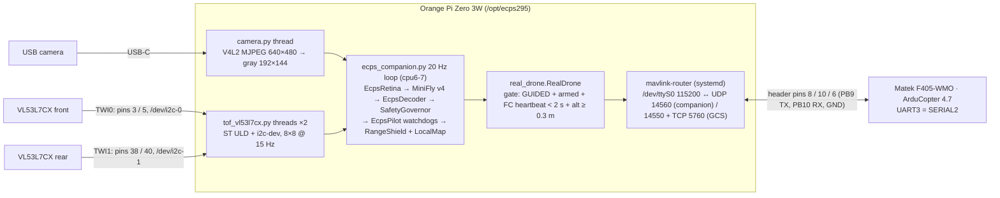
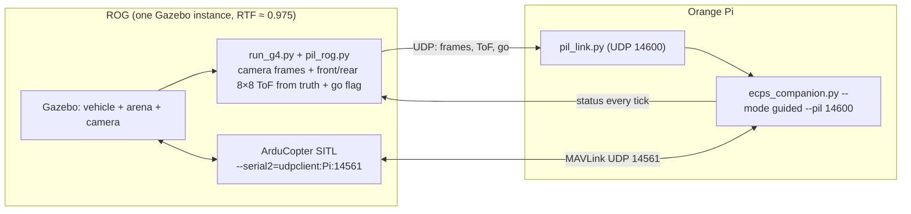

# ECPS295 Orange Pi Zero 3W: onboard deployment and performance test report

> 2026-10-15 · Target: Orange Pi Zero 3W (Allwinner A733: 2 × Cortex-A76 @ 2.0 GHz + 6 × Cortex-A55 @ 1.8 GHz, 6 GB) ·
> Armbian 26.8.3 / Ubuntu 26.04, kernel 6.6.98, Python 3.14.4 · Pi at `root@192.168.86.20`
> Chinese version: [ECPS295_OrangePi部署与性能测试报告_20261015.zh.md](ECPS295_OrangePi部署与性能测试报告_20261015.zh.md) ·
> Deployment package: `course_files_export/deploy/orangepi/` · raw data: `data/` here, figures: `figures/`

## 0. Findings

1. **The final configuration is deployed on the Pi**: MiniFly v4 + C1 with the front + rear VL53L7CX local 3D map shield
   (`minifly/s7_w2map.yaml`). In Gazebo it scored lowbox 0/50 and cage20 0/8, and 1/116 over two brain-seed sets.
   The onboard code is the same tree that passed the Gazebo acceptance on ROG. Only the drone backend is new: camera,
   two ToF sensors, and serial MAVLink through mavlink-router.
2. **The 20 Hz budget holds with margin, provided the loop runs on the A76 cores.**
   - A76 (cpu6-7), default schedutil: compute per tick p50 32.1 ms, p99 37.6 ms, 0 of 2,390 ticks over 50 ms.
   - A76 with the performance governor (2.0 GHz): p50 22.2 ms, p99 25.7 ms, max 30.5 ms. **Only half the budget is
     used**, so the companion service switches the A76 cluster to performance while it runs.
   - Two 15-minute thermal soaks (17,989 ticks each) had one overrun each (schedutil 60 ms; performance 50.4 ms). The CPU stayed at 53–56 °C
     with no throttling.
   - **The A55 cores cannot run it.** The brain step alone is 3.4× slower there, so the full pipeline needs about 75 ms
     per tick. The brain simulates the elapsed wall time, so each overrun makes the next tick longer. The loop settles
     at the 250 ms clamp (99.8 % of ticks over budget).
3. **Numerical equivalence.** I re-ran on the Pi 16 fast-twin episodes that the Mac mini had already run (s7_w2map in
   lowbox, cage20 and empty worlds). Given the same randomisation parameters, **16/16 match field by field**. The
   deployment does not change the model's behaviour.
4. **SITL link test passed** (ArduCopter 4.7.0 SITL and the companion both on the Pi, through mavlink-router):
   - Disarmed: only heartbeat (1 Hz) and route-B height (~15 Hz) are sent, no control.
   - Armed in GUIDED on the ground: no take-over.
   - After take-off: control is taken at 0.35 m; setpoints run at 20.0 Hz with a maximum gap of 50.4 ms.
   - Switching to LOITER: control released within 38 ms. Back to GUIDED: resumed within 35 ms.
   - Companion killed: **the FC switched to LAND after 2.0 s**.
5. **Two companion-side bugs found by the tests and fixed:**
   - The heartbeat and height were sent only from the command path. When a watchdog requested LAND, that path was not
     called, so both stopped.
   - Arming on the ground handed the motors to the brain. Control is now latched only from 0.3 m up.
6. **Two issues that need a parameter or procedure change:**
   - Any live GCS with sysid 255 (Mission Planner) **masks the companion-loss failsafe** (decided 10-16: `MAV_GCS_SYSID_HI 254`).
   - Route-B height latency (corrected 10-16): the 80 ms estimate double-counted; measured ≈ 53 ms at 10 Hz. RANGEFINDER is now requested at 20 Hz, ≈ 30 ms; `VISO_DELAY_MS` 40 recommended (§7.2).

Details are in §6–7; §8 is the bench checklist before the real drone.

## 1. Basis: why this configuration

| Basis | Numbers | Source |
|---|---|---|
| Final hardware | front + rear VL53L7CX 8×8 (TWI0 / TWI1) + local 3D map → RangeShield; front 8 columns → brain LCn | user decision 10-14 22:20; report 7 §8 |
| w2map in Gazebo (ROG, first seed set) | lowbox 0/50 (v4 11/50, p = 0.001), cage20 0/8, coverage +0.023, 5th-percentile clearance 0.092 m | report 7 §8 |
| Second brain-seed set | lowbox 1/50, cage20 0/8; pooled 1/116, one-sided 95 % upper bound 4.0 % | RL checklist 10-15 |
| N3 rounds 2/3 CMA candidates | seed 1 no coverage gain (fail), seed 2 coverage −14.6 % (fail), seed 11 hold-out 0.35 < 0.40 | checklist N3 |
| FC parameters | `EK3_TERR_GRAD 10` + `EK3_RNG_M_NSE 0.1` (tf10): EKF error over boxes −32 % to −38 %, replicated on the second seed set, recommended as FC default | checklist N4 |

**Decision.** Brain: the v4 decoder + C1 from `s7_w2map.yaml`. No N3 candidate passed Gazebo acceptance, so none is
deployed. FC: load `sitl/variants/H_terrain_fast.parm`, `G_extnav_height.parm` and `companion_fs.parm` (the last one
changed as in §7.1). `n3s1/2/3.yaml` are on the Pi for comparison only (select with `--config`).

## 2. Deployment architecture



### 2.1 What was done on the Pi

| Item | Content | Status |
|---|---|---|
| Device tree | `overlays=i2c0 i2c1` in `/boot/armbianEnv.txt` (backup `/root/ecps_backup/armbianEnv.txt.pre_ecps`). After reboot `/dev/i2c-0` = TWI0 (PB2/PB3) and `/dev/i2c-1` = TWI1 (PB7/PB8); pinmux checked; bus clock 400 kHz | ✅ (no devices on the buses yet: sensors not connected) |
| Serial | existing `uart0-pb9-pb10` overlay kept (`/dev/ttyS0`, pins 8/10); `serial-getty@ttyS0` disabled | ✅ (FC not connected) |
| System packages | i2c-tools, meson, ninja-build, libsystemd-dev, pkg-config, build-essential | ✅ |
| Python | `/opt/ecps295/venv` (Python 3.14): numpy 2.4.6, scipy 1.17.1, cma 4.5.0, PyYAML 6.0.3, pymavlink 2.4.50, opencv-python-headless 5.0.0.93, pyserial, smbus2, psutil; numpy / scipy match the simulation machines | ✅ |
| Onboard code | `ecps295/` = ROG `~/sim/rl_h2/ecps295` (S7 `ecps_map.py`, map shield, route B), `src/flydrones` | ✅ |
| Twin code | `twin/` = Mac mini `~/rl_exp/s1b` (SIL, `rl.gates`) | ✅ |
| New in this work | `companion/ecps_companion.py` (runner), `real_drone.py` (real + bench backends), `camera.py`, `tof_vl53l7cx.py` | ✅ |
| ToF driver | ST VL53L7CX ULD (stm32duino/VL53L7CX, BSD-3, unchanged) + new Linux i2c-dev platform layer → `libvl53l7cx.so` (ctypes) | ✅ built and loads; without a sensor it reports "not found" and retries every 2 s |
| MAVLink | mavlink-router (built from upstream source, `/usr/bin/mavlink-routerd`), `/etc/mavlink-router/main.conf`, enabled at boot | ✅ running |
| Service | `ecps-companion.service`: shadow mode by default, pinned to cpu6-7, A76 cluster at performance while running, restarts on failure | ✅ installed, **not enabled at boot** |
| Test tools | `profile_matrix.sh`, `brain_bench.py`, `sil_equiv.py`, `sitl_hil_test.py`, `tof_probe.py` (with `--orient`), `cam_probe.py` | ✅ |
| SITL | ArduCopter 4.7.0 SITL built on the Pi (`build/ap`, 10.5 min on the A55 cores) | ✅ |

The earlier UART test project (`/root/opiRasPiUartTest`, `/root/drone-venv`) was left untouched.

### 2.2 Companion modes and the safety contract

| Mode | Use | Sent to the FC |
|---|---|---|
| `bench` | no FC: bench tests and profiling (`BenchDrone`, fixed 0.8 m hover telemetry) | nothing |
| `shadow` (service default) | FC connected, runs alongside: brain and safety layer compute, results are only logged | heartbeat 1 Hz (sysid 254), route-B height 20 Hz |
| `guided` | after the ground tests | as shadow, plus velocity setpoints at 20 Hz and watchdog LAND, **only while the gate is open** |

The gate (`RealDrone.in_control`) opens only when all of these hold:

- the process was started with `--mode guided`;
- the FC's **own** heartbeat (read by sysid 1, so no other node can spoof it) reports GUIDED and armed, and is
  younger than 2 s;
- **at take-over**, the FC altitude is ≥ 0.3 m. This is latched: control is kept until the FC leaves GUIDED or disarms.

The companion never arms, takes off or changes mode. The one exception: while it is in control, a watchdog can
request LAND. Moving the mode switch out of GUIDED takes control back at once. While the companion is not in control,
the watchdog land request and the flight timer are reset every tick and start again at take-over.

## 3. Test methods

| Test | Method | Question answered |
|---|---|---|
| A. Timing matrix P1–P9 | `bench` mode with simulated sensors and the full s7_w2map pipeline, stage timers every tick; 120 s per run, 900 s for the soaks. Camera: pre-encoded MJPEG of a textured wall that looms, recedes and pans, decoded live at 30 fps. ToF: front + rear at 15 Hz, wall moving 0.4–2.5 m | is 20 Hz feasible; which cores; governor and background-load effects; thermals |
| B. Brain micro-benchmark | `brain_bench.py`: the brain alone, 50 ms per tick, fixed inputs; cProfile | where the brain time goes; A55 vs A76 |
| C. SIL equivalence | `sil_equiv.py`: re-run on the Pi the s7_w2map episodes from the Mac mini's `rl/out/s6.jsonl` (lowbox 10, cage20 4, empty 2) and compare every field | does the deployed model behave exactly as in simulation |
| D. SITL link | `sitl_hil_test.py`: on the Pi, ArduCopter SITL (cpu0-3), a second mavlink-router (cpu4) and the companion in `--mode guided` (cpu6-7, simulated camera / ToF); the test plays pilot / GCS | do the MAVLink link, gate, hand-over and failsafes work as designed |
| E. Service | `systemctl start ecps-companion` without an FC | start-up, governor switching, waiting for the FC, restart |

**Not tested yet:** the real camera, the real VL53L7CX sensors and the real FC UART link. None of these are wired to
the Pi yet; §8 lists the bench steps and tools. The simulated camera and ToF scenes are synthetic: the brain's outputs
in them say nothing about real behaviour, they only create a realistic compute load.

## 4. Timing results

### 4.1 Timing matrix

| Run | Setting | Ticks | Overruns (> 50 ms) | compute p50 | p95 | p99 | max | period p99 | max CPU °C |
|---|---|---|---|---|---|---|---|---|---|
| P1 | A76 ×2 (cpu6-7), schedutil | 2390 | 0 | 32.1 | 36.2 | 37.6 | 39.5 | 50.5 | 55.3 |
| P2 | A55 ×6 (cpu0-5), schedutil | 445 | **444 (99.8 %)** | 265.4 | 272.8 | 304.9 | 317.9 | 307.5 | 57.0 |
| P3 | no pinning, schedutil | 2388 | 0 | 34.9 | 38.0 | 39.7 | 46.8 | 50.2 | 57.4 |
| P4 | one A55 (cpu0) | 321 | **320** | 363.2 | 375.0 | 452.7 | 483.6 | 453.4 | 56.4 |
| **P5** | **A76 ×2, performance** | 2390 | **0** | **22.2** | **24.8** | **25.7** | **30.5** | 50.2 | 58.7 |
| P6 | A76 ×2, all six A55 cores busy | 2390 | 0 | 32.1 | 35.5 | 36.8 | 41.8 | 50.3 | 62.4 |
| P7 | no pinning, six A55 cores busy | 2390 | 0 | 30.5 | 35.2 | 37.0 | 39.4 | 50.4 | 62.2 |
| P8 | A76 ×2, schedutil, 15 min soak | 17,989 | 1 (60.0 ms) | 31.7 | 35.7 | 37.1 | 60.0 | 50.5 | 55.9 |
| P9 | A76 ×2, performance, 15 min soak | 17,989 | 1 (50.4 ms) | 23.1 | 25.6 | 26.4 | 50.4 | 50.2 | 56.5 |

All times in ms. "Compute" is the whole `EcpsPilot.tick`: frame, retina, encoder, brain, decoder, governor,
watchdogs, map, shield and send. "Period" is the time between two ticks (target 50 ms).


### 4.2 Per-stage times (ms, p50 / p95 / p99)

| Stage | P1 A76 schedutil | P5 A76 performance | P2 A55 |
|---|---|---|---|
| Retina (EcpsRetina) | 4.77 / 6.52 / 6.68 | 3.46 / 4.24 / 4.93 | 9.21 / 10.35 / 10.88 |
| Input encoder | 0.36 / 0.51 / 0.51 | 0.26 / 0.28 / 0.30 | 0.83 / 0.90 / 0.93 |
| **Brain, MiniFly v4 (LIF)** | **20.35 / 22.65 / 23.87** | **13.98 / 14.52 / 14.85** | 239.56 / 247.45 / 275.13 † |
| Decoder | 0.11 / 0.12 / 0.14 | 0.09 / 0.10 / 0.11 | 0.18 / 0.21 / 0.24 |
| SafetyGovernor | 0.03 / 0.04 / 0.05 | 0.03 / 0.03 / 0.03 | 0.05 / 0.05 / 0.07 |
| **Local 3D map (incl. integration)** | 5.48 / 8.20 / 8.84 | 3.90 / 6.04 / 6.43 | 12.49 / 16.85 / 17.65 |
| Safety layer total (map + RangeShield) | 5.58 / 8.31 / 8.94 | 3.98 / 6.14 / 6.52 | 12.61 / 16.95 / 17.82 |
| Frame / telemetry / send | < 0.02 | < 0.02 | < 0.02 |

† On the A55 cores the brain is in the runaway state: it simulates 250 ms of neural time per tick, not 50 ms (§4.3).

Other measurements:

- Camera decode + gray + resize runs on its own thread, off the main loop: p50 5.16 ms (schedutil) / 3.39 ms
  (performance).
- Frame age when the loop takes a frame: p50 17.5–20.4 ms, p95 32–34 ms.
- ToF frame age: p50 about 40 ms (15 Hz sensor).
- Peak RSS 95 MB (of 5.7 GB).
- Launch to first tick: about 3.4 s (imports about 0.6 s, connectome load, brain warm-up).

### 4.3 Why the loop must stay on the A76 cores

`brain_bench.py` (50 ms per tick, fixed inputs, one core): A76 (cpu6) p50 **14.5 ms**, A55 (cpu0) p50 **49.3 ms**,
3.4× slower. cProfile shows each tick is 100 LIF sub-steps (dt = 0.5 ms) on only 982 neurons and 6,115 synapses.
Each sub-step takes about 0.2 ms, almost all of it per-call Python / numpy overhead with very little arithmetic. That
kind of overhead hurts most on the in-order A55.

On the A55 cores the whole pipeline takes about 49 + 9 + 12 + … ≈ 75 ms, more than 50 ms. **The brain simulates the
elapsed wall time each tick** (`dt` from the wall clock, clamped at 0.25 s, as in simulation). So once a tick overruns:

- the next tick has more neural time to simulate, and the brain cost grows with it;
- the loop settles at about 265 ms per tick (P2): under 4 Hz instead of 20 Hz.

On the A76 cores with the performance governor the margin is 2×. The single overruns in P8 / P9 (60 ms / 50.4 ms) recovered
immediately and did not start this loop. It is still a **positive-feedback failure mode** and should be bounded
(§7.3).

### 4.4 Thermals


- P8 (schedutil, A76 actually at 1.4 GHz): A76 cluster at 53–56 °C over 15 minutes, no throttling, no upward trend
  in compute p99.
- P9 (performance, 2.0 GHz): the A76 cluster held 2002 MHz for all 15 minutes (no throttling) at 52.3–56.5 °C (median 53.8 °C; mean 53.8 °C in the first 2 minutes and 54.1 °C in the last 2, no upward trend); compute p99 26.4 ms, the single overrun was 50.4 ms.

Conditions: room temperature, still air, heat sink fitted. In flight the propeller downwash only helps.

### 4.5 Comparison with the simulation machine

Per-tick compute for the same configuration on ROG (Ryzen 9 5900HX, while running 3 Gazebo instances; g7_w2map, 116
runs, 277,936 ticks):

| Machine | p50 | p95 | p99 | max |
|---|---|---|---|---|
| ROG (Gazebo acceptance) | 11.6 | 15.1 | 15.7 | 54.5 |
| Orange Pi A76, performance | 22.2 | 24.8 | 25.7 | 30.5 |
| Orange Pi A76, schedutil | 32.1 | 36.2 | 37.6 | 39.5 |

The Pi with the performance governor is about 1.9× slower, but both finish every tick inside 50 ms, so the control
rate is the same.

All Gazebo results so far were obtained with the brain ticked every 50 ms of wall time (see the Gazebo pacing issue,
10-15). On the Pi every tick is on time (period p99 50.2–50.5 ms), which matches those simulation conditions.

## 5. SIL numerical equivalence

| Item | Result |
|---|---|
| Episodes | s7_w2map: lowbox 10 (worlds 0–3, brain seeds k / k+100 / k+200), cage20 4, empty 2; 120 s / 60 s each |
| Field-by-field vs the Mac mini reference (`s6.jsonl`, 10-14) | **16/16 identical**: every field, including contacts, near misses, minimum clearance, path length, coverage, the escape timetable, shield counters and map frames |
| Speed | one 120 s episode takes about 100–130 s of wall time on one A76 core (the twin runs at about 1× real time) |
| Side finding | Each episode's randomisation parameters come from `rl.twin.flow_dr()`. Its `np.exp(np.log(...))` gives a different last bit on the Pi (aarch64 / glibc / numpy NEON kernels) than on the Mac mini in 6/16 episodes. **So a full CMA run on the Pi would not be bit-identical to the other machines.** Comparisons should feed the reference episodes' parameters, as done here. Flight code is not affected. |

Conclusion: the retina, brain, decoder, watchdogs, map and shield on the Pi compute bit for bit what the
simulation-accepted code computes.

## 6. SITL link test (ArduCopter 4.7.0 SITL + mavlink-router + companion, all on the Pi)

FC parameters: SITL default copter parameters + `companion_fs.parm` + `G_extnav_height.parm` + SITL downward
rangefinder (`RNGFND1_TYPE 100`) + `GUID_TIMEOUT 1`. The companion ran in `--mode guided` with simulated camera / ToF.

| Phase | Criterion | Result |
|---|---|---|
| T1 disarmed | no take-over; heartbeat ≥ 0.8 Hz; route-B height ≥ 10 Hz | ✅ 0 control ticks; heartbeat 1.0 Hz; VISION_POSITION_ESTIMATE 15.0 Hz |
| T2 armed in GUIDED on the ground | no take-over | ✅ 0 control ticks (latch works) |
| T3 GCS take-off to 0.8 m | take-over once airborne; setpoints > 18 Hz | ✅ take-over 1.87 s after the take-off command, at 0.35 m. Setpoints **20.0 Hz**, max gap 50.4 ms. The FC echoed non-zero velocity targets 97 times (stream requested at 10 Hz) |
| T4 GCS switches to LOITER (stick centred) | released within 200 ms | ✅ released **38.4 ms** after the FC heartbeat showed LOITER; 0 control ticks afterwards |
| T5 back to GUIDED (airborne) | resumed within 300 ms | ✅ resumed within **34.9 ms**; 18.3 Hz including the resume second |
| T6 companion SIGKILL (a hung Pi), GCS silent | LAND within 1.5–4 s | ✅ FC "GCS Failsafe" → LAND after **2.0 s**; touchdown at 0.5 m/s |
| T6′ same, but a sysid-255 GCS still sending | — | ❌ **no LAND within 10 s**; stays in GUIDED and hovers (only GUID_TIMEOUT stops it). See §7.1 |
| T6″ flight setting `MAV_GCS_SYSID_HI 254` (`config/fc_flight.parm`), sysid-255 GCS still sending heartbeats and RC overrides (re-test 10-16) | LAND within 1.5–4 s | ✅ "GCS Failsafe" → LAND after **2.02 s**; T1–T5 all passed again (take-over at 0.31 m, 20.0 Hz, release 13.9 ms, resume 39.0 ms) |

The route-B height was sent normally over 0–1.21 m (SITL rangefinder → VentralCue → VISION_POSITION_ESTIMATE).

**Two problems the tests exposed, both fixed.** Both were in the new backend, not in the simulation code.

1. **Heartbeat and height stopped.** At first the heartbeat and route-B height were sent only from `send()`. While
   the companion was not in control, the height watchdog requested LAND, so the pilot called `land()` instead of
   `send()`. Neither went out any more, and the height stayed stale: a deadlock. The FC therefore refused to arm
   ("GCS failsafe on", "VisOdom: not healthy"). Both are now sent from `telemetry()`, which runs every tick. This
   never showed in Gazebo because `run_g4.py` calls `send()` throughout the take-off.
2. **Take-over on the ground.** The first gate checked only GUIDED + armed. In SITL, after the GCS armed on the
   ground, the companion took control at once; its setpoints overrode the take-off command and the FC then disarmed.
   On the real drone the brain could lift the drone off by itself. Control is now latched only from ≥ 0.3 m
   (`mavlink.handover_alt_m`).

## 7. Recommendations for FC parameters, procedures and code

### 7.1 A GCS masks the companion-loss failsafe (parameter or procedure change needed)

`companion_fs.parm` sets `MAV_GCS_SYSID 254` and `MAV_GCS_SYSID_HI 255`, so both 254 and 255 count as the GCS. T6′
shows that while any sysid-255 node keeps sending, the FC considers the GCS alive and **does not land when the
companion dies**. Mission Planner uses sysid 255 by default, so this happens whenever it is connected through the
ESP32 or mavlink-router.

**Decided (2026-10-16): `MAV_GCS_SYSID_HI 254` in flight**, so only the companion counts as the GCS. The pilot flies
with the RC transmitter and needs no RC override. Mission Planner can still show telemetry, change parameters and switch
modes; its RC overrides are ignored and its heartbeats no longer hold off FS_GCS. Parameter file:
`deploy/orangepi/config/fc_flight.parm` (Pi: `/opt/ecps295/config/fc_flight.parm`). The simulation file
`sitl/variants/companion_fs.parm` keeps HI 255, because SITL and Gazebo take off with sysid-255 RC overrides.

SITL re-test T6″ (`FLIGHT_GCS=1`): with Mission-Planner-style sysid-255 heartbeats and RC overrides still arriving, the
FC landed 2.02 s after the companion was killed.

Before the real drone, test on the ground with props off: armed in GUIDED, `kill -9` the companion, confirm LAND after
2 s.

### 7.2 Route-B latency: `VISO_DELAY_MS` (changed to 20 Hz and measured on 10-16)

The height the companion sends comes from the FC's latest RANGEFINDER message. The simulation code
(`mavlink_twin.py`) requests it at 10 Hz; the companion backend (`real_drone.py`) now requests 20 Hz on its own
(`companion.yaml` → `mavlink.rangefinder_hz`). The simulation code is unchanged.

The 10-15 report added up the contributions to about 80 ms, but it counted the same interval twice: "waiting inside the
20 Hz send interval" and "average age of the data" are one and the same, because each tick sends from the latest
RANGEFINDER. On 10-16 the interval from a RANGEFINDER arriving to the VISION_POSITION_ESTIMATE built from it was
measured directly in the Pi SITL (both pass the same mavlink-router; `sitl_hil_test.py`, `RNG_HZ=10` as the baseline):

| RANGEFINDER rate | Measured rate | Data age mean / p50 / p95 / max | SITL T1–T6 |
|---|---|---|---|
| 10 Hz (old) | 10.0 Hz | 47.1 / 44.0 / 91.2 / 104.0 ms | all pass |
| **20 Hz (now)** | 20.0 Hz | **24.4 / 25.4 / 46.5 / 74.2 ms** | all pass (release 39.5 ms, resume 18.3 ms, LAND 2.16 s after the kill) |

Adding the two UART hops at 115200 baud (RANGEFINDER ≈ 2 ms, VISION_POSITION_ESTIMATE ≈ 4 ms), the delay from the FC
emitting a range to receiving the height is ≈ 53 ms at 10 Hz and **≈ 30 ms at 20 Hz**, with half the jitter. The
rangefinder's own measurement and driver delay comes on top; it depends on the real downward rangefinder (typically
10–30 ms) and SITL cannot measure it.

Recommendation: at 20 Hz start with `VISO_DELAY_MS` **40** (30 ms + about 10 ms for the sensor), then check it against
the `VISP` vs `RFND` timing in the FC log after the bench or first flight. If the real rangefinder updates slower than
20 Hz, the 20 Hz request cannot lower the delay further; set the measured value. The old 50 ms actually matched 10 Hz
fairly well (≈ 53 ms + sensor delay), which is the combination Gazebo accepted.

### 7.3 Pre-flight fixes (done 10-16, all in the companion layer; simulation code unchanged)

| Problem | Fix | Verification (Pi SITL / measured) |
|---|---|---|
| **No ToF watchdog**: an uninitialised sensor gave `ranges()` = 2.0 m (= clear) and no map input; a hung I²C bus kept the last frame forever | Guard in `real_drone.py`: (1) control is taken only while the camera and every ToF delivered within 0.3 s, otherwise the hand-over is refused and a STATUSTEXT sent; (2) in flight, any ToF older than 0.3 s → hover; still bad after 2 s → LAND. Thresholds under `guard:` in `companion.yaml` | `SCENARIO=tof_boot`: front ToF frozen from the start, 0 control ticks, Mission Planner shows "ECPS: not taking control: ToF front stale"; `SCENARIO=tof_flight`: front ToF frozen in the air, hover after 0.32 s, **LAND after 2.41 s** |
| **Service would not stop**: without a camera `frame()` waited 5 s per call and the warm-up calls it dozens of times; `connect()` ignored the stop flag | `frame()` no longer waits (None before the first frame; the camera watchdog hovers / refuses the hand-over); `connect()` waits for the FC indefinitely but checks the stop flag every 0.5 s and exits 0 on a requested stop; shutdown signals all sensor threads before joining; `TimeoutStopSec=10` | No FC, camera or ToF: SIGTERM exits in 0.38 s; in the bench loop 0.23 s; `systemctl stop` **0.34 s, Result=success**, governor back to schedutil |
| **Time limit landed in place** (once on a box edge in PIL) | The flight timer moved to the guard: after `max_flight_s` under our control, **hover in place** and send "ECPS: time limit, hovering - take over" every 5 s; the pilot lands from LOITER. Battery-low and the other LANDs are unchanged. The timer restarts at each hand-over | `SCENARIO=time_hold` (5 s limit): hover **5.0 s** after the take-over, no LAND during T3, 3 messages received; then LOITER release 39 ms, GUIDED resume 15 ms |
| **Brain dt positive feedback** (§4.3) | Simulated time per tick capped at 2 × DT = 0.1 s instead of 0.25 s; `run.json` counts clamped ticks | The 116 s7_w2map Gazebo acceptance runs on ROG had a maximum tick gap of 55.5 ms, never above 100 ms, so the cap changes none of them; the fast twin uses a fixed dt |

Normal-scenario regression (`FLIGHT_GCS=1`): take-over at 0.41 m, 20.0 Hz, LOITER release 17.7 ms, resume 31.3 ms, LAND
1.71 s after the kill; all pass. Bench smoke test (sim camera + sim ToF, 20 s): 0 overruns, p50 31.7 ms (schedutil).

Not done and not needed before flight: cheaper brain steps (vectorised sub-steps / numba; A76 + performance already has
2× headroom); I²C at 1 MHz (decide after the bench).

**FC UART bandwidth**: the streams the companion requests are ≈ 2.9 kB/s (FC → Pi); setpoints, route-B height and
heartbeat ≈ 2.2 kB/s (Pi → FC). 115200 baud is ≈ 11.5 kB/s, so about 25 % per direction. The risk is Mission Planner
connecting through the Pi's port 14550: it requests its own set of streams on the same UART. In flight, connect
Mission Planner through the ESP32 instead; at bench step 8 check `SR2_*` and the mavlink-router statistics, and if
usage exceeds 60 %, change `SERIAL2_BAUD` and `/etc/mavlink-router/main.conf` to 921600 together.

### 7.4 Recommended flight configuration

- Companion: `ecps-companion.service` (A76 cluster at performance, pinned to cpu6-7, `Nice -10`), model
  `s7_w2map.yaml`, cruise 0.5 m/s.
- FC:
  - `fhb_delta.parm` + `G_extnav_height.parm` + `H_terrain_fast.parm`;
  - `fc_flight.parm` (`MAV_GCS_SYSID 254`, `MAV_GCS_SYSID_HI 254`, `FS_GCS_ENABLE 5`, `FS_GCS_TIMEOUT 2`), §7.1;
  - `SERIAL2_BAUD 115`, matching mavlink-router's 115200;
  - `VISO_DELAY_MS 40` (companion RANGEFINDER at 20 Hz); tune from `VISP` / `RFND` (§7.2).

## 8. Bench checklist before the real drone (in order)

| # | Step | Tool / command | Pass criterion |
|---|---|---|---|
| 1 | Wire the two VL53L7CX to TWI0 (pins 3/5) and TWI1 (pins 38/40; **check the pin numbers with a meter first**), VIN 3.3 V; measure the 3.3 V current | `i2cdetect -y -r 0` / `-r 1` | 0x29 once on each bus; 3.3 V rail has margin (about 100 mA each) |
| 2 | Firmware upload and frame rate | `tof_probe.py --sensor front` / `rear` | 15 Hz, 0 errors; record upload time and I²C read time per frame |
| 3 | **Orientation** | `tof_probe.py --sensor front --orient` (hand at the top-left of the view), then set `flip_lr` / `flip_ud` in `companion.yaml` as prompted | top-left = row 0, column 0 |
| 4 | **Distance definition** (radial vs perpendicular) | flat wall square-on at 0.5 m; compare edge and centre zones | edge ≈ 0.5 / cos(angle) → `radial`; ≈ 0.5 → `perpendicular` |
| 5 | Detection | cage net, black box, white wall at 0.2 / 0.5 / 1.0 m; box tops 1–15 cm below the sensor; check whether edge zones see the props | compare with the model assumptions of report 7 |
| 6 | Camera | `cam_probe.py`: formats, fps, decode time; lock exposure; 12° nose-down mount; LED + high-speed video for camera latency | ≥ 30 fps; record end-to-end latency |
| 7 | Full bench pipeline | `ecps_companion.py --mode bench --affinity 6,7` (real camera + ToF) | 0 overruns; `tof_f_min` follows a hand in front and `cmd_forward` is limited |
| 8 | Connect the FC (**props off**) | FC `SERIAL2_PROTOCOL 2`, `SERIAL2_BAUD 115`; `systemctl start ecps-companion` (shadow) | correct `fc_mode` in the log; `VISION_POSITION_ESTIMATE` at about 20 Hz in Mission Planner; EKF uses ExtNav height |
| 9 | Failsafe ground test (**props off**) | parameters as in §7.1; armed in GUIDED, `kill -9` the companion; then unplug one ToF | `kill -9`: LAND after 2 s; ToF unplugged: `[guard]` hover, LAND after 2 s; with a ToF missing, no take-over even above 0.3 m |
| 10 | Switch to guided, cage flights | `systemctl edit ecps-companion` → `ECPS_MODE=guided`; FLIGHT_TEST_PLAN R0–R6 | pilot takes off in LOITER and switches to GUIDED above 0.3 m; switching back to LOITER takes control back at any time |

## 9. Reproduction

```sh
# on the Pi
R=/opt/ecps295; PY=$R/venv/bin/python
bash $R/scripts/profile_matrix.sh                                   # P1–P8 (about 35 min)
taskset -c 6 $PY $R/scripts/brain_bench.py --profile               # brain micro-benchmark
cd $R/twin/ecps295 && PYTHONPATH=../src:. taskset -c 6,7 $PY sil_equiv.py ../ref_s7w2map.jsonl /tmp/sil.jsonl --procs 2
$PY $R/scripts/sitl_hil_test.py                                     # SITL link (about 2.5 min); GCS_ALIVE=1 reproduces T6′; FLIGHT_GCS=1 checks T6″; RNG_HZ=10 = latency baseline; SCENARIO=tof_boot / tof_flight / time_hold check the guard
# on the Mac: tables and figures
python3 deploy/orangepi/scripts/analyze_profile.py 项目文档/07_机载部署/data 项目文档/07_机载部署/figures
```

Data: `data/*_bench_P*` (`ticks.csv` / `system.csv` / `run.json` per run) and `data/sitl/` (`sitl_hil_pass.json`,
`sitl_hil_gcs_alive.json`, `sitl_hil_flight_gcs.json`, `sitl_hil_rng10.json`, `sitl_hil_rng20.json`, `sitl_guard_*.json`, companion logs of the three SITL runs, `sil_equiv.jsonl`).

## 10. Programs running on the Pi and what they do (updated 2026-10-16)

### 10.1 Resident services

| Program / service | At boot | Role | Resources / ports |
|---|---|---|---|
| `mavlink-router.service` (`/usr/bin/mavlink-routerd`) | ✅ | MAVLink switch: FC UART `/dev/ttyS0` (115200, pins 8/10) ↔ UDP 14560 (companion), UDP 14550 and TCP 5760 (Mission Planner). Idle while no FC is wired | CPU ≈ 0, RSS 3.5 MB |
| `ecps-companion.service` | ❌ (installed, not enabled) | the flight program (`companion/ecps_companion.py`), shadow mode by default, pinned to cpu6-7, A76 performance governor while running. Starts and stops cleanly since the 10-16 fix (`systemctl stop` 0.34 s, Result=success) | — |
| `netbird.service` | ✅ | NetBird remote access (added 10-16), 100.112.163.133; ssh management only, realtime data stays on the LAN | RSS 65 MB, UDP 51820 |
| `ssh.service` | ✅ | remote login (Mac key, root / ming) | TCP 22 |
| `systemd-networkd` + `wpa_supplicant` | ✅ | WiFi 5317 (netplan), LAN address 192.168.86.20 | — |
| `systemd-resolved` / `timesyncd` / `journald` / `rsyslog` / `cron` / `logind` / `udevd` | ✅ | base system | — |
| `aic8800-bluetooth` + `bluetoothd` (`hciattach /dev/ttyS1`) | ✅ | on-board Bluetooth, not used by the project | can be disabled before flight |

### 10.2 Inside `ecps_companion.py`

| Thread | Where | Role |
|---|---|---|
| main loop, 20 Hz | cpu6-7 (A76), p50 22 ms per tick | latest frame → `EcpsRetina` (visual features, ventral cue) → MiniFly v4 brain (982-neuron LIF network) → `EcpsDecoder` (descending neurons → flight command, escape state machine) → `SafetyGovernor` (altitude, fence, speed, flight timer) → `EcpsPilot` watchdogs → local 3D map + RangeShield → MAVLink velocity setpoint (only while the control gate is open) |
| telemetry (in the main loop) | same | reads the FC each tick; heartbeat (sysid 254, 1 Hz) and route-B height (`VISION_POSITION_ESTIMATE`, 20 Hz); re-requests the streams every 5 s; sends no height from a range / baro reading older than 0.5 s (fixed 10-16, see 10.4) |
| **local 3D mapping** (`ecps_map.LocalMap`, inside the safety layer of the main loop) | cpu6-7, p50 3.9 ms / p99 6.4 ms per tick (performance; schedutil 5.5 / 8.8 ms) | every new 8×8 frame of the front / rear VL53L7CX writes its rays into a 5 cm voxel occupancy map at the EKF pose; the nearest obstacle per direction within ±10 cm of flight height becomes a 360° virtual range ring for the RangeShield. Details below |
| camera thread | same process | V4L2 MJPEG 640×480 decode → gray 192×144 |
| ToF threads ×2 | same process | front and rear VL53L7CX (TWI0 / TWI1), 8×8 @ 15 Hz |
| PIL receive thread (`--pil` only) | same process | replaces the camera and ToF threads with the Gazebo frames and ToF readings sent by ROG, see 10.3 |

**What the mapping on the Pi does** (`ecps295/ecps_map.py`, config `struct.shield.map` in `minifly/s7_w2map.yaml`):

- Map: a fixed 8 m × 8 m × 1.6 m grid around the take-off point, 5 cm voxels (160 × 160 × 32 ≈ 0.82 M, float32 ≈ 3.3 MB) of log-odds, in the flight controller's optical-flow EKF frame (yaw only; the sensors are mounted level).
- Update: 64 rays per frame per sensor; voxels a ray crosses become free, its end voxel occupied; no echo marks free space up to 3.5 m; returns below the floor threshold are the floor. Two sensors at 15 Hz.
- Forgetting: every voxel decays toward unknown with a 10 s time constant, so misplacement from EKF drift fades instead of piling up (no SLAM / drift correction yet).
- Query: each tick, occupied voxels within ±10 cm of flight height and the query radius, nearest per body-frame sector, go to the RangeShield as virtual ranges. Obstacles seen beside or behind the drone keep bounding its motion after it turns; low box tops below the airframe are passable.
- Why on the Pi: it is part of the only configuration with lowbox 0/50 and cage20 0/8 in Gazebo (w2map); the two 8×8 boards without the map gave 3/50.
- Cost: about 8–13 % of the 50 ms budget with per-frame ray sampling in Python; there is headroom for a doubled ToF rate or 1 MHz I²C.

Each run writes `logs/<stamp>_<mode>/`: `ticks.csv` (per-stage timing, commands, DN rates per tick), `system.csv` (1 Hz temperatures, clocks, load), `run.json` (summary).

### 10.3 Gazebo processor-in-the-loop (PIL, 10-16)

Purpose: the Gazebo world, vehicle physics and SITL flight controller run on ROG; the brain, safety layer and MAVLink backend are the real companion program on the Pi, so the Pi's compute, link, hand-over and protections are tested in full closed-loop flights.



- Every flow is started from ROG (its firewall is on), over the home LAN, not NetBird.
- The Pi takes control only while ROG sets go (patrol phase) and the last control datagram is < 0.5 s old; it exits when go drops. ROG's `run_g4.py` still takes off and lands, and scores on Gazebo truth exactly like the local runs.
- Smoke test (lowbox_s0, 30 s): the Pi flew the whole patrol, tick p50 21.7 ms / p99 26.6 ms, 0 overruns; 0 contacts; network round trip p50 7 ms, p99 99 ms, max 411 ms.
- 24 runs paired with the sim-paced Gazebo baseline g7_sc2_tf10 (lowbox_s0–19 + cage20 × 4), two batches: pil2 (raw frames) and pil3 (JPEG frames, 10-16 18:50–20:08).
  - **Runs with a healthy link** (the Pi in control ≥ 78 % of ticks, network round trip p99 < 200 ms): 11 in pil2 and 14 in pil3. All 25 had **0 contacts and 0 near misses**.
  - Paired against the local Gazebo runs, coverage, path, minimum clearance and time over boxes show **no significant difference**. pil3 coverage was −0.034 (p = 0.51) and pil2 +0.066 (p = 0.04); the two batches point in opposite directions, so this is noise.
  - Pi tick time: p50 24.4 / p99 27.5 ms (median over runs); the worst run had p99 28.3 ms and max 33.6 ms, **never above the 50 ms tick**.
  - **Conclusion**: the same brain flown closed-loop on the Pi behaves like the local ROG runs, and the Pi has enough compute.
  - JPEG frames average 5.7 kB, about 1/5 of a raw frame (27.6 kB).
  - **Runs with a degraded link**: lowbox_s0–s6 and s9 in pil3 had round trips up to 6–15 s; in 4 of them the Pi lost control and the FC failsafe landed. These runs clustered in 18:50–19:15 and the link was mostly healthy after that. So the home WiFi congests intermittently, and lower traffic only mitigates it.
  - These runs count only as failsafe tests and are **excluded from the behaviour comparison**.
- Raw data: Mac scratchpad `res/pil2.jsonl` and `res/pil3.jsonl`; ROG `~/sim/runs/pil2__*` and `pil3__*`.
- Usage: PIL section of the deployment README. Orchestration notes: retry the Pi start (its FC heartbeat wait can time out); align the Pi flight timer with ROG's sim-clock mode (`--set safety.max_flight_s=420`).

### 10.4 Issues found by PIL

| Issue | Effect | Status |
|---|---|---|
| Route B sent a stale range: when the stream requests never reached the FC, the Pi kept sending its last cached RANGEFINDER (a 0.005 m ground reading) as the height | the EKF believed the drone was on the floor; it climbed to 2.9 m and the FC landed. Same after an FC reboot on the real drone | ✅ fixed (`real_drone.py`): no height from a range / baro reading older than 0.5 s; streams re-requested every 5 s |
| The flight timer lands in place | one PIL run landed on a box edge (scored as a contact) | ✅ changed 10-16: hover in place and ask the pilot to take over (§7.3) |
| Intermittent WiFi stalls: under PIL traffic the round trip reaches seconds (ping does not show it) | of 44 recorded pil2 + pil3 runs, 19 had a degraded link; 10 were failsafe-landed by the FC, all safely with 0 contacts | JPEG frames cut the traffic 5×, but the stalls remain. Use a wired link (USB Ethernet) or a dedicated 5 GHz AP for PIL. On the real drone the camera and ToF connect directly to the Pi, so this does not apply |
| `ecps-companion.service` does not stop | without a camera SIGTERM timed out and it was SIGKILLed | ✅ fixed 10-16, `systemctl stop` 0.34 s (§7.3) |
