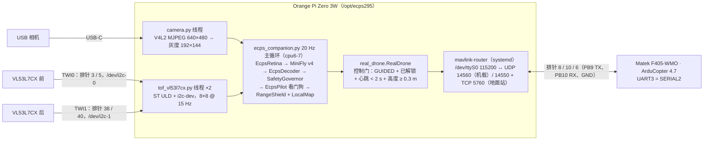
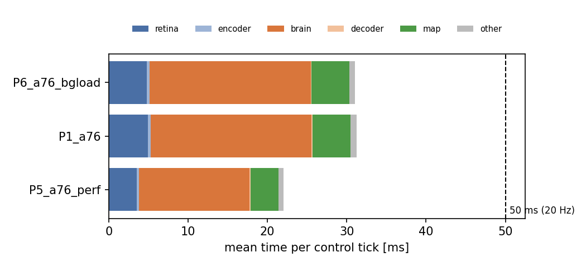
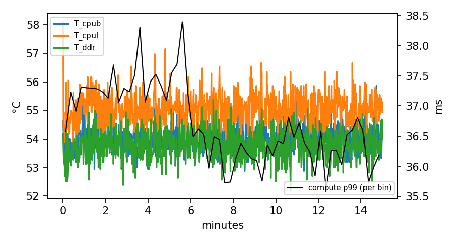
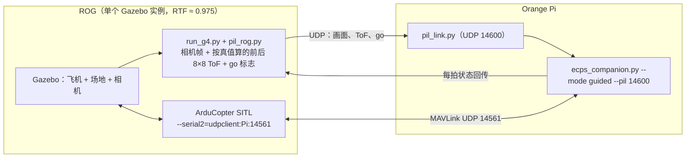

# ECPS295 Orange Pi Zero 3W 机载部署与性能测试报告

> 2026-10-15 · 对象：Orange Pi Zero 3W（Allwinner A733：2 × Cortex-A76 @ 2.0 GHz + 6 × Cortex-A55 @ 1.8 GHz，6 GB）·
> Armbian 26.8.3 / Ubuntu 26.04，内核 6.6.98，Python 3.14.4 · Pi 地址 `root@192.168.86.20`
> 英文版：[ECPS295_OrangePi部署与性能测试报告_20261015.en.md](ECPS295_OrangePi部署与性能测试报告_20261015.en.md) ·
> 部署包：`course_files_export/deploy/orangepi/` · 原始数据：本目录 `data/`，图：`figures/`

## 0. 结论

1. **最终构型已经部署到 Pi**：MiniFly v4 + C1 + 前后两块 VL53L7CX 的局部 3D 地图安全层（`minifly/s7_w2map.yaml`，Gazebo
   lowbox 0/50、cage20 0/8，两组大脑种子合计 1/116）。机载代码与 ROG 上做 Gazebo 验收的代码是同一份，只换了真机后端
   （相机、两块 ToF、经 mavlink-router 的串口 MAVLink）。
2. **20 Hz 实时预算满足，且余量足够——前提是跑在 A76 大核上**。
   - A76（cpu6-7）、默认 schedutil 调频：每拍计算 p50 32.1 ms、p99 37.6 ms，2390 拍 0 次超 50 ms。
   - A76 + performance 调频（大核锁 2.0 GHz）：p50 22.2 ms、p99 25.7 ms，最长 30.5 ms，**预算只用了一半**。
     机载服务因此在运行期间把大核设为 performance。
   - 两次 15 分钟热浸泡（各 17,989 拍）各只超时 1 次（schedutil 60 ms；performance 50.4 ms）；CPU 温度稳定在 53–56 °C，无降频。
   - **A55 小核不可用**：大脑单步慢 3.4 倍，整条流水线约 75 ms > 50 ms。因为大脑按实际经过的时间仿真，一旦超时，
     下一拍要算的时间更长，越拖越慢，最后卡在 250 ms 上限（99.8 % 超时）。
3. **数值等价**：Pi 上重跑 Mac mini 已有的 16 个快仿真回合（s7_w2map，lowbox / cage20 / 空场），给定同样的随机化参数时
   **16/16 逐字段完全一致**。部署没有改变模型行为。
4. **SITL 链路测试全部通过**（ArduCopter 4.7.0 SITL 与机载程序同在 Pi 上，经 mavlink-router）：
   - 未解锁：只发心跳 1 Hz 和路线 B 高度约 15 Hz，不发控制。
   - 在地面以 GUIDED 解锁时不接管。
   - 起飞后在 0.35 m 处接管，此后速度指令 20.0 Hz，最大间隔 50.4 ms。
   - 切 LOITER 后 38 ms 内交还控制，切回 GUIDED 后 35 ms 恢复。
   - 机载程序被杀后，**飞控在 2.0 s 后进入 LAND**。
5. **测试中发现并已修复两个机载侧问题**：
   - 心跳 / 高度原来挂在发送指令的路径上。看门狗要求降落时，这条路径不再被调用，结果心跳和高度都断了。
   - 原来地面解锁就会把电机交给大脑。现已改为“到达 0.3 m 才接管”的锁存。
6. **测试中发现两个需要改参数 / 流程的问题**：
   - 只要有 sysid 255 的地面站在线（Mission Planner），**机载程序失联的失控保护就不会触发**。
   - 路线 B 高度延迟（10-16 修正）：原估 80 ms 有重复计算，实测 10 Hz 约 53 ms；已改为 20 Hz 请求，约 30 ms，`VISO_DELAY_MS` 建议 40，见 7.2。

详见第 6、7 节；第 8 节是上真机前的台架清单。

## 1. 依据：为什么部署这套配置

| 依据 | 数字 | 出处 |
|---|---|---|
| 最终硬件 | 前后各一块 VL53L7CX 8×8（TWI0 / TWI1）+ 局部 3D 地图 → RangeShield；前板 8 列读数进大脑 LCn | 用户 10-14 22:20 确认；报告 7 §8 |
| w2map Gazebo（ROG，第一组种子） | lowbox 0/50（v4 11/50，p = 0.001）、cage20 0/8、覆盖率 +0.023、5 % 分位间隙 0.092 m | 报告 7 §8 |
| 第二组大脑种子复验 | lowbox 1/50、cage20 0/8；两组合计 1/116，单侧 95 % 上界 4.0 % | RL 路线清单 10-15 |
| N3 第二 / 三轮 CMA 候选 | 种子 1 覆盖率无提升（未过），种子 2 覆盖率 −14.6 %（未过），种子 11 留出 0.35 < 0.40 | 清单 N3 |
| 飞控参数 | `EK3_TERR_GRAD 10` + `EK3_RNG_M_NSE 0.1`（tf10）：箱子上方 EKF 误差 −32 %～−38 %，第二组种子复验通过，建议定为飞控默认 | 清单 N4 |

**结论**：大脑参数用 v4（`s7_w2map.yaml` 里的 v4 解码器 + C1），N3 候选都没通过 Gazebo 验收，因此不部署。飞控侧建议加载
`sitl/variants/H_terrain_fast.parm`、`G_extnav_height.parm` 和 `companion_fs.parm`（后者按第 7.1 节修改）。
`n3s1/2/3.yaml` 也在 Pi 上，可用 `--config` 切换，只供对照。

## 2. 部署架构



### 2.1 Pi 上做了什么

| 项目 | 内容 | 状态 |
|---|---|---|
| 设备树 | `/boot/armbianEnv.txt` 加 `overlays=i2c0 i2c1`（备份 `/root/ecps_backup/armbianEnv.txt.pre_ecps`）。重启后 `/dev/i2c-0` = TWI0（PB2/PB3），`/dev/i2c-1` = TWI1（PB7/PB8），pinmux 已核对；总线 400 kHz | ✅（两条总线目前扫不到设备：传感器未接） |
| 串口 | 沿用已有的 `uart0-pb9-pb10` overlay（`/dev/ttyS0`，排针 8/10），`serial-getty@ttyS0` 已禁用 | ✅（未接飞控） |
| 系统包 | i2c-tools、meson、ninja-build、libsystemd-dev、pkg-config、build-essential | ✅ |
| Python | `/opt/ecps295/venv`（Python 3.14）：numpy 2.4.6、scipy 1.17.1、cma 4.5.0、PyYAML 6.0.3、pymavlink 2.4.50、opencv-python-headless 5.0.0.93、pyserial、smbus2、psutil；numpy / scipy 与各仿真机同版本 | ✅ |
| 机载代码 | `ecps295/` = ROG `~/sim/rl_h2/ecps295`（含 S7 `ecps_map.py`、地图安全层、route B），`src/flydrones` | ✅ |
| 快仿真代码 | `twin/` = Mac mini `~/rl_exp/s1b`（SIL 与 `rl.gates`） | ✅ |
| 本次新写 | `companion/ecps_companion.py`（主程序）、`real_drone.py`（真机后端 + 台架后端）、`camera.py`、`tof_vl53l7cx.py` | ✅ |
| ToF 驱动 | ST VL53L7CX ULD（stm32duino/VL53L7CX，BSD-3，原样）+ 本次写的 Linux i2c-dev 平台层 → `libvl53l7cx.so`（ctypes） | ✅ 已编译，可加载；无传感器时报 “not found” 并每 2 s 重试 |
| MAVLink | mavlink-router（上游源码编译，`/usr/bin/mavlink-routerd`），`/etc/mavlink-router/main.conf`，开机启动 | ✅ 运行中 |
| 服务 | `ecps-companion.service`：默认 shadow 模式，固定 cpu6-7，运行期间大核 performance，失败自动重启 | ✅ 已安装，**未设开机启动** |
| 测试工具 | `profile_matrix.sh`、`brain_bench.py`、`sil_equiv.py`、`sitl_hil_test.py`、`tof_probe.py`（含 `--orient` 方向标定）、`cam_probe.py` | ✅ |
| SITL | ArduCopter 4.7.0 SITL 在 Pi 上编译（`build/ap`，A55 上 10.5 min） | ✅ |

`/root/opiRasPiUartTest` 和 `/root/drone-venv`（之前的串口测试项目）没有改动。

### 2.2 机载程序的三种模式与安全约定

| 模式 | 用途 | 对飞控发送 |
|---|---|---|
| `bench` | 不接飞控：台架、性能测试（`BenchDrone`，固定 0.8 m 悬停遥测） | 无 |
| `shadow`（服务默认） | 接飞控旁路运行：大脑和安全层照常算，只记录 | 心跳 1 Hz（sysid 254）、路线 B 高度 20 Hz |
| `guided` | 地面测试通过后使用 | 同上；**仅在控制门打开时**再加速度指令 20 Hz、看门狗 LAND |

控制门（`RealDrone.in_control`）要求同时满足：

- 以 `--mode guided` 启动；
- 飞控**自己的**心跳（按 sysid 1 取，不会被别的节点冒充）报告 GUIDED 且已解锁，心跳在 2 s 内；
- **接管时**飞控高度 ≥ 0.3 m（锁存：接管后保持到离开 GUIDED 或上锁）。

机载程序从不解锁、不起飞、不切模式。唯一例外：它在掌控时，看门狗要求降落会发 LAND。飞手把模式开关拨离 GUIDED，
控制权立即收回。程序不在掌控时，看门狗的降落请求和飞行计时会在每拍清零，接管时重新开始。

## 3. 测试方法

| 测试 | 做法 | 回答的问题 |
|---|---|---|
| A. 时序矩阵 P1–P9 | `bench` 模式，模拟相机（预先编码的 MJPEG 纹理墙逼近 / 后退 + 平移，按 30 fps 实时解码）+ 模拟 ToF（前后各 15 Hz，0.4–2.5 m 往返的墙），完整 s7_w2map 流水线，每拍分阶段计时；每组 120 s，热浸泡 900 s | 20 Hz 是否可行；放在哪些核；调频与后台负载的影响；热 |
| B. 大脑微基准 | `brain_bench.py`：只跑大脑，每拍 50 ms，固定输入；cProfile | 大脑耗时的构成，A55 / A76 比 |
| C. SIL 等价性 | `sil_equiv.py`：在 Pi 上重跑 Mac mini `rl/out/s6.jsonl` 里的 s7_w2map 回合（lowbox 10、cage20 4、空场 2），逐字段比较 | 部署后模型行为是否与仿真完全一致 |
| D. SITL 链路 | `sitl_hil_test.py`：Pi 上同时跑 ArduCopter SITL（cpu0-3）、第二个 mavlink-router（cpu4）、机载程序 `--mode guided`（cpu6-7，相机 / ToF 模拟）；测试脚本扮演飞手 / 地面站 | MAVLink 链路、控制门、交接、失控保护是否按设计工作 |
| E. 服务 | 不接飞控时 `systemctl start ecps-companion` | 启动、调频切换、等待飞控、自动重启 |

**没有测到的**：真实相机、真实 VL53L7CX、真实飞控串口（这三样硬件目前没接在 Pi 上）。对应的台架步骤和工具见第 8 节。
模拟相机和 ToF 的输入是人工构造的场景，大脑输出不代表真实场景中的行为，只用来产生真实的计算负载。

## 4. 时序结果

### 4.1 时序矩阵

| 运行 | 设置 | 拍数 | 超时（> 50 ms） | 计算 p50 | p95 | p99 | 最大 | 周期 p99 | 最高 CPU 温度 °C |
|---|---|---|---|---|---|---|---|---|---|
| P1 | A76 ×2（cpu6-7），schedutil | 2390 | 0 | 32.1 | 36.2 | 37.6 | 39.5 | 50.5 | 55.3 |
| P2 | A55 ×6（cpu0-5），schedutil | 445 | **444（99.8 %）** | 265.4 | 272.8 | 304.9 | 317.9 | 307.5 | 57.0 |
| P3 | 不绑核，schedutil | 2388 | 0 | 34.9 | 38.0 | 39.7 | 46.8 | 50.2 | 57.4 |
| P4 | 单个 A55（cpu0） | 321 | **320** | 363.2 | 375.0 | 452.7 | 483.6 | 453.4 | 56.4 |
| **P5** | **A76 ×2，performance** | 2390 | **0** | **22.2** | **24.8** | **25.7** | **30.5** | 50.2 | 58.7 |
| P6 | A76 ×2，6 个 A55 满载 | 2390 | 0 | 32.1 | 35.5 | 36.8 | 41.8 | 50.3 | 62.4 |
| P7 | 不绑核，6 个 A55 满载 | 2390 | 0 | 30.5 | 35.2 | 37.0 | 39.4 | 50.4 | 62.2 |
| P8 | A76 ×2，schedutil，15 min 热浸泡 | 17,989 | 1（60.0 ms） | 31.7 | 35.7 | 37.1 | 60.0 | 50.5 | 55.9 |
| P9 | A76 ×2，performance，15 min 热浸泡 | 17,989 | 1（50.4 ms） | 23.1 | 25.6 | 26.4 | 50.4 | 50.2 | 56.5 |

单位 ms。“计算”指整个 `EcpsPilot.tick`（取帧、视网膜、编码、大脑、解码、调速器、看门狗、地图、安全层、发送），
“周期”指相邻两拍的间隔（目标 50 ms）。



### 4.2 分阶段耗时（ms，p50 / p95 / p99）

| 阶段 | P1 A76 schedutil | P5 A76 performance | P2 A55 |
|---|---|---|---|
| 视网膜 EcpsRetina | 4.77 / 6.52 / 6.68 | 3.46 / 4.24 / 4.93 | 9.21 / 10.35 / 10.88 |
| 输入编码 | 0.36 / 0.51 / 0.51 | 0.26 / 0.28 / 0.30 | 0.83 / 0.90 / 0.93 |
| **大脑 MiniFly v4（LIF）** | **20.35 / 22.65 / 23.87** | **13.98 / 14.52 / 14.85** | 239.56 / 247.45 / 275.13 † |
| 解码器 | 0.11 / 0.12 / 0.14 | 0.09 / 0.10 / 0.11 | 0.18 / 0.21 / 0.24 |
| 调速器 SafetyGovernor | 0.03 / 0.04 / 0.05 | 0.03 / 0.03 / 0.03 | 0.05 / 0.05 / 0.07 |
| **局部 3D 地图（含建图）** | 5.48 / 8.20 / 8.84 | 3.90 / 6.04 / 6.43 | 12.49 / 16.85 / 17.65 |
| 安全层合计（地图 + RangeShield） | 5.58 / 8.31 / 8.94 | 3.98 / 6.14 / 6.52 | 12.61 / 16.95 / 17.82 |
| 取帧 / 遥测 / 发送 | < 0.02 | < 0.02 | < 0.02 |

† A55 上的大脑耗时是“失控”状态下的值：每拍模拟 250 ms 的神经活动，不是 50 ms，见 4.3。

其他测量：

- 相机解码 + 灰度 + 缩放在独立线程上，不占主循环：p50 5.16 ms（schedutil）/ 3.39 ms（performance）。
- 主循环取帧时帧龄 p50 17.5–20.4 ms，p95 32–34 ms。
- ToF 帧龄 p50 约 40 ms（15 Hz 传感器）。
- 进程内存 RSS 最高 95 MB（共 5.7 GB）。
- 从启动到第一拍约 3.4 s：导入约 0.6 s，加载连接组，预热大脑。

### 4.3 为什么必须放在 A76 上

`brain_bench.py`（每拍 50 ms、固定输入，单核）：A76（cpu6）p50 **14.5 ms**，A55（cpu0）p50 **49.3 ms**，慢 3.4 倍。
cProfile：每拍 100 个 LIF 子步（dt = 0.5 ms），网络只有 982 个神经元、6,115 条突触，每个子步约 0.2 ms，几乎全是
Python / numpy 的逐次调用开销，算术量很小。在顺序执行的 A55 上，这类开销尤其吃亏。

整条流水线在 A55 上约 49 + 9 + 12 + … ≈ 75 ms，超过 50 ms。**而大脑每拍模拟的时长等于实际经过的时间**（`dt` 来自墙钟，
上限 0.25 s，与仿真中一样），所以一旦超时：

- 下一拍要模拟的神经活动更长，大脑耗时按比例增加；
- 循环停在约 265 ms 一拍（P2），控制频率从 20 Hz 掉到不到 4 Hz。

A76 上 performance 下的余量是 2 倍，P8 / P9 中个别超时（60 ms / 50.4 ms）之后也立刻恢复，没有形成这种循环。但这是一个
**正反馈失效模式**，应当在第 7.3 节的改进里加以限制。

### 4.4 热



- P8（schedutil，大核实际 1.4 GHz）：15 分钟里 CPU 大核 53–56 °C，无降频，计算 p99 没有上升趋势。
- P9（performance，2.0 GHz）：15 分钟里大核一直在 2002 MHz（未降频），温度 52.3–56.5 °C（中位 53.8 °C，前 2 分钟平均 53.8、最后 2 分钟 54.1，没有上升趋势）；计算 p99 26.4 ms，唯一一次超时为 50.4 ms。

测试在室温、静止空气、装散热片的条件下进行；飞行中有桨风，条件只会更好。

### 4.5 与仿真机的对比

ROG（Ryzen 9 5900HX，同时跑 3 个 Gazebo）上同一配置（g7_w2map，116 次运行，277,936 拍）每拍计算：

| 机器 | p50 | p95 | p99 | 最大 |
|---|---|---|---|---|
| ROG（Gazebo 验收时） | 11.6 | 15.1 | 15.7 | 54.5 |
| Orange Pi A76，performance | 22.2 | 24.8 | 25.7 | 30.5 |
| Orange Pi A76，schedutil | 32.1 | 36.2 | 37.6 | 39.5 |

Pi（performance）约慢 1.9 倍，但两者每拍都在 50 ms 内，控制频率相同。

另外，仿真中所有 Gazebo 结果都是在大脑“每 50 ms 墙钟一拍”的条件下得到的（见 Gazebo 节拍问题，10-15）。Pi 上每拍
都准时（周期 p99 50.2–50.5 ms），与仿真的节拍条件一致。

## 5. SIL 数值等价性

| 项目 | 结果 |
|---|---|
| 回合 | s7_w2map：lowbox 10（世界 0–3，大脑种子 k / k+100 / k+200）、cage20 4、空场 2，各 120 s / 60 s |
| 与 Mac mini 参考结果（`s6.jsonl`，10-14）逐字段比较 | **16/16 完全相同**（接触、近距、最小间隙、航程、覆盖率、逃逸时刻表、安全层计数、地图帧数等全部字段） |
| 速度 | 每个 120 s 回合在 Pi 的一个 A76 核上墙钟约 100–130 s（快仿真本身约 1 倍实时） |
| 附带发现 | 每回合的随机化参数由 `rl.twin.flow_dr()` 生成，其中 `np.exp(np.log(...))` 在 Pi（aarch64 / glibc / numpy NEON 内核）上有 6/16 个回合最后一位与 Mac mini 不同。**因此 Pi 上直接重跑整个 CMA 不会与其他机器逐位一致**。比较时用参考回合的随机化参数即可。飞行代码不受影响。 |

结论：Pi 上的视网膜、大脑、解码器、看门狗、地图和安全层与仿真中得出验收结果的代码，计算结果逐位相同。

## 6. SITL 链路测试（ArduCopter 4.7.0 SITL + mavlink-router + 机载程序，全部在 Pi 上）

飞控参数：SITL 默认 copter 参数 + `companion_fs.parm` + `G_extnav_height.parm` + SITL 下视测距（`RNGFND1_TYPE 100`）
+ `GUID_TIMEOUT 1`。机载程序 `--mode guided`，相机 / ToF 为模拟输入。

| 阶段 | 判据 | 结果 |
|---|---|---|
| T1 未解锁 | 不接管；心跳 ≥ 0.8 Hz；路线 B 高度 ≥ 10 Hz | ✅ 0 拍接管，心跳 1.0 Hz，VISION_POSITION_ESTIMATE 15.0 Hz |
| T2 在地面以 GUIDED 解锁 | 不接管 | ✅ 0 拍接管（锁存生效） |
| T3 地面站起飞到 0.8 m | 离地后接管；指令 > 18 Hz | ✅ 起飞指令后 1.87 s、高度 0.35 m 时接管；指令 **20.0 Hz**，最大间隔 50.4 ms；飞控回显的目标速度非零 97 次（10 Hz 请求） |
| T4 地面站切 LOITER（摇杆居中） | 200 ms 内交还 | ✅ 飞控心跳出现 LOITER 后 **38.4 ms** 内交还，此后 0 拍控制 |
| T5 切回 GUIDED（空中） | 300 ms 内恢复 | ✅ **34.9 ms** 内恢复，18.3 Hz（含恢复那一秒） |
| T6 SIGKILL 机载程序（模拟 Pi 死机），地面站静默 | 1.5–4 s 内 LAND | ✅ **2.0 s** 后飞控 “GCS Failsafe” → LAND，0.5 m/s 触地 |
| T6′ 同上，但 sysid 255 的地面站仍在发包 | — | ❌ **10 s 内没有 LAND**，保持 GUIDED 悬停（只有 GUID_TIMEOUT 让它停住），见 7.1 |
| T6″ 飞行设置 `MAV_GCS_SYSID_HI 254`（`config/fc_flight.parm`），sysid 255 地面站仍在发心跳和 RC 覆盖（10-16 补测） | 1.5–4 s 内 LAND | ✅ **2.02 s** 后 “GCS Failsafe” → LAND；T1–T5 同样全部通过（接管 0.31 m、20.0 Hz、交还 13.9 ms、恢复 39.0 ms） |

路线 B 高度在 0–1.21 m 范围正常发送（SITL 测距 → VentralCue → VISION_POSITION_ESTIMATE）。

**测试暴露、已修复的两个问题**（都在本次新写的后端里，不在仿真代码里）：

1. **心跳 / 高度停发**。最初心跳和路线 B 高度只在 `send()` 里发。不在掌控时，高度看门狗请求降落，导致 pilot 调用
   `land()` 而不是 `send()`，于是心跳和高度都不再发出，形成死锁。飞控因此拒绝解锁（“GCS failsafe on”、
   “VisOdom: not healthy”）。现在改为在每拍都会调用的 `telemetry()` 里发送。Gazebo 中没有出现这个问题，因为
   `run_g4.py` 在起飞阶段一直调用 `send()`。
2. **地面解锁即接管**。最初的控制门只看 GUIDED + 已解锁。SITL 中地面站在地面解锁后，机载程序立即接管，速度指令
   覆盖了起飞指令，飞控随后自动上锁。在真机上这意味着大脑可能自己把飞机拉离地面。现在加了“高度 ≥ 0.3 m 才接管”的
   锁存（`mavlink.handover_alt_m`）。

## 7. 对飞控参数、流程和代码的建议

### 7.1 地面站会屏蔽机载失联保护（需要改参数或流程）

`companion_fs.parm` 设 `MAV_GCS_SYSID 254`、`MAV_GCS_SYSID_HI 255`，sysid 254–255 都被当作地面站。T6′ 证明：只要
sysid 255 的节点还在发包，飞控就认为地面站没丢，机载程序死机后**不会降落**。Mission Planner 的默认 sysid 就是 255，
经 ESP32 / mavlink-router 连着时都会出现这种情况。

**已决定（2026-10-16）：飞行时 `MAV_GCS_SYSID_HI 254`**，只把机载程序当地面站。飞手用遥控器飞，不需要 RC 覆盖；
Mission Planner 仍能看遥测、改参数、切模式，只是它的 RC 覆盖会被忽略、心跳不再压住 FS_GCS。参数文件
`deploy/orangepi/config/fc_flight.parm`（Pi：`/opt/ecps295/config/fc_flight.parm`）。仿真用的
`sitl/variants/companion_fs.parm` 保持 HI 255 不变，因为 SITL / Gazebo 起飞要靠 sysid 255 的 RC 覆盖。

SITL 补测 T6″（`FLIGHT_GCS=1`）：Mission Planner 式的 sysid 255 心跳和 RC 覆盖一直在发，机载程序被杀 2.02 s 后 LAND。

上真机前在地面做一次（带桨卸下）：已解锁 GUIDED，`kill -9` 机载程序，确认 2 s 后 LAND。

### 7.2 路线 B 的延迟：`VISO_DELAY_MS`（10-16 已改为 20 Hz 并实测）

机载程序发出的高度来自飞控上一条 RANGEFINDER 消息。仿真代码 `mavlink_twin.py` 请求 10 Hz；机载后端
`real_drone.py` 现在单独改成 20 Hz（`companion.yaml` → `mavlink.rangefinder_hz`），仿真代码不动。

10-15 版报告按各项相加估成约 80 ms，其中把“20 Hz 发送间隔内的等待”和“数据平均已有的时间”重复计算了：机载程序
每拍发出时取的就是最新一条 RANGEFINDER，两者是同一段时间。10-16 在 Pi 的 SITL 上直接测量“RANGEFINDER 到达 →
用它算出的 VISION_POSITION_ESTIMATE 发出”的间隔（两者经过同一个 mavlink-router，见 `sitl_hil_test.py`，`RNG_HZ=10`
为对照）：

| RANGEFINDER 频率 | 实测频率 | 数据年龄 平均 / p50 / p95 / 最大 | SITL T1–T6 |
|---|---|---|---|
| 10 Hz（原值） | 10.0 Hz | 47.1 / 44.0 / 91.2 / 104.0 ms | 全部通过 |
| **20 Hz（现值）** | 20.0 Hz | **24.4 / 25.4 / 46.5 / 74.2 ms** | 全部通过（交还 39.5 ms、恢复 18.3 ms、被杀 2.16 s 后 LAND） |

再加上两段串口（RANGEFINDER 约 2 ms、VISION_POSITION_ESTIMATE 约 4 ms，115200 波特），从飞控发出测距值到它收到
高度的总延迟：10 Hz 约 53 ms，**20 Hz 约 30 ms**，抖动也减半。另外还有测距传感器自身的测量和驱动延迟，取决于真机的
下视测距模块（常见 10–30 ms），SITL 测不到。

建议：20 Hz 下先把 `VISO_DELAY_MS` 设为 **40**（30 ms + 传感器约 10 ms），首飞或台架后用飞控日志 `VISP` 与 `RFND`
的时间差复核再调。如果真机测距模块本身更新率低于 20 Hz，20 Hz 请求不会再降延迟，届时按实测值设定。原来的 50 ms
在 10 Hz 下其实基本对得上（约 53 ms + 传感器延迟），Gazebo 验收用的就是这个组合。

### 7.3 代码改进（不影响已验收的行为）

- **限制每拍的大脑模拟时长**：例如 `dt ≤ 2 × DT`，防止 4.3 节的正反馈。默认关闭，先在快仿真验证不改变结果。
- **降低大脑开销**的方向（都需要重新验证行为）：把 100 个子步合成向量化批处理，或用 numba 编译 `lif.step`。
  A76 + performance 下已有 2 倍余量，**上飞前不需要做**。
- **I²C 速率**：总线当前 400 kHz，每块 VL53L7CX 上电要上传约 84 kB 固件，理论约 2 s；8×8 每帧读取约 1.4 kB，约 35 ms
  的总线时间，在单独的线程里，不阻塞主循环。若要缩短，可在设备树里把 TWI0 / TWI1 设为 1 MHz（VL53L7CX 支持）。
  上台架实测后再决定。

### 7.4 推荐的飞行配置

- 机载：`ecps-companion.service`（大核 performance、绑 cpu6-7、`Nice -10`），模型 `s7_w2map.yaml`，巡航 0.5 m/s。
- 飞控：
  - `fhb_delta.parm` + `G_extnav_height.parm` + `H_terrain_fast.parm`；
  - `fc_flight.parm`（`MAV_GCS_SYSID 254`、`MAV_GCS_SYSID_HI 254`、`FS_GCS_ENABLE 5`、`FS_GCS_TIMEOUT 2`），见 7.1；
  - `SERIAL2_BAUD 115`，与 mavlink-router 的 115200 一致；
  - `VISO_DELAY_MS 40`（机载 RANGEFINDER 20 Hz），按 `VISP` / `RFND` 实测再调，见 7.2。

## 8. 上真机前的台架清单（按顺序）

| # | 步骤 | 工具 / 命令 | 通过标准 |
|---|---|---|---|
| 1 | 两块 VL53L7CX 接到 TWI0（排针 3/5）和 TWI1（排针 38/40，**引脚号先用万用表核对**），VIN 3.3 V，测 3.3 V 电流 | `i2cdetect -y -r 0` / `-r 1` | 两条总线 0x29 各出现一次；3.3 V 总电流有余量（每块约 100 mA） |
| 2 | 固件上传与帧率 | `tof_probe.py --sensor front` / `rear` | 15 Hz，0 错误；记录上传时间和每帧 I²C 读时 |
| 3 | **方向标定** | `tof_probe.py --sensor front --orient`（手放在视场左上），按提示改 `companion.yaml` 的 `flip_lr` / `flip_ud` | 左上 = 第 0 行第 0 列 |
| 4 | **距离定义**（径向 / 垂直） | 平墙 0.5 m 正对，比较边缘区与中心区读数 | 边缘区读数 ≈ 0.5 / cos(角度) → `radial`；≈ 0.5 → `perpendicular` |
| 5 | 检出率 | 笼网、黑箱、白墙 0.2 / 0.5 / 1.0 m；箱顶比传感器低 1–15 cm；看视场边缘是否扫到桨 | 与报告 7 的模型假设对照 |
| 6 | 相机 | `cam_probe.py`：格式、帧率、解码时间；锁曝光；12° 下俯安装；LED + 高速视频测相机延迟 | ≥ 30 fps；记录端到端延迟 |
| 7 | 台架全流程 | `ecps_companion.py --mode bench --affinity 6,7`（真实相机 + ToF） | 0 超时；手在前方时 `tof_f_min` 变化、`cmd_forward` 被限制 |
| 8 | 接飞控（**卸桨**） | 飞控 `SERIAL2_PROTOCOL 2`、`SERIAL2_BAUD 115`；`systemctl start ecps-companion`（shadow） | 日志 `fc_mode` 正确；Mission Planner 中 `VISION_POSITION_ESTIMATE` 约 20 Hz；EKF 用 ExtNav 高度 |
| 9 | 失控保护地面测试（**卸桨**） | 按 7.1 改参数；已解锁 GUIDED 后 `kill -9` 机载进程 | 2 s 后 LAND |
| 10 | 改为 guided、上笼测试 | `systemctl edit ecps-companion` → `ECPS_MODE=guided`；按 FLIGHT_TEST_PLAN R0–R6 | 飞手在 LOITER 起飞、到 0.3 m 以上切 GUIDED；随时拨回 LOITER 收回控制 |

## 9. 复现

```sh
# Pi 上
R=/opt/ecps295; PY=$R/venv/bin/python
bash $R/scripts/profile_matrix.sh                                   # P1–P8（约 35 min）
taskset -c 6 $PY $R/scripts/brain_bench.py --profile               # 大脑微基准
cd $R/twin/ecps295 && PYTHONPATH=../src:. taskset -c 6,7 $PY sil_equiv.py ../ref_s7w2map.jsonl /tmp/sil.jsonl --procs 2
$PY $R/scripts/sitl_hil_test.py                                     # SITL 链路（约 2.5 min）；GCS_ALIVE=1 复现 T6′；FLIGHT_GCS=1 验证 T6″；RNG_HZ=10 为延迟对照
# Mac 上：表格与图
python3 deploy/orangepi/scripts/analyze_profile.py 项目文档/07_机载部署/data 项目文档/07_机载部署/figures
```

数据：`data/*_bench_P*`（每次运行的 `ticks.csv` / `system.csv` / `run.json`）、`data/sitl/`（`sitl_hil_pass.json`、
`sitl_hil_gcs_alive.json`、`sitl_hil_flight_gcs.json`、`sitl_hil_rng10.json`、`sitl_hil_rng20.json`、三次 SITL 运行的机载日志、`sil_equiv.jsonl`）。

## 10. Pi 上运行的程序与职责（2026-10-16 更新）

### 10.1 常驻服务

| 程序 / 服务 | 开机启动 | 职责 | 资源 / 端口 |
|---|---|---|---|
| `mavlink-router.service`（`/usr/bin/mavlink-routerd`） | ✅ | MAVLink 交换机：飞控串口 `/dev/ttyS0`（115200，排针 8/10）↔ UDP 14560（给机载程序）、UDP 14550 和 TCP 5760（给地面站 Mission Planner）。未接飞控时空转 | CPU ≈ 0，RSS 3.5 MB |
| `ecps-companion.service` | ❌（已安装，未设开机启动） | 上飞时的主程序（`companion/ecps_companion.py`），默认 shadow 模式，固定 cpu6-7，运行期间大核 performance。**目前处于 failed**（10-15 21:58 无相机时 SIGTERM 停不下来、被 SIGKILL，上真机前要修） | — |
| `netbird.service` | ✅ | NetBird 远程访问（10-16 加入），地址 100.112.163.133。只用于 ssh 管理；实时数据走局域网 | RSS 65 MB，UDP 51820 |
| `ssh.service` | ✅ | 远程登录（Mac 密钥，root / ming） | TCP 22 |
| `systemd-networkd` + `wpa_supplicant` | ✅ | WiFi 5317（netplan），局域网地址 192.168.86.20 | — |
| `systemd-resolved` / `timesyncd` / `journald` / `rsyslog` / `cron` / `logind` / `udevd` | ✅ | 系统基础服务 | — |
| `aic8800-bluetooth` + `bluetoothd`（`hciattach /dev/ttyS1`） | ✅ | 板载蓝牙，本项目不用 | 可在上飞前停用，减少无关负载 |

### 10.2 机载主程序 `ecps_companion.py` 的内部分工

| 线程 | 运行位置 | 职责 |
|---|---|---|
| 主循环，20 Hz | cpu6-7（A76），实测每拍 p50 22 ms | 取最新帧 → `EcpsRetina`（视觉特征、下视信号）→ MiniFly v4 大脑（982 个神经元的 LIF 网络）→ `EcpsDecoder`（下行神经元 → 飞行指令、逃逸状态机）→ `SafetyGovernor`（高度、围栏、限速、飞行限时）→ `EcpsPilot` 看门狗 → 局部 3D 地图 + RangeShield → MAVLink 速度指令（只在控制门打开时） |
| 遥测（在主循环里） | 同上 | 每拍读飞控数据；发心跳（sysid 254，1 Hz）和路线 B 高度（`VISION_POSITION_ESTIMATE`，20 Hz）；每 5 s 重发数据流请求；测距 / 气压超过 0.5 s 未更新则不发高度（10-16 修复，见 10.4） |
| **局部 3D 建图**（`ecps_map.LocalMap`，在主循环的安全层里） | cpu6-7，每拍 p50 3.9 ms / p99 6.4 ms（performance；schedutil 5.5 / 8.8 ms） | 前后两块 VL53L7CX 每来一帧 8×8，就把 128 条测距射线按 EKF 位姿写进 5 cm 体素的占据地图；查询飞行高度 ±10 cm 内每个方向最近的障碍，生成 360° 虚拟测距环交给 RangeShield。详见下文 |
| 相机线程 | 同进程 | V4L2 MJPEG 640×480 解码 → 灰度 192×144 |
| ToF 线程 ×2 | 同进程 | 前、后两块 VL53L7CX（TWI0 / TWI1），8×8 @ 15 Hz |
| PIL 接收线程（只在 `--pil` 时） | 同进程 | 代替相机和 ToF 线程，接收 ROG 发来的 Gazebo 画面和 ToF 读数，见 10.3 |

**建图在 Pi 上做什么**（`ecps295/ecps_map.py`，配置 `minifly/s7_w2map.yaml` 的 `struct.shield.map`）：

- 地图：以起飞点为中心 8 m × 8 m、高 1.6 m 的固定网格，5 cm 体素（160 × 160 × 32 ≈ 82 万个，float32 约 3.3 MB），存对数几率；坐标用飞控的光流 EKF 位姿（只用航向，传感器按水平安装）。
- 写入：每块 ToF 每帧 64 条射线。射线经过的体素记为空闲，终点体素记为占据；没有回波就把 3.5 m 以内都记为空闲；低于地面阈值的回波当作地面。两块共 15 Hz × 2 帧/s。
- 遗忘：所有体素以 10 s 时间常数衰减回"未知"，这样 EKF 漂移造成的错位会逐渐淡出，不会越积越多。目前没有 SLAM 和漂移校正。
- 查询：每拍取飞行高度 ±10 cm 内、一定半径内的占据体素，按机体方向分扇区取最近的一个，作为虚拟测距交给 RangeShield。所以飞机转过身之后，侧面、背后见过的障碍仍然约束运动；比机身低的矮箱顶不算障碍，可以飞越。
- 为什么必须在 Pi 上做：它是 Gazebo 里唯一做到 lowbox 0/50、cage20 0/8 的构型（w2map）的一部分，只靠两块 8×8 的瞬时读数（不建图）是 3/50。
- 资源：占 50 ms 预算的约 8–13%。目前的实现在 Python 里逐帧做射线采样，ToF 帧率翻倍或改 1 MHz I²C 后也还有余量。

每次运行写 `logs/<时间>_<模式>/`：`ticks.csv`（每拍各阶段耗时、指令、DN 发放率）、`system.csv`（1 Hz 温度、频率、负载）、`run.json`（汇总）。

### 10.3 Gazebo 处理器在环（PIL，10-16）

目的：Gazebo 世界、飞机物理和 SITL 飞控在 ROG 上，大脑、安全层和 MAVLink 后端用 Pi 上真实的机载程序。这样能在完整的闭环飞行里测试 Pi 的算力、通信、交接和保护机制。



- 所有连接都由 ROG 主动发出（ROG 开着防火墙），走家里局域网，不走 NetBird。
- Pi 只在 ROG 置位 go（巡逻阶段）且控制包不超过 0.5 s 时接管；go 归零后程序自行退出。起飞和降落仍由 ROG 的 `run_g4.py` 负责，评分用 Gazebo 真值，与本地 Gazebo 运行完全相同。
- 冒烟测试（lowbox_s0，30 s）：Pi 接管巡逻全程，每拍 p50 21.7 ms / p99 26.6 ms，0 次超时；0 接触；网络往返 p50 7 ms、p99 99 ms、最大 411 ms。
- 与仿真时钟 Gazebo 基准 g7_sc2_tf10 逐局配对的 24 局（lowbox_s0–19 + cage20 × 4）进行中，结果见 RL 路线优化调研文档第 3.11 节。
- 用法见部署包 README 的 PIL 一节；编排注意事项：Pi 端等心跳时可能超时，要重试；Pi 的飞行限时要用 `--set safety.max_flight_s=420` 与 ROG 的仿真时钟模式对齐。

### 10.4 PIL 发现的问题

| 问题 | 影响 | 处理 |
|---|---|---|
| 路线 B 用过期测距：数据流请求没送达飞控时，Pi 一直把缓存里最后一条 RANGEFINDER（地面读数 0.005 m）当作高度发出 | EKF 以为飞机在地面，实际爬升到 2.9 m，飞控自行降落。真机飞控重启后同样会发生 | ✅ 已修（`real_drone.py`）：测距 / 气压超过 0.5 s 未更新就不发高度；每 5 s 重发数据流请求 |
| 飞行限时到点后原地直接下降 | PIL 中一次在箱子边缘降落，被记为接触 | 记录为真机风险：限时降落前应先悬停，或检查下方是否有障碍 |
| `ecps-companion.service` 停不下来 | 无相机时 SIGTERM 超时，被 SIGKILL | 待修：`frame()` 等待帧、`connect()` 等心跳时要检查停止标志 |
