# ecps295 system architecture

> Branch `ecps295-sim` · state of 2026-10-15 · hardware decided 2026-10-14 ·
> companion to the lab notebook [`../README.md`](../README.md) and the reports in [`../reports/`](../reports/README.md).
> The upstream FlyDrones architecture (generic `Brain` / `Retina` / `MotorDecoder` / `SafetyGovernor` pipeline) is in
> [`../../docs/ARCHITECTURE.md`](../../docs/ARCHITECTURE.md); this document covers what the ECPS 295 project built on
> top of it.
>
> Related: [HARDWARE.md](HARDWARE.md) · [FLIGHT_CONTROLLER.md](FLIGHT_CONTROLLER.md) · [SIMULATION_GUIDE.md](SIMULATION_GUIDE.md) ·
> [FLIGHT_TEST_PLAN.md](FLIGHT_TEST_PLAN.md) · [GLOSSARY.md](GLOSSARY.md)

**Status tags used below**

| Tag | Meaning |
|---|---|
| ✅ sim | implemented on this branch and validated in the fast twin and Gazebo + ArduPilot SITL |
| 🟡 pending push | implemented and validated on the experiment machines, not yet on this branch (S6/S7 map code, N3 round 2) |
| ⬜ planned | design for the real drone; not implemented yet (companion runtime on the Orange Pi, ToF drivers) |

## Contents

1. [System overview: the layers](#1-system-overview-the-layers)
2. [One control tick](#2-one-control-tick)
3. [Model layer: MiniFly generations v0 → v4](#3-model-layer-minifly-generations-v0--v4)
4. [System generations: from the GPS cage to the final hardware](#4-system-generations-from-the-gps-cage-to-the-final-hardware)
5. [Safety layer](#5-safety-layer)
6. [Navigation and state estimation without GPS (route B)](#6-navigation-and-state-estimation-without-gps-route-b)
7. [Hardware architecture and wiring](#7-hardware-architecture-and-wiring)
8. [Onboard software deployment: Orange Pi vs flight controller](#8-onboard-software-deployment-orange-pi-vs-flight-controller)
9. [Development and verification architecture](#9-development-and-verification-architecture)
10. [Experimental branches that were not adopted](#10-experimental-branches-that-were-not-adopted)
11. [Code map](#11-code-map)
12. [Open items](#12-open-items)

---

## 1. System overview: the layers

The design principle that came out of reports 1–7 is **"the brain decides, the shield constrains, the flight
controller stabilises"**. Each layer can only make the command below it *more* conservative; none of the lower layers
needs the layers above it to keep the drone safe.

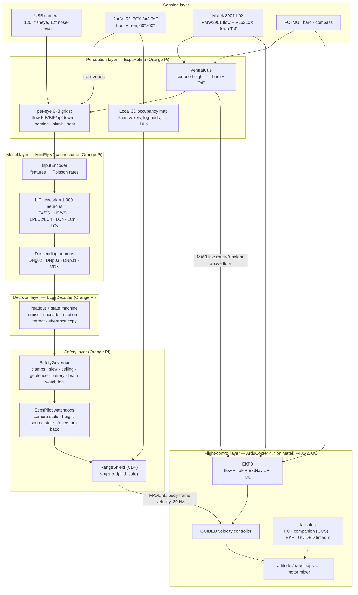

| Layer | Runs on | Key code | Responsibility | Status |
|---|---|---|---|---|
| Sensing | sensors | — | camera frames, 2 × 64 range zones, downward flow + range, IMU / baro / compass | sim ✅ · real ⬜ |
| Perception | Orange Pi | [`ecps_retina.py`](../ecps_retina.py), [`ecps_ventral.py`](../ecps_ventral.py), `ecps_map.py` | turn raw sensing into fly-like visual features, the ventral cue and a local map | ✅ sim · map 🟡 |
| Model | Orange Pi | [`my_minifly.py`](../my_minifly.py), upstream `flydrones.brain` | spiking connectome; the only place where "decisions" are made from what is seen | ✅ sim |
| Decision | Orange Pi | [`ecps_decoder.py`](../ecps_decoder.py) | read descending-neuron rates into a flight command; escape state machine | ✅ sim |
| Safety | Orange Pi | upstream `flydrones.safety`, [`ecps_pilot.py`](../ecps_pilot.py), [`ecps_struct.py`](../ecps_struct.py) | make the command physically safe regardless of what the brain wants | ✅ sim · map-fed shield 🟡 |
| Flight control | F405-WMO | ArduCopter 4.7 + [`sitl/`](../sitl/) params | state estimation, stabilisation, last-resort failsafes | ✅ SITL · real ⬜ |

---

## 2. One control tick

`EcpsPilot.tick()` runs at **20 Hz** (`control.hz` in `minifly/*.yaml`). The order below is exactly the order in
[`ecps_pilot.py`](../ecps_pilot.py); every stage can only replace or attenuate the command of the stage before.

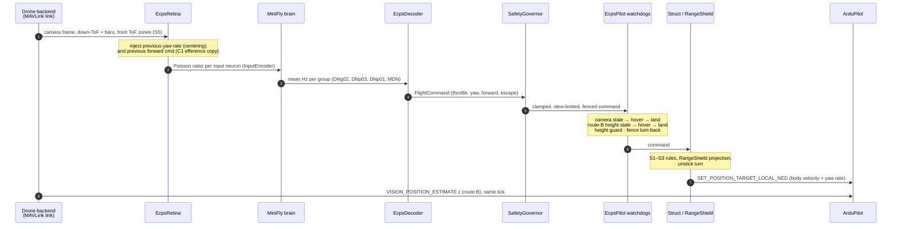

Timing measured on the ROG laptop: brain tick ≈ 9 ms p95, whole control tick 50.1 ms p95 (report 1 §1.1). The
On the Orange Pi (Allwinner A733) the whole s7_w2map tick takes p50 22 ms / p99 26 ms on the A76 cores with the
performance governor, 0 overruns in 15 min; the A55 cores cannot hold 20 Hz
([deployment report](../deploy/orangepi/docs/ECPS295_OrangePi部署与性能测试报告_20261015.en.md) §4).

---

## 3. Model layer: MiniFly generations v0 → v4

All variants are built by [`my_minifly.py`](../my_minifly.py) on top of the upstream synthetic MiniFly. They **only
add** neurons and synapses; the upstream block stays bit-identical (checked at build time), and every added cell type
has a fixed biological sign. v1 and its sub-versions changed only the decoder and the pilot, not the network.

### 3.1 The cumulative circuit

Colours mark the generation that introduced each pathway (one side shown; every population exists as L and R).

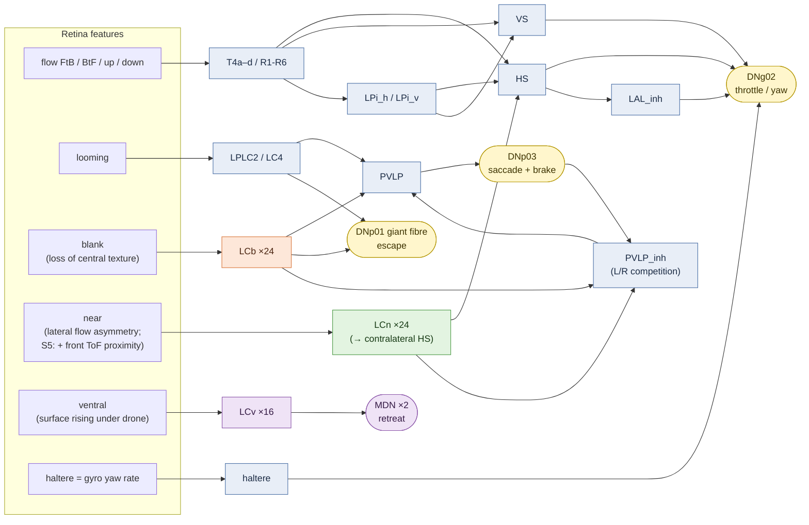

Legend: blue = upstream v0 · orange = v2 (LCb) · green = v3 (LCn) · purple = v4 (LCv → MDN) · yellow = descending
neurons read by the decoder. LCn and LCb inhibit the opposite side's DNp03 through PVLP_inh, so a saccade turns away from the near / blank side.

### 3.2 Generation ladder

| Gen | Network change | Decoder / pilot change | Failure that motivated it | Result |
|---|---|---|---|---|
| **v0** | upstream MiniFly (≈ 1,000 neurons) | upstream linear readout | — | wall contact **6/6**: looming goes silent once the wall fills the view |
| **v1** | — | saccade escape (turn + back-off), caution period, efference copy, yaw decoupling | v0 brakes, then drifts into the wall | 3/6 |
| v1.1–1.3 | — | saccade threshold 15 Hz, brake-triggered saccade, 1 s refractory, camera / brain-age watchdogs | plain walls and frozen camera unnoticed | taped + offset walls pass |
| **v2** | **+ LCb** blank cells → PVLP, DNp01, contra PVLP_inh | — | a textureless wall produces no flow | **0/6** |
| v2.1 | — | LCb side from the whole-eye textureless share | wrong turn side | turn side 5/6 |
| **v3** | **+ LCn** near-side cells → contra HS, contra PVLP_inh | — | grazing at oblique passes | turn side 3/3, clearance +0.1 m |
| v3.1 / v3.2 | — | fence overrides saccades; centering on 5 outer columns | corner grazes in cage20 | v3_2 = RL baseline (report 4) |
| **v4** | **+ LCv → MDN** "moonwalker" retreat | `retreat` backs out along the path (≤ 2 s), then saccades | low boxes under the drone corrupt the FC height (no GPS) | with route B: 0/5 low-box contacts |
| **v4_eff** | — | C1 blank-cue efference term (c = 0.4, τ = 0.8 s) | 2.75 false turns / min in an empty cage | false alarms halved; **default since 10-13** |
| **s5** | — (LCn input extended) | S5: front ToF zones drive the retina's `near` grids | the brain cannot see what the shield sees | 30–42 % fewer shield interventions |

Parameter variants with the same architecture (not new generations): `es2`/`es3` (CMA in the GPS cage, report 4),
`h2_s1..8` (CMA on v4 with hardware caps; `h2_s3` accepted as conservative variant, report 5), `c4_s1..8` (bypass
arm, report 6), N3 round 2 (CMA with the shield in the loop, running, §4).

---

## 4. System generations: from the GPS cage to the final hardware

The brain is one part; each system generation also changed sensing, estimation and the safety layer.

```mermaid
flowchart LR
  A["<b>Gen A — GPS cage</b><br/>v0 → v3_2<br/>camera only<br/>GPS position<br/>SafetyGovernor"]
  B["<b>Gen B — flow navigation</b><br/>v4 + route B<br/>camera + down-ToF<br/>EKF3 on flow, ExtNav z<br/>+ height / companion watchdogs"]
  C["<b>Gen C — hardware-aligned</b><br/>v4_eff<br/>same sensors<br/>calibrated twin, CMA h2_*<br/>+ C1 efference copy"]
  D["<b>Gen D — range shield</b><br/>s5: 5 × single-zone ToF<br/>ToF → brain (LCn)<br/>+ RangeShield"]
  E["<b>Gen E — final</b><br/>w2map: front + rear VL53L7CX 8×8<br/>local 3D map → shield<br/>front zones → brain"]
  A -->|"real drone has no GPS;<br/>boxes pull FC height down"| B
  B -->|"GPS-cage RL decoders fail<br/>under the real sensor set"| C
  C -->|"lowbox contacts insensitive<br/>to the decoder: blind spots"| D
  D -->|"cheaper, easier-to-mount layout;<br/>memory of seen obstacles"| E
```

| Gen | Brain | Sensors | Estimation | Safety layer | Key number | Report |
|---|---|---|---|---|---|---|
| A | v0 → v3_2 | camera | GPS | SafetyGovernor + camera/brain watchdogs | wall contact 100 % → 0 % (v2.1 on) | 1, 3, 4 |
| B | v4 | + 3901-L0X | EKF3 flow + route B ExtNav height | + height-source watchdog, `retreat.max_s`, companion failsafe | mission success 10 % → 82 % with route B | 2, 3 |
| C | v4_eff | same | same + calibrated flow error model in the twin | same | lowbox ≈ 1 run in 5 still hits something, for every decoder | 5, 6 |
| D | s5 | + 5 × VL53L1X-like cones | same | + RangeShield (S4) | Gazebo lowbox 11/50 → 1/50; pooled 19/100 → 2/100 | 7 |
| **E** | **s5-style front zones → LCn** | **+ 2 × VL53L7CX 8×8 (front, rear)** | same | **+ local 3D map feeding the shield** | **lowbox 0/50, cage20 0/8, coverage +0.023** | 7 §8 |

### 4.1 Final system (Gen E, w2map)

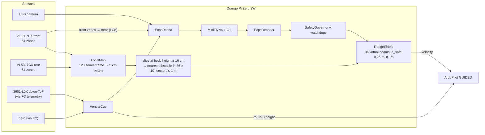

The map is built in the flow-EKF frame, so EKF drift moves it exactly as it will on the real drone; drift is the main
residual risk (closest approach 0.5 cm in lowbox_s32 while the EKF had drifted 0.82 m).

---

## 5. Safety layer

### 5.1 Defence in depth

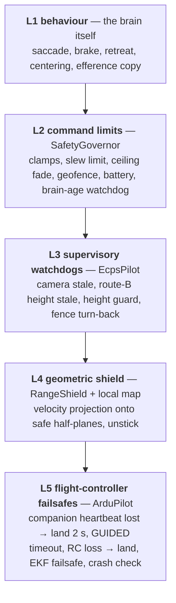

| Layer | Trigger | Action | Where | Verified by |
|---|---|---|---|---|
| L1 | looming / blank / near / ventral cues | saccade, brake, retreat | brain + decoder | reports 1–3 (wall contact 100 % → 0 %) |
| L2 | command out of bounds, brain tick older than `brain_timeout` | clamp / fade / hover / land | `SafetyGovernor.filter` | upstream tests; slew-sign fix `8b8eef9` |
| L3 | no camera frame for `stale_s`, no route-B height for 0.5 s | hover; land after `land_after_s` / 3 s | `EcpsPilot.tick` | S8 E3 fault injection, 10/10 safe landings |
| L4 | any range zone closer than allowed by v·uᵢ ≤ α(dᵢ − d_safe) | project the horizontal velocity; push back if dᵢ < d_safe; turn after 1 s stall | `ecps_struct.RangeShield` | report 7: lowbox 0/50 (Gazebo, cone ToF) |
| L5 | companion heartbeat lost 2 s; GUIDED command silent `GUID_TIMEOUT`; RC lost | land / stop | ArduCopter | SITL `companion_fs.parm`; real drone ⬜ |

### 5.2 The range shield (control-barrier-function filter)

For each beam *i* (or, with the map, each 10° sector) with body bearing *bᵢ*, unit vector **uᵢ** and range *dᵢ*:

```
v · uᵢ ≤ α (dᵢ − d_safe)        d_safe = 0.25 m, α = 1 s⁻¹
```

The commanded horizontal velocity (forward, lateral) is projected cyclically (3 passes) onto the intersection of
these half-planes. If *dᵢ < d_safe* the right-hand side is negative and the drone is pushed away. Yaw and throttle are
never modified. If forward motion stays clamped below 20 % of the request for `unstick_s` = 1 s, the shield commands a
turn towards the more open side. The shield counts clamp / retreat / unstick ticks, and fitness v6 (N3 round 2)
uses the share of clamped ticks as a hard constraint so the brain cannot lean on the filter.

### 5.3 Local 3D map (S7, 🟡 pending push)

- Each ToF frame (2 × 64 zones) is ray-cast into 5 cm voxels in the flow-EKF frame (log-odds, forgotten with
  τ = 10 s).
- Each tick: take the slice at body height ± 10 cm, find the nearest occupied voxel in 36 sectors of 10° within 1 m,
  and pass them to the RangeShield as virtual beams.
- Effect against the same sensors without the map (w2): contacts 3 → 0 / 50, coverage +0.042 (p = 0.044), cage20
  clearance +0.079 m (p = 0.008). Box tops below the slice no longer slow the drone; obstacles seen before a turn still
  constrain motion after it.

---

## 6. Navigation and state estimation without GPS (route B)

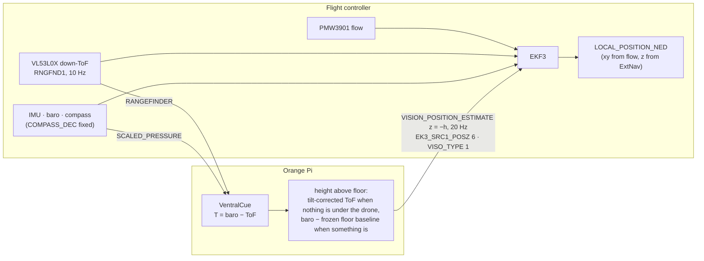

Why: a box passing under the drone drops the ToF from 0.83 to 0.40 m and pulled the EKF height down by 0.4–1.0 m;
the FC climbed through the 1.3 m fence and landed itself (report 2). With route B the companion tells the FC the
height above the *floor*; FC landings fell from 4/5 to 0/5 and the median height error to 0.1 m. If the route-B
messages stop, the EKF falls back to baro within 0.5 s and the pilot watchdog hovers, then lands after 3 s.
Parameters: [`sitl/variants/G_extnav_height.parm`](../sitl/variants/G_extnav_height.parm),
[`sitl/variants/companion_fs.parm`](../sitl/variants/companion_fs.parm), base EKF set
[`sitl/fhb_delta.parm`](../sitl/fhb_delta.parm).

---

## 7. Hardware architecture and wiring

Course airframe: 2S quadrotor, Matek F405-WMO flight controller, all-up weight estimated 300–350 g after the
additions. **Only the 3901-L0X is added to the flight controller**; every other new part hangs off the Orange Pi.

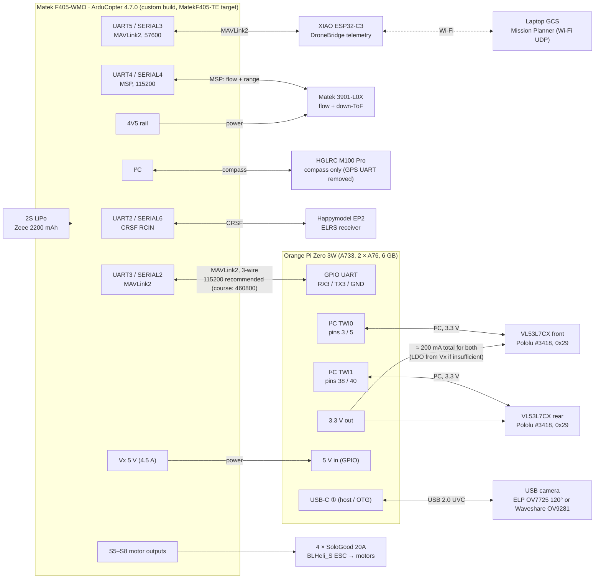

### 7.1 Interface table

| Link | Physical | Protocol / rate | Carries | Status |
|---|---|---|---|---|
| Orange Pi ↔ FC | GPIO UART ↔ UART3 (SERIAL2), 3 wires | MAVLink2; course 460800 baud, **115200 recommended** (UART3 has no DMA) | see §8.2 | wired per course ⬜ |
| 3901-L0X → FC | UART4 (SERIAL4), replaces the GPS UART | MSP, 115200 (`SERIAL4_PROTOCOL 32`, `FLOW_TYPE 7`, `RNGFND1_TYPE 32`) | optical flow, downward range (max 1.2 m) | ⬜ needs custom firmware with MSP flow/range + `EK3_FEATURE_OPTFLOW_FUSION` |
| VL53L7CX front → Orange Pi | I²C TWI0, own bus, address 0x29 | ST ULD driver, ≈ 84 KB firmware upload at boot; 8×8 zones, 15 Hz class | 64 ranges / frame | ⬜ bench test first |
| VL53L7CX rear → Orange Pi | I²C TWI1, own bus, address 0x29 | same | 64 ranges / frame | ⬜ pin levels to verify |
| USB camera → Orange Pi | USB-C ① | UVC, 640×480 MJPEG 60 fps (ELP) or 640×480 @ 120 fps mono (OV9281) | frames, down-sampled to 192×144 gray for the retina | ⬜ A/B bench comparison |
| ELRS → FC | UART2 (SERIAL6) | CRSF | pilot RC, mode switch, kill | course setup |
| Telemetry → GCS | UART5 (SERIAL3) → ESP32-C3 | MAVLink2 57600, Wi-Fi UDP | monitoring, parameters | course setup |
| Compass → FC | I²C | — | heading (`COMPASS_DEC 0.197` fixed, no GPS) | course setup |
| Power | Vx 5 V → Orange Pi; Orange Pi USB → camera; Orange Pi 3.3 V → ToF | — | — | ⬜ check 3.3 V current |

Mounts (3D-printed, in the course folder `项目文档/01_硬件与飞控配置/`): 3901-L0X base under the bottom plate,
Orange Pi cover + battery deck on the top plate, GPS mast, front and rear VL53L7CX mounts clear of the propeller disc.

---

## 8. Onboard software deployment: Orange Pi vs flight controller

🟡 **Deployed on the Pi, sensors not wired yet** (2026-10-15/16, [`deploy/orangepi/`](../deploy/orangepi/)). In simulation
the same Python code runs on a laptop/server and talks to ArduPilot SITL over UDP; on the real drone it runs on the Orange Pi
unchanged except for the drone backend (`companion/real_drone.py`: camera, ToF and MAVLink sources). Tested on the Pi: SIL
equivalence 16/16, SITL hand-over / failsafe, and Gazebo processor-in-the-loop (Gazebo + SITL on ROG, the companion on the
Pi, `pil_rog.py` / `companion/pil_link.py`). What runs on the Pi and why: deployment report §10.

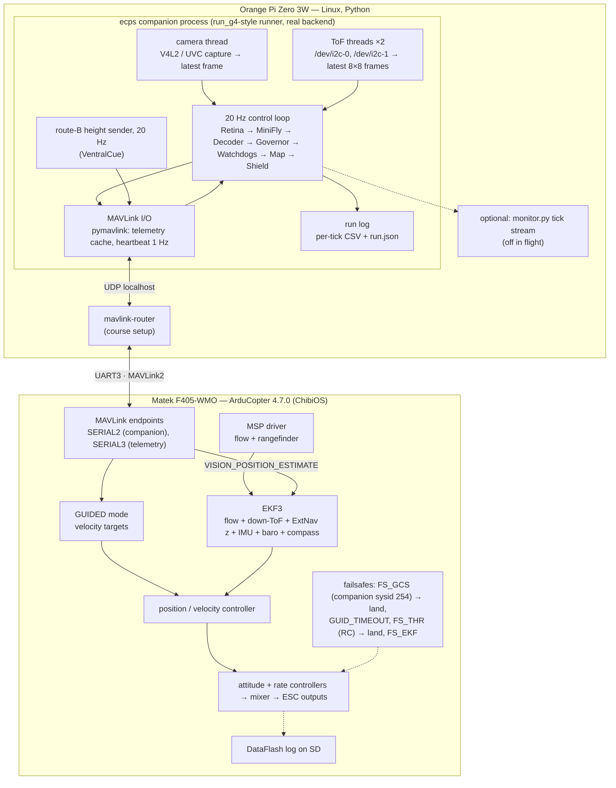

### 8.1 Who owns what

| Function | Orange Pi | Flight controller |
|---|---|---|
| Vision, connectome, decoder | ✅ | — |
| Obstacle ranging, local map, range shield | ✅ | — |
| Route-B height (height above floor) | computes and sends | fuses as ExtNav z |
| Horizontal velocity / position estimate | consumes (fence turn, map frame) | ✅ EKF3 on optical flow |
| Velocity → attitude → motors | — | ✅ |
| Take-off, landing | requests (mode, arm, land commands) | ✅ executes |
| Last-resort safety | watchdogs that hover / land | ✅ failsafes that do not depend on the Orange Pi |
| Pilot override | — | ✅ RC mode switch / kill always wins |

### 8.2 MAVLink traffic on UART3

Companion system id **254**, `MAV_TYPE_ONBOARD_CONTROLLER` (from [`mavlink_twin.py`](../mavlink_twin.py)).

| Direction | Message | Rate | Purpose |
|---|---|---|---|
| Pi → FC | `HEARTBEAT` | 1 Hz | liveness; FC treats sysid 254 as a GCS (`MAV_GCS_SYSID 254`, `FS_GCS_ENABLE 5`, timeout 2 s → land) |
| Pi → FC | `SET_POSITION_TARGET_LOCAL_NED`, `MAV_FRAME_BODY_OFFSET_NED`, velocity + yaw-rate mask | 20 Hz | the safe command from the shield |
| Pi → FC | `VISION_POSITION_ESTIMATE` (z = −height above floor) | 20 Hz | route B (`VISO_DELAY_MS 50`, `VISO_POS_M_NSE 0.1`) |
| Pi → FC | `COMMAND_LONG` | on demand | mode change, arm, land, `SET_MESSAGE_INTERVAL` stream requests |
| Pi → FC | `SET_GPS_GLOBAL_ORIGIN` | once | EKF origin without GPS |
| FC → Pi | `LOCAL_POSITION_NED`, `ATTITUDE`, `SCALED_PRESSURE` | 20 Hz (requested) | pose for fence turn, map frame, VentralCue |
| FC → Pi | `RANGEFINDER` | 10 Hz | downward ToF for VentralCue |
| FC → Pi | `SYS_STATUS`, `EKF_STATUS_REPORT`, `RC_CHANNELS` | 2 Hz | battery, EKF health, pilot switches |
| (sim only) | `SIM_STATE` | 20 Hz | ground truth for scoring and for ray-casting simulated ToF |

Bandwidth: about 2.3 kB/s up and 2.5 kB/s down, roughly a fifth of 115200 baud (≈ 11.5 kB/s per direction).

### 8.3 Sim ↔ real mapping

| Function | Simulation | Real drone |
|---|---|---|
| Camera | Gazebo fisheye → `gazebo/cam_bridge.py` → `/dev/shm` | UVC camera via V4L2 (`companion/camera.py`) 🟡 bench |
| Front / rear 8×8 ToF | `MavlinkTwin.zones()` ray-cast from `SIM_STATE` + world layout ✅ | VL53L7CX ULD driver on TWI0 / TWI1 (`companion/tof_vl53l7cx.py`) 🟡 built, sensors not wired |
| Down-ToF + flow | Gazebo range sensor → patched SITL JSON backend; SITL flow | 3901-L0X over MSP |
| ArduPilot | SITL Copter-4.7.0 + `sitl/ardupilot_sitl.patch`, lock-step with Gazebo | F405-WMO, same version, same parameters |
| MAVLink link | UDP to SITL | UART3 via mavlink-router |
| Compute | ROG / desktop / server / Mac mini / Jetson | Orange Pi A733, A76 cores: p50 22 ms per 50 ms tick ✅ |

---

## 9. Development and verification architecture

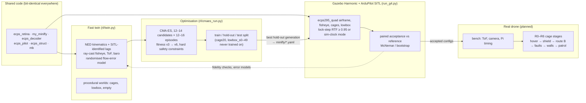

| Machine | Role |
|---|---|
| ROG laptop (Ryzen 9 5900HX, RTX 3070 Laptop) | Gazebo 8.15, 3 lock-step instances; quiet 01:00–07:00 PT |
| Desktop (R5 7500X3D, RTX 5060) | Gazebo node, 2–4 instances, when available |
| Lab server (Xeon 6330, 8 × RTX 4090, shared) | many Gazebo instances with sim clock; only when needed |
| Mac mini M4 | fast twin and CMA-ES (fastest per core) |
| Jetson AGX Orin | fast twin and CMA-ES overflow |

`python -m rl.gates all` checks the sensory gate, closed-loop smoke tests and bit-identical anchors on every
machine (12/12). All new options are off by default so older configs reproduce bit for bit.

---

## 10. Experimental branches that were not adopted

These were built and measured; they are kept because the paper reports them as controls or negative results.

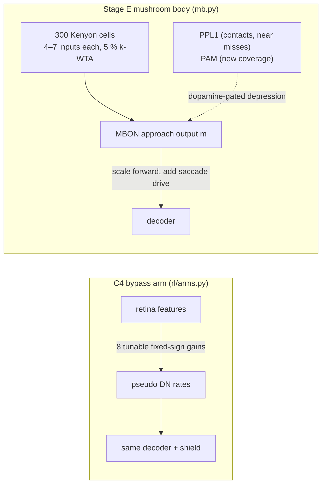

| Branch | What | Outcome |
|---|---|---|
| Control arms C0 / C2 | brain off, no looming, degree-preserving shuffles, random readout | the network is needed (≈ 10–40× contacts without it); real wiring beats 5/5 shuffles, weakly |
| C4 bypass | no LIF network, 8 gains from features to pseudo-DN rates, same optimiser | better in nominal scenes (Gazebo p = 0.015) but loses its edge without texture (OOD, p = 0.001) |
| Stage E mushroom body | KC → MBON with dopamine-gated plasticity on top of v4 | negative: learned weights no better than shuffled (48 lifetimes) |
| S1 no back-off / S2 spatial memory | rules without new sensors | no effect / not significant; dropped |
| S3 side + rear single rangers | ToF rules without a shield | −38 % contact runs; superseded by the shield |
| `height_guard` | descend above 1.0 m | fails: ArduPilot executes it in its own corrupted height frame; superseded by route B |
| N3 round 1 | CMA with the shield, weighted penalty | safety or coverage traded away; replaced by round 2 with hard constraints |

---

## 11. Code map

| Area | Files |
|---|---|
| Model | [`my_minifly.py`](../my_minifly.py) (v2–v4 builders), [`minifly/*.yaml`](../minifly/) (v0 … v4_eff, h2_*, c4_*, s*, sh5u, shfu, s5), upstream `src/flydrones/brain/` |
| Perception | [`ecps_retina.py`](../ecps_retina.py), [`ecps_ventral.py`](../ecps_ventral.py), `ecps_map.py` 🟡 |
| Decision | [`ecps_decoder.py`](../ecps_decoder.py) |
| Safety | [`ecps_pilot.py`](../ecps_pilot.py), [`ecps_struct.py`](../ecps_struct.py), upstream `src/flydrones/safety.py` |
| Drone backends | [`mavlink_twin.py`](../mavlink_twin.py) (route B, heartbeat, stream requests, ToF ray-cast), upstream `src/flydrones/drones/mavlink.py` |
| ArduPilot | [`sitl/`](../sitl/) (patch, frame JSON, course params, `variants/`), [`make_sitl_params.py`](../make_sitl_params.py) |
| Gazebo | [`gazebo/`](../gazebo/) (airframe, worlds, `cam_bridge.py`, `ood_world.py`), [`run_g4.py`](../run_g4.py), [`scripts/`](../scripts/) |
| Fast twin / RL | [`rl/twin.py`](../rl/twin.py), [`rl/cmaes_run.py`](../rl/cmaes_run.py), [`rl/params.py`](../rl/params.py), [`rl/arms.py`](../rl/arms.py), [`rl/shield_screen.py`](../rl/shield_screen.py), [`rl/gates.py`](../rl/gates.py) |
| Plasticity (negative) | [`mb.py`](../mb.py), [`rl/mb_life.py`](../rl/mb_life.py) |
| Deployment | [`deploy/desktop/`](../deploy/desktop/) (Gazebo node); [`deploy/orangepi/`](../deploy/orangepi/) (companion runtime, PIL link); [`pil_rog.py`](../pil_rog.py) (Gazebo side of PIL) |

---

## 12. Open items

- **Companion runtime on the Orange Pi** (🟡 deployed 10-15): bench with the real camera and the two VL53L7CX still to
  do; `ecps-companion.service` must stop cleanly on SIGTERM when no camera / FC is present.
- **Route-B latency**: `VISO_DELAY_MS` to confirm on the real FC (SITL on the Pi: ≈ 24 ms + UART at 20 Hz RANGEFINDER).
- **Timed landing**: the flight timer lands in place; check what is below first (a PIL run landed on a box edge).
- **ToF bench**: net and black-box detection, readings when a box top is 1–15 cm below the sensor, edge zones that
  may see the propellers, 3.3 V current budget.
- **Firmware**: custom ArduCopter 4.7.0 build with MSP flow / rangefinder and optical-flow fusion must fit the
  F405's 1 MB flash.
- **Failsafe parameters on the real drone**: `FS_GCS_ENABLE 5` with the companion as GCS is validated in SITL only;
  the course default is 0.
- **Fast twin v3** (motion model refit on sim-paced Gazebo) is under evaluation; options are off by default.
