# 系统图册（中文）

本页是 `ecps295/` 各文档里 Mermaid 图的中文版，图的结构与原图一致。
原图和详细说明见各文档；数据图见 [FIGURES.md](FIGURES.md)。

## 1. 系统总览

### 系统总览：真机部件连接与仿真替代

传感器、Orange Pi 机载电脑、飞控和地面控制台之间的连接。虚线表示仿真中由哪些部分替代真机部件。

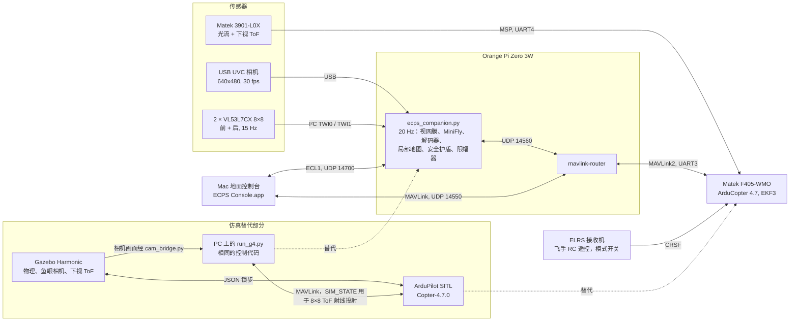

*原图：[README.md § At a glance · 概览](../README.md)*

### MiniFly 闭环数据通路

鱼眼相机、ToF 与气压计的数据经 `EcpsRetina` 进入 MiniFly 连接组脑模型，再经解码器、`EcpsPilot` 和安全护盾向 ArduPilot SITL 发速度指令。前后两块 8×8 ToF 同时用于建立局部三维地图，供安全护盾使用。

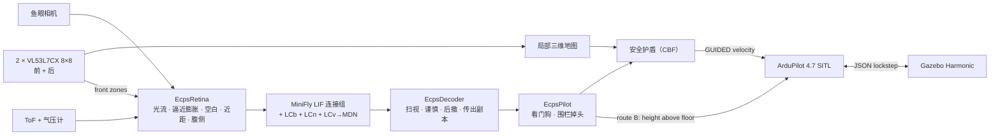

*原图：[README.md § At a glance · 概览](../README.md)*

### 系统分层架构

分层原则是“脑模型做决定，安全护盾做约束，飞控做增稳”。每一层只能让它下面的指令更保守，下层不需要上层也能保证无人机安全。

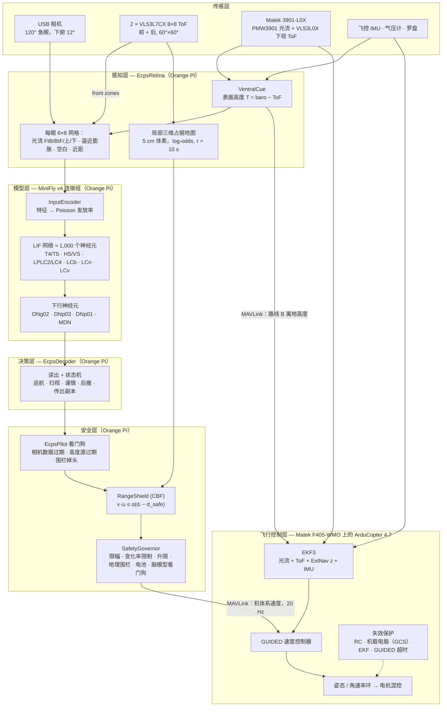

*原图：[ARCHITECTURE.md § 1. System overview: the layers](ARCHITECTURE.md)*

### MiniFly 累积神经回路（v0 → v4）

颜色表示引入各条通路的代次：蓝色为上游 v0，橙色为 v2（LCb），绿色为 v3（LCn），紫色为 v4（LCv → MDN），黄色为解码器读取的下行神经元。图中只画一侧，每个神经元群都有左右两份；LCn 和 LCb 经 PVLP_inh 抑制对侧 DNp03，因此扫视会转离较近或空白的一侧。

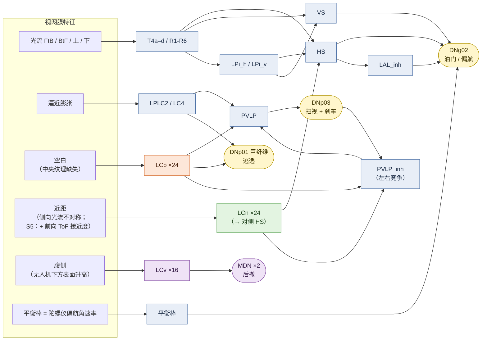

*原图：[ARCHITECTURE.md § 3.1 The cumulative circuit](ARCHITECTURE.md)*

### 系统代次演进：从 GPS 笼到最终硬件

脑模型只是系统的一部分，每一代系统还改动了传感、状态估计和安全层。连线上的文字是推动进入下一代的原因。

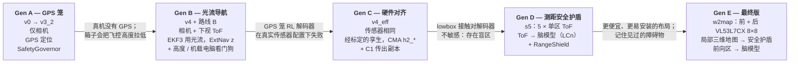

*原图：[ARCHITECTURE.md § 4. System generations: from the GPS cage to the final hardware](ARCHITECTURE.md)*

### 最终系统（Gen E，w2map）

前后两块 8×8 ToF 建立局部地图，取机体高度附近的切片作为 `RangeShield` 的虚拟波束，前向区同时进入脑模型。地图建在光流 EKF 坐标系中，EKF 漂移是主要的剩余风险。

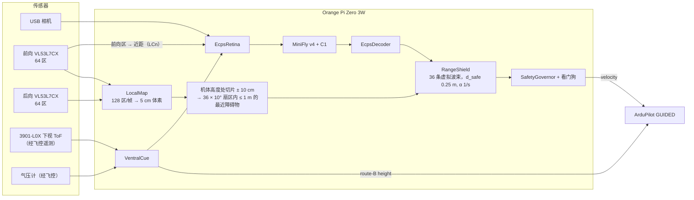

*原图：[ARCHITECTURE.md § 4.1 Final system (Gen E, w2map)](ARCHITECTURE.md)*

### ecps_*.py 模块导入关系

实线表示导入，虚线表示继承上游类。`run_g4.py`（Gazebo）、`ecps_companion.py`（Orange Pi）和快速孪生的 `rl/episode.py` 这三个运行器构建同一个 pilot。

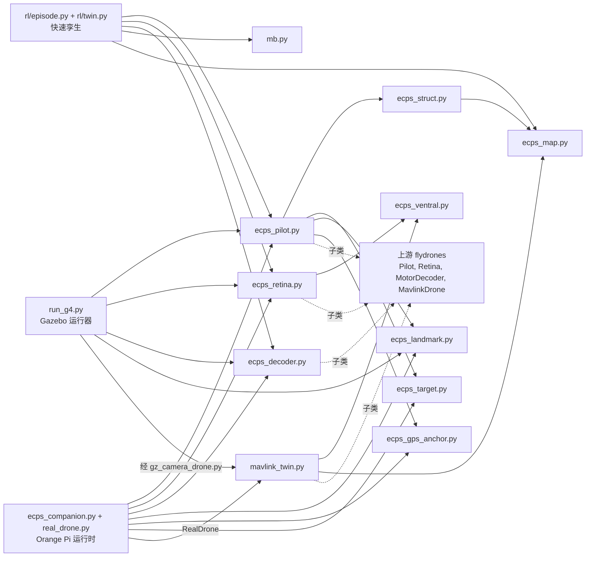

*原图：[ARCHITECTURE.md § 11. Code map](ARCHITECTURE.md)*

## 2. 控制流程与安全

### 一个 20 Hz 控制周期

按 `EcpsPilot.tick` 的执行顺序画出，并标有传感器和输出的频率。每一级只能替换或削弱前一级的指令；限幅器之后的环节无法撤销限幅或停止。

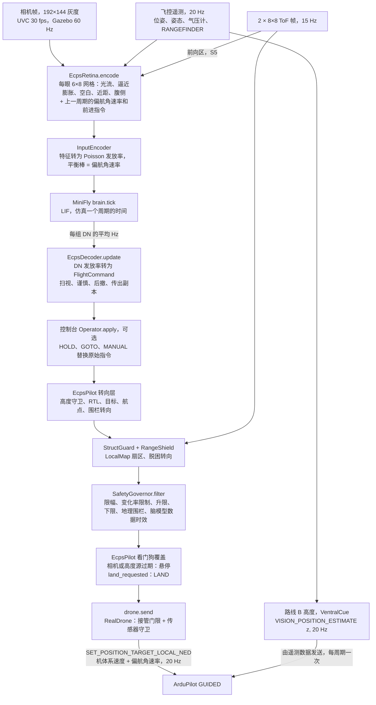

*原图：[ARCHITECTURE.md § 2. One control tick](ARCHITECTURE.md)*

### 解码器逃逸行为状态机

图中数值取自最终硬件配置 `minifly/s7_w2map.yaml`。巨纤维和 DNp03 触发用的是经低通滤波的发放率；由刹车触发的扫视在上一次扫视后的 1 s 内被屏蔽。

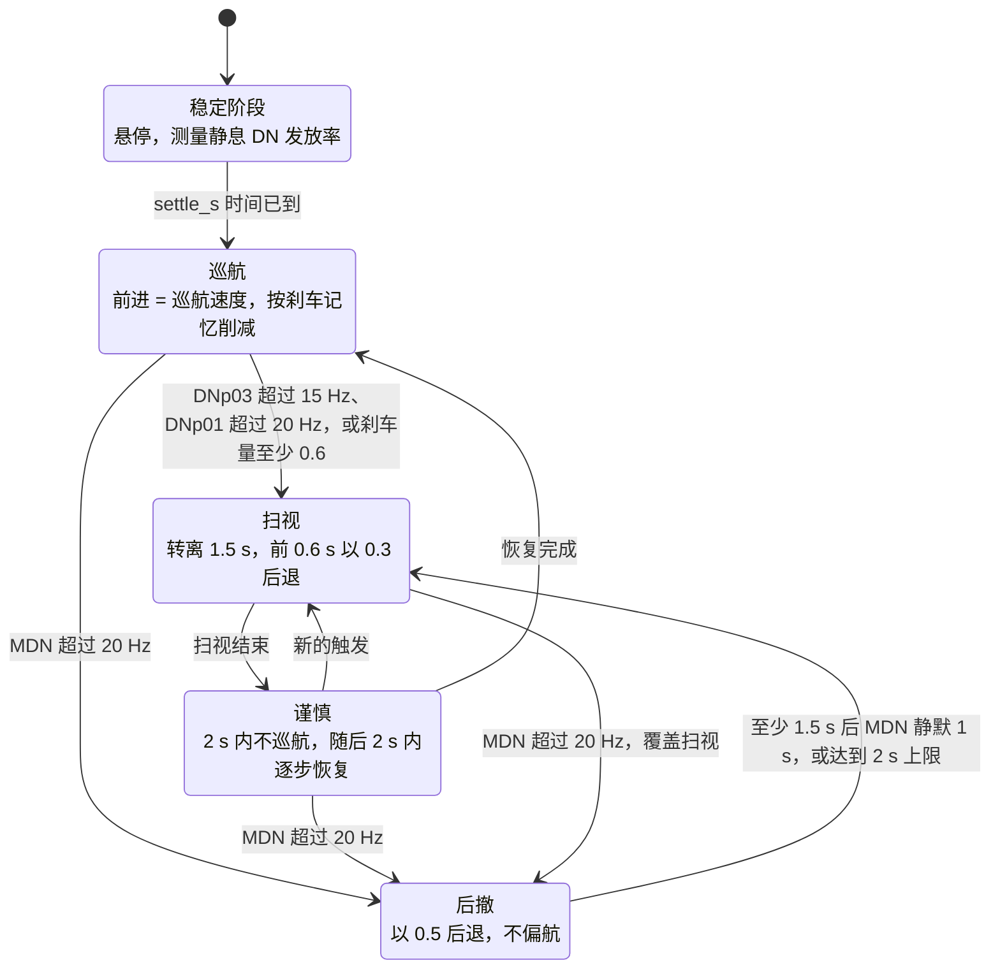

*原图：[ARCHITECTURE.md § 3.3 Decoder behaviour states](ARCHITECTURE.md)*

### 纵深防御五层

从脑模型自身的行为，到指令限幅、监督看门狗、几何安全护盾，再到飞控失效保护。各层的触发条件、动作和验证方式见原文表格。

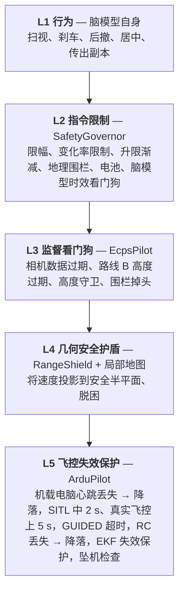

*原图：[ARCHITECTURE.md § 5.1 Defence in depth](ARCHITECTURE.md)*

### 传感器故障时机载电脑的处置

Orange Pi 上针对各类传感器故障的判断与动作。机载电脑的 LAND 只在它掌握控制权时发出（高度守卫的 LAND 按图中标注，无论是否掌控都会发出）；否则由飞手飞行。

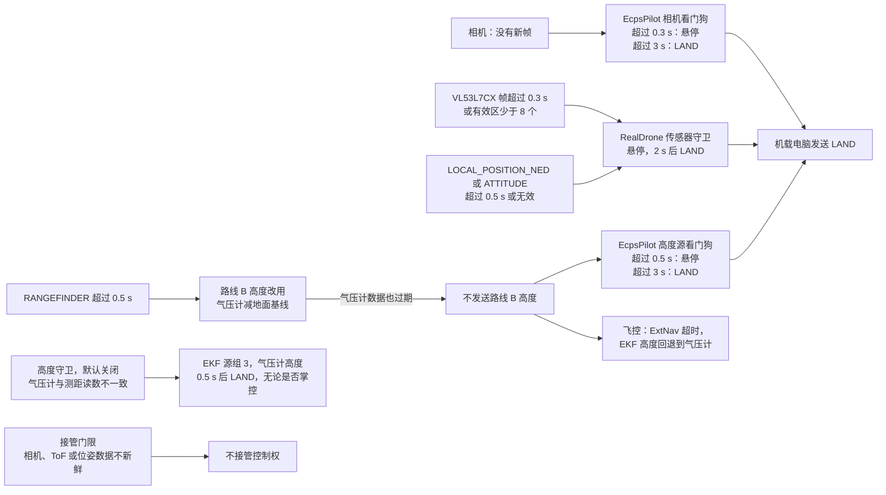

*原图：[ARCHITECTURE.md § 5.1 Defence in depth](ARCHITECTURE.md)*

### 链路与机载电脑故障处置

当链路或机载电脑本身出故障时，先由控制台层处理，再由飞控自身的失效保护接手。

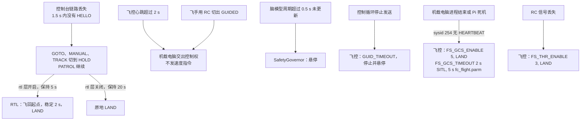

*原图：[ARCHITECTURE.md § 5.1 Defence in depth](ARCHITECTURE.md)*

### 机载电脑视角的飞行模式与行为状态

包括脑模型之上的控制台模式、飞手接管交接和两级急停；机载电脑从不解锁或起飞。控制台指令可在 InControl 内的模式间直接切换（图中只画出以 HOLD 为中心的转移）；飞控确认急停后 RC 仍然优先，锁存会让脑模型无法接管，直到 `estop_reset`（飞控处于解锁状态时会被拒绝，除非强制）。

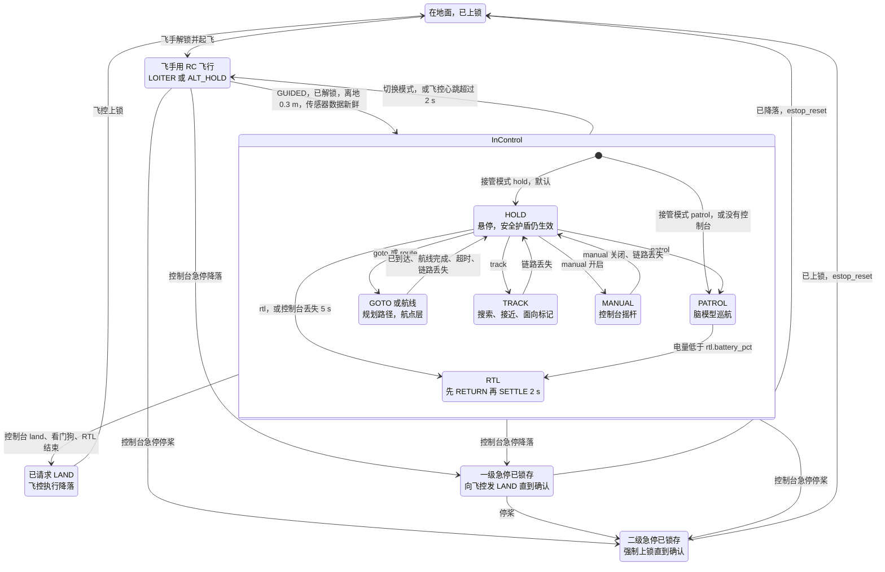

*原图：[ARCHITECTURE.md § 8.4 Ground console (Mac)](ARCHITECTURE.md)*

### 一条 GOTO 指令从控制台到飞控的时序

该指令只改变目标点；脑模型继续负责飞行，其后的每一级安全环节仍然生效。

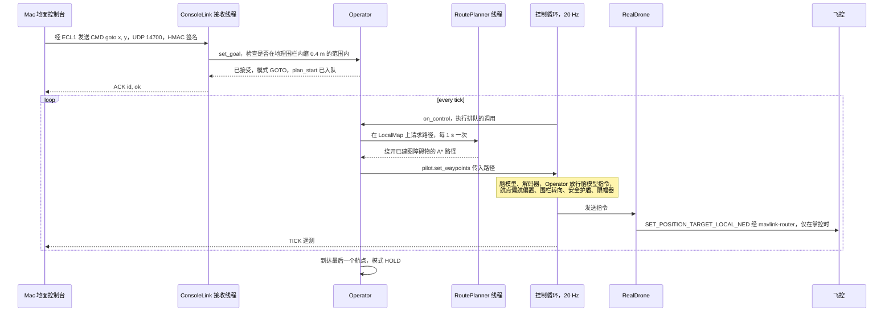

*原图：[ARCHITECTURE.md § 8.4 Ground console (Mac)](ARCHITECTURE.md)*

## 3. 硬件与飞控

### 无 GPS 导航与状态估计（路线 B）

箱子从机下经过会使下视 ToF 读数变小并把 EKF 高度拉低。路线 B 由机载电脑向飞控发送相对地面的高度；若这些消息停止，EKF 回退到气压计，pilot 看门狗先悬停，再降落。

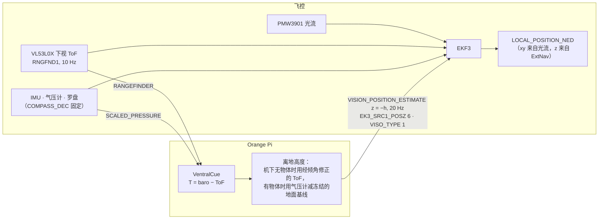

*原图：[ARCHITECTURE.md § 6. Navigation and state estimation without GPS (route B)](ARCHITECTURE.md)*

### 硬件架构与接线

课程机架上只有 3901-L0X 是加到飞控上的新部件，其他新增部件都接在 Orange Pi 上。

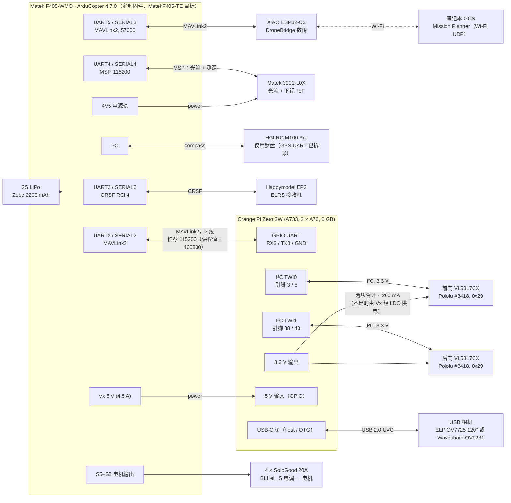

*原图：[ARCHITECTURE.md § 7. Hardware architecture and wiring](ARCHITECTURE.md)*

### 飞行配置总线图

飞行配置中的每个传感器和执行器要么挂在飞控上，要么挂在机载电脑上，连线上标有总线类型。电源轨见下一张图。

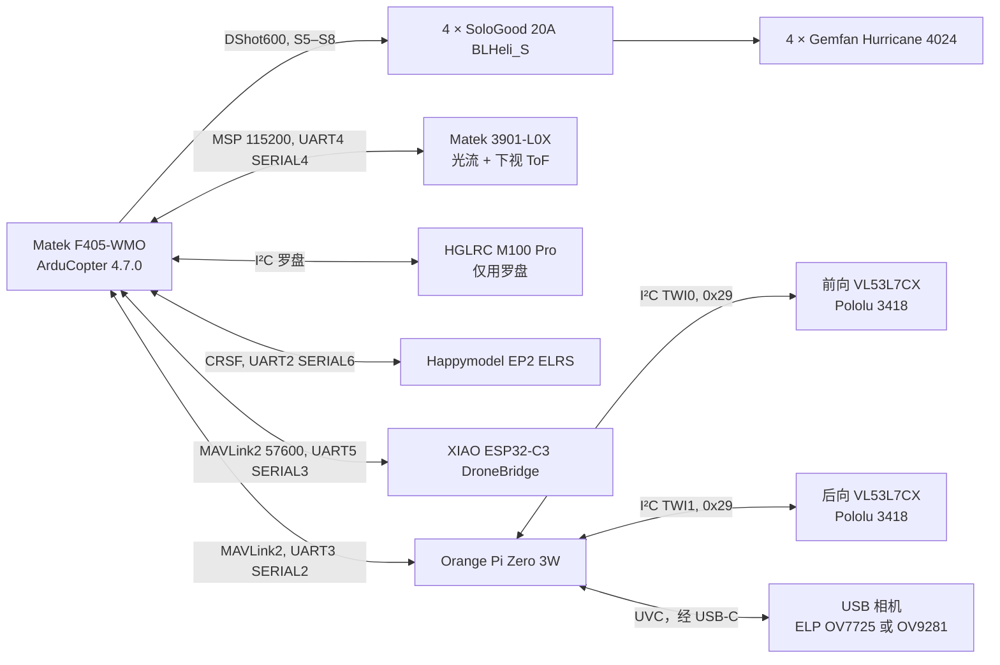

*原图：[HARDWARE.md § 3. Wiring and pin-out](HARDWARE.md)*

### 供电分配

2S 电池接飞控电池焊盘和电调；Orange Pi 由飞控的 Vx 供电，相机和两块 VL53L7CX 由 Orange Pi 供电。

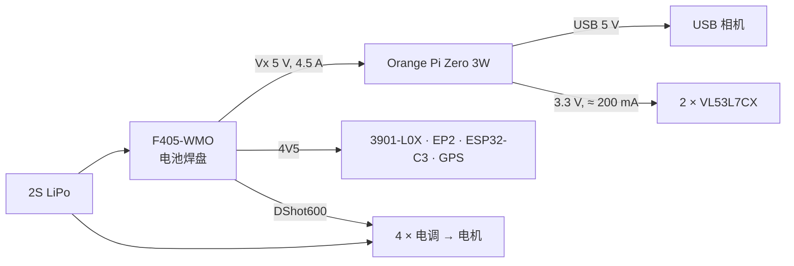

*原图：[HARDWARE.md § 3.3 Power](HARDWARE.md)*

### 飞控参数分层叠加

参数集分层构建，仿真器使用完全相同的分层；最后一步是原文第 3 节所列的真实飞控替换项。


*原图：[FLIGHT_CONTROLLER.md § Flight-controller configuration (ArduCopter 4.7 on Matek F405-WMO)](FLIGHT_CONTROLLER.md)*

### RC 模式开关与接管门限

飞手在 LOITER 中飞行，切到 GUIDED 把无人机交给机载电脑，切出 GUIDED 立即收回控制权。SITL 台架参数文件与 `course_base.parm` 的开关档位设置不同，见原图注。

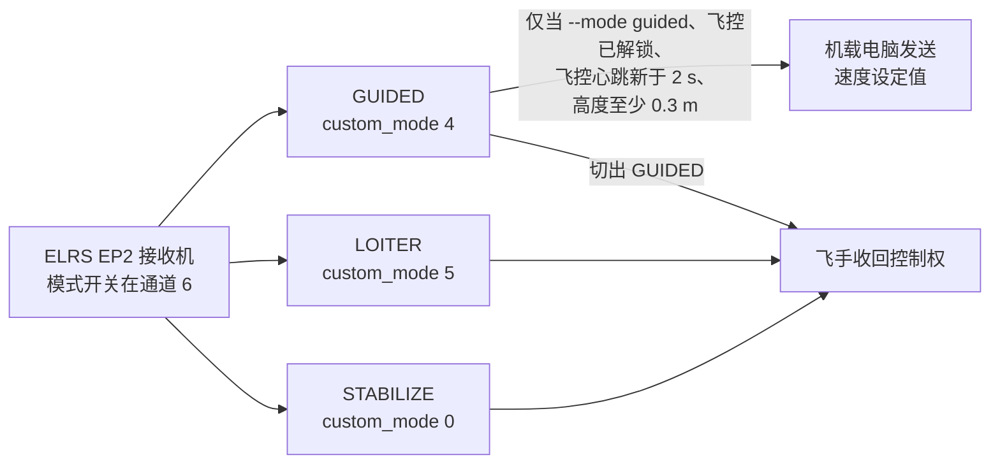

*原图：[FLIGHT_CONTROLLER.md § 2.1 RC mode switch](FLIGHT_CONTROLLER.md)*

### 无 GPS 时 EKF3 的数据来源

`EK3_SRC1_POSXY 0` 表示完全没有位置源，水平位置由光流速度积分得到。高度用路线 B（机载电脑的 z），气压计作回退，偏航来自罗盘。

```mermaid
flowchart LR
  FLOW["3901-L0X 光流<br/>FLOW_TYPE 7 MSP"] -->|"水平速度"| EKF
  RNG["3901-L0X 下视 ToF<br/>RNGFND1_TYPE 32 MSP"] -->|"距离，SITL POSZ 2"| EKF
  CMP["HGLRC M100 Pro 罗盘<br/>I²C"] -->|"偏航"| EKF
  OPI["Orange Pi 机载电脑<br/>VISION_POSITION_ESTIMATE z，20 Hz"] -->|"离地高度，POSZ 6"| EKF
  BARO["飞控气压计"] -->|"回退高度"| EKF
  IMU["飞控 IMU"] -->|"姿态"| EKF
  GPS["HGLRC M100 Pro GPS<br/>GPS1_TYPE 0"] -.->|"不融合"| EKF
  EKF["EKF3 源组 1<br/>POSXY 0 · VELXY 5 · YAW 1 · POSZ 6"]
  EKF --> CTRL["位置与速度控制器<br/>GUIDED 和 LOITER"]
```

*原图：[FLIGHT_CONTROLLER.md § 3. Sensors and EKF3 without GPS](FLIGHT_CONTROLLER.md)*

## 4. 仿真与优化

### 上真机前的四种测试环境

同一套 `ecps_*.py` 控制代码在上真机之前跑四种测试环境，每一种都让更多环节变成真实的。图中标明各环境里哪些部分是真实的、哪些是仿真的。

```mermaid
flowchart TD
  CODE["共享控制代码<br/>ecps_pilot, ecps_retina, ecps_decoder,<br/>ecps_struct, ecps_map, my_minifly"]
  subgraph M1["1 快速孪生，rl/twin.py"]
    T1["仿真：速度模式四旋翼，带 SITL 辨识出的滞后，<br/>射线投射鱼眼相机、ToF、气压计、光流 EKF 误差模型<br/>不用 ArduPilot 和 Gazebo，快于实时"]
  end
  subgraph M2["2 ArduPilot SITL"]
    S2["真实：ArduCopter 4.7 代码和课程参数<br/>仿真：来自 sitl/ecps295.json 的物理模型<br/>无相机：run_s5.py, s7_flow.py"]
  end
  subgraph M3["3 Gazebo + ArduPilot SITL，run_g4.py"]
    G3["真实：ArduCopter 代码<br/>仿真：Gazebo 物理、鱼眼相机、下视 ToF、<br/>SITL 光流、由 SIM_STATE 射线投射的 8×8 ToF"]
  end
  subgraph M4["4 处理器在环"]
    P4A["仿真 PC：Gazebo + SITL<br/>pil_rog.py 推送相机和 ToF 数据"]
    P4B["Orange Pi：ecps_companion.py --pil<br/>真实 CPU、RealDrone 后端、看门狗"]
  end
  subgraph M5["真机"]
    R5["真实：Orange Pi、相机、VL53L7CX、<br/>F405-WMO, 3901-L0X"]
  end
  CODE --> T1
  CODE -->|"仅 mavlink_twin.py"| S2
  CODE --> G3
  CODE --> P4B
  CODE --> R5
  P4A -->|"UDP：图像帧、8×8 区、起飞标志 10 Hz"| P4B
  P4A <-->|"SITL MAVLink, UDP 14561"| P4B
```

*原图：[README.md § Layers](../README.md)*

### 开发与验证架构

共享代码同时用于快速孪生和 Gazebo；优化结果经 Gazebo 配对验收后再进入真机阶段。真机部分在原图中标为计划中。

```mermaid
flowchart LR
  subgraph CODE["共享代码（各处逐位一致）"]
    RT["ecps_retina · my_minifly · ecps_decoder<br/>ecps_pilot · ecps_struct · mb"]
  end

  subgraph TWIN["快速孪生（rl/twin.py）"]
    T1["NED 运动学 + SITL 辨识出的滞后<br/>射线投射鱼眼相机、ToF、气压计<br/>随机化的光流误差模型"]
    T2["程序化世界：笼子、lowbox、空场"]
  end

  subgraph OPT["优化（rl/cmaes_run.py）"]
    O1["CMA-ES, 12–14 个候选 × 12–16 个回合<br/>适应度 v3 → v6，硬安全约束"]
    O2["训练 / 留出 / 测试划分<br/>（cage20、lowbox_s0–49 从不参与训练）"]
  end

  subgraph GZ["Gazebo Harmonic + ArduPilot SITL (run_g4.py)"]
    G1["ecps295_quad 机架、鱼眼相机、笼子、lowbox<br/>锁步 RTF ≥ 0.95 或仿真时钟模式"]
    G2["与参考配置做配对验收<br/>McNemar / bootstrap"]
  end

  subgraph HW["真机（计划中）"]
    H1["台架：ToF、相机、Pi 时序"]
    H2["R0–R6 笼内阶段<br/>悬停 → 安全护盾 → 路线 B → 故障 → 墙面 → 巡逻"]
  end

  RT --> T1
  RT --> G1
  T1 --> O1 --> O2 -->|"留出集最优代<br/>→ minifly/*.yaml"| G1
  G1 --> G2 -->|"通过验收的配置"| H1 --> H2
  G2 -.->|"保真度检查、误差模型"| T1
```

*原图：[ARCHITECTURE.md § 9. Development and verification architecture](ARCHITECTURE.md)*

### 未被采用的实验分支

这些分支都做过实现和测量；保留它们是因为论文把它们作为对照或阴性结果报告。

```mermaid
flowchart LR
  subgraph BYP["C4 旁路对照臂（rl/arms.py）"]
    BF["视网膜特征"] -->|"8 个可调的固定符号增益"| BDN["伪 DN 发放率"] --> BDEC["相同的解码器 + 安全护盾"]
  end
  subgraph MBX["阶段 E 蘑菇体（mb.py）"]
    KC["300 个 Kenyon 细胞<br/>每个 4–7 个输入，5 % k-WTA"] --> MBON["MBON 趋近输出 m"]
    DA["PPL1（接触、险情）<br/>PAM（新覆盖区域）"] -.->|"多巴胺门控抑制"| MBON
    MBON -->|"缩放前进量，增加扫视驱动"| DEC2["解码器"]
  end
```

*原图：[ARCHITECTURE.md § 10. Experimental branches that were not adopted](ARCHITECTURE.md)*

### 一次 Gazebo 运行的进程与链路

一次 Gazebo 运行在机器上是四个进程：仿真器、相机桥、ArduPilot SITL 和控制脚本 `run_g4.py`；`monitor.py` 为可选面板。并行实例各有自己的 TCP 端口、FDM 端口、共享内存文件和 Gazebo 分区。

```mermaid
flowchart LR
  GZ["Gazebo Harmonic<br/>gz sim -s -r --headless-rendering<br/>世界文件 ecps295_*.sdf"]
  CB["cam_bridge.py<br/>系统 Python"]
  SHM["共享内存<br/>/dev/shm/ecps295_cam<br/>192×144 灰度"]
  SITL["ArduPilot SITL<br/>arducopter --model JSON<br/>Copter-4.7.0"]
  RUN["run_g4.py<br/>视网膜、脑模型、解码器、pilot、安全护盾<br/>20 Hz 控制循环"]
  MON["monitor.py<br/>可选的实时面板"]
  GZ -->|"相机话题 /ecps295/camera"| CB
  CB --> SHM
  SHM --> RUN
  GZ <-->|"FDM, UDP 9002"| SITL
  SITL -->|"MAVLink2, TCP 5760"| RUN
  RUN -->|"逐周期数据流，UDP 5799"| MON
```

*原图：[SIMULATION_GUIDE.md § 4. Gazebo + SITL](SIMULATION_GUIDE.md)*

### 一次 Gazebo 运行的执行时序

按 `gz_g4.sh` 的执行顺序，画出从命令行启动到生成结果文件的各个步骤。

```mermaid
sequenceDiagram
  participant OP as 操作员
  participant S as gz_g4.sh
  participant GZ as Gazebo
  participant CB as cam_bridge.py
  participant FC as ArduPilot SITL
  participant R as run_g4.py
  OP->>S: bash gz_g4.sh world tag args
  S->>GZ: 启动 gz sim -s -r --headless-rendering
  S->>CB: 启动 cam_bridge.py
  GZ-->>CB: /ecps295/camera 上的相机帧
  CB-->>R: /dev/shm/ecps295_cam 中的最新帧
  S->>FC: 启动 arducopter --model JSON --defaults params
  FC->>GZ: 经 UDP 9002 传 FDM 状态
  S->>R: python run_g4.py --url tcp:127.0.0.1:5760
  R->>FC: MAVLink2 连接，等待飞控心跳
  R->>FC: 设置 GUIDED，解锁，起飞
  loop every 20 Hz tick
    R->>R: 读帧、视网膜、脑模型、解码器、安全护盾
    R->>FC: 速度设定值
    R->>FC: 带 --ext-height 时发 VISION_POSITION_ESTIMATE z
    FC-->>R: LOCAL_POSITION_NED, RANGEFINDER, SIM_STATE
  end
  R->>FC: LAND 并等待上锁状态
  R-->>S: run.json 和逐周期 CSV
  S->>S: 由两条 stats 消息得出整段 RTF
  S->>FC: 结束进程
  S->>CB: 结束进程
  S->>GZ: 结束进程
```

*原图：[SIMULATION_GUIDE.md § 4. Gazebo + SITL](SIMULATION_GUIDE.md)*

### CMA-ES 优化与 Gazebo 验收流程

一次优化从起点到 Gazebo 验收的流程。快速孪生（原文称快仿真）只负责筛选，是否采用以 Gazebo 上的配对统计为准。

```mermaid
flowchart TD
  X0["起点 x0<br/>v3_2，或 --base / --x0-yaml"]
  W["每代抽 K 个程序化世界<br/>worlds.py episode_set，cage20 不参与训练"]
  ASK["es.ask：popsize 个候选<br/>params.py 解码器参数，z 空间 0..1"]
  RUN["batch.py 并行跑 episode.py + twin.py<br/>候选和参考飞同一批回合，公共随机数"]
  FIT["适应度 F，v1–v6<br/>es.tell，写 gens.jsonl 和 es.pkl"]
  VAL{"每 5 代或最后一代？<br/>--val-every 5"}
  HO["分布均值在 24 回合留出集上评估<br/>更好则写 best_val.json"]
  NEXT{"还有下一代？"}
  EXP["导出留出集最优点<br/>validate.py export / export_arms.py<br/>→ configs/、minifly/*.yaml"]
  GZ["Gazebo 复测<br/>server/gz_batch.py 或 validate.py gazebo<br/>cage20 32 个种子，lowbox 50 个世界"]
  ST["配对统计 stats.py<br/>McNemar、bootstrap CI、Wilcoxon、Holm"]
  GATE{"显著好于参考？"}
  ACC["采用为新配置"]
  KEEP["保留为参数变体或对照"]
  X0 --> W --> ASK --> RUN --> FIT --> VAL
  VAL -->|"是"| HO --> NEXT
  VAL -->|"否"| NEXT
  NEXT -->|"是"| W
  NEXT -->|"否"| EXP --> GZ --> ST --> GATE
  GATE -->|"是"| ACC
  GATE -->|"否"| KEEP
```

*原图：[rl/README.md § 1. 内容](../rl/README.md)*

### 台式机仿真环境的安装与验收阶段

安装各阶段按图中顺序执行，只有 apt 和驱动需要 sudo。已完成的阶段会在 `~/sim/.deploy/` 打标记，因此脚本可重复运行（`FORCE=1` 重做某阶段）。

```mermaid
flowchart LR
  CH["check<br/>系统版本 · 磁盘至少 30 GB · 网络"] --> DR["driver<br/>NVIDIA open 驱动 570 或更新<br/>重启"]
  DR --> AP["apt<br/>Gazebo Harmonic · gz Python 绑定"]
  AP --> CO["conda<br/>flydrones · ardupilot · Python 3.11"]
  CO --> FD["flydrones<br/>分支 ecps295-sim<br/>MiniFly 权重"]
  FD --> AD["ardupilot<br/>Copter-4.7.0 加补丁<br/>编译 SITL"]
  AD --> GZ["gzplugin<br/>ardupilot_gazebo 082a0fe"]
  GZ --> HW["hw<br/>运行树位于 ~/sim/hw"]
  HW --> LA["launchers<br/>gz_g4.sh · run_matrix*.sh"]
  LA --> VE["verify_desktop.sh<br/>门禁 · 锚点 · RTF · Gazebo 闭环"]
```

*原图：[deploy/desktop/README.md § 用法](../deploy/desktop/README.md)*

## 5. 机载部署与地面控制台

### 机载软件部署：Orange Pi 与飞控

Orange Pi 上的机载电脑进程负责 20 Hz 控制循环和路线 B 高度发送，经 mavlink-router 与飞控通信。原文说明（2026-10-15/16 状态）：软件已部署到 Pi 上，传感器尚未接线。

```mermaid
flowchart TB
  subgraph OPI["Orange Pi Zero 3W — Linux, Python"]
    direction TB
    subgraph MAIN["ecps 机载电脑进程（run_g4 式运行器，真机后端）"]
      direction TB
      CAMT["相机线程<br/>V4L2 / UVC 采集 → 最新帧"]
      TOFT["ToF 线程 ×2<br/>/dev/i2c-0, /dev/i2c-1 → 最新 8×8 帧"]
      MAVT["MAVLink I/O<br/>pymavlink：遥测缓存，心跳 1 Hz"]
      LOOP["20 Hz 控制循环<br/>视网膜 → MiniFly → 解码器 → 转向层 → 地图 → 安全护盾 → 限幅器 → 看门狗"]
      HGT["路线 B 高度发送器，20 Hz<br/>(VentralCue)"]
      LOG["运行日志<br/>逐周期 CSV + run.json"]
      CAMT --> LOOP
      TOFT --> LOOP
      MAVT --> LOOP
      LOOP --> MAVT
      HGT --> MAVT
      LOOP --> LOG
    end
    MR["mavlink-router<br/>（课程配置）"]
    MON["可选：monitor.py 逐周期数据流<br/>（飞行时关闭）"]
    MAVT <-->|"UDP localhost"| MR
    LOOP -.-> MON
  end

  subgraph FC["Matek F405-WMO — ArduCopter 4.7.0 (ChibiOS)"]
    direction TB
    MAVFC["MAVLink 端点<br/>SERIAL2（机载电脑），SERIAL3（数传）"]
    MSP["MSP 驱动<br/>光流 + 测距"]
    EKF3["EKF3<br/>光流 + 下视 ToF + ExtNav z + IMU + 气压计 + 罗盘"]
    GD["GUIDED 模式<br/>速度目标"]
    PC["位置 / 速度控制器"]
    AC["姿态 + 角速率控制器 → 混控 → 电调输出"]
    FSF["失效保护：FS_GCS（机载电脑 sysid 254）→ 降落，<br/>GUID_TIMEOUT, FS_THR（RC）→ 降落，FS_EKF"]
    LOGF["SD 卡上的 DataFlash 日志"]
    MSP --> EKF3
    MAVFC --> GD --> PC --> AC
    MAVFC -->|VISION_POSITION_ESTIMATE| EKF3
    EKF3 --> PC
    FSF -.-> AC
    AC -.-> LOGF
  end

  MR <-->|"UART3 · MAVLink2"| MAVFC
```

*原图：[ARCHITECTURE.md § 8. Onboard software deployment: Orange Pi vs flight controller](ARCHITECTURE.md)*

### Orange Pi 上的服务与进程

机载常驻服务、传感器线程和控制台链路。虚线表示 `ecps-security.service` 对入站 UDP 端口的过滤。

```mermaid
flowchart LR
  FC["Matek F405-WMO<br/>ArduCopter 4.7.0"]
  SEC["ecps-security.service<br/>nftables 白名单"]
  MR["mavlink-router.service<br/>mavlink-routerd"]
  CP["ecps-companion.service<br/>ecps_companion.py<br/>ECPS_MODE=shadow"]
  CAM["相机线程<br/>V4L2 /dev/video0"]
  TOF["ToF 线程 ×2<br/>/dev/i2c-0 和 /dev/i2c-1"]
  MKT["标记检测线程<br/>ArUco，A55 核心"]
  CON["ECPS Console.app<br/>Mac 地面控制台"]
  FC <-->|"UART2 /dev/ttyS2<br/>MAVLink2 115200"| MR
  MR <-->|"UDP 14560 localhost"| CP
  MR -->|"UDP 14550"| CON
  CAM -->|"192×144 灰度帧"| CP
  TOF -->|"8×8 区，15 Hz"| CP
  CP --> MKT
  CP <-->|"UDP 14700 ECL1"| CON
  SEC -.->|"过滤入站 UDP 14550"| MR
  SEC -.->|"过滤入站 UDP 14700"| CP
```

*原图：[deploy/orangepi/README.md § 服务与进程 / Services and processes](../deploy/orangepi/README.md)*

### Orange Pi 开机顺序

`ecps-security.service` 和 `mavlink-router.service` 开机自启。`ecps-companion.service` 已安装但不开机自启，地面测试通过后手动 `systemctl start`。

```mermaid
flowchart TD
  BOOT["上电<br/>armbianEnv overlays i2c0 i2c1 uart2"] --> DEV["/dev/i2c-0 和 /dev/i2c-1<br/>/dev/ttyS2"]
  DEV --> SEC["ecps-security.service<br/>开机自启<br/>nftables 白名单"]
  SEC --> MR["mavlink-router.service<br/>开机自启<br/>飞控 UART 转到 UDP 14560 和 14550"]
  MR --> MAN["systemctl start ecps-companion<br/>已安装，未设开机自启<br/>ECPS_MODE=shadow"]
  MAN --> CON["ECPS Console.app 连接<br/>HELLO 心跳 5 Hz<br/>指引需要 ECPS_MODE=guided"]
```

*原图：[deploy/orangepi/README.md § 开机流程 / Boot sequence](../deploy/orangepi/README.md)*

### 地面控制台、机载电脑与飞控的报文流

控制台到机载电脑走 ECL1（UDP 14700），到飞控走 Pi 上的 mavlink-router（UDP 14550）。机载电脑只在掌控时经路由向飞控发速度设定值和路线 B 高度。

```mermaid
flowchart LR
  CON["ECPS Console.app<br/>运行在 Mac 上"]
  ECL["ECL1，经 UDP 14700<br/>Pi 上的 companion/console_link.py"]
  MR["Pi 上的 mavlink-router"]
  CP["机载电脑进程<br/>ecps_companion.py"]
  FC["Matek F405-WMO<br/>ArduCopter 4.7.0"]
  CON -->|"HELLO 心跳 5 Hz · CMD · ESTOP · PING"| ECL
  ECL -->|"TICK 20 Hz · BRAIN · CAM · MAP 2 Hz · TOF · STATUS 2 Hz"| CON
  CON -->|"MAVLink2，经 UDP 14550"| MR
  MR <-->|"MAVLink2，经 UART /dev/ttyS2 115200"| FC
  MR <-->|"UDP 14560 localhost"| CP
  CP -.->|"经路由器：速度设定值<br/>和路线 B 高度，仅在掌控时"| FC
```

*原图：[deploy/console/README.md § 链路 / Message flow](../deploy/console/README.md)*

### 地面控制台两级急停状态机

一级是紧急降落（LAND），二级是停桨（强制上锁）。飞控确认之前一直重发，确认之后不再重发（飞手重新切模式仍然优先）；解除需要飞控状态新鲜且已上锁。

```mermaid
stateDiagram-v2
  state "空闲" as Idle
  state "一级，每 200 ms 发一次 LAND" as Land
  state "一级已确认" as LandOK
  state "二级，每 150 ms 发一次强制上锁" as Kill
  state "二级已确认" as KillOK
  state "已停止重发，飞控未确认" as Held
  Idle --> Land : Esc 或红色大按钮
  Idle --> Kill : 按住 1.5 s
  Land --> LandOK : 飞控报告 LAND 或已上锁，或收到 COMMAND_ACK
  Land --> Held : 已停止发送，飞控未确认
  Kill --> KillOK : 飞控报告已上锁，或收到 COMMAND_ACK
  Kill --> Held : 已停止发送，飞控未确认
  LandOK --> Idle : estop_reset，飞控状态新鲜且已上锁
  KillOK --> Idle : estop_reset，飞控状态新鲜且已上锁
  Held --> Idle : estop_reset，飞控状态新鲜且已上锁
```

*原图：[deploy/console/README.md § 使用流程（真机）](../deploy/console/README.md)*

## 6. 测试流程

### 从台架到笼内飞行的总体路线

计划从台架推进到处理器在环，再到笼内飞行，每个阶段必须完全通过后才开始下一个。原文说明（2026-10-15 状态）这些阶段都尚未飞过。

```mermaid
flowchart LR
  B["台架<br/>3901-L0X · VL53L7CX · 相机 A/B"] --> F["首飞 10-28<br/>仅 RC，完整日志"]
  F --> T["更新孪生<br/>依据飞行日志 + 台架"]
  T --> P["Orange Pi 上的 PIL<br/>p99 < 25 ms"]
  P --> R0["R0 手动 Loiter<br/>光流 + ToF"]
  R0 --> R1["R1 机载电脑<br/>GUIDED 悬停"]
  R1 --> R1b["R1b 真机上的<br/>安全护盾"]
  R1b --> R2["R2 路线 B"]
  R2 --> R3["R3 机载电脑故障"]
  R3 --> R4["R4 接近墙面"]
  R4 --> R5["R5 120 s 巡逻"]
  R5 -.-> R6["R6 关闭脑模型对照臂<br/>（可选）"]
```

*原图：[FLIGHT_TEST_PLAN.md § Real-drone test plan](FLIGHT_TEST_PLAN.md)*

### 进笼前的步骤与放行门槛

进笼前的各个步骤和放行门槛，每道门槛就是原文第 2 节表格中的退出标准。

```mermaid
flowchart LR
  B["台架<br/>3901-L0X · VL53L7CX · 相机 A/B"] -->|"门槛：数值回填到孪生<br/>和 Gazebo 模型，相机已选定"| F["首飞 10-28<br/>仅 RC，完整日志"]
  F -->|"门槛：取得用于更新孪生的日志"| T["更新孪生<br/>悬停油门、时间常数、<br/>障碍物布局"]
  T -->|"门槛：回归测试悬停、单面墙、<br/>巡逻各 × 5，得出孪生误差表"| P["Orange Pi 上的 PIL<br/>taskset, pil_replay.py"]
  P -->|"门槛：p99 每周期低于 25 ms，<br/>无过热降频"| C["笼内飞行"]
```

*原图：[FLIGHT_TEST_PLAN.md § 2. Before the cage](FLIGHT_TEST_PLAN.md)*

### 笼内测试阶段与放行门槛

只有达到上一阶段的门槛才能进入下一阶段。门槛文字取自原文第 3 节的指标和第 5 节的里程碑标准。

```mermaid
flowchart LR
  R0["R0 手动 Loiter<br/>光流 + ToF, 3 × 60 s"] -->|"门槛：机载电脑看门狗和 FS_GCS_ENABLE 5<br/>地面测试通过，能靠光流 + ToF 保持位置"| R1["R1 机载电脑 GUIDED 悬停<br/>5 × 60 s"]
  R1 -->|"门槛：GUIDED 悬停至少 60 s，<br/>记录位置和高度 SD（G2）"| R1B["R1b 真机上的安全护盾<br/>前进、后退、斜向 × 3"]
  R1B -->|"门槛：记录停止距离与 d_safe 的对比，<br/>无停滞或振荡"| R2["R2 路线 B<br/>开启和关闭各飞 5 次"]
  R2 -->|"门槛：路线 B 在真机上验证通过（G3）"| R3["R3 机载电脑故障<br/>kill -STOP、拔掉相机，各 3 次"]
  R3 -->|"门槛：记录到悬停和降落的时间<br/>以及降落质量"| R4["R4 接近墙面<br/>3 种墙面 × 2 种控制器 × 至少 5 次"]
  R4 -->|"门槛：每种条件至少<br/>5 次接近墙面（G3）"| R5["R5 120 s 巡逻<br/>2 种控制器 × 至少 5 次"]
  R5 -.-> R6["R6 关闭脑模型对照臂<br/>可选，× 3"]
```

*原图：[FLIGHT_TEST_PLAN.md § 3. Cage stages](FLIGHT_TEST_PLAN.md)*
