# Figures and diagrams

One page with every picture in the `ecps295/` documents: 130 data figures and photos, 42 diagrams, from 41 documents. Each entry links to the document that explains it.

Data figures are made by the `make_figures.py` script next to each `figures/` directory, from the result files in the same directory. Diagrams are Mermaid blocks inside the documents; GitHub draws them.

Where a report exists in English and Chinese, this page lists the English one. This page is generated: `ecps295/docs/gen_figures_index.py`.

## Contents

- [System and architecture diagrams](#system-and-architecture-diagrams)
- [Deployment and ground console](#deployment-and-ground-console)
- [Experiment reports (twin, Gazebo, optimisation)](#experiment-reports-twin-gazebo-optimisation)
- [Gazebo result sets](#gazebo-result-sets)
- [ArduPilot SITL bench studies](#ardupilot-sitl-bench-studies)

## System and architecture diagrams

### ecps295: digital twin of the ECPS 295 course drone

Document: [`README.md`](../README.md)

| Diagram | Type | Section |
|---|---|---|
| System overview: sensors, Orange Pi companion, flight controller, ground console and their simulation stand-ins | flowchart | [At a glance · 概览](../README.md#at-a-glance--概览) |
| — | flowchart | [At a glance · 概览](../README.md#at-a-glance--概览) |
| The four ways to run the stack and which parts are real or simulated in each | flowchart | [Layers](../README.md#layers) |

| Figure | What it shows |
|---|---|
| <a href="../reports/figures/fig1_version_ladder.png">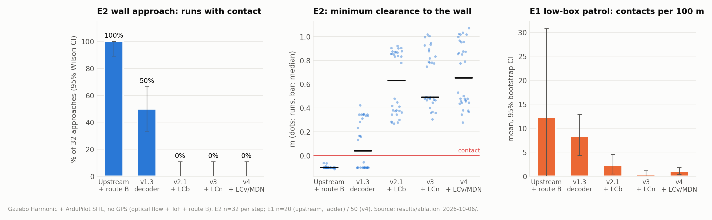</a> | Version ladder |
| <a href="../reports/figures/fig2_e1_ablation_forest.png">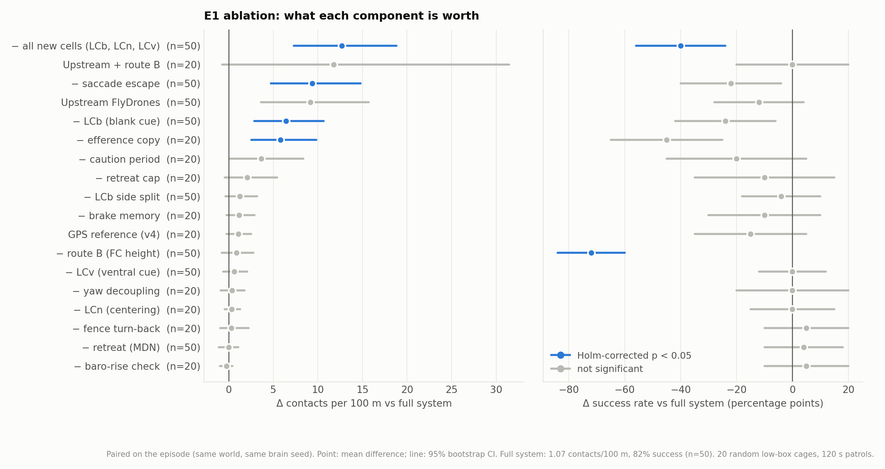</a> | E1 ablation |

### ecps295 system architecture

Document: [`docs/ARCHITECTURE.md`](../docs/ARCHITECTURE.md)

| Diagram | Type | Section |
|---|---|---|
| — | flowchart | [1. System overview: the layers](../docs/ARCHITECTURE.md#1-system-overview-the-layers) |
| One 20 Hz control tick in execution order, with sensor and output rates | flowchart | [2. One control tick](../docs/ARCHITECTURE.md#2-one-control-tick) |
| — | flowchart | [3.1 The cumulative circuit](../docs/ARCHITECTURE.md#31-the-cumulative-circuit) |
| Escape state machine of the decoder (giant-fibre and DNp03 triggers are low-pass filtered rates; a brake-triggered saccade is blocked for 1 s after the last one) | stateDiagram-v2 | [3.3 Decoder behaviour states](../docs/ARCHITECTURE.md#33-decoder-behaviour-states) |
| — | flowchart | [4. System generations: from the GPS cage to the final hardware](../docs/ARCHITECTURE.md#4-system-generations-from-the-gps-cage-to-the-final-hardware) |
| — | flowchart | [4.1 Final system (Gen E, w2map)](../docs/ARCHITECTURE.md#41-final-system-gen-e-w2map) |
| — | flowchart | [5.1 Defence in depth](../docs/ARCHITECTURE.md#51-defence-in-depth) |
| Sensor-fault decisions on the Orange Pi | flowchart | [5.1 Defence in depth](../docs/ARCHITECTURE.md#51-defence-in-depth) |
| Link and companion faults | flowchart | [5.1 Defence in depth](../docs/ARCHITECTURE.md#51-defence-in-depth) |
| — | flowchart | [6. Navigation and state estimation without GPS (route B)](../docs/ARCHITECTURE.md#6-navigation-and-state-estimation-without-gps-route-b) |
| — | flowchart | [7. Hardware architecture and wiring](../docs/ARCHITECTURE.md#7-hardware-architecture-and-wiring) |
| — | flowchart | [8. Onboard software deployment: Orange Pi vs flight controller](../docs/ARCHITECTURE.md#8-onboard-software-deployment-orange-pi-vs-flight-controller) |
| Flight modes and behaviour states seen from the companion. Any console command switches between the modes inside InControl directly (only the hub transitions are drawn); after the FC confirms an E-stop, the RC still wins, and the latch keeps the brain out of control until `estop_reset`, which is ref | stateDiagram-v2 | [8.4 Ground console (Mac)](../docs/ARCHITECTURE.md#84-ground-console-mac) |
| Guidance path of a GOTO command | sequenceDiagram | [8.4 Ground console (Mac)](../docs/ARCHITECTURE.md#84-ground-console-mac) |
| — | flowchart | [9. Development and verification architecture](../docs/ARCHITECTURE.md#9-development-and-verification-architecture) |
| — | flowchart | [10. Experimental branches that were not adopted](../docs/ARCHITECTURE.md#10-experimental-branches-that-were-not-adopted) |
| Import graph, solid = imports, dashed = subclasses an upstream class | flowchart | [11. Code map](../docs/ARCHITECTURE.md#11-code-map) |

### Flight-controller configuration (ArduCopter 4.7 on Matek F405-WMO)

Document: [`docs/FLIGHT_CONTROLLER.md`](../docs/FLIGHT_CONTROLLER.md)

| Diagram | Type | Section |
|---|---|---|
| — | flowchart | [Flight-controller configuration (ArduCopter 4.7 on Matek F405-WMO)](../docs/FLIGHT_CONTROLLER.md#flight-controller-configuration-arducopter-47-on-matek-f405-wmo) |
| Mode switch and hand-over gate. The SITL bench parameter files put GUIDED on switch position 1 (`FLTMODE1 4`) and LOITER on position 4 (`FLTMODE4 5`), the other positions are `FLTMODE2 3 5 6 = 0` = STABILIZE; `../sitl/course_base.parm` has `FLTMODE1 6` = RTL instead | flowchart | [2.1 RC mode switch](../docs/FLIGHT_CONTROLLER.md#21-rc-mode-switch) |
| Where the GPS-free estimate comes from. `EK3_SRC1_POSXY 0` means there is no position source at all: the horizontal position is the integral of the flow-derived velocity, the height is route B (the companion's z) with the barometer as fallback, and the yaw comes from the compass | flowchart | [3. Sensors and EKF3 without GPS](../docs/FLIGHT_CONTROLLER.md#3-sensors-and-ekf3-without-gps) |

### Real-drone test plan

Document: [`docs/FLIGHT_TEST_PLAN.md`](../docs/FLIGHT_TEST_PLAN.md)

| Diagram | Type | Section |
|---|---|---|
| — | flowchart | [Real-drone test plan](../docs/FLIGHT_TEST_PLAN.md#real-drone-test-plan) |
| Pre-cage ladder with the go / no-go gates; every gate is the exit criterion of the table in §2 | flowchart | [2. Before the cage](../docs/FLIGHT_TEST_PLAN.md#2-before-the-cage) |
| Cage ladder with the go / no-go gates; the gate texts are the metrics of §3 and the milestone criteria of §5 | flowchart | [3. Cage stages](../docs/FLIGHT_TEST_PLAN.md#3-cage-stages) |

### Hardware

Document: [`docs/HARDWARE.md`](../docs/HARDWARE.md)

| Diagram | Type | Section |
|---|---|---|
| Bus map of the flying configuration; power rails are in §3.3 | flowchart | [3. Wiring and pin-out](../docs/HARDWARE.md#3-wiring-and-pin-out) |
| — | flowchart | [3.3 Power](../docs/HARDWARE.md#33-power) |

### Simulation guide: set up, run, reproduce

Document: [`docs/SIMULATION_GUIDE.md`](../docs/SIMULATION_GUIDE.md)

| Diagram | Type | Section |
|---|---|---|
| Processes of one Gazebo run and the links between them. A parallel instance n has its own TCP 5760 + 10n, its own FDM port 9002 + 10n, its own shared-memory file and its own Gazebo partition | flowchart | [4. Gazebo + SITL](../docs/SIMULATION_GUIDE.md#4-gazebo--sitl) |
| One Gazebo run from the command line to the result files | sequenceDiagram | [4. Gazebo + SITL](../docs/SIMULATION_GUIDE.md#4-gazebo--sitl) |

### ecps295/rl：用 CMA-ES 优化 MiniFly 解码器，以及配套的快仿真、对照实验与 Gazebo 多实例评估

Document: [`rl/README.md`](../rl/README.md)

| Diagram | Type | Section |
|---|---|---|
| CMA-ES 优化、快仿真评估与 Gazebo 验收的流程。来源：`cmaes_run.py`（`main`）、`worlds.py`、`params.py`、`batch.py`、 `episode.py`、`twin.py`、`validate.py`、`export_arms.py`、`server/gz_batch.py`、`stats.py`，以及本文第 3 节。 | flowchart | [1. 内容](../rl/README.md#1-内容) |

## Deployment and ground console

### ECPS 控制台（Mac 地面站）/ ECPS Console

Document: [`deploy/console/README.md`](../deploy/console/README.md)

| Diagram | Type | Section |
|---|---|---|
| 控制台 ↔ 机载程序 ↔ 飞控 的报文流。The message flow between console, companion and flight controller | flowchart | [链路 / Message flow](../deploy/console/README.md#链路--message-flow) |
| 急停状态机：确认之前一直重发，确认之后不再重发（飞手重新切模式仍然优先），解除需要飞控状态新鲜且已上锁。The emergency-stop state machine: the command is repeated until the FC confirms, then the console stops sending and only the operator resets the stop | stateDiagram-v2 | [使用流程（真机）](../deploy/console/README.md#使用流程真机) |

### ECPS295 地面控制台（Mac）设计与测试报告

Document: [`deploy/console/docs/ECPS295_地面控制台设计与测试报告_20261017.md`](../deploy/console/docs/ECPS295_地面控制台设计与测试报告_20261017.md)

| Diagram | Type | Section |
|---|---|---|
| — | flowchart | [2. 架构](../deploy/console/docs/ECPS295_地面控制台设计与测试报告_20261017.md#2-架构) |

| Figure | What it shows |
|---|---|
| <a href="../deploy/console/docs/img/lan_e2e_patrol.jpg">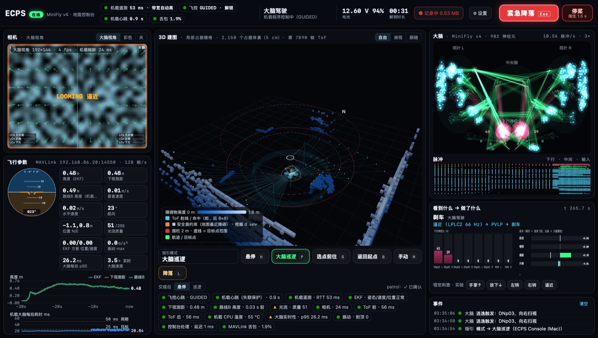</a> | 巡逻中 |
| <a href="../deploy/console/docs/img/lan_e2e_estop_land.jpg">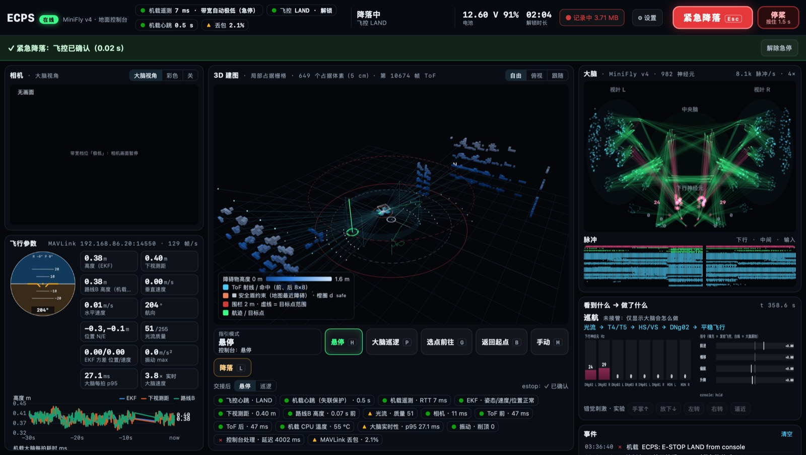</a> | 紧急降落已确认 |
| <a href="../deploy/console/docs/img/lan_e2e_kill.jpg">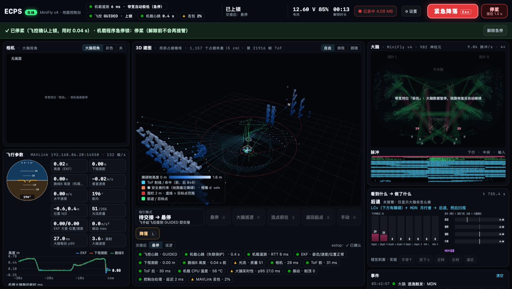</a> | 停桨已确认 |
| <a href="../deploy/console/docs/img/ui_en_patrol.jpg">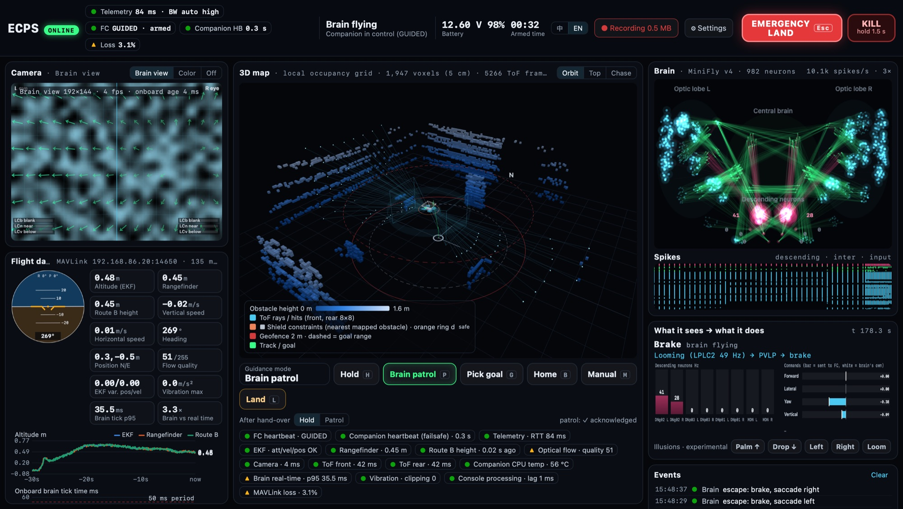</a> | 英文界面，A2 巡逻中 |
| <a href="../deploy/console/docs/img/track_approach.jpg">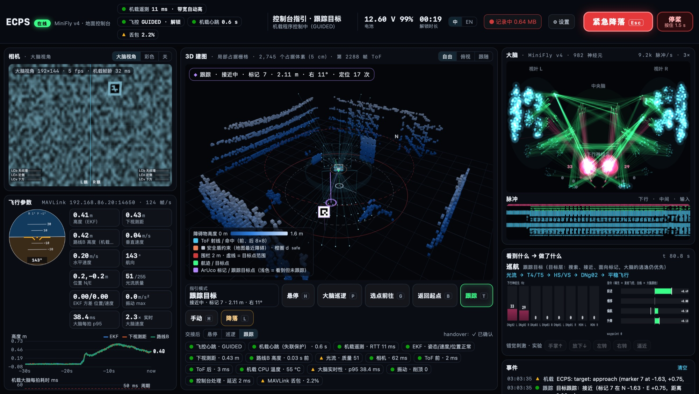</a> | 跟踪：接近中 |
| <a href="../deploy/console/docs/img/track_arrived.jpg">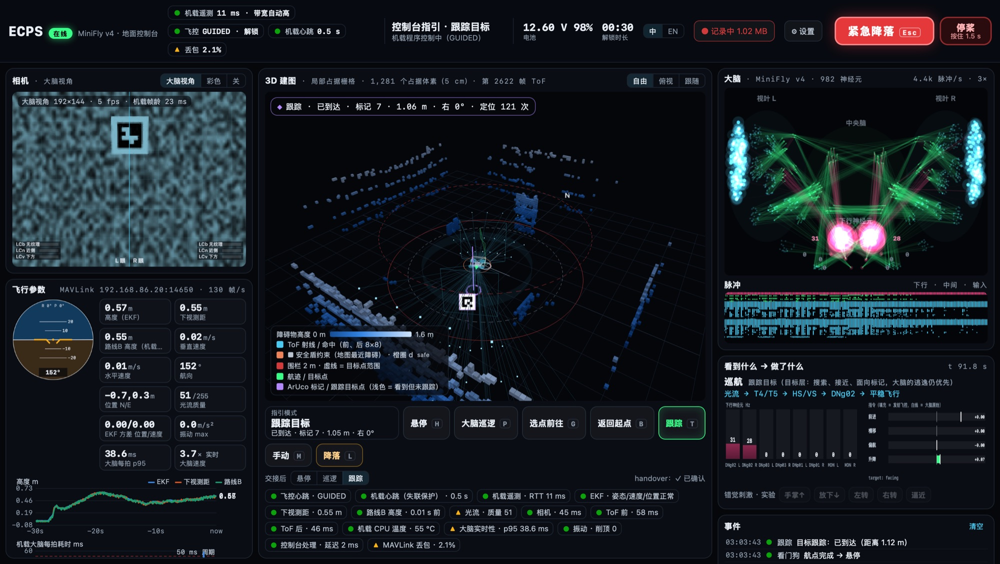</a> | 跟踪：已到达，面向标记 |
| <a href="../deploy/console/docs/img/track_deployed_arrived.jpg">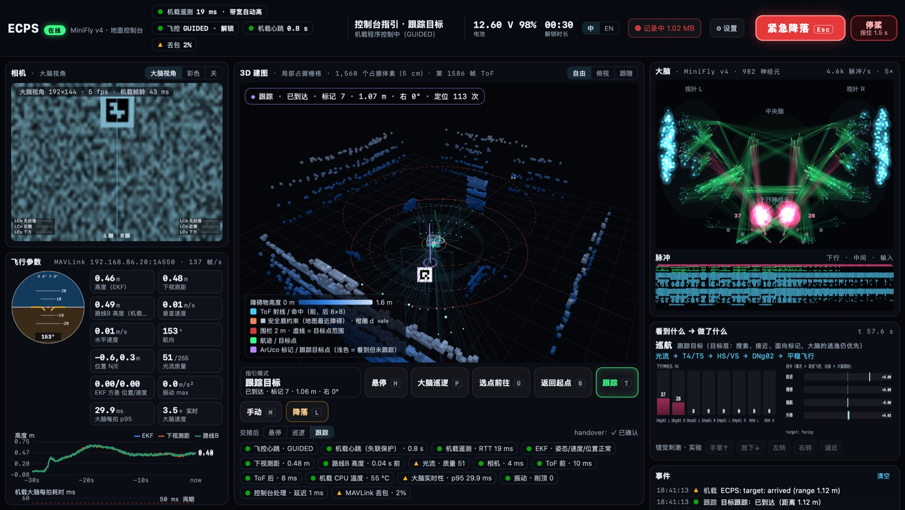</a> | 部署后的跟踪：经由应用，已到达 |

### 台式机部署（Ubuntu 24.04 + NVIDIA）

Document: [`deploy/desktop/README.md`](../deploy/desktop/README.md)

| Diagram | Type | Section |
|---|---|---|
| 安装阶段和验收。The setup stages and the acceptance run. A finished stage is marked in `~/sim/.deploy/`, so the script can be repeated (`FORCE=1` redoes a stage) | flowchart | [用法](../deploy/desktop/README.md#用法) |

### ECPS295 Orange Pi Zero 3W 部署包 / deployment package

Document: [`deploy/orangepi/README.md`](../deploy/orangepi/README.md)

| Diagram | Type | Section |
|---|---|---|
| 机载服务、传感器线程和控制台链路。The onboard services, the sensor threads and the console link | flowchart | [服务与进程 / Services and processes](../deploy/orangepi/README.md#服务与进程--services-and-processes) |
| 开机顺序：`ecps-security.service` 和 `mavlink-router.service` 开机自启，`ecps-companion.service` 已安装但不开机自启， 地面测试通过后手动 `systemctl start`。Boot order: `ecps-security.service` and `mavlink-router.service` start at boot, `ecps-companion.service` is installed but not enabled — it is started by hand after the ground  | flowchart | [开机流程 / Boot sequence](../deploy/orangepi/README.md#开机流程--boot-sequence) |

### ECPS295 Orange Pi Zero 3W: onboard deployment and performance test report

Document: [`deploy/orangepi/docs/ECPS295_OrangePi部署与性能测试报告_20261015.en.md`](../deploy/orangepi/docs/ECPS295_OrangePi部署与性能测试报告_20261015.en.md)

| Diagram | Type | Section |
|---|---|---|
| — | flowchart | [2. Deployment architecture](../deploy/orangepi/docs/ECPS295_OrangePi部署与性能测试报告_20261015.en.md#2-deployment-architecture) |
| — | flowchart | [10.3 Gazebo processor-in-the-loop (PIL, 10-16)](../deploy/orangepi/docs/ECPS295_OrangePi部署与性能测试报告_20261015.en.md#103-gazebo-processor-in-the-loop-pil-10-16) |

| Figure | What it shows |
|---|---|
| <a href="../deploy/orangepi/docs/figures/fig_stage_breakdown.png">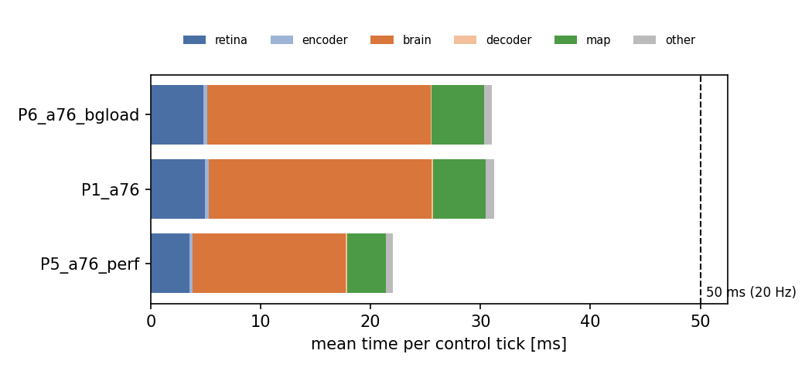</a> | Mean time per tick by stage |
| <a href="../deploy/orangepi/docs/figures/fig_thermal.png">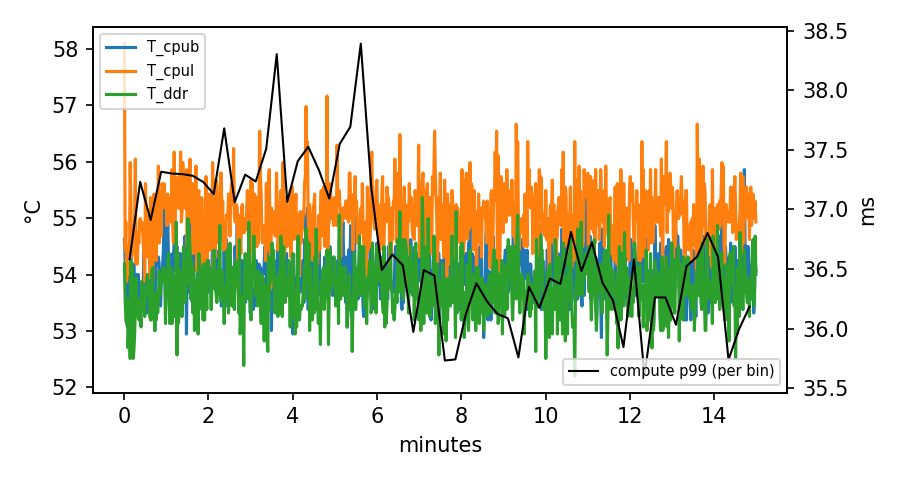</a> | 15 min thermal soak |

## Experiment reports (twin, Gazebo, optimisation)

### Report 1 — Digital twin of the ECPS 295 drone and the MiniFly v0 → v4 evolution

Document: [`reports/01_twin_and_minifly.en.md`](../reports/01_twin_and_minifly.en.md)

| Diagram | Type | Section |
|---|---|---|
| — | flowchart | [1. The twin](../reports/01_twin_and_minifly.en.md#1-the-twin) |

| Figure | What it shows |
|---|---|
|  | Figure 1. Wall approaches (E2, n = 32 per step) and low-box patrols (E1, n = 20/50), no GPS. Contact drops to 0 % when LCb arrives in v2.1, and the minimum clearance to the wall rises from −0.10 m to ≈ 0.65 m. |

### Report 2 — Flying without GPS: optical flow, the low-box problem and route B

Document: [`reports/02_gps_free_navigation.en.md`](../reports/02_gps_free_navigation.en.md)

| Figure | What it shows |
|---|---|
| <a href="../reports/figures/fig5_s7e_route_b.png">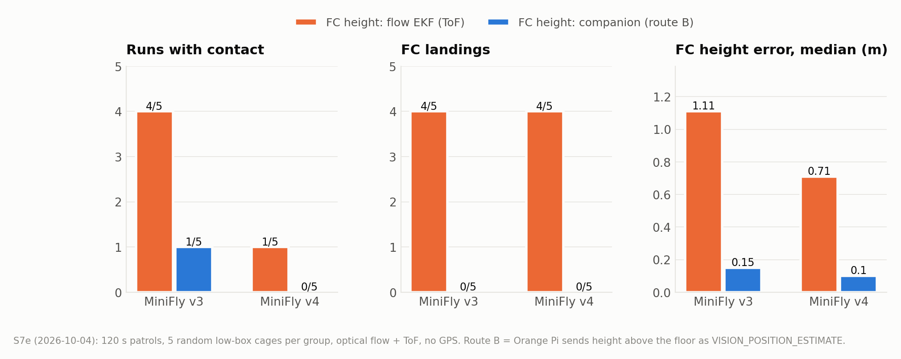</a> | Figure 2. S7e, 5 random low-box cages per group, no GPS. Route B takes FC landings from 4/5 to 0/5 and the median height error from ~1 m to 0.1 m. v4 adds a second layer: fewer contacts and a third of the time over boxes. |
| <a href="../reports/figures/fig4_e3_fault_injection.png">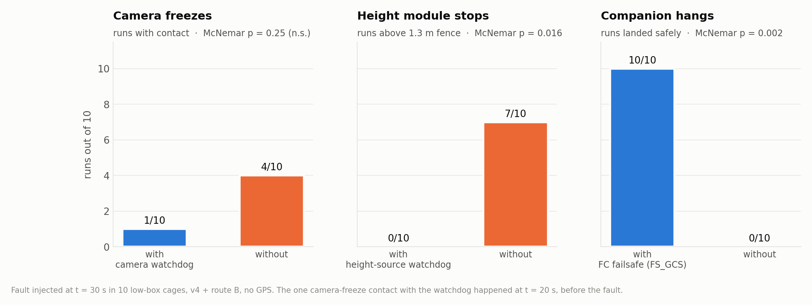</a> | Figure 3. Fault at t = 30 s, 10 low-box cages each, paired exact McNemar. |

### Report 3 — S8 ablation: 1,260 closed-loop flights on the final-hardware twin

Document: [`reports/03_s8_ablation.en.md`](../reports/03_s8_ablation.en.md)

| Figure | What it shows |
|---|---|
|  | Figure 1. Paired difference to the full system (full: 1.07 contacts/100 m [0.44, 1.87], 82 % success [70, 92]). Blue: Holm p < 0.05. |
| <a href="../reports/figures/fig3_e2_wall_clearance.png">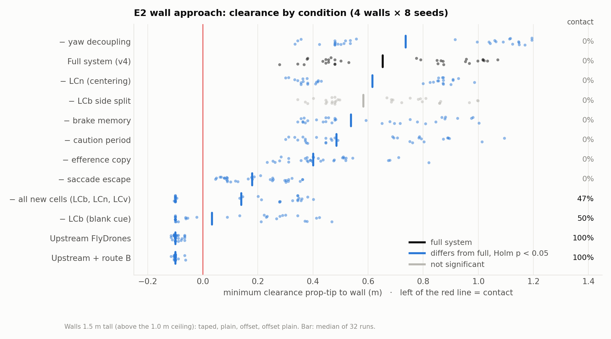</a> | Figure 2. Minimum clearance per run (32 per condition). Only conditions without LCb, and the upstream brain, ever touch the wall. The finer components (caution, brake memory, LCn) are each worth 6–8 cm of margin. |

### Report 4 — Optimising the MiniFly decoder with CMA-ES, and what the controls say

Document: [`reports/04_cmaes_optimisation.en.md`](../reports/04_cmaes_optimisation.en.md)

| Figure | What it shows |
|---|---|
| <a href="../reports/figures/fig6_cmaes_convergence.png">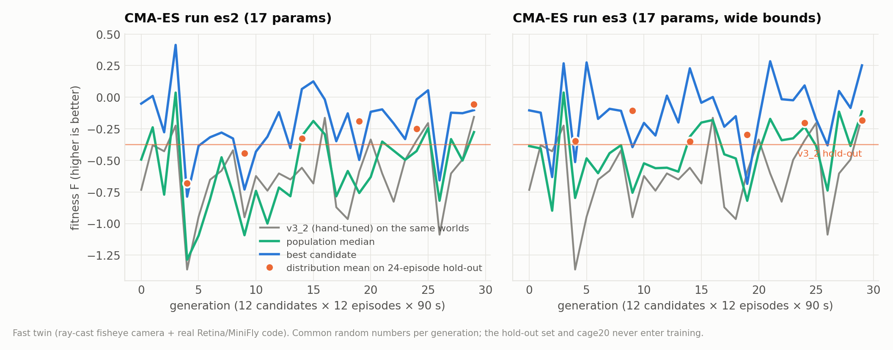</a> | Figure 1. Fitness per generation for es2 (default bounds) and es3 (bounds widened where es2's optimum sat on a bound). Grey: hand-tuned v3_2 on the same worlds; orange dots: distribution mean on the hold-out set. |
| <a href="../reports/figures/fig7_cage20_gazebo.png">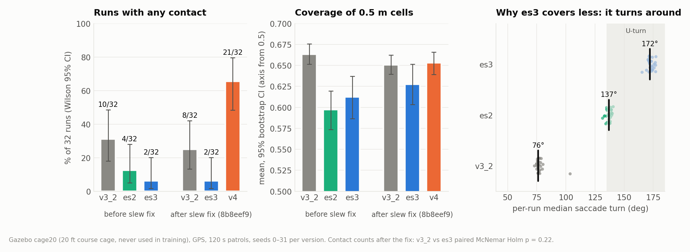</a> | Figure 2. Gazebo cage20, GPS, 120 s patrols, 32 seeds per version. Left: runs with contact. Middle: coverage. Right: why es3 covers less. |
| <a href="../reports/figures/fig8_a1_control_arms.png">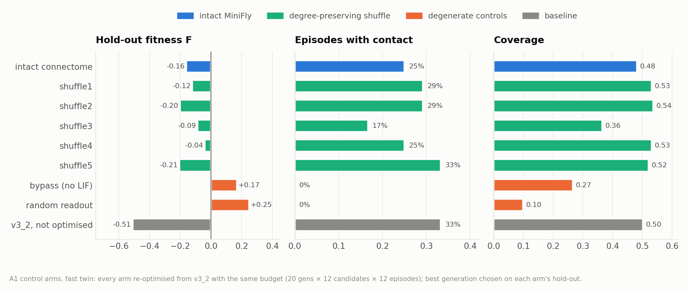</a> | Figure 3. Fast-twin hold-out results at each arm's best generation. Shuffle = Maslov–Sneppen edge swaps that keep in/out degree and weight sign exactly. |

### Report 5 — Hardware alignment: re-doing the RL pipeline under the real sensor set

Document: [`reports/05_hardware_alignment.en.md`](../reports/05_hardware_alignment.en.md)

| Figure | What it shows |
|---|---|
| <a href="../reports/figures/fig9_h1_lowbox_reliability.png">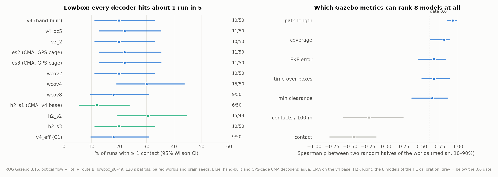</a> | Figure 1. Left: runs with contact on lowbox_s0–49 (ROG). Right: split-half reliability of each metric across the 8 calibration models — draw two random halves of the 50 worlds and correlate the model means. |
| <a href="../reports/figures/fig10_h3_acceptance.png">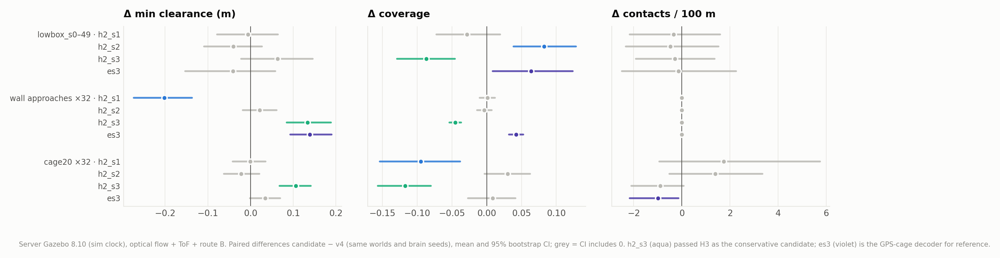</a> | Figure 2. H3 on the server: paired differences against v4 on lowbox_s0–49, 32 wall approaches and cage20 × 32. |
| <a href="../reports/figures/fig16_c1_efference.png">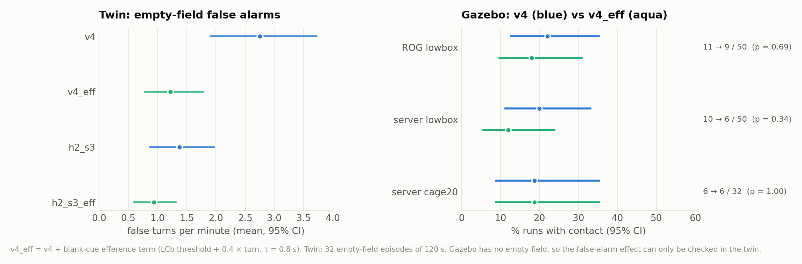</a> | Figure 3. Left: twin, empty field (32 × 120 s). Right: Gazebo, v4 vs v4_eff paired on the same worlds and seeds. |

### Report 6 — Does the connectome matter? Control arms and out-of-distribution tests under the real sensor set

Document: [`reports/06_connectome_controls_ood.en.md`](../reports/06_connectome_controls_ood.en.md)

| Figure | What it shows |
|---|---|
| <a href="../reports/figures/fig11_c0_c2_hw.png">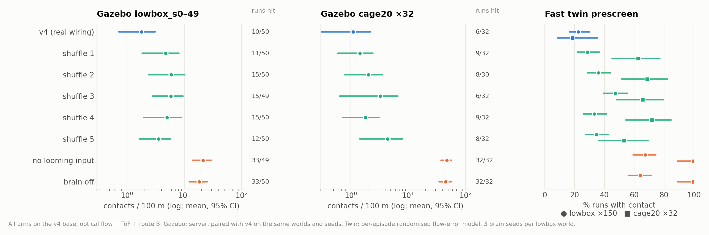</a> | Figure 1. Server Gazebo, 574 runs paired with v4 (left, middle), and the fast-twin prescreen with the same arms (right, 2,782 episodes). |
| <a href="../reports/figures/fig12_bypass_vs_intact.png">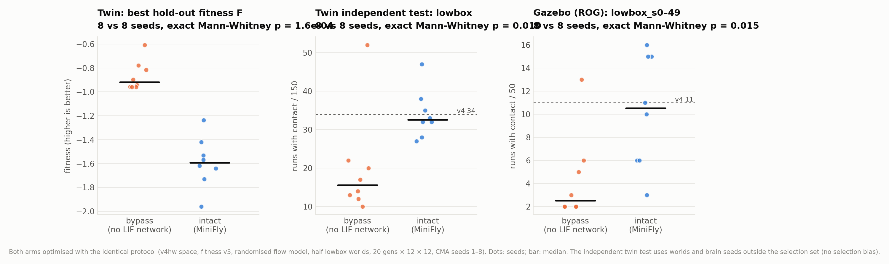</a> | Figure 2. Each dot is one CMA seed. Left: best hold-out fitness (selected on the hold-out set, so biased upward). Middle: independent twin test on 150 lowbox episodes outside the selection set. Right: Gazebo, ROG, lowbox_s0–49 paired with v4. |
| <a href="../reports/figures/fig13_twin_gazebo_transfer.png">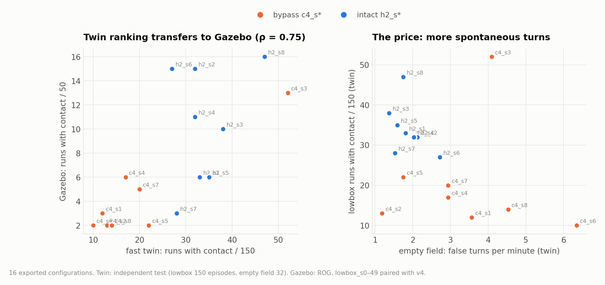</a> | Figure 3. Left: per configuration, twin vs Gazebo runs with contact (Spearman ρ = 0.75, p = 0.0009). Right: the cost of bypass — more false turns in an empty field (c4_s6: 6.4/min). |
| <a href="../reports/figures/fig15_c4_h2_curves.png">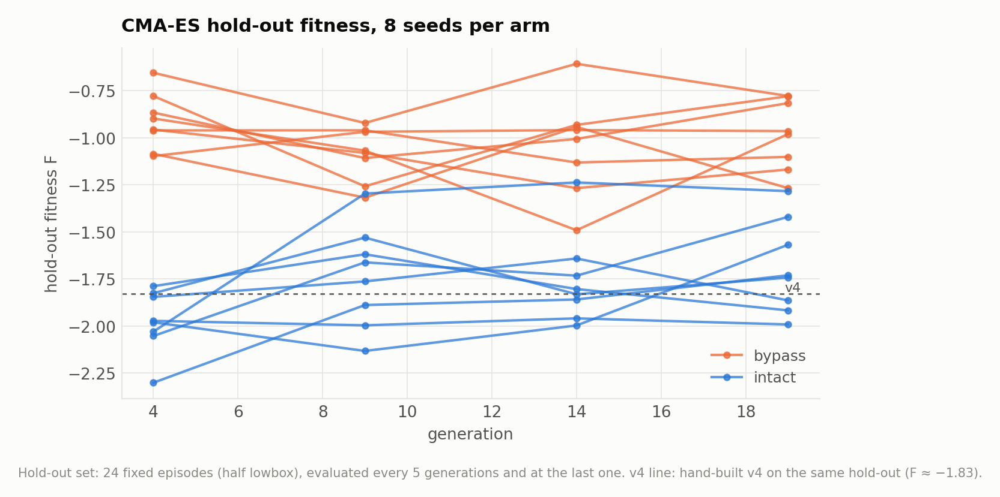</a> | Figure 4. Hold-out fitness during optimisation. Bypass starts better and stays better; most of its gains are already present by generation 4. Many bypass gains end at a bound (c0 = 60, k_flow = 3, th_gf = 0). |
| <a href="../reports/figures/fig14_ood.png">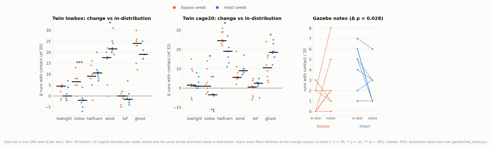</a> | Figure 5. Change in runs with contact relative to in-distribution, per seed. The test asked by FLYNN-style arguments: if the connectome helps, intact should degrade less. |

### Report 7 — Range sensing and a safety shield: closing the lowbox gap

Document: [`reports/07_range_sensing_shield.en.md`](../reports/07_range_sensing_shield.en.md)

| Figure | What it shows |
|---|---|
| <a href="../reports/figures/fig17_contact_diagnosis.png">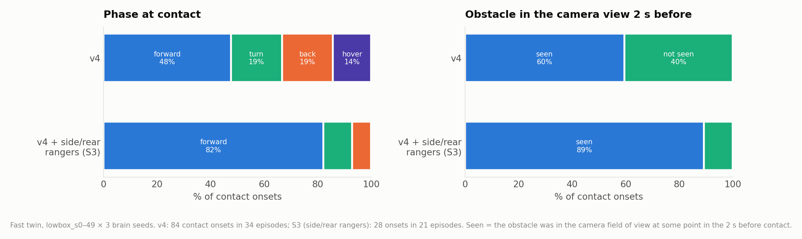</a> | Figure 1. What the contacts look like, twin lowbox, 150 episodes per model (`rl/diag_contacts.py`). S3 removes the backing, turning and hovering contacts. What remains is forward flight into an obstacle that was in view: it is seen too late, not missed. |
| <a href="../reports/figures/fig18_shield_screen.png">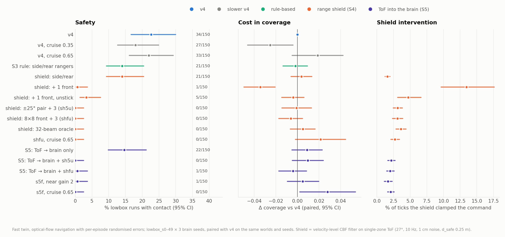</a> | Figure 2. Safety, coverage cost and shield intervention for each configuration, fast twin. |
| <a href="../reports/figures/fig19_gazebo_shield.png">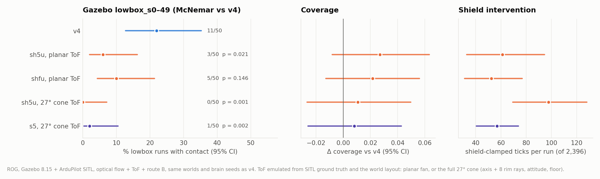</a> | Figure 3. Gazebo lowbox, paired with v4 on the same 50 worlds and brain seeds. |
| <a href="../reports/figures/fig21_n3_cma.png">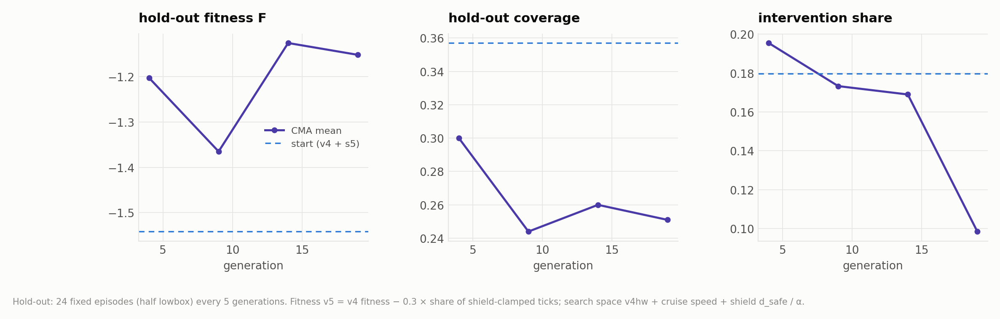</a> | Figure 4. Mac mini, seed 1 with the s5 shield, 20 generations × 14 candidates × 16 episodes. |

### Report 8 — Mushroom-body plasticity (stage E): a negative result

Document: [`reports/08_mushroom_body.en.md`](../reports/08_mushroom_body.en.md)

| Figure | What it shows |
|---|---|
| <a href="../reports/figures/fig20_mb_stage_e.png">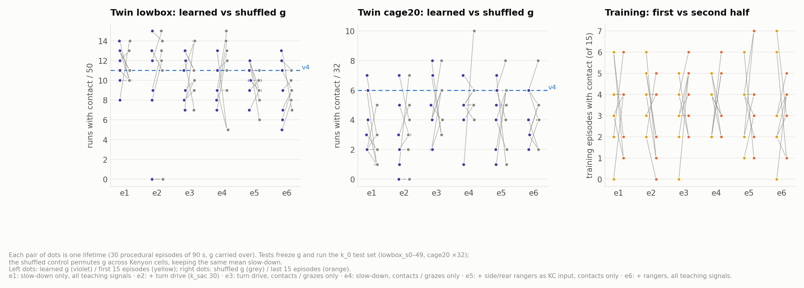</a> | Figure 1. Left and middle: runs with contact per lifetime, learned g vs shuffled g (8 lifetimes per setting, frozen test). Right: training episodes with contact in the first vs the second half of each lifetime. |

### ECPS 295 experiment reports · 实验报告

Document: [`reports/README.md`](../reports/README.md)

| Figure | What it shows |
|---|---|
|  |  |
|  |  |
|  |  |
|  |  |
|  |  |
|  |  |
|  |  |
|  |  |
|  |  |
|  |  |
|  |  |
|  |  |
|  |  |
|  |  |
|  |  |
|  |  |
|  |  |
|  |  |
|  |  |
|  |  |
|  |  |

## Gazebo result sets

### Gazebo target-tracking tests (2026-10-18/19)

Document: [`gazebo/trk_results/README.md`](../gazebo/trk_results/README.md)

| Figure | What it shows |
|---|---|
| <a href="../gazebo/trk_results/figures/fig1_pass_fail.png">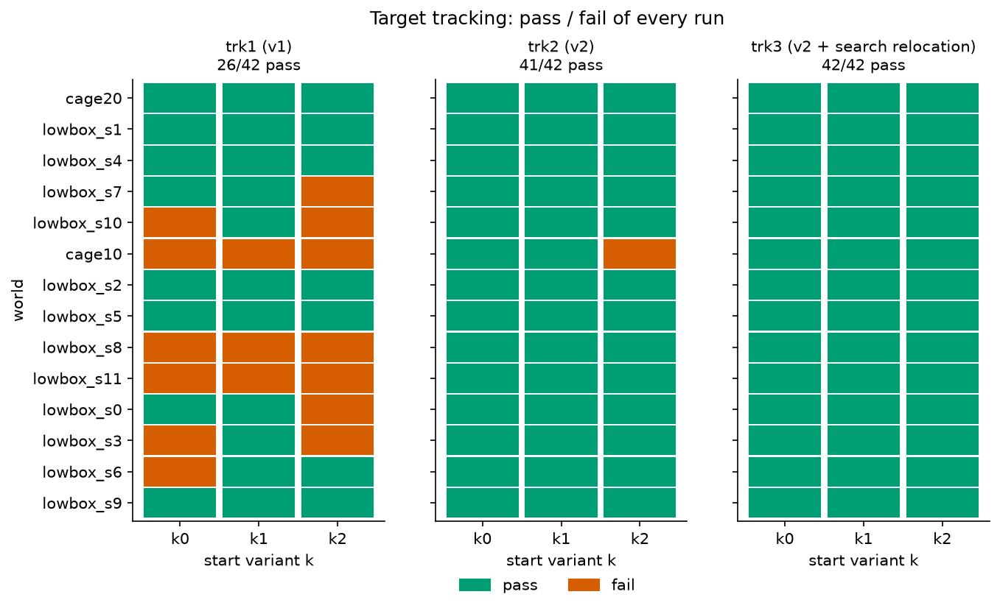</a> | Figure 1. Pass / fail of each of the 42 runs per version, by world and start variant k (k0, k1: track start at 6 s; k2: at 20 s); cage10 is included here (trk1 0/3, trk2 2/3, trk3 3/3). Source: matrix_trk1.log, matrix_trk2.log, matrix_trk3.log; script: make_figures.py. |
| <a href="../gazebo/trk_results/figures/fig2_end_distance.png">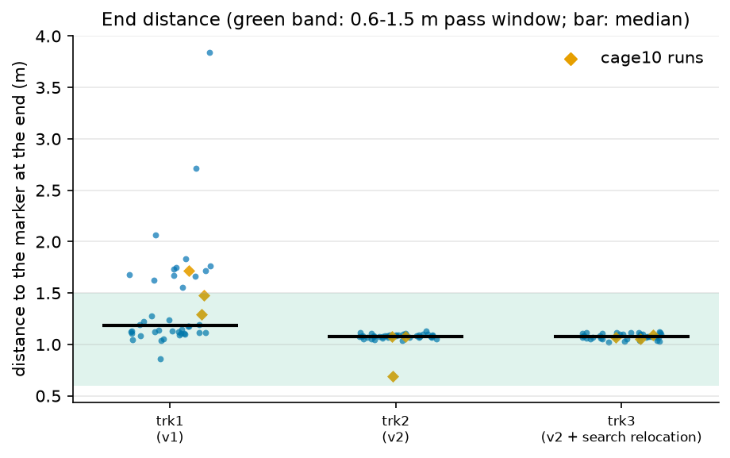</a> | Figure 2. Distance to the marker at the end of each run, with the 0.6-1.5 m pass window. Source: matrix_trk1.log, matrix_trk2.log, matrix_trk3.log; script: make_figures.py. |
| <a href="../gazebo/trk_results/figures/fig3_arrival_time.png">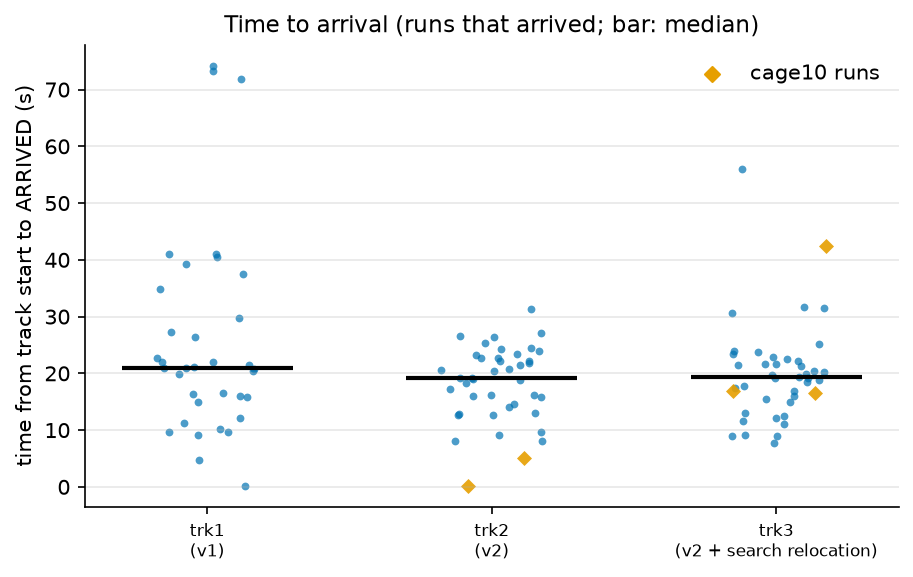</a> | Figure 3. Time from track start to ARRIVED for the runs that arrived. Source: matrix_trk1.log, matrix_trk2.log, matrix_trk3.log; script: make_figures.py. |
| <a href="../gazebo/trk_results/figures/fig4_estimate_error.png">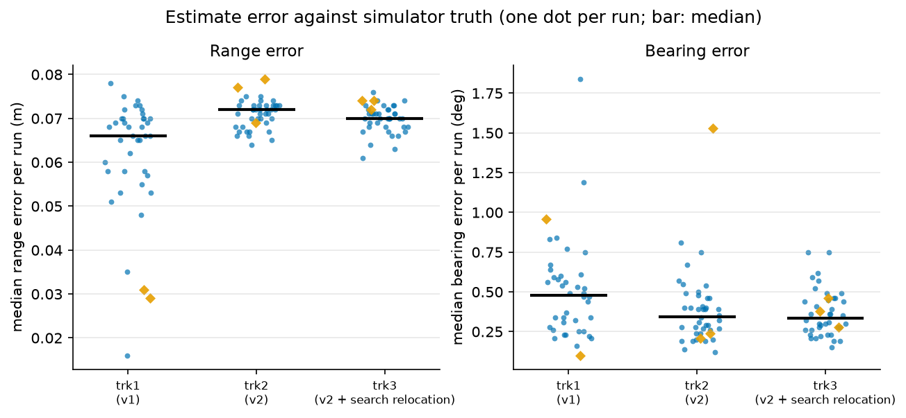</a> | Figure 4. Median range and bearing error of the marker estimate per run, against simulator truth. Source: matrix_trk1.log, matrix_trk2.log, matrix_trk3.log; script: make_figures.py. |
| <a href="../gazebo/trk_results/figures/fig5_min_clearance.png">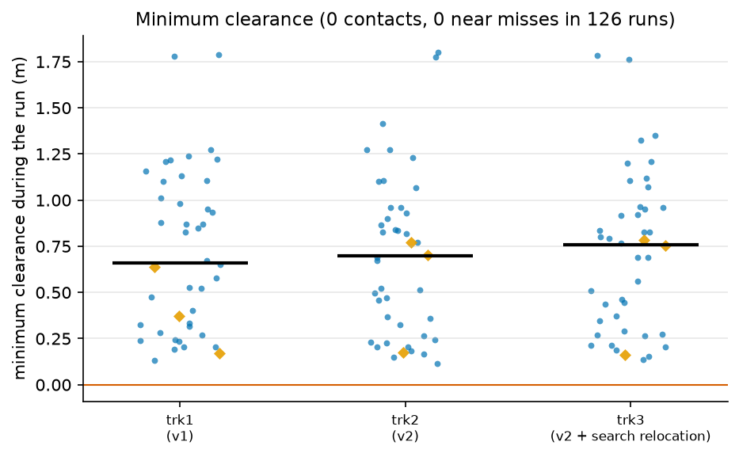</a> | Figure 5. Minimum clearance during each run (no contacts, no near misses in any of the 126 runs). Source: matrix_trk1.log, matrix_trk2.log, matrix_trk3.log; script: make_figures.py. |

### FlyDrones × ECPS295：MiniFly 与系统改进的消融实验报告（S8a）

Document: [`results/ablation_2026-10-06/REPORT_zh.md`](../results/ablation_2026-10-06/REPORT_zh.md)

| Figure | What it shows |
|---|---|
| <a href="../results/ablation_2026-10-06/figures/fig5_thermal_rtf.png">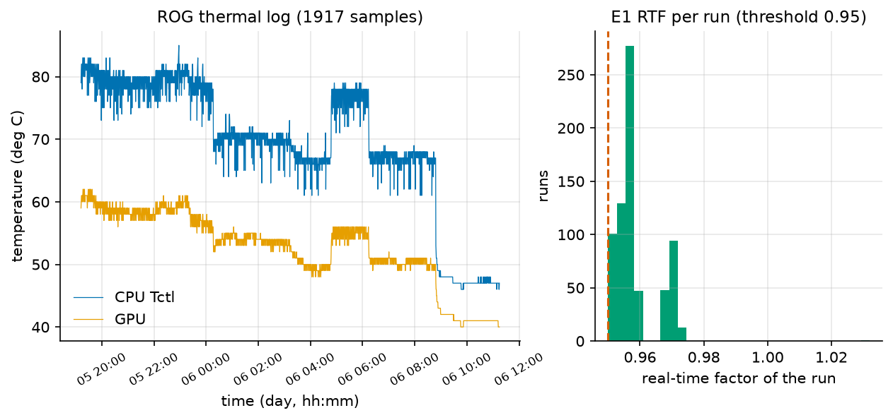</a> | 图 5。左：CPU 和 GPU 温度记录（1,917 次采样）；右：E1 各次运行的 RTF 分布，虚线为 0.95 的有效性阈值。数据：thermal.csv、e1.csv；脚本：make_figures.py。 |
| <a href="../results/ablation_2026-10-06/figures/fig1_e1_outcomes.png">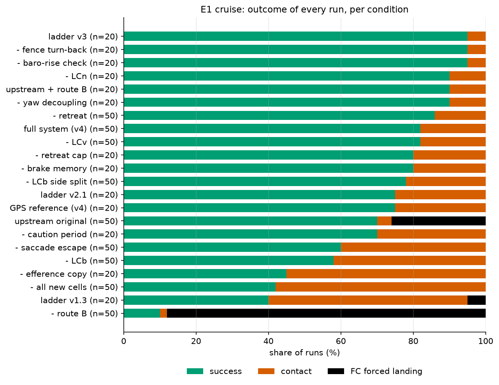</a> | 图 1。E1 中每个条件的运行结果占比（成功 / 撞击 / 飞控强制降落），按成功率排序。数据：e1.csv；脚本：make_figures.py。 |
| <a href="../results/ablation_2026-10-06/figures/fig2_e1_path_overbox.png">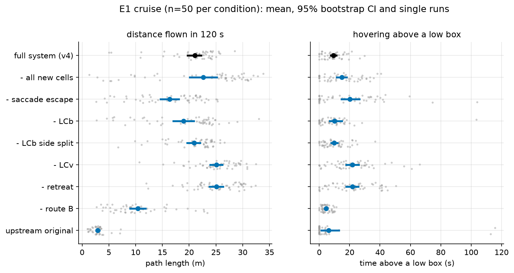</a> | 图 2。E1 九个 n = 50 条件的航程与停在箱子上方的时间（均值、95% bootstrap 置信区间、单次运行）。数据：e1.csv；脚本：make_figures.py。 |
| <a href="../results/ablation_2026-10-06/figures/fig3_e1_altitude.png">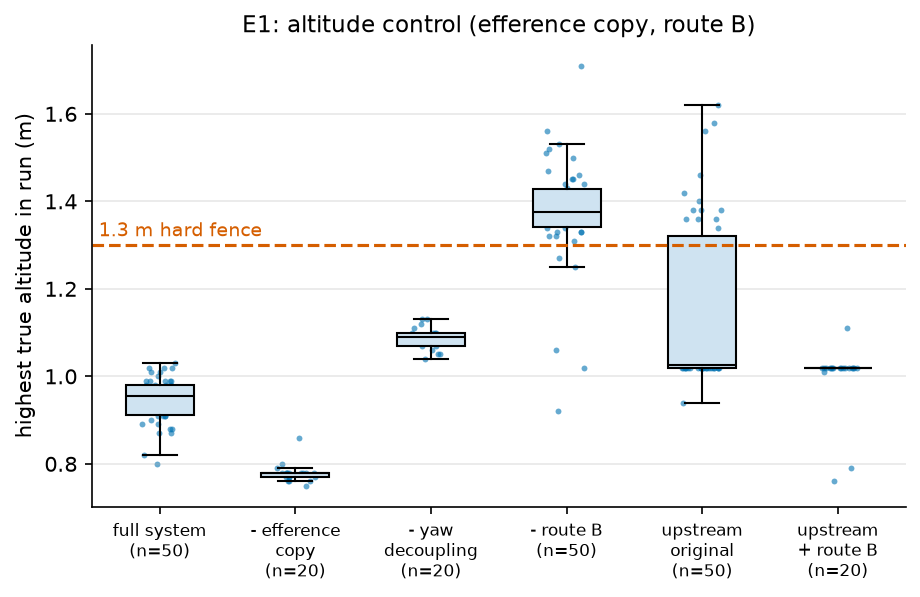</a> | 图 3。E1 中与高度控制相关的条件的最高真实高度（箱线图加单次运行），虚线为 1.3 m 硬围栏。数据：e1.csv；脚本：make_figures.py。 |
| <a href="../results/ablation_2026-10-06/figures/fig4_e2_onset_vs_min.png">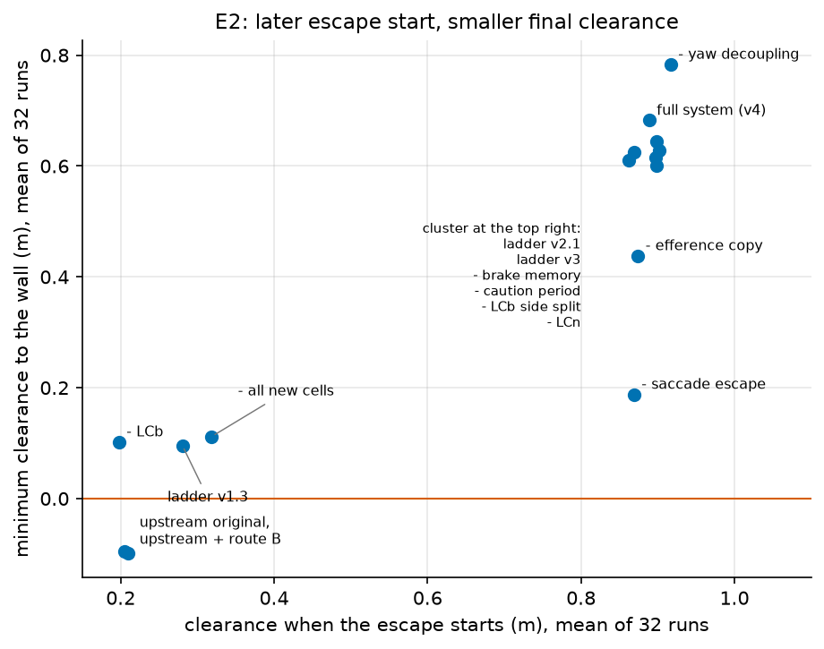</a> | 图 4。E2 各条件的逃逸起点间距与最小间距（每点为 32 次运行的均值）。数据：e2.csv；脚本：make_figures.py。 |

### slew 修复后的复核：S8 消融是否受影响，以及手工模型与 RL 解码器的对比

Document: [`results/slewfix_2026-10-07/REPORT_zh.md`](../results/slewfix_2026-10-07/REPORT_zh.md)

| Figure | What it shows |
|---|---|
| <a href="../results/slewfix_2026-10-07/figures/fig1_before_after.png">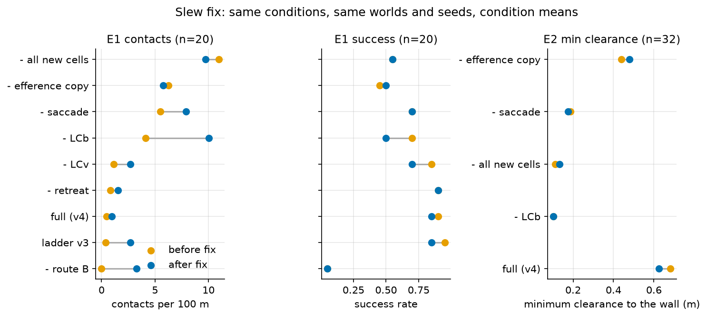</a> | 图 1。同一条件、同一世界和种子下，slew 修复前后的 E1 撞击、E1 成功率和 E2 最小间距（条件均值）。数据：A2_e1_bug.csv、A2_e1_fixed.csv、A2_e2_bug.csv、A2_e2_fixed.csv；脚本：make_figures.py。 |
| <a href="../results/slewfix_2026-10-07/figures/fig2_lowbox_models.png">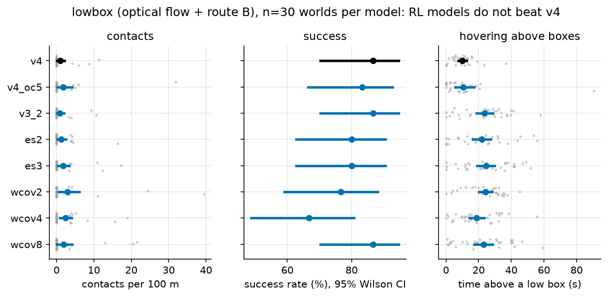</a> | 图 2。lowbox（n = 30）中八个模型的每 100 m 撞击、成功率（Wilson 95% 区间）和停在箱子上方的时间。数据：B_low_vs_v4.csv；脚本：make_figures.py。 |
| <a href="../results/slewfix_2026-10-07/figures/fig3_cage20_models.png">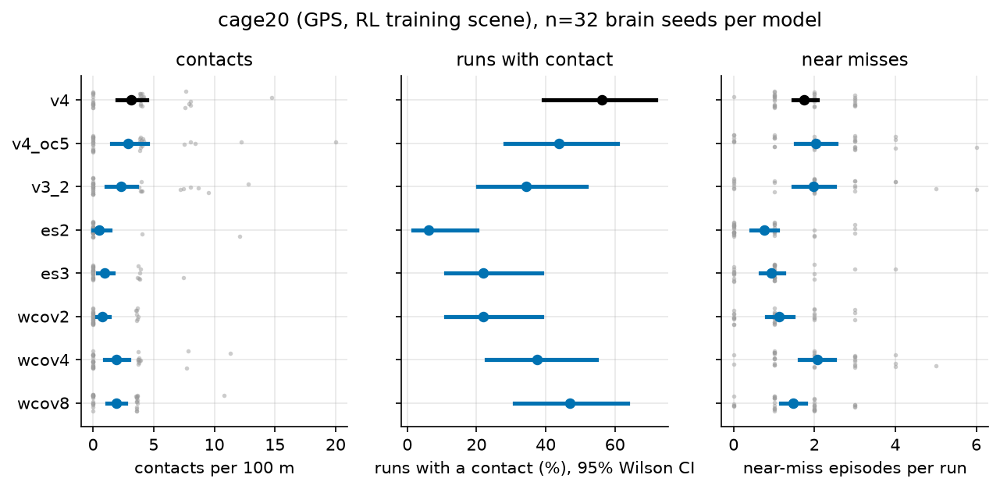</a> | 图 3。cage20（n = 32）中八个模型的每 100 m 撞击、有接触的运行占比（Wilson 95% 区间）和每次运行险情数。数据：B_cage_vs_v4.csv；脚本：make_figures.py。 |
| <a href="../results/slewfix_2026-10-07/figures/fig4_wall_models.png">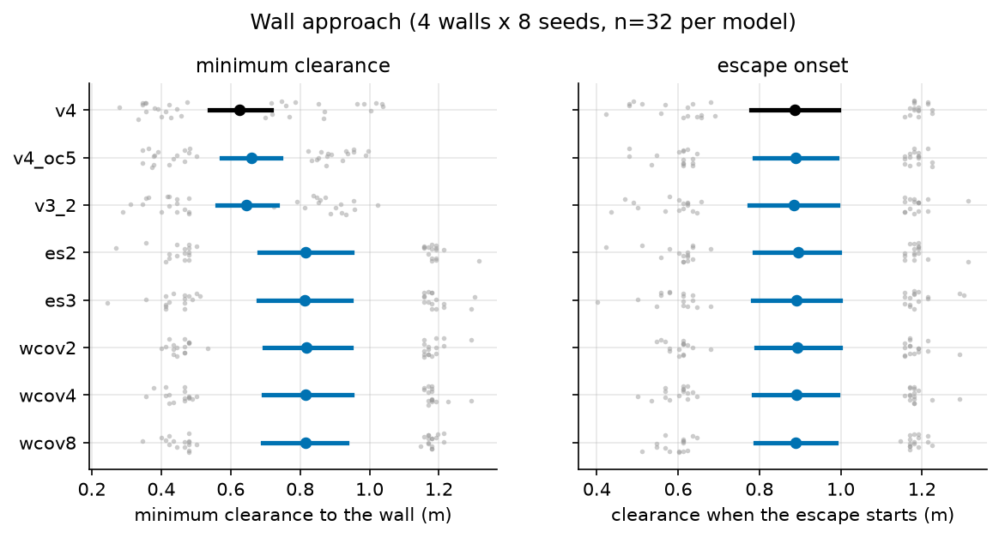</a> | 图 4。墙体接近（n = 32）中八个模型的最小间距和逃逸起点间距（均值、95% bootstrap 置信区间、单次运行）。数据：B_wall_vs_v4.csv；脚本：make_figures.py。 |
| <a href="../results/slewfix_2026-10-07/figures/fig5_coverage_vs_contacts.png">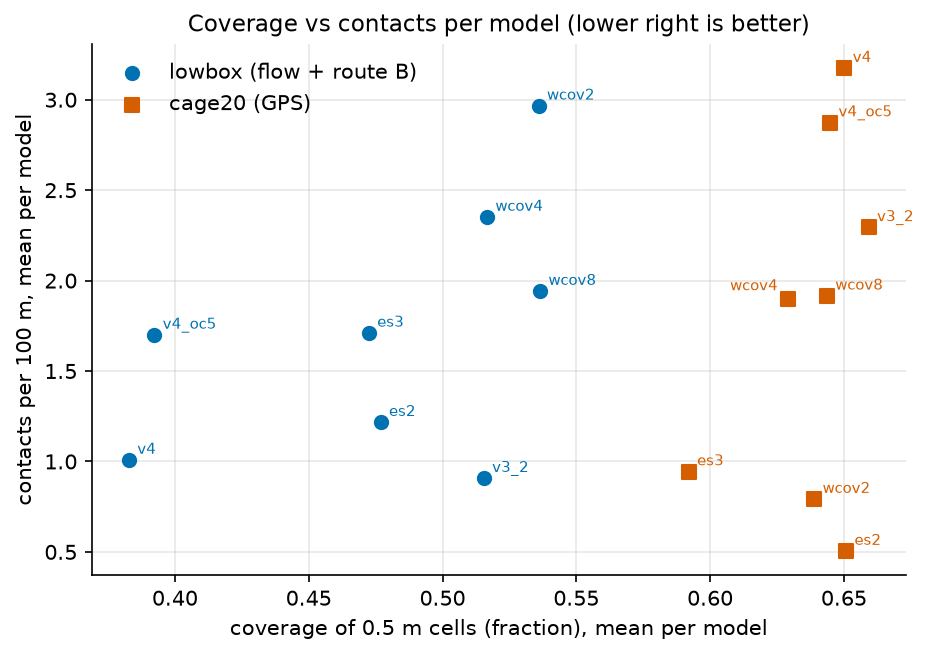</a> | 图 5。lowbox 与 cage20 中各模型的覆盖率与每 100 m 撞击（每点为一个模型的均值）。数据：B_low_vs_v4.csv、B_cage_vs_v4.csv；脚本：make_figures.py。 |

### Gazebo ground-console session (2026-10-21)

Document: [`scripts/gzc/README.md`](../scripts/gzc/README.md)

| Diagram | Type | Section |
|---|---|---|
| — | flowchart | [How the scripts chain](../scripts/gzc/README.md#how-the-scripts-chain) |

### Hover-precision tests (feat/hover)

Document: [`scripts/hover/README.md`](../scripts/hover/README.md)

| Diagram | Type | Section |
|---|---|---|
| — | flowchart | [How the scripts chain](../scripts/hover/README.md#how-the-scripts-chain) |

## ArduPilot SITL bench studies

### 用 GPS 和罗盘改善悬停漂移：仿真研究报告

Document: [`experiments/gps_hover_20261123/report.md`](../experiments/gps_hover_20261123/report.md)

| Figure | What it shows |
|---|---|
| <a href="../experiments/gps_hover_20261123/figures/fig1_round1_heatmap.png">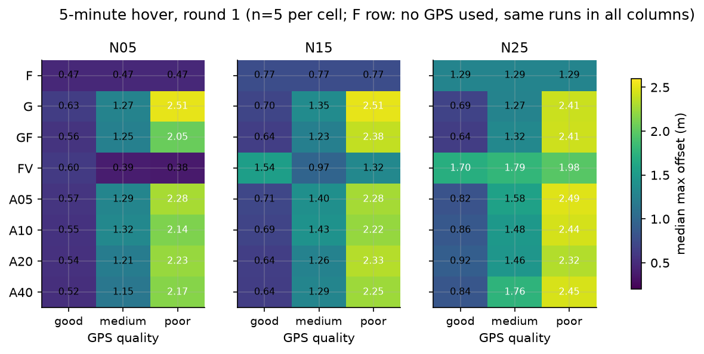</a> | 图1. 第 1 轮 5 分钟悬停各格的最大偏移中位数热图（行=方案，列=GPS 质量，三块=光流噪声）：偏移主要由 GPS 质量决定（好 0.5–0.7 / 中 1.2–1.4 / 差 2.1–2.5 m），F 与纯光流侧的 FV 不随 GPS 变化。数据来源：results_all.csv；脚本：make_figures.py。 |
| <a href="../experiments/gps_hover_20261123/figures/fig2_h15_heatmap.png">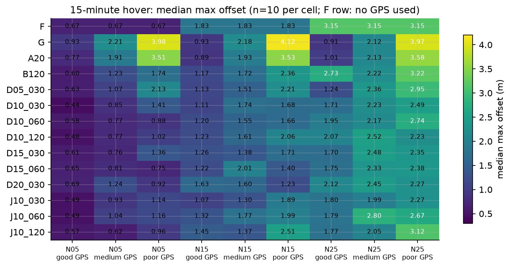</a> | 图2. 15 分钟悬停 14 个方案 × 9 格的最大偏移中位数热图（即上表）：飞控融合 GPS 的方案（G/A20）偏移只随 GPS 质量变化，伴机慢修正各格都在 F 与 GPS 质量决定的包络之内。数据来源：results_h15_.csv；脚本：make_figures.py。 |
| <a href="../experiments/gps_hover_20261123/figures/fig3_drift_vs_noise.png">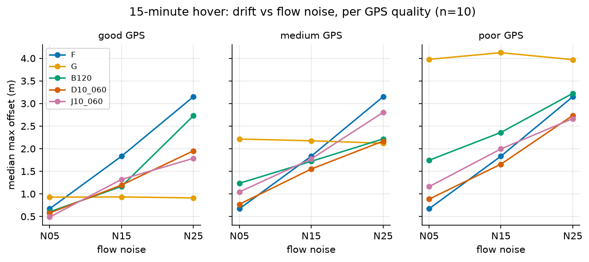</a> | 图3. 五个代表方案的最大偏移中位数随光流噪声的变化（三块=GPS 质量）：G 几乎水平（好 0.9 / 中 2.2 / 差 4.0 m，与光流无关），F 随噪声线性上升，慢修正方案介于两者之间。数据来源：results_h15_.csv；脚本：make_figures.py。 |
| <a href="../experiments/gps_hover_20261123/figures/fig4_h15_n15_dists.png">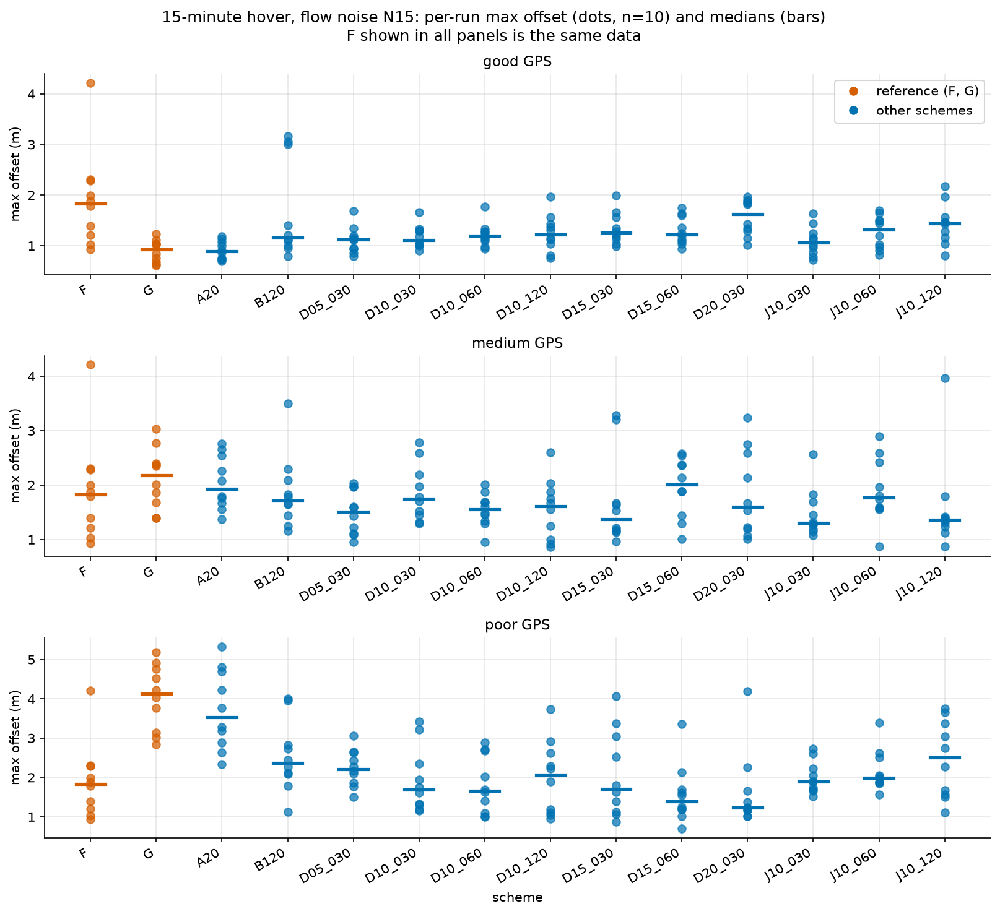</a> | 图4. 光流噪声 N15 时各方案每次运行的最大偏移分布（圆点 n=10，横线=中位数）：同一方案格内的散布约 ±0.5 m，比多数方案间的差别还大，与 3.3 节的重复性结论一致。数据来源：results_h15_.csv；脚本：make_figures.py。 |
| <a href="../experiments/gps_hover_20261123/figures/fig5_repeatability.png">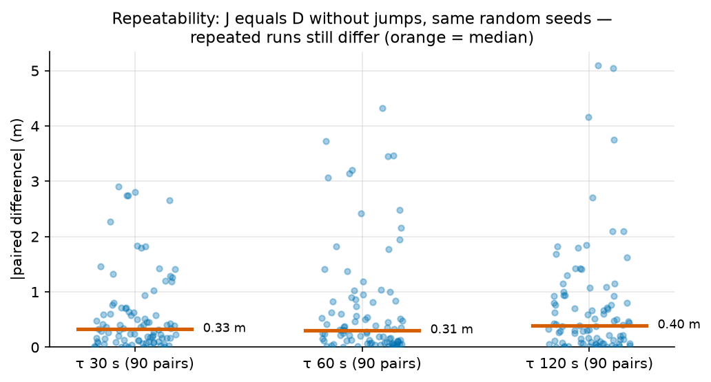</a> | 图5. 三个时间常数下 D 与 J 同条件配对差值绝对值的分布（每格 90 对，橙线=中位数 0.33/0.31/0.40 m）：算法完全相同、随机序列相同的两次运行仍差约 0.3 m，尾部可达 3–5 m。数据来源：results_h15_.csv（D10_* 与 J10_* 按重复编号配对）；脚本：make_figures.py。 |
|  | 图6. 四个候选方案按重复编号合并后与 F 的逐次配对（蓝=F，橙=合并慢修正，灰线连接同一次重复；F 不用 GPS，三个 GPS 列重复同一组 F 数据）：没有任何一格稳定地一侧占优，与上表 p 均 > 0.05 一致。数据来源：results_h15_.csv；脚本：make_figures.py。 |
|  | 图7. 六种故障下四个方案每次运行的最大偏移（n=8/格）：只有 G 在两种 GPS 丢失故障下整体抬高（16/16 未完成），伴机慢修正与 F 的分布重叠；罗盘干扰对四个方案影响都不大。数据来源：results_ft_.csv；脚本：make_figures.py。 |
|  | 图8. 四个罗盘方案的悬停航向变化（左，n=30/方案）与最大偏移（右，按光流噪声分三组）：无罗盘 F0 的航向变化中位约 103°（各次 30–180°），有罗盘的三个方案位置偏移分布与 F0 重叠。数据来源：results_h15_.csv（F0/F/FM2/FM6）；脚本：make_figures.py。 |

### ablation tables

Document: [`experiments/sitl_bench/abl/tables.md`](../experiments/sitl_bench/abl/tables.md)

| Figure | What it shows |
|---|---|
|  | Figure 1. Run outcome mix by controller arm across all recorded faults. Source: all_runs.csv; script: make_figures.py. |
|  | Figure 2. Fraction of runs classified UNSAFE for each controller arm. Source: all_runs.csv; script: make_figures.py. |
|  | Figure 3. Per-run maximum altitude for FULL, NOGUARD, and BARE arms; black marks show medians. Source: all_runs.csv; script: make_figures.py. |

### 任务 C：用 ArUco 绝对位置消除光流漂移（abs_fix，2026-11-19，ROG 本机）

Document: [`experiments/sitl_bench/abs_fix/report.md`](../experiments/sitl_bench/abs_fix/report.md)

| Figure | What it shows |
|---|---|
|  | 图 1. 无修正和不同修正条件下，悬停 120 秒期间的最大偏离。数据来源：report.md §1.2 表“实测：两种方法把漂移从多少降到多少”；脚本：make_figures.py。 |
|  | 图 2. 不同飞行高度下悬停最大偏离和正方形航线跟踪 RMS；标记为中位数，误差线两端为表中的最小值和最大值（每个高度 3 次，因中位数偏向一端，误差线上下不对称）。数据来源：report.md §1.6 表；脚本：make_figures.py。 |
|  | 图 3. 基线、四角 ExtNav 和四角 ExtPos 条件下正方形航线的逐次跟踪 RMS。数据来源：results.csv；脚本：make_figures.py。 |

### 加装 GPS + 罗盘后的定位架构：SITL 研究报告（2026-11-19，ROG，实例 I20–I23）

Document: [`experiments/sitl_bench/gps_flow/report.md`](../experiments/sitl_bench/gps_flow/report.md)

| Figure | What it shows |
|---|---|
|  | 图1. 每次运行的飞行中航向误差变化（横轴，对数）与跟踪 RMS（纵轴）：恒偏 10°/20° 与无罗盘聚在左下（0.05–0.10 m），随油门变化的电机干扰（FMmot2/FMmot6）沿对角线上移，跟踪误差随航向误差变化增大而增大。数据来源：results.csv（F0/FM/FMdec10/FMdec20/FMmot2/FMmot6 各 3 次）；脚本：make_figures.py。 |
|  | 图2. 各配置每次运行的跟踪 RMS（绿=任务完成，橙=失败/中止，横线=中位数）：只要 GPS 位置被融合（IG 组、架构 ii 差 GPS）误差就跟着 GPS 走，光流组与丢星后回退光流速度的组都在 0.5 m 以下；Q5_in_noorg 与 GSF_good 0/3 解锁，无数据点。数据来源：results.csv（第 3 节表中各配置各 3 次）；脚本：make_figures.py。 |
|  | 图3. WP2 悬停中切换源组每次运行的 EKF 位置跳变（左）与切换后 10 s 真值位移（右）：GPS→光流几乎不跳（0.11 m），光流→GPS 的跳变随注入偏移线性增大（1.1/1.95/3.7 m），真值随后以受 WP_SPD 限制的速度平移 1.7–2.5 m。数据来源：results.csv（SW_G2F / SW_F2G / SW_F2G_d1 / SW_F2G_d3 各 3 次）；脚本：make_figures.py。 |

### MTF-01 光流定位 SITL 仿真报告（2026-11-19，ROG 本机）

Document: [`experiments/sitl_bench/mtf01/report.md`](../experiments/sitl_bench/mtf01/report.md)

| Figure | What it shows |
|---|---|
|  | 图1. 四种高度源每次运行的任务高度误差 RMS（左）与 EKF 高度误差 RMS（右）：测距（b）最低，气压（c）约 4 倍于测距，气压+`RNG_USE_HGT` 混合（c+）最高。数据来源：results.csv（q2_B / q2_RNG / q2_BARO / q2_BRNG 各 3 次）；脚本：make_figures.py。 |
|  | 图2. 光流比例误差从 −20% 到 +20% 每次运行的跟踪 RMS（黑线为中位数）：0% 附近 0.065–0.076 m，±10% 起恶化且 −10%（0.224 m）比 +10%（0.076 m）更差，−20% 达 0.436 m。数据来源：results.csv（q2_RNG 基线与 q4scale_* 各 3 次）；脚本：make_figures.py。 |
|  | 图3. 测距噪声幅值 0.02/0.05/0.10 m 下的任务高度误差 RMS（左）与悬停 EKF 高度误差 RMS（右）：两者都随噪声近似线性增大（0.005/0.014/0.028 与 0.014/0.025/0.052 m），任务全部完成。数据来源：results.csv（q4rnd_* 各 3 次）；脚本：make_figures.py。 |
|  | 图4. 四种测距故障每次运行的真值最高高度（圆点按完成与否着色，横线为中位数：蓝 = 方案 a，橙 = 方案 b）：超量程 1 s 与下跳 1.5 m 1 s 时方案 a 无事而方案 b 冲高，5 s 故障两种方案都触发保护（q4oor5_B 有 1 次冲到 7.86 m）。数据来源：results.csv（q4oor1/oor5/jmp1/jmp5 × B/RNG 各 3 次）；脚本：make_figures.py。 |
|  | 图5. AUTO 开始 15 s 后伴机停发高度（cut）及高度+心跳都停（cut+hb）时的任务高度误差 RMS（蓝 = 正常飞行基线）：停发只让任务高度误差增大到与所选高度源自身的品质相当（a/c 涨到 0.04–0.06 m，b/c+ 反而更小），任务都完成。数据来源：results.csv（q2cut_* / q2hb_B 各 3 次）；脚本：make_figures.py。 |
|  | 图6. 光流方向装错后每次运行在 LOITER 段的真值最大水平偏移（results.csv 的 hover_drift 列）：90° 为 8.9–34.4 m，180° 为 57.0–66.4 m，全部触发围栏且 AUTO 未能解锁；正文表中 14–51 / 97–107 m 是 diverge.py 对整段日志统计的最大半径，两者口径不同。数据来源：results.csv（q4orient_9000 / q4orient_18000 各 3 次）；脚本：make_figures.py。 |

### MTF-01 光流+测距定位 参数优化报告（2026-11-19，ROG 本机）

Document: [`experiments/sitl_bench/opt_flow/report.md`](../experiments/sitl_bench/opt_flow/report.md)

| Figure | What it shows |
|---|---|
|  | 图1. 苛刻场景三次重复的真值终点漂移与最大漂移：三组完全重叠，两臂差异小于重复间离散度。数据来源：results.csv（ab_base_* / ab_recA_* / ab_recB_*）；脚本：make_figures.py。 |
|  | 图2. 六种测距故障（下跳 / 上跳 1.5 m、超量程，各 3 s / 5 s）的真值高度偏离与 EKF 高度估计误差：上跳故障的估计误差改善约 15–20 倍，但两臂的飞机仍都掉到地面。数据来源：results.csv（fd* / fu* / fo* 各行）；脚本：make_figures.py。 |
|  | 图3. §2.1 各悬停配置（每次单次运行）的真值最大漂移（左）与 EKF−真值最大位置差（右）：光流传感器偏前 5 cm（fpos_raw）在位置差上最突出，光流噪声 0.2 rad/s（h1d）在真值漂移上最突出。数据来源：results.csv（§2.1 各行）；脚本：make_figures.py。 |
|  | 图4. §2.2 各任务场景的跟踪 RMS：绿色 = 完成 3 圈，橙色 = 围栏触发或任务中断。数据来源：results.csv（mis_* 各行）；脚本：make_figures.py。 |

### 光流 + 测距定位参数优化（第二轮，2026-11-19，ROG 本机）

Document: [`experiments/sitl_bench/opt_flow2/report.md`](../experiments/sitl_bench/opt_flow2/report.md)

| Figure | What it shows |
|---|---|
|  | 图1. 2 m 悬停 120 s 各扰动组每次运行的真值最大漂移（横线为中位数）：光流噪声（FNSE）是唯一的明显来源，其余组与无扰动（C0）重叠。数据来源：results.csv（m_H2_* / x_H2_TURB10 各组）；脚本：make_figures.py。 |
|  | 图2. 2 m 正方形任务各扰动组每次运行的跟踪 RMS（横线为中位数）：光流噪声（FNSE）抬高约 3 倍，±5% 比例误差与基线范围重叠，极端湍流（TURB 10）无法完成任务。数据来源：results.csv（m_SQ_* / x_SQ_TURB10 各组）；脚本：make_figures.py。 |
|  | 图3. 全部扰动（ALL）下原参数 / recH / recHF 的悬停真值最大漂移（H1、H2）与正方形任务跟踪 RMS：三臂范围互相重叠，正常飞行没有可分辨的收益。数据来源：results.csv（m_H*_ALL / ab_H*_ALL_* / ab_SQ_ALL_* 各组）；脚本：make_figures.py。 |
|  | 图4. AUTO 悬停中注入测距故障（def = 原参数，p1 = 收紧门限，绿色小点为 p1b）每次运行的故障期真值最高高度（左）与触地垂直速度（右）：p1 消除了 DN 的爬高（6.95 m 的 5 s 特例除外）和 UP 的 1.28 m/s 触地。数据来源：results.csv（f_def_* / f_p1_* / f_p1b_* 各组）；脚本：make_figures.py。 |

### V1：FINAL 参数整套回归（2026-11-19，ROG 本机，16 核）

Document: [`experiments/sitl_bench/val1/report.md`](../experiments/sitl_bench/val1/report.md)

| Figure | What it shows |
|---|---|
|  | 图 1. A1/A3 无扰动组与 B1/B3 苛刻扰动组的逐次跟踪 RMS；点表示单次运行，黑线表示中位数。数据来源：results.csv；脚本：make_figures.py。 |
|  | 图 2. C 组四种解锁条件下的任务完成比例（每种条件运行 3 次）。数据来源：results.csv；脚本：make_figures.py。 |
|  | 图 3. 每次运行距有效水平围栏半径的余量；黑线表示中位数。数据来源：results.csv 和 report.md §5（有效半径）；脚本：make_figures.py。 |

### 任务 V2：测距异常发生在起飞、转弯、降落阶段的表现（2026-11-19/20）

Document: [`experiments/sitl_bench/val2/report.md`](../experiments/sitl_bench/val2/report.md)

| Figure | What it shows |
|---|---|
|  | 图 1. 不同飞行阶段和参数组的逐次最大高度偏差。数据来源：results.csv；脚本：make_figures.py。 |
|  | 图 2. D、F 两组在不同飞行阶段的任务完成率。数据来源：results.csv；脚本：make_figures.py。 |
|  | 图 3. 按测距故障类型分组的逐次触地速度。数据来源：results.csv；脚本：make_figures.py。 |

### MTF-01 MAVLink 传感器接入仿真验证报告（任务 V3）

Document: [`experiments/sitl_bench/val3/report.md`](../experiments/sitl_bench/val3/report.md)

| Figure | What it shows |
|---|---|
|  | 图 1. 光流配置发送频率与 dataflash 实测频率的对照。数据来源：results.csv；脚本：make_figures.py。 |
|  | 图 2. 三个选定运行中收到的光流和测距消息数。数据来源：results.csv；脚本：make_figures.py。 |
|  | 图 3. 不同配置发送频率下，dataflash 光流分量相对发送值的误差。数据来源：results.csv 和 report.md §1 表（发送值）；脚本：make_figures.py。 |

### 任务 V4：测距门限的折中（2026-11-20）

Document: [`experiments/sitl_bench/val4/report.md`](../experiments/sitl_bench/val4/report.md)

| Figure | What it shows |
|---|---|
|  | 图 1. 各门限参数组在不同故障下的任务完成比例。数据来源：results.csv；脚本：make_figures.py。 |
|  | 图 2. 各参数组 HOV 运行的逐次真值高度 RMS 误差。数据来源：results.csv；脚本：make_figures.py。 |
|  | 图 3. 原始组和 FINAL 组爬升故障复现运行的逐次真值最大高度。数据来源：results.csv；脚本：make_figures.py。 |

### 任务 V5：标记位置修正在任务飞行中的故障表现（val5，2026-11-20）

Document: [`experiments/sitl_bench/val5/report.md`](../experiments/sitl_bench/val5/report.md)

| Figure | What it shows |
|---|---|
|  | Figure 1. 每种注入故障下的真值偏离航线量（四角标记与单标记各 5 次，左：全程最大偏离，右：故障窗口内最大偏离；虚线为 0.3 m 判据）。来源：results.csv、fault_rows.json；脚本：make_figures.py。 |
|  | Figure 2. 三种布置在无故障对照下的跟踪 RMS（左）与真值最大偏离航线（右），条为 5 次中位数、须为 5 次最小-最大范围。来源：results.csv；脚本：make_figures.py。 |
|  | Figure 3. 每种故障下机载一致性门限（v1，实心）与新息门限（v2，浅色）拒掉的观测条数（每格 5 次的中位数），四角标记与单标记各一组。来源：fault_rows.json；脚本：make_figures.py。 |
|  | Figure 4. 每种故障下故障时刻的 EKF 位置跳变（实心）与该次飞行全程最大跳变（浅色），每格 5 次的中位数。来源：fault_rows.json；脚本：make_figures.py。 |
|  | Figure 5. 每种故障窗口内的真值速度峰值（每个点为一次运行，横线为中位数），虚线为任务要求的 0.7 m/s 上限。来源：fault_rows.json；脚本：make_figures.py。 |

### 任务 V6：提高测距量程下限 `RNGFND1_MIN`（2026-11-20）

Document: [`experiments/sitl_bench/val6/report.md`](../experiments/sitl_bench/val6/report.md)

| Figure | What it shows |
|---|---|
|  | Figure 1. 每个配置 × 每个任务格的完成次数（格内为“完成次数/总次数”，颜色为完成比例）：`RNGFND1_MIN ≥ 0.10` 的 6 个配置全部 0 次完成（未解锁）。来源：results.csv；脚本：make_figures.py。 |
|  | Figure 3. `RNGFND1_MIN 0.01` 两个配置在 D3 / SQ / HOV 正常飞行上的真值最高高度（左）、离地时 EKF 高度误差 max（中）、触地速度（右），条为 5 次中位数、须为 5 次最小-最大范围。来源：results.csv；脚本：make_figures.py。 |
|  | Figure 2. 各配置地面静止时的测距读数范围（蓝竖条，含每次运行的最小-最大）与该配置的 `RNGFND1_MIN`（橙横线）：`min ≥ 0.10` 的 6 个配置读数（0.00–0.07 m）始终低于自己的下限，`RFND.Stat` 只有 2（OutOfRangeLow）。来源：results.csv；脚本：make_figures.py。 |
|  | Figure 4. `RNGFND1_MIN 0.01` 两个配置在各异常格上的故障窗口真值最高高度（左）与基线偏离 `dev_base`（右），条为 3 次中位数、须为 3 次最小-最大范围。来源：results.csv；脚本：make_figures.py。 |
|  | Figure 5. 各异常格的故障窗口 EKF 高度误差 max（左，条为 3 次中位数）与注入期实测测距读数范围（右，每格 3 次运行的最小-最大）。来源：results.csv；脚本：make_figures.py。 |

### 任务 V7：“气压计监视测距”的完整仿真验证

Document: [`experiments/sitl_bench/val7/report.md`](../experiments/sitl_bench/val7/report.md)

| Figure | What it shows |
|---|---|
|  | Figure 1. 参数网格中每小时误报数（左 `R=0.6 m`、右 `R=0.4 m`，均取 `T=1.0 s` 的 12 组，即 `fc`×`tau`×`E` 的全部组合；格内数字为次/小时）：只有 `fc=0.5 Hz` 且 `E=0.7 m` 的组合能压到 2.03 次/小时，`R=0.4 m` 时全部 ≥ 10 次/小时。来源：fp_grid.md；脚本：make_figures.py。 |
|  | Figure 2. 220 次第 1 步飞行按气压条件的误报次数（离线重放）：选中的参数组（蓝，2.03 次/小时）、加 `b_hold=0.5 s`（黄，0.20 次/小时）、把 `E` 降到 0.5 m（绿，6.70 次/小时，误报全部落在 ±1.2 m/min 慢漂条件）。来源：fp_sel.csv、fp_bh05.csv、fp_e05.csv；脚本：make_figures.py。 |
|  | Figure 3. 选中的参数组在 11 个异常格上的检出延迟（左，条为 5 次中位数、须为最小-最大范围）与判定时刻的真值高度偏离（右，条为报告上表的范围中点，绿色带为 ±0.5 m）：只有 `i`（慢变）检出慢（9.49 s）、`h`/`k` 因注入在爬升途中而偏离超过 0.5 m。来源：det_s2.csv（延迟）、report.md 第 6 节表（真值偏离）；脚本：make_figures.py。 |
|  | Figure 4. 第 4 步闭环（任务 `SQ`）下每个异常格 × 处置（A1/A2/A3/无监视器对照）的真值最高高度：横粗线为 5 次中位数、点为每次运行，虚线为无异常基线 2.070 m。来源：results.csv；脚本：make_figures.py。 |
|  | Figure 5. 左：闭环时注入到监视器动作的延迟（横粗线为 5 次中位数、点为每次运行）；右：动作 A3（只切源组、不切模式）各异常格的任务完成数（满格 5/5）。来源：results.csv；脚本：make_figures.py。 |
|  | Figure 6. 切源组时 XKF1 记录的 EKF 高度跳变（纵轴）与同一时刻真实高度的变化（横轴），每个点是一次运行（A2 圆点、A3 方点），虚线为两者相等。来源：results.csv；脚本：make_figures.py。 |
|  | Figure 7. 第 5 步三种自身失效下每次运行的真值最高高度（每组 3 次）：`p0` 取错仍被监视器抓住（≈2.04 m），气压断流与监视器进程停掉都没有告警，真值最高可达 4.0 m，与无监视器对照（`gN`）同量级。来源：results.csv；脚本：make_figures.py。 |
|  | Figure 8. 判据 B 增加“持续”要求（`b_hold`）的代价与收益：左为每小时误报数（220 次飞行），中为检出完整度（55 次飞行），右为检出延迟中位/最大。来源：fp_sel.csv、fp_bh05.csv、det_s2.csv、det_bh05.csv、det_bh1.csv、det_bh2.csv 与 report.md 第 11.2 节表；脚本：make_figures.py。 |

### V8 — 真实 HeightGuard 的 SITL 验证

Document: [`experiments/sitl_bench/val8/README.md`](../experiments/sitl_bench/val8/README.md)

| Figure | What it shows |
|---|---|
|  | Figure 1. 各条件的 `SIM_SONAR_POS_Z` 设定值时间线（横轴：进入 AUTO 后的仿真时间 s；纵轴：`--fault` 写入的参数值 m；D3 条件与 SQ 条件使用相同阶梯故以虚线叠加）。这是任务清单里的计划，不是实测。来源：jobs_v8.txt；脚本：make_figures.py。 |

