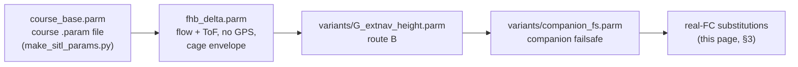

# Flight-controller configuration (ArduCopter 4.7 on Matek F405-WMO)

> State of 2026-10-15 · hardware: [HARDWARE.md](HARDWARE.md) · role of the FC in the system:
> [ARCHITECTURE.md](ARCHITECTURE.md) §6 and §8

The parameter set is built in three layers, and the simulator uses exactly the same layers:

All files are in [`../sitl/`](../sitl/). Every value below was used in the Gazebo + SITL runs behind reports 2–7,
unless marked **real FC only**.

## 1. Firmware

- The stable `MatekF405-TE` build has MSP optical flow, MSP rangefinder and EKF3 optical-flow fusion **disabled**.
  Build ArduCopter **4.7.0** for `MatekF405-TE` at custom.ardupilot.org with at least:
  `HAL_MSP_OPTICALFLOW_ENABLED`, `HAL_MSP_RANGEFINDER_ENABLED`, `HAL_MSP_SENSORS_ENABLED`,
  `EK3_FEATURE_OPTFLOW_FUSION` (plus the optical-flow library itself).
- The F405 has 1 MB of flash. If the build does not fit, drop unused features (FrSky, Spektrum, HoTT telemetry,
  RunCam, Tramp, …).
- Back up the parameters, flash the `.apj` from Mission Planner, restore the parameters.
- SITL runs the same version (Copter-4.7.0) plus [`sitl/ardupilot_sitl.patch`](../sitl/ardupilot_sitl.patch): the JSON
  backend's `rng_1..6` bit test (fixed upstream as ArduPilot#33342, backport proposed as #34610) and flow scaling over
  obstacles. Neither patch is needed on the real FC.

## 2. Serial ports

| Port | Pad | Device | `SERIALn_PROTOCOL` | `SERIALn_BAUD` |
|---|---|---|---|---|
| SERIAL0 | USB | laptop | 2 | 115 |
| SERIAL2 | UART3 | Orange Pi | 2 (MAVLink2) | course 460; **115 recommended** (no DMA on UART3; non-DMA UARTs showed ≈ 2.5 % errors at 230400) |
| SERIAL3 | UART5 | ESP32-C3 telemetry | 2 | 57 |
| SERIAL4 | UART4 | 3901-L0X | **32 (MSP)** — was 5 (GPS) | 115 |
| SERIAL6 | UART2 | ELRS EP2 | 23 (RCIN) | — |
| SERIAL1, SERIAL5 | none | — | −1 | — |

Check UART errors with Mission Planner → Config → MAVFtp → `@SYS/uarts.txt`. The course parameters leave the
`MAV2_*` stream rates at 0; the companion requests its streams itself (`SET_MESSAGE_INTERVAL`), and `fhb_delta.parm`
also sets `MAV2_POSITION 20`, `MAV2_EXTRA1 20`, `MAV2_EXT_STAT 2` as a fallback.

## 3. Sensors and EKF3 without GPS

| Parameter | SITL value | Real FC | Why |
|---|---|---|---|
| `FLOW_TYPE` | 10 (SITL) | **7 (MSP)** | 3901-L0X flow |
| `FLOW_FXSCALER` / `FLOW_FYSCALER` | — | −800 / −800 to start, then calibrate | ArduPilot's starting value for this sensor |
| `FLOW_POS_X/Y/Z` | — | measured from the CG | lens ≈ 11 mm ahead of the base centre, 6.5 mm below the plate |
| `RNGFND1_TYPE` | 100 (SITL) | **32 (MSP)** | downward VL53L0X |
| `RNGFND1_ORIENT` | 25 | 25 | facing down |
| `RNGFND1_MIN` / `MAX` / `GNDCLR` | 0.03 / 1.2 / 0.03 m | same; widen `MAX` only if the bench shows > 1.5 m | — |
| `GPS1_TYPE` | 0 | 0 | GPS UART removed |
| `COMPASS_AUTODEC` / `COMPASS_DEC` | 0 / 0.197 rad | same, set for the flying site | without GPS no declination is computed; yaw was 11° off in Gazebo |
| `EK3_SRC1_POSXY` / `VELXY` / `VELZ` / `YAW` | 0 / 5 / 0 / 1 | same | velocity from optical flow, yaw from the compass |
| `EK3_SRC1_POSZ` | 2 (rangefinder) in `fhb_delta`; **6 (ExtNav) with route B** | **6** | see §4 |
| `EK3_RNG_USE_HGT` | −1 | −1 | "baro primary + switch to rangefinder below 70 %" latched a 0.3–0.45 m height bias in S7c |
| `ARMING_SKIPCHK` | 4104 | 4104 | skip GPS lock (bit 3) and GPS configuration (bit 12) |

Note: an earlier procurement note suggested baro as primary height (`EK3_SRC1_POSZ 1`, `EK3_RNG_USE_HGT 70`). The
S7c SITL runs replaced that with rangefinder-primary, and S7e replaced that with route B. Use route B.

## 4. Route B: companion height as external navigation

From [`sitl/variants/G_extnav_height.parm`](../sitl/variants/G_extnav_height.parm):

| Parameter | Value | Meaning |
|---|---|---|
| `EK3_SRC1_POSZ` | 6 | height from external navigation (`VISION_POSITION_ESTIMATE` z) |
| `EK3_RNG_USE_HGT` | −1 | no automatic rangefinder height switching |
| `VISO_TYPE` | 1 | MAVLink visual odometry input |
| `VISO_POS_M_NSE` | 0.1 | observation noise of the companion height (m) |
| `VISO_DELAY_MS` | 50 | companion pipeline delay; **re-measure on the Orange Pi** |

The Orange Pi sends z = −(height above floor) at 20 Hz. If the messages stop for 0.5 s, the EKF falls back to baro by
itself, and the companion's own watchdog hovers and then lands after 3 s. Why route B is needed: report 2.

## 5. Cage envelope and fences

| Parameter | Value | Note |
|---|---|---|
| `FENCE_ENABLE` | 1 | — |
| `FENCE_TYPE` | 1 (altitude only) | a circle fence blocks arming without GPS ("Fence requires position") |
| `FENCE_ALT_MAX` | 1.3 m | hard ceiling, inside the 1.2 m rangefinder envelope plus margin |
| `FENCE_MARGIN` | 0.3 m | the course value 2 caps climb at 1.3 − 2 m and the drone cannot take off; 0.3 gives a 1.0 m soft ceiling |
| `FENCE_ACTION` | 2 | land on breach |
| `RTL_ALT_M` | 0.8 m | must stay within rangefinder range |
| `LOIT_SPEED_MS` / `WP_SPD` / `PILOT_SPD_UP` | 1.0 / 0.5 / 0.5 | cage speeds |

The horizontal fence is enforced by the companion (`EcpsPilot` fence turn-back and `SafetyGovernor` geofence), using
the flow-EKF position. The brain's own altitude window is 0.4–1.0 m (`min_alt_m` / `max_alt_m`), take-off at 0.6 m.

## 6. Failsafes

| Parameter | Course value | Project value | Effect |
|---|---|---|---|
| `FS_THR_ENABLE` / `FS_THR_VALUE` | 3 / 975 | same | RC loss → land |
| `FS_EKF_ACTION` | 1 | same | EKF failure → land |
| `FS_CRASH_CHECK`, `FS_VIBE_ENABLE` | 1, 1 | same | — |
| `GUID_TIMEOUT` | 3 s | **1 s** (`fhb_delta`) | GUIDED stops if the companion stops sending |
| `BATT_CAPACITY` | — | 2200 | — |
| `BATT_FS_LOW_ACT` | 0 | **1 (land)** in SITL; ask the TA before using it on the real drone | — |
| `MAV_GCS_SYSID` / `MAV_GCS_SYSID_HI` | — | **254 / 255** | the companion (sysid 254) counts as a GCS |
| `FS_GCS_ENABLE` | 0 | **5 (land)** | companion heartbeat lost → land |
| `FS_GCS_TIMEOUT` | — | 2 s | — |

The companion failsafe (`companion_fs.parm`) was validated in SITL fault injection (report 2 §4, S8 E3: 10/10 safe
landings). **On the real drone enable it only after a ground test**: Orange Pi powered, props off, armed in GUIDED,
then `kill -STOP` the companion process and confirm the GCS failsafe message and the land action.

## 7. Logging

- `LOG_BACKEND_TYPE 1` (SD), course `LOG_BITMASK 180222`; for the first flights log everything and keep
  `MOT_HOVER_LEARN 2` so the twin can be recalibrated (hover throttle, time constants, vibration, `PM.Load`).
- Useful messages: `OF` (flow), `RFND` (range), `XKF5` (HAGL, flow innovations), `VISP` / `VISO` (route-B input),
  `XKF4` (EKF health), `MODE`, `ERR`.

## 8. Checklist after changing parameters

1. `@SYS/uarts.txt`: no errors on SERIAL2 and SERIAL4.
2. Mission Planner status: `opt_qua` > 0 while moving over the mat, `rangefinder1` plausible.
3. Hand-carry the drone over a 0.4–0.6 m box with route B on: EKF height must stay at the floor height (± 0.15 m).
4. Arm in a position-controlled mode without GPS warnings; fence status shows the altitude fence only.
5. Companion failsafe ground test (§6).
