# Real-drone test plan

> State of 2026-10-15 · ⬜ nothing below has flown yet · hardware: [HARDWARE.md](HARDWARE.md) · FC set-up:
> [FLIGHT_CONTROLLER.md](FLIGHT_CONTROLLER.md) · paper target ICUAS 2027 (full paper due 2027-02-05)

The plan moves from bench to processor-in-the-loop to cage flights. **Each stage must pass completely before the next
one starts.**

```mermaid
flowchart LR
  B["Bench<br/>3901-L0X · VL53L7CX · camera A/B"] --> F["First flight 10-28<br/>RC only, full logging"]
  F --> T["Twin update<br/>from flight logs + bench"]
  T --> P["PIL on the Orange Pi<br/>p99 < 25 ms"]
  P --> R0["R0 manual Loiter<br/>flow + ToF"]
  R0 --> R1["R1 companion<br/>GUIDED hover"]
  R1 --> R1b["R1b shield<br/>on the real drone"]
  R1b --> R2["R2 route B"]
  R2 --> R3["R3 companion faults"]
  R3 --> R4["R4 wall approaches"]
  R4 --> R5["R5 120 s patrol"]
  R5 -.-> R6["R6 brain-off arm<br/>(optional)"]
```

## 1. Safety rules (every flight)

- Two people: a pilot holding the RC, ready to switch to Stabilize and take over at any time; a second person logging.
- Propeller guards; take off only with the battery above 7.4 V.
- Soft ceiling 1.0 m, hard fence 1.3 m (`FENCE_*`, [FLIGHT_CONTROLLER.md](FLIGHT_CONTROLLER.md) §5).
- Autonomous flight only after the companion watchdogs and `FS_GCS_ENABLE 5` have passed the ground test.
- Run the course ARC checklist before every take-off.
- RC failsafe test (props off, armed, transmitter off → "RADIO FAILSAFE") as required by the course checklist.

## 2. Before the cage

| Step | Content | Exit criterion |
|---|---|---|
| Bench | 3901-L0X range, flow rate and quality, box-edge transitions, power-up condition; VL53L7CX detection (net, black box, wall), low box tops, prop occlusion, timing; camera A vs B | numbers written back into the twin and Gazebo sensor models; camera chosen ([HARDWARE.md](HARDWARE.md) §6) |
| First flight (10-28) | RC flight, full DataFlash logging, `MOT_HOVER_LEARN 2` | logs for the twin update |
| Twin update | hover throttle, hover current, time constants from GUIDED velocity steps, vibration, `PM.Load` → SITL JSON + Gazebo model; `SIM_FLOW_RND`, `SIM_SONAR_RND`, `RNGFND1_MAX` from the bench; cage lux and mat texture; measured obstacle layout → `ecps295_cage20_real.sdf` | regression (hover, single wall, patrol × 5 each) gives a twin-error table |
| PIL | on the Orange Pi, process pinned to the A76 cores (`taskset`), `pil_replay.py` replays recorded frames through Retina → MiniFly → decoder → MAVLink; 10 min at 20 Hz with temperature and throttling (`/sys/class/thermal`); route-B message latency and jitter; camera-to-action latency (LED + high-speed video) | **p99 < 25 ms** per tick, no thermal throttling |

## 3. Cage stages

| Stage | Content | Repetitions | Main metrics |
|---|---|---|---|
| R0 | manual Loiter on optical flow + ToF (course A+ LIDAR option) | 3 × 60 s | drift, height SD |
| R1 | companion GUIDED hover, brain in the loop, no forward motion | 5 × 60 s | position and height SD, tick time, spurious actions |
| R1b | shield on the real drone: constant velocity command towards a box / net wall | forward, backward, diagonal × 3 | stopping distance vs d_safe, sliding, stalls or oscillation |
| R2 | route B: carry/fly the drone over a 0.4–0.6 m box with and without route B | 5 each | FC height error, climb towards the fence |
| R3 | companion faults: `kill -STOP` the companion process; unplug or freeze the camera | 3 each | time to hover / land, landing quality |
| R4 | wall approaches: taped wall head-on, taped wall offset 0.45 m, plain wall head-on; MiniFly v4 vs classical baseline, both with the shield, plus v4 without the shield | 3 walls × 2 controllers × ≥ 5 | contact, minimum clearance, brake and escape onset |
| R5 | 120 s patrol in the real cage layout; v4 + route B vs baseline | 2 controllers × ≥ 5 | contacts, near misses, path length, coverage |
| R6 | (optional) brain-off arm in R4 | × 3 | — |

About 75 flights in total; at 4–5 flights per battery that is 15–20 cage days of 1–2 hours. Book the cage early for
exam week and winter break.

## 4. Ground truth and logging

- A phone or GoPro on the ceiling looking down, an ArUco marker on top of the drone; trajectories tracked offline,
  scale from the 24-inch mat grid.
- Recorded together: DataFlash log, companion log (the same per-tick CSV fields as `run_g4.py`), external video; a sync
  event at take-off (LED flash or clap).
- `real_report.py` (to be written) reuses `patrol_report.py` and `matrix_stats.py` so real flights and simulation
  produce the same tables.

## 5. Milestones

| Gate | Date | Criterion |
|---|---|---|
| G1 | 11-01 | simulation controls done (brain off, shuffled wiring, baseline); paper outline fixed |
| G2 | 11-22 | real drone holds position on flow + ToF; companion GUIDED hover ≥ 60 s; PIL p99 < 25 ms |
| G3 | 12-20 | route B verified on the real drone; ≥ 5 wall approaches per condition |
| G4 | 01-10 | data freeze |

Fallbacks: if the Orange Pi misses G2, the brain runs on a laptop over the telemetry link (stated as such in the
paper); if cage time is short, R5 becomes a demonstration and the main table uses R2 and R4.

## 6. Known risks

| Risk | Mitigation |
|---|---|
| Crash or hardware delay at first flight | spare props, motors, one ESC; laptop-brain fallback |
| 3901-L0X unstable on the real mat (light, texture) | extra lighting; random tape on the mat (already modelled); MTF-01 fallback |
| VL53L7CX misses the net or black boxes, or edge zones see the props | bench first; mask occluded zones; the map keeps earlier hits and the fence is a backstop; cardboard obstacles or reflective strips if needed |
| Flow-EKF drift moves the map | drift is the main residual risk in Gazebo (closest approach 0.5 cm at 0.82 m drift); a range-rate-based shield would not depend on the EKF |
