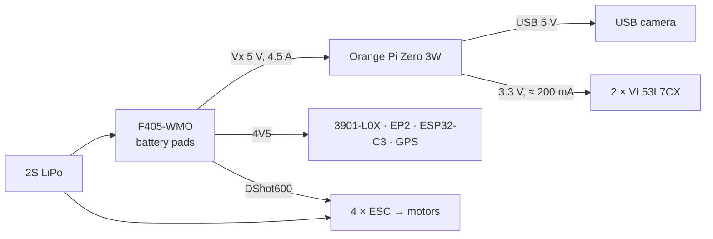

# Hardware

> State of 2026-10-15 · final configuration decided 2026-10-14 (front + rear VL53L7CX + local 3D map, "w2map") ·
> how the parts fit into the software: [ARCHITECTURE.md](ARCHITECTURE.md) §7–8 · flight-controller setup:
> [FLIGHT_CONTROLLER.md](FLIGHT_CONTROLLER.md)

Tags: **[course]** part of the ECPS 295 kit · **[added]** added by this project · **[unverified]** not yet confirmed on
the bench or from a primary source.

## 1. Airframe and course kit

| Part | Model | Notes |
|---|---|---|
| Frame | 4-inch X quad (course frame) | 2S, ≈ 260–290 g as delivered **[course]** |
| Flight controller | **Matek F405-WMO** | ArduCopter 4.7.0, flashed with the `MatekF405-TE` target (same MCU and pin map; not the `-bdshot` build) **[course]** |
| ESCs | 4 × SoloGood 20A BLHeli_S | DShot600 on S5–S8 **[course]** |
| Propellers | Gemfan Hurricane 4024, 2-blade | motors 3 and 4 take the "R" props |
| Receiver | Happymodel EP2 (ELRS, CRSF) | UART2 **[course]** |
| Telemetry | Seeed XIAO ESP32-C3 running DroneBridge | UART5, Wi-Fi to Mission Planner **[course]** |
| GPS + compass | HGLRC M100 Pro | after the flow sensor is fitted only its I²C compass stays connected **[course]** |
| Video | AKK A11T VTX | OSD / FPV, not used by the autonomy stack **[course]** |
| Companion computer | **Orange Pi Zero 3W** (Allwinner A733, 2 × Cortex-A76, 6 GB) | powered from the FC's Vx pad **[course]** |
| Battery | Zeee 2S 2200 mAh | sits on the printed battery deck above the Orange Pi |

The course's Pi AI Camera (IMX500, CSI) is not used: it depends on the Raspberry Pi software stack.

## 2. Parts added by this project

| Part | Interface | Role | Weight | Cost |
|---|---|---|---|---|
| **Matek 3901-L0X** (PMW3901 optical flow + VL53L0X ToF, both facing down) | FC UART4, MSP | GPS-free velocity and height; satisfies the course A+ "LIDAR" option | 2 g | already owned |
| **2 × Pololu #3418 VL53L7CX** (8×8 multizone ToF, 60° × 60°, 2 cm–3.5 m, ≤ 15 Hz at 8×8) | Orange Pi I²C TWI0 (front), TWI1 (rear) | obstacle ranging → local 3D map → safety shield; front zones also feed the brain's LCn | 0.5 g each | $19.95 each (3 bought, 1 spare) |
| **USB camera A: ELP OV7725 120°** (120° H / 150° D, 640×480 MJPEG 60 fps, rolling shutter) | Orange Pi USB-C | the brain's eyes; identical to the simulated camera | ≈ 5–8 g bare **[unverified]** | $27.99 |
| **USB camera B: Waveshare OV9281 (A)** (global shutter, mono, 640×480 @ 120 fps, ≈ 99° H estimated) | Orange Pi USB-C (native Type-C) | alternative; one of A/B is chosen after a bench comparison | ≈ 6–10 g bare **[unverified]** | $25.99 |
| 3D-printed parts (PETG, no supports) | — | flow-sensor base, Orange Pi cover + battery deck, GPS mast, front/rear ToF mounts | ≈ 40 g together | filament |
| TPU landing feet | — | lens must be > 2 cm above ground at power-up | 6–10 g | filament |

If camera B is chosen, the twin must be re-run with a ≈ 100° H camera, no rolling-shutter noise and a lower
`yaw_rate_max_dps` (≈ 25 °/s).

Fallback flow sensor (not bought): MicoAir MTF-01 in MSP mode, if the 3901-L0X proves unreliable on the cage floor.

## 3. Wiring and pin-out

### 3.1 Flight controller

| Pad | ArduPilot port | Device | Protocol / baud |
|---|---|---|---|
| USB-C (extension board) | SERIAL0 | laptop | MAVLink2 / 115200 |
| TX2 / RX2 | SERIAL6 | ELRS EP2 | RCIN (CRSF) |
| **TX3 / RX3** | **SERIAL2** | **Orange Pi** | MAVLink2; course value 460800, **115200 recommended** (UART3 has no DMA) |
| **TX4 / RX4** | **SERIAL4** | **3901-L0X** (replaces the GPS UART) | MSP / 115200 |
| TX5 / RX5 | SERIAL3 | ESP32-C3 telemetry | MAVLink2 / 57600 |
| — (no pads) | SERIAL1, SERIAL5 | — | must be disabled (−1), otherwise they use up MAVLink channels |
| I²C | — | GPS-module compass | — |
| S5–S8 | SERVO5–8 | ESCs | DShot600 |
| Vx | — | Orange Pi 5 V (4.5 A rail) | — |
| 4V5 | — | 3901-L0X, receiver, ESP32, GPS | — |

3901-L0X wiring: TX → RX4, RX → TX4, 5 V → 4V5, GND → G.

### 3.2 Orange Pi Zero 3W

| Orange Pi | Connects to | Notes |
|---|---|---|
| GPIO UART (RX3 / TX3 / GND, 3-pin Dupont) | FC UART3 | crossed TX/RX; mavlink-router on the Pi must use the same baud as `SERIAL2_BAUD` |
| GPIO 5 V | FC Vx | the Pi's USB-C power input stays free |
| **TWI0: SDA pin 3, SCL pin 5** | front VL53L7CX | own bus, default address 0x29, enabled by a device-tree overlay |
| **TWI1: SDA pin 38, SCL pin 40** | rear VL53L7CX | own bus, address 0x29 · pin numbers from third-party sources **[unverified]** |
| 3.3 V | both VL53L7CX VIN | ≈ 100 mA each; if the 3.3 V pin cannot supply 200 mA, add a small 3.3 V LDO from Vx (common ground) |
| USB-C ① (USB 3.1, OTG, DP alt mode) | camera | short USB-C cable or OTG adapter |

VL53L7CX notes:

- **VIN must be 3.3 V, not 5 V.** The Pololu carrier has no level shifter; SDA/SCL follow VIN.
- LPn and I2C_RST stay unconnected (LPn pulled up, I2C_RST pulled down on the carrier). One board per bus, so no
  XSHUT wiring is needed.
- TWI2/TWI3 may be 1.8 V **[unverified]**; not used.
- The ST ULD driver uploads ≈ 84 KB of firmware over I²C at every power-up.

### 3.3 Power

## 4. Mounting

| Part | Location | Key dimensions |
|---|---|---|
| 3901-L0X base (2.9 g) | belly, bottom-plate 4 holes (40 × 43 mm) | lens down, small arrow towards the nose; window opens at a 32° half-cone so the 42° flow and 27° ToF cones are clear; skirt ≈ 4 mm below the lens; 1–1.5 mm foam tape |
| Landing feet | arms | **at least ≈ 27 mm below the bottom plate** so the lens is > 2 cm above ground at power-up |
| Orange Pi cover + battery deck (10.6 g + 8.2 g) | top plate, 4 holes (27 mm front, 33 mm rear, 55 mm apart) | Pi hangs upside down under the lid; USB-C / mini-HDMI cut-outs on +x, Dupont exit on −x |
| GPS mast (6.7 g) | top-plate tail, 2 holes ≈ 17 mm apart | GPS 60 mm above the plate, ≈ 13.5 mm above the battery top, compass away from battery current |
| Front VL53L7CX mount | under the bottom-plate front holes, stacked under the flow base | facing straight forward, near propeller-disc height |
| Rear VL53L7CX mount | under the GPS-mast base | facing straight backward |
| Camera | nose | facing forward, ≈ 12° nose-down (as in the twin) |

Position offsets from the measured centre of gravity: 3901-L0X lens ≈ 11 mm ahead of the base centre and 6.5 mm below
the bottom plate (`FLOW_POS_X/Y/Z`); GPS antenna ≈ 64 mm above the top plate, 6 mm behind the tail holes
(`GPS1_POS_X/Y/Z`). Calibrate the compass after everything is mounted.

The propeller discs sit at roughly 8°–82° to either side of the nose, so the outer zones of the 60° ToF field may see
the prop tips. Either mount the boards ahead of / behind the tips or mask those zones in software (checked on the
bench, §6).

Print files (STL, parametric `gen_*.py`, README per part) live in the course folder
`项目文档/01_硬件与飞控配置/3D打印_*`.

## 5. Weight budget [estimated]

| Addition | Weight |
|---|---|
| 3901-L0X + base | 4.9 g |
| 2 × VL53L7CX + harness + mounts | ≈ 4–6 g |
| Camera (bare board, short cable) | ≈ 5–10 g |
| Orange Pi cover + deck | 18.8 g (100 % infill; less at 30–40 %) |
| GPS mast | 6.7 g |
| TPU feet | 6–10 g |
| Wiring | ≈ 2 g |
| **Total added** | **≈ 50–65 g** |

All-up weight ≈ **300–350 g**. The course log's learned `MOT_THST_HOVER = 0.287` implies a thrust-to-weight of about
3.5, falling to ≈ 2.9–3.0; the main cost is ≈ 15–20 % less flight time. Weigh the finished drone and update the twin
if the mass changes by more than 10 g (frame JSON `mass`, `hoverThrOut`).

## 6. Bench tests before flight

| Test | Method | Feeds back into |
|---|---|---|
| 3901-L0X range | read `rangefinder1` every 0.1 m from 0.1 to 2.0 m against a tape measure | `RNGFND1_MAX`, altitude envelope |
| Flow rate and quality | `OF` message rate in the DataFlash log; `opt_qua`, `opt_m_x/y` while moving by hand over the mat | `SIM_FLOW_RATE`, mat texture |
| Box-edge transitions | sweep the sensor over a box edge; also carry the drone slowly over a box, logging `XKF5` HAGL and range | twin flow / terrain model |
| Power-up condition | power the FC with the lens < 2 cm and > 2 cm above ground | landing-feet height |
| VL53L7CX detection | cage net, black box, white wall at 0.2 / 0.5 / 1.0 m; zone readings and target status | ToF model in twin and Gazebo |
| VL53L7CX low box tops | box top 1–15 cm below the sensor; which distance each zone reports | cone model (the shield assumes "nearest hit in the zone") |
| Prop occlusion | fitted, props off; then props on at low throttle; look for fixed near readings in the edge zones | zone mask |
| Orange Pi timing | read both boards at 15 Hz + map update per frame; full control tick replayed with `pil_replay.py` | compute budget (target p99 < 25 ms) |
| Camera A vs B | field of view, exposure lock (`v4l2-ctl -L`), formats (`v4l2-ctl --list-formats-ext`), latency (LED + high-speed video) | camera choice, twin camera model |
