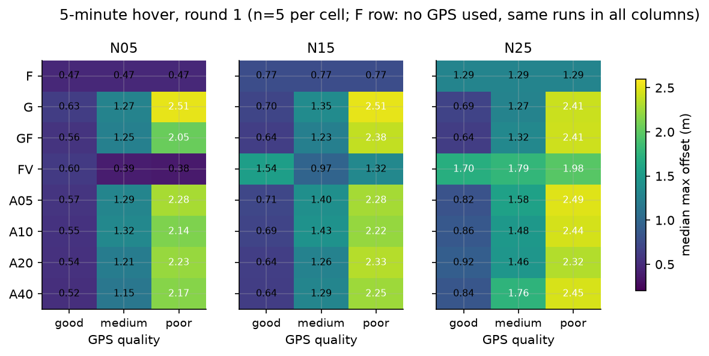
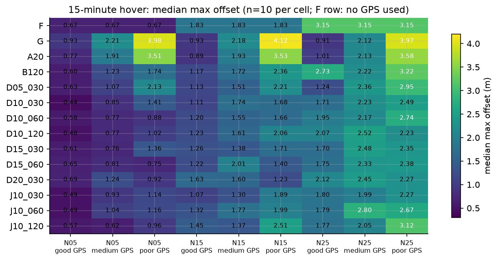
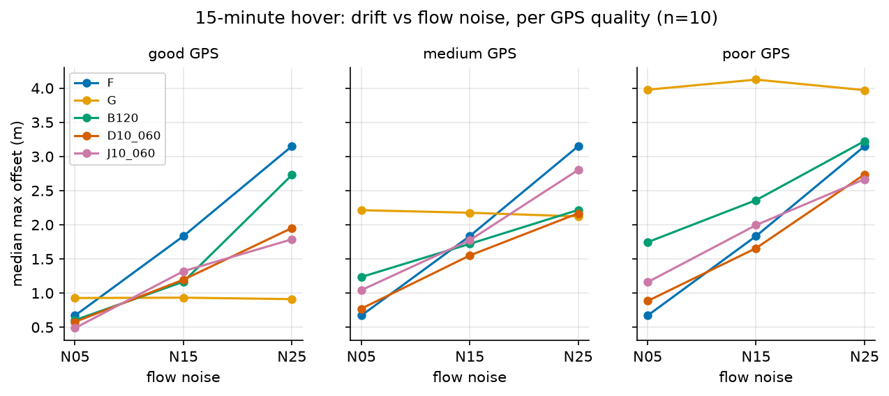
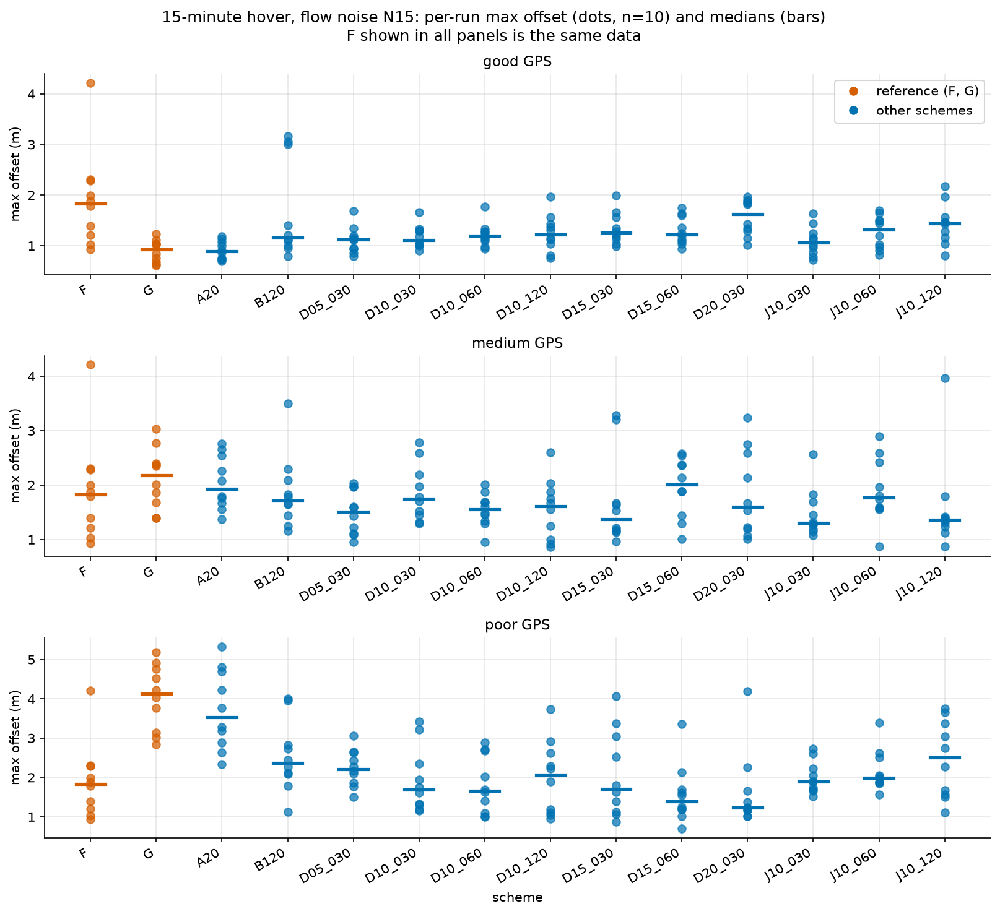
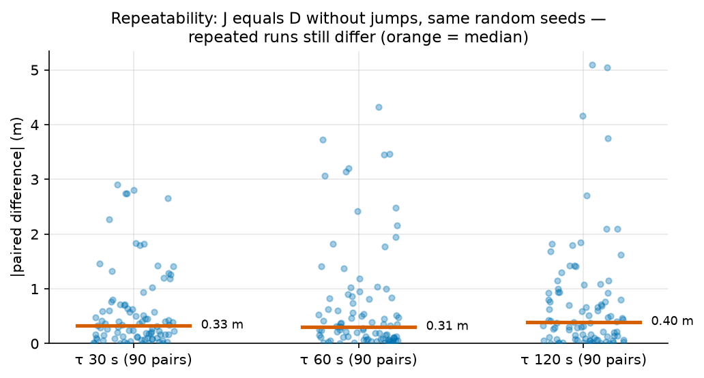
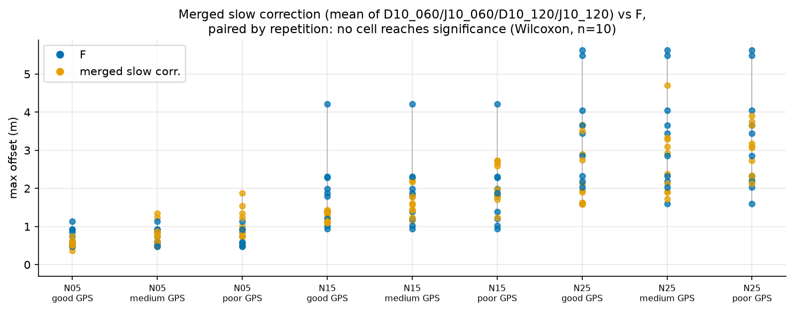
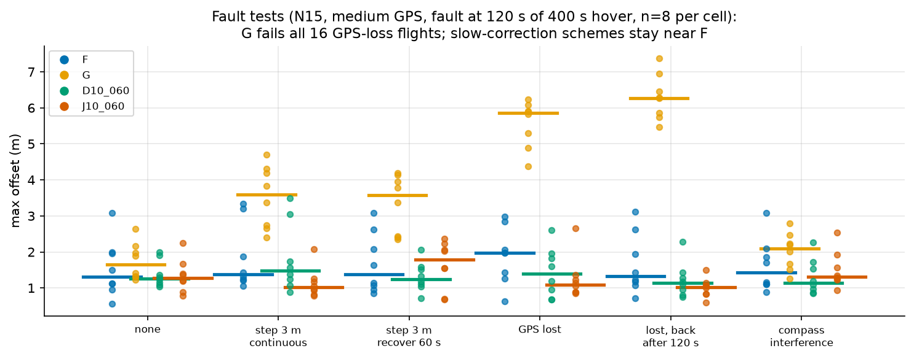
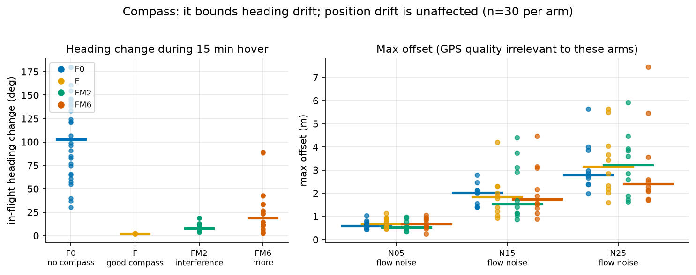

# 用 GPS 和罗盘改善悬停漂移：仿真研究报告

日期：2026-11-23
平台：ArduCopter 4.7.0 SITL（ROG，`~/sim/gps_hover`），5 倍速，共 2250 次飞行
硬件背景：Matek F405 + MTF-01 光流/测距，新增 HGLRC M100 Pro GPS（M10）和 QMC5883L 罗盘

## 1. 结论

1. **罗盘应该开**。不用罗盘时航向在 15 分钟内漂移约 100°，用罗盘时约 2°。罗盘受电机电流干扰（航向变化中位数 8–19°）时，位置偏移与正常罗盘没有显著差别。
2. **不要让飞控融合 GPS 位置**（`EK3_SRC1_POSXY` 保持 0）。GPS 好时它效果最好（15 分钟最大偏移 0.9 m，纯光流是 1.8–3.2 m），但 GPS 差时最差（4 m，纯光流 0.7 m），GPS 突跳 3 m 时飞机跟着走 3.6 m，GPS 丢失时 16 次中 16 次没有完成任务，偏移约 6 m。
3. **GPS 放在伴机侧做慢修正是安全的**：3 m 突跳在 80 次中 80 次被吸收，270 次 15 分钟飞行中跳变检测没有误触发，GPS 丢失时修正量保持不动。所有故障下都不比纯光流差。
4. **伴机慢修正的收益不大，统计上没有确立**。GPS 好时最大偏移约为纯光流的 0.6–0.8 倍，其余情况大致相同。光流好而 GPS 差时可能更差（约 1.0 m 对 0.7 m，p = 0.06）。
5. **GPS 不能提高短时间的悬停精度**。5 分钟内光流本身只漂 0.5–1.3 m，GPS 的慢漂和它同一量级。GPS 的作用是给长时间悬停的漂移封顶。厘米级的精度仍然要靠地标（ArUco）。
6. 以上数值依赖仿真里假设的 GPS 误差模型。真机 M10 在场地里的实际慢漂大小是最大的不确定项，需要一段真机静置 GPS 日志来校准。

## 2. 方法

### 2.1 任务

GUIDED 起飞到 2 m，伴机以 5 Hz 发位置目标保持悬停（`SET_POSITION_TARGET_LOCAL_NED`），然后降落。风 1.5 m/s 加湍流。指标取自仿真真值（数据闪存日志 `SIM2`）：

- 最大偏移：悬停期间离起始真实位置的最大水平距离。
- 均方根偏移、结束时偏移。
- 航向变化：`ATT.Yaw − SIM.Yaw` 在悬停期间的最大变化。

### 2.2 条件

| 因素 | 取值 |
|-|-|
| 光流噪声 `SIM_FLOW_RND` | 0.05 / 0.15 / 0.25（记作 N05 / N15 / N25） |
| GPS 质量 | 好：慢漂 σ 0.3 m，上报精度 0.6 m；中：0.8 m，1.2 m；差：1.5 m，2.0 m（记作 Gg / Gm / Gp） |
| GPS 误差模型 | 高斯-马尔可夫慢漂（时间常数 300 s）加快噪声（5 s），通过 `SIM_GPS1_GLTCH_X/Y` 注入 |

同一重复编号的各方案使用相同的航向、风向和 GPS 误差序列，方案间做配对 Wilcoxon 检验，基准是“光流 + 罗盘”。

### 2.3 方案

| 代号 | 内容 |
|-|-|
| F0 | 纯光流，无罗盘（目前笼内配置） |
| F | 光流 + 罗盘（基准） |
| FM2 / FM6 | F，罗盘受电机电流干扰（`SIM_MAG_MOT_Y` 2 / 6） |
| G | 飞控融合 GPS 位置和速度 |
| GF / FV | G 加光流速度；光流加 GPS 速度 |
| A05–A40 | 飞控融合光流速度 + GPS 位置，`EK3_POSNE_M_NSE` 0.5–4 |
| B020 / B060 / B120 | 飞控纯光流，伴机慢修正，时间常数 20 / 60 / 120 s |
| Dkk_ttt | B 加死区：死区 = k × GPS 上报精度，时间常数 ttt 秒 |
| Jkk_ttt | D 加 GPS 跳变检测（1.5 m） |

### 2.4 伴机慢修正

d = (EKF 位置 − GPS 位置) − 起始 5 秒的基准值，等于光流漂移加 GPS 自身的晃动。

- 死区：|d| 小于 k × 上报精度时不修正，超出的部分才往回拉。
- 修正量 c 以时间常数 τ 跟随，限速 0.1 m/s，限幅 3 m，加到位置保持目标上。
- GPS 不合格（定位类型 < 3、精度 > 2.5 m、卫星数 < 7）时保持 c 不动。
- 跳变检测：d 偏离自身 5 秒低通值超过 1.5 m 时判为 GPS 突跳，把跳变量并入基准，c 不动。

### 2.5 各轮

| 轮 | 次数 | 内容 |
|-|-|-|
| 1 | 480 | 悬停 5 分钟，全部方案，每格 5 次 |
| 2 | 660 | 悬停 15 分钟，10 个方案，每格 10 次 |
| 3 | 552 | 故障测试（192 次）+ 死区宽度和时间常数调参（360 次） |
| 3b | 372 | 跳变检测版本：故障（192 次）+ 15 分钟（180 次） |
| 3c | 186 | 死区 1×、τ = 60 s、跳变检测：故障（96 次）+ 15 分钟（90 次） |

2250 次中 2234 次完成任务；未完成的 16 次全部是方案 G 在 GPS 丢失故障下。

## 3. 结果

### 3.1 悬停 5 分钟（第 1 轮，最大偏移中位数，m，每格 5 次）

| 光流噪声 | 纯光流 F | GPS 好 | GPS 中 | GPS 差 |
|-|-|-|-|-|
| N05 | 0.47 | 0.52–0.63 | 1.15–1.32 | 2.1–2.5 |
| N15 | 0.77 | 0.64–0.71 | 1.26–1.43 | 2.2–2.5 |
| N25 | 1.29 | 0.64–0.92 | 1.27–1.76 | 2.3–2.5 |

GPS 三列是“飞控融合 GPS 位置”各方案（G、GF、A05–A40）的范围。

*图1. 第 1 轮 5 分钟悬停各格的最大偏移中位数热图（行=方案，列=GPS 质量，三块=光流噪声）：偏移主要由 GPS 质量决定（好 0.5–0.7 / 中 1.2–1.4 / 差 2.1–2.5 m），F 与纯光流侧的 FV 不随 GPS 变化。数据来源：results_all.csv；脚本：make_figures.py。*

- `EK3_POSNE_M_NSE` 从 0.5 调到 4 没有差别：GPS 慢漂的周期是几分钟，短于几分钟的滤波都会跟着走。
- 融合 GPS 速度（FV）没有改善。
- 每格只有 5 次，p 值最小只能到 0.0625，这一轮只用来看趋势。

### 3.2 悬停 15 分钟（第 2、3 轮，最大偏移中位数，m，每格 10 次）

`+` 表示显著好于 F，`x` 表示显著差于 F（配对 Wilcoxon，p < 0.05）。

| 方案 | N05 好 | N05 中 | N05 差 | N15 好 | N15 中 | N15 差 | N25 好 | N25 中 | N25 差 |
|-|-|-|-|-|-|-|-|-|-|
| F（基准） | 0.67 | 0.67 | 0.67 | 1.83 | 1.83 | 1.83 | 3.15 | 3.15 | 3.15 |
| G | 0.93 | 2.21x | 3.98x | 0.93+ | 2.18 | 4.12x | 0.91+ | 2.12+ | 3.97 |
| A20 | 0.77 | 1.91x | 3.51x | 0.89+ | 1.93 | 3.53x | 1.01+ | 2.13+ | 3.58 |
| B120 | 0.60 | 1.23x | 1.74x | 1.17 | 1.72 | 2.36 | 2.73 | 2.22+ | 3.22 |
| D05_030 | 0.63 | 1.07x | 2.13x | 1.13+ | 1.51 | 2.21 | 1.24+ | 2.36+ | 2.95 |
| D10_030 | 0.44 | 0.85 | 1.41x | 1.11+ | 1.74 | 1.68 | 1.71+ | 2.23 | 2.49 |
| D10_060 | 0.58 | 0.77 | 0.88 | 1.20+ | 1.55 | 1.66 | 1.95 | 2.17+ | 2.74 |
| D10_120 | 0.48 | 0.77 | 1.02 | 1.23 | 1.61 | 2.06 | 2.07 | 2.52 | 2.23 |
| D15_030 | 0.61 | 0.76 | 1.36 | 1.26 | 1.38 | 1.71 | 1.70 | 2.48 | 2.35 |
| D15_060 | 0.65 | 0.81 | 0.75 | 1.22+ | 2.01 | 1.40 | 1.75+ | 2.33 | 2.38 |
| D20_030 | 0.69 | 1.24 | 0.92x | 1.63 | 1.60 | 1.23 | 2.12 | 2.45 | 2.27 |
| J10_030 | 0.49 | 0.93 | 1.14x | 1.07+ | 1.30 | 1.89 | 1.80 | 1.99 | 2.27 |
| J10_060 | 0.49 | 1.04 | 1.16x | 1.32+ | 1.77 | 1.99 | 1.79 | 2.80 | 2.67 |
| J10_120 | 0.57 | 0.62 | 0.96 | 1.45 | 1.37 | 2.51 | 1.77 | 2.05+ | 3.12 |

*图2. 15 分钟悬停 14 个方案 × 9 格的最大偏移中位数热图（即上表）：飞控融合 GPS 的方案（G/A20）偏移只随 GPS 质量变化，伴机慢修正各格都在 F 与 GPS 质量决定的包络之内。数据来源：results_h15_.csv；脚本：make_figures.py。*

F 不使用 GPS，三种 GPS 质量下是同一组数据。完整表（含均方根、结束时偏移、四分位范围）见 `h15_tables.txt` 和 `pivot.txt`。

解读：

- 方案 G（飞控融合）的偏移只取决于 GPS 质量，与光流噪声无关：好 0.9 m，中 2.2 m，差 4.0 m。
- 没有死区的慢修正（B120）在 GPS 中、差时显著变差。加死区后基本消除。
- 时间常数 30 s 的两个方案（D10_030、J10_030）在“光流好 + GPS 差”一格都显著变差，时间常数应不小于 60 s。

*图3. 五个代表方案的最大偏移中位数随光流噪声的变化（三块=GPS 质量）：G 几乎水平（好 0.9 / 中 2.2 / 差 4.0 m，与光流无关），F 随噪声线性上升，慢修正方案介于两者之间。数据来源：results_h15_.csv；脚本：make_figures.py。*

*图4. 光流噪声 N15 时各方案每次运行的最大偏移分布（圆点 n=10，横线=中位数）：同一方案格内的散布约 ±0.5 m，比多数方案间的差别还大，与 3.3 节的重复性结论一致。数据来源：results_h15_.csv；脚本：make_figures.py。*

### 3.3 重复性和合并比较

J 方案在没有跳变时与同参数的 D 方案算法完全相同，随机序列也相同，可以当作重复实验。270 次 15 分钟 J 飞行中跳变检测一次都没有触发，但 D 与 J 的最大偏移仍然不同：

| 时间常数 | 配对数 | 差值绝对值中位数 | 90 分位 |
|-|-|-|-|
| 30 s | 90 | 0.33 m | 1.80 m |
| 60 s | 90 | 0.31 m | 2.42 m |
| 120 s | 90 | 0.40 m | 1.82 m |

*图5. 三个时间常数下 D 与 J 同条件配对差值绝对值的分布（每格 90 对，橙线=中位数 0.33/0.31/0.40 m）：算法完全相同、随机序列相同的两次运行仍差约 0.3 m，尾部可达 3–5 m。数据来源：results_h15_.csv（D10_* 与 J10_* 按重复编号配对）；脚本：make_figures.py。*

也就是说同一条件重复跑，结果本身就有约 0.3 m 的差别（5 倍速下仿真时序不完全确定）。所以 3.2 表中各 D / J 方案之间的差别分辨不出来，60 s 和 120 s 哪个更好没有结论。

把死区 1×、时间常数 60 和 120 s 的四个方案（D10_060、J10_060、D10_120、J10_120）按重复编号取平均，再与 F 配对比较：

| 条件 | F | 合并慢修正 | 更好的次数 | p |
|-|-|-|-|-|
| N05 好 | 0.67 | 0.55 | 7/10 | 0.19 |
| N05 中 | 0.67 | 0.82 | 4/10 | 0.49 |
| N05 差 | 0.67 | 0.97 | 3/10 | 0.06 |
| N15 好 | 1.83 | 1.34 | 6/10 | 0.08 |
| N15 中 | 1.83 | 1.59 | 6/10 | 0.70 |
| N15 差 | 1.83 | 1.93 | 4/10 | 0.38 |
| N25 好 | 3.15 | 2.04 | 7/10 | 0.23 |
| N25 中 | 3.15 | 2.65 | 7/10 | 0.28 |
| N25 差 | 3.15 | 3.08 | 3/10 | 1.00 |

*图6. 四个候选方案按重复编号合并后与 F 的逐次配对（蓝=F，橙=合并慢修正，灰线连接同一次重复；F 不用 GPS，三个 GPS 列重复同一组 F 数据）：没有任何一格稳定地一侧占优，与上表 p 均 > 0.05 一致。数据来源：results_h15_.csv；脚本：make_figures.py。*

没有一格达到显著。方向上，GPS 好时偏移减小到 0.65–0.8 倍，GPS 差而光流好时偏大。

### 3.4 故障测试（N15，GPS 中，悬停 400 s，第 120 s 注入，最大偏移中位数，m，每格 8 次）

| 故障 | F | G | D10_060 | J10_060 |
|-|-|-|-|-|
| 无 | 1.31 | 1.65 | 1.27 | 1.28 |
| GPS 突跳 3 m，持续 | 1.37 | 3.60x | 1.47 | 1.01+ |
| GPS 突跳 3 m，60 s 后恢复 | 1.39 | 3.57x | 1.25 | 1.79 |
| GPS 丢失 | 1.98 | 5.86x | 1.39 | 1.09 |
| GPS 丢失 120 s 后恢复 | 1.33 | 6.27x | 1.14 | 1.03 |
| 罗盘干扰（`SIM_MAG_MOT_Y` 6） | 1.43 | 2.10 | 1.14 | 1.32 |

*图7. 六种故障下四个方案每次运行的最大偏移（n=8/格）：只有 G 在两种 GPS 丢失故障下整体抬高（16/16 未完成），伴机慢修正与 F 的分布重叠；罗盘干扰对四个方案影响都不大。数据来源：results_ft_.csv；脚本：make_figures.py。*

- 方案 G 在 GPS 丢失的 16 次里全部没有完成任务，估计位置出现约 1 m 的跳变。这里的配置没有自动切回光流（F405 上没有 Lua，只能靠遥控开关切源），所以这个结果对应“没人切开关”的情况。
- 伴机慢修正在所有故障下与 F 没有显著差别，或更好。
- 跳变检测：五个 J 方案的持续突跳 40 次、突跳后恢复 40 次，全部检出（后者检出去、回两次）。GPS 丢失后恢复的 40 次里有 8 次在恢复时判了一次跳变，属于保守处理，没有造成偏移增大。
- 没有跳变检测的 D10_030 在突跳时修正量被带偏（一次飞行里达到 1.6 m）：死区之外的部分间歇落入原来的 1.5 m 门限之内，被当作漂移跟了过去。这是加跳变检测的原因。

### 3.5 罗盘（15 分钟，N05 / N15 / N25，每格 10 次）

| 方案 | 航向变化中位数 | 最大偏移（m） |
|-|-|-|
| F0 无罗盘 | 92–110°（各次 30–180°） | 0.60 / 2.01 / 2.80 |
| F 罗盘 | 2.2°（各次 1.8–3.0°） | 0.67 / 1.83 / 3.15 |
| FM2 罗盘受干扰 | 8°（各次 3.6–19°） | 0.53 / 1.54 / 3.22 |
| FM6 罗盘受干扰更大 | 19°（各次 2.4–90°） | 0.68 / 1.73 / 2.41 |

*图8. 四个罗盘方案的悬停航向变化（左，n=30/方案）与最大偏移（右，按光流噪声分三组）：无罗盘 F0 的航向变化中位约 103°（各次 30–180°），有罗盘的三个方案位置偏移分布与 F0 重叠。数据来源：results_h15_.csv（F0/F/FM2/FM6）；脚本：make_figures.py。*

无罗盘时位置偏移与有罗盘没有显著差别（悬停时航向漂移不直接变成位置漂移），但航向漂 100° 会让航点、围栏、返航这些依赖世界坐标的功能全部出错。

## 4. 建议

### 4.1 飞控参数（由用户写入）

- 位置源保持光流：`EK3_SRC1_POSXY 0`，`EK3_SRC1_VELXY 5`。不要把 GPS 设为位置源。
- 航向用罗盘：`COMPASS_ENABLE 1`，`COMPASS_USE 1`，`EK3_SRC1_YAW 1`。上机后做罗盘校准，并做电机电流补偿（`COMPASS_MOTCT`），因为 GPS 模块上的罗盘离电源线近。
- `GPS1_TYPE 1`，让飞控输出 `GPS_RAW_INT` 给伴机。GPS 只用于伴机修正和日志。

### 4.2 伴机

代码已移植到 worktree `~/code/FlyDrones-mtf01`（未提交），默认关闭：

| 文件 | 内容 |
|-|-|
| `ecps295/ecps_gps_anchor.py` | 慢修正 + 死区 + 跳变检测；有地标定位时以地标为准 |
| `ecps295/ecps_pilot.py` | 修正量走地标修正的同一路径（`pos_offset`） |
| `ecps295/mavlink_twin.py` | 读 `GPS_RAW_INT`，开启时才请求该数据流 |
| `ecps295/deploy/orangepi/companion/ecps_companion.py` | 读配置、状态记录（`ga_dn`、`ga_de`、`ga_state`） |
| `ecps295/deploy/orangepi/config/companion.yaml` | `gps_anchor:` 段，`enabled: false` |
| `ecps295/scripts/gps_anchor_test.py` | 离线测试 12 项，全部通过 |

默认参数：死区 1× 上报精度，时间常数 60 s，跳变门限 1.5 m，限速 0.1 m/s，限幅 3 m。

开启前需要：

1. 真机静置 10 分钟的 GPS 日志（室外，场地内），看实际慢漂大小和上报精度是否相称。如果上报精度明显小于实际慢漂，死区要加大（`dead_k`）。
2. 室内或笼内不要开启：GPS 多径严重时上报精度不可信。

### 4.3 已知限制

- 光流漂移快于约 0.025 m/s（门限 1.5 m ÷ 时间常数 60 s）时修正会停住，保持不动。仿真里最差的漂移约 0.003 m/s。
- 慢于跳变门限的 GPS 缓慢偏移（例如 0.1 m/s 的斜坡）检测不出来，会被当作漂移跟随，上限是限幅 3 m。
- 仿真的 GPS 误差是平稳的高斯-马尔可夫过程，上报精度恒定。真实接收机的误差有多径跳变，上报精度也会变。
- 5 倍速下同一条件重复结果相差约 0.3 m（中位数），小于这个量级的差别不能下结论。

## 5. 文件

本目录（Mac）和 ROG `~/sim/gps_hover/` 内容相同，ROG 另有 `runs/`（41 GB，飞行日志已 gzip 压缩）。

| 文件 | 内容 |
|-|-|
| `gps_drift_fix.py` | 仿真用的慢修正（与伴机版算法相同） |
| `gh_sim.py` | 单次飞行脚本 |
| `gh_analyze.py` | 从数据闪存日志算指标 |
| `gen.py`、`batch.py`、`run_one.sh` | 任务生成和批量运行 |
| `gh_stats.py`、`pivot.py` | 统计表 |
| `results_all.csv` | 第 1 轮结果（原始日志已删除） |
| `results_h15_.csv`、`h15_tables.txt`、`pivot.txt` | 15 分钟结果 |
| `results_ft_.csv`、`ft_tables.txt` | 故障测试结果 |

说明：第 2 轮跑到一半时 ROG 磁盘写满，之后删除了第 1 轮 480 次的原始飞行日志（指标保留），受影响的 226 次第 2 轮飞行全部重跑。
