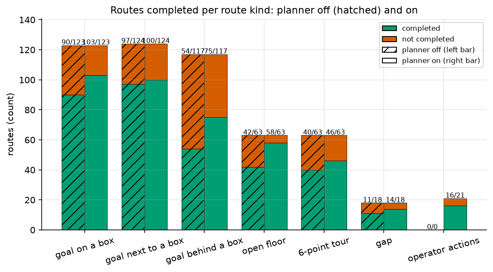
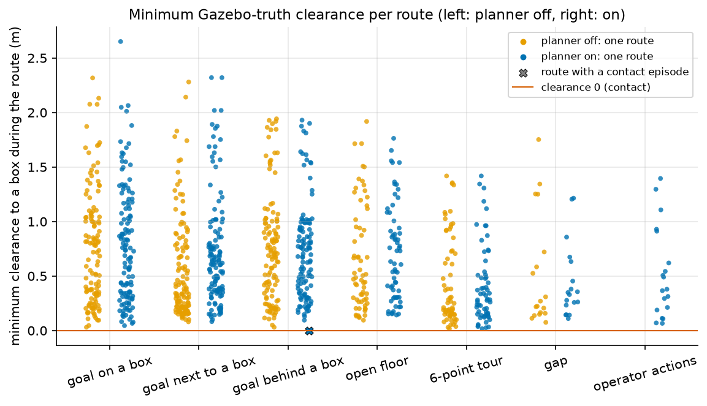
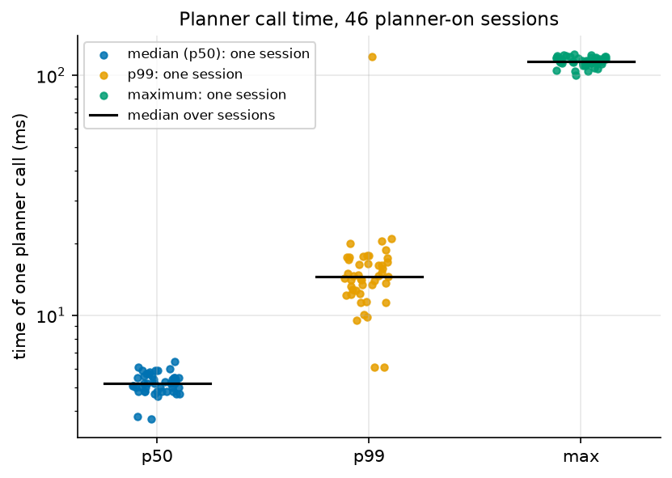
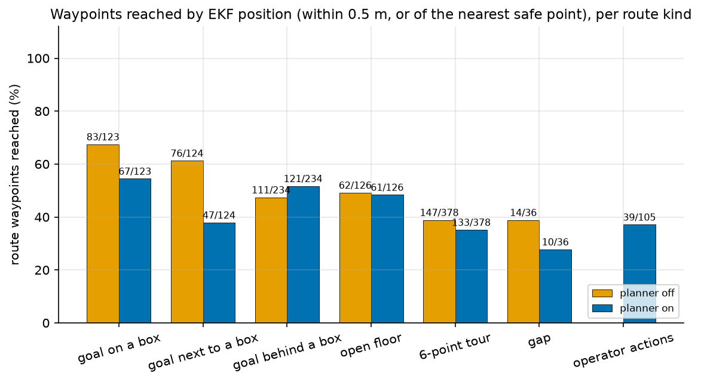
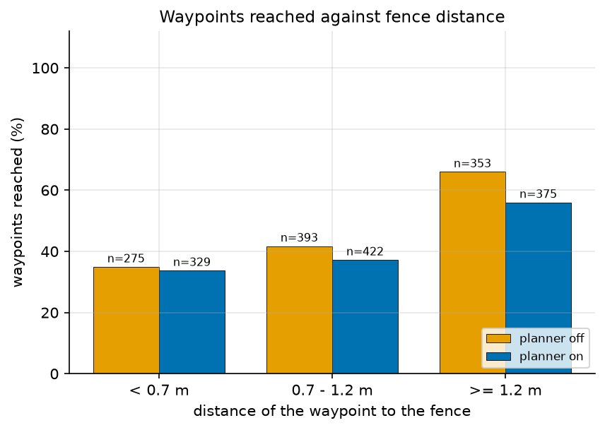

# Gazebo console verification: planner on / off (2026-10-22)

Verification of the companion's route planner through the operator console, in Gazebo + ArduCopter SITL. The same
console routes (go-to waypoint lists) were flown twice, once with the planner enabled and once with it disabled,
in 33 worlds with boxes; the Gazebo truth and the console event log are compared per route.

**Results** (`verify/pv_result.json`, `verify/pv_truth.json`, added 2026-11-24; figures below). Routes finished according
to the console log: planner off 334/508 (65.7%), planner on 412/529 (77.9%). Route waypoints
reached by the truth-based rule of `analyze_truth.py`: planner off 493/1021 (48.3%), planner on 478/1126 (42.5%).
The two measures do not point the same way: with the planner on more routes are reported finished, and fewer of the
original waypoints are reached within 0.5 m. Contact episodes
in the Gazebo truth: 3 with the planner off, 2 with it on. Planner call time over 46 planner-on sessions that reported it: median of the
session medians 5.2 ms, median of the 99th percentiles 14.6 ms, largest single call 122.9 ms.

## What was tested

| Part | Files | Runs |
|---|---|---|
| Wave `pv1`: plan `*_r1.json`, planner on and off | `verify/queue.txt`, `verify/plans/` | 33 worlds x 2 = 66 |
| Wave `pv2`: plan `*_r2.json` (same route kinds, other points), planner on and off | same | 30 worlds x 2 = 60 |
| Wave `pvops`: operator actions, planner on only | same | 7 |
| Smoke tests (not in the queue) | `verify/plans/smoke3.json`, `smoke_cage20.json` | - |

`verify/queue.txt` has 133 lines in total: `<world> <plan|noplan> <plan file> <session tag>`. The 33 worlds are `cage20`
(20 ft cage), `cage10` (10 ft cage), `wall_offset` and 30 `lowbox_s0` ... `lowbox_s29` (low boxes in the cage; wave `pv2`
has only the 30 lowbox worlds). The paths inside the queue point at the simulation PC's working copy.

One session is one world, one condition and one plan file. `verify/run_resume.sh` shows the session: Gazebo + SITL with a scripted pilot (`run_g4 --mode console`,
cruise and forward speed limit 0.5 m/s, fence turn on), the companion run locally with a console link over a local UDP port (fence radius 2.7 m, 1.27 m in
`cage10`, 2.6 m in `wall_offset`) and a client that plays the plan. The FC heartbeat timeout is 4 s. The scripts
`hb_gap_relay.py` and the client that the shell script calls are not in the directory.

The two conditions differ in one line of the companion configuration: `config/hw_plan.yaml` and `config/hw_noplan.yaml`
are identical (real-drone layout: UVC camera, two 8-zone ToF sensors, MAVLink to the FC, console on port 14700,
marker and landmark off) except that `hw_noplan.yaml` sets `console.planner.enabled: false`.

Route kinds (tag prefix of each plan step, counted over all plan files; refusal steps and operator steps included):

| Prefix | Steps | Meaning (from the plans) |
|---|---|---|
| `on` | 125 | goal on / inside a box (the planner has to move the goal to the nearest safe point) |
| `adj` | 125 | goal next to a box |
| `behind` | 120 | two-point route, second goal behind a box |
| `tour6` | 63 | six goals, alternating across the cage |
| `open` | 63 | two goals on open floor |
| `gap` | 18 | goals on either side of a gap between two boxes; the gap width in metres is in the tag (0.33 ... 0.84) |
| `refuse` | 64 | goal outside the fence; `expect_refuse`: the console must refuse the route |
| `ops` | 21 | operator actions: `ops_change` (route replaced 8 s in), `ops_estop` (emergency stop 6 s in, then a new goal), `ops_tour_after` |

(The meaning of `on`, `adj`, `behind` is taken from the tag names and from `analyze_truth.py`, which treats a goal
on or next to an obstacle through `reach_need`; the plans have no description field.)

## What the analysis scripts compute (`verify/analyze.py`, `verify/analyze_truth.py`)

`analyze.py` (console log + truth; `pv_result.json` holds `sessions` and `steps`):

| Field | Meaning |
|---|---|
| `steps[].done` | route finished: the console's final operator mode event says "route done" / "goal reached" / "goal done", no timeout |
| `reached`, `skipped`, `n_wp` | waypoint events reached / skipped, and waypoints in the route. Planner on: the console's own "waypoint k of N" events; planner off: the pilot's "waypoint i reached / skipped" events |
| `min_clear` (m), `contacts` | minimum Gazebo truth clearance to a box during the route; number of contact episodes (clearance below 0) |
| `secs`, `escapes`, `fence_turns`, `replans`, `moved`, `low_cross`, `no_path` | route duration; brain escapes; fence turn-backs; "new path" events; goals moved clear of an obstacle; paths crossing low boxes; "no path yet" events |
| `sessions[].plan_ms_p50 / p99 / max` | planner call time in ms, from the companion status (planner-on sessions) |
| `sessions[].rtf`, `contact_episodes`, `min_clear` | real-time factor of the run; whole-session contact episodes and minimum clearance |

Sessions whose own companion did not answer (`companion_tag` mismatch) are skipped by both scripts.

`analyze_truth.py` (`pv_truth.json` holds `waypoints`, `contacts`, `steps`): independent of the console log. A route
waypoint counts as reached when the EKF position came within 0.5 m of it, or within 0.5 m of the nearest safe point
(`need`) when the waypoint sits on or next to a box (prop tip clearance 0.3 m, prop radius 0.13 m). `min_truth` and
`min_ekf` are the closest approaches (Gazebo truth and EKF); `fence_gap` is the distance of the waypoint to the
fence; every contact episode is listed with its step and the nearest box.

## Files

| File | Kind |
|---|---|
| `config/hw_plan.yaml`, `config/hw_noplan.yaml` | plan: companion configuration of the two conditions |
| `verify/queue.txt`, `verify/plans/*.json`, `verify/run_resume.sh` | plan: run list, route plans (72 files), session script |
| `verify/analyze.py`, `verify/analyze_truth.py` | scripts that produce the result files |
| `verify/pv_result.json`, `verify/pv_truth.json` | results: one entry per session and route step (console log + truth), and per route waypoint and contact (truth only) |
| `make_figures.py` | reads the two result files and writes `figures/`; `python make_figures.py` |

## Figures

*Figure 1. Routes finished according to the console log, per route kind, planner off (hatched) and on; the label is finished / flown. Source: verify/pv_result.json; script: make_figures.py.*

*Figure 2. Minimum truth clearance to a box during each route, per route kind (left: planner off, right: planner on); routes with a contact episode are marked. Source: verify/pv_result.json; script: make_figures.py.*

*Figure 3. Planner call time of each planner-on session (median, 99th percentile, maximum), log scale. Source: verify/pv_result.json; script: make_figures.py.*

*Figure 4. Share of route waypoints the EKF position came within 0.5 m of (or of the nearest safe point), per route kind and condition; the label is reached / waypoints. Source: verify/pv_truth.json; script: make_figures.py.*

*Figure 5. Share of waypoints reached, grouped by the waypoint's distance to the fence. Source: verify/pv_truth.json; script: make_figures.py.*

The tool that runs the console in Gazebo is documented in [`../../scripts/gzc/README.md`](../../scripts/gzc/README.md).
A written report of the planner on / off result is not in `ecps295/`; the numbers above come straight from the two result files.
