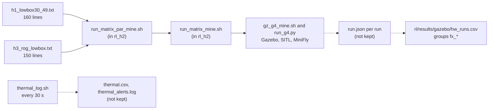
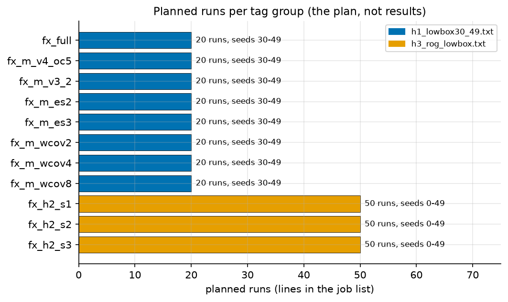

# misc: a thermal logger and two low-box job lists

Loose files from the top of `~/sim` on the simulation PC. **The per-run results of the two job lists were not kept in
this directory**; the corresponding rows are in the repository (last section). The directory holds two plans (the
job lists) and one script (the logger); there is no result file.

## Files

| File | Kind | What it is |
|---|---|---|
| `thermal_log.sh` | script | logs one CSV row every 30 s during long simulation batches (CPU `Tctl`, GPU and iGPU temperature, NVMe maximum, fan speeds, mean CPU clock, load, GPU utilisation and power, GPU throttle bits) and writes an alert line when the CPU is at 95 C or more, the GPU at 87 C or more, or the GPU reports thermal / power throttling. Stop with `pkill -f thermal_log.sh` |
| `h1_lowbox30_49.txt` | plan | 160 runs: 8 configurations on `lowbox_s30` ... `lowbox_s49` (20 worlds, brain seed = world number) |
| `h3_rog_lowbox.txt` | plan | 150 runs: 3 CMA-ES results `h2_s1`, `h2_s2`, `h2_s3` on `lowbox_s0` ... `lowbox_s49` (50 worlds, brain seed = world number) |

Job-list line format: `<tag> <world> <config> <seed> <run_g4 arguments>`; all 310 runs are
`--mode patrol --seconds 120 --cruise 0.5 --max-forward 0.5 --fence-turn --ext-height`. Config paths such as
`../rl/configs/v4_oc5` and `../../../rl_h2/ecps295/minifly/h2_s1` point into other trees on the machine.

## How the scripts chain

The job lists are inputs of the runners that live in [`../rl_h2/`](../rl_h2/README.md); the logger runs next to them.

## Job lists

| List | Runs | What varies |
|---|---|---|
| `h1_lowbox30_49.txt` | 160 | the configuration, 20 runs each (tag group in brackets): `v4` (`fx_full`), `v4_oc5` (`fx_m_v4_oc5`), `v3_2` (`fx_m_v3_2`), `v3_2_es2` (`fx_m_es2`), `v3_2_es3` (`fx_m_es3`), `b2_wcov2`, `b2_wcov4`, `b2_wcov8` (`fx_m_wcov2`, `fx_m_wcov4`, `fx_m_wcov8`) |
| `h3_rog_lowbox.txt` | 150 | the configuration, 50 runs each: `h2_s1` (`fx_h2_s1`), `h2_s2`, `h2_s3` |

*Figure 1. Planned runs per tag group in the two job lists (the plan, not results). Source: h1_lowbox30_49.txt, h3_rog_lowbox.txt; script: make_figures.py.*

## Where the results are reported

- Per-run rows: [`rl/results/gazebo/hw_runs.csv`](../../rl/results/gazebo/hw_runs.csv), groups `fx_full`, `fx_m_*` (from
  `h1_lowbox30_49.txt`) and `fx_h2_s1` ... `fx_h2_s3` (from `h3_rog_lowbox.txt`).
  The `fx_m_*` groups in that file have 114 rows each and `fx_full` 82, more than the 20 runs this list plans per group;
  the other rows must come from lists that are not in this directory.
- Text: [Report 5, section 7](../../reports/05_hardware_alignment.en.md) names the `fx_*` groups as the ROG H0 / H1 runs;
  [Report 6, section 6](../../reports/06_connectome_controls_ood.en.md) names `fx_h2_s*` as "ROG intact seeds 1-3"; the
  acceptance of `h2_s*` against `v4` is in Report 5, section 4 (H2 / H3).
- The thermal log has no report.
