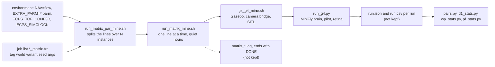
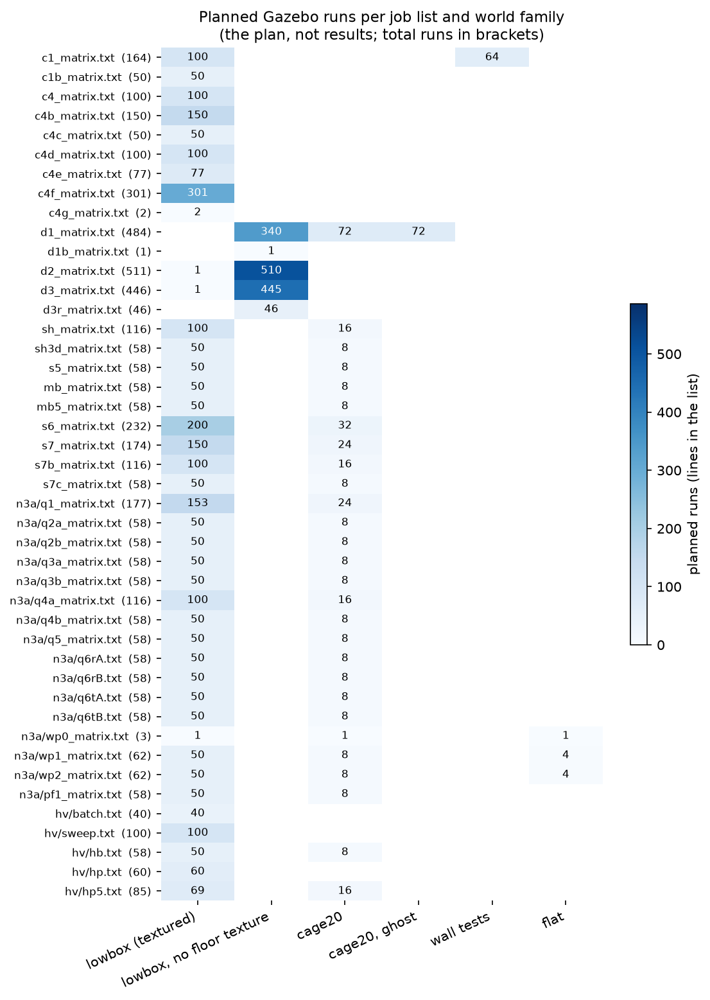

# rl_h2: Gazebo job lists, chain scripts and patch scripts (hover / hold / PIL work)

Working copy of `~/sim/rl_h2` on the simulation PC. It holds what ran the Gazebo + SITL batches of the RL work after
the hardware alignment: the job lists ("matrices"), the runners, the chain scripts that start one batch after the
previous one, and the patch scripts that added features to `run_g4.py` / `mavlink_twin.py` / `ecps_*.py`.
**The per-run results (`run.json`, `run.csv`, the `matrix_*.log` summary logs) were not kept in this directory.** Where
the numbers are reported is in the last section. Everything in this directory is a plan or a script; nothing is a result.

## Files

| Path | Kind | What it is |
|---|---|---|
| `*_matrix.txt` (24 files), `c4_smoke.txt`, `lowbox_s0_k3.txt` | plan | job lists, one run per line: `<tag> <world> <variant>[@<arm>] <brain seed> <run_g4 arguments>`. `lowbox_s0_k3.txt` is not a list: it holds one line `pil1__ FAILED FileNotFoundError(...)` and `DONE` (the log of a failed start) |
| `run_matrix_mine.sh`, `run_matrix_par_mine.sh`, `gz_g4_mine.sh` (+ `.pre_gzc`, `.pre_pil`, `.pre_qoff`, `.pre_quiet` older versions, `bak/`) | script | the runners: one line at a time, N parallel Gazebo / SITL instances, no new run 00:55-07:00 Pacific time |
| `chain_*.sh`, `launch_msh3.sh`, `retry_md3.sh`, `c4_rog.sh` | script | start one batch when the previous log ends with `DONE`; `retry_md3.sh` reruns the `FAILED` lines of the `d3` batch; `c4_rog.sh` runs the CMA-ES `c4` search (twin, not Gazebo) |
| `patch.py`, `gen_sh.py`, `s5gz/`, `s6gz/`, `s7gz/` | script | feature patches and the files they install: full-cone ToF emulation (`ECPS_TOF_CONE3D`), shield variants (`sh5u`, `shfu`), S5 ToF into the retina, S6 sensor layouts, S7 local 3D map |
| `n3a/` | plan + script | follow-up queues `chain_q1.sh` ... `chain_q6.sh`, their job lists, patch scripts (`patch_bandlo.py`, `patch_drift*.py`, `patch_simclock.py`, `patch_shdbg.py`), `gz_export.py`, and one-line lists of the PIL runs (`pil1__*`, `pil2__*`, `pil3__*`, `pil_smoke1.txt`) |
| `hv/` | plan + script | hover-hold job lists and runners; the same set is in [`../../scripts/hover/`](../../scripts/hover/README.md) |
| `pairs.py`, `d1_stats.py`, `n3a/pf_stats.py`, `n3a/wp_stats.py`, `hv/pilhold_stats.py` | script | paired comparisons of two batches, read from the run directories (not present here) |
| `test.py`, `s6gz/test_s6.py`, `s7gz/test_s7.py` | script | geometry and emulation checks of the patched `MavlinkTwin` |
| `src/flydrones/` | code | copy of the upstream `flydrones` package used by the batches |
| `make_figures.py`, `figures/` | script | redraws the figure below from the job lists (`python make_figures.py`) |

Paths inside the scripts point at the simulation PC; adjust them before running elsewhere (see `../README.md`).

## How the scripts chain

One batch: the job list goes through the runners into Gazebo; the dotted boxes were not kept.

The batches, in the order the chain scripts start them (each waits for `DONE` in the log of the previous one;
`chain_s7b.sh` and `chain_q6.sh` have no wait line, their place follows from the comments in the scripts):

```mermaid
flowchart LR
    N1b["launch_msh3.sh<br/>sh3d_matrix"] --> N1c["s5gz/chain_ms5.sh<br/>s5_matrix"]
    N1c --> MB["chain_mb.sh<br/>mb_matrix"]
    MB --> MB5["chain_mb5.sh<br/>mb5_matrix"]
    MB5 --> S6["chain_s6.sh<br/>s6_matrix"]
    S6 --> S7["chain_s7.sh<br/>s7_matrix"]
    S7 --> S7B["chain_s7b.sh<br/>s7b_matrix"]
    S7B --> S7C["chain_s7c.sh<br/>s7c_matrix"]
    S7C --> Q1["n3a/deploy_q1.sh,<br/>n3a/chain_q1.sh"]
    Q1 --> Q25["n3a/chain_q2.sh to chain_q5.sh"]
    Q25 --> Q6["n3a/chain_q6.sh"]
    Q6 --> PF["n3a/chain_pf1.sh<br/>after the wp2 batch"]
```

The earlier lists (`c1`, `c4*`, `d1`-`d3`, `sh`) were started by hand or by scripts that are not in this directory.

## Job lists

Runs = lines in the file (counted). All runs are `run_g4 --mode patrol ... --fence-turn --ext-height` with cruise and
maximum forward speed 0.5 m/s unless the last column says otherwise. "Set A" = `lowbox_s0`-`s49` at brain seed k and
`cage20` k0-7; "set B" = brain seed k+100 and `cage20` k8-15 (58 runs each).

| List | Runs | What varies |
|---|---|---|
| `c1_matrix.txt` | 164 | `v4` against `v4_eff` (efference copy for the blank cue): 50 lowbox worlds each at 120 s, and 4 wall worlds (`wall_tape`, `wall_plain`, `wall_offset`, `wall_offset_plain`) x 8 seeds each at 20 s |
| `c1b_matrix.txt` | 50 | `h2_s3_eff` on `lowbox_s0`-`s49` |
| `c4_matrix.txt`, `c4b_matrix.txt`, `c4c_matrix.txt` | 100, 150, 50 | CMA-ES arms `c4_s1`-`s4` (bypass), 50 lowbox worlds each; `c4b` also `v4` and `c4_s1` at brain seed k+100 (50 each) |
| `c4d_matrix.txt`, `c4e_matrix.txt`, `c4f_matrix.txt`, `c4g_matrix.txt` | 100, 77, 301, 2 | `c4_s5`-`s8` (bypass) and `h2_s4`-`s8` (intact), 50 lowbox worlds each; `c4e` repeats 27 `h2_s4` lines of `c4d`; `c4g` is 2 single reruns |
| `c4_smoke.txt`, `smk_matrix.txt` | 1, 1 | smoke tests (`c4_s3`, 40 s; `sh5u`, 60 s) |
| `d1_matrix.txt` | 484 | texture-free floors: 17 configs (`v4`, `c4_s1`-`s8`, `h2_s1`-`s8`): `lowbox_s0`-`s19_notex`, and `cage20` and `cage20_ghost` x 8 seeds for the first 9 configs (36 runs each; 20 runs each for the other 8) |
| `d1b_matrix.txt` | 1 | one `v4` run on `lowbox_s0_notex` |
| `d2_matrix.txt` | 511 | the same 17 configs on `lowbox_s20`-`s49_notex` (30 each), plus one `h2_s2` run on a textured world |
| `d3_matrix.txt`, `d3r_matrix.txt` | 446, 46 | `d3` is 446 of the 511 `d2` lines (same tags, seeds 21-49); `d3r` is 46 of those again, the lines that failed in `d3` (`retry_md3.sh`) |
| `sh_matrix.txt`, `sh3d_matrix.txt` | 116, 58 | range shield on 5 ToF beams `sh5u` (planar ToF) against 8 front beams `shfu`; `sh3d`: `sh5u` with the full-cone ToF emulation; set A |
| `s5_matrix.txt` | 58 | `s5`: ToF beams also into the retina plus the shield; set A |
| `mb_matrix.txt`, `mb5_matrix.txt` | 58, 58 | `v4` and `s5` on set B |
| `s6_matrix.txt` | 232 | sensor layouts `s6_f3b`, `s6_m1b`, `s6_f2m`, `s6_m2`, set A (58 each) |
| `s7_matrix.txt` | 174 | `s6_w2` (two 8x8 boards), `s7_w2map` (+ local 3D map), `s7_w1map` (one board + map), set A |
| `s7b_matrix.txt`, `s7c_matrix.txt` | 116, 58 | `s7b`: `s7_w2map` and `s7_w1map` on set B; `s7c`: `s7_w2map` at cruise 0.65 m/s on set A |
| `n3a/q1_matrix.txt` | 177 | `n3s1` (CMA candidate, cruise 0.525 m/s) 116 runs, `s7_w2map_lo45` (map band below the drone) 58, 3 debug runs |
| `n3a/q2a`, `q2b`, `q3a`, `q3b` | 58 each | `s7_w2map` with `H_terrain_fast.parm` (`tf10`) on set A and B; `n3s2` (cruise 0.415 m/s); `s7_w2map` again on set A (day control) |
| `n3a/q4a`, `q4b` | 116, 58 | EKF drift injection (`ECPS_DRIFT_MPS`): `s7_w2map` against the drift-aware `s7_w2map_dr`; `q4b` `dr` without drift |
| `n3a/q5_matrix.txt`, `q6rA`, `q6rB`, `q6tA`, `q6tB` | 58 each | simulated-time pacing (`ECPS_SIMCLOCK=1`): `s7_w2map` (`g7_sc2`) and with `tf10` (`g7_sc2_tf10`), sets A and B |
| `n3a/wp0`, `wp1`, `wp2`, `pf1` | 3, 62, 62, 58 | waypoint batches `s7_w2map_wp` / `_wp2` (set A + 4 `flat` worlds; `wp2` 150 s); `pf1`: patrol regression of the fence-turn fix, set A |
| `hv/batch.txt`, `sweep.txt`, `sweep_rest.txt`, `hb.txt`, `hp.txt`, `hp5.txt` | 40, 100, 37, 58, 60, 85 | hover tests (`--mode hovertest`): velocity against position hold (20 worlds); position hold with `EK3_FLOW_DELAY` 40/60/80 ms and 15 deg/s yaw (5 conditions x 20; `sweep_rest` is the unfinished remainder, 37 lines); patrol checks of the hold modes: `hb` (58), `hp` (60: velocity, position hold with and without a 15 deg/s turn cap, 20 worlds), `hp5` (85) |
| `hv/pil4p`, `pil4v`, `pil5p`, `pil5v`, `n3a/pil1`-`pil3` | 20, 20, 6, 6; 3, 22, 24 | one-line files, one per PIL run (processor-in-the-loop with the Orange Pi); `p` / `v`: position / velocity hold |

*Figure 1. Planned runs per job list and world family (the plan, not results). Textured and texture-free lowbox worlds are the bulk; cage20 appears as 8 runs per batch. Source: *_matrix.txt, n3a/*, hv/*; script: make_figures.py.*

## Where the results are reported

| Batches | Reported in |
|---|---|
| `c1`, `c1b` (`mc1_*`) | [Report 5](../../reports/05_hardware_alignment.en.md) section 5 (C1); per-run rows in [`rl/results/gazebo/hw_runs.csv`](../../rl/results/gazebo/hw_runs.csv), groups `mc1_*` |
| `c4*`, `d1`-`d3` (`mc4_*`, `mc4r_*`, `md_*`) | [Report 6](../../reports/06_connectome_controls_ood.en.md) sections 3 (C4) and 4 (D); data section 6; groups `mc4_*`, `mc4r_*`, `md_*` in `hw_runs.csv` |
| `sh`, `sh3d`, `s5`, `mb`, `mb5` (`msh_*`, `msh3_*`, `ms5_*`, `mb_v4`) | [Report 7](../../reports/07_range_sensing_shield.en.md) section 4 (N1) and section 8 (second seed set); groups in `hw_runs.csv` (`mb5` / `mb_s5` has no group there) |
| `s6`, `s7`, `s7b`, `s7c` (`g6_*`, `g7_*`) | summary table in [Report 7](../../reports/07_range_sensing_shield.en.md) section 8; per-run data not in the repository (the report says it was still on the experiment machines) |
| `n3a/q1`-`q6`, `wp*`, `pf1` | the simulated-time baseline `g7_sc2_tf10` is used in the [Orange Pi report](../../deploy/orangepi/docs/ECPS295_OrangePi部署与性能测试报告_20261015.en.md); results of the queues themselves not in the repository |
| `n3a/pil1`-`pil3` | [PIL data](../../deploy/orangepi/docs/results/README.md) (`pil2.jsonl`, `pil3.jsonl`, `g7_sc2_tf10_local.jsonl`) and the Orange Pi report section 10.3 |
| `hv/` (hover) | [`scripts/hover/README.md`](../../scripts/hover/README.md): 10-18 batch, median truth rms 14.4 to 6.0 cm; the full results are in a roadmap document that is not in the repository; `pil4` / `pil5`: results not in the repository |

## Surprises in the lists

- `d3_matrix.txt` is a subset of `d2_matrix.txt` (all 446 tags are in `d2`); why `d2` was started again is not
  recorded here. Without the run logs it cannot be told which of the two produced the rows in `hw_runs.csv`.
- `c4e` and `c4d` share 27 tags, `c4g` 2 with `c4f`: reruns, not extra data.
- `d2`/`d3` contain one `mdb_h2_s2__lowbox_s33_k33` run on a textured world among the texture-free ones.
