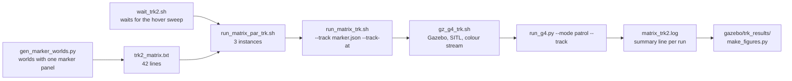

# rl_trk: TargetTrack matrix scripts that were not already under `gazebo/`

Working copy of `~/sim/rl_trk` on the simulation PC: the hand-copied tree from which the Gazebo target-tracking
batches ran (marker worlds, a launcher with an extra camera stream, the matrix runners) and the job list of the
second batch. **No per-run result is kept in this directory.** The result logs of the three batches are in
[`../../gazebo/trk_results/`](../../gazebo/trk_results/README.md), see the last section.

## Files

| File | Kind | What it is |
|---|---|---|
| `trk2_matrix.txt` | plan | job list of batch trk2 (target tracking v2): 42 runs |
| `smoke_matrix.txt` | plan | one smoke run (`trksm3__cage20_k0`, 90 s) |
| `run_matrix_trk.sh` | script | runs a job list one line at a time; writes one summary line per run with the `trk_*` columns (`trk_pass`, `trk_t_arrived`, `trk_end_dist_m`, `trk_range_err_med_m`, ..., `trk_escapes_ignored`) |
| `run_matrix_trk.sh.v1` | script | the first version (batch trk1): the same without the `trk_escapes_ignored` column |
| `run_matrix_par_trk.sh` | script | splits a list over N parallel Gazebo / SITL instances (started 20 s apart) and merges the logs, ending with `DONE` |
| `gz_g4_trk.sh` | script | copy of the Gazebo launcher with an extra 640x480 colour stream for the marker detector |
| `gen_marker_worlds.py` | script | writes `ecps295_<w>_mk.sdf`, `.layout.json` and `.marker.json`: the world with one ArUco 4x4_50 id 7 panel on a ring at take-off height (30 cm panel in the code; the docstring still says 15 cm). The tracked copy in `gazebo/` differs only in how paths are resolved |
| `wait_trk2.sh` | script | waits until the hover sweep has finished and no Gazebo is running, then starts trk2 (not after 00:15 Pacific time) |

The scripts in this directory differ from the tracked versions in [`../../scripts/trk/`](../../scripts/trk) and
[`../../gazebo/`](../../gazebo) (`gen_marker_worlds.py`, `run_matrix_trk.sh`, `run_matrix_par_trk.sh`,
`gz_g4_trk.sh`): these are the copies as they were run on the machine; paths inside still point at it.

## How the scripts chain

## Job list

| List | Runs | What varies |
|---|---|---|
| `trk2_matrix.txt` | 42 | 14 marker worlds (`cage20_mk`, `cage10_mk`, `lowbox_s0_mk` ... `lowbox_s11_mk`) x 3 start variants k0, k1, k2 (brain seed = k; track start `--track-at` 6 s for k0 and k1, 20 s for k2). Fixed: `s7_w2map@intact`, patrol 100 s, cruise and maximum forward speed 0.5 m/s |
| `smoke_matrix.txt` | 1 | `cage20_mk`, seed 0, 90 s, track start 6 s |

All 42 + 1 lines are plans. No figure is drawn for this directory: a plan heat map would be 14 x 3 cells all equal to 1.

## Where the results are reported

- trk1 (v1), trk2 (v2) and trk3 (v2 + search relocation): [`gazebo/trk_results/README.md`](../../gazebo/trk_results/README.md)
  with the result logs `matrix_trk1.log`, `matrix_trk2.log`, `matrix_trk3.log` and five figures. trk2 of this directory is
  the batch described there as "trk2 (10-20 02:06-02:36, TargetTrack v2)": 42 runs, 39/39 pass without `cage10`, 2/3 on `cage10`.
- The tracked job lists `trk1_matrix.txt`, `trk2_matrix.txt`, `trk3_matrix.txt` are in that directory too.
