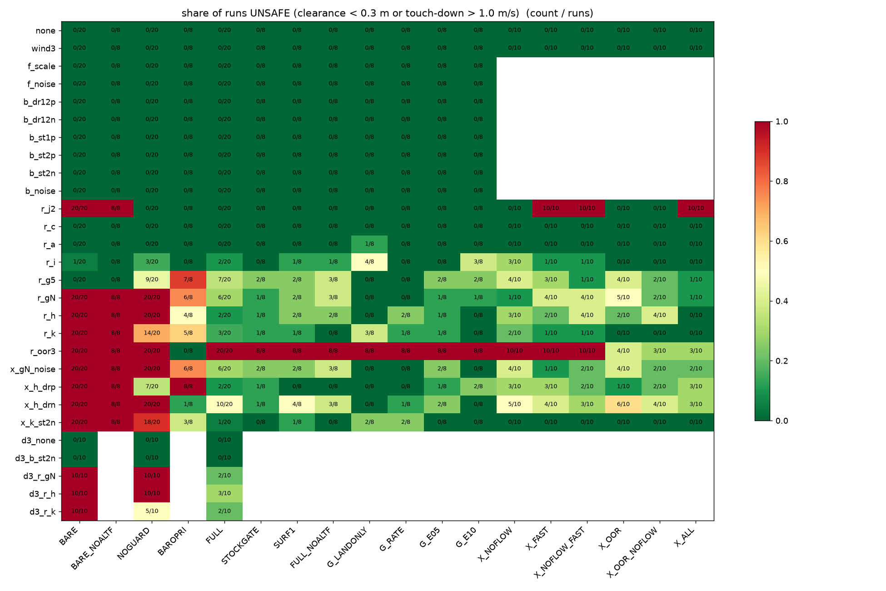
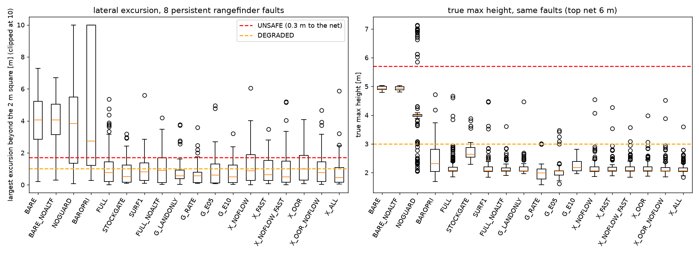

# ECPS295 新硬件架构安全性消融仿真报告

日期：2026-11-21
范围：MTF-01（光流 + 测距）直接作高度源的新架构，加上机载“气压计监视测距”保护（height guard，提交 `b3a6691`）。全部为 SITL 仿真，没有任何真机数据。
数据目录：``（本文件同级）。原始运行目录在 ROG `~/sim/abl/runs/`（12 GB，未拷回）。

---

## 1. 结论

1. **高度方向守住了。** 带监视器的 2698 次飞行里，没有一次接近 6 m 顶网，最小顶部余量 1.34 m，真实最高 4.66 m。不带监视器时最高 7.14 m，21 次碰顶。
2. **剩下的危险几乎全在横向。** 全部 874 次“不安全”里，805 次是笼壁余量不足，53 次是硬着陆，21 次是碰顶（有重叠）。
3. **横向偏移发生在监视器触发之后。** 触发前偏移不超过 0.2 m。触发后约 6 秒的下降过程中，飞机以 0.8–1 m/s 横移，中位 0.8 m，最大约 5 m。6 m 笼子里方形航线距笼壁只有 2 m，所以约四分之一的持续性测距故障最终出笼。
4. **监视器无误报。** 无故障、大风、气压计漂移/阶跃/噪声、光流误差，共 220 次全保护飞行，0 次触发，全部正常完成任务。
5. **测距超量程是当前配置的盲区。** 监视器把超量程读数当作无效直接忽略，飞控自己的 EKF 保护先切降落，横移 5–8 m，所有配置 20/20 出笼。加一条“测距无效 0.3 秒即触发”后降到 3–4/10。
6. **第二轮试的三种横向缓解措施里，只有上面这一条有效。** “触发后停用光流”和“加快下降”都没有减少横向偏移，后者还在测距读数偏高时造成 1.4 m/s 的硬着陆。
7. **新发现一个落地后不上锁的问题。** 测距故障持续 5 秒后恢复的那种情形，全保护配置 15/20 次落地后电机保持解锁直到超时。
8. 慢漂移（0.1 m/s）仍然抓不住：全保护 5/20 触发，真实高度到 3.2–3.3 m，不碰顶但超出预期高度。

一句话：这套保护把“冲顶”变成了“中止降落”，但降落过程本身不受控的横移还没有解决，真机首飞必须有人随时用遥控器接管。

---

## 2. 实验设置

### 2.1 仿真环境

- ArduCopter 4.7.0 SITL，参数基于真机导出的 150 项实测值，改为 MTF-01 配置（`mtf01_sitl_rng.parm`）：`EK3_SRC1_POSZ 2`（测距作高度）、`RNGFND1_MAX 8`、`EK3_RNG_USE_HGT -1`。
- 监视器是真实的机载代码（`height_guard.py`，`b3a6691`），作为独立 MAVLink 客户端连到飞控第二个端口，20 Hz 运行，自己发切源和 LAND 指令。仿真以 1 倍速运行，因为监视器按墙上时钟计时。所有运行的实时率不低于 0.94。
- 环境统一加扰：风 1.5 m/s 带湍流，光流噪声 0.15 rad/s，光流标定偏 5%，测距噪声 5 cm。每次重复的初始航向和风向不同。
- 任务：AUTO 起飞到 2 m，飞 2 m 方形一圈，降落（SQ）。另有 450 次先 LOITER 手动起飞再飞方形的任务（D3）。
- 故障在飞行中通过运行时改仿真参数注入。故障表里的时间以任务开始为零点，比解锁晚约 3.1 s；本文其余时间都以解锁为零点。

### 2.2 安全等级的定义

用仿真器真值（不是 EKF 估计）计算。笼子按 6 m 立方、方形航线居中，即笼壁在航线外 2 m，顶网 6 m。

| 等级 | 条件 |
|-|-|
| 不安全 | 到任一面网的余量 < 0.3 m，或触地速度 > 1.0 m/s |
| 降级 | 余量 < 1.0 m，或真实高度 > 3.0 m，或触地速度 > 0.8 m/s |
| 落地未上锁 | 不属于以上两类，已触地但运行结束时电机仍解锁 |
| 中止 | 不属于以上，任务未完成（被监视器或飞控保护提前降落） |
| 正常 | 任务完成且未越限 |

“落地未上锁”是分析阶段加的一类。已经被判为不安全或降级的运行不再重复计入，所以第 5.4 节另给了不分等级的总数。

### 2.3 配置（消融臂）

每个臂在全保护的基础上去掉或改动一层。

| 臂 | 含义 | 重复次数 |
|-|-|-|
| FULL | 全保护：收紧的测距门限（`EK3_RNG_M_NSE 0.1`、`EK3_HGT_I_GATE 200`）、`SURFTRAK_MODE 0`、高度围栏 2.5 m、监视器（偏差 0.7 m 持续 0.5 s，触发后切到源集 3 再 LAND） | 20 |
| NOGUARD | 去掉监视器 | 20 |
| BARE | 原始配置：出厂门限、`SURFTRAK_MODE 1`、无监视器 | 20 |
| STOCKGATE | 监视器保留，门限改回出厂值 | 8 |
| SURF1 | 监视器保留，`SURFTRAK_MODE 1` | 8 |
| FULL_NOALTF | 全保护去掉高度围栏 | 8 |
| BARE_NOALTF | 原始配置去掉高度围栏 | 8 |
| G_LANDONLY | 监视器触发后只 LAND，不切高度源 | 8 |
| G_RATE | 监视器加变化率判据（2 s 内 0.6 m） | 8 |
| G_E05 / G_E10 | 监视器阈值改为 0.5 m / 1.0 m | 8 |
| BAROPRI | 气压计作主高度源，无监视器 | 8 |

第二轮（缓解措施，各 10 次重复，15 种故障）：

| 臂 | 含义 |
|-|-|
| X_NOFLOW | 触发后切到源集 2（气压计高度，不用光流） |
| X_FAST | 降落加速：`LAND_ALT_LOW_M 1`、`LAND_SPD_HIGH_MS 1.5` |
| X_NOFLOW_FAST | 以上两项 |
| X_OOR | 测距读数无效持续 0.3 s 且气压高度 > 0.5 m 时也触发 |
| X_OOR_NOFLOW | X_OOR + 源集 2 |
| X_ALL | 三项全加 |

X_OOR 的逻辑是仿真副本里的实验代码（`height_guard_r2.diff`，9 行），没有进工作树，没有单元测试。

### 2.4 故障

| 代号 | 内容 |
|-|-|
| none、wind3 | 无故障；风 3 m/s |
| f_scale、f_noise | 光流标定偏 20%；光流噪声加倍 |
| b_dr12p / b_dr12n | 气压计漂移 ±1.2 m/min |
| b_st1p、b_st2p / b_st2n | 气压计阶跃 0.5 hPa 持续 1 s（巡航中）；持续 2 s（起飞中，正/负） |
| b_noise | 气压计噪声 0.5 |
| r_a | 爬升中读数偏低 1.5 m，持续 1 s |
| r_c | 2 m 处读数偏低 1.5 m，持续 3 s |
| r_g5 / r_gN | 2 m 处读数塌到约 0.1 m，持续 5 s / 不恢复 |
| r_h | 从爬升起一直偏低，不恢复（现场实测到的那种失效） |
| r_k | 离地起读数卡在约 0.2 m |
| r_i | 慢漂移 0.1 m/s，持续 10 s |
| r_j2 | 读数偏高 1.55 m，不恢复 |
| r_oor3 | 超量程 3 s |
| x_h_drp / x_h_drn | r_h 叠加气压计正/负漂移 |
| x_k_st2n | r_k 叠加起飞中气压计负阶跃 |
| x_gN_noise | r_gN 叠加气压计噪声 |
| d3_* | 同名故障，D3 任务 |

### 2.5 规模与用时

| 批次 | 次数 | 并行 | 用时 |
|-|-|-|-|
| 回路验证（val8） | 65 | 4 | 约 0.4 h |
| 第一轮 | 3186 | 12 | 6.1 h |
| 第二轮 | 900 | 14 | 1.2 h |

合计约 7.7 小时，全部在 ROG 上，只用 CPU。SITL 不使用 GPU，所以预算里的 24 GPU 小时实际一点没用。4086 次运行全部产出结果，没有未起飞、监视器失联或致盲的运行。

Mac mini 原计划分担 1149 次，因跨境链路传源码中断而放弃，这部分改在 ROG 上跑，因此不存在跨机器差异的问题。

---

## 3. 回路验证（65 次）

目的：确认真实监视器代码接进飞控回路后能工作。此前的 220 次验证是离线回放。

| 故障 | 触发 | 真实最高 | 备注 |
|-|-|-|-|
| 无故障 ×10 | 0/10 | 2.06 m | 任务全部完成 |
| h、k、c、gN、j2 及 3 个 D3 组合 | 40/40 | 2.1–2.7 m | 降落并上锁，触地最快 0.72 m/s |
| a（短故障） | 4/5 | 3.70 m | 漏掉的一次由围栏触发降落 |
| i（慢漂移） | 2/5 | 3.23 m | 偏置滤波吸收了漂移 |
| g5（塌 5 s 后恢复） | 5/5 | 2.08 m | 4/5 落地未上锁 |

切源指令 `MAV_CMD_SET_EKF_SOURCE_SET` 每次都被飞控接受（ACK 0）。

---

## 4. 第一轮结果

### 4.1 各臂总览（全部故障合计）

| 臂 | 次数 | 正常 | 中止 | 落地未上锁 | 降级 | 不安全 | 真实最高 (m) | 最大触地 (m/s) |
|-|-|-|-|-|-|-|-|-|
| FULL | 510 | 220 | 154 | 6 | 64 | 66 | 4.66 | 1.02 |
| NOGUARD | 510 | 242 | 18 | 0 | 74 | 176 | 7.14 | 1.49 |
| BARE | 510 | 239 | 0 | 0 | 60 | 211 | 5.03 | 1.38 |
| STOCKGATE | 184 | 84 | 49 | 0 | 34 | 17 | 3.88 | 0.97 |
| SURF1 | 184 | 79 | 55 | 1 | 26 | 23 | 4.48 | 1.03 |
| FULL_NOALTF | 184 | 80 | 53 | 2 | 26 | 23 | 3.86 | 0.91 |
| BARE_NOALTF | 184 | 88 | 0 | 0 | 24 | 72 | 5.03 | 0.68 |
| G_LANDONLY | 184 | 79 | 67 | 1 | 19 | 18 | 4.46 | 0.92 |
| G_RATE | 184 | 76 | 77 | 1 | 16 | 14 | 3.24 | 0.90 |
| G_E05 | 184 | 79 | 65 | 2 | 20 | 18 | 3.47 | 0.99 |
| G_E10 | 184 | 79 | 59 | 2 | 28 | 16 | 3.79 | 0.90 |
| BAROPRI | 184 | 123 | 0 | 0 | 21 | 40 | 4.72 | 0.79 |

三个主臂各 510 次，其余各 184 次，行与行之间不能直接比绝对数。按格子的完整表见 `tables.md`，热图见 `heat_unsafe.png`、`heat_unsafe_degraded.png`。

### 4.2 无故障和非测距故障

10 种不涉及测距的情形（含 2 种 D3）下，各臂的表现：

| 臂 | 次数 | 监视器触发 | 非“正常” |
|-|-|-|-|
| FULL | 220 | 0 | 0 |
| STOCKGATE / FULL_NOALTF | 80 / 80 | 0 / 0 | 0 / 0 |
| SURF1、G_LANDONLY、G_E10 | 各 80 | 0 | 各 1（光流噪声加倍时横向余量 < 1 m，与监视器无关） |
| G_E05 | 80 | 1 | 1（起飞中气压计负阶跃） |
| G_RATE | 80 | 4 | 4（起飞中气压计阶跃，正 1 负 3） |

气压计漂移 ±1.2 m/min 对所有臂都没有影响，监视器的偏置跟踪把它吸收了。

### 4.3 每一层的贡献

用 8 种持续性测距故障（r_g5、r_gN、r_h、r_k 和 4 个叠加故障）在相同的 8 次重复上比较，每臂 64 次：

| 臂 | 不安全 | 降级 | 横向偏移中位 / 90 分位 / 最大 (m) | 真实最高 (m) |
|-|-|-|-|-|
| BARE | 56 | 8 | 4.27 / 5.95 / 6.97 | 5.03 |
| BARE_NOALTF | 56 | 8 | 4.05 / 6.25 / 6.69 | 5.03 |
| NOGUARD | 54 | 4 | 4.40 / 6.47 / 16.0 | 7.11 |
| BAROPRI | 40 | 18 | 2.74 / 19.8 / 45.0 | 4.72 |
| FULL | 13 | 9 | 0.64 / 2.12 / 3.71 | 3.97 |
| FULL_NOALTF | 14 | 15 | 0.90 / 2.58 / 4.19 | 3.60 |
| SURF1 | 14 | 17 | 0.82 / 2.11 / 5.60 | 4.48 |
| G_E05 | 10 | 19 | 0.61 / 2.35 / 4.96 | 3.47 |
| STOCKGATE | 9 | 21 | 0.52 / 1.98 / 3.18 | 3.88 |
| G_RATE | 6 | 8 | 0.56 / 1.48 / 3.59 | 3.01 |
| G_E10 | 5 | 17 | 0.50 / 1.61 / 3.20 | 2.81 |
| G_LANDONLY | 5 | 9 | 0.57 / 1.49 / 3.76 | 4.46 |

“横向偏移”指飞机真实位置超出 2 m 方形的最大距离；超过 1.7 m 即判不安全。

- **监视器是唯一起决定作用的一层。** 有它，不安全从 54–56 次降到 5–14 次。
- **收紧门限和 `SURFTRAK_MODE 0` 单独用没有保护作用。** NOGUARD 与 BARE 的不安全次数相同，失效形态不同：BARE 稳定飞到约 4.9 m，NOGUARD 在 r_k 下飞到 7.1 m 碰顶。配上监视器后，收紧门限的作用是让触发前的超调更小（持续故障下真实最高 2.1 m，出厂门限 2.6–2.9 m）。
- **高度围栏没有贡献。** 有无围栏，结果在噪声范围内相同。围栏用的是同一个被污染的 EKF 高度，测距读数偏低时 EKF 认为飞机还在低处。
- **气压计作主高度源更差。** 高度没问题，但测距故障时光流的水平估计崩溃，最远飞出 45 m，飞控没有任何保护动作。
- 带监视器的各变体之间（5 到 14 次）差异多数在采样误差内，只有 G_LANDONLY 的差异有规律，见 5.3。

### 4.4 监视器的检出情况

| 故障 | FULL 触发 | 解锁后触发时间中位 (s) | 结果 |
|-|-|-|-|
| r_h、r_k 及叠加 | 100/100 | 6.7–7.6 | 读数从约 5.6 s 起逐步偏离，偏差累积到阈值后触发 |
| r_c、r_g5、r_gN、r_j2、x_gN_noise | 100/100 | 9.6 | 故障在解锁后约 9.1 s 出现，约 0.5 s 后触发，与设定的持续时间一致 |
| d3 的三种故障 | 30/30 | 68–71 | 手动起飞阶段后同样触发 |
| r_a（1 s 短故障） | 9/20 | 7.6 | 未触发的 11 次真实高度到 3.6–3.8 m |
| r_i（慢漂移） | 5/20 | 20.2 | 真实高度 3.2–3.3 m |
| r_oor3（超量程） | 20/20 | 12.5 | 触发在故障结束之后，太晚，见 5.2 |

阈值的取舍：0.5 m 能抓住全部慢漂移（8/8，真实最高 3.1 m），代价是 80 次里 1 次误触发；1.0 m 完全抓不住慢漂移（0/8），短故障只抓到 3/8。0.7 m 是无误报前提下的折中。

### 4.5 D3（手动起飞）任务

| 故障 | FULL | NOGUARD | BARE |
|-|-|-|-|
| 无故障、气压计阶跃 | 20/20 正常 | 20/20 正常 | 20/20 正常 |
| r_gN、r_h、r_k | 不安全 7/30，降级 2，中止 21 | 不安全 25/30 | 不安全 30/30 |

结论与 SQ 任务一致。

---

## 5. 成因分析

### 5.1 横向偏移发生在触发之后

对 8 种持续性故障逐次读取仿真真值，把轨迹按监视器触发时刻切成两段（`lat_timing.py`，重复 1–10）：

| 臂 | 触发前最大偏移 (m) | 触发后偏移中位 / 90 分位 / 最大 (m) | 下降用时 (s) | 下降中横向速度中位 (m/s) |
|-|-|-|-|-|
| FULL | 0.16 | 0.81 / 2.85 / 4.75 | 6.5 | 0.82 |
| G_LANDONLY | 0.15 | 0.59 / 1.34 / 3.73 | 5.8 | 0.84 |
| G_RATE | 0.16 | 0.43 / 1.10 / 2.46 | 5.4 | 0.66 |
| NOGUARD | 5.11 | 4.61 / 6.45 / 16.0 | 5.8 | 1.91 |

监视器触发得足够早，触发时飞机还在航线上。之后 LAND 模式仍在做水平位置控制，用的是光流速度；光流把角速度换算成线速度要乘离地高度，而这个高度来自已经坏掉的测距。速度估计错了，位置控制就把飞机往错误的方向推，或者不纠正风造成的漂移。

这不是监视器引入的问题。没有监视器时横移更大（中位 4.6 m）。监视器只是把它缩短到一次 6 秒的下降。

### 5.2 超量程

`r_oor3` 下所有第一轮配置都是 20/20 或 8/8 不安全，横向偏移中位 5.3 m。时间顺序是：

1. 解锁后约 9.1 s 测距超量程，EKF 失去高度源和光流的尺度。
2. 解锁后 10.4 s 飞控报 `EKF variance`，自己切 LAND。
3. 监视器把超量程读数视为无效，不参与判断；约 12.1 s 读数恢复，12.5 s 才触发，此时已经没有意义。

唯一没事的是 BAROPRI（8/8 正常），因为它的高度不依赖测距。

### 5.3 “只降落不切源”的横向表现更好，但高度更差

G_LANDONLY 触发后不切高度源，直接 LAND。在 6 种“高度已经稳住”的持续性故障上（重复 1–10，FULL 60 次，G_LANDONLY 48 次）：不安全 FULL 16 次，G_LANDONLY 0 次，后者也没有出现落地未上锁。这个差距超出了采样误差。

但它在另外三种故障上更差：慢漂移 4/8 不安全（FULL 2/20），`x_k_st2n` 2/8 不安全且真实高度到 4.5 m（FULL 1/20），`r_a` 出现一次 6.6 m 的横移。这三种都是 EKF 高度已被污染的情形，不切源就一直用错的高度。

为什么切到气压计高度会让横向变差，没有查清。一种可能是切源后 EKF 改用测距去估计地形高度，光流尺度比不切时偏得更多，但这只是推测，没有验证。

### 5.4 落地未上锁

按“已触地但结束时仍解锁”统计，不分等级，共 63 次，集中在 `r_g5`：

| 臂 | r_g5 落地未上锁 |
|-|-|
| FULL | 15/20 |
| FULL_NOALTF、G_E05、G_E10、SURF1 | 6/8、3/8、3/8、3/8 |
| G_RATE | 1/8 |
| G_LANDONLY、STOCKGATE | 0/8、0/8 |
| 第二轮各臂 | 3/10 – 7/10 |

读一次日志得到的过程：触发并切源后下降，EKF 水平位置估计在下降和触地过程中漂走 4–6 m。落地后 LAND 的位置控制仍要求约 26° 倾角去追目标点，飞控的落地检测因为姿态指令不为零而不成立，电机保持解锁（油门输出为 0），同时报围栏越界和 EKF 重置。

它只在“故障恢复 + 已切源”的组合下出现，不切源的 G_LANDONLY 没有。仿真里地面上的光流读数可能不真实，所以这个现象在真机上是否出现不确定，但不能排除。

---

## 6. 第二轮：缓解措施

15 种故障，每格 10 次。FULL 取第一轮的重复 1–10 作对照（每臂 150 次）。

| 臂 | 正常 | 中止 | 落地未上锁 | 降级 | 不安全 |
|-|-|-|-|-|-|
| FULL（对照） | 20 | 69 | 4 | 29 | 28 |
| X_NOFLOW | 20 | 68 | 2 | 25 | 35 |
| X_FAST | 20 | 61 | 3 | 27 | 39 |
| X_NOFLOW_FAST | 20 | 59 | 4 | 29 | 38 |
| X_OOR | 20 | 70 | 2 | 32 | 26 |
| X_OOR_NOFLOW | 20 | 78 | 1 | 32 | 19 |
| X_ALL | 20 | 80 | 1 | 26 | 23 |

逐项：

- **停用光流（X_NOFLOW）无效。** 持续性故障下触发后横移中位 0.97 m，对照 0.81 m。没有任何水平参考时，飞机带着触发瞬间的速度和 1.5 m/s 的风漂 6 秒，并不比用错的光流好。
- **加快下降（X_FAST）无效且有害。** 下降用时 6.2 s，对照 6.5 s，基本没缩短，因为加速段的高度判断用的也是 EKF 高度。测距读数偏高（`r_j2`）时 10/10 以约 1.4 m/s 硬着陆，对照是 10/10 正常中止。**不采用。**
- **测距无效即触发（X_OOR）有效。**

| 指标 | FULL | X_OOR | X_OOR_NOFLOW | X_ALL |
|-|-|-|-|-|
| r_oor3 不安全 | 10/10 | 4/10 | 3/10 | 3/10 |
| r_oor3 横移中位 / 最大 (m) | 5.3 / 7.9 | 1.5 / 2.7 | 1.5 / 2.6 | 0.9 / 2.2 |
| r_oor3 触发时间 (s) | 12.5 | 9.3 | 9.3 | 9.3 |
| r_a 结果 | 降级 6、中止 4，最高 3.8 m | 中止 10，最高 2.0 m | 同左 | 同左 |
| 无故障 + 大风误触发 | 0/20 | 0/20 | 0/20 | 0/20 |

它顺带解决了爬升中的短故障（`r_a`）：那种故障的读数落到有效范围之外，原逻辑看不见。

第二轮没有包含气压计故障和光流故障，所以 X_OOR 的无误报结论只覆盖无故障和大风两种情形共 20 次，不够。

---

## 7. 建议

**保持不变**

- 全保护配置：收紧门限、`SURFTRAK_MODE 0`、监视器阈值 0.7 m / 0.5 s、只用偏差判据、触发后切源集 3 再 LAND。
- 不加变化率判据（起飞中气压计阶跃时 4/80 误触发）。
- 不用气压计作主高度源。
- 不调降落速度参数。

**建议加入，需要你决定**

- 监视器增加“测距无效 0.3 s 即触发”。目前只有仿真副本里的 9 行实验代码。正式加入需要：写进工作树、补单元测试、补一轮含气压计和光流故障的无误报验证（约 200 次，1 小时内）。

**真机首飞时必须有的人工措施**

- 监视器触发后飞机会在约 6 秒内降落，期间可能横移 1–5 m。飞手必须全程手持遥控器，听到或看到 `RANGEFINDER BAD` 立即准备接管或急停。
- 落地后如果电机不停，用遥控器上锁。
- 6 m 笼子挡不住最坏情况的横移，首飞不要有人站在笼壁外侧近处。

**尚未解决**

| 问题 | 现状 | 可能的方向 |
|-|-|-|
| 触发后下降过程横移 | 中位 0.8 m，最大约 5 m，试过的两种措施无效 | 独立的水平参考（标记定位，下周的工作；室外用 GPS） |
| 切源与不切源的横向差异 | 现象明确，原因未查清 | 读 EKF 地形估计和光流新息的日志 |
| 落地未上锁 | `r_g5` 下 15/20 | 监视器在确认触地后发上锁指令；未实现、未测试 |
| 慢漂移 | 5/20 检出，真实高度 3.3 m | 阈值降到 0.5 m 可全部检出，代价是约 1% 误触发 |
| 超量程 | 加新判据后仍有 3–4/10 出笼 | 同第一行 |

---

## 8. 局限

- 全部是 SITL。光流模型、地面附近的光流读数、气压计受桨下洗的影响都与真机不同。真机上的数值会不一样，结论里可靠的是相对关系和失效机理。
- 第二层臂每格 8 次，第二轮每格 10 次。单格里 1–2 次的差别没有统计意义，文中只对合并后差距大的结果下了结论。
- 笼壁位置是假设的（方形居中，四周各 2 m）。实际摆放不同，横向的不安全次数会跟着变。
- 监视器阈值还没有用真机日志标定，`companion.yaml` 里仍是 `enabled: false`。
- 故障是人为设计的 13 种测距失效形态，现场实测到的只有 `r_h` 这一种。
- 上次现场定下的硬性前置条件不变：MTF-01 装机后先做日光下手持测距检查到 2.5 m，通过才允许装桨。

---

## 9. 文件清单与复现

目录 ``：

| 文件 | 内容 |
|-|-|
| `all_runs.csv` | 4086 次运行的全部指标，每行一次 |
| `tables.md` | 按臂 × 故障的等级、高度、触发时间表 |
| `heat_unsafe.png`、`heat_unsafe_degraded.png`、`box_lat_alt.png` | 图 |
| `lat_timing_r1.json`、`lat_timing.json` | 触发前后横向偏移的逐次数据（第一轮 / 第二轮） |
| `gen_abl.py` | 任务矩阵生成，`gen_abl.py r2` 生成第二轮；`gen_abl.py.r1` 是第一轮当时的版本 |
| `run_one.sh`、`batch.py`、`hg_loop.py` | 单次运行、批量调度、监视器回路 |
| `safety.py`、`agg.py`、`lat_timing.py` | 安全等级判定、汇总、横向时序分析 |
| `height_guard_r2.diff`、`height_guard_r2_experiment.py` | 第二轮的实验改动 |
| `mtf01_sitl_rng.parm` | 仿真基础参数 |
| `val8/` | 回路验证 65 次的指标和监视器日志 |

复现（ROG）：`cd ~/sim/abl && NINST=12 python batch.py jobs_abl.txt jobs_mac.txt`，然后 `python agg.py`。已有结果的任务会被跳过，重跑需要 `FORCE=1`。

过程中的一次事故：全量批次原定凌晨自动启动，但两个等待脚本用 `pgrep -f` 互相匹配到了对方的命令行，空等了 8 小时，到 11:46 才发现并重启。数据不受影响。
