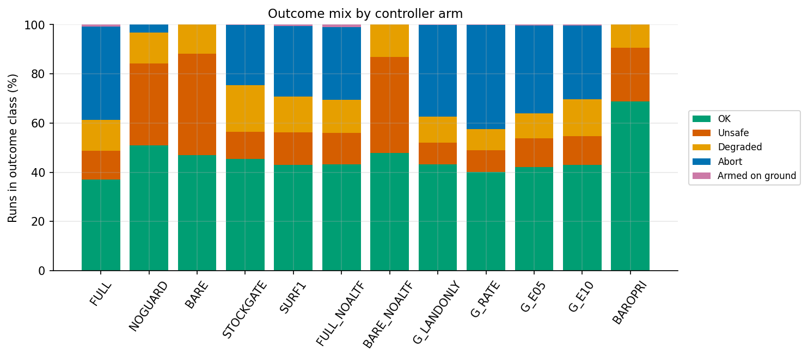
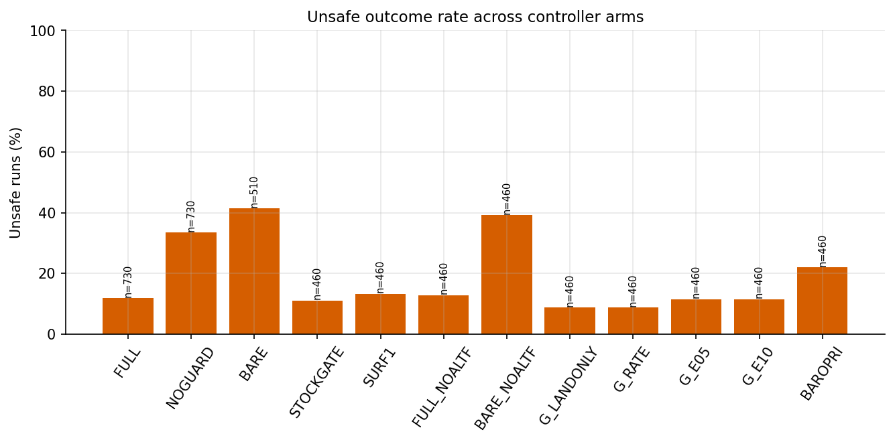
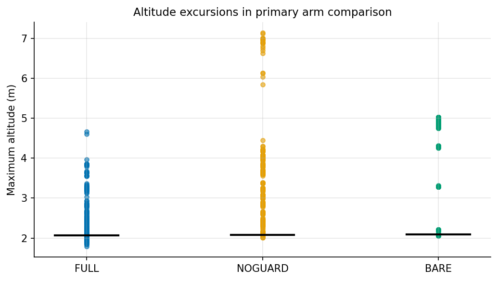

# ablation tables

runs: 9796

## per arm (all faults)

| arm | n | OK | ABORT | ARMED_GND | DEGRADED | UNSAFE | NOFLY | ? | max alt | min clr | max td |
|-|-|-|-|-|-|-|-|-|-|-|-|
| FULL | 730 | 270 | 277 | 6 | 91 | 86 | 0 | 0 | 4.66 | -5.92 | 1.02 |
| NOGUARD | 730 | 371 | 23 | 0 | 92 | 244 | 0 | 0 | 7.14 | -14.00 | 1.49 |
| BARE | 510 | 239 | 0 | 0 | 60 | 211 | 0 | 0 | 5.03 | -5.69 | 1.38 |
| STOCKGATE | 460 | 209 | 112 | 1 | 87 | 51 | 0 | 0 | 3.90 | -5.81 | 1.02 |
| SURF1 | 460 | 198 | 131 | 3 | 67 | 61 | 0 | 0 | 4.48 | -5.49 | 1.03 |
| FULL_NOALTF | 460 | 199 | 136 | 5 | 61 | 59 | 0 | 0 | 4.08 | -5.43 | 0.95 |
| BARE_NOALTF | 460 | 220 | 0 | 0 | 60 | 180 | 0 | 0 | 5.06 | -6.00 | 0.69 |
| G_LANDONLY | 460 | 199 | 171 | 1 | 49 | 40 | 0 | 0 | 4.46 | -5.70 | 0.94 |
| G_RATE | 460 | 185 | 194 | 1 | 40 | 40 | 0 | 0 | 3.31 | -5.46 | 0.90 |
| G_E05 | 460 | 194 | 164 | 2 | 47 | 53 | 0 | 0 | 3.75 | -5.30 | 0.99 |
| G_E10 | 460 | 198 | 138 | 2 | 69 | 53 | 0 | 0 | 4.55 | -8.08 | 0.98 |
| BAROPRI | 460 | 316 | 0 | 0 | 43 | 101 | 0 | 0 | 4.94 | -55.19 | 0.81 |
| X_SYN_OOR | 270 | 99 | 155 | 0 | 15 | 1 | 0 | 0 | 4.50 | -0.38 | 0.97 |
| S_E07_T02 | 96 | 48 | 34 | 0 | 10 | 4 | 0 | 0 | 3.35 | -0.59 | 0.63 |
| S_E10_T02 | 96 | 48 | 29 | 0 | 12 | 7 | 0 | 0 | 3.24 | -3.68 | 0.86 |
| X_NOFLOW_FAST | 150 | 20 | 59 | 4 | 29 | 38 | 0 | 0 | 3.85 | -4.23 | 1.42 |
| S_E05_T02 | 96 | 44 | 42 | 0 | 4 | 6 | 0 | 0 | 2.95 | -0.38 | 0.59 |
| X_ALL | 150 | 20 | 80 | 1 | 26 | 23 | 0 | 0 | 3.59 | -3.88 | 1.41 |
| S_E03_T10 | 96 | 32 | 43 | 0 | 18 | 3 | 0 | 0 | 3.77 | -6.05 | 0.93 |
| S_E07_T10 | 96 | 48 | 17 | 1 | 23 | 7 | 0 | 0 | 4.62 | -2.59 | 0.97 |
| X_OOR | 550 | 216 | 187 | 5 | 83 | 59 | 0 | 0 | 4.68 | -2.83 | 1.01 |
| BR04 | 96 | 64 | 9 | 0 | 23 | 0 | 0 | 0 | 3.28 | 0.96 | 0.70 |
| X_SYN_FIX | 176 | 90 | 57 | 0 | 29 | 0 | 0 | 0 | 3.95 | 1.30 | 0.92 |
| S_E03_T05 | 96 | 32 | 57 | 0 | 5 | 2 | 0 | 0 | 2.70 | -0.65 | 0.84 |
| X_NOFLOW | 150 | 20 | 68 | 2 | 25 | 35 | 0 | 0 | 4.54 | -4.98 | 0.96 |
| BC09 | 96 | 64 | 8 | 0 | 24 | 0 | 0 | 0 | 3.60 | 1.15 | 0.80 |
| X_FAST | 150 | 20 | 61 | 3 | 27 | 39 | 0 | 0 | 4.27 | -4.16 | 1.45 |
| BR03 | 96 | 64 | 19 | 0 | 13 | 0 | 0 | 0 | 3.25 | 1.14 | 0.72 |
| X_OOR_NOFLOW | 150 | 20 | 78 | 1 | 32 | 19 | 0 | 0 | 4.52 | -2.66 | 0.98 |
| X_SYN | 250 | 110 | 126 | 0 | 9 | 5 | 0 | 0 | 4.75 | 0.96 | 1.10 |
| X_SYN_L1 | 250 | 99 | 113 | 1 | 31 | 6 | 0 | 0 | 5.33 | -3.30 | 1.10 |
| S_E05_T10 | 96 | 48 | 26 | 0 | 17 | 5 | 0 | 0 | 3.88 | -5.00 | 0.96 |
| BC12 | 96 | 64 | 8 | 0 | 24 | 0 | 0 | 0 | 3.83 | 0.67 | 0.75 |
| S_E10_T10 | 96 | 48 | 21 | 0 | 20 | 7 | 0 | 0 | 3.78 | -4.84 | 0.90 |
| BC06 | 96 | 46 | 26 | 1 | 23 | 0 | 0 | 0 | 3.33 | 1.02 | 0.74 |
| BC15 | 96 | 64 | 8 | 0 | 24 | 0 | 0 | 0 | 3.85 | 1.08 | 0.73 |
| S_E03_T02 | 96 | 27 | 66 | 0 | 2 | 1 | 0 | 0 | 2.62 | -0.40 | 0.61 |

## arm x fault: n, then U=unsafe D=degraded G=armed on ground A=abort N=nofly

| fault | FULL | NOGUARD | BARE | STOCKGATE | SURF1 | FULL_NOALTF | BARE_NOALTF | G_LANDONLY | G_RATE | G_E05 | G_E10 | BAROPRI | X_SYN_OOR | S_E07_T02 | S_E10_T02 | X_NOFLOW_FAST | S_E05_T02 | X_ALL | S_E03_T10 | S_E07_T10 | X_OOR | BR04 | X_SYN_FIX | S_E03_T05 | X_NOFLOW | BC09 | X_FAST | BR03 | X_OOR_NOFLOW | X_SYN | X_SYN_L1 | S_E05_T10 | BC12 | S_E10_T10 | BC06 | BC15 | S_E03_T02 |
|-|-|-|-|-|-|-|-|-|-|-|-|-|-|-|-|-|-|-|-|-|-|-|-|-|-|-|-|-|-|-|-|-|-|-|-|-|-|
| b_dr12n | 20 ok | 20 ok | 20 ok | 20 ok | 20 ok | 20 ok | 20 ok | 20 ok | 20 ok | 20 ok | 20 ok | 20 ok | 10 ok | - | - | - | - | - | - | - | 20 ok | 8 ok | 8 ok | - | - | 8 ok | - | 8 ok | - | 10 ok | 10 ok | - | 8 ok | - | 8 A8 | 8 ok | - |
| b_dr12p | 20 ok | 20 ok | 20 ok | 20 ok | 20 ok | 20 ok | 20 ok | 20 ok | 20 ok | 20 ok | 20 ok | 20 ok | 10 ok | 8 ok | 8 ok | - | 8 ok | - | 8 ok | 8 ok | 20 ok | 8 ok | 8 ok | 8 ok | - | 8 ok | - | 8 ok | - | 10 ok | 10 ok | 8 ok | 8 ok | 8 ok | 8 A8 | 8 ok | 8 A3 |
| b_noise | 20 ok | 20 ok | 20 ok | 20 ok | 20 ok | 20 ok | 20 ok | 20 ok | 20 ok | 20 ok | 20 ok | 20 ok | 10 ok | 8 ok | 8 ok | - | 8 ok | - | 8 ok | 8 ok | 20 ok | 8 ok | 8 ok | 8 ok | - | 8 ok | - | 8 ok | - | 10 ok | 10 ok | 8 ok | 8 ok | 8 ok | 8 ok | 8 ok | 8 A2 |
| b_st1p | 20 ok | 20 ok | 20 ok | 20 ok | 20 ok | 20 ok | 20 ok | 20 ok | 20 A1 | 20 ok | 20 ok | 20 ok | 10 ok | - | - | - | - | - | - | - | 20 G1 | - | - | - | - | - | - | - | - | 10 ok | 10 ok | - | - | - | - | - | - |
| b_st2n | 20 ok | 20 ok | 20 ok | 20 ok | 20 ok | 20 ok | 20 ok | 20 ok | 20 A8 | 20 A3 | 20 ok | 20 ok | 10 ok | 8 ok | 8 ok | - | 8 A4 | - | 8 A8 | 8 ok | 20 ok | 8 ok | 10 ok | 8 A8 | - | 8 ok | - | 8 ok | - | 10 ok | 10 ok | 8 ok | 8 ok | 8 ok | 8 ok | 8 ok | 8 A8 |
| b_st2p | 20 ok | 20 ok | 20 ok | 20 ok | 20 ok | 20 ok | 20 ok | 20 ok | 20 A5 | 20 A2 | 20 ok | 20 ok | 10 ok | 8 ok | 8 ok | - | 8 ok | - | 8 A8 | 8 ok | 20 ok | 8 ok | 8 ok | 8 A8 | - | 8 ok | - | 8 ok | - | 10 ok | 10 ok | 8 ok | 8 ok | 8 ok | 8 ok | 8 ok | 8 A8 |
| d3_b_st2n | 10 ok | 10 ok | 10 ok | - | - | - | - | - | - | - | - | - | - | - | - | - | - | - | - | - | 10 ok | - | - | - | - | - | - | - | - | - | - | - | - | - | - | - | - |
| d3_none | 10 ok | 10 ok | 10 ok | - | - | - | - | - | - | - | - | - | - | - | - | - | - | - | - | - | 10 ok | - | - | - | - | - | - | - | - | - | - | - | - | - | - | - | - |
| d3_r_gN | 10 U2/A8 | 10 U10 | 10 U10 | - | - | - | - | - | - | - | - | - | - | - | - | - | - | - | - | - | 10 U1/D2/A7 | - | - | - | - | - | - | - | - | - | - | - | - | - | - | - | - |
| d3_r_h | 10 U3/A7 | 10 U10 | 10 U10 | - | - | - | - | - | - | - | - | - | - | - | - | - | - | - | - | - | 10 U5/D3/A2 | - | - | - | - | - | - | - | - | - | - | - | - | - | - | - | - |
| d3_r_k | 10 U2/D2/A6 | 10 U5/D4/A1 | 10 U10 | - | - | - | - | - | - | - | - | - | - | - | - | - | - | - | - | - | 10 U2/D4/A4 | - | - | - | - | - | - | - | - | - | - | - | - | - | - | - | - |
| f_noise | 20 ok | 20 D3 | 20 D1 | 20 ok | 20 D2 | 20 D1 | 20 ok | 20 D1 | 20 D1 | 20 D1 | 20 D2 | 20 D3 | 10 D1 | - | - | - | - | - | - | - | 20 D3 | - | - | - | - | - | - | - | - | 10 D1 | 10 D1 | - | - | - | - | - | - |
| f_scale | 20 ok | 20 ok | 20 ok | 20 ok | 20 ok | 20 ok | 20 ok | 20 ok | 20 ok | 20 ok | 20 ok | 20 ok | 10 ok | - | - | - | - | - | - | - | 20 ok | - | - | - | - | - | - | - | - | 10 ok | 10 ok | - | - | - | - | - | - |
| m_blip | 10 A10 | 10 ok | - | - | - | - | - | - | - | - | - | - | 10 A10 | - | - | - | - | - | - | - | 10 A10 | - | 10 ok | - | - | - | - | - | - | 10 A10 | 10 A10 | - | - | - | - | - | - |
| m_dr002 | - | - | - | - | - | - | - | - | - | - | - | - | - | - | - | - | - | - | - | - | - | 8 ok | 8 ok | - | - | 8 ok | - | 8 ok | - | - | - | - | 8 ok | - | 8 G1/A1 | 8 ok | - |
| m_dr005 | 10 U10 | 10 U10 | - | - | - | - | - | - | - | - | - | - | - | - | - | - | - | - | - | - | - | 8 D7/A1 | 8 D8 | - | - | 8 D8 | - | 8 D1/A7 | - | - | - | - | 8 D8 | - | 8 D7/A1 | 8 D8 | - |
| m_dr010 | 10 D10 | 10 U10 | - | - | - | - | - | - | - | - | - | - | - | - | - | - | - | - | - | - | - | - | - | - | - | - | - | - | - | - | - | - | - | - | - | - | - |
| m_dr020 | 10 D10 | 10 U10 | - | - | - | - | - | - | - | - | - | - | - | - | - | - | - | - | - | - | - | 8 D8 | 8 D8 | - | - | 8 D8 | - | 8 D8 | - | - | - | - | 8 D8 | - | 8 D8 | 8 D8 | - |
| m_dr040 | 10 D2/A8 | 10 U10 | - | - | - | - | - | - | - | - | - | - | - | - | - | - | - | - | - | - | - | - | - | - | - | - | - | - | - | - | - | - | - | - | - | - | - |
| m_du05 | 10 A10 | 10 ok | - | - | - | - | - | - | - | - | - | - | - | - | - | - | - | - | - | - | - | - | - | - | - | - | - | - | - | - | - | - | - | - | - | - | - |
| m_du10 | 10 D2/A8 | 10 ok | - | - | - | - | - | - | - | - | - | - | - | - | - | - | - | - | - | - | - | - | - | - | - | - | - | - | - | - | - | - | - | - | - | - | - |
| m_du20 | 10 A10 | 10 ok | - | - | - | - | - | - | - | - | - | - | - | - | - | - | - | - | - | - | - | - | - | - | - | - | - | - | - | - | - | - | - | - | - | - | - |
| m_du30 | 10 D1/A9 | 10 U1 | - | - | - | - | - | - | - | - | - | - | - | - | - | - | - | - | - | - | - | - | - | - | - | - | - | - | - | - | - | - | - | - | - | - | - |
| m_hi030 | 10 ok | 10 ok | - | - | - | - | - | - | - | - | - | - | - | - | - | - | - | - | - | - | - | - | - | - | - | - | - | - | - | - | - | - | - | - | - | - | - |
| m_hi060 | 10 ok | 10 ok | - | - | - | - | - | - | - | - | - | - | - | - | - | - | - | - | - | - | - | - | - | - | - | - | - | - | - | - | - | - | - | - | - | - | - |
| m_hi100 | 10 A10 | 10 D5/A5 | - | - | - | - | - | - | - | - | - | - | - | - | - | - | - | - | - | - | - | - | - | - | - | - | - | - | - | - | - | - | - | - | - | - | - |
| m_lo020 | 10 ok | 10 ok | - | - | - | - | - | - | - | - | - | - | - | - | - | - | - | - | - | - | - | - | - | - | - | - | - | - | - | - | - | - | - | - | - | - | - |
| m_lo040 | 10 ok | 10 ok | - | - | - | - | - | - | - | - | - | - | - | - | - | - | - | - | - | - | - | - | - | - | - | - | - | - | - | - | - | - | - | - | - | - | - |
| m_lo060 | 10 ok | 10 ok | - | - | - | - | - | - | - | - | - | - | - | - | - | - | - | - | - | - | - | - | - | - | - | - | - | - | - | - | - | - | - | - | - | - | - |
| m_lo080 | 10 A10 | 10 ok | - | - | - | - | - | - | - | - | - | - | - | - | - | - | - | - | - | - | - | - | - | - | - | - | - | - | - | - | - | - | - | - | - | - | - |
| m_lo100 | 10 A10 | 10 U1/D9 | - | - | - | - | - | - | - | - | - | - | - | - | - | - | - | - | - | - | - | - | - | - | - | - | - | - | - | - | - | - | - | - | - | - | - |
| m_lo130 | 10 A10 | 10 U7/D3 | - | - | - | - | - | - | - | - | - | - | - | - | - | - | - | - | - | - | - | - | - | - | - | - | - | - | - | - | - | - | - | - | - | - | - |
| m_lo160 | 10 D2/A8 | 10 U9/D1 | - | - | - | - | - | - | - | - | - | - | - | - | - | - | - | - | - | - | - | - | - | - | - | - | - | - | - | - | - | - | - | - | - | - | - |
| m_oo03 | 10 A10 | 10 ok | - | - | - | - | - | - | - | - | - | - | 10 A10 | - | - | - | - | - | - | - | 10 A10 | - | 10 ok | - | - | - | - | - | - | - | - | - | - | - | - | - | - |
| m_oo10 | 10 A10 | 10 ok | - | - | - | - | - | - | - | - | - | - | 10 A10 | - | - | - | - | - | - | - | 10 U2/D5/A3 | - | 10 A10 | - | - | - | - | - | - | - | - | - | - | - | - | - | - |
| m_ooN | 10 U10 | 10 U10 | - | - | - | - | - | - | - | - | - | - | 10 A10 | - | - | - | - | - | - | - | 10 U4/D1/A5 | - | 10 A10 | - | - | - | - | - | - | 10 ok | 10 A10 | - | - | - | - | - | - |
| none | 20 ok | 20 ok | 20 ok | 20 ok | 20 ok | 20 ok | 20 ok | 20 ok | 20 ok | 20 ok | 20 ok | 20 ok | 10 ok | 8 ok | 8 ok | 10 ok | 8 ok | 10 ok | 8 ok | 8 ok | 20 ok | 8 ok | 10 ok | 8 ok | 10 ok | 8 ok | 10 ok | 8 ok | 10 ok | 10 ok | 10 ok | 8 ok | 8 ok | 8 ok | 8 ok | 8 ok | 8 ok |
| r_a | 20 D11/A9 | 20 D20 | 20 ok | 20 A11 | 20 D9/A11 | 20 D10/A10 | 20 ok | 20 U2/D14/G1/A3 | 20 A20 | 20 D2/A18 | 20 D16/A4 | 20 ok | 10 A10 | 8 A8 | 8 A8 | 10 D6/A4 | 8 A8 | 10 A10 | 8 D8 | 8 D8 | 20 A20 | - | - | 8 A8 | 10 D3/A7 | - | 10 D4/A6 | - | 10 A10 | 10 A9 | 10 D3/A7 | 8 D8 | - | 8 D8 | - | - | 8 A8 |
| r_c | 20 A20 | 20 D1 | 20 D20 | 20 D2/A18 | 20 A20 | 20 A20 | 20 D20 | 20 A20 | 20 A20 | 20 A20 | 20 A20 | 20 ok | 10 A10 | 8 A8 | 8 A8 | 10 A10 | 8 A8 | 10 A10 | 8 A8 | 8 G1/A7 | 20 A20 | - | - | 8 A8 | 10 A10 | - | 10 A10 | - | 10 A10 | 10 A10 | 10 A10 | 8 A8 | - | 8 A8 | - | - | 8 A8 |
| r_g5 | 20 U7/D4/G6/A3 | 20 U9/D5 | 20 D20 | 20 U7/D5/G1/A7 | 20 U6/D5/G3/A6 | 20 U6/D1/G5/A8 | 20 D20 | 20 D2/A18 | 20 D1/G1/A18 | 20 U7/D5/G2/A6 | 20 U5/D7/G2/A6 | 20 U17/D1 | 10 A10 | - | - | 10 U1/D4/G4/A1 | - | 10 U1/D4/G1/A4 | - | - | 20 U7/D3/G4/A6 | - | - | - | 10 U4/D1/G2/A3 | - | 10 U3/D1/G3/A3 | - | 10 U2/D3/G1/A4 | 10 A10 | 10 A10 | - | - | - | - | - | - |
| r_gN | 20 U6/D3/A11 | 20 U20 | 20 U20 | 20 U5/D2/A13 | 20 U6/D5/A9 | 20 U5/D5/A10 | 20 U19/D1 | 20 D1/A19 | 20 D1/A19 | 20 U5/D3/A12 | 20 U3/D1/A16 | 20 U15 | 10 D1/A9 | 8 D2/A6 | 8 U1/D4/A3 | 10 U4/A6 | 8 U2/D3/A3 | 10 U1/D4/A5 | 8 U2/D3/A3 | 8 U3/D1/A4 | 20 U8/D5/A7 | 8 A8 | 10 A10 | 8 D3/A5 | 10 U1/D4/A5 | 8 A8 | 10 U4/D1/A5 | 8 A8 | 10 U2/D4/A4 | 10 A10 | 10 A10 | 8 U2/D3/A3 | 8 A8 | 8 U4/D1/A3 | 8 A8 | 8 A8 | 8 D1/A7 |
| r_h | 20 U2/D6/A12 | 20 U20 | 20 U20 | 20 U4/D5/A11 | 20 U4/D4/A12 | 20 U6/D8/A6 | 20 U20 | 20 D4/A16 | 20 U4/D3/A13 | 20 U2/D7/A11 | 20 U3/D5/A12 | 20 U14/D6 | 10 A10 | 8 U1/D1/A6 | 8 U4/A4 | 10 U4/D2/A4 | 8 U1/D1/A6 | 10 D2/A8 | 8 D3/A5 | 8 U3/D3/A2 | 20 U5/D5/A10 | - | 10 A10 | 8 U1/D1/A6 | 10 U3/D1/A6 | - | 10 U2/D2/A6 | - | 10 U4/D2/A4 | 10 A10 | 10 D3/A7 | 8 U3/D3/A2 | - | 8 U3/A5 | - | - | 8 A8 |
| r_i | 20 U2/D18 | 20 U3/D17 | 20 U1/D19 | 20 U1/D19 | 20 U3/D17 | 20 U2/D18 | 20 U1/D19 | 20 U5/D15 | 20 U2/D18 | 20 D4/A16 | 20 U7/D13 | 20 ok | 10 D10 | 8 U2/D6 | 8 U1/D7 | 10 U1/D9 | 8 A8 | 10 D10 | 8 A8 | 8 U1/D7 | 20 D20 | 8 D8 | 10 D10 | 8 A8 | 10 U3/D7 | 8 D8 | 10 U1/D9 | 8 D4/A4 | 10 D10 | 10 U5/D5 | 10 U1/D9 | 8 A8 | 8 D8 | 8 D8 | 8 D8 | 8 D8 | 8 A8 |
| r_j2 | 20 A20 | 20 D20 | 20 U20 | 20 D16/A4 | 20 A20 | 20 A20 | 20 U20 | 20 A20 | 20 A20 | 20 A20 | 20 A20 | 20 ok | 10 A10 | - | - | 10 U10 | - | 10 U10 | - | - | 20 A20 | - | - | - | 10 A10 | - | 10 U10 | - | 10 A10 | 10 A10 | 10 A10 | - | - | - | - | - | - |
| r_k | 20 U3/D7/A10 | 20 U14/D2/A4 | 20 U20 | 20 U4/D4/A12 | 20 U3/D5/A12 | 20 U3/D6/A11 | 20 U20 | 20 U8/D2/A10 | 20 U3/D3/A14 | 20 U6/D4/A10 | 20 D3/A17 | 20 U10/D6 | 10 D1/A9 | 8 U1/D1/A6 | 8 U1/D1/A6 | 10 U1/D2/A7 | 8 U3/A5 | 10 D1/A9 | 8 U1/D4/A3 | 8 D4/A4 | 20 U2/D6/A12 | - | 10 D3/A7 | 8 U1/D1/A6 | 10 U2/D2/A6 | - | 10 U1/D2/A7 | - | 10 D2/A8 | 10 D1/A9 | 10 U1/D3/G1/A5 | 8 D3/A5 | - | 8 D3/A5 | - | - | 8 U1/D1/A6 |
| r_oor3 | 20 U20 | 20 U20 | 20 U20 | 20 U20 | 20 U20 | 20 U20 | 20 U20 | 20 U20 | 20 U20 | 20 U20 | 20 U20 | 20 ok | 10 A10 | - | - | 10 U10 | - | 10 U3/A7 | - | - | 20 U7/D4/A9 | - | 10 A10 | - | 10 U10 | - | 10 U10 | - | 10 U3/D5/A2 | 10 A10 | 10 A10 | - | - | - | - | - | - |
| wind3 | 20 ok | 20 ok | 20 ok | 20 ok | 20 ok | 20 ok | 20 ok | 20 ok | 20 ok | 20 ok | 20 ok | 20 ok | 10 ok | 8 ok | 8 ok | 10 ok | 8 ok | 10 ok | 8 ok | 8 ok | 20 ok | 8 ok | 10 ok | 8 ok | 10 ok | 8 ok | 10 ok | 8 ok | 10 ok | 10 ok | 10 ok | 8 ok | 8 ok | 8 ok | 8 ok | 8 ok | 8 ok |
| x_gN_noise | 20 U6/D4/A10 | 20 U20 | 20 U20 | 20 U5/D4/A11 | 20 U7/D3/A10 | 20 U5/D4/A11 | 20 U20 | 20 D2/A18 | 20 A20 | 20 U6/D2/A12 | 20 U5/D7/A8 | 20 U15/D3 | 10 U1/A9 | - | - | 10 U2/D1/A7 | - | 10 U2/D2/A6 | - | - | 20 U7/D4/A9 | - | - | - | 10 U4/D2/A4 | - | 10 U1/D2/A7 | - | 10 U2/A8 | 10 D1/A9 | 10 D2/A8 | - | - | - | - | - | - |
| x_h_drn | 20 U10/D4/A6 | 20 U20 | 20 U20 | 20 U4/D6/A10 | 20 U8/D5/A7 | 20 U9/D3/A8 | 20 U20 | 20 D6/A14 | 20 U3/D6/A11 | 20 U5/D3/A12 | 20 U3/D4/A13 | 20 U4/D14 | 10 A10 | - | - | 10 U3/D2/A5 | - | 10 U3/D2/A5 | - | - | 20 U7/D7/A6 | - | - | - | 10 U5/D2/A3 | - | 10 U4/D3/A3 | - | 10 U4/D2/A4 | 10 A10 | 10 U1/D3/A6 | - | - | - | - | - | - |
| x_h_drp | 20 U2/D4/A14 | 20 U7/D1/A12 | 20 U20 | 20 U1/D5/A14 | 20 U3/D9/A8 | 20 U3/D4/A13 | 20 U20 | 20 A20 | 20 U2/D4/A14 | 20 U2/D9/A9 | 20 U6/D3/A11 | 20 U19/D1 | 10 A10 | - | - | 10 U2/D2/A6 | - | 10 U3/D1/A6 | - | - | 20 U1/D9/A10 | - | - | - | 10 U3/D2/A5 | - | 10 U3/D2/A5 | - | 10 U2/D3/A5 | 10 A10 | 10 D4/A6 | - | - | - | - | - | - |
| x_k_st2n | 20 U1/D1/A18 | 20 U18/D1/A1 | 20 U20 | 20 D19/A1 | 20 U1/D3/A16 | 20 D1/A19 | 20 U20 | 20 U5/D2/A13 | 20 U6/D3/A11 | 20 D7/A13 | 20 U1/D8/A11 | 20 U7/D9 | 10 D2/A8 | - | - | 10 D1/A9 | - | 10 A10 | - | - | 20 U1/D2/A17 | - | - | - | 10 D1/A9 | - | 10 D1/A9 | - | 10 D1/A9 | 10 D1/A9 | 10 U3/D3/A4 | - | - | - | - | - | - |

## arm x fault: true max height median / max (m)

| fault | FULL | NOGUARD | BARE | STOCKGATE | SURF1 | FULL_NOALTF | BARE_NOALTF | G_LANDONLY | G_RATE | G_E05 | G_E10 | BAROPRI | X_SYN_OOR | S_E07_T02 | S_E10_T02 | X_NOFLOW_FAST | S_E05_T02 | X_ALL | S_E03_T10 | S_E07_T10 | X_OOR | BR04 | X_SYN_FIX | S_E03_T05 | X_NOFLOW | BC09 | X_FAST | BR03 | X_OOR_NOFLOW | X_SYN | X_SYN_L1 | S_E05_T10 | BC12 | S_E10_T10 | BC06 | BC15 | S_E03_T02 |
|-|-|-|-|-|-|-|-|-|-|-|-|-|-|-|-|-|-|-|-|-|-|-|-|-|-|-|-|-|-|-|-|-|-|-|-|-|-|
| b_dr12n | 2.1/2.1 | 2.0/2.1 | 2.1/2.1 | 2.1/2.1 | 2.1/2.1 | 2.1/2.1 | 2.1/2.1 | 2.1/2.1 | 2.1/2.1 | 2.1/2.1 | 2.1/2.1 | 2.9/2.9 | 2.0/2.1 | - | - | - | - | - | - | - | 2.1/2.1 | 2.1/2.1 | 2.1/2.1 | - | - | 2.1/2.1 | - | 2.0/2.1 | - | 2.1/2.1 | 2.0/2.1 | - | 2.1/2.1 | - | 2.1/2.2 | 2.1/2.1 | - |
| b_dr12p | 2.1/2.1 | 2.1/2.1 | 2.1/2.1 | 2.1/2.1 | 2.1/2.1 | 2.1/2.1 | 2.1/2.1 | 2.1/2.1 | 2.1/2.1 | 2.1/2.1 | 2.1/2.1 | 1.8/1.9 | 2.1/2.1 | 2.1/2.1 | 2.1/2.1 | - | 2.1/2.1 | - | 2.1/2.1 | 2.0/2.1 | 2.1/2.1 | 2.1/2.1 | 2.1/2.1 | 2.1/2.1 | - | 2.1/2.1 | - | 2.0/2.1 | - | 2.1/2.1 | 2.1/2.1 | 2.1/2.1 | 2.1/2.1 | 2.1/2.1 | 2.1/2.1 | 2.0/2.1 | 2.1/2.2 |
| b_noise | 2.1/2.1 | 2.0/2.1 | 2.1/2.1 | 2.1/2.1 | 2.1/2.1 | 2.1/2.1 | 2.1/2.1 | 2.1/2.1 | 2.1/2.1 | 2.1/2.1 | 2.1/2.1 | 2.1/2.1 | 2.1/2.1 | 2.1/2.1 | 2.1/2.1 | - | 2.1/2.1 | - | 2.0/2.1 | 2.1/2.1 | 2.1/2.1 | 2.1/2.1 | 2.1/2.1 | 2.1/2.1 | - | 2.0/2.1 | - | 2.1/2.1 | - | 2.1/2.1 | 2.1/2.1 | 2.1/2.1 | 2.0/2.1 | 2.1/2.1 | 2.0/2.1 | 2.1/2.1 | 2.0/2.3 |
| b_st1p | 2.1/2.1 | 2.0/2.1 | 2.1/2.1 | 2.1/2.1 | 2.0/2.1 | 2.1/2.1 | 2.1/2.1 | 2.1/2.1 | 2.1/2.1 | 2.1/2.1 | 2.1/2.1 | 2.1/2.1 | 2.1/2.1 | - | - | - | - | - | - | - | 2.1/2.1 | - | - | - | - | - | - | - | - | 2.0/2.1 | 2.1/2.1 | - | - | - | - | - | - |
| b_st2n | 2.1/2.1 | 2.1/2.1 | 2.1/2.1 | 2.1/2.1 | 2.1/2.1 | 2.1/2.1 | 2.1/2.1 | 2.1/2.1 | 2.1/2.3 | 2.1/2.2 | 2.1/2.1 | 2.3/2.4 | 2.0/2.1 | 2.1/2.1 | 2.1/2.1 | - | 2.1/2.3 | - | 2.2/2.3 | 2.1/2.1 | 2.1/2.1 | 2.1/2.1 | 2.0/2.1 | 2.2/2.3 | - | 2.1/2.1 | - | 2.1/2.1 | - | 2.1/2.1 | 2.1/2.1 | 2.0/2.1 | 2.1/2.1 | 2.1/2.1 | 2.0/2.1 | 2.1/2.1 | 2.1/2.1 |
| b_st2p | 2.1/2.1 | 2.0/2.1 | 2.1/2.1 | 2.1/2.1 | 2.1/2.1 | 2.1/2.1 | 2.1/2.1 | 2.1/2.1 | 2.0/2.1 | 2.1/2.1 | 2.1/2.1 | 2.1/2.1 | 2.1/2.1 | 2.1/2.1 | 2.1/2.1 | - | 2.1/2.1 | - | 2.0/2.1 | 2.1/2.1 | 2.1/2.1 | 2.0/2.1 | 2.1/2.1 | 2.0/2.0 | - | 2.1/2.1 | - | 2.1/2.1 | - | 2.1/2.1 | 2.1/2.1 | 2.1/2.1 | 2.1/2.1 | 2.1/2.1 | 2.0/2.1 | 2.1/2.1 | 1.7/1.8 |
| d3_b_st2n | 2.1/2.1 | 2.1/2.1 | 2.1/2.1 | - | - | - | - | - | - | - | - | - | - | - | - | - | - | - | - | - | 2.1/2.1 | - | - | - | - | - | - | - | - | - | - | - | - | - | - | - | - |
| d3_none | 2.1/2.1 | 2.1/2.1 | 2.1/2.1 | - | - | - | - | - | - | - | - | - | - | - | - | - | - | - | - | - | 2.1/2.1 | - | - | - | - | - | - | - | - | - | - | - | - | - | - | - | - |
| d3_r_gN | 2.1/2.2 | 4.0/4.0 | 4.9/5.0 | - | - | - | - | - | - | - | - | - | - | - | - | - | - | - | - | - | 2.1/2.1 | - | - | - | - | - | - | - | - | - | - | - | - | - | - | - | - |
| d3_r_h | 2.0/2.2 | 4.0/4.1 | 4.8/4.9 | - | - | - | - | - | - | - | - | - | - | - | - | - | - | - | - | - | 2.0/2.1 | - | - | - | - | - | - | - | - | - | - | - | - | - | - | - | - |
| d3_r_k | 2.2/2.4 | 3.6/6.9 | 4.8/4.8 | - | - | - | - | - | - | - | - | - | - | - | - | - | - | - | - | - | 2.2/3.5 | - | - | - | - | - | - | - | - | - | - | - | - | - | - | - | - |
| f_noise | 2.1/2.1 | 2.0/2.1 | 2.1/2.1 | 2.1/2.1 | 2.1/2.1 | 2.1/2.1 | 2.1/2.1 | 2.1/2.1 | 2.1/2.1 | 2.1/2.1 | 2.1/2.1 | 2.1/2.1 | 2.1/2.1 | - | - | - | - | - | - | - | 2.0/2.1 | - | - | - | - | - | - | - | - | 2.1/2.1 | 2.1/2.1 | - | - | - | - | - | - |
| f_scale | 2.1/2.1 | 2.0/2.1 | 2.1/2.1 | 2.1/2.1 | 2.1/2.1 | 2.1/2.1 | 2.1/2.1 | 2.1/2.1 | 2.1/2.1 | 2.1/2.1 | 2.1/2.1 | 2.1/2.1 | 2.1/2.1 | - | - | - | - | - | - | - | 2.1/2.1 | - | - | - | - | - | - | - | - | 2.1/2.1 | 2.1/2.1 | - | - | - | - | - | - |
| m_blip | 2.1/2.2 | 2.0/2.0 | - | - | - | - | - | - | - | - | - | - | 2.1/2.1 | - | - | - | - | - | - | - | 2.1/2.2 | - | 2.1/2.2 | - | - | - | - | - | - | 2.1/2.2 | 2.1/2.1 | - | - | - | - | - | - |
| m_dr002 | - | - | - | - | - | - | - | - | - | - | - | - | - | - | - | - | - | - | - | - | - | 2.8/2.8 | 2.8/2.8 | - | - | 2.8/2.8 | - | 2.8/2.8 | - | - | - | - | 2.8/2.8 | - | 2.8/2.8 | 2.8/2.8 | - |
| m_dr005 | 3.8/3.9 | 3.8/3.8 | - | - | - | - | - | - | - | - | - | - | - | - | - | - | - | - | - | - | - | 3.2/3.2 | 3.8/3.9 | - | - | 3.4/3.6 | - | 2.8/3.0 | - | - | - | - | 3.7/3.8 | - | 3.1/3.3 | 3.8/3.9 | - |
| m_dr010 | 3.3/3.4 | 4.1/4.1 | - | - | - | - | - | - | - | - | - | - | - | - | - | - | - | - | - | - | - | - | - | - | - | - | - | - | - | - | - | - | - | - | - | - | - |
| m_dr020 | 3.2/3.3 | 4.2/4.2 | - | - | - | - | - | - | - | - | - | - | - | - | - | - | - | - | - | - | - | 3.2/3.3 | 3.1/3.2 | - | - | 3.2/3.3 | - | 3.2/3.2 | - | - | - | - | 3.2/3.3 | - | 3.2/3.3 | 3.2/3.2 | - |
| m_dr040 | 2.2/3.3 | 4.0/4.4 | - | - | - | - | - | - | - | - | - | - | - | - | - | - | - | - | - | - | - | - | - | - | - | - | - | - | - | - | - | - | - | - | - | - | - |
| m_du05 | 2.1/2.1 | 2.0/2.1 | - | - | - | - | - | - | - | - | - | - | - | - | - | - | - | - | - | - | - | - | - | - | - | - | - | - | - | - | - | - | - | - | - | - | - |
| m_du10 | 2.1/2.1 | 2.0/2.1 | - | - | - | - | - | - | - | - | - | - | - | - | - | - | - | - | - | - | - | - | - | - | - | - | - | - | - | - | - | - | - | - | - | - | - |
| m_du20 | 2.1/2.1 | 2.0/2.1 | - | - | - | - | - | - | - | - | - | - | - | - | - | - | - | - | - | - | - | - | - | - | - | - | - | - | - | - | - | - | - | - | - | - | - |
| m_du30 | 2.1/2.1 | 2.0/2.1 | - | - | - | - | - | - | - | - | - | - | - | - | - | - | - | - | - | - | - | - | - | - | - | - | - | - | - | - | - | - | - | - | - | - | - |
| m_hi030 | 2.1/2.1 | 2.1/2.1 | - | - | - | - | - | - | - | - | - | - | - | - | - | - | - | - | - | - | - | - | - | - | - | - | - | - | - | - | - | - | - | - | - | - | - |
| m_hi060 | 2.1/2.1 | 2.1/2.1 | - | - | - | - | - | - | - | - | - | - | - | - | - | - | - | - | - | - | - | - | - | - | - | - | - | - | - | - | - | - | - | - | - | - | - |
| m_hi100 | 2.1/2.2 | 2.0/2.1 | - | - | - | - | - | - | - | - | - | - | - | - | - | - | - | - | - | - | - | - | - | - | - | - | - | - | - | - | - | - | - | - | - | - | - |
| m_lo020 | 2.4/2.5 | 2.4/2.5 | - | - | - | - | - | - | - | - | - | - | - | - | - | - | - | - | - | - | - | - | - | - | - | - | - | - | - | - | - | - | - | - | - | - | - |
| m_lo040 | 2.6/2.7 | 2.6/2.7 | - | - | - | - | - | - | - | - | - | - | - | - | - | - | - | - | - | - | - | - | - | - | - | - | - | - | - | - | - | - | - | - | - | - | - |
| m_lo060 | 2.8/2.8 | 2.8/2.8 | - | - | - | - | - | - | - | - | - | - | - | - | - | - | - | - | - | - | - | - | - | - | - | - | - | - | - | - | - | - | - | - | - | - | - |
| m_lo080 | 2.1/2.1 | 2.9/3.0 | - | - | - | - | - | - | - | - | - | - | - | - | - | - | - | - | - | - | - | - | - | - | - | - | - | - | - | - | - | - | - | - | - | - | - |
| m_lo100 | 2.0/2.2 | 3.1/3.1 | - | - | - | - | - | - | - | - | - | - | - | - | - | - | - | - | - | - | - | - | - | - | - | - | - | - | - | - | - | - | - | - | - | - | - |
| m_lo130 | 2.1/2.1 | 3.4/3.4 | - | - | - | - | - | - | - | - | - | - | - | - | - | - | - | - | - | - | - | - | - | - | - | - | - | - | - | - | - | - | - | - | - | - | - |
| m_lo160 | 2.0/2.1 | 3.7/3.7 | - | - | - | - | - | - | - | - | - | - | - | - | - | - | - | - | - | - | - | - | - | - | - | - | - | - | - | - | - | - | - | - | - | - | - |
| m_oo03 | 2.1/2.1 | 2.1/2.1 | - | - | - | - | - | - | - | - | - | - | 2.1/2.2 | - | - | - | - | - | - | - | 2.1/2.2 | - | 2.1/2.2 | - | - | - | - | - | - | - | - | - | - | - | - | - | - |
| m_oo10 | 2.1/2.2 | 2.1/2.1 | - | - | - | - | - | - | - | - | - | - | 2.1/2.1 | - | - | - | - | - | - | - | 2.1/2.1 | - | 2.1/2.2 | - | - | - | - | - | - | - | - | - | - | - | - | - | - |
| m_ooN | 2.1/2.2 | 2.1/2.3 | - | - | - | - | - | - | - | - | - | - | 2.1/2.2 | - | - | - | - | - | - | - | 2.1/2.1 | - | 2.1/2.1 | - | - | - | - | - | - | 2.2/2.3 | 2.1/2.1 | - | - | - | - | - | - |
| none | 2.1/2.1 | 2.0/2.1 | 2.1/2.1 | 2.1/2.1 | 2.1/2.1 | 2.1/2.1 | 2.1/2.1 | 2.1/2.1 | 2.1/2.1 | 2.1/2.1 | 2.1/2.1 | 2.0/2.1 | 2.0/2.1 | 2.0/2.1 | 2.1/2.1 | 2.1/2.1 | 2.1/2.1 | 2.1/2.1 | 2.1/2.1 | 2.1/2.1 | 2.1/2.1 | 2.1/2.1 | 2.1/2.1 | 2.1/2.1 | 2.1/2.1 | 2.1/2.1 | 2.1/2.1 | 2.0/2.1 | 2.1/2.1 | 2.1/2.1 | 2.0/2.1 | 2.0/2.1 | 2.0/2.1 | 2.1/2.1 | 2.1/2.1 | 2.1/2.1 | 2.1/2.1 |
| r_a | 3.6/3.8 | 3.6/3.8 | 2.1/2.1 | 2.1/2.2 | 2.4/3.8 | 3.0/3.9 | 2.1/2.1 | 3.6/3.9 | 2.1/2.1 | 2.4/3.8 | 3.6/3.8 | 2.0/2.1 | 2.0/2.1 | 2.2/2.2 | 2.2/2.2 | 3.6/3.9 | 2.2/2.3 | 1.9/2.0 | 3.7/3.8 | 3.7/3.7 | 2.0/2.0 | - | - | 2.3/2.4 | 2.4/3.7 | - | 2.4/3.8 | - | 1.9/2.0 | 2.3/2.4 | 2.1/2.2 | 3.7/3.8 | - | 3.7/3.8 | - | - | 2.2/2.3 |
| r_c | 2.1/2.1 | 2.0/2.1 | 4.3/4.3 | 2.5/2.6 | 2.1/2.2 | 2.1/2.1 | 4.3/4.3 | 2.1/2.1 | 2.1/2.2 | 2.1/2.1 | 2.1/2.2 | 2.4/2.5 | 2.1/2.2 | 2.1/2.2 | 2.1/2.1 | 2.1/2.1 | 2.1/2.2 | 2.1/2.1 | 2.1/2.1 | 2.1/2.2 | 2.1/2.1 | - | - | 2.1/2.1 | 2.1/2.1 | - | 2.1/2.1 | - | 2.1/2.1 | 2.1/2.2 | 2.1/2.1 | 2.1/2.1 | - | 2.1/2.1 | - | - | 2.1/2.1 |
| r_g5 | 2.1/2.1 | 3.8/6.6 | 5.0/5.0 | 2.6/2.7 | 2.1/2.2 | 2.1/2.2 | 5.0/5.0 | 2.1/2.1 | 2.1/2.2 | 2.1/2.1 | 2.1/2.2 | 2.0/2.4 | 2.1/2.2 | - | - | 2.1/2.1 | - | 2.1/2.1 | - | - | 2.1/2.2 | - | - | - | 2.1/2.1 | - | 2.1/2.2 | - | 2.1/2.2 | 2.1/2.2 | 2.0/2.1 | - | - | - | - | - | - |
| r_gN | 2.1/2.2 | 4.0/4.0 | 5.0/5.0 | 2.6/2.7 | 2.1/2.1 | 2.1/2.1 | 5.0/5.0 | 2.1/2.1 | 2.1/2.2 | 2.1/2.2 | 2.1/2.2 | 2.1/2.9 | 2.1/2.1 | 2.1/2.1 | 2.1/2.1 | 2.1/2.2 | 2.1/2.2 | 2.1/2.1 | 2.1/2.1 | 2.1/2.1 | 2.1/2.2 | 2.1/2.1 | 2.1/2.2 | 2.1/2.2 | 2.1/2.1 | 2.1/2.2 | 2.1/2.1 | 2.0/2.1 | 2.1/2.2 | 2.1/2.2 | 2.1/2.1 | 2.1/2.1 | 2.1/2.2 | 2.1/2.1 | 2.1/2.2 | 2.1/2.1 | 2.0/2.2 |
| r_h | 2.1/2.2 | 4.0/4.1 | 4.9/5.0 | 2.6/2.9 | 2.1/2.2 | 2.0/2.1 | 4.9/5.0 | 2.0/2.2 | 1.8/1.9 | 1.9/2.0 | 2.2/2.3 | 2.4/3.7 | 2.0/2.1 | 1.9/2.0 | 2.1/2.2 | 2.1/2.1 | 1.7/1.8 | 2.1/2.1 | 2.0/2.0 | 2.1/2.3 | 2.1/2.1 | - | 2.0/2.1 | 1.7/1.7 | 2.0/2.1 | - | 2.1/2.1 | - | 2.1/2.2 | 2.0/2.1 | 2.2/2.2 | 2.1/2.2 | - | 2.2/2.4 | - | - | 1.5/1.6 |
| r_i | 3.2/3.3 | 3.2/3.3 | 3.3/3.3 | 3.3/3.4 | 3.2/3.3 | 3.2/3.3 | 3.3/3.3 | 3.2/3.2 | 3.2/3.3 | 2.9/3.1 | 3.2/3.2 | 2.1/2.1 | 3.2/3.3 | 3.2/3.3 | 3.2/3.2 | 3.2/3.3 | 2.8/3.0 | 3.2/3.4 | 2.6/2.7 | 3.2/3.4 | 3.2/3.3 | 3.1/3.2 | 3.2/3.3 | 2.6/2.7 | 3.2/3.2 | 3.2/3.3 | 3.2/3.2 | 3.0/3.0 | 3.2/3.4 | 3.2/3.3 | 3.2/3.3 | 3.0/3.0 | 3.2/3.3 | 3.2/3.3 | 3.2/3.3 | 3.2/3.3 | 2.5/2.6 |
| r_j2 | 2.1/2.1 | 2.0/2.1 | 2.1/2.1 | 2.1/2.1 | 2.1/2.2 | 2.1/2.1 | 2.1/2.1 | 2.0/2.1 | 2.1/2.2 | 2.1/2.2 | 2.1/2.1 | 2.1/2.1 | 2.1/2.2 | - | - | 2.1/2.1 | - | 2.1/2.1 | - | - | 2.1/2.2 | - | - | - | 2.1/2.1 | - | 2.1/2.1 | - | 2.1/2.2 | 2.1/2.1 | 2.0/2.1 | - | - | - | - | - | - |
| r_k | 2.4/4.0 | 5.2/7.1 | 4.8/4.8 | 2.8/3.0 | 2.4/3.6 | 2.4/4.1 | 4.8/4.8 | 2.5/2.9 | 1.9/3.0 | 2.2/3.3 | 2.5/4.5 | 2.5/3.6 | 2.4/3.9 | 2.2/2.3 | 2.5/2.8 | 2.4/3.6 | 1.9/2.2 | 2.5/3.6 | 2.3/3.5 | 3.5/4.6 | 2.4/4.0 | - | 2.4/3.9 | 1.9/2.5 | 2.3/4.1 | - | 2.4/3.5 | - | 2.4/3.9 | 2.2/3.9 | 2.2/5.2 | 2.4/3.9 | - | 2.7/3.2 | - | - | 1.7/1.8 |
| r_oor3 | 2.1/2.2 | 2.1/2.2 | 2.2/2.2 | 2.1/2.3 | 2.1/2.2 | 2.1/2.2 | 2.1/2.3 | 2.1/2.2 | 2.1/2.2 | 2.1/2.2 | 2.2/2.2 | 2.0/2.1 | 2.1/2.1 | - | - | 2.2/2.2 | - | 2.1/2.1 | - | - | 2.1/2.2 | - | 2.1/2.2 | - | 2.1/2.2 | - | 2.1/2.2 | - | 2.1/2.2 | 2.1/2.2 | 2.1/2.1 | - | - | - | - | - | - |
| wind3 | 2.1/2.1 | 2.0/2.1 | 2.1/2.1 | 2.1/2.1 | 2.1/2.1 | 2.1/2.1 | 2.1/2.1 | 2.1/2.1 | 2.1/2.1 | 2.1/2.1 | 2.1/2.1 | 2.0/2.1 | 2.1/2.1 | 2.1/2.1 | 2.1/2.1 | 2.0/2.1 | 2.1/2.1 | 2.0/2.1 | 2.1/2.1 | 2.1/2.1 | 2.1/2.1 | 2.1/2.1 | 2.0/2.1 | 2.1/2.1 | 2.1/2.1 | 2.0/2.1 | 2.1/2.1 | 2.1/2.1 | 2.1/2.1 | 2.1/2.1 | 2.1/2.1 | 2.1/2.1 | 2.1/2.1 | 2.1/2.1 | 2.1/2.1 | 2.0/2.1 | 2.1/2.1 |
| x_gN_noise | 2.1/2.4 | 4.0/4.0 | 5.0/5.0 | 2.6/2.8 | 2.1/2.3 | 2.1/2.3 | 5.0/5.1 | 2.1/2.1 | 2.2/2.3 | 2.1/2.3 | 2.1/2.3 | 2.1/3.2 | 2.1/2.2 | - | - | 2.1/2.3 | - | 2.1/2.1 | - | - | 2.1/2.1 | - | - | - | 2.1/2.2 | - | 2.1/2.2 | - | 2.1/2.1 | 2.1/2.3 | 2.1/2.1 | - | - | - | - | - | - |
| x_h_drn | 2.1/2.2 | 4.0/4.0 | 4.9/4.9 | 2.9/3.2 | 2.1/2.2 | 2.1/2.3 | 4.9/5.0 | 2.1/2.2 | 1.7/1.8 | 2.0/2.0 | 2.2/2.4 | 3.3/4.9 | 2.1/2.2 | - | - | 2.2/2.2 | - | 2.0/2.2 | - | - | 2.1/2.2 | - | - | - | 2.1/2.4 | - | 2.1/2.1 | - | 2.1/2.2 | 2.1/2.2 | 2.3/2.3 | - | - | - | - | - | - |
| x_h_drp | 2.0/2.1 | 2.5/4.0 | 4.9/5.0 | 2.6/2.8 | 2.0/2.0 | 1.9/2.0 | 4.9/5.0 | 2.0/2.1 | 1.7/1.8 | 1.8/1.9 | 2.1/2.3 | 1.8/2.0 | 2.0/2.1 | - | - | 1.9/2.0 | - | 1.9/2.1 | - | - | 2.0/2.1 | - | - | - | 2.0/2.0 | - | 2.0/2.0 | - | 2.0/2.0 | 2.0/2.0 | 1.9/2.0 | - | - | - | - | - | - |
| x_k_st2n | 2.7/4.7 | 4.2/7.0 | 4.8/4.9 | 3.7/3.9 | 2.7/4.5 | 2.7/2.9 | 4.8/4.9 | 2.6/4.5 | 2.0/3.0 | 2.2/3.5 | 2.7/4.5 | 2.7/3.1 | 2.5/4.5 | - | - | 2.6/3.1 | - | 2.5/2.8 | - | - | 2.7/4.7 | - | - | - | 2.8/4.5 | - | 2.7/4.3 | - | 2.7/4.5 | 2.6/4.7 | 2.7/5.3 | - | - | - | - | - | - |

## guard: trips and trip time after arm (s) median/max, blind, rtf<0.9

| fault | FULL | STOCKGATE | SURF1 | FULL_NOALTF | G_LANDONLY | G_RATE | G_E05 | G_E10 | X_SYN_OOR | S_E07_T02 | S_E10_T02 | X_NOFLOW_FAST | S_E05_T02 | X_ALL | S_E03_T10 | S_E07_T10 | X_OOR | BR04 | X_SYN_FIX | S_E03_T05 | X_NOFLOW | BC09 | X_FAST | BR03 | X_OOR_NOFLOW | X_SYN | X_SYN_L1 | S_E05_T10 | BC12 | S_E10_T10 | BC06 | BC15 | S_E03_T02 |
|-|-|-|-|-|-|-|-|-|-|-|-|-|-|-|-|-|-|-|-|-|-|-|-|-|-|-|-|-|-|-|-|-|-|
| b_dr12n | 0/20 | 0/20 | 0/20 | 0/20 | 0/20 | 0/20 | 0/20 | 0/20 | 0/10 | - | - | - | - | - | - | - | 0/20 | 0/8 | 0/8 | - | - | 0/8 | - | 0/8 | - | 0/10 | 0/10 | - | 0/8 | - | 8/8 40.7/43.6 | 0/8 | - |
| b_dr12p | 0/20 | 0/20 | 0/20 | 0/20 | 0/20 | 0/20 | 0/20 | 0/20 | 0/10 | 0/8 | 0/8 | - | 0/8 | - | 0/8 | 0/8 | 0/20 | 0/8 | 0/8 | 0/8 | - | 0/8 | - | 0/8 | - | 0/10 | 0/10 | 0/8 | 0/8 | 0/8 | 8/8 41.8/43.0 | 0/8 | 4/8 31.9/48.8 |
| b_noise | 0/20 | 0/20 | 0/20 | 0/20 | 0/20 | 0/20 | 0/20 | 0/20 | 0/10 | 0/8 | 0/8 | - | 0/8 | - | 0/8 | 0/8 | 0/20 | 0/8 | 0/8 | 0/8 | - | 0/8 | - | 0/8 | - | 0/10 | 0/10 | 0/8 | 0/8 | 0/8 | 0/8 | 0/8 | 2/8 31.9/31.9 |
| b_st1p | 0/20 | 0/20 | 0/20 | 0/20 | 0/20 | 1/20 16.0/16.0 | 0/20 | 0/20 | 0/10 | - | - | - | - | - | - | - | 0/20 | - | - | - | - | - | - | - | - | 0/10 | 0/10 | - | - | - | - | - | - |
| b_st2n | 0/20 | 0/20 | 0/20 | 0/20 | 0/20 | 8/20 8.1/10.1 | 3/20 7.8/8.0 | 0/20 | 0/10 | 0/8 | 0/8 | - | 4/8 8.1/8.2 | - | 8/8 7.9/8.0 | 0/8 | 0/20 | 0/8 | 0/10 | 8/8 7.3/7.6 | - | 0/8 | - | 0/8 | - | 0/10 | 0/10 | 0/8 | 0/8 | 0/8 | 0/8 | 0/8 | 8/8 7.2/7.3 |
| b_st2p | 0/20 | 0/20 | 0/20 | 0/20 | 0/20 | 5/20 7.5/7.7 | 2/20 7.7/7.8 | 0/20 | 0/10 | 0/8 | 0/8 | - | 0/8 | - | 8/8 7.8/8.1 | 0/8 | 0/20 | 0/8 | 0/8 | 8/8 7.3/7.6 | - | 0/8 | - | 0/8 | - | 0/10 | 0/10 | 0/8 | 0/8 | 0/8 | 0/8 | 0/8 | 8/8 7.0/7.1 |
| d3_b_st2n | 0/10 | - | - | - | - | - | - | - | - | - | - | - | - | - | - | - | 0/10 | - | - | - | - | - | - | - | - | - | - | - | - | - | - | - | - |
| d3_none | 0/10 | - | - | - | - | - | - | - | - | - | - | - | - | - | - | - | 0/10 | - | - | - | - | - | - | - | - | - | - | - | - | - | - | - | - |
| d3_r_gN | 10/10 70.9/71.0 | - | - | - | - | - | - | - | - | - | - | - | - | - | - | - | 10/10 70.8/71.0 | - | - | - | - | - | - | - | - | - | - | - | - | - | - | - | - |
| d3_r_h | 10/10 68.1/68.3 | - | - | - | - | - | - | - | - | - | - | - | - | - | - | - | 10/10 68.2/68.5 | - | - | - | - | - | - | - | - | - | - | - | - | - | - | - | - |
| d3_r_k | 10/10 68.1/68.5 | - | - | - | - | - | - | - | - | - | - | - | - | - | - | - | 10/10 67.9/68.5 | - | - | - | - | - | - | - | - | - | - | - | - | - | - | - | - |
| f_noise | 0/20 | 0/20 | 0/20 | 0/20 | 0/20 | 0/20 | 0/20 | 0/20 | 0/10 | - | - | - | - | - | - | - | 0/20 | - | - | - | - | - | - | - | - | 0/10 | 0/10 | - | - | - | - | - | - |
| f_scale | 0/20 | 0/20 | 0/20 | 0/20 | 0/20 | 0/20 | 0/20 | 0/20 | 0/10 | - | - | - | - | - | - | - | 0/20 | - | - | - | - | - | - | - | - | 0/10 | 0/10 | - | - | - | - | - | - |
| m_blip | 10/10 9.7/9.7 | - | - | - | - | - | - | - | 10/10 9.7/9.8 | - | - | - | - | - | - | - | 10/10 9.7/9.7 | - | 0/10 | - | - | - | - | - | - | 10/10 9.6/9.8 | 10/10 9.6/9.7 | - | - | - | - | - | - |
| m_dr002 | - | - | - | - | - | - | - | - | - | - | - | - | - | - | - | - | - | 8/8 50.6/51.1 | 8/8 50.6/51.1 | - | - | 8/8 50.7/51.4 | - | 8/8 50.4/51.1 | - | - | - | - | 8/8 50.5/50.7 | - | 8/8 46.0/50.5 | 8/8 50.7/51.0 | - |
| m_dr005 | 0/10 | - | - | - | - | - | - | - | - | - | - | - | - | - | - | - | - | 8/8 29.0/31.4 | 8/8 50.0/51.0 | - | - | 8/8 35.4/36.9 | - | 8/8 22.4/23.9 | - | - | - | - | 8/8 41.6/42.8 | - | 8/8 29.1/30.5 | 8/8 48.8/50.2 | - |
| m_dr010 | 10/10 20.2/20.8 | - | - | - | - | - | - | - | - | - | - | - | - | - | - | - | - | - | - | - | - | - | - | - | - | - | - | - | - | - | - | - | - |
| m_dr020 | 10/10 13.5/13.6 | - | - | - | - | - | - | - | - | - | - | - | - | - | - | - | - | 8/8 13.6/14.2 | 8/8 13.6/13.8 | - | - | 8/8 13.5/13.8 | - | 8/8 13.6/14.0 | - | - | - | - | 8/8 13.7/14.0 | - | 8/8 13.6/13.9 | 8/8 13.6/13.9 | - |
| m_dr040 | 10/10 11.3/11.6 | - | - | - | - | - | - | - | - | - | - | - | - | - | - | - | - | - | - | - | - | - | - | - | - | - | - | - | - | - | - | - | - |
| m_du05 | 10/10 9.6/9.7 | - | - | - | - | - | - | - | - | - | - | - | - | - | - | - | - | - | - | - | - | - | - | - | - | - | - | - | - | - | - | - | - |
| m_du10 | 10/10 9.6/9.7 | - | - | - | - | - | - | - | - | - | - | - | - | - | - | - | - | - | - | - | - | - | - | - | - | - | - | - | - | - | - | - | - |
| m_du20 | 10/10 9.6/9.6 | - | - | - | - | - | - | - | - | - | - | - | - | - | - | - | - | - | - | - | - | - | - | - | - | - | - | - | - | - | - | - | - |
| m_du30 | 10/10 9.6/9.7 | - | - | - | - | - | - | - | - | - | - | - | - | - | - | - | - | - | - | - | - | - | - | - | - | - | - | - | - | - | - | - | - |
| m_hi030 | 0/10 | - | - | - | - | - | - | - | - | - | - | - | - | - | - | - | - | - | - | - | - | - | - | - | - | - | - | - | - | - | - | - | - |
| m_hi060 | 0/10 | - | - | - | - | - | - | - | - | - | - | - | - | - | - | - | - | - | - | - | - | - | - | - | - | - | - | - | - | - | - | - | - |
| m_hi100 | 10/10 9.9/10.2 | - | - | - | - | - | - | - | - | - | - | - | - | - | - | - | - | - | - | - | - | - | - | - | - | - | - | - | - | - | - | - | - |
| m_lo020 | 0/10 | - | - | - | - | - | - | - | - | - | - | - | - | - | - | - | - | - | - | - | - | - | - | - | - | - | - | - | - | - | - | - | - |
| m_lo040 | 0/10 | - | - | - | - | - | - | - | - | - | - | - | - | - | - | - | - | - | - | - | - | - | - | - | - | - | - | - | - | - | - | - | - |
| m_lo060 | 0/10 | - | - | - | - | - | - | - | - | - | - | - | - | - | - | - | - | - | - | - | - | - | - | - | - | - | - | - | - | - | - | - | - |
| m_lo080 | 10/10 10.1/10.8 | - | - | - | - | - | - | - | - | - | - | - | - | - | - | - | - | - | - | - | - | - | - | - | - | - | - | - | - | - | - | - | - |
| m_lo100 | 10/10 9.8/9.9 | - | - | - | - | - | - | - | - | - | - | - | - | - | - | - | - | - | - | - | - | - | - | - | - | - | - | - | - | - | - | - | - |
| m_lo130 | 10/10 9.7/9.7 | - | - | - | - | - | - | - | - | - | - | - | - | - | - | - | - | - | - | - | - | - | - | - | - | - | - | - | - | - | - | - | - |
| m_lo160 | 10/10 9.6/9.8 | - | - | - | - | - | - | - | - | - | - | - | - | - | - | - | - | - | - | - | - | - | - | - | - | - | - | - | - | - | - | - | - |
| m_oo03 | 10/10 9.8/9.8 | - | - | - | - | - | - | - | 10/10 9.8/9.8 | - | - | - | - | - | - | - | 10/10 9.7/9.8 | - | 0/10 | - | - | - | - | - | - | - | - | - | - | - | - | - | - |
| m_oo10 | 10/10 10.5/10.6 | - | - | - | - | - | - | - | 10/10 9.3/9.4 | - | - | - | - | - | - | - | 10/10 9.3/9.3 | - | 10/10 9.3/9.4 | - | - | - | - | - | - | - | - | - | - | - | - | - | - |
| m_ooN | 0/10 | - | - | - | - | - | - | - | 10/10 9.2/9.3 | - | - | - | - | - | - | - | 10/10 9.3/9.4 | - | 10/10 9.3/9.4 | - | - | - | - | - | - | 0/10 | 10/10 9.3/9.4 | - | - | - | - | - | - |
| none | 0/20 | 0/20 | 0/20 | 0/20 | 0/20 | 0/20 | 0/20 | 0/20 | 0/10 | 0/8 | 0/8 | 0/10 | 0/8 | 0/10 | 0/8 | 0/8 | 0/20 | 0/8 | 0/10 | 0/8 | 0/10 | 0/8 | 0/10 | 0/8 | 0/10 | 0/10 | 0/10 | 0/8 | 0/8 | 0/8 | 0/8 | 0/8 | 0/8 |
| r_a | 9/20 7.6/7.7 | 11/20 7.6/7.8 | 11/20 7.5/7.7 | 10/20 7.5/7.7 | 10/20 7.6/7.8 | 20/20 7.1/7.2 | 18/20 7.6/7.8 | 4/20 7.5/7.7 | 10/10 6.9/6.9 | 8/8 7.3/7.5 | 8/8 7.3/7.4 | 4/10 7.6/7.7 | 8/8 7.3/7.5 | 10/10 6.8/6.9 | 0/8 | 0/8 | 20/20 6.9/7.0 | - | - | 8/8 7.6/7.8 | 7/10 7.5/7.6 | - | 6/10 7.6/7.6 | - | 10/10 6.8/6.9 | 9/10 7.5/7.6 | 10/10 6.8/7.0 | 0/8 | - | 0/8 | - | - | 8/8 7.4/7.5 |
| r_c | 20/20 9.6/9.8 | 20/20 9.6/9.7 | 20/20 9.6/9.8 | 20/20 9.6/9.8 | 20/20 9.6/9.8 | 20/20 9.1/9.2 | 20/20 9.6/9.7 | 20/20 9.8/9.9 | 10/10 9.6/9.7 | 8/8 9.4/9.4 | 8/8 9.5/9.6 | 10/10 9.6/9.7 | 8/8 9.3/9.3 | 10/10 9.6/9.8 | 8/8 10.0/10.1 | 8/8 10.1/10.2 | 20/20 9.6/9.8 | - | - | 8/8 9.4/9.6 | 10/10 9.6/9.7 | - | 10/10 9.6/9.8 | - | 10/10 9.6/9.7 | 10/10 9.6/9.7 | 10/10 9.6/9.8 | 8/8 10.0/10.2 | - | 8/8 10.3/10.4 | - | - | 8/8 9.2/9.2 |
| r_g5 | 20/20 9.6/9.8 | 20/20 9.6/9.7 | 20/20 9.6/9.7 | 20/20 9.6/9.7 | 20/20 9.5/9.7 | 20/20 9.1/9.2 | 20/20 9.5/9.7 | 20/20 9.7/9.8 | 10/10 9.6/9.6 | - | - | 10/10 9.5/9.7 | - | 10/10 9.5/9.6 | - | - | 20/20 9.6/9.7 | - | - | - | 10/10 9.6/9.7 | - | 10/10 9.6/9.7 | - | 10/10 9.6/9.6 | 10/10 9.6/9.7 | 10/10 9.5/9.6 | - | - | - | - | - | - |
| r_gN | 20/20 9.6/9.7 | 20/20 9.6/9.7 | 20/20 9.6/9.7 | 20/20 9.5/9.7 | 20/20 9.6/9.7 | 20/20 9.1/9.1 | 20/20 9.5/9.7 | 20/20 9.7/9.8 | 10/10 9.5/9.8 | 8/8 9.3/9.3 | 8/8 9.4/9.4 | 10/10 9.6/9.7 | 8/8 9.2/9.2 | 10/10 9.6/9.7 | 8/8 9.9/10.1 | 8/8 10.1/10.2 | 20/20 9.6/9.7 | 8/8 9.6/9.7 | 10/10 9.5/9.6 | 8/8 9.5/9.6 | 10/10 9.6/9.6 | 8/8 9.5/9.7 | 10/10 9.6/9.7 | 8/8 9.6/9.7 | 10/10 9.6/9.7 | 10/10 9.5/9.7 | 10/10 9.6/10.5 | 8/8 10.0/10.1 | 8/8 9.6/9.7 | 8/8 10.2/10.2 | 8/8 9.6/9.7 | 8/8 9.6/9.8 | 8/8 9.2/9.2 |
| r_h | 20/20 6.9/7.2 | 20/20 6.9/7.1 | 20/20 6.8/7.0 | 20/20 6.8/7.0 | 20/20 6.9/7.3 | 20/20 6.3/6.5 | 20/20 6.6/6.7 | 20/20 7.5/7.7 | 10/10 6.8/7.1 | 8/8 6.6/6.7 | 8/8 7.2/7.5 | 10/10 6.9/7.2 | 8/8 6.3/6.3 | 10/10 6.9/7.1 | 8/8 6.7/6.8 | 8/8 7.4/7.5 | 20/20 6.9/7.0 | - | 10/10 6.9/7.0 | 8/8 6.2/6.3 | 10/10 6.8/7.0 | - | 10/10 7.0/7.1 | - | 10/10 6.9/7.2 | 10/10 6.9/7.0 | 10/10 6.9/7.0 | 8/8 7.1/7.1 | - | 8/8 8.1/8.2 | - | - | 8/8 5.9/6.1 |
| r_i | 5/20 20.2/20.5 | 9/20 20.2/20.9 | 7/20 20.2/20.6 | 8/20 19.8/21.0 | 7/20 19.7/20.1 | 9/20 19.8/20.5 | 20/20 16.5/17.8 | 0/20 | 10/10 50.1/51.0 | 4/8 19.3/19.9 | 0/8 | 8/10 20.2/20.5 | 8/8 15.8/16.2 | 10/10 35.3/50.5 | 8/8 13.4/13.9 | 3/8 20.8/20.8 | 20/20 50.7/51.9 | 8/8 19.3/19.6 | 10/10 20.1/50.9 | 8/8 13.3/13.6 | 3/10 19.6/19.7 | 8/8 26.9/36.9 | 3/10 19.7/19.9 | 8/8 18.1/18.2 | 10/10 50.7/51.8 | 3/10 20.2/20.6 | 10/10 50.5/51.1 | 8/8 17.6/18.1 | 8/8 49.8/50.8 | 0/8 | 8/8 21.7/24.8 | 8/8 35.2/51.2 | 8/8 12.9/13.3 |
| r_j2 | 20/20 9.6/9.8 | 20/20 9.7/9.7 | 20/20 9.7/9.8 | 20/20 9.6/9.8 | 20/20 9.6/9.7 | 20/20 9.1/9.3 | 20/20 9.6/9.7 | 20/20 9.8/9.9 | 10/10 9.6/9.8 | - | - | 10/10 9.6/9.8 | - | 10/10 9.6/9.7 | - | - | 20/20 9.7/9.7 | - | - | - | 10/10 9.6/9.7 | - | 10/10 9.6/9.7 | - | 10/10 9.7/9.7 | 10/10 9.6/9.7 | 10/10 9.6/9.7 | - | - | - | - | - | - |
| r_k | 20/20 6.8/7.0 | 20/20 6.8/6.9 | 20/20 6.8/7.2 | 20/20 6.8/7.0 | 20/20 6.8/7.0 | 20/20 6.0/6.3 | 20/20 6.5/6.7 | 20/20 7.5/7.8 | 10/10 6.8/7.3 | 8/8 6.5/6.7 | 8/8 7.2/7.5 | 10/10 6.8/7.0 | 8/8 6.1/6.2 | 10/10 6.8/6.9 | 8/8 6.5/6.5 | 8/8 7.3/7.5 | 20/20 6.8/6.9 | - | 10/10 6.9/7.0 | 8/8 6.0/6.1 | 10/10 6.8/6.9 | - | 10/10 6.8/6.9 | - | 10/10 6.8/7.0 | 10/10 6.8/7.0 | 10/10 6.8/6.9 | 8/8 6.9/7.0 | - | 8/8 8.0/8.4 | - | - | 8/8 5.7/5.8 |
| r_oor3 | 20/20 12.5/12.6 | 20/20 12.5/12.6 | 20/20 12.4/12.6 | 20/20 12.5/12.6 | 20/20 12.5/12.6 | 20/20 12.0/12.1 | 20/20 12.5/12.6 | 20/20 12.5/12.6 | 10/10 9.3/9.4 | - | - | 10/10 12.5/12.6 | - | 10/10 9.3/9.4 | - | - | 20/20 9.3/9.3 | - | 10/10 9.3/9.4 | - | 10/10 12.4/12.6 | - | 10/10 12.4/12.6 | - | 10/10 9.3/9.3 | 10/10 12.5/12.6 | 10/10 9.3/9.3 | - | - | - | - | - | - |
| wind3 | 0/20 | 0/20 | 0/20 | 0/20 | 0/20 | 0/20 | 0/20 | 0/20 | 0/10 | 0/8 | 0/8 | 0/10 | 0/8 | 0/10 | 0/8 | 0/8 | 0/20 | 0/8 | 0/10 | 0/8 | 0/10 | 0/8 | 0/10 | 0/8 | 0/10 | 0/10 | 0/10 | 0/8 | 0/8 | 0/8 | 0/8 | 0/8 | 0/8 |
| x_gN_noise | 20/20 9.6/9.8 | 20/20 9.6/9.7 | 19/20 9.6/9.7 | 20/20 9.6/9.7 | 20/20 9.6/9.8 | 20/20 9.1/9.2 | 20/20 9.5/9.7 | 20/20 9.7/9.8 | 10/10 9.6/9.6 | - | - | 10/10 9.6/9.6 | - | 10/10 9.6/9.7 | - | - | 20/20 9.6/9.7 | - | - | - | 10/10 9.6/9.6 | - | 10/10 9.6/9.7 | - | 10/10 9.6/9.7 | 10/10 9.6/11.0 | 10/10 9.6/9.6 | - | - | - | - | - | - |
| x_h_drn | 20/20 7.1/7.2 | 20/20 7.1/7.3 | 20/20 7.1/7.3 | 20/20 7.0/7.3 | 20/20 7.1/7.2 | 20/20 6.3/6.5 | 20/20 6.7/6.9 | 20/20 7.8/8.1 | 10/10 7.1/7.2 | - | - | 10/10 7.1/7.2 | - | 10/10 7.0/7.2 | - | - | 20/20 7.1/7.2 | - | - | - | 10/10 7.1/7.3 | - | 10/10 7.0/7.2 | - | 10/10 7.1/7.5 | 10/10 7.0/7.1 | 10/10 7.1/7.2 | - | - | - | - | - | - |
| x_h_drp | 20/20 6.7/7.0 | 20/20 6.7/6.9 | 20/20 6.7/6.8 | 20/20 6.7/6.9 | 20/20 6.7/6.8 | 20/20 6.2/6.4 | 20/20 6.4/6.6 | 20/20 7.2/7.7 | 10/10 6.8/6.9 | - | - | 10/10 6.7/6.8 | - | 10/10 6.7/6.8 | - | - | 20/20 6.7/6.9 | - | - | - | 10/10 6.7/6.8 | - | 10/10 6.7/6.8 | - | 10/10 6.7/6.8 | 10/10 6.7/6.8 | 10/10 6.8/6.8 | - | - | - | - | - | - |
| x_k_st2n | 20/20 7.6/8.4 | 20/20 7.8/8.2 | 20/20 7.7/8.1 | 20/20 7.6/8.2 | 20/20 7.6/8.3 | 20/20 6.1/6.4 | 20/20 6.5/6.5 | 20/20 8.9/9.1 | 10/10 7.9/8.2 | - | - | 10/10 7.8/8.4 | - | 10/10 7.8/8.1 | - | - | 20/20 7.8/8.2 | - | - | - | 10/10 8.0/8.2 | - | 10/10 7.9/8.2 | - | 10/10 7.7/8.1 | 10/10 7.8/8.1 | 10/10 7.6/8.1 | - | - | - | - | - | - |

rtf_min < 0.9: 0  []
guard blind: 0  []
guard no link: 0 []

<!-- figures-20261124 -->
## 图表（2026-11-24 补充）

下面三张图由 `make_figures.py` 从 `all_runs.csv` 画出。图用的是本目录的 `all_runs.csv`（10,236 次运行，39 个配置），只画其中 12 个主要配置。

*图 1. 各控制器配置在全部故障下的结果类别比例（正常 / 不安全 / 降级 / 中止 / 地面已解锁）。数据来源：all_runs.csv；脚本：make_figures.py。*

*图 2. 各控制器配置被判为“不安全”的运行占比，柱上为运行次数。数据来源：all_runs.csv；脚本：make_figures.py。*

*图 3. FULL、NOGUARD、BARE 三个配置每次运行的最大高度，黑线为中位数。数据来源：all_runs.csv；脚本：make_figures.py。*
