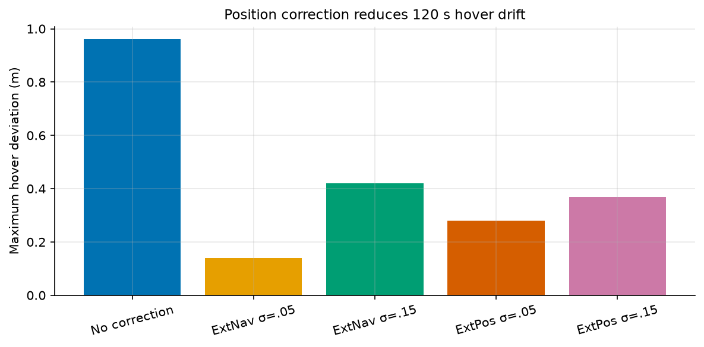
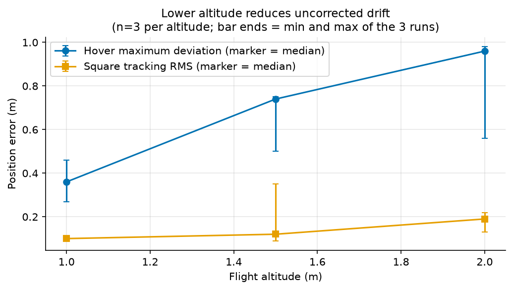
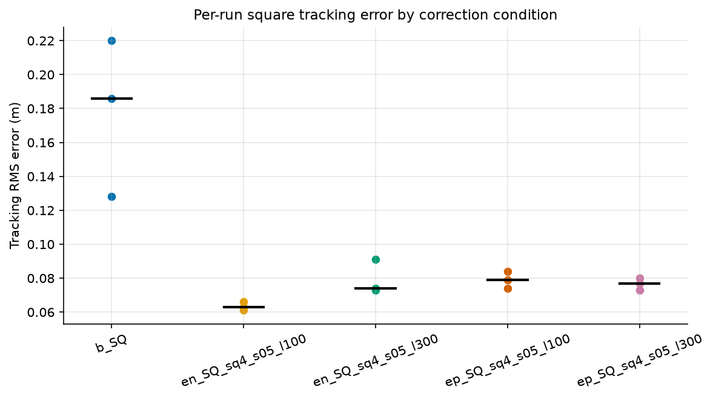

# 任务 C：用 ArUco 绝对位置消除光流漂移（abs_fix，2026-11-19，ROG 本机）

ArduCopter 4.7.0 SITL（`~/sim/ardupilot/build/sitl/bin/arducopter`，未改、未重编译），`+` 构型，实例只用 `-I10..-I13`，speedup 4。
配置继承 opt_flow2：MTF-01 光流 + 测距，`EK3_SRC1_POSZ 2`，加 `EK3_RNG_M_NSE 0.1`、`EK3_HGT_I_GATE 200`、`SURFTRAK_MODE 0`。
所有运行都在苛刻扰动下：光流噪声 `SIM_FLOW_RND 0.15`，风 1.5 m/s，`SIM_WIND_TURB 1`，`SIM_WIND_T 1`。

- 有效运行 324 次（`runs/`），另有 14 次无效（`runs_failed/`，见第四节）。
- 误差全部对照 SITL 真值（dataflash `SIM2`/`SIM`），不是飞控自己的估计。
- 收尾时已确认没有残留的 arducopter、batch 或驱动进程。

固件源码依据都在 `/home/jacky/sim/ap-fw470`（Copter-4.7.0，`1511f27`）。文中 `文件:行` 都指这棵树。

## 一、结论与推荐

### 1.1 各办法在 Copter 4.7.0 里能不能用

| 办法 | 能用吗（4.7.0 源码） | F405 固件 | 实测 |
|---|---|---|---|
| (a) ExtNav 位置：`ODOMETRY` / `VISION_POSITION_ESTIMATE`，`EK3_SRC1_POSXY 6` + `VELXY 5` | **能用**。没有罗盘时必须同时设 `EK3_SRC1_YAW 6`，并在消息里带标记测得的航向，原因见 1.4 | **已编进去**（`HAL_VISUALODOM_ENABLED`、`EK3_FEATURE_EXTERNAL_NAV` 在 `extra_hwdef.dat`），不用改固件 | 全部场景都测了，**推荐** |
| (b) `MAV_CMD_EXTERNAL_POSITION_ESTIMATE` | 能用，Copter 走通用处理：`GCS_Common.cpp:5770` → `5525` → `AP_AHRS.cpp:1574` → `NavEKF3_core::setLatLng`（`AP_NavEKF3_PosVelFusion.cpp:191`）。只在“已经 1 s 没有 GPS 位置 + 有辅助（光流）+ 有原点”时接受，直接硬重置 NE 位置，**不经过新息门限，不修航向** | 需要 `AP_AHRS_POSITION_RESET_ENABLED 1`，默认只在闪存大于 1024 KB 时打开（`AP_AHRS_config.h:41`），约 +1 KB | 全部场景都测了，效果次于 (a) |
| (c) 伪 GPS `GPS_INPUT`（`GPS1_TYPE 14`） | 代码存在。但 EKF 只有在航向已对准后才用 GPS（`AP_NavEKF3_Control.cpp:594`），没有罗盘时必须用 GPS_INPUT 的 yaw 字段加 `EK3_SRC1_YAW 2`。另外需要连续的数据流，机载电脑得自己做光流推算 | 需要 `AP_GPS_MAV_ENABLED`（`minimize_common.inc:29` 把 GPS 后端默认关了），约 +1.5 KB | 没测：做的事和 (a) 一样，但工作量和失效模式都更多 |
| (d) 不动 EKF，只改目标 | `SET_POSITION_TARGET_*` 只在 `in_guided_mode()` 时处理（`GCS_MAVLink_Copter.cpp:1005`），AUTO 里只有 NAVGUIDED / NAV_SCRIPT_TIME 子模式算（`mode.h:548`）。`AC_NAV_GUIDED` 被 `minimize_common.inc:111` 关掉，脚本放不下。飞行中改写航点可以（`AP_Mission::replace_cmd` 没有限制），但当前和下一个航点已经载入，所以修正要晚两段才生效，悬停和航向都修不了 | 改航点不用改固件；NAV_GUIDED 需要 `AC_NAV_GUIDED 1` | 没测 |
| (e) 精准降落 PLND | 只在 LAND 阶段起作用。MAVLink 后端接受 BODY_FRD / LOCAL_FRD 的目标位置（`AC_PrecLand_MAVLink.cpp handle_msg`），所以前视相机可以发一个算出来的“虚拟目标” | `AC_PRECLAND_ENABLED` 被 `minimize_fpv_osd.inc:24` 关掉，约 +8–12 KB | 没测。(a) 本身就把落点从 0.30 降到了 0.03–0.12 m，不需要 PLND |
| (f) UWB 信标 `AP_Beacon` | 能用，但只支持串口 UWB（Marvelmind、Nooploop、Pozyx），没有 MAVLink 输入。要求航向已对准（`Control.cpp:605`），所以没有罗盘就用不了 | `AP_BEACON_ENABLED` 被关（`minimize_common.inc:60`），约 +10–15 KB | SITL 对照失败（第 2.6 节），改用 (a) 的“标记始终可见”当连续绝对位置对照 |
| 其他：ExtNav 加 `reset_counter` | 重新看到标记时把 `reset_counter` 加 1，EKF 就直接重置到该位置（`PosVelFusion.cpp:634`），不用改固件 | 同 (a) | 测了，比普通融合差（2.7 节），不推荐 |

固件的余量依据：`fw_ecps295_mtf/build.log` 显示已用 897,004 B，剩余 86,020 B（约 84 KB），板子是 MatekF405-TE。
- 推荐方案 (a) **不需要改固件**。
- (b) 加 (c) 加 PLND 合计约 +10–15 KB，放得下。
- 再加上信标，估计合计 +20–30 KB，也放得下。
- Lua 脚本超过 150 KB，而且 RAM 不够，放不下。
- 这些大小是按源码量和已编入模块的符号大小（`arm-none-eabi-nm -S`）估的，误差约 ±50%。没有编译验证。

### 1.2 实测：两种方法把漂移从多少降到多少

中位数 [最小–最大]，每组 3 次，单位 m。“落点”指落地后离起飞点的真值距离。

| 场景 | 无修正 | (a) ExtNav σ 0.05 / 0.15 m | (b) ExtPos σ 0.05 / 0.15 m |
|---|---|---|---|
| 悬停 2 m 120 s，标记始终可见：真值最大偏离 | **0.96** [0.56–0.98] | **0.14** / 0.42（上报精度改成 2σ 后为 0.30） | 0.28 / 0.37 |
| 悬停，只在前 10 s 可见：最大偏离 / 结束时 | 0.96 / 0.95 | 0.72 / 0.69（之后照常漂） | 0.78 / 0.76 |
| 悬停，每 30 s 可见 5 s：最大偏离 / 落点 | 0.96 / 0.86 | 0.43 / **0.04** | 0.48 / 0.41 |
| 正方形 3 圈，只在起飞角可见：跟踪 RMS / 第 3 圈回原点 / 落点 | **0.19 / 0.33 / 0.30** | 0.11 / 0.16 / 0.05（σ 0.15：0.09 / 0.12 / 0.12） | 0.12 / 0.16 / 0.14（σ 0.15：0.13 / 0.22 / 0.24） |
| 正方形，四个角各一个标记 | 同上 | **0.06 / 0.05 / 0.04**（σ 0.15：0.13 / 0.17 / 0.08） | 0.08 / 0.16 / 0.15（σ 0.15：0.13 / 0.18 / 0.07） |

- 上表的延迟是 100 ms。延迟 300 ms（`VISO_DELAY_MS` 设到上限 250）时，各项变化不超过约 0.1 m，详见 2.1、2.2。
- 推荐配置复核（`rec_*`）：门限 v2 + `EK3_GLITCH_RAD 5` + 上报精度 max(0.1, 2σ)，结果在同一量级。
  - 正方形四标记：跟踪 RMS 0.07（σ 0.05 / 100 ms），0.10（σ 0.15 / 300 ms）。
  - 悬停始终可见：最大偏离 0.14 / 0.31 m。

*图 1. 无修正和不同修正条件下，悬停 120 秒期间的最大偏离。数据来源：report.md §1.2 表“实测：两种方法把漂移从多少降到多少”；脚本：make_figures.py。*

### 1.3 间歇可见时 EKF 怎么做（(a)，源码加实测）

1. **起飞前没看到标记。** EKF 处于 AID_RELATIVE，只用光流，可以正常解锁。解锁检查需要 VisOdom “healthy”，也就是 300 ms 内收到过消息（`AP_VisualOdom_Backend.cpp:36`）。所以机载电脑要以 5 Hz 发 quality 0 的保活 ODOMETRY，并设 `VISO_QUAL_MIN 1`：这类消息只算健康，不送进 EKF（`AP_VisualOdom_MAV.cpp handle_pose_estimate`）。`VISION_POSITION_ESTIMATE` 没有 quality 字段，做不到这一点。
2. **第一次看到标记。** EKF 切到 AID_ABSOLUTE，位置直接重置到这次观测（`Control.cpp:471`）。AUTO 航点里，位置控制器按 MoveVehicle 平滑移过去（`AC_PosControl.cpp:1715`，`mode_auto.cpp:226-247`）。
3. **标记不见、不到 10 s。** 什么都不发生，光流速度继续推算位置。
4. **不见超过 10 s**（`posRetryTimeUseVel_ms = 10000`，`AP_NavEKF3.h:493`）。EKF 置 `posTimeout`，但因为光流还在，不降级、不报警、不切模式。
   - 重新看到标记后的那几帧**不经过新息门限**，直接按大协方差融合（`PosVelFusion.cpp:841` `posCheckPassed || posTimeout`）。
   - 也不会硬重置，因为条件要求 `!velAiding`（`PosVelFusion.cpp:845`）。
   - 所以“看不见时靠光流推算、看见时修正”是成立的。但重新看见后的第一批观测完全没有飞控侧的保护，错检必须由机载电脑拦。
5. **修正瞬间的动作。** 估计位置单步跳变：
   - 悬停每 30 s 看一次：0.08–0.13 m。
   - 正方形单标记，约 20 s 才看一次：0.22–0.34 m。

   飞机的反应：
   - 悬停真值速度峰值 0.28–0.40 m/s，倾角不超过约 5°。
   - 正方形最大速度 0.52–0.74 m/s，基线 0.51–0.56 m/s（`WP_SPD 0.4`）。

   **没有“猛地一冲”**。(b) 的硬重置稍猛：悬停 0.47–0.55 m/s，倾角 7–9°；正方形 0.56–0.82 m/s。
6. **AUTO 子模式的差别**（只影响 (b) 和 (a) 的第一次重置）。在 TAKEOFF / LAND 子模式，EKF 重置时位置控制器把目标一起平移，飞机不动（MoveTarget）。
   - 实测 (b)：降落中一次 0.39 m 的重置，真值离目标 0.44 → 0.41 m，基本没修到。所以 (b) 每 30 s 看一次时落点偏 0.41 m，(a) 只有 0.04 m。
   - 在 `NAV_WAYPOINT` 和 `NAV_LOITER_TIME` 里，重置会让飞机移回去：(b) 在 LOITER_TIME 里 0.59 → 0.17 m。原因是 WPNav 每个周期都按任务点重算目标。
   - (a) 的普通融合不是重置，在任何子模式下都会把飞机拉回去。

### 1.4 偏航（问题 3）

- **没有罗盘时 EKF 航向会漂。** SITL 自带陀螺漂移模型（`SIM_DRIFT_SPEED 0.05`），无修正悬停 120 s 后 EKF 航向误差 9.3° [7.4–15.0]。
  - (b) 只改位置，航向误差还是 7–15°。
  - (a) 发标记航向后保持在 0.4–2°。
  - 只在前 10 s 看到标记时，(a) 之后的航向也照样漂到约 10°。
- **场地坐标系与开机机头差 10°**（机头没对准场地 x 轴），正方形（跟踪 RMS / 第 3 圈）：
  - 无修正：0.25 / 0.39。
  - (a) 四标记：0.06 / 0.10。
  - (a) 单标记：0.14 / 0.12。
  - (a) 发回飞控自己的航向而不是标记航向（echo）：0.08 / 0.11。位置融合本身也能慢慢把航向拉回来。
  - (b)：0.28 / 0.38，**没有改善**。
  - (b) 加“机载电脑用飞控航向换算标记位置”（现在 wt/rtl 代码的做法）：0.18 / 0.23。
- **单个标记够不够。** 够修航向，前提是机载电脑能从标记位姿里给出 3–5° 精度的航向（SITL 假设 σ 3°；EKF 内部对航向噪声下限取 5°，`AP_NavEKF3_Measurements.cpp writeExtNavData`）。单标记也可以只发位置、航向用 echo，EKF 通过“光流速度 × 位置”的关系去估航向，实测同样可用。多个标记让航向更快收敛，第 3 圈误差更小。15 cm 标记在 2–3 m 处的位姿角误差可能更大，见第五节。
- **没有罗盘**：只有 (a) + `EK3_SRC1_YAW 6` 成立。`YAW 0` 时，EKF 一进 AID_ABSOLUTE 就因为“航向未对准”判为不健康（`Control.cpp:786`）。SITL 实测第一次修正后 1 s 报 `EKF variance` → EKF failsafe LAND（`runs_failed/smk_*`）。
- **有罗盘：**
  - 罗盘干净或轻度电机干扰（`SIM_MAG_MOT 2/1 mGauss/A`）：`YAW 1`（罗盘）+ (a) 成立，正方形跟踪 0.07，落点 0.03–0.05；(b) 0.08–0.10。基线罗盘干净时 0.13，轻度干扰时 0.27。
  - 强干扰（`10/5`）：EKF 航向错 40–180°，基线、(a)+`YAW 1`、(b) 全部失败，落点 1.4–3.7 m。
  - 同样强干扰下改用 `YAW 6`、不用罗盘：0.06 / 落点 0.06。
  - **结论：不管有没有罗盘，都用 `EK3_SRC1_YAW 6`**，罗盘可以留着记日志，但不参与航向。

### 1.5 失效与安全（问题 4，悬停 2 m，标记始终可见，σ 0.05）

| 情况 | 原配置（v1 门限、`EK3_GLITCH_RAD 0`） | 推荐配置（v2 门限、`GLITCH_RAD 5`） |
|---|---|---|
| 持续错检：所有观测偏 1 m，持续 3 s | (a) **1.92 m**，飞机被推出标记视野（离标记超过 3 m），再也看不到，落点 1.88；(b) 0.99，看得见后自行修回 | (a) 0.17；(b) 0.27 |
| 同上，持续 20 s | (a) 1.99（`GLITCH_RAD 5` 时 1.67）；(b) 1.37 | (a) 0.28 [0.23–**1.16**]；(b) 0.33 |
| 间歇可见时，重新看到的第一批就是错的（偏 1 m） | — | (a) 0.40，与无错检的 0.44 相同，被挡掉 |
| 20% 单帧错检，机载电脑不过滤 | (a) 0.61；(b) 0.25（重置前已用中位数和离散度筛过） | (a) 只靠 `GLITCH_RAD 5`：**0.16** |
| 机载电脑在第 60 s 停止 | (a) 0.53，(b) 0.56，之后按光流漂，没有模式切换和报警（基线 0.96） | 同左 |
| 光流比例 +10% 与标记打架（正方形单标记） | 跟踪 / 落点：基线 0.21 / 0.34，(a) 0.18 / 0.04，(b) 0.18 / 0.08 | — |
| `VISO_DELAY_MS 40`，实际延迟 300 ms | (a) 跟踪 0.20（设对时 0.12） | — |

- 需要的门限：
  - **`EK3_GLITCH_RAD` 必须大于 0。** 现在是 0，新息超门限时仍按放大方差融合（`PosVelFusion.cpp:827`），等于不拒绝。
  - `EK3_POS_I_GATE` 保持 500。
  - 光流在用时，`GLITCH_RAD` 的方差重置条件永远不成立（要求 `!velAiding`），所以这个值没有副作用。
  - **机载电脑侧的 v2 门限是主要防线**：观测与飞控估计的距离必须不超过 min(1.5, max(0.3, 3σ) + 0.02 m/s × 距上次合格观测的时间)。理由是超时后飞控不再设门限。
  - `VISO_*` 在推荐 parm 里。
- **最坏情况的真值偏离：**
  - 推荐配置下，一个持续 20 s 的 1 m 地图错误，3 次中有 1 次被接受，偏 1.16 m。原因是拒绝期间飞机自己漂向错误一侧 0.37 m，新息落进了放宽的门限。
  - 原配置下，3 s 的错误就能把飞机推出视野，偏离 1.9–2.3 m，而且不会自己恢复。
  - 在 4 m 半径围栏内，两种情况都没有触发围栏。
- 结论：要防的是**持续的、看起来一致的错**，例如 ID 映射错、地图量错、标记被挪动。单帧错检好防。

### 1.6 只降低飞行高度（问题 5，无修正，各 3 次）

| 高度 | 悬停 120 s：最大偏离 / 结束 / 落点 | 正方形：跟踪 RMS / 第 3 圈 / 落点 |
|---|---|---|
| 2.0 m | 0.96 [0.56–0.98] / 0.95 / 0.86 | 0.19 [0.13–0.22] / 0.33 / 0.30 |
| 1.5 m | 0.74 [0.50–0.75] / 0.71 / 0.69 | 0.12 [0.09–0.35] / 0.26 / 0.27 |
| 1.0 m | **0.36** [0.27–0.46] / 0.34 / 0.40 | **0.10** [0.09–0.10] / 0.19 / 0.24 |

漂移大致与高度成正比。光流噪声是角速率噪声，乘以高度才变成速度噪声。降到 1 m 约减一半到 2/3，但仍明显大于 (a) 的 0.05–0.15 m。前视相机在 1 m 高时看墙上 1 m 高的标记，俯仰几何反而更好（第 6 条）。

*图 2. 不同飞行高度下悬停最大偏离和正方形航线跟踪 RMS；标记为中位数，误差线两端为表中的最小值和最大值（每个高度 3 次，因中位数偏向一端，误差线上下不对称）。数据来源：report.md §1.6 表；脚本：make_figures.py。*

### 1.7 推荐方案

**固件**：不改。ExtNav 已经编进去。如果想要 (b) 作为备选，加 `define AP_AHRS_POSITION_RESET_ENABLED 1`（约 +1 KB）。

**飞控参数**：见 `abs_fix_recommended.parm`，叠加在 `opt_recommended.parm` 上。

| 参数 | 值 |
|---|---|
| `EK3_SRC1_POSXY` | 6 |
| `EK3_SRC1_VELXY` | 5 |
| `EK3_SRC1_POSZ` | 2 |
| `EK3_SRC1_YAW` | 6 |
| `EK3_GLITCH_RAD` | 5 |
| `VISO_TYPE` | 1 |
| `VISO_DELAY_MS` | 实测延迟，不超过 250 |
| `VISO_POS_M_NSE` | 0.1 |
| `VISO_YAW_M_NSE` | 0.05 |
| `VISO_QUAL_MIN` | 1 |
| `WP_YAW_BEHAVIOR` | 0，或在任务里显式设航向 |

**机载电脑发什么**：参考实现在 `marker_fix.py`，`ExtNavSender` 和 `OutlierGate(ekf_hist=...)`。

- `ODOMETRY`（#331），每个通过门限的检测发一条，5–10 Hz：
  - `time_usec` = 机载电脑单调时钟的**发送时刻**（µs）。飞控的 JitterCorrection 会把它映射到到达时刻（`JitterCorrection.cpp:50`），所以真实延迟只能靠 `VISO_DELAY_MS` 告诉飞控。
  - `frame_id` = 20（`MAV_FRAME_LOCAL_FRD`），`child_frame_id` = 12（`MAV_FRAME_BODY_FRD`）。其他组合会被丢弃（`GCS_Common.cpp:4062`）。
  - `x, y` = 机体原点（不是相机）在场地坐标系中的位置，单位 m。x 是 EKF 的“北”，也就是上电时机头方向。`z` = −测距高度（`POSZ 2` 时不融合，但不能是 NaN）。
  - `q` = (roll, pitch 用 ATTITUDE，yaw 用**标记位姿算出的场地航向**)。
  - `vx..vz` 和各角速率 = NaN。
  - `pose_covariance[0]` = max(0.1, 2σ)²，`[20]` = σ_yaw²（rad²），其余为 0。
  - `reset_counter` 固定。
  - `quality` = 100。
- 没有检测时：5 Hz 发同样格式、`quality = 0` 的保活消息，加 1 Hz HEARTBEAT。
- **必须停掉现有 `mavlink_twin.send_ext_height()` 里把飞控自己的 x、y 回发的 `VISION_POSITION_ESTIMATE`。** 在 `POSXY 6` 下，它会把飞控自己的估计当绝对位置喂回去。
- 另外 wt/rtl 的 `companion.yaml` 写的是 `EK3_SRC1_POSZ 6`；按本方案应为 2。如果保留 6，`z` 就必须是真实高度。
- 门限：先做连续 3 帧一致性检查，再做 v2 新息门限（见 1.5）。现有 `ecps_landmark.py` 里的 EMA 平滑不要再叠加，滤波交给 EKF。

**标记布置**（现有相机朝前、下俯 12°、HFOV 70°，检测距离 0.4–3.0 m）：

- 每块标记立在下一个航点“前方”约 1 m、正对来向（`sq4` 布局）。每条 2 m 的边上，约前 65% 的路程能看到。
- 至少要有起飞角那一块，放在最后一条边的延长线上，这样落地前能看到。
- 标记中心约 1.0 m 高：2 m 飞行高度时要离标记 ≥1.2 m 才在视野内，1 m 高时任意距离都行。
- 悬停点正前方 2 m 放一块，并且悬停时不能让机头乱转（`WP_YAW_BEHAVIOR 0`）。SITL 里 `WP_YAW_BEHAVIOR 2` 在起飞点上悬停时，机头转了 90°，看不到标记（`runs_failed/yawbug_*`）。
- 15 cm 标记在 3 m 处只有约 15 px，Gazebo 里检测不到（wt/rtl 记录），**建议换 25–30 cm**。
- 场地坐标系：起飞时机头对准场地 x 轴放好（建议画线），各标记的位置和朝向在这个坐标系里量好（±2 cm、±1°）。

**上机验证步骤**：

1. **台架**（不装桨）。机载电脑发 ODOMETRY。确认：
   - 日志 `VISP` 有记录，quality 100 的被使用；
   - 保活时解锁检查通过；
   - 拔掉机载电脑后报 `VisOdom: not healthy`。
2. **测延迟。** 快速转动机体，比较 `VISP` 的航向和 `ATT` 的航向的时间差（或拍屏幕时钟），设 `VISO_DELAY_MS`。
3. **手持走正方形**（飞控上电、电机不转）。
   - 看 `XKF1` 的 PN/PE 与卷尺真值是否一致；
   - 看 `EKF3 IMU0 is using external nav data` 和 `yaw aligned`；
   - 不能出现 `EKF variance`；
   - 遮住标记 30 s 再放开，看 `XKF3` IPN/IPE 的单步跳变。
4. **1 m 高 LOITER**（看得到标记，遥控手随时切 ALT_HOLD）。遮挡、放开各 3 次，量飞机实际移动。
5. **AUTO**，依次飞：1 m 悬停 → 2 m 悬停 120 s → 正方形 1 圈 → 3 圈。每次用卷尺量落点，和不开修正（`EK3_SRC1_POSXY 0`）的同样任务对比。
6. **故障演练**（手持或 1 m 高）：
   - 在地图里故意把一个标记写错 1 m，确认机载电脑门限拒绝（看日志），飞控不跟；
   - 杀掉机载电脑进程，确认飞控继续靠光流，不切模式；
   - 遮挡单个标记。

## 二、结果表（中位数 [最小–最大]，n=3，单位 m；全部分组见 `summary_tables.md`，每次运行见 `results.csv`）

列的含义：
- `dev_*`：真值离悬停点的距离。
- `track`：真值离计划正方形的距离。
- `lap3`：第 3 圈到起飞角时的真值误差。
- `jump`：EKF 位置单步跳变，扣除了速度能解释的部分。
- `spd`：真值水平速度最大值，m/s。
- `yaw`：结束时的 EKF 航向误差，°。
- 配置名 `sXX_lYYY`：σ = 0.XX m，延迟 YYY ms。

### 2.1 悬停 2 m 120 s（AUTO `NAV_WAYPOINT` 保持 120 s，`WP_YAW_BEHAVIOR 0`；10 Hz，3% 单帧 1 m 错检；v1 门限，`GLITCH_RAD 0`）

| 组 | dev_max | dev_end | 落点 | jump | 修正后 4 s 内速度峰值 | yaw |
|---|---|---|---|---|---|---|
| 无修正 b_H2 | 0.96 [0.56–0.98] | 0.95 [0.47–0.95] | 0.86 | 0.02 | – | 9.3 [7.4–15.0] |
| (a) 始终可见 s05_l100 / s05_l300 | 0.14 [0.12–0.17] / 0.16 [0.15–0.16] | 0.07 / 0.05 | 0.05 / 0.03 | 0.02 | 0.14 / 0.13 | 0.6 / 0.5 |
| (a) 始终可见 s15_l100 / s15_l300 | 0.42 [0.37–0.43] / 0.41 [0.39–0.42] | 0.14 / 0.15 | 0.07 / 0.03 | 0.05–0.06 | 0.20 / 0.21 | 0.6 / 0.5 |
| (a) 始终可见 s15_l100，上报精度 0.3 | 0.30 [0.28–0.30] | 0.12 | 0.05 | 0.03 | – | – |
| (a) 前 10 s s05 l100/l300 · s15 l100/l300 | 0.72 / 0.70 · 0.43 / 0.78 | 0.69 / 0.65 · 0.24 / 0.72 | 0.67 / 0.65 · 0.25 / 0.71 | 0.02 | 0.16–0.38 | 7.8–10 |
| (a) 每 30 s 可见 5 s，同上四组 | 0.43 / 0.44 · 0.55 / 0.56 | 0.17 / 0.43 · 0.15 / 0.16 | **0.04 / 0.04 · 0.09 / 0.09** | 0.09–0.13 | 0.34–0.40 | 1.5–2.1 |
| (b) 始终可见，同上四组 | 0.28 / 0.28 · 0.37 / 0.35 | 0.06 / 0.14 · 0.08 / 0.12 | 0.04 / 0.14 · 0.05 / 0.17 | 0.17–0.35 | 0.37–0.46 | 8.9–13.2 |
| (b) 前 10 s | 0.78 / 0.76 · 0.81 / 0.65 | 0.76 / 0.74 · 0.77 / 0.57 | 0.68 / 0.67 · 0.76 / 0.59 | 0.02–0.14 | 0.21–0.42 | 9.9–13.2 |
| (b) 每 30 s 可见 5 s | 0.48 / 0.62 · 0.59 / 0.46 | 0.45 / 0.46 · 0.42 / 0.40 | 0.41 / 0.40 · 0.28 / 0.37 | 0.35–0.56 | 0.47–0.55 | 6.8–10.8 |
| 用 `NAV_LOITER_TIME` 悬停，每 30 s，s05_l100：(a) / (b) | 0.46 / 0.60 | 0.24 / 0.45 | 0.32 / 0.35 | 0.09 / 0.54 | – | 1.4 / 8.5 |

### 2.2 正方形 2 m × 2 m，3 圈，2 m 高（`WP_SPD 0.4`，航点不停，`WP_YAW_BEHAVIOR 2`）

| 组 | track_rms | track_max | lap1 / lap3 | 落点 | jump | spd_max |
|---|---|---|---|---|---|---|
| 无修正 b_SQ | 0.19 [0.13–0.22] | 0.37 | 0.21 / 0.33 | 0.30 | 0.02 | 0.55 |
| (a) 起飞角 s05_l100 / s05_l300 | 0.11 / 0.11 | 0.29 / 0.25 | 0.07 / 0.16 · 0.07 / 0.24 | 0.05 / 0.05 | 0.22 | 0.58–0.59 |
| (a) 起飞角 s15_l100 / s15_l300 | 0.09 / 0.12 | 0.24 / 0.35 | 0.11 / 0.12 · 0.24 / 0.23 | 0.12 / 0.11 | 0.29–0.34 | 0.66–0.74 |
| (a) 四角 s05_l100 / s05_l300 | **0.06** / 0.07 | 0.22 / 0.21 | 0.04 / 0.05 · 0.06 / 0.10 | 0.04 / 0.07 | 0.04 | 0.52–0.56 |
| (a) 四角 s15_l100 / s15_l300 | 0.13 / 0.13 | 0.31 / 0.38 | 0.08 / 0.17 · 0.17 / 0.22 | 0.08 / 0.08 | 0.09–0.18 | 0.66–0.69 |
| (a) 四角 s15_l100，上报精度 0.3 | 0.09 | – | – / 0.08 | 0.08 | 0.12 | 0.61 |
| (b) 起飞角 s05_l100 / s05_l300 | 0.12 / 0.14 | 0.36 | 0.08 / 0.16 · 0.09 / 0.19 | 0.14 / 0.16 | 0.18–0.22 | 0.56–0.59 |
| (b) 起飞角 s15_l100 / s15_l300 | 0.13 / 0.17 | 0.42 / 0.50 | 0.12 / 0.22 · 0.18 / 0.15 | 0.24 / 0.10 | 0.31–0.44 | 0.65–0.76 |
| (b) 四角 s05_l100 / s05_l300 | 0.08 / 0.08 | 0.19 / 0.20 | 0.08 / 0.16 · 0.10 / 0.16 | 0.15 / 0.21 | 0.18–0.22 | 0.73–0.77 |
| (b) 四角 s15_l100 / s15_l300 | 0.13 / 0.16 | 0.35 / 0.53 | 0.09 / 0.18 · 0.09 / 0.22 | 0.07 / 0.13 | 0.49–0.50 | 0.76–0.80 |
| 5 Hz，起飞角，s15_l300：(a) / (b) | 0.16 / 0.14 | – | – / 0.25 · – / 0.23 | 0.09 / 0.14 | 0.15 / 0.34 | 0.66 / 0.81 |

*图 3. 基线、四角 ExtNav 和四角 ExtPos 条件下正方形航线的逐次跟踪 RMS。数据来源：results.csv；脚本：make_figures.py。*

### 2.3 偏航与罗盘（正方形，s05_l100）

| 组 | track_rms | lap3 | 落点 | 结束时 yaw 误差 |
|---|---|---|---|---|
| 场地转 10°，无修正 | 0.25 [0.22–0.35] | 0.39 | 0.36 | 11–12 |
| 场地转 10°，(a) 四角 / 单角 / 四角 echo 航向 | 0.06 / 0.14 / 0.08 | 0.10 / 0.12 / 0.11 | 0.05 / 0.03 / 0.03 | 0.2 / −0.3 / 1.5 |
| 场地转 10°，(b) / (b) 用飞控航向换算 | 0.28 / 0.18 | 0.38 / 0.23 | 0.39 / 0.31 | 14 / 12 |
| 罗盘干净：无修正 / (a) `YAW 1` / (b) | 0.13 / 0.07 / 0.08 | 0.37 / 0.08 / 0.09 | 0.38 / 0.05 / 0.14 | ≤1 |
| 轻度电机干扰（2/1）：无修正 / (a) `YAW 1` / (b) | 0.27 / 0.07 / 0.10 | 0.44 / 0.09 / 0.17 | 0.57 / 0.03 / 0.09 | 0–3.8 |
| 强干扰（10/5）：无修正 / (a) `YAW 1` / (b) | 1.48 / 2.02 / 1.59 | 1.46 / 3.44 / 2.94 | 1.40 / 3.45 / 3.74 | 40–180 |
| 强干扰，(a) `YAW 6` 场地坐标系 | **0.06** | 0.02 | 0.06 | 0.2 |

### 2.4 失效：见 1.5 的表；完整列见 `summary_tables.md` “失效”节

### 2.5 降低高度：见 1.6 的表

### 2.6 信标对照（SITL `BCN_TYPE 10`，测距无噪声，罗盘航向）

| 组 | 悬停 dev_max | 正方形 track_rms / 落点 |
|---|---|---|
| 信标在地面高度（`BCN_ALT 20`） | 0.44 | 1.25 / 1.99 |
| 信标高 4 m（`BCN_ALT 24`） | 0.46 | 1.29 / 2.04 |

- EKF 报 `initial beacon pos D offset = -3.8 m`，正方形的 EKF 误差达 1.7 m。SITL 的 4 个信标排成 10 × 20 m（`AP_Beacon_SITL.cpp:36-41`），比飞行范围大很多，而且共面。
- 原因没有查清，所以这组**不能当作“连续绝对位置能好到哪里”的对照**。改用 (a) 的“始终可见”：σ 0.05 时 0.14 m，σ 0.15 时 0.30–0.42 m。

### 2.7 没有效果的变体

- ExtNav 重新看到标记时加 1 `reset_counter`（硬重置为 3 帧均值），s15_l300：
  - 悬停每 30 s：落点 0.62，普通融合 0.09；
  - 正方形起飞角：跟踪 0.14，普通融合 0.12。
  - 不推荐。
- 上报精度改成 2σ（claim 0.3，σ 0.15）：
  - 始终可见悬停 0.42 → 0.30；
  - 四角跟踪 0.13 → 0.09；
  - 每 30 s 悬停 0.55 → 0.39，但范围重叠。
  - 已并入推荐配置。

## 三、方法

### 3.1 工具链（都在本目录）

- **`marker_fix.py`：机载电脑侧，可移植，不含 SITL 代码。**
  - `OutlierGate`：v1 是 3 帧一致加跟踪连续性；v2 加了与飞控估计的、随时间放宽的新息门限。
  - `ExtNavSender`：发 ODOMETRY 和保活，可选 `reset_counter`。
  - `ExtPosResetter`：一次看见期间累计 ≥5 帧“观测 − 飞控估计”的偏差，取中位数、剔除离群后求平均，再发 `MAV_CMD_EXTERNAL_POSITION_ESTIMATE`（COMMAND_INT，frame 0，param1 = 发送时刻，param2 = 发送 − 拍摄，param3 = 精度，z = NaN）。冷却 3 s，偏差小于 0.05 m 不发。
  - `EkfHistory`：按拍摄时刻取飞控的 LOCAL_POSITION_NED。
- **`abs_sim.py`：SITL 驱动。** 由 opt_flow2 `opt2_sim.py` 改来，起飞、上传任务、RC3 1500 定高、解锁重试的逻辑不变。
  - 用 `SIM_STATE`（25 Hz）真值合成标记观测。
  - 几何门限：水平距离 0.4–3.0 m，方位 ±30°，标记朝向角不超过 60°，取自 wt/rtl `ecps_landmark.py`；再加上俯仰 −12°、VFOV 55.4° 的垂直视场，使用真实机体俯仰。
  - 时间窗：始终 / 前 10 s / 每 30 s 中 5 s，从悬停航点开始计时。
  - 噪声：每轴高斯 σ，3% 概率单帧错 1 m（方向随机），可选持续错检，可选按飞控航向换算。
  - 延迟按飞控时钟排队发出，更新率 10 Hz 或 5 Hz。
  - 每次运行写 `comp.csv`，记录每条观测、门限结果和发送，每 5 s 记一次链路积压检查（`clock`）。
- **`abs_analyze.py`：指标。** 场地坐标系 = 解锁时的真值位置 + 真值航向（+`--field-rot`）。有罗盘时（`--ekf-frame ned`）把 EKF 的 NE 转到场地坐标系。
- `run_one.sh`、`batch.py`（I10–I13，最多 4 个并行）、`chain.sh`、`waitbatch.sh`、`stopall.sh`：调度。
- `gen.py`（任务清单 `jobs_*.txt`）、`collect.py`（`results.csv`）、`tables.py`（`summary_tables.md`）。
- `tools/reset_effect.py`：单次修正前后飞机的实际移动。`tools/probe_simstate.py`。

### 3.2 重复与随机

- 每组 3 次，起飞航向 30° / 150° / 270°，风向 0° / 120° / 240°。观测噪声的随机种子是 1 / 2 / 3。
- SITL 的 `random()` 没有播种，所以要靠改航向和风向让各次不同。

### 3.3 核对过的事

- **链路积压。** 第一版驱动的接收循环在 speedup 4、4 实例并行时跟不上，约 80 s 后不再合成观测。现象是“始终可见”只发了 37 条修正。已改为每轮最多处理 20 条消息，并降低真值和姿态的消息率。之后 `comp.csv` 里的 `clock` 列（墙钟 × speedup − 飞控时钟）在每次运行中变化不超过 0.18 s（缓慢单调，不是积压），没有积压。之前的运行都已作废。
- **坐标系。** `comp.csv` 里驱动看到的真值和 EKF，与 dataflash 的 `SIM2`/`XKF1` 逐点一致。用场地转 10° 的运行检验了旋转方向：无修正时跟踪误差按预期变大。
- **悬停机头。** `WP_YAW_BEHAVIOR 2` 时，起飞点上的航点悬停会让机头转 90°，与 opt_flow2 的 `NAV_LOITER_TIME` 不同。发现后悬停任务全部改为 `WP_YAW_BEHAVIOR 0` 重跑，旧结果在 `runs_failed/yawbug_*`。

### 3.4 关于基线

本轮基线 `b_H2` 悬停最大偏离 0.96 m，opt_flow2 的 FNSE 组是 0.82 m（只有光流噪声，没有风），两者一致。基线的正方形跟踪 0.19 m，opt_flow2 的 FNSE 组是 0.18 m。

## 四、未完成、无效、可疑

- **无效 14 次（`runs_failed/`）：**
  - `smk_*` 和 `yawbug_smk_*`：4 次调试期的冒烟运行，包括没设 `YAW 6` 时的 EKF failsafe，以及链路积压问题。
  - `yawbug_*`（不含 smk）：9 次悬停受机头旋转影响，已重跑。
  - `killed_*`：1 次被我的调度重启打断，已重跑。
- **未完成：** `ep_SQ_sq4_cmpmot_r1`。强罗盘干扰下飞丢，任务没完成，计入强干扰组。
- **没做的：**
  - (c) GPS_INPUT、(d) 改航点、(e) PLND 都只做了源码评估，没有 SITL 实测。
  - 没有编译固件，各宏的大小是估计值。
  - 没有测正方形里的持续错检和机载电脑中断（只在悬停里测了）。
  - 没有测标记位姿航向的真实误差分布，包括 IPPE 的二义性翻转。
  - 没有测相机到机体的安装偏移（`VISO_POS_*`），SITL 观测直接给的是机体位置。
- **可疑：**
  - `rec_en_H2_bad20` 3 次中 1 次接受了错误地图，偏 1.16 m，机理见 1.5。`drift_rate` 取 0.02 m/s 偏宽，降到 0.01 能挡住这一次，但长时间不见后真实漂移可能被拒，没有扫这个参数。
  - (a) 每 30 s 可见的组里，`dev_end` 有的是 0.1、有的是 0.4，取决于最后一个可见窗口与降落的先后。
  - 信标对照失败，原因没查。
- 我在调试时让一个后台探测命令输出了大量 “EOF on TCP socket”，Claude Code 把它存成了 `~/.claude/projects/-home-jacky-sim-abs-fix/.../tool-results/biizrim5p.txt`（64 MB）。删除需要你确认，我没有删。

## 五、SITL 回答不了的事

- **标记观测的误差模型是假设的**（高斯 + 偶发 1 m）。真实 ArUco 的误差随距离和视角变化，有系统偏差：标定、畸变、相机外参。还有 IPPE 位姿翻转，会产生航向错 20–40° 的离群值。标定后要在场地上实测 σ，并用 `ODOMETRY` 的协方差如实上报。
- 15 cm 标记在 2–3 m、HFOV 70°、640 px 时只有 25–15 px，**单标记位姿航向可能做不到 3–5°**。缓解办法：
  - 用 25–30 cm 标记；
  - 用两块标记的方位差求航向；
  - 或者发 echo 航向（实测也可用），只靠位置融合去修航向。
- SITL 的光流噪声是白噪声，陀螺漂移是线性斜坡模型，风是均匀的。真机的光流误差是相关的、有偏的（纹理、反光、网影），所以“看不见时漂多快”只能定性参考，门限里的 `drift_rate` 要按真机实测漂移重新定。
- 机载电脑的真实延迟抖动、USB 相机的曝光时间都没有仿真。现在的结果是：延迟设对与设错（300 vs 40 ms）只差约 0.08 m 跟踪 RMS。
- SITL 的位置控制器、机体和 PID 不是这台 2S 小机，“修正时的速度峰值”只能用于方案之间的比较。

## 文件

- `report.md`（本文件）、`summary_tables.md`（全部分组）、`results.csv`（每次运行一行，324 行）、`abs_fix_recommended.parm`
- 机载电脑可移植代码：`marker_fix.py`
- SITL：`abs_sim.py`、`abs_analyze.py`、`run_one.sh`、`batch.py`、`chain.sh`、`waitbatch.sh`、`stopall.sh`、`gen.py`、`collect.py`、`tables.py`、`tools/`、`mtf01_sitl_rng.parm`（从 opt_flow2 拷贝）
- 任务清单 `jobs_*.txt`，批次日志 `batch_*.log`
- `runs/<tag>/`：`cmd.txt`、`overlay.parm`、`run.log`、`sitl.log`、`comp.csv`、`logs/*.BIN`、`metrics.json`；`runs_failed/`
