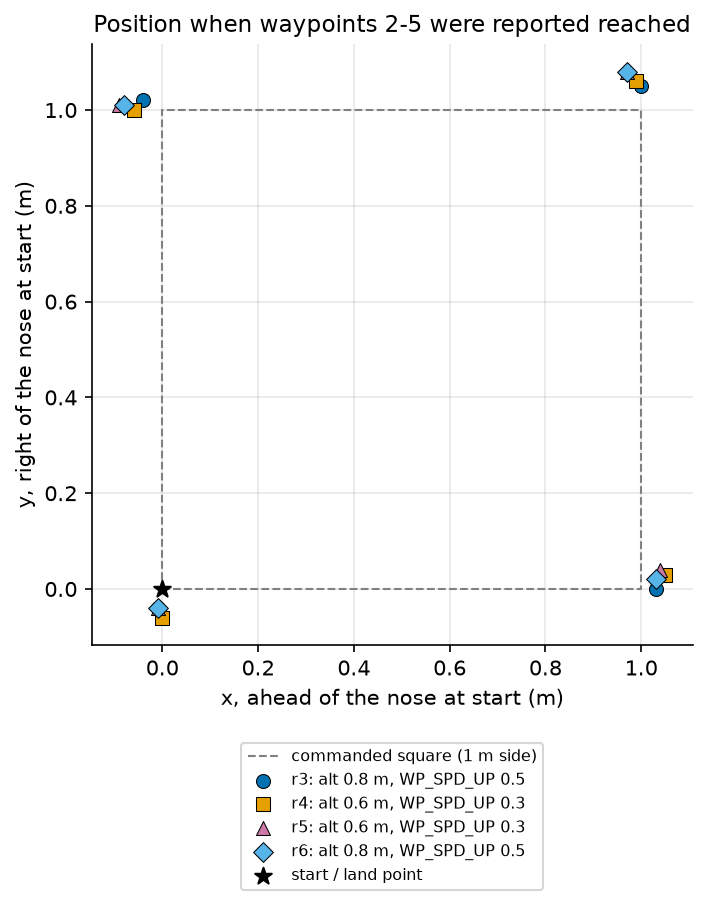
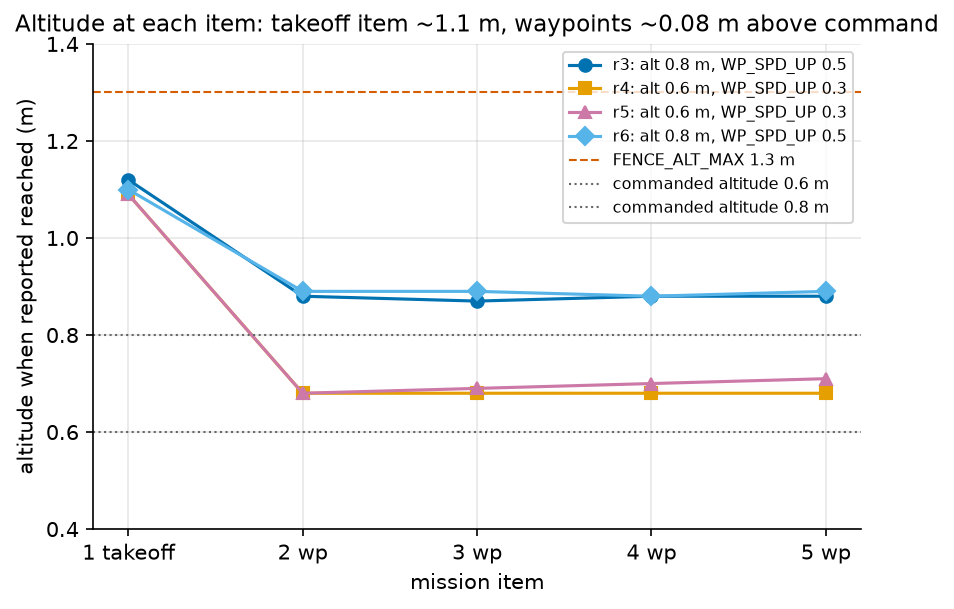
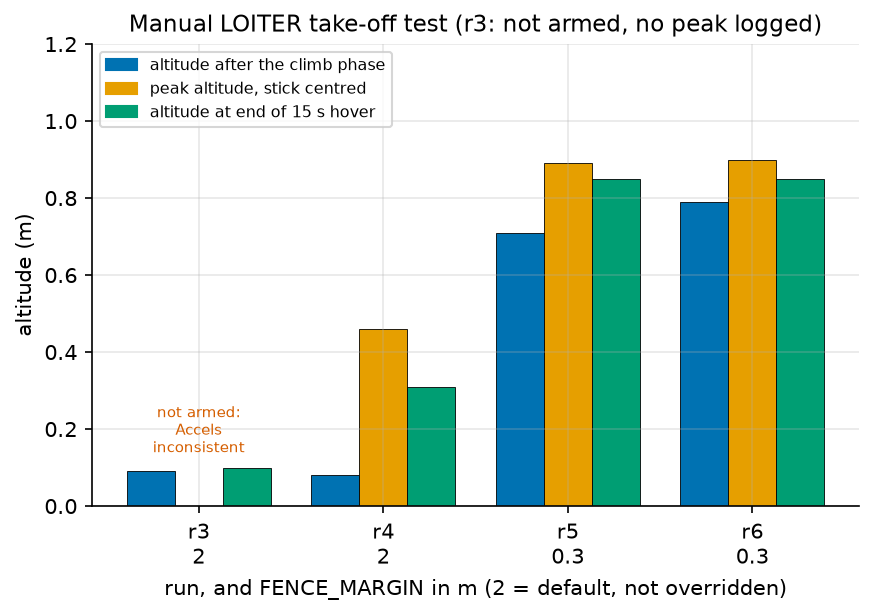

# Rehearsal of the 2026-11-19 no-GPS AUTO mission (SITL, runs r3 - r6)

ArduCopter SITL rehearsal of the field tool `auto_mission.py`: the course's 20 ft cage flight with no GPS and no
compass, flown by the flight controller itself in AUTO on optical flow and the companion's height. The script
plays the companion and the pilot, so the whole field sequence can be checked before going to the real drone.

## What the rehearsal does

`run_rehearsal.sh <tag> [auto_mission.py args]` starts a fresh ArduCopter SITL (`--model +`, speedup 1, GPS off,
home 20 m) with the defaults of `copter.parm` plus `field_sitl.parm`, then runs `auto_mission.py rehearse` against it
over a local TCP port with a 330 s timeout. The log goes to `run_<tag>.log` (the SITL's own log `sitl_<tag>.log` is not kept).

- `field_sitl.parm`: the real drone's parameters from the 2026-11-18 bench day (arming checks, EKF3 sources: flow
  velocity, rangefinder height, no GPS, no compass; fence radius 3 m and `FENCE_ALT_MAX` 1.3 m; waypoint, loiter and
  failsafe settings), then the SITL sensors: optical flow, rangefinder, battery.
- `auto_mission.py rehearse` steps: the script writes the field parameters (`RTL_ALT_M` 0, `WP_SPD` 0.4 m/s,
  `WP_SPD_UP` 0.5 m/s, `WP_SPD_DN` 0.4 m/s, `WP_RADIUS_M` 0.2 m, `WP_ACC` 1.0, `LOIT_SPEED_MS` 1.0; in r5 and r6
  also `FENCE_MARGIN` 0.3 m, see below), waits 25 s for the simulated IMUs, then
  1. LOITER test: arm, throttle up for up to 8 s or until 0.7 m, centre the stick for 4 s, hover 15 s, land;
  2. AUTO mission D3: upload 7 items (takeoff, a 1 m square of four waypoints with 2 s hold each, land), read it
     back, arm in LOITER, switch to AUTO, follow the flight until the FC disarms and print a JSON summary.
- Mission D3 is metres from the start point, x ahead of the nose, y to the right, converted to latitude / longitude
  with the FC's own position and yaw. The reference point printed in the logs is the simulated home.

The command line of each run was not kept. The parameters in the table are what each log shows
(`uploading D3: ... alt ...`, `param ...` lines); the cause of the differences between runs (e.g. `WP_SPD_UP` 0.3 vs
0.5) is not in the logs.

## Files

| File | Kind |
|---|---|
| `run_r3.log`, `run_r4.log`, `run_r5.log`, `run_r6.log` | results: console log of each run, ending with the JSON summary and `rehearsal exit 0` |
| `auto_mission.py`, `run_rehearsal.sh`, `field_sitl.parm` | scripts and parameters that made them (plan) |
| `make_figures.py`, `figures/` | redraws the figures from the four logs (`python make_figures.py`) |

The log files were copied into the repository by reading them, not with a byte copy; they contain no address, host
name or key (only `127.0.0.1` ports in the scripts). The simulated home latitude / longitude appears in the logs.

## The four runs

All four runs: `rehearsal exit 0`, mission items 1-5 reached, mode only AUTO, disarmed after landing, battery 12.6 V.

| Run | D3 altitude | Nose yaw | `WP_SPD_UP` | `FENCE_MARGIN` | LOITER test | AUTO time | Max alt | Max radius | Landing offset |
|---|---|---|---|---|---|---|---|---|---|
| r3 | 0.8 m | 0 deg | 0.5 m/s | default (2 m) | not armed: "Arm: Accels inconsistent"; alt 0.10 m | 34.8 s | 1.13 m | 1.45 m | 0.01 m |
| r4 | 0.6 m | 2 deg | 0.3 m/s | default (2 m) | armed; climb 0.08 m after 8.1 s, peak 0.46 m, hover 0.31 m, drift 0.01 m; 3 ground hits (0.77, 0.77, 0.70 m/s) | 36.0 s | 1.11 m | 1.45 m | 0.02 m |
| r5 | 0.6 m | 2 deg | 0.3 m/s | 0.3 m | armed; climb 0.71 m after 2.6 s, peak 0.89 m, hover 0.85 m, drift 0.02 m; 1 ground hit (1.00 m/s) | 35.7 s | 1.11 m | 1.45 m | 0.03 m |
| r6 | 0.8 m | 2 deg | 0.5 m/s | 0.3 m | armed; climb 0.79 m after 2.7 s, peak 0.90 m, hover 0.85 m, drift 0.02 m; 1 ground hit (1.01 m/s) | 34.5 s | 1.12 m | 1.44 m | 0.00 m |

Reading the table:

- r3 to r4 to r5 show the `FENCE_MARGIN` story told in the `FIELD_PARAMS` comment of `auto_mission.py`: with the
  real drone's 2 m margin and a 1.3 m altitude fence, the LOITER take-off does not climb (r4: peak 0.46 m), with 0.3 m
  it climbs to 0.89 m (r5, r6). The AUTO mission is not affected: it flew the same in all four runs.
- r3's LOITER test did not arm at all (the log says "Arm: Accels inconsistent" shortly after boot); AUTO armed
  normally 30 s later.

## Figures

The logs hold the positions and altitudes reported at each mission item, so three figures are possible. There is no
track (the logs hold only item events, not a time series).

*Figure 1. Position (x ahead, y right of the start point) when mission items 2-5 were reported REACHED, one marker per run and item, against the commanded 1 m square. All 16 points lie within 0.1 m of a corner; the four runs overlap. Source: run_r3.log ... run_r6.log; script: make_figures.py.*

*Figure 2. Altitude when each mission item was reported reached. The takeoff item reports 1.09-1.12 m although 0.6 m or 0.8 m was commanded; the four waypoints then sit 0.07-0.11 m above the commanded altitude. r4 and r5 (same settings of altitude and speed) overlap. Source: run_r3.log ... run_r6.log; script: make_figures.py.*

*Figure 3. Manual LOITER take-off test of each run: altitude after the climb phase, peak altitude with the stick centred, altitude at the end of the 15 s hover. r3 did not arm (no peak logged). Source: run_r3.log ... run_r6.log; script: make_figures.py.*

## Surprises in the data

- The takeoff item reports 1.09-1.12 m in every run although the commanded altitude is 0.6 or 0.8 m (about 1.4-1.9
  times as high), and the waypoints then sit 0.07-0.11 m above the command. The maximum altitude of 1.11-1.13 m is
  within 0.2 m of `FENCE_ALT_MAX` (1.3 m). The logs do not say why.
- Max radius 1.44-1.45 m for a 1 m square (corner distance 1.41 m): the drone overshoots the far corner by about 4 cm,
  which matches the reported positions (x 0.97-1.05, y 1.05-1.08 at item 3).
- After the landing each log shows "Mission: 1 Takeoff" and "mission item 1 active" again, right after "Disarming
  motors": the mission pointer goes back to item 1. The logs do not show why; the drone stays disarmed.
