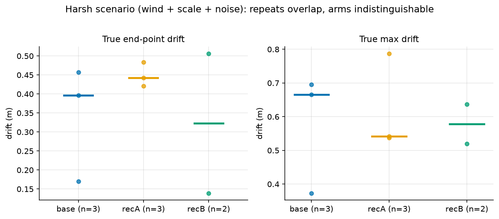
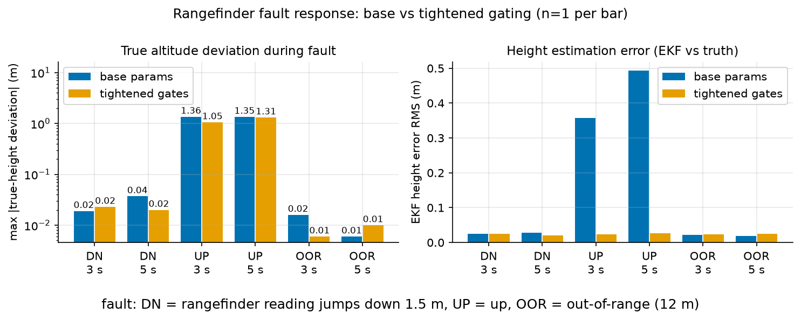
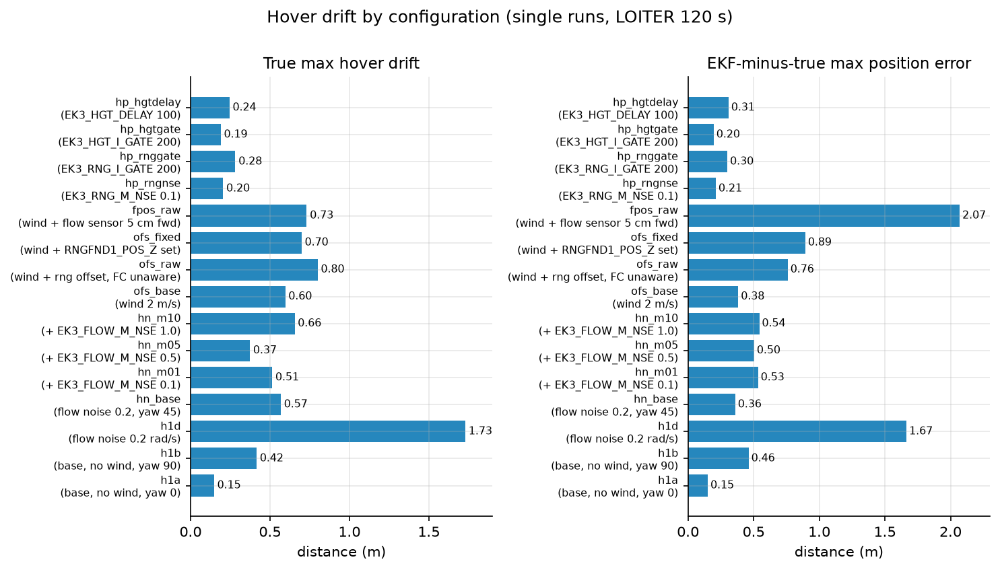
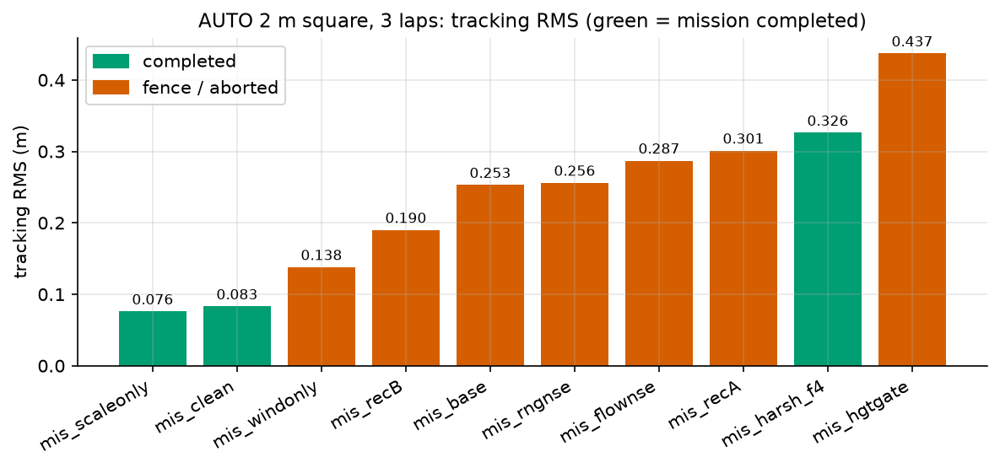

# MTF-01 光流+测距定位 参数优化报告（2026-11-19，ROG 本机）

ArduCopter 4.7.0 SITL（`~/sim/ardupilot/build/sitl/bin/arducopter`，未改未编译），`+` 构型，无 GPS、无罗盘（室内场景）。
基线配置 = MTF-01 光流+测距，`EK3_SRC1_POSZ 2`（测距直接做高度源），从 `~/sim/mtf01/mtf01_sitl_rng.parm` 出发，只把 `FENCE_RADIUS` 3→4（沿用上一轮的建议值，A/B 两臂只差被测参数）。
共 46 次运行（`runs/`），误差全部以 SITL 真值（dataflash `SIM2`）为准，不是飞控自己的估计。
硬件/软件事实以源码为准（`libraries/AP_NavEKF3/`、`libraries/AP_RangeFinder/`、`libraries/SITL/`）。

## 一、结论

**1. 水平漂移：调 EKF 参数没有用，改善小于重复间离散度。**
苛刻场景（LOITER 定高悬停 120 s + 阵风 1.5 m/s + 光流比例误差 +5% + 光流噪声 0.1 rad/s + 测距噪声 0.05 m）：

| 配置 | n | 真值终点漂移 | 真值最大漂移 | 漂移速率 | EKF-真值位置差（终点） | EKF 高度误差 RMS |
|---|---|---|---|---|---|---|
| 原参数 base | 3 | 0.396 / 0.170 / 0.457（中位 0.396） | 0.373–0.695 | 0.0016–0.0064 m/s | 0.453 / 0.782 / 0.456 | 0.054–0.061 m |
| recA（FLOW_M_NSE 0.1 + 测距门限组） | 3 | 0.442 / 0.421 / 0.484 | 0.537–0.787 | 0.0021–0.0056 | 0.377 / 1.041 / 0.557 | 0.048–0.051 m |
| recB（只改测距门限组） | 2 | 0.506 / 0.139 | 0.520–0.637 | 0.0035–0.0088 | 0.714 / 0.410 | 0.046–0.047 m |

*图1. 苛刻场景三次重复的真值终点漂移与最大漂移：三组完全重叠，两臂差异小于重复间离散度。数据来源：results.csv（ab_base_* / ab_recA_* / ab_recB_*）；脚本：make_figures.py。*

同一配置的 3 次重复本身就能差 0.3 m（0.170–0.457），**两臂之间没有任何差异大于这个离散度**，因此不推荐任何“为减少漂移”而改 EKF 参数的动作。

**2. 水平漂移最大的单一因素是传感器不在重心（SITL 单次运行，需复测）。**
`SIM_FLOW_POS_X 0.05`（光流传感器在 IMU 前方 5 cm，飞控 `FLOW_POS_X` 仍为 0）：EKF-真值位置差 **1.565 m**（最大 2.07 m）、真值最大半径 3.93 m；同扰动的对照组（只有风）为 0.235 m / 0.52 m。
机理（源码）：`AP_NavEKF3_OptFlowFusion.cpp` 用 `range = (terrainState - pd) / cos(tilt)` 把光流角速度换算成速度，`AP_NavEKF3_PosVelFusion.cpp` 用 `rng * cos(tilt)` 把测距换算成高度——**高度误差直接按比例缩放速度估计**，传感器偏置会同时污染两个量。

**3. 高度误差分两种，性质完全不同。**
- *估计误差*（EKF 高度 vs 真值）：所有正常场景都 **0.016–0.061 m**，很好；EKF 不是问题。
- *绝对高度误差*（真值高度 vs 任务高度）：风一上来就变差。
  - 干净场景（无风、无比例误差）：任务高度 RMS **0.022 m**，最高 2.068 m，3 圈全部完成，落点 0.112 m，逐圈回原点误差 0.069 / 0.140 / 0.102 m（**不累积**）。
  - 只有风 1.5 m/s：飞机爬到 2.555 m，`Max Alt fence breached` → 手动回收，任务高度 RMS **1.056 m**。
  - 苛刻场景：任务高度 RMS **0.41–0.50 m**，真值最高 2.60–2.94 m，`FENCE_ALT_MAX 2.5`+余量 0.3 被触发，任务中断（只飞完 2 圈）。
  - 只有光流比例误差 +5%：任务高度 RMS **0.022 m**，与干净场景相同 → **比例误差不影响高度**。
  - 结论：**绝对高度误差来自风，不是来自比例误差**。最可能的机理是光流推算的地形/高度基准随风漂移（`terrainState`），飞控为了把 EKF 高度维持在 2.0 m 就真的爬高了。这条只做了 2 组对照运行，机理未逐帧验证。

**4. 测距异常保护：唯一有大幅、明确改善的一组。**
故障注入方式：飞行中改 `SIM_SONAR_POS_Z`（真值侧），让读数下跳 1.5 m / 上跳 1.5 m / 变成 12 m（超量程）。

| 故障 | 原参数：真值高度偏离 / EKF 高度误差 RMS / 结束状态 | 收紧门限组（`EK3_RNG_M_NSE 0.1`+`EK3_RNG_I_GATE 200`+`EK3_HGT_I_GATE 200`）：真值高度偏离 / EKF 高度误差 RMS / 结束状态 |
|---|---|---|
| 读数下跳 1.5 m，3 s | +0.019 m / 0.025 m / **EKF variance → LAND** | +0.003 m / 0.025 m / **EKF variance → LAND** |
| 读数下跳 1.5 m，5 s | +0.037 m / 0.028 m / **EKF variance → LAND** | +0.016 m / 0.021 m / **EKF variance → LAND** |
| 读数上跳 1.5 m，3 s | **−1.359 m（掉到地面）/ 0.357 m（最大 1.851 m）/ 自行落地** | −1.054 m（掉到地面）/ **0.024 m（最大 0.078 m）/ 自行落地** |
| 读数上跳 1.5 m，5 s | **−1.353 m（掉到地面）/ 0.494 m（最大 1.900 m）/ 自行落地** | −1.311 m（掉到地面）/ **0.026 m（最大 0.096 m）/ 自行落地** |
| 超量程（12 m），3 s | +0.016 m / 0.022 m / **EKF variance → LAND** | +0.006 m / 0.023 m / **EKF variance → LAND** |
| 超量程（12 m），5 s | +0.006 m / 0.018 m / **EKF variance → LAND** | +0.010 m / 0.025 m / **EKF variance → LAND** |

*图2. 六种测距故障（下跳 / 上跳 1.5 m、超量程，各 3 s / 5 s）的真值高度偏离与 EKF 高度估计误差：上跳故障的估计误差改善约 15–20 倍，但两臂的飞机仍都掉到地面。数据来源：results.csv（fd* / fu* / fo* 各行）；脚本：make_figures.py。*

- 原参数最危险的是**读数上跳**：`EK3_RNG_M_NSE 0.5` + `EK3_RNG_I_GATE 500` 时 1.5 m 跳变只有 3σ，被当成有效测量吃进去，EKF 高度误差 RMS 0.357–0.494 m，飞机被"骗"下去摔到地面。
- 收紧 `EK3_RNG_M_NSE 0.1` + `EK3_RNG_I_GATE 200` + `EK3_HGT_I_GATE 200` 后，**高度估计误差降到 0.024–0.026 m（改善 15–20 倍，���远大于重复间离散度 0.003 m）**；但**飞机仍然掉到地面**：SITL 里同一个故障也污染了光流的换算高度（`AP_OpticalFlow_SITL.cpp` 会用测距读数缩放光流），所以这只修好了"估计"，没修好"动作"。
- 下跳和超量程两种故障两种配置都会触发 `EKF variance` → 保护降落，真值高度偏离 ≤ 0.037 m，**已经满足"偏离 ≤ 0.5 m 或及时保护降落"**。
- `EK3_SRC2_POSZ` **不是气压备用**：EKF3 里 SRC1/SRC2/SRC3 是 IMU0/1/2 三个实例各自的高度源配置（`AP_NavEKF_Source.h`），不是主/备。真正的回退是自动的：测距数据超过 500 ms 没有更新 → `fallback_to_baro`（`AP_NavEKF3_PosVelFusion.cpp:1275`）。
- `RNGFND1_MAX` 保持 8 即可：12 m 的读数在驱动层就被判为超量程（`Status != Good` → EKF 不收），不需要靠调小 MAX 保护。

**5. 一次意外发现（对真机有用）：装好 MTF-01 之后，机载电脑不能不发视觉消息。**
`VISO_TYPE 1` 时飞控解锁检查要求视觉源健康（`Arm: VisOdom: not healthy`）。本轮第一次起飞就是因此失败（补发 `VISION_POSITION_ESTIMATE` 后正常）。两个选择：要么机载电脑继续发视觉消息（它对高度已经无用，`EK3_SRC1_POSXY 0` + `EK3_SRC1_POSZ 2`，EKF 不用它），要么把 `VISO_TYPE` 改成 0（本轮没测）。

## 二、结果表

### 2.1 悬停漂移（LOITER 定高悬停 120 s，误差 = 真值，位置差 = EKF 与真值之差）

| 运行 | 配置 | 真值悬停高度 | 终点漂移 | 最大漂移 | 漂移速率 | EKF-真值位置差（终点/最大） | EKF 高度误差 RMS |
|---|---|---|---|---|---|---|---|
| h1a | 原参数，无风，初始航向 0° | 1.598 | 0.101 | 0.148 | 0.0009 | 0.114 / 0.151 | 0.022 |
| h1b | 原参数，无风，初始航向 90° | 2.227 | 0.416 | 0.416 | 0.0038 | 0.445 / 0.462 | 0.022 |
| h1d | 原参数 + 光流噪声 0.2 rad/s | 2.212 | **1.718** | 1.730 | 0.0087 | **1.660** / 1.665 | 0.023 |
| hn_base | 光流噪声 0.2，航向 45° | 1.343 | 0.434 | 0.568 | 0.0077 | 0.360 | 0.015 |
| hn_m01 | 同上 + `EK3_FLOW_M_NSE 0.1` | 1.348 | 0.107 | 0.514 | 0.0014 | 0.150 | 0.023 |
| hn_m05 | 同上 + `EK3_FLOW_M_NSE 0.5` | 1.342 | 0.335 | 0.374 | 0.0054 | 0.453 | 0.022 |
| hn_m10 | 同上 + `EK3_FLOW_M_NSE 1.0` | 1.342 | 0.297 | 0.655 | 0.0027 | 0.199 | 0.022 |
| ofs_base | 原参数 + 风 2 m/s | 1.469 | 0.223 | 0.596 | 0.0033 | 0.235 / 0.383 | 0.055 |
| ofs_raw | 同上 + 测距传感器低于 FC 10 cm，FC 不知道 | 1.414 | 0.645 | 0.800 | 0.0053 | 0.726 | 0.053 |
| ofs_fixed | 同上 + `RNGFND1_POS_Z -0.10`（FC 知道） | 1.510 | 0.482 | 0.699 | 0.0048 | 0.754 | 0.075 |
| fpos_raw | 原参数 + 风 + 光流传感器偏前 5 cm，FC 不知道 | 1.464 | 0.376 | 0.731 | 0.0042 | **1.565 / 2.070** | 0.054 |
| hp_rngnse | `EK3_RNG_M_NSE 0.1` | 1.346 | 0.118 | 0.205 | 0.0010 | 0.131 | 0.024 |
| hp_rnggate | `EK3_RNG_I_GATE 200` | 1.344 | 0.241 | 0.282 | 0.0036 | 0.251 | 0.016 |
| hp_hgtgate | `EK3_HGT_I_GATE 200` | 1.341 | 0.108 | 0.190 | 0.0007 | 0.122 | 0.020 |
| hp_hgtdelay | `EK3_HGT_DELAY 100` | 1.342 | 0.228 | 0.245 | 0.0025 | 0.309 | 0.023 |
| ab_base_r1/r2/r3 | 苛刻场景，原参数 | 1.45/1.18/1.48 | 0.396/0.170/0.457 | 0.695/0.373/0.666 | 0.0016/0.0040/0.0064 | 0.453/0.782/0.456 | 0.061/0.056/0.054 |
| ab_recA_r1/r2/r3 | 苛刻场景，recA | 1.44/1.46/1.45 | 0.442/0.421/0.484 | 0.787/0.537/0.542 | 0.0021/0.0056/0.0024 | 0.377/1.041/0.557 | 0.051/0.050/0.048 |
| ab_recB_r1/r2 | 苛刻场景，recB | 1.46/1.48 | 0.506/0.139 | 0.637/0.520 | 0.0088/0.0035 | 0.714/0.410 | 0.047/0.046 |

*图3. §2.1 各悬停配置（每次单次运行）的真值最大漂移（左）与 EKF−真值最大位置差（右）：光流传感器偏前 5 cm（fpos_raw）在位置差上最突出，光流噪声 0.2 rad/s（h1d）在真值漂移上最突出。数据来源：results.csv（§2.1 各行）；脚本：make_figures.py。*

> hp_* 四行没有同扰动的对照组（对照组 `h1a/h1b` 的初始航向和噪声不同），只能看趋势，**不作为推荐依据**。

### 2.2 AUTO 任务（2 m 边长正方形 × 3 圈，2 m 高，初始航向 45°）

| 运行 | 场景 | 完成 | 跟踪 RMS | 跟踪最大 | 逐圈回原点误差 | 任务高度 RMS | 真值最高 | 落点偏差 | EKF 高度误差 RMS |
|---|---|---|---|---|---|---|---|---|---|
| mis_clean | 干净（只加测距噪声 0.05） | 是（3/3 圈） | 0.083 | 0.202 | 0.069 / 0.140 / 0.102 | **0.022** | 2.068 | 0.112 | 0.030 |
| mis_scaleonly | + 光流比例误差 +5% | 是 | 0.076 | 0.189 | 0.068 / 0.123 / 0.111 | 0.022 | 2.081 | 0.244 | 0.029 |
| mis_windonly | + 风 1.5 m/s | 否（围栏） | 0.138 | 0.342 | — | **1.056** | 2.555 | 2.06 | 0.059 |
| mis_harsh_f4 | 苛刻 + `FENCE_ALT_MAX 4` | 是 | 0.326 | 0.910 | 0.198 / 0.324 / 0.305 | 0.191 | 2.601 | 0.567 | 0.054 |
| mis_base | 苛刻（原参数） | 否（第 2 圈被围栏打断） | 0.253 | 0.597 | 0.126 / 0.551 | 0.489 | 2.941 | 1.378 | 0.057 |
| mis_recA | 苛刻 + recA | 否 | 0.301 | 0.793 | 0.082 / 0.509 / 0.747 | 0.448 | 2.656 | 1.804 | 0.046 |
| mis_recB | 苛刻 + recB | 否（早停） | 0.190 | 0.257 | — | 1.471 | 2.584 | 0.32 | 0.063 |
| mis_flownse | 苛刻 + `EK3_FLOW_M_NSE 0.1` | 否 | 0.287 | 0.640 | 0.213 / 0.634 / 1.007 | 0.406 | 2.599 | 2.332 | 0.059 |
| mis_rngnse | 苛刻 + `EK3_RNG_M_NSE 0.1` | 否 | 0.256 | 0.634 | 0.443 / 0.272 | 0.503 | 2.631 | 1.970 | 0.047 |
| mis_hgtgate | 苛刻 + `EK3_HGT_I_GATE 200` | 否 | 0.437 | 1.139 | 0.606 / 0.533 / 0.505 | 0.432 | 2.636 | 1.477 | 0.058 |

苛刻场景 = 风 1.5 m/s@45° + 光流比例 +5% + 光流噪声 0.1 rad/s + 测距噪声 0.05 m。
**结论：苛刻场景下跟踪 RMS 0.19–0.44 m，逐圈回原点误差最大 1.01 m（3 圈不收敛）；任何一个 EKF 参数改动都没有把它降下来（recA 0.301、recB 0.190、flownse 0.287、rngnse 0.256、hgtgate 0.437、原参数 0.253 —— 全部落在重复离散度内）。**

*图4. §2.2 各任务场景的跟踪 RMS：绿色 = 完成 3 圈，橙色 = 围栏触发或任务中断。数据来源：results.csv（mis_* 各行）；脚本：make_figures.py。*

## 三、方法

- 工具链全部复用并改造上一轮的 `/home/jacky/sim/mtf01/`：`opt_sim.py`（由 `mtf_sim.py` 派生）、`run_one.sh`、`batch.py`、`analyze_opt.py`、`gen.py`、`summarize.py`。
- 实例只用 `-I10`～`-I13`（端口 5760+10×N），每次运行独立目录 `runs/<tag>/`，只清理自己的实例号。结束时确认无残留进程。
- 场景：
  - `hover`：LOITER（位置保持）定高悬停 120 s，测终点漂移 / 最大漂移 / 漂移速率（最后 60 s 线性拟合）/ EKF-真值位置差。
  - `mission`：AUTO 正方形 2 m×2 m×3 圈，2 m 高，测跟踪 RMS、逐圈回原点误差、任务高度 RMS、落点偏差。
- 加的扰动（每个配置都写明）：初始航向（`--home ...,yaw`，SITL 用 home 的 hdg 设初始朝向，SITL_Aircraft.cpp:104）、风（`SIM_WIND_SPD/DIR/TURB`）、光流噪声（`SIM_FLOW_RND`）、光流比例误差（`FLOW_FXSCALER/FYSCALER`）、测距噪声（`SIM_SONAR_RND`）、传感器不在重心（`SIM_FLOW_POS_*` / `SIM_SONAR_POS_Z` + 飞控侧 `FLOW_POS_*` / `RNGFND1_POS_Z`）、测距故障（飞行中改 `SIM_SONAR_POS_Z`）。
- 误差一律用 dataflash `SIM2`（真值 NED）对 `XKF1`（core 0），都相对解锁时刻；任务段由 MSG 的 "Mission: 2 WP"…"... Land" 界定；正方形按**初始航向旋转后**的真值坐标放置（第一版分析漏了旋转，wp_err 一开始是 2–3 m，改正后 0.08–1.3 m）。
- SITL 没有随机种子，`rand_float()` 用未播种的 `random()`，所以同一配置的重复之间确实是不同的噪声样本（本轮重复间漂移差 0.14–0.46 m），**离散度是真实的，但只有 n=2/3，不能当统计量**。

## 四、失败、无效、可疑

- `h1c`（风 + 2 m 悬停）：爬升超调越过 `FENCE_ALT_MAX 2.5`+余量 → "Max Alt fence breached" → 手动回收落地，悬停段数据在地面上，**无效**。之后把爬升改成按估计高度的 P 控制。
- `mis_recB`：AUTO 里早早停下（`reached` 为空），任务高度 RMS 1.471 m，**可疑/无效**，未深查。
- 最早的 4 次运行（h1a–h1d）用的爬升是固定油门，悬停高度超冲到 1.6 m（目标 1.0 m）；已改为 P 控制，但 P 控制本身有静差（实际悬停 1.18–2.23 m 不等）→ **悬停高度各次不同，横向漂移的比较只在同一批次内有效**。
- 任务场景第一版在 AUTO 里把 RC 油门设成 1550，飞机多爬 0.8 m 直接触发高度围栏，4 次任务运行全部作废；改成 1500 后正常。
- 分析脚本改了三版（ARM 消息在这个 dataflash 里不可用 → 用整段日志；任务正方形没按初始航向旋转；落点取的是任务结束后飞机又起飞的位置而不是触地点），**改正前的数字全部作废**，`results.csv` 是改正后重算的。
- `opt_recommended.parm` 里 `RNGFND1_POS_Z` 的值是**按 MTF-01 实际安装位置填的假设值**，SITL 里 ofs_raw / ofs_fixed 两次单跑没有分出差异（0.726 vs 0.754 vs 对照 0.235），**没有仿真依据**，必须现场量。

## 五、没做的（时间不够，按优先级砍）

- 大多数参数只有 1 次运行（A/B 两臂有 2–3 次）。`EK3_FLOW_DELAY`、`EK3_FLOW_I_GATE`、`EK3_TERR_GRAD`、`EK3_ACC_P_NSE`、`EK3_GYRO_P_NSE`、`EK3_ALT_M_NSE`、`EK3_RNG_USE_SPD`、`EK3_FLOW_MAX`、`RNGFND1_MAX 4`、`FS_EKF_ACTION 3` 的 parm 变体都生成了但**没跑**（`parm/` 里有文件）。
- 测距故障只做了 3 s 和 5 s，**1 s 没做**；也没做"读数为 0/无数据"（SITL 没有现成参数）。
- 控制器一侧（`PSC_*`、`LOIT_*`、`WP_*`）完全没动：没有证据支持动它们，且上一轮已经验证过 FIELD_PARAMS。
- 没做 3 圈以上的任务、没做不同边长、没做爬升/下降段与转弯段分开的高度误差统计（mission 里只有整段的高度 RMS）。
- 没做 `VISO_TYPE 0`（机载电脑彻底不发视觉消息）的解锁测试。
- 没有测距比例误差（只能加常数偏置，`SIM_SONAR_POS_Z`）。

## 六、SITL 回答不了的事

- **阳光对 MTF-01 测距的影响**：SITL 测距永远可用，"读数上跳 1.5 m"是我用改传感器安装高度模拟的，不是真实阳光行为。
- **倾斜时的斜距补偿**：EKF 侧确实做了补偿（`hgtMea = rng * cos(tilt)`，倾角 >45° 时 `fuseHgtData=false`，`AP_NavEKF3_PosVelFusion.cpp:1335`），但 **SITL 的测距返回的是垂直高度而不是斜距**（`SIM_Aircraft.cpp:552`），所以 SITL 无法验证补偿是否正确，只能验证 EKF 代码里有这一步。
- **真实地面纹理下的光流质量**：SITL 光流质量恒定，没有低纹理/反光/草地。
- **风引起绝对高度漂移 0.5–1 m 的机理**：本轮只做了 2 组对照（风-only / 比例-error-only），风是原因这一点证据比较硬，但具体是 `terrainState` 漂移还是别的，需要逐帧查 `XKF1` 的地形状态量。
- **机体动力学 / PID**：SITL 的 `+` 构型不是这台飞机，真机跟踪误差会更大。
- **MTF-01 的真实光流噪声、比例、安装方向、输出率**：只能在真机标定；本轮 `EK3_FLOW_M_NSE` 的最优值随噪声水平移动（SITL 0.2 rad/s 噪声下 0.1 明显更好，但 A/B 复测没有复现）。

## 七、文件

- `report.md`（本文件）、`results.csv`（每次运行一行，46 次，40 列，含故障注入前后的高度偏离列）
- `opt_recommended.parm`（真机参数名，每行注释写现值/建议值/依据）
- 脚本：`opt_sim.py`、`run_one.sh`、`batch.py`、`analyze_opt.py`、`gen.py`、`summarize.py`
- 参数集：`parm/*.parm`（50 个变体，base = 上一轮 parm + `FENCE_RADIUS 4`）
- 任务清单：`jobs_p1.txt`、`jobs_main.txt`、`jobs_p2.txt`、`jobs_p3.txt`；批次日志 `batch_*.log`
- 运行数据：`runs/<tag>/`（`cmd.txt`、`run.log`、`sitl.log`、`logs/*.BIN`、`metrics.json`、`analyze.err`）
