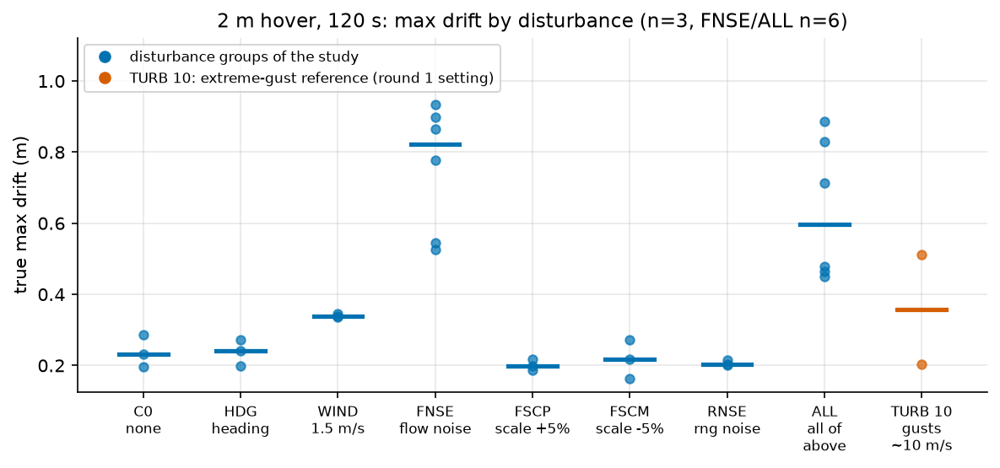
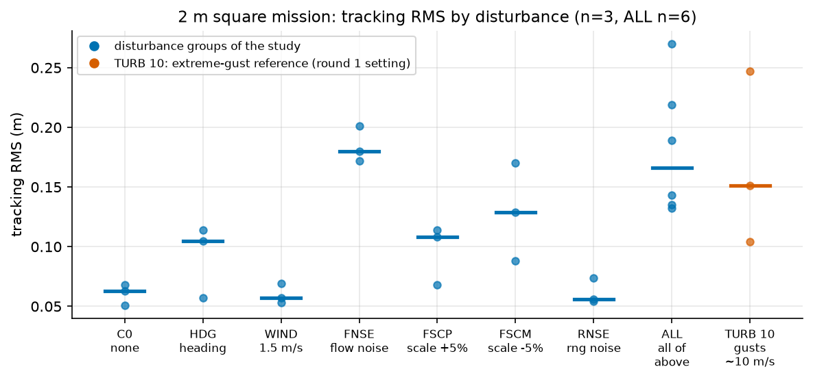
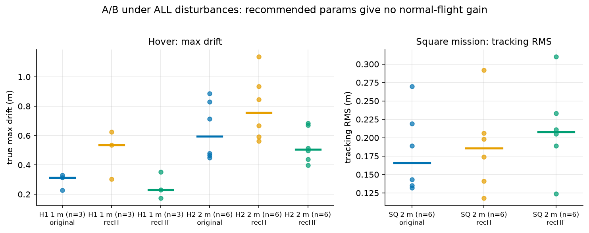
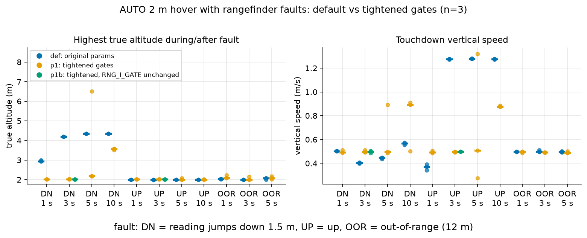

# 光流 + 测距定位参数优化（第二轮，2026-11-19，ROG 本机）

ArduCopter 4.7.0 SITL（`~/sim/ardupilot/build/sitl/bin/arducopter`，源码未改、未重编译），`+` 构型。配置从 `mtf01_sitl_rng.parm` 出发：MTF-01 光流 + 测距，`EK3_SRC1_POSZ 2`，无 GPS、无罗盘。
有效运行 247 次（`runs/`），另有 5 次无效运行（`runs_failed/`，见第五节）。所有误差都对照 SITL 真值计算（dataflash `SIM2` 位置、`SIM.Yaw`），不是飞控自己的估计。实例只用了 `-I10..-I13`，结束时已确认没有残留的 arducopter、batch 或驱动脚本进程。

## 一、结论

1. **两个基准都复现了。**
   - `q4jmp5_RNG` 原样复现：用 mtf01 原脚本和原参数，3/3 真值最高 4.38 m（原报告 4.37 m），触发 `Max Alt fence breached` 后 LAND，落点偏 2.53–2.62 m（原报告 2.58–2.67 m）。
   - 2 m / 2 m 任务 `q2_RNG` 基本复现：6 次跟踪 RMS 中位数 0.075 m [0.057–0.144]，原报告 0.065 m [0.046–0.074]。高度 RMS 0.009–0.015 m、最高 2.05–2.07 m，与原报告一致。r1 的 0.144 m 偏大，所以离散度比原报告大。
2. **改用飞控自己定高以后，高度在所有扰动下都控得住。**
   - 悬停的方法：AUTO 任务 `NAV_TAKEOFF` → `NAV_LOITER_TIME` 120 s → `NAV_LAND`，RC3 保持 1500。
   - 无扰动时，2 m 悬停的真值高度均值 1.999 m [1.988–2.011]，1 m 悬停 1.000 m [0.989–1.013]。满足 ±0.05 m 的要求。
   - 五种扰动全部加上（`ALL`）时，真值高度 2 m 为 1.976–2.038 m，1 m 为 0.975–1.041 m；正方形任务高度误差最大 0.069 m。
   - 只有加了第一轮用过的 `SIM_WIND_TURB 10`（阵风标准差约 10 m/s）时，高度才会失控：RMS 0.20 m，3/3 触发高度围栏（`x_*_TURB10`）。
3. **水平漂移的主要来源是光流噪声，不是风，也不是比例误差。**
   - 2 m 悬停 120 s，真值最大漂移：无扰动换航向 0.24 m；光流噪声 0.15 rad/s 时 0.82 m（n=6）；风 1.5 m/s + 湍流 1 时 0.34 m；比例误差 ±5%、测距噪声都约 0.20–0.22 m，与基线没有差别。
   - 正方形任务中，光流噪声让跟踪 RMS 从 0.105 升到 0.180 m。±5% 比例误差升到 0.11–0.13 m，但与基线的范围重叠。
4. **高度误差（真值对任务高度）在各个飞行段都很小。** 影响最大的是测距噪声：0.05 m 噪声使航段高度 RMS 从 0.005 升到 0.013 m。爬升段 EKF 高度误差 RMS 约 0.02–0.03 m，下降段约 0.025 m，转角和直线段没有差别。
5. **EKF 参数对漂移基本无效。**
   - `EK3_FLOW_I_GATE`、`EK3_FLOW_DELAY`、`EK3_RNG_M_NSE`（单独改）、`EK3_HGT_I_GATE`（单独改）、`EK3_RNG_I_GATE` 的改善都小于重复间离散度，判为无效。
   - `EK3_FLOW_M_NSE 0.1` 在纯光流噪声悬停中让漂移中位数从 0.82 降到 0.52 m（n=6，范围重叠）。但在 A/B 正方形任务中，落点偏差从 0.37 升到 0.54 m，所以不推荐。
   - `FLOW_POS_*` 设对和不设的差别很小，但能重复：传感器偏 5 cm 时跟踪 RMS 0.089 → 0.058 m。
   - `RNGFND1_POS_Z` 设成仿真里的偏移后，反而出现 5 cm 的恒定高度偏差，不推荐。
6. **测距异常保护：`EK3_RNG_M_NSE 0.1` + `EK3_HGT_I_GATE 200` 对 1–3 s 的读数跳变非常有效，但对 5 s 左右的故障有一个危险窗口。**
   - 原参数：读数变小 1 s 时真值冲到 2.94 m；变小 3/5/10 s 时冲到 4.19 / 4.34 / 4.35 m，随后被高度围栏拉回 LAND。读数变大时，EKF 跟着读数认为自己在 3.5 m，高度围栏触发 LAND，3 s 以上的故障下以 1.28 m/s 触地（正常约 0.5 m/s）。
   - 新参数：变小或变大 1 s、3 s 时，真值偏离都不超过 0.04 m，任务继续（各 3/3）。
   - 但是 5 s 的故障正好撞上 EKF 的 5 s 高度超时重置（`hgtRetryTimeMode12_ms`，常数，不能用参数改）。读数变小 5 s 时有 1/3 冲到 6.95 m；故障结束后，正确的读数又被拒绝 5 s。10 s 故障时新参数最高 3.56 m，原参数 4.35 m，两种都会 LAND。
   - 超量程时，1 s 两种参数都没事；3 s 和 5 s 两种参数都在约 1.5 s 内报 `EKF variance`，触发 EKF failsafe LAND，真值偏离 ≤0.22 m，满足“及时保护降落”。
   - **两种参数都做不到“3 s 以上的读数跳变偏离 ≤0.5 m”。**
7. **第一轮说的“估计误差压到 0.02 m 但飞机仍掉高”在 LOITER 里属实，原因不是 EKF，而是地面跟踪。**
   - `SURFTRAK_MODE 1` 时，LOITER / ALT_HOLD 的高度目标直接按原始测距修正，绕过了 EKF 门限。AP_SurfaceDistance 只把超过 2 m 的变化当 glitch，1.5 m 的跳变会被放过。
   - 实测（读数变大 1.5 m，3 s）：
     - 原参数：真值掉到 0 m（3/3）。
     - 只收紧门限：EKF 误差 ≤0.09 m，但真值掉到 0.81 m。
     - 再加 `SURFTRAK_MODE 0`：最低 1.99 m。
   - AUTO 相对高度航点不用地面跟踪，所以 AUTO 里不掉高。
   - 第一轮归因于“SITL 光流用测距读数缩放”是错的。那段本地改动只在测距读数比几何距离短 0.1 m 以上时生效，而且只影响水平光流，不影响高度。
8. **测距失效时高度怎么回退**（读 `AP_NavEKF_Source.cpp/.h`、`AP_NavEKF3_PosVelFusion.cpp:1181-1300`）：
   - `EK3_SRC1/2/3_*` 是三套可切换的源组，所有 EKF 核共用当前激活的那一套。切换方式是 `RCx_OPTION 90`、MAVLink 或 Lua。只有 `EK3_SRC_OPTIONS` 的 bit 3（SRC per core）打开时，才会把核 n 映射到 SRCn，现值是 1，没有打开。第一轮说“对应 IMU0/1/2”是错的。
   - 自动回退不会切到 SRC2：
     - 测距状态不是 Good（超量程或无数据）超过 500 ms 时，EKF 在当前源组内直接退到气压计（`fallback_to_baro`）。
     - 读数“Good 但错了”（跳变）不会触发回退，只能靠 `EK3_HGT_I_GATE` 门限拒绝。
     - 门限连续拒绝 5 s 后，EKF 会强制把高度重置到测量值，不管测量值对不对。
   - **`EK3_SRC1_POSZ 2` 时，测距高度的门限是 `EK3_HGT_I_GATE`，不是 `EK3_RNG_I_GATE`。** 后者只用于地形状态估计，而测距做高度源时这个估计被跳过（`AP_NavEKF3_OptFlowFusion.cpp:89`）。3 s 故障下，不改 `RNG_I_GATE` 的 p1b 和改了的 p1 结果相同，可以佐证。
9. **推荐**（详见 `opt_recommended.parm`）：
   - `EK3_RNG_M_NSE 0.5→0.1`、`EK3_HGT_I_GATE 500→200`、`SURFTRAK_MODE 1→0`。
   - `FLOW_POS_X/Y/Z` 填实测偏移。
   - 其余 EKF 光流参数不改。
   - A/B（`ab_*` vs `m_*_ALL`）：正常飞行的代价是正方形航段高度 RMS 0.015 → 0.018 m（+3 mm）；水平漂移没有差别（在离散度内）。

## 二、结果表（中位数 [最小–最大]，单位 m；完整数据见 `summary_tables.md`、`results.csv`）

### 2.1 扰动贡献：2 m 悬停 120 s（窗口为进入 LOITER_TIME 后 10 s 到 LAND）

| 组 | n | 真值高度均值 | 真值高度 最低–最高 | EKF 高度误差 RMS | 真值最大漂移 | 离起飞点最大距离 | EKF-真值水平差（末） |
|---|---|---|---|---|---|---|---|
| C0 无扰动（航向 0） | 3 | 1.999 | 1.989–2.007 | 0.008 | 0.232 [0.197–0.287] | 0.313 | 0.276 |
| HDG 换航向 30/150/270° | 3 | 1.999 | 1.988–2.012 | 0.008 | 0.240 [0.198–0.271] | 0.306 | 0.180 |
| WIND 1.5 m/s + TURB 1 | 3 | 2.000 | 1.972–2.020 | 0.009 | 0.339 [0.335–0.346] | 0.322 | 0.297 |
| FNSE 光流噪声 0.15 | 6 | 2.000 | 1.989–2.011 | 0.009 | **0.822 [0.526–0.933]** | 0.932 | 0.767 |
| FSCP 比例 +5% | 3 | 1.999 | 1.990–2.009 | 0.008 | 0.199 [0.187–0.217] | 0.205 | 0.102 |
| FSCM 比例 −5% | 3 | 1.999 | 1.987–2.011 | 0.008 | 0.218 [0.164–0.273] | 0.240 | 0.152 |
| RNSE 测距噪声 0.05 | 3 | 2.011 | 1.988–2.033 | 0.014 | 0.203 [0.202–0.216] | 0.197 | 0.109 |
| ALL 全部 | 6 | 2.010 | 1.975–2.041 | 0.015 | 0.596 [0.450–0.886] | 0.673 | 0.524 |
| 1 m：C0 / WIND / ALL | 3/3/3 | 1.000 / 1.000 / 1.009 | 0.989–1.013 / 0.977–1.028 / 0.975–1.041 | 0.009 / 0.009 / 0.015 | 0.124 / 0.122 / 0.313 | | |
| 参考：TURB 10（第一轮的湍流） | 3 | 2.037 | **1.045–2.621** | | 0.357 | | 0/3 完成，高度围栏 |

*图1. 2 m 悬停 120 s 各扰动组每次运行的真值最大漂移（横线为中位数）：光流噪声（FNSE）是唯一的明显来源，其余组与无扰动（C0）重叠。数据来源：results.csv（m_H2_* / x_H2_TURB10 各组）；脚本：make_figures.py。*

### 2.2 扰动贡献：2 m 高、2 m 正方形 3 圈（`WP_SPD 0.4`，航点不停留）

| 组 | n | 跟踪 RMS | 跟踪最大 | 航段高度 RMS | 转角高度 RMS | 高度误差最大 | 爬升 EKF 误差 RMS | 下降 EKF 误差 RMS | 落点偏差 |
|---|---|---|---|---|---|---|---|---|---|
| C0 | 3 | 0.063 [0.051–0.068] | 0.183 | 0.004 | 0.008 | 0.040 | 0.019 | 0.026 | 0.098 |
| HDG | 3 | 0.105 [0.057–0.114] | 0.201 | 0.005 | 0.008 | 0.040 | 0.019 | 0.026 | 0.056 |
| WIND | 3 | 0.057 [0.053–0.069] | 0.141 | 0.008 | 0.010 | 0.053 | 0.020 | 0.024 | 0.106 |
| FNSE | 3 | **0.180 [0.172–0.201]** | 0.425 | 0.005 | 0.007 | 0.040 | 0.019 | 0.023 | 0.193 |
| FSCP | 3 | 0.108 [0.068–0.114] | 0.252 | 0.005 | 0.008 | 0.041 | 0.019 | 0.024 | 0.056 |
| FSCM | 3 | 0.129 [0.088–0.170] | 0.260 | 0.005 | 0.007 | 0.042 | 0.019 | 0.026 | 0.127 |
| RNSE | 3 | 0.056 [0.054–0.074] | 0.177 | **0.013** | **0.016** | 0.059 | 0.023 | 0.027 | 0.151 |
| ALL | 6 | 0.166 [0.132–0.270] | 0.357 | 0.015 | 0.018 | 0.061 | 0.024 | 0.027 | 0.367 |
| 参考：TURB 10 | 3 | 0.151 | | **0.369** | | 0.606 | | | 0/3 完成，高度围栏 |

*图2. 2 m 正方形任务各扰动组每次运行的跟踪 RMS（横线为中位数）：光流噪声（FNSE）抬高约 3 倍，±5% 比例误差与基线范围重叠，极端湍流（TURB 10）无法完成任务。数据来源：results.csv（m_SQ_* / x_SQ_TURB10 各组）；脚本：make_figures.py。*

“爬升”段的高度误差还包括 `climb_overshoot`：AUTO 起飞后的超调，无扰动约 0.04 m，ALL 约 0.06–0.07 m。

### 2.3 参数扫描（每值 3 次；★ 为 6 次）

| 场景 | 改动 | 指标 | 基线 | 改动后 | 判定 |
|---|---|---|---|---|---|
| H2 + FNSE | `EK3_FLOW_M_NSE` 0.25→0.1 ★ | 真值最大漂移 | 0.822 [0.526–0.933] | 0.518 [0.476–0.721] | 范围重叠；A/B 任务中变差 → 不推荐 |
| 同上 | `EK3_FLOW_M_NSE` →0.5 | 同上 | 同上 | 0.857 [0.471–1.047] | 无效 |
| 同上 | `EK3_FLOW_I_GATE` →150 / 500 | 同上 | 同上 | 0.805 / 0.540 [0.446–0.564] | 无效（在离散度内） |
| 同上 | `EK3_FLOW_DELAY` →0 ★ / 50 | 同上 | 同上 | 0.498 [0.422–0.936] / 0.722 | 无效 |
| SQ + WIND，光流偏 X+5 cm、Z+3 cm | `FLOW_POS_X/Z` 不设 → 设对 | 跟踪 RMS | 0.089 [0.064–0.102] | 0.058 [0.044–0.061] | 有效但小（约 3 cm） |
| SQ + ALL | `EK3_RNG_M_NSE` →0.1 / 0.25 | 航段高度 RMS | 0.015 [0.014–0.016] | 0.017 / 0.015 | 无效（略差） |
| 同上 | `EK3_HGT_I_GATE` →200 | 同上 | 同上 | 0.014 | 无效 |
| 同上 | `EK3_RNG_I_GATE` →200 | 同上 | 同上 | 0.012；跟踪 0.280 vs 0.189 | 无效（代码上不起作用，差异就是离散度） |
| 同上 | `RNGFND1_POS_Z` 0→−0.05（与仿真偏移一致） | 同上 | 同上 | **0.051 [0.051–0.051]** | 变差（恒定偏差） |

### 2.4 A/B（ALL 扰动，相同的航向和风向；recH = `EK3_RNG_M_NSE 0.1` + `EK3_HGT_I_GATE 200` + `SURFTRAK_MODE 0`；recHF = recH + `EK3_FLOW_M_NSE 0.1`）

| 场景 | 指标 | 原参数 | recH（推荐） | recHF |
|---|---|---|---|---|
| H2（n=6） | 真值最大漂移 | 0.596 [0.450–0.886] | 0.757 [0.562–1.137] | 0.506 [0.398–0.683] |
| H2 | 真值高度 最低–最高 | 1.975–2.041 | 1.959–2.055 | 1.961–2.049 |
| H1（n=3） | 真值最大漂移 | 0.313 [0.227–0.329] | 0.536 [0.303–0.624] | 0.230 [0.174–0.353] |
| H1 | 真值高度 最低–最高 | 0.975–1.041 | 0.969–1.054 | 0.959–1.053 |
| SQ（n=6） | 跟踪 RMS | 0.166 [0.132–0.270] | 0.186 [0.118–0.292] | 0.208 [0.124–0.310] |
| SQ | 跟踪最大 / 落点偏差 | 0.357 / 0.367 | 0.374 / 0.259 | **0.568 / 0.540** |
| SQ | 航段高度 RMS | 0.015 [0.014–0.016] | 0.018 [0.017–0.020] | 0.018 [0.017–0.021] |

recH 的水平指标与原参数的差异都在离散度内，没有改善也没有确定的变差。H1 的漂移 0.54 对 0.31 m 范围重叠，n=3，列为可疑。recH 在正常飞行中没有收益，推荐它只是为了第 2.5 节的故障保护。

*图3. 全部扰动（ALL）下原参数 / recH / recHF 的悬停真值最大漂移（H1、H2）与正方形任务跟踪 RMS：三臂范围互相重叠，正常飞行没有可分辨的收益。数据来源：results.csv（m_H*_ALL / ab_H*_ALL_* / ab_SQ_ALL_* 各组）；脚本：make_figures.py。*

### 2.5 测距异常（AUTO 2 m 悬停，进入 AUTO 后 25 s 注入；def = 原参数，p1 = `EK3_RNG_M_NSE 0.1` + `EK3_RNG_I_GATE 200` + `EK3_HGT_I_GATE 200`，p1b = 不改 `RNG_I_GATE`）

“最高”是故障开始到飞行结束的真值最高高度。“最低”是故障开始到离开 AUTO 之前的真值最低高度；之后是 LAND，属于保护动作。

| 故障 | def 最高 / 最低 / 结果 | p1 最高 / 最低 / 结果 |
|---|---|---|
| 读数变小 1.5 m（DN），1 s | **2.94** / 1.78 / 任务完成 3/3 | 2.02 / 1.98 / 完成 3/3 |
| DN 3 s | **4.20** / 2.00 / 故障结束后高度围栏 → LAND 3/3 | 2.02 / 1.98 / 完成 3/3（p1b 相同：2.02 / 1.99） |
| DN 5 s | **4.34** / 1.99 / 围栏 LAND 3/3 | 2.17、2.20 完成（2/3）；**6.95** 围栏 LAND（1/3） |
| DN 10 s | **4.35** / 2.00 / 围栏 LAND 3/3 | **3.56** [3.52–3.63] / 1.99 / 围栏 LAND 3/3 |
| 读数变大 1.5 m（UP），1 s | 2.00 / 1.90 / 围栏（EKF 以为 3.5 m）→ LAND 3/3，触地 0.37 m/s | 2.01 / 1.99 / 完成 3/3 |
| UP 3 s | 2.00 / 1.89 / 围栏 LAND，**触地 1.28 m/s** 3/3 | 2.02 / 1.97 / 完成 3/3（p1b 相同） |
| UP 5 s | 2.00 / 1.90 / 围栏 LAND，触地 1.28 m/s 3/3 | 1/3 完成；2/3 在 5 s 超时重置后围栏 LAND，触地 0.28–1.32 m/s |
| UP 10 s | 2.00 / 1.89 / 围栏 LAND，触地 1.28 m/s 3/3 | 2.01 / 1.95 / 超时重置后围栏 LAND，触地 0.88 m/s 3/3 |
| 超量程（12 m > `RNGFND1_MAX` 8），1 s | 2.04 / 1.85 / 完成 3/3 | 2.23 / 1.96 / 完成 3/3 |
| 超量程 3 s | 2.02 / 1.91 / `EKF variance` → EKF failsafe LAND 3/3 | 2.17 / 1.89 / EKF failsafe LAND 3/3 |
| 超量程 5 s | 2.09 / 1.90 / EKF failsafe LAND 3/3 | 2.22 / 1.99 / EKF failsafe LAND 3/3 |

*图4. AUTO 悬停中注入测距故障（def = 原参数，p1 = 收紧门限，绿色小点为 p1b）每次运行的故障期真值最高高度（左）与触地垂直速度（右）：p1 消除了 DN 的爬高（6.95 m 的 5 s 特例除外）和 UP 的 1.28 m/s 触地。数据来源：results.csv（f_def_* / f_p1_* / f_p1b_* 各组）；脚本：make_figures.py。*

LOITER 悬停（RC3 1500，飞控定高，读数变大 1.5 m、3 s，15 s 窗口）：

| 配置 | 真值最低 | 真值最高 | EKF 误差最大 |
|---|---|---|---|
| 原参数 | **0.00（触地 3/3）** | 2.80 | 1.90 |
| p1 | **0.81** [0.79–0.82] | 2.08 | 0.09 |
| p1 + `SURFTRAK_MODE 0` | 2.01 [1.99–2.05] | 2.07 | 0.09 |
| 无故障、ALL 扰动：`SURFTRAK_MODE` 1 / 0 | 1.98–2.09 / 2.05–2.10 | | 0.10 / 0.10 |

**p1 在 DN5 时冲到 6.95 m 的过程**（`f_p1_DN5_r3`，逐秒读 XKF1 / SIM2 / RFND）：

1. 故障开始，读数变成 0.49 m。新门限把它拒绝了，EKF 高度保持 2.0 m。
2. 5 s 后高度超时，EKF 把高度重置到 0.26 m，这时故障刚好结束。
3. 正确的读数（2.1 m 以上）又被门限当成异常拒绝，EKF 一直认为自己在 0.2–1.1 m，飞机持续爬升，真值到 6.9 m。
4. 再过 5 s 超时，EKF 重置回正确高度，高度围栏触发 LAND。

## 三、方法

- **工具链**：复制 mtf01 的 `mtf_sim.py` / `analyze.py`（`base_*` 运行原样使用）。在此基础上：
  - 新驱动 `opt2_sim.py`：增加 `HOV`（起飞 → `NAV_LOITER_TIME` → 降落）和 `SQ`（N 圈正方形）两种任务。AUTO 中 RC3 固定 1500，高度完全由飞控控制。故障时间按飞控 `time_boot` 计。解锁失败会重试。另有 `--loiter-fault`，用于 LOITER 中注入故障。
  - `run_one.sh`：每次运行一个独立目录，支持起飞航向和逐次 overlay 参数文件。
  - `batch.py`：在 I10–I13 上最多并行 4 个实例，可按顺序跑多个任务文件。
  - `gen.py` 生成任务清单，`analyze2.py` 计算指标，`collect.py` 汇总，`reanalyze.sh` 在分析脚本修改后重算。
  - 新运行用 speedup 10，基准用 4（与 mtf01 相同）。
- **分析脚本的验证**（先于批量运行）：
  - 无扰动悬停 `v_h2_s4` 与 `v_h2_s10`：真值高度 1.999 / 1.999 m，最低–最高 1.988–2.008 / 1.989–2.011 m。speedup 4 和 10 的结果一致。
  - 抽查原始日志（`v_h2_s10`，60 s 处）：SIM2 高度 1.998 m，CTUN.Alt 1.99 m，RFND 2.04 m（含 5 cm 安装偏移）。与分析结果一致。
  - 换航向的运行显示 EKF 初始航向恒为 0°（真值为 150° 等），所以水平误差必须分别转到“真值初始机体系”和“EKF 初始机体系”再比较。这一点是在第一批结果里发现的（未修正前 EKF-真值差为 1.4–5.5 m），修正后全部重算。另外两处修正：日志从解锁开始，可能没有第一条 ARM 记录；PARM 可能重复记录。这三处修正之后没有再改指标定义；之后只新增了触地速度和 15 s 窗口两个指标。
- **参数和单位**（读源码确认）：
  - `SIM_WIND_SPD`：m/s。
  - `SIM_WIND_T`：默认 0，即平方根风廓线，`SIM_WIND_T_ALT` 60 m。2 m 高时风速只剩设定值的 18%，因此本轮设为 1，不随高度衰减。
  - `SIM_WIND_TURB`：内部乘 10 后经 0.98 的 IIR 滤波，标准差约等于设定值（m/s），包含垂直分量。
  - `SIM_FLOW_RND`：光流角速率上的均匀噪声，±值，rad/s。
  - `FLOW_FXSCALER/FYSCALER`：千分比，SITL 中直接乘到输出上，50 即 +5%。
  - `SIM_SONAR_RND`：均匀噪声，±值，m。
  - `SIM_FLOW_POS_*` / `SIM_SONAR_POS_*`：m，机体系，向下为 +Z。
  - overlay 参数文件中，后出现的同名项覆盖前面的值，已在日志 PARM 中核对。
- **扰动和重复**：
  - SITL 用未播种的 `random()`，每次运行的随机序列相同。所以除 C0 外，每组 3 次重复的起飞航向分别为 30° / 150° / 270°，有风的组风向分别为 0° / 120° / 240°。第 4–6 次重复用 60° / 200° / 330° 和 60° / 180° / 300°。
  - 基础 overlay：`SIM_SONAR_RND 0.02`、`FENCE_RADIUS 4`、`SIM_WIND_T 1`。另外沿用 mtf01 的 FIELD_PARAMS（`WP_SPD 0.4`、`FENCE_MARGIN 0.3` 等）。
- **测距故障注入**：与 mtf01 相同，飞行中改 `SIM_SONAR_POS_Z`。
  - 改成 +1.5：传感器“下移”1.5 m，读数**变小** 1.5 m，即“下跳”。EKF 以为自己低了，飞机**往上**飞。
  - 改成 −1.5：读数**变大** 1.5 m，即“上跳”。EKF 以为自己高了，飞机往下飞（AUTO 中先被高度围栏截住）。
  - 改成 −10：读数约 12 m，超出 `RNGFND1_MAX`，即超量程。
  - 到时改回 −0.05。

## 四、与第一轮和 mtf01 那轮的差异及原因

| 结论 | 第一轮（opt_flow） | mtf01 | 本轮 | 原因 |
|---|---|---|---|---|
| 悬停高度 | 命令 2.0 m，真值 0.4–2.2 m | — | 1.988–2.011 m（无扰动） | 第一轮用自己写的 P 控制器在 LOITER 里推油门，本轮由飞控 AUTO 定高 |
| “风导致高度 RMS 1 m” | 是 | — | 风 1.5 m/s + TURB 1：高度误差最大 0.05 m；TURB 10：RMS 0.20–0.37 m，围栏触发 | 第一轮所有“有风”配置都用了 `SIM_WIND_TURB 10`（约 10 m/s 阵风，含垂直分量），平均风还因平方根廓线只剩约 15–18%。所以是极端湍流加上自己的油门闭环造成的，不是风本身 |
| 读数下跳 1.5 m | 真值偏离 ≤0.037 m，EKF variance → LAND | 冲到 4.37 m，高度围栏 | 4.19–4.35 m，高度围栏（3 s 以上） | 第一轮注入时飞机真值只有约 1.36 m（第一轮 `results.csv` 的 `pre_fault_agl`：`fd3` / `fd5` / `fd3p` / `fd5p` 为 1.35–1.36 m）。下移 1.5 m 后读数为负，被截成 0，测距状态变成 OutOfRangeLow（不是 Good），EKF 收不到数据，结果相当于“测距丢失”，于是 EKF variance → LAND。mtf01 和本轮都在 2 m 注入，读数 0.5 m 仍是 Good，EKF 接受了，飞机向上冲。另外第一轮在 LOITER（有地面跟踪），这两轮在 AUTO |
| p1 估计误差 0.02 m 但掉到地面 | 归因于 SITL 光流用测距缩放 | — | LOITER 中属实：本轮从 2.06 m 掉到 0.81 m，第一轮 `fu3p` 从 1.36 m 掉到 0.30 m，都约下降 1.25 m；AUTO 中不掉（≤0.04 m） | 真正的原因是 `SURFTRAK_MODE 1` 的地面跟踪直接用原始测距。光流缩放的本地改动只在读数**变小**时起作用，而且只影响水平 |
| `EK3_SRCn` | 说成 IMU0/1/2 各自的源 | — | 是三套可切换的源组 | 读 `AP_NavEKF_Source.h:66`（`getActiveSourceSet`） |
| `EK3_RNG_I_GATE` 有用 | 推荐 200 | — | POSZ 2 时无作用，有作用的是 `EK3_HGT_I_GATE` | `OptFlowFusion.cpp:89`、`PosVelFusion.cpp:940`；p1b 与 p1 结果相同 |
| 最大漂移因素是 FLOW_POS 偏 5 cm（1.6 m） | 单次运行 | — | 偏 5 cm（加 Z 3 cm）跟踪 RMS 只差约 3 cm；最大因素是光流噪声 | 第一轮只跑了 1 次，而且在 TURB 10 下 |

## 五、失败、无效、可疑的运行

- **无效 5 次（`runs_failed/`）**：
  - `v_*_s10` 和 `v_h2_s4_settle10`：参数设定后只等 10 s 就解锁，报 `Arm: Gyros inconsistent`，没有起飞。之后改成等 20 s，并加了解锁重试。
  - `m_H2_HDG_r2`：我的队列脚本 bug 让两个 batch 同时用了 I10–I13，这次运行被另一个 batch 杀掉了。同一时间被打断的另外 4 次已删除重跑，fault 批次已开始的 4 次也删除后重跑。
- **调度事故**：上面提到的 batch 冲突持续约 20 s。冲突中被打断的运行都没有进入结果。
- **可疑**：
  - `base_q2_RNG_r1` 跟踪 RMS 0.144 m，比其余 5 次（0.057–0.104）大，原因没有查。
  - A/B 中 recH 的 H1 漂移 0.54 m 对基线 0.31 m（n=3，范围重叠），没有补跑。
  - `f_p1_DN5_r3` 冲到 6.95 m 是可重复的机理（5 s 超时），但 3 次里只出现 1 次，概率取决于故障时长和超时的时间对齐。
- **指标说明**：
  - LOITER 组（`l_*`）的起飞是脚本推油门（1750）爬升再回中，所以起始高度在 2.0–2.07 m，比较只看 15 s 窗口内的相对变化。
  - 超量程时 EKF 报 `EKF variance` 的具体是哪一项方差，没有逐帧查。

## 六、没做的

- 爬升 / 下降过程中注入测距故障：没做，所有故障都在悬停中注入。
- 正方形任务中的测距故障：没做。
- 读数为 0 或 NoData：SITL 没有现成参数能产生。
- 部分短于 1 s 的跳变：没做。
- 对 5 s 危险窗口的缓解：没有试，例如 Lua 脚本比较测距和气压，切换 `EK3_SRC` 源组或直接 LAND。
- `FLOW_POS` 只测了一种偏移（X+5 cm、Z+3 cm），只在 SQ + WIND 下测。
- `EK3_FLOW_M_NSE 0.1` 在悬停有改善迹象，但没有加大样本量去拆开“悬停改善 / 任务变差”。
- `SURFTRAK_MODE 0` 在地面有台阶（室内桌子等）时的行为：没测。
- 机载电脑停发 / `VISO_TYPE 0`：沿用 mtf01 的驱动，机载电脑一直在发 `VISION_POSITION_ESTIMATE`。`POSZ 2` 时它不参与高度融合，但 `VISO_TYPE 1` 的解锁检查要它。
- 用时约 40 分钟，在预算内。

## 七、SITL 回答不了的事

- **MTF-01 在阳光下的真实故障形态**：读数是变小、变大、跳变还是超量程，持续多久。这决定上面哪一行适用。3901-L0X 在阳光下是量程塌缩到约 0.24 m，相当于持续的“读数变小”，正好是本轮最危险的情况。所以必须在现场阳光下手持实测 MTF-01 到 2.5 m。
- SITL 光流噪声是白噪声，质量恒为满值。真实的低纹理、反光、草地、网笼阴影产生的是有偏的、相关的误差，EKF 门限对这类误差的效果不能从这里推出。
- SITL 机体、PID、振动都不是这台 2S 小机，绝对数值（漂移 0.2–0.8 m / 120 s）不能当真机预期，只能用于配置之间的比较。
- 本源码树 `AP_OpticalFlow_SITL.cpp` 有本地改动：读数明显短于几何距离时，用测距读数缩放光流。它会让“读数变小”故障时仿真的水平光流失真。本轮的结论只用了高度，没有用这类故障下的水平数据。
- MAVLink 驱动（`FLOW_TYPE 5`、`RNGFND1_TYPE 10`）没有仿真，SITL 用的是内部光流和测距。
- 任何“3/3 不出事”都只说明这几种注入方式下不出事，不说明真机没问题。

## 文件

- `report.md`（本文件）、`summary_tables.md`（全部分组汇总）、`results.csv`（每次运行一行，247 行）、`opt_recommended.parm`
- 脚本：`opt2_sim.py`、`run_one.sh`、`batch.py`、`gen.py`、`analyze2.py`、`collect.py`、`reanalyze.sh`。mtf01 原样拷贝：`mtf_sim.py`、`analyze.py`、`mtf01_sitl_rng.parm`
- 任务清单 `jobs_*.txt`，批次日志 `batch_*.log`
- `runs/<tag>/`：`cmd.txt`、`overlay.parm`、`run.log`、`sitl.log`、`logs/*.BIN`、`metrics.json`；`runs_failed/`：无效运行
