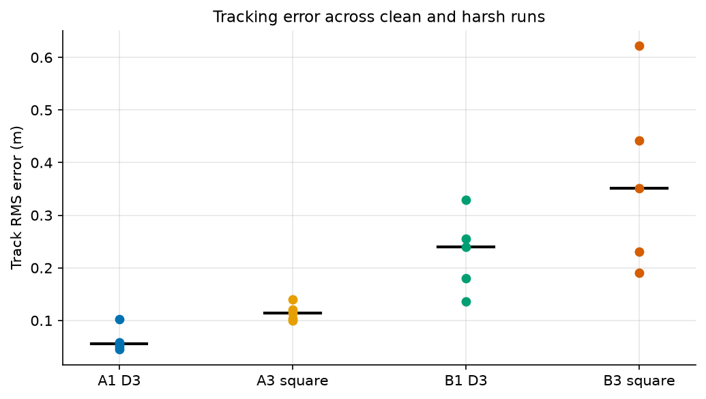
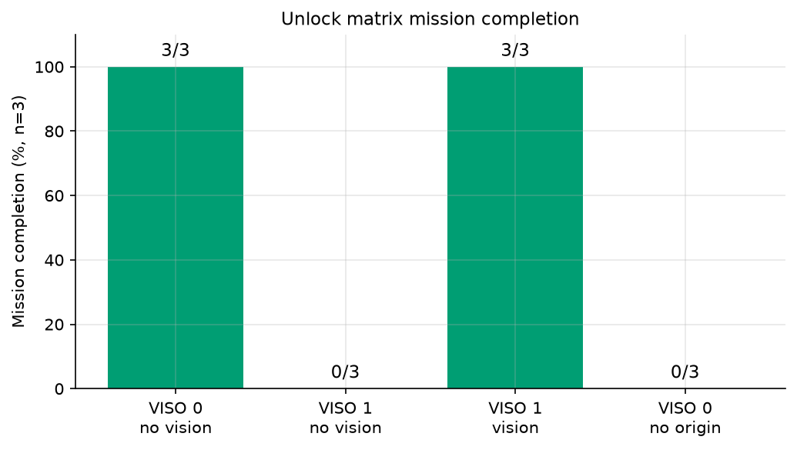
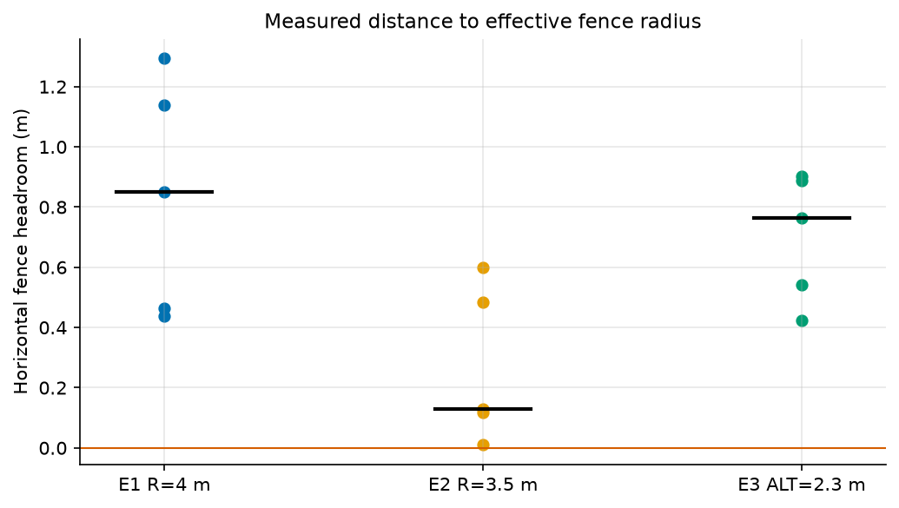

# V1：FINAL 参数整套回归（2026-11-19，ROG 本机，16 核）

仿真：ArduCopter 4.7.0 SITL（`~/sim/ardupilot/build/sitl/bin/arducopter`，未编译、未改源码），`+` 构型，实例只用 `-I20..-I23`（端口 5960/5970/5980/5990），speedup 10。
定位：下视光流 + 下视测距（MTF-01），无 GPS、无罗盘，`EK3_SRC1_POSZ 2`（测距直接做高度源）。
基础参数文件：`mtf01_sitl_rng.parm`（原样拷贝自上一轮）。所有指标都对照 SITL 真值（dataflash `SIM2` 位置 + `SIM.Yaw`）计算，见 `analyze2.py`。
本次共 103 个运行目录（`runs/`），逐次结果在 `results.csv`（一行一次运行）。

## 0. 工具改动（只改了自己的副本，未动 /home/jacky/sim/opt_flow2）

| 文件 | 改动 | 原因 |
|---|---|---|
| `opt2_sim.py` | 新增命令行开关 `--no-vis`（从起飞起就不发 VISION_POSITION_ESTIMATE）、`--no-origin`（不发 SET_GPS_GLOBAL_ORIGIN / MAV_CMD_DO_SET_HOME） | 原脚本总是发视觉消息和 EKF 原点，没有开关，C 组无法构造「不发」的情形 |
| `opt2_sim.py` | 新增 `--hb-cut-full`（停视觉消息的同时也停心跳和 RC 覆盖）、`--rc-cut T`（到 T 秒停发 RC_CHANNELS_OVERRIDE，心跳和视觉继续） | 原 `--hb-cut` 只停心跳，伴随脚本仍发 RC 覆盖，导致 D1/D2 的失效保护不触发（见第七节） |
| `analyze2.py` | `MISSION == "SQ"` 改为 `MISSION in ("SQ","D3")`（两者航路几何相同） | A1 用的是 D3，否则算不出跟踪 RMS |
| `analyze2.py` | 新增 `rad_max`（真值到起飞点的最大水平距离）、`f_land_dist`（落点到故障触发点的距离）、`tag` 字段修正（目录名带斜杠时 basename 为空） | E 组要看离起飞点最大距离，D 组要看落点离触发点多远 |
| `run_one.sh` / `batch.py` / `collect.py` | 目录改到 `/home/jacky/sim/val1`，实例号改成 20–23 | 只用自己的目录和实例 |

新增脚本：`d_report.py`（D 组：触发时刻、真值高度、落点到触发点距离、切模式延迟）、`report_tables.py`、`summ.py`、`failsafe_report.py`、`dump_params.py`、`reanalyze.sh`、`gen_jobs*.py`。

原脚本默认行为（也是 A、B 两组用的行为）：发送视觉消息（每收到一次 RANGEFINDER 就发一条 VISION_POSITION_ESTIMATE，用测距读数当高度），并发送 EKF 原点（启动后 2 s 起每 2 s 重发一次 SET_GPS_GLOBAL_ORIGIN）。

## 1. 参数

FINAL 覆盖（每条运行都加）：

```
EK3_RNG_M_NSE=0.1,EK3_HGT_I_GATE=200,SURFTRAK_MODE=0,FENCE_ALT_MAX=2.5,FENCE_RADIUS=4,FENCE_MARGIN=0.3,SIM_SONAR_RND=0.02,SIM_WIND_T=1
```

苛刻扰动覆盖（加在 FINAL 后面，同名项以靠后的为准，已在 dataflash PARM 记录里核对：SIM_SONAR_RND=0.05 生效）：

```
SIM_WIND_SPD=1.5,SIM_WIND_TURB=1.0,SIM_FLOW_RND=0.15,FLOW_FXSCALER=50,FLOW_FYSCALER=50,SIM_SONAR_RND=0.05
```

有风时 SIM_WIND_DIR 依次 0/120/240/60/180，起始航向依次 30/150/270/90/210。
D3（电池低压）额外加了 `BATT_FS_LOW_ACT=1,BATT_LOW_VOLT=11.0`（见第七节 D3 说明）。
E2/E3 在 FINAL+苛刻之上追加 `FENCE_RADIUS=3.5` / `FENCE_ALT_MAX=2.3`（同名项靠后者生效，已在 PARM 记录核对）。

## 2. 复现性检查（先做，再批量）

单跑 smoke_a1（= A1 的配置，实例 I20）：track_rms=0.036 m、alt_max=2.048 m、alt_leg_rms=0.009 m、touchdown=0.485 m/s、mission_complete=true，LOITER 手动起飞和 AUTO 任务都完成。参数落地核对（PARM 记录）：EK3_HGT_I_GATE=200、EK3_RNG_M_NSE=0.1、SURFTRAK_MODE=0、FENCE_ALT_MAX=2.5、FENCE_RADIUS=4、FENCE_MARGIN=0.3。

## 3. 方法

- 驱动脚本 `opt2_sim.py`（自己的副本）在仿真里扮演机载电脑（发视觉消息、EKF 原点、1 Hz 心跳）和飞手（RC3 覆盖）。
- 任务类型：`D3`（LOITER 手动起飞测试 + AUTO 正方形 1 圈）、`HOV`（AUTO 起飞 → `NAV_LOITER_TIME` → 降落）、`SQ`（AUTO 起飞 → N 圈正方形 → 降落）。
- 重复：每个配置 5 次，起始航向 30/150/270/90/210°；有风的组风向 0/120/240/60/180°。
- 故障注入：`--fault T:PARAM=VALUE`（T = 进入 AUTO 后的飞控秒数）、`--vis-cut/--hb-cut/--hb-cut-full/--rc-cut`（停止发视觉消息 / 停心跳 / 停心跳+RC 覆盖 / 停 RC 覆盖）、`SIM_RC_FAIL`（遥控信号丢失）、`SIM_BATT_VOLTAGE`（电池电压）。
- 指标全部来自 `analyze2.py`（`runs/<tag>/metrics.json`），对照 SITL 真值（`SIM2`）而不是飞控估计值；D 组触发点/落点距离来自 `d_report.py`。

## 4. 运行事故（一处，已如实记录）

00:15:56 我在 A/B 批次还没跑完的时候又启动了 C/D/E 批次，两个批次抢同一组实例 20–23：`run_one.sh` 开工前会杀掉同实例上已有的 SITL，于是 A/B 中正在跑的 4 次（`a_hov1_r5`、`a_hov2_r5`、`a_sq_r5`、`b_d3_r1`）被杀。这 4 个伴随脚本在断开的 TCP 连接上死循环打印 `EOF on TCP socket`（每次约 420 MB 日志），我手动终止并删掉这 4 个运行目录，之后重跑补齐（补跑结果即 `runs/a_hov1_r5`、`runs/a_hov2_r5`、`runs/a_sq_r5`、`runs/b_d3_r1`）。其余运行未受影响。残留的 6 个伴随脚本进程（4 个来自被杀的运行，2 个来自 C2/C4 运行结束后仍在空转）已在 00:36 全部 kill，现无遗留 SITL/伴随进程。

---

# 5. 总表

指标格式：中位数 [最小–最大]；“完成”= 任务跑到降落且 `mission_complete=true`（失效保护主动降落的算“未完成”，单列）。

| 组 | 清单项 | 次数 | 完成 | 关键指标（中位数[范围]） | 与预期是否相符 |
|---|---|---|---|---|---|
| a_d3 | A1 无扰动 D3 | 5 | 5/5 | 跟踪 RMS 0.056 [0.045–0.103] m；高度误差最大 0.028 [0.024–0.034] m | **部分**：RMS 中位数 0.056 略低于预期下限 0.06（5 次中 4 次 <0.06）；高度误差 <0.05 符合 |
| a_hov2 | A2 无扰动 HOV 2 m | 5 | 5/5 | 悬停真值高度 最低 1.996 / 中位 2.010 / 最高 2.023 m；最大漂移 0.257 [0.196–0.424] m | 符合（2.0±0.05） |
| a_sq | A3 无扰动 SQ 3 圈 | 5 | 5/5 | 跟踪 RMS 0.114 [0.100–0.140] m；高度误差最大 0.037 m | 符合（0.06–0.15） |
| a_hov1 | A4 无扰动 HOV 1 m | 5 | 5/5 | 悬停真值高度 中位 1.009 m [0.995–1.023]；最大漂移 0.121 m | 符合（清单未给数值判据） |
| b_d3 | B1 苛刻 D3 | 5 | 5/5 | 跟踪 RMS 0.240 [0.136–0.329] m；高度误差最大 0.038 m | **部分**：中位数在 0.15–0.25 内，r2=0.329 超出上限，r3=0.136 低于下限 |
| b_hov2 | B2 苛刻 HOV 2 m | 5 | 5/5 | 真值高度 1.971–2.083 m；最大漂移 0.618 [0.476–1.056] m | **部分**：漂移中位数在 0.5–1.0 内，r4=1.056 超出，r3=0.476 略低；高度误差 ≤0.083 m <0.1 符合 |
| b_sq | B3 苛刻 SQ 3 圈 | 5 | 5/5 | 跟踪 RMS 0.351 [0.190–0.622] m；高度误差最大 0.070 m | **不符**：中位数 0.351 超出预期 0.15–0.25，5 次中 3 次超出（0.622/0.442/0.351）；高度误差符合 |
| b_hov1 | B4 苛刻 HOV 1 m | 5 | 5/5 | 悬停真值高度 中位 1.030 m [1.019–1.071]；最大漂移 0.367 [0.267–0.436] m | 符合（清单未给数值判据） |
| c1_viso0_novis | C1 VISO_TYPE=0 无视觉消息 | 3 | 3/3 | 解锁成功并完成任务，RMS 0.047 [0.046–0.062] m | 符合 |
| c2_viso1_novis | C2 VISO_TYPE=1 无视觉消息 | 3 | 0/3 | 拒绝解锁，STATUSTEXT：`Arm: VisOdom: not healthy` | 符合 |
| c3_viso1_vis | C3 VISO_TYPE=1 有视觉消息 | 3 | 3/3 | 解锁成功并完成任务，RMS 0.056 [0.033–0.057] m | 符合 |
| c4_viso0_noorigin | C4 VISO_TYPE=0 无 EKF 原点 | 3 | 0/3 | 拒绝解锁，STATUSTEXT：`Arm: Fence requires position` | 符合 |
| d1_hb | D1 伴随心跳丢失（`--hb-cut`） | 5 | 5/5 | **无 LAND 切换**；任务按原计划飞完并降落 | **不符**（原因见 7.1） |
| d1b_hbfull | D1b 心跳+RC 覆盖一起断（`--hb-cut-full`，新增对照） | 5 | 0/5 | `GCS Failsafe` → LAND，触发后 5.9–6.2 s 切模式；落点离触发点 0.063–0.114 m；触地 0.490–0.497 m/s | （补充试验，非清单原项） |
| d2_rcfail | D2 RC 信号丢失（`SIM_RC_FAIL=1`） | 5 | 5/5 | **无 LAND 切换**；任务按原计划飞完并降落 | **不符**（原因见 7.2） |
| d2c_rcfail | D2c RC 帧丢失且无 RC 覆盖（`--rc-cut` + `SIM_RC_FAIL=1`，新增对照） | 5 | 0/5 | `Radio Failsafe` → LAND，触发后 2.0–2.2 s 切模式；落点离触发点 0.030–0.104 m；触地 0.482–0.507 m/s | （补充试验，非清单原项） |
| d3_batt | D3 电池低压 | 5 | 0/5 | `Battery Failsafe` → LAND，触发后 11.2–11.3 s 切模式；落点离触发点 0.044–0.088 m；触地 0.493–0.505 m/s | 符合（需额外参数，见 7.3） |
| d4_son_dn | D4 测距读数小 1.5 m / 3 s | 5 | 5/5 | 真值高度偏差最大 0.023 [0.022–0.027] m；触发段真值高度 1.996–2.027 m；任务继续 | 符合（<0.1 m，任务继续） |
| d5_son_up | D5 测距读数大 1.5 m / 3 s | 5 | 5/5 | 真值高度偏差最大 0.023 [0.021–0.024] m；触发段真值高度 1.994–2.023 m；任务继续 | 符合（<0.1 m，任务继续） |
| e1_fence | E1 FINAL+苛刻，R=4 / ALT=2.5 | 5 | 5/5 | 最大离起飞点距离 2.849 [2.406–3.263] m；最大高度 2.067 [2.059–2.085] m；**无围栏触发消息** | 符合 |
| e2_r35 | E2 同上 + `FENCE_RADIUS=3.5` | 5 | 5/5 | 最大离起飞点距离 3.070 [2.601–3.190] m；最大高度 2.072 m；**无围栏触发消息** | 符合（但余量很小，见 7.6） |
| e3_alt23 | E3 同上 + `FENCE_ALT_MAX=2.3` | 5 | 5/5 | 最大高度 2.091 [2.065–2.093] m；最大距离 2.936 [2.799–3.276] m；**无围栏触发消息** | 符合 |

---


*图 1. A1/A3 无扰动组与 B1/B3 苛刻扰动组的逐次跟踪 RMS；点表示单次运行，黑线表示中位数。数据来源：results.csv；脚本：make_figures.py。*


*图 2. C 组四种解锁条件下的任务完成比例（每种条件运行 3 次）。数据来源：results.csv；脚本：make_figures.py。*


*图 3. 每次运行距有效水平围栏半径的余量；黑线表示中位数。数据来源：results.csv 和 report.md §5（有效半径）；脚本：make_figures.py。*

# 6. 分项说明

## A 组（FINAL，无扰动）

- **A1 `D3 --alt 2.0 --side 2.0`**（`runs/a_d3_r1..r5`）：5/5 完成，LOITER 手动起飞测试与 AUTO 正方形都跑完；跟踪 RMS 0.056 [0.045–0.103] m。清单给的期望区间是 0.06–0.15 m，实测中位数 0.056 m，5 次里有 4 次低于 0.06 m（最小 0.045 m），即比预期更准但落在区间外。高度误差最大 0.028 m。
- **A2 `HOV --alt 2.0 --hold 120 --no-loiter-test`**（`runs/a_hov2_r1..r5`）：5/5 完成；悬停段真值高度 1.996–2.023 m（中位 2.010），落在 2.0±0.05 m 内；悬停最大水平漂移 0.257 m。
- **A3 `SQ --alt 2.0 --side 2.0 --laps 3 --no-loiter-test`**（`runs/a_sq_r1..r5`）：5/5 完成，3 圈全部飞完；跟踪 RMS 0.114 [0.100–0.140] m，在 0.06–0.15 m 内。
- **A4 `HOV --alt 1.0 --hold 120 --no-loiter-test`**（`runs/a_hov1_r1..r5`）：5/5 完成；悬停真值高度 0.995–1.023 m（中位 1.009）；最大漂移 0.121 m。

## B 组（FINAL + 苛刻扰动：风 1.5 m/s + 湍流 1.0、光流噪声 0.15、光流比例 50/50、测距噪声 0.05）

- **B1 D3**：5/5 完成；跟踪 RMS 0.240 [0.136–0.329] m，中位数在 0.15–0.25 内，但 r2=0.329 m 超上限、r3=0.136 m 低于下限。高度误差最大 0.038 m。
- **B2 HOV 2 m**：5/5 完成；悬停真值高度 1.971–2.083 m，偏差 ≤0.083 m <0.1 m；最大漂移 0.618 [0.476–1.056] m，中位数在 0.5–1.0 内，r4=1.056 m 超上限、r3=0.476 m 低于下限。
- **B3 SQ 3 圈**：5/5 完成；跟踪 RMS 0.351 [0.190–0.622] m，**中位数与 3/5 次运行都超出 0.15–0.25 m**（0.622 / 0.442 / 0.351）；落点离起飞点 0.204–1.511 m。高度误差最大 0.070 m <0.1 m。
- **B4 HOV 1 m**：5/5 完成；悬停真值高度 1.019–1.071 m（中位 1.030）；最大漂移 0.367 m。

## C 组（解锁条件矩阵，FINAL，无扰动，每格 3 次，任务同 A1）

`opt2_sim.py` 原脚本总是发视觉消息并发 EKF 原点，没有开关，因此在自己的副本里加了 `--no-vis`、`--no-origin` 两个命令行开关（C 组用它们；A、B 两组用默认行为，即发视觉消息 + 发 EKF 原点，见第 0 节）。`VISO_TYPE` 用覆盖参数设置，PARM 记录核对：C1/C4=0，C2/C3=1。

| 格子 | 配置 | 结果 | STATUSTEXT（原样） |
|---|---|---|---|
| C1 | `VISO_TYPE=0` + 不发视觉消息 | 3/3 解锁并完成任务 | `Arming motors` |
| C2 | `VISO_TYPE=1` + 不发视觉消息 | 3/3 拒绝解锁 | `Arm: VisOdom: not healthy` |
| C3 | `VISO_TYPE=1` + 正常视觉消息 | 3/3 解锁并完成任务 | `Arming motors` |
| C4 | `VISO_TYPE=0` + 不发 EKF 原点 | 3/3 拒绝解锁 | `Arm: Fence requires position` |

四格与清单预期完全一致。

## D 组（失控保护，FINAL，无扰动，每项 5 次）

- **D1 伴随计算机心跳丢失（`--hb-cut`：停视觉消息 + 停心跳，RC 覆盖继续）**：5/5 次都**没有**切到 LAND；任务按原计划飞完 120 s 悬停再降落（`mission_complete=true`）。见 7.1 的原因。
- **D1b（补充对照，`--hb-cut-full`：心跳和 RC 覆盖一起停）**：5/5 次 STATUSTEXT 出现 `GCS Failsafe`，模式 AUTO→LAND，切换发生在触发后 5.9–6.2 s；触发点→落点距离 0.063–0.114 m；触地速度 0.490–0.497 m/s；触发后真值高度 2.016–2.021 m。
- **D2 RC 信号丢失（`SIM_RC_FAIL=1`，PARM 记录确认 40 s 时已置 1）**：5/5 次都**没有**切到 LAND，任务照常完成。见 7.2 的原因。
- **D2c（补充对照，RC 帧丢失 + 停发 RC 覆盖：心跳和视觉保持）**：5/5 次 STATUSTEXT 出现 `Radio Failsafe`，AUTO→LAND，切换发生在触发后 2.0–2.2 s；触发点→落点 0.030–0.104 m；触地 0.482–0.507 m/s。
- **D3 电池低压（40 s 时 `SIM_BATT_VOLTAGE=10.5`）**：5/5 次 STATUSTEXT 出现 `Battery Failsafe`，AUTO→LAND，切换发生在触发后 11.2–11.3 s；触发点→落点 0.044–0.088 m；触地 0.493–0.505 m/s；触发段真值高度 1.898–2.026 m。见 7.3 关于额外参数。
- **D4 测距读数偏小 1.5 m 持续 3 s（`SIM_SONAR_POS_Z=1.5`，3 s 后恢复 -0.05）**：5/5 次任务继续（`mission_complete=true`），无 LAND 切换；触发段真值高度 1.996–2.027 m，**最大偏差 0.023 m**（<0.1 m）；触发点→落点 0.067–0.309 m。
- **D5 测距读数偏大 1.5 m 持续 3 s（`SIM_SONAR_POS_Z=-1.5`，3 s 后恢复）**：5/5 次任务继续；触发段真值高度 1.994–2.023 m，**最大偏差 0.023 m**（<0.1 m）；触发点→落点 0.089–0.286 m。

D1/D2 的“真值最大/最小高度”取触发时刻到落地的真值高度：D1 为 0.000–2.026 m，D2 为 0.000–2.026 m（都含起飞前地面段 0 m 与悬停 2 m）；D1b 为 0.000–2.021 m，D2c 为 0.000–2.020 m，D3 为 0.000–2.030 m。

## E 组（围栏余量，FINAL + 苛刻扰动，`SQ --alt 2.0 --side 2.0 --laps 3`）

FENCE_TYPE=3（MaxAlt|Circle），PARM 记录核对 FENCE_RADIUS / FENCE_ALT_MAX 生效。源码 `AC_Fence.cpp:849` 的水平越界判据是 `home_distance >= FENCE_RADIUS − FENCE_MARGIN`，即 `FENCE_MARGIN=0.3` 会把有效半径缩小 0.3 m；高度越界判据是 `alt >= FENCE_ALT_MAX`（`AC_Fence.cpp:655`），`FENCE_ALT_MAX − FENCE_MARGIN` 只作“备份高度”动作阈值。

| 组 | 有效半径 | 真值最大距离 | 距有效半径余量 | 真值最大高度 | 距 FENCE_ALT_MAX 余量 | 围栏是否触发 |
|---|---|---|---|---|---|---|
| e1 (R=4, ALT=2.5) | 3.7 m | 2.849 [2.406–3.263] m | ≥0.437 m | 2.067 [2.059–2.085] m | ≥0.415 m | 否（5/5 无围栏文本） |
| e2 (R=3.5) | 3.2 m | 3.070 [2.601–3.190] m | **≥0.010 m** | 2.072 [2.060–2.083] m | ≥0.417 m | 否（5/5 无围栏文本） |
| e3 (ALT=2.3) | 3.7 m | 2.936 [2.799–3.276] m | ≥0.424 m | 2.091 [2.065–2.093] m | ≥0.207 m | 否（5/5 无围栏文本） |

逐次：e1 五次最大距离 3.263/2.406/2.562/3.236/2.849 m；e2 五次 2.717/3.190/3.070/2.601/3.083 m；e3 五次最大高度 2.092/2.077/2.065/2.093/2.091 m。
注意两点：e2 最坏一次（3.190 m）离有效半径 3.2 m 只差 0.010 m；e3 真值最高 2.093 m 已超过备份高度 2.3−0.3=2.0 m，但未触发围栏违规。

---

# 7. 失败、结果可疑的运行与原因

## 7.1 D1（`--hb-cut`）没有触发失效保护 —— 已定位原因

现象：`runs/d1_hb_r1..r5` 里 STATUSTEXT 只有 `Mission: 3 Land`，模式序列只有 AUTO，没有 GCS/Radio/Battery Failsafe，任务正常飞完。日志里能确认心跳确实停了（伴随脚本输出 `COMPANION: route-B height stopped + heartbeat stopped`，t=76.5 s）。
原因（源码）：`Copter::failsafe_gcs_check` 用 `gcs().sysid_mygcs_last_seen_time_ms()` 判断 GCS 链路是否在线，该计数包含心跳和部分手动控制消息。伴随脚本在心跳停掉后仍每 0.1 s 发 `RC_CHANNELS_OVERRIDE`，GCS 链路因此一直被视为在线，失效保护不触发。
补充对照 D1b（`--hb-cut-full`，心跳与 RC 覆盖一起停）5/5 次触发 `GCS Failsafe` → LAND。

## 7.2 D2（`SIM_RC_FAIL=1`）没有触发遥控失效保护 —— 已定位原因

现象：5/5 次无 LAND 切换。PARM 记录确认 40 s 时 `SIM_RC_FAIL=1` 已生效（`runs/d2_rcfail_r1/logs/*.BIN`）。
原因（源码）：`RC_Channels::read_input()` 在存在 RC 覆盖（`has_new_overrides`）时直接返回 true，因此 SITL 侧没有 RC 脉冲不会触发“遥控帧超时”；同时覆盖的油门是 1500，高于 `FS_THR_VALUE`（975），也不会触发低油门失效。伴随脚本持续发 RC 覆盖使这两条路径都被绕过。
补充对照 D2c（停发 RC 覆盖 + `SIM_RC_FAIL=1`，心跳保持）5/5 次触发 `Radio Failsafe` → LAND。

## 7.3 D3（电池低压）需要 FINAL 之外的两个参数

默认 `BATT_FS_LOW_ACT=0`（只告警不动作）、`BATT_LOW_VOLT=10.5`，而 `SIM_BATT_VOLTAGE` 默认 12.6；直接把电压压到 10.5 只会让飞控进入告警。因此 D3 的覆盖里加了 `BATT_FS_LOW_ACT=1,BATT_LOW_VOLT=11.0`（动作=降落、阈值 11.0 V），并在 40 s 时把 `SIM_BATT_VOLTAGE` 置 10.5。这是与 FINAL 参数集的一处偏离，已在第 1 节标明。

## 7.4 A1 跟踪 RMS 略低于期望区间

`runs/a_d3_r1..r5` 的 0.045–0.103 m，中位数 0.056 m，低于期望下限 0.06 m（越准，不是越差）。单次最大的是 a_d3_r5=0.103 m。

## 7.5 B3 跟踪 RMS 超出期望区间

`runs/b_sq_r1..r5` 的 0.190–0.622 m，中位数 0.351 m，5 次里 r1=0.622、r2=0.351、r3=0.442 超出期望上限 0.25 m。同为苛刻条件的 B1（D3，一圈）中位数 0.240 m 仍在带内；B3 是 3 圈任务，累计时间更长。

## 7.6 E2 围栏余量很小

e2 最坏一次真值最大距离 3.190 m，有效越界半径是 `FENCE_RADIUS − FENCE_MARGIN = 3.2 m`，余量 0.010 m；其余四次余量 0.117–0.599 m。本次 5 次都没有越界，但余量已经到 0.01 m 量级。

## 7.7 运行事故（已补跑）

00:15:56 的批次冲突（见第 4 节）杀掉了 A/B 组的 4 次运行（`a_hov1_r5`、`a_hov2_r5`、`a_sq_r5`、`b_d3_r1`）。这 4 次已重跑补齐，`runs/` 下现存的是补跑结果；被杀的原始 4 个目录已删除。

## 7.8 判为“未完成”但属预期的运行

`d1b_hbfull_r1..r5`、`d2c_rcfail_r1..r5`、`d3_batt_r1..r5` 的 `mission_complete=false`，因为失效保护中止了任务并直接降落；这些是按预期触发的，不算失败。

## 7.9 没有任何运行因超时或崩溃被丢弃

`runs/` 下 103 个目录，每个都有 `metrics.json`；`analyze.err` 中除正常空输出外无解析错误。数据 flash 日志（`logs/*.BIN`）全部存在。

---

# 8. 没有做的部分

1. **D1、D2 按清单原样注入时都不触发失效保护**（原因见 7.1、7.2）。补跑了 D1b、D2c 两个对照变体，各 5 次。除此之外没有再尝试别的注入方式（例如逐条关掉 `FS_GCS_ENABLE` / `FS_THR_ENABLE` / `FS_OPTIONS` 组合）。
2. **D3 用了 FINAL 之外的 `BATT_FS_LOW_ACT=1`、`BATT_LOW_VOLT=11.0`**（见 7.3），没有再跑一组“纯 FINAL 参数 + 只压电压”的对照。
3. **E 组把 `FENCE_RADIUS=3.5` 和 `FENCE_ALT_MAX=2.3` 分成两组各 5 次**（E2、E3），**没有做两个参数同时收紧的组合**。
4. **没有做 speedup=1 的复核**，全部运行都是 speedup 10（上一轮已验证 10 与 1 一致）。
5. **没有做真实的断电/断链/真实测距异常**，故障都是 SITL 参数注入（`SIM_RC_FAIL`、`SIM_BATT_VOLTAGE`、`SIM_SONAR_POS_Z`）。
6. **D4/D5 只做了清单要求的 ±1.5 m / 3 s 一种幅度**，没有做更长或更大幅度的注入。
7. **没有记录真实网罩尺寸（6 m）与围栏的相互关系**——E 组只按清单给的 `FENCE_RADIUS` / `FENCE_ALT_MAX` 判断，报告里的余量是相对飞控阈值算的，不是相对网罩。

# 9. 文件

- `report.md`（本文件）、`results.csv`（103 行，每行一次运行，含全部指标）
- 任务文件：`jobs_A.txt`、`jobs_B.txt`、`jobs_C.txt`、`jobs_D.txt`、`jobs_E.txt`、`jobs_fix.txt`（补跑 + D1b/D2c）；`jobs_fix_d1b.txt` 是早期草稿，未使用
- 脚本：`run_one.sh`、`batch.py`、`collect.py`、`opt2_sim.py`、`analyze2.py`、`d_report.py`、`report_tables.py`、`summ.py`、`failsafe_report.py`、`dump_params.py`、`reanalyze.sh`、`gen_jobs.py`、`gen_jobs2.py`、`gen_jobs3.py`、`patch_opt2.py`、`patch_opt2b.py`、`patch_opt2c.py`
- 运行数据：`runs/<tag>/`（`run.log`、`sitl.log`、`metrics.json`、`cmd.txt`、`overlay.parm`、`logs/*.BIN`）
