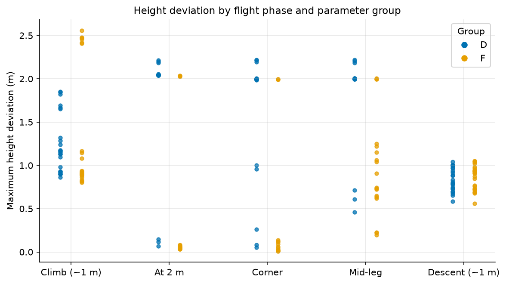
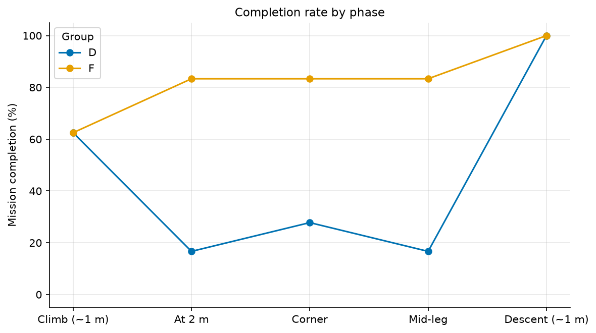
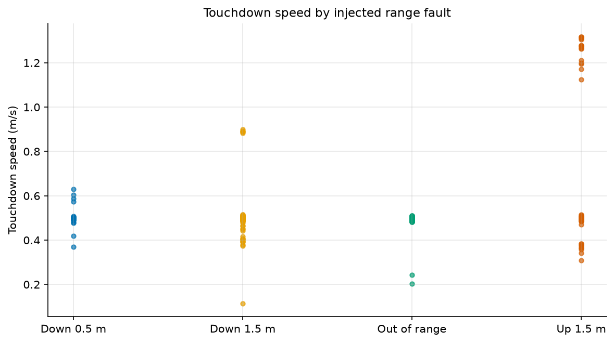

# 任务 V2：测距异常发生在起飞、转弯、降落阶段的表现（2026-11-19/20）

ArduCopter 4.7.0 SITL，`/home/jacky/sim/ardupilot/build/sitl/bin/arducopter`（只读）。工具链复制自 `/home/jacky/sim/opt_flow2/`（`opt2_sim.py`、`analyze2.py`、`mtf01_sitl_rng.parm`），实例只用 30–33。任务 `SQ --alt 2.0 --side 2.0 --laps 1 --hold 2.0 --no-loiter-test --thr-auto 1500 --settle 20 --seconds 120`，speedup 10。异常注入 = 飞行中改 `SIM_SONAR_POS_Z`，结束时恢复 `-0.05`；超量程照抄上一轮 `jobs_fault.txt`（`-10`，读数 ≈ 真值+10.05 m > `RNGFND1_MAX` 8）。

共 **207 次运行**（3 次时间轴 + 204 次注入矩阵），全部有 `metrics.json`，无脚本超时（run.log 末行全部 `script exit 0`）、无分析错误（`analyze.err` 全部为空）、无 `"error"` 字段。结束时确认实例 30–33 无残留 arducopter 进程（机器上剩余的 `-I40/-I41` 属于 val3 的另一个 worker）。

参数组：**F** = FINAL 覆盖 `EK3_RNG_M_NSE=0.1,EK3_HGT_I_GATE=200,SURFTRAK_MODE=0,FENCE_ALT_MAX=2.5,FENCE_RADIUS=4,FENCE_MARGIN=0.3,SIM_SONAR_RND=0.02,SIM_WIND_T=1`；**D** = 原门限对照组（同一覆盖去掉前三项）。每格 3 次（起始航向 30/150/270）。本矩阵无风（V2 清单未要求扰动）。

## 一、时间轴（FINAL，无扰动，3 次：v2_tl_r1/r2/r3）

时刻相对 AUTO 模式接通（dataflash `MODE` ModeNum=3；高度用 `SIM2` 真值 AGL）。三次之间最大差 0.7 s，取中位数：

| 事件 | 中位数 (s) | 范围 |
|---|---|---|
| 离地（AGL>0.05） | 2.7 | 2.6–2.8 |
| 爬升过 1 m | 4.2 | 4.2–4.3 |
| 到达 2 m（AGL≥1.95） | 6.2 | 6.1–6.2 |
| 到达第一个转角（Reached command #2） | 16.1 | 15.9–16.3 |
| 第二转角（#3） | 25.3 | 24.8–25.6 |
| 第三转角（#4） | 34.4 | 33.9–35.0 |
| 最后航点（Reached command #5） = 开始下降（Mission: 6 Land） | 43.7 | 43.1–44.0 |
| 下降过 1 m | 46.0 | 45.5–46.3 |
| 触地（SIM Hit ground） | 48.1 | 47.5–48.3 |
| 解锁解除 | 50.2 | 49.6–50.4 |

注入时刻按此表定（`--fault T` 的时钟比它早约 1 s，实际命中高度用 `f_alt0` 核对，见下）。注入时的真值高度（全部 204 次）：爬升 1.08–1.25 m，刚到 2 m 2.02–2.05 m，转角 1.99–2.01 m，航段中 1.98–2.01 m，下降 0.56–1.05 m（下降速率 0.5 m/s，注入时刻有 ±0.5 s 抖动，散布比其他段大）。

## 二、总表：阶段 × 异常类型 × 持续时间 × 参数组

每格 3 次。`dev_base` = 注入后 15 s 内（或任一方触地前）真值高度与**同航向无扰动基线**（v2_tl_r1–r3，同 rep）的最大偏离，中位数 [最小..最大]，单位 m；它剔除任务本身高度轨迹（爬升到 2 m、下降到 0）的影响，`dev_base=2.0` 级别的值都对应"提前保护降落"（飞机落地而基线还在 2 m）。`f_alt0` = 注入时真值高度。td = 触地速度，off = 落点偏差。结局里 fence = `Max Alt fence breached` → LAND，EKFvar = `EKF variance` → EKF failsafe LAND。raw 的 15 s 窗口最高/最低（相对注入时刻）在 `results.csv`（`dev_up`/`dev_dn`/`dev_max`）。

| phase | type | dur | grp | n | compl | dev_max m | dev_base m | f_alt0 m | td m/s | off m | outcome | clip |
|---|---|---|---|---|---|---|---|---|---|---|---|---|
| climb~1m | dn05 | 1 | D | 3 | 3/3 | - | 0.40 [0.40..0.41] | 1.17 [1.14..1.19] | 0.50 [0.50..0.50] | 0.10 [0.05..0.13] | completex3 | no | 未定预期：偏离 0.4/0.8 |
| climb~1m | dn05 | 1 | F | 3 | 3/3 | - | 0.03 [0.02..0.04] | 1.12 [1.11..1.14] | 0.50 [0.50..0.50] | 0.10 [0.09..0.17] | completex3 | no | 符合 |
| climb~1m | dn05 | 3 | D | 3 | 3/3 | - | 0.84 [0.82..0.86] | 1.17 [1.15..1.20] | 0.50 [0.50..0.51] | 0.18 [0.13..0.21] | completex3 | no | 未定预期：偏离 0.4/0.8 |
| climb~1m | dn05 | 3 | F | 3 | 3/3 | - | 0.05 [0.04..0.07] | 1.17 [1.14..1.17] | 0.48 [0.48..0.49] | 0.04 [0.03..0.17] | completex3 | no | 符合 |
| climb~1m | dn15 | 1 | D | 3 | 3/3 | - | 0.82 [0.81..0.82] | 1.17 [1.15..1.18] | 0.51 [0.50..0.51] | 0.11 [0.07..0.25] | completex3 | yes->0(OORlow) | 完成但偏离 0.8 |
| climb~1m | dn15 | 1 | F | 3 | 0/3 | - | 1.94 [1.91..1.95] | 1.16 [1.15..1.22] | 0.89 [0.51..0.89] | 0.16 [0.12..0.19] | LAND:fencex3 | yes->0(OORlow) | 不符合（截 0→围栏） |
| climb~1m | dn15 | 3 | D | 3 | 0/3 | - | 1.96 [1.96..1.98] | 1.12 [1.10..1.13] | 0.45 [0.44..0.45] | 0.08 [0.04..0.08] | LAND:fencex3 | yes->0(OORlow) | 不符合（截 0→围栏） |
| climb~1m | dn15 | 3 | F | 3 | 0/3 | - | 1.95 [1.92..1.97] | 1.17 [1.14..1.17] | 0.89 [0.88..0.90] | 1.25 [1.10..1.39] | LAND:fencex3 | yes->0(OORlow) | 不符合（截 0→围栏） |
| climb~1m | oor | 1 | D | 3 | 3/3 | - | 0.03 [0.02..0.06] | 1.15 [1.12..1.20] | 0.50 [0.50..0.50] | 0.13 [0.09..0.17] | completex3 |  | 符合 |
| climb~1m | oor | 1 | F | 3 | 3/3 | - | 0.03 [0.03..0.04] | 1.15 [1.14..1.21] | 0.50 [0.49..0.50] | 0.10 [0.09..0.15] | completex3 |  | 符合 |
| climb~1m | oor | 3 | D | 3 | 0/3 | - | 1.96 [1.95..1.97] | 1.15 [1.13..1.17] | 0.51 [0.50..0.51] | 0.38 [0.36..0.46] | LAND:EKFvar+EKFfailx3 |  | 符合 |
| climb~1m | oor | 3 | F | 3 | 0/3 | - | 1.96 [1.95..1.96] | 1.15 [1.08..1.17] | 0.49 [0.49..0.51] | 0.36 [0.35..0.45] | LAND:EKFvar+EKFfailx3 |  | 符合 |
| climb~1m | up15 | 1 | D | 3 | 3/3 | - | 0.99 [0.93..1.10] | 1.22 [1.09..1.25] | 0.50 [0.50..0.50] | 0.10 [0.10..0.16] | completex3 |  | 符合 |
| climb~1m | up15 | 1 | F | 3 | 3/3 | - | 0.02 [0.02..0.06] | 1.21 [1.16..1.24] | 0.50 [0.49..0.51] | 0.17 [0.08..0.20] | completex3 |  | 符合 |
| climb~1m | up15 | 3 | D | 3 | 0/3 | - | 1.94 [1.91..1.95] | 1.16 [1.10..1.18] | 1.32 [1.31..1.32] | 0.04 [0.03..0.04] | LAND:fencex3 |  | 围栏，触地 1.3 m/s |
| climb~1m | up15 | 3 | F | 3 | 3/3 | - | 0.03 [0.03..0.05] | 1.17 [1.14..1.22] | 0.49 [0.49..0.51] | 0.18 [0.10..0.19] | completex3 |  | 符合 |
| just-2m | dn15 | 1 | D | 3 | 0/3 | - | 1.97 [1.96..1.98] | 2.04 [2.04..2.04] | 0.50 [0.49..0.50] | 0.86 [0.80..0.93] | LAND:fencex3 | no | 符合（上冲+围栏） |
| just-2m | dn15 | 1 | F | 3 | 3/3 | - | 0.03 [0.02..0.04] | 2.04 [2.03..2.04] | 0.50 [0.49..0.50] | 0.28 [0.23..0.28] | completex3 | no | 符合 |
| just-2m | dn15 | 3 | D | 3 | 0/3 | - | 2.26 [2.23..2.26] | 2.04 [2.04..2.05] | 0.38 [0.38..0.40] | 1.02 [1.01..1.03] | LAND:fencex3 | no | 符合（上冲+围栏） |
| just-2m | dn15 | 3 | F | 3 | 3/3 | - | 0.03 [0.03..0.04] | 2.03 [2.02..2.04] | 0.49 [0.48..0.49] | 0.24 [0.21..0.25] | completex3 | no | 符合 |
| just-2m | oor | 1 | D | 3 | 3/3 | - | 0.11 [0.05..0.17] | 2.04 [2.03..2.05] | 0.50 [0.50..0.50] | 0.08 [0.03..0.14] | completex3 |  | 符合 |
| just-2m | oor | 1 | F | 3 | 3/3 | - | 0.04 [0.02..0.10] | 2.03 [2.02..2.03] | 0.48 [0.48..0.50] | 0.18 [0.15..0.19] | completex3 |  | 符合 |
| just-2m | oor | 3 | D | 3 | 0/3 | - | 1.95 [1.94..1.98] | 2.04 [2.04..2.04] | 0.50 [0.50..0.50] | 1.92 [1.83..2.02] | LAND:EKFvar+EKFfailx3 |  | 符合 |
| just-2m | oor | 3 | F | 3 | 0/3 | - | 1.96 [1.95..1.99] | 2.04 [2.02..2.04] | 0.49 [0.49..0.50] | 1.92 [1.89..2.02] | LAND:EKFvar+EKFfailx3 |  | 符合 |
| just-2m | up15 | 1 | D | 3 | 0/3 | - | 1.98 [1.96..1.98] | 2.05 [2.05..2.05] | 0.38 [0.36..0.38] | 0.07 [0.04..0.18] | LAND:fencex3 |  | 不符合预期外：围栏+1 s 即降 |
| just-2m | up15 | 1 | F | 3 | 3/3 | - | 0.02 [0.01..0.03] | 2.02 [2.02..2.04] | 0.49 [0.48..0.51] | 0.17 [0.08..0.20] | completex3 |  | 符合 |
| just-2m | up15 | 3 | D | 3 | 0/3 | - | 1.88 [1.86..1.90] | 2.05 [2.04..2.05] | 1.31 [1.30..1.32] | 0.11 [0.06..0.13] | LAND:fencex3 |  | 围栏，触地 1.3 m/s |
| just-2m | up15 | 3 | F | 3 | 3/3 | - | 0.02 [0.02..0.05] | 2.02 [2.02..2.03] | 0.49 [0.49..0.51] | 0.08 [0.04..0.19] | completex3 |  | 符合 |
| corner | dn15 | 1 | D | 3 | 2/3 | - | 1.00 [0.96..1.96] | 1.99 [1.99..2.00] | 0.50 [0.50..0.51] | 0.55 [0.50..1.95] | LAND:fencex1;completex2 | no | 符合（上冲+围栏） |
| corner | dn15 | 1 | F | 3 | 3/3 | - | 0.02 [0.01..0.02] | 2.00 [1.99..2.00] | 0.49 [0.49..0.49] | 0.48 [0.40..0.65] | completex3 | no | 符合 |
| corner | dn15 | 3 | D | 3 | 0/3 | - | 2.21 [2.19..2.23] | 2.00 [2.00..2.00] | 0.40 [0.39..0.41] | 2.26 [2.19..2.29] | LAND:fencex3 | no | 符合（上冲+围栏） |
| corner | dn15 | 3 | F | 3 | 3/3 | - | 0.10 [0.05..0.13] | 2.01 [2.00..2.01] | 0.49 [0.49..0.49] | 0.18 [0.12..0.72] | completex3 | no | 符合（最大 0.13） |
| corner | oor | 1 | D | 3 | 3/3 | - | 0.09 [0.04..0.26] | 2.00 [1.99..2.00] | 0.50 [0.49..0.51] | 0.19 [0.13..0.20] | completex3 |  | 符合 |
| corner | oor | 1 | F | 3 | 3/3 | - | 0.12 [0.05..0.12] | 2.00 [1.99..2.01] | 0.49 [0.48..0.50] | 0.17 [0.14..0.20] | completex3 |  | 符合 |
| corner | oor | 3 | D | 3 | 0/3 | - | 1.97 [1.97..1.98] | 2.00 [2.00..2.01] | 0.50 [0.50..0.50] | 2.60 [2.59..2.69] | LAND:EKFvar+EKFfailx3 |  | 符合 |
| corner | oor | 3 | F | 3 | 0/3 | - | 1.96 [1.96..1.98] | 1.99 [1.99..2.00] | 0.50 [0.48..0.50] | 2.66 [2.59..2.67] | LAND:EKFvar+EKFfailx3 |  | 符合 |
| corner | up15 | 1 | D | 3 | 0/3 | - | 1.97 [1.96..1.97] | 2.00 [2.00..2.00] | 0.38 [0.37..0.38] | 2.01 [1.98..2.05] | LAND:fencex3 |  | 不符合预期外：围栏+1 s 即降 |
| corner | up15 | 1 | F | 3 | 3/3 | - | 0.02 [0.02..0.02] | 2.00 [2.00..2.00] | 0.49 [0.49..0.50] | 0.18 [0.14..0.20] | completex3 |  | 符合 |
| corner | up15 | 3 | D | 3 | 0/3 | - | 1.89 [1.88..1.90] | 1.99 [1.99..2.00] | 1.27 [1.27..1.28] | 2.04 [2.01..2.06] | LAND:fencex3 |  | 围栏，触地 1.3 m/s |
| corner | up15 | 3 | F | 3 | 3/3 | - | 0.02 [0.01..0.04] | 1.99 [1.99..2.00] | 0.49 [0.49..0.50] | 0.15 [0.05..0.15] | completex3 |  | 符合 |
| midleg | dn15 | 1 | D | 3 | 0/3 | - | 1.96 [1.95..1.98] | 2.00 [2.00..2.01] | 0.51 [0.50..0.51] | 2.05 [1.95..2.06] | LAND:fencex3 | no | 符合（上冲+围栏） |
| midleg | dn15 | 1 | F | 3 | 3/3 | - | 0.47 [0.34..0.48] | 1.99 [1.99..2.00] | 0.50 [0.50..0.50] | 0.47 [0.18..0.51] | completex3 | no | 符合 |
| midleg | dn15 | 3 | D | 3 | 0/3 | - | 2.20 [2.19..2.21] | 2.00 [2.00..2.00] | 0.41 [0.40..0.42] | 2.06 [1.97..2.10] | LAND:fencex3 | no | 符合（上冲+围栏） |
| midleg | dn15 | 3 | F | 3 | 3/3 | - | 0.34 [0.13..0.34] | 2.00 [1.99..2.00] | 0.50 [0.49..0.50] | 0.87 [0.79..1.05] | completex3 | no | 符合 |
| midleg | oor | 1 | D | 3 | 3/3 | - | 0.12 [0.04..0.58] | 2.00 [2.00..2.00] | 0.50 [0.50..0.50] | 0.15 [0.11..0.16] | completex3 |  | 符合 |
| midleg | oor | 1 | F | 3 | 3/3 | - | 0.45 [0.41..0.72] | 2.00 [1.98..2.00] | 0.49 [0.49..0.50] | 0.14 [0.07..0.19] | completex3 |  | 符合 |
| midleg | oor | 3 | D | 3 | 0/3 | - | 1.96 [1.96..1.98] | 2.00 [2.00..2.00] | 0.49 [0.49..0.50] | 2.53 [2.53..2.58] | LAND:EKFvar+EKFfailx3 |  | 符合 |
| midleg | oor | 3 | F | 3 | 0/3 | - | 1.97 [1.96..1.97] | 2.00 [1.99..2.00] | 0.50 [0.49..0.50] | 2.56 [2.38..2.64] | LAND:EKFvar+EKFfailx3 |  | 符合 |
| midleg | up15 | 1 | D | 3 | 0/3 | - | 1.98 [1.97..2.00] | 2.00 [2.00..2.00] | 0.34 [0.31..0.37] | 2.01 [1.96..2.06] | LAND:fencex3 |  | 不符合预期外：围栏+1 s 即降 |
| midleg | up15 | 1 | F | 3 | 3/3 | - | 0.09 [0.05..0.13] | 2.00 [2.00..2.01] | 0.49 [0.49..0.50] | 0.13 [0.11..0.17] | completex3 |  | 符合 |
| midleg | up15 | 3 | D | 3 | 0/3 | - | 1.93 [1.91..1.93] | 2.00 [2.00..2.00] | 1.28 [1.26..1.28] | 2.01 [1.96..2.04] | LAND:fencex3 |  | 围栏，触地 1.3 m/s |
| midleg | up15 | 3 | F | 3 | 3/3 | - | 0.17 [0.13..0.67] | 2.00 [2.00..2.01] | 0.49 [0.49..0.49] | 0.04 [0.04..0.16] | completex3 |  | 符合 |
| desc~1m | dn05 | 1 | D | 3 | 3/3 | - | 0.20 [0.04..0.26] | 0.73 [0.58..0.88] | 0.42 [0.37..0.57] | 0.10 [0.08..0.14] | completex3 | no | 符合 |
| desc~1m | dn05 | 1 | F | 3 | 3/3 | - | 0.27 [0.11..0.30] | 0.73 [0.72..0.85] | 0.50 [0.49..0.51] | 0.06 [0.04..0.08] | completex3 | no | 符合 |
| desc~1m | dn05 | 3 | D | 3 | 3/3 | - | 0.36 [0.29..0.38] | 0.92 [0.89..1.00] | 0.60 [0.59..0.63] | 0.34 [0.27..0.38] | completex3 | no | 符合 |
| desc~1m | dn05 | 3 | F | 3 | 3/3 | - | 0.03 [0.01..0.19] | 0.91 [0.69..0.93] | 0.49 [0.49..0.50] | 0.14 [0.13..0.15] | completex3 | no | 符合 |
| desc~1m | dn15 | 1 | D | 3 | 3/3 | - | 0.10 [0.03..0.15] | 0.97 [0.78..1.00] | 0.51 [0.50..0.52] | 0.17 [0.14..0.18] | completex3 | yes->0(OORlow) | 边际（截 0，完成） |
| desc~1m | dn15 | 1 | F | 3 | 3/3 | - | 0.25 [0.01..0.41] | 0.93 [0.72..0.98] | 0.50 [0.49..0.51] | 0.14 [0.12..0.19] | completex3 | yes->0(OORlow) | 边际（偏离最大 0.41，完成） |
| desc~1m | dn15 | 3 | D | 3 | 3/3 | - | 0.38 [0.07..0.50] | 1.01 [0.65..1.04] | 0.46 [0.39..0.51] | 0.12 [0.09..0.22] | completex3 | yes->0(OORlow) | 边际（截 0，完成） |
| desc~1m | dn15 | 3 | F | 3 | 3/3 | - | 0.14 [0.09..0.34] | 1.04 [0.93..1.05] | 0.47 [0.11..0.48] | 0.16 [0.14..0.19] | completex3 | yes->0(OORlow) | 边际（截 0，variance，完成） |
| desc~1m | oor | 1 | D | 3 | 3/3 | - | 0.33 [0.30..0.34] | 0.79 [0.67..1.00] | 0.50 [0.50..0.51] | 0.11 [0.10..0.13] | completex3 |  | 符合 |
| desc~1m | oor | 1 | F | 3 | 3/3 | - | 0.20 [0.13..0.32] | 0.95 [0.69..0.97] | 0.51 [0.50..0.51] | 0.16 [0.08..0.19] | completex3 |  | 符合 |
| desc~1m | oor | 3 | D | 3 | 3/3 | - | 0.29 [0.16..0.36] | 0.73 [0.69..0.97] | 0.50 [0.20..0.50] | 0.08 [0.02..0.12] | completex3 |  | 符合（variance，完成） |
| desc~1m | oor | 3 | F | 3 | 3/3 | - | 0.37 [0.30..0.39] | 0.87 [0.56..1.05] | 0.48 [0.24..0.49] | 0.10 [0.01..0.14] | completex3 |  | 符合（variance，完成） |
| desc~1m | up15 | 1 | D | 3 | 3/3 | - | 0.38 [0.12..0.50] | 0.79 [0.70..0.83] | 1.20 [1.12..1.21] | 0.08 [0.07..0.14] | completex3 |  | 触地 1.2 m/s（预期外） |
| desc~1m | up15 | 1 | F | 3 | 3/3 | - | 0.17 [0.05..0.50] | 0.77 [0.68..1.02] | 0.50 [0.47..0.52] | 0.15 [0.12..0.17] | completex3 |  | 符合 |
| desc~1m | up15 | 3 | D | 3 | 3/3 | - | 0.36 [0.33..0.54] | 0.81 [0.75..0.94] | 1.19 [1.17..1.26] | 0.14 [0.14..0.18] | completex3 |  | 触地 1.2 m/s（预期外） |
| desc~1m | up15 | 3 | F | 3 | 3/3 | - | 0.10 [0.03..0.11] | 0.91 [0.76..0.94] | 0.51 [0.51..0.51] | 0.19 [0.08..0.20] | completex3 |  | 符合 |

注（截 0）：读数 = 真值 − `SIM_SONAR_POS_Z` − 0.05，被 `RNGFND1_MIN 0.01` 截为 0 → OutOfRangeLow，测距状态不再是 Good。截 0 条件是真值 ≤ 1.55 m。**爬升段和下降段的"读数变小 1.5 m"（dn15）全部实际截 0**，等效于超量程/测距丢失，不是 1.5 m 跳变；表中已标 `clip` 列。dn05（变小 0.5 m）的截 0 条件是真值 ≤ 0.55 m，实际注入高度 0.58–1.25 m，未截 0（最低一次 0.58 m，读数约 0.03 m，接近边界）。

*图 1. 不同飞行阶段和参数组的逐次最大高度偏差。数据来源：results.csv；脚本：make_figures.py。*

*图 2. D、F 两组在不同飞行阶段的任务完成率。数据来源：results.csv；脚本：make_figures.py。*

*图 3. 按测距故障类型分组的逐次触地速度。数据来源：results.csv；脚本：make_figures.py。*

## 三、与预期对照

1. **"FINAL 下 1 s 和 3 s 异常：真值高度偏离 < 0.1 m，任务继续"**
   - 刚到 2 m、第一转角、航段中：**符合**。dev_base 中位数 0.02–0.20 m，最大 0.22 m（例外：转角 dn15 3 s 一次 0.13 m，航段 oor 1 s 一次 0.22 m），9 格 × 3 次（dn15/up15）全部完成任务。
   - 爬升段读数变小（dn15）：**不符合**。真值小于 1.55 m，读数截 0（等效测距丢失），1 s 和 3 s 都是 0/3 完成：EKF 高度塌向 0（注入后 1 s 内 EKF 0.10 m vs 真值 1.73 m），故障结束后正确读数被 FINAL 门限拒绝，约 5 s 高度超时把高度强制重置到当前读数（3.6–3.7 m），随后高度围栏 LAND，真值最高 3.6–3.7 m，落点偏 1.1–1.4 m（3 s）。注意：**这一格里 FINAL 比原门限差**（原门限 1 s 时 3/3 完成，见下）。
   - 爬升段读数变大（up15）、变小 0.5 m（dn05）、超量程 1 s：符合（dev_base ≤ 0.06，3/3 完成）。
   - 下降段：**边际**。全部完成、正常触地，但 dev_base 最大 0.41–0.50 m（读数变小截 0 后高度源短暂丢失；3 s 时 6/6 报 `EKF variance`，此时飞机已在 Land 航点上，failsafe LAND 与正常降落重合，任务仍判完成）。
2. **"原门限下读数变小 3 s：飞机上冲，可能超过 2.5 m 触发高度围栏"：符合。** 刚到 2 m / 转角 / 航段中：真值最高 4.19–4.26 m（EKF 跟随错误读数，认为自身低于 2 m 而持续爬升），9/9 围栏 LAND。爬升段因截 0 走另一条路径（EKF 塌缩 → 超时重置），同样围栏 3/3。
3. **"超量程：1 s 无影响；3 s 可能报 EKF variance 后降落"：符合。** 1 s：18/18 完成，dev_base ≤ 0.33 m。3 s：爬升/刚到 2 m/转角/航段中 12/12 报 `EKF variance` → EKF failsafe LAND（真值偏离 2.0 m 是提前降落所致）；下降段 6/6 也报 variance，但已在降落段，任务完成、触地 0.2–0.5 m/s。

## 四、逐段说明（事实，含未预期的）

- **原门限、读数变大（up15）在 2 m 平飞三段**：EKF 以为 3.5 m，立即超过围栏触发行（`FENCE_ALT_MAX 2.5` + `FENCE_MARGIN 0.3`），1 s 也 0/3 完成。3 s 时 LAND 下降段更快，**触地 1.26–1.32 m/s**（正常 0.38–0.51）。
- **原门限、读数变小 1 s**：刚到 2 m / 航段中 0/3 完成（围栏）：EKF 跟随错误读数，故障结束时读数恢复，EKF 估计瞬间跳回 3 m 上下、越过围栏触发线 → LAND。转角段 3 次中 2 次完成、1 次（r3，真值最高 3.09 m）越线围栏——处在触发线附近的边际状态。爬升段 3/3 完成（EKF 塌缩幅度小，跳回后未越线）。
- **下降段、原门限、up15**：全部完成，但触地 1.12–1.26 m/s（6/6），是 FINAL 同格（0.47–0.51）的两倍多。
- **FINAL 在 2 m 平飞三段对全部四种异常**：dev_base ≤ 0.22 m，任务全部完成，触地正常（0.48–0.51），落点偏差 ≤ 1.05 m（个别格中位数偏大：航段 dn15 3 s 落点 0.87 [0.79..1.05]，转角 dn15 1 s 0.48 [0.40..0.65]，均正常完成；上一轮无扰动落点偏差约 0.05–0.1 m，此处偏大与故障后轨迹修正有关，未逐帧查）。
- **触地速度正常范围**：本任务无故障降落 0.49–0.51 m/s；>1 m/s 的触地全部出现在原门限 up15（读数变大、EKF 认为偏高 → LAND 下降更快）。

## 五、失败、可疑、异常运行

- **失败/超时/分析错误：0 次。** 207/207 有 metrics.json，`script exit 0`，analyze.err 空。
- 可疑/边际（原样列出）：
  - `v2_cn_D_dn15_1_r3`：同格 3 次中唯一围栏（另 2 次真值最高 2.95/3.00 m 未越线，本次 3.09 m 越线）。机理相同，属触发线附近的边际离散。
  - `v2_ds_F_dn15_3_r1`：触地 0.11 m/s，明显低于正常（0.4–0.6）；msgs 显示注入后 `EKF variance` 在下降中触发，failsafe LAND 与任务降落重叠。同格另 2 次 0.47/0.48。
  - `v2_ds_D_oor_3_r3`：触地 0.20 m/s，同类边界情况，任务完成。
  - `v2_ds_dn05_D_1s_r1`（tag `v2_ds_D_dn05_1_r1`）：注入时真值 0.58 m，读数约 0.03 m，接近截 0 边界，结果（dev_base 0.20）可能与截 0 格混淆。
  - 下降段全部格子的注入真值散布 0.56–1.05 m，比其他段大；格内比较受此影响。
  - FINAL 爬升 dn15 1 s 的触地速度离散 0.51/0.89/0.89 m/s（3 次），原因未查。

## 六、没做的

- FINAL + 苛刻扰动覆盖（风/光流噪声等）下的本矩阵：未做，V2 只要求 FINAL 与原门限两组、无扰动。
- 通用要求里的每配置 5 次：按 V2 清单执行为每格 3 次（航向 30/150/270）。
- 持续时间只测 1 s、3 s；5 s/10 s 未测。
- 注入时刻的水平位置/轨迹偏差只看了落点偏差总量，未做逐帧水平分析；`EKF variance` 具体是哪一项方差超限未逐帧查（沿用上一轮的口径）。
- 下降段注入时刻的抖动未通过加密 pump 循环改善。

## 文件

- `report.md`（本文件）、`results.csv`（207 行 + 表头）、`agg2_table.txt`（总表原文）、`dev_base.json`（逐次 dev_base）、`batch_v2.log`（批次日志）
- 脚本：`gen.py`（生成 jobs）、`jobs_v2.txt`（204 个任务行）、`batch.py`/`run_one.sh`（实例 30–33）、`timeline.py`、`agg.py`（results.csv）、`agg2.py`（总表）、`dev_base.py`（基线偏离）、`mon.sh`（进度监视，未用上）
- `runs/<tag>/`：`cmd.txt`、`overlay.parm`、`run.log`、`sitl.log`、`metrics.json`、`analyze.err`、dataflash `logs/*.BIN`；时间轴基线 `runs/v2_tl_r1..3/`
- 注入参数来源：`/home/jacky/sim/opt_flow2/jobs_fault.txt`（超量程 `-10`、恢复 `-0.05`）
