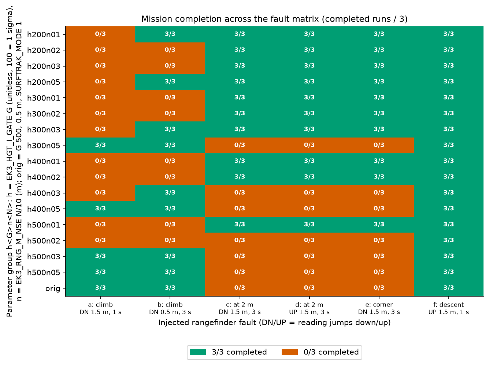
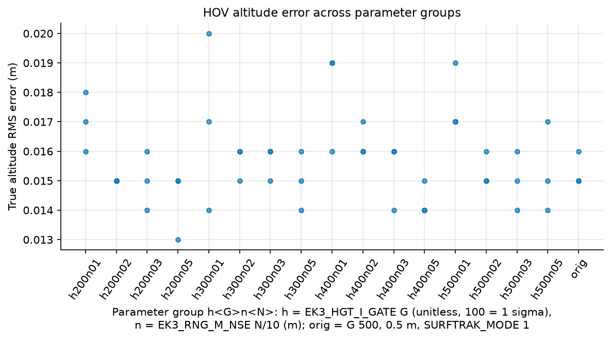
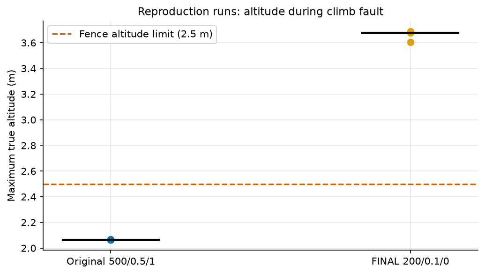

# 任务 V4：测距门限的折中（2026-11-20）

ArduCopter 4.7.0 SITL，工具链复用 `/home/jacky/sim/val2/`（`run_one.sh`/`batch.py`/`opt2_sim.py`/`analyze2.py` 原样，实例 30–33，speedup 10）。任务 `SQ --alt 2.0 --side 2.0 --laps 1 --hold 2.0 --no-loiter-test --thr-auto 1500 --settle 20 --seconds 120`（时间轴同 V2：注入基准 3.5 s≈爬升 1.1 m、6.0 s≈刚到 2 m、16.0 s≈第一转角、45.0 s≈下降 1 m，实际命中相对 AUTO 约 +0.95 s 偏移）。异常注入 = 飞行中改 `SIM_SONAR_POS_Z`（dn=+1.5/+0.5 读数变小、up=−1.5 读数变大），到时恢复 −0.05。除对照组外其余参数 = FINAL（`FENCE_ALT_MAX=2.5,FENCE_RADIUS=4,FENCE_MARGIN=0.3,SIM_SONAR_RND=0.02,SIM_WIND_T=1`），只改 `EK3_HGT_I_GATE`/`EK3_RNG_M_NSE`/`SURFTRAK_MODE=0`；对照组 orig = 500/0.5/SURFTRAK_MODE=1。

共 **360 次运行**：3 时间轴基线（v4_tl_r1..3，FINAL 无扰动）+ 17 组 × 6 异常 × 3 次（306）+ 17 组 × 苛刻扰动 HOV × 3（51）。全部有 `metrics.json`、`script exit 0`、`analyze.err` 全空、无 `error` 字段。每格 3 次航向 30/150/270（HOV 另加 `SIM_WIND_DIR` 0/120/240）。执行顺序：tl → a（先复现两格）→ a 其余 → c → b → d → e → f → HOV。结束确认实例 30–33 无残留 arducopter 进程（机器上其余 SITL 属其他 worker）。注：批量第一段被本会话后台命令 10 分钟上限杀过一次（无任务丢失，重启后自动跳过已完成 tag 续跑），日志 `batch_v4.log`。

## 一、复现（清单 1）

| 组 | a 格（爬升 dn15 1 s）3 次 | 真值最高 m | f_est_err_max m | 结局 |
|---|---|---|---|---|
| orig 500/0.5/1（v4_orig_a_r1..3） | 3/3 完成 | 2.064–2.069 | 1.56–1.58 | completex3（V2 同格 3/3） |
| FINAL 200/0.1/0（v4_h200n01_a_r1..3） | 0/3 | 3.603–3.688 | 1.57–1.64 | LAND:fencex3（V2 同格 0/3，3.6–3.7 围栏） |

环境复现与上一轮一致。orig 三次围栏消息只出现在故障后（`Mission: 6 Land` 正常降落），FINAL 三次均为 `Max Alt fence breached`（注入后 6.1 s）。

## 二、机理（清单 2）

**数据帧**（`v4_h200n01_a_r1`，时间相对注入首帧，注入 4.45→5.45 s / AUTO 后）：

| t | RFND.Dist | Stat | EKF | 真值 | XKF4.SH（高度检验比） |
|---|---|---|---|---|---|
| +0.4..+0.8 | 0.00 | 2 (OutOfRangeLow) | 1.24→1.64 | 1.36→1.56 | 0.06→0.01 |
| +0.9/+1.0 | 0.02/0.06 | 4 (Good) | 1.69/1.74 | 1.61/1.66 | 0.00/0.02 |
| +1.1 | 1.65 | 4 | **0.04** | 1.71 | 0.00 |
| +1.2..+2.9 | 1.73→2.60 | 4 | 0.09→0.94 | 1.76→2.63 | **6.8→4.4**（全拒） |
| orig 同窗 | 1.75→2.60 | 4 | 0.15→1.74 | 1.78→2.63 | 0.58→0.04（通过） |

1. **读数 0 被当成 `OutOfRangeLow`（Stat=2），EKF 不融合 0**：SITL 读数 = 真值 − `SIM_SONAR_POS_Z`（`libraries/SITL/SIM_Aircraft.cpp:547-559` 传感器偏移、:635 噪声），后端截负（`libraries/AP_RangeFinder/AP_RangeFinder_SITL.cpp:49` `MAX(0, dist)`），`< RNGFND1_MIN 0.01` → OutOfRangeLow（`AP_RangeFinder_Backend.cpp:62-70`，枚举 `AP_RangeFinder.h:214-216`）。EKF 只存 Good 样本（`AP_NavEKF3/AP_NavEKF3_Measurements.cpp:47`），坏样本连缓冲都进不了。
2. **故障窗内 EKF 退到气压计、高度保持正常**：Good 样本 500 ms 内耗尽（`Measurements.cpp:60-68`）→ `rangeFinderDataIsFresh=false`（`AP_NavEKF3_PosVelFusion.cpp:1209`）→ `lostRngHgt → fallback_to_baro`（:1240-1262）；气压计测量 = `baro − baroHgtOffset`（:1368），offset 是对当前估计的 LPF（`Measurements.cpp:809-812`），源切换 `ResetPositionD`（:977-981）保证估计连续。实测故障窗内 EKF 1.24–1.64 vs 真值 1.36–1.56。**0 本身不造成塌缩。**
3. **塌缩来自"有效但极小"的读数**：真值爬过 1.55 m 后读数 = 真值−1.5 ≈ 0.02–0.08 m 重新变为 Good，被当有效高度融合（`PosVelFusion.cpp:1335`，下限 `rngOnGnd=0.05`，`Measurements.cpp:29`），NSE=0.1 把观测方差压到 0.01 量级（`PosVelFusion.cpp:1347`，默认 0.5 `AP_NavEKF3.cpp:286-293`）→ 估计一步吸附到 ≈0.05 m。
4. **FINAL 恢复慢的原因**：恢复后 innov ≈ 1.6–1.7 m，门限判据 `hgtTestRatio = innov²/((0.01·EK3_HGT_I_GATE)²·varInnov) < 1`（`PosVelFusion.cpp:936-948`，即 gate/100 个 σ）：200→2σ，σ_eff≈0.14 → 2σ≈0.28 → 全拒（SH=6.8）；只能等 5 s 高度超时（无垂直速度源，`AP_NavEKF3.h:495-496` `hgtRetryTimeMode12_ms=5000`；`PosVelFusion.cpp:1403-1410`）→ `ResetHeight()` 直接把高度置为当前读数（:963-977、:287-295，无 STATUSTEXT）→ 真值已 3.6–3.7 m → 越过围栏触发线 2.8 m → LAND。orig：5σ·σ_eff≈3.5 > 1.7 → 通过，约 1.6 s 收敛。
5. **截 0 的假象与真实影响**：`MAX(0,dist)` 是 SITL 后端行为，真实 MTF-01 低于量程下限的输出形式不同。但失败主因不是截 0 窗（该窗气压计兜底、无影响），而是"偏移 1.5 m 的传感器在真值 1.55–2 m 区间给出有效小读数"，与传感器型号无关。若真实传感器低于下限时输出最小量程值（同样会变 Good），坏读数会更早进入融合，机理相同甚至更快。

**矩阵格间差异同此判据**（实测归纳）：接受 innov≈1.5–1.7 m 需要 `(gate/100)·sqrt(P+NSE²) ≥ innov`。NSE 0.5（σ_eff≈0.71）任意 gate、或 NSE 0.3+gate≥500 恢复爬升格（a）；NSE≤0.1 任意 gate、或 NSE 0.2/0.3+gate≤300 在 2 m 格全程拒绝坏读数（c/d/e）。两区间无交集，唯一交集候选 (500,0.3) 实测 c/d/e 0/3——因为 3 s 故障内 P 增长越过门限后坏读数被"迟接受"（`v4_h500n03_c_r1`：估计先保持 2 m、3 s 后被拉向 0.5，恢复再被拒，5 s 超时重置到 6.4–6.6 m → 围栏），比 NSE 0.5 的立即接受更差。

## 三、总表（清单 3–6）

17 组 × 6 异常（每格 3 次）：完成数 / dev_base 中位数 [min..max]（m，注入后 15 s 内真值与同航向无扰动基线的最大偏离；3/3 完成时才列 dev_base）+ 苛刻扰动 HOV 120 s（`hov_alt_rms`=真值高度误差 RMS、`hov_hgt_est_rms`=EKF 高度误差 RMS、EKF variance 次数）。完整表见 `agg4_table.txt`。

| 组 (GATE/NSE/ST) | a 爬升dn15 1s | c 2m dn15 3s | b 爬升dn05 3s | d 2m up15 3s | e 转角dn15 3s | f 下降up15 1s | HOV alt RMS m | HOV est RMS m | EKFvar |
|---|---|---|---|---|---|---|---|---|---|
| 200/0.1/0 (FINAL) | **0/3** | 3/3, 0.03 | 3/3, 0.05 | 3/3, 0.04 | 3/3, 0.07 | 3/3, 0.20 | 0.017 | 0.017 | 0/3 |
| 200/0.2/0 | **0/3** | 3/3, 0.07 | **0/3** | 3/3, 0.03 | 3/3, 0.11 | 3/3, 0.10 | 0.015 | 0.016 | 0/3 |
| 200/0.3/0 | **0/3** | 3/3, 0.08 | **0/3** | 3/3, 0.03 | 3/3, 0.11 | 3/3, 0.05 | 0.015 | 0.015 | 0/3 |
| 200/0.5/0 | **0/3** | 3/3, 0.10 | 3/3, 0.85 | 3/3, 0.03 | 3/3, 0.18 | 3/3, 0.12 | 0.015 | 0.015 | 0/3 |
| 300/0.1/0 | **0/3** | 3/3, 0.03 | **0/3** | 3/3, 0.04 | 3/3, 0.08 | 3/3, 0.22 | 0.017 | 0.017 | 0/3 |
| 300/0.2/0 | **0/3** | 3/3, 0.07 | **0/3** | 3/3, 0.02 | 3/3, 0.10 | 3/3, 0.20 | 0.016 | 0.016 | 0/3 |
| 300/0.3/0 | **0/3** | 3/3, 0.10 | 3/3, 0.91 | 3/3, 0.02 | 3/3, 0.16 | 3/3, 0.20 | 0.016 | 0.016 | 0/3 |
| 300/0.5/0 | 3/3, 0.82 | **0/3** | 3/3, 0.85 | **0/3** | **0/3** | 3/3, 0.33 | 0.015 | 0.015 | 0/3 |
| 400/0.1/0 | **0/3** | 3/3, 0.03 | **0/3** | 3/3, 0.04 | 3/3, 0.10 | 3/3, 0.22 | 0.019 | 0.018 | 0/3 |
| 400/0.2/0 | **0/3** | 3/3, 0.07 | **0/3** | 3/3, 0.02 | 3/3, 0.10 | 3/3, 0.07 | 0.016 | 0.016 | 0/3 |
| 400/0.3/0 | **0/3** | **0/3** | 3/3, 0.91 | **0/3** | **0/3** | 3/3, 0.23 | 0.016 | 0.016 | 0/3 |
| 400/0.5/0 | 3/3, 0.81 | **0/3** | 3/3, 0.85 | **0/3** | **0/3** | 3/3, 0.31 | 0.014 | 0.015 | 0/3 |
| 500/0.1/0 | **0/3** | 3/3, 0.03 | **0/3** | 3/3, 0.03 | 3/3, 0.10 | 3/3, 0.09 | 0.017 | 0.017 | 0/3 |
| 500/0.2/0 | **0/3** | **0/3** | **0/3** | **0/3** | **0/3** | 3/3, 0.18 | 0.015 | 0.016 | 0/3 |
| 500/0.3/0 | 3/3, 0.89 | **0/3** | 3/3, 0.91 | **0/3** | **0/3** | 3/3, 0.35 | 0.015 | 0.015 | 0/3 |
| 500/0.5/0 | 3/3, 0.81 | **0/3** | 3/3, 0.86 | **0/3** | **0/3** | 3/3, 0.41 | 0.015 | 0.014 | 0/3 |
| 500/0.5/1 (orig) | 3/3, 0.81 | **0/3** | 3/3, 0.86 | **0/3** | **0/3** | 3/3, 0.32 | 0.015 | 0.015 | 0/3 |

*图 1. 各门限参数组在不同故障下的任务完成比例。数据来源：results.csv；脚本：make_figures.py。*

*图 2. 各参数组 HOV 运行的逐次真值高度 RMS 误差。数据来源：results.csv；脚本：make_figures.py。*

*图 3. 原始组和 FINAL 组爬升故障复现运行的逐次真值最大高度。数据来源：results.csv；脚本：make_figures.py。*

加粗 = 0/3（真值结局均为 `Max Alt fence breached` → LAND；未加粗的失败格 dev_base 未列，如 a 格 0/3 时 dev_base ≈ 1.92–1.95）。f 格全部 3/3。**"6 种异常全部完成且偏离 < 0.5 m"的组：没有。**

逐格说明：
- **a（爬升 dn15 1 s，读数截 0→恢复）**：只有 NSE 0.5（200 除外：200/0.5 是 2σ·0.71=1.42<1.7 仍拒，0/3）和 (500, 0.3) 存活（3/3，dev 0.81–0.89）；NSE ≤ 0.2 全灭、(300,0.3)/(400,0.3) 全灭（3σ/4σ·σ_eff≈1.0–1.7 < innov，恢复被拒 → 5 s 超时重置 → 2.7–3.7 m 围栏）。
- **b（爬升 dn05 3 s，读数 0.5–0.7 有效）**：NSE ≤ 0.2 的 8 组 0/3——坏读数被全程拒绝（NSE 0.1 gate 500：5σ≈0.7 < innov 1.5）→ 5 s 超时重置 → 2.9 m 围栏（`v4_h500n01` 系，alt_max 2.89–2.95）。NSE 0.3/0.5 的组 3/3 完成但 dev 0.85–0.91（故障期 EKF 跟随 −0.5 m 错读数、飞机降 0.5 m 后恢复），超出 0.5 目标。
- **c/d/e（2 m 平飞三段）**：NSE 0.5 全灭（坏读数立即接受，d 格真值仅到 2.05 但围栏提前降落、c/e 格真值冲到 6.1–7.1 m）；(400,0.3)/(500,0.2)/(500,0.3)/(500,0.5) 0/3（迟接受路径）；其余（NSE ≤ 0.2 任意 gate，及 (200,0.3)/(300,0.3)）3/3，dev ≤ 0.18。
- **f（下降 up15 1 s）**：全部 3/3，dev 0.01–0.50（orig 系 0.32–0.50，NSE ≤ 0.3 系 0.01–0.43）。NSE 0.5 系触地 1.1–1.3 m/s（正常 0.5）。
- **d 格的例外**：NSE 0.5 + gate 200（200/0.5）d 3/3（2σ 拒绝坏高读数），但同组 a 0/3——门限方向性冲突的直接体现。
- **HOV 苛刻扰动对照（清单 5）**：17 组 × 3 次全部正常完成，`hov_alt_rms` 0.013–0.020 m、`hov_hgt_est_rms` 0.014–0.019 m、`EKF variance` 0/51。收紧门限在无注入的苛刻扰动飞行中**没有**出现测距误拒迹象（窗口 120 s，高度误差 RMS 与 FINAL 基线同量级）。
- **最接近的三组**（全部 6 格完成且 dev<0.5 的组不存在）：
  1. **200/0.1/0（FINAL，h200n01）**：仅 a 失败（0/3，真值 3.6–3.7 围栏）；其余 5 格 3/3 且 dev ≤ 0.20。
  2. **300/0.3/0（h300n03）**：仅 a 失败（0/3）；b 完成 dev 0.91（>0.5），其余 3/3 dev ≤ 0.20。
  3. **500/0.1/0（h500n01）**：a、b 两格失败（0/3，围栏）；c/d/e/f 3/3 且 dev ≤ 0.10。同型（仅 a+b 失败）还有 h200n02/h200n03/h300n01/h300n02/h400n01/h400n02，共 7 组。
  - 反向参照：500/0.3/0 过 a+b+f 但 c/d/e 全灭——单独放宽 NSE 或 gate 无法同时满足两段。

## 四、失败、可疑、异常运行

- 脚本失败 / 超时 / 缺 metrics / analyze 错误：**0 次**（360/360 有 metrics.json，`script exit 0`，analyze.err 全空）。
- 批量进程：第一段被会话后台命令 10 分钟上限终止一次（约 160 个完成后），重启续跑完成；无任务因此丢失，无数据损坏。
- 格内非单调（已查清机理，非随机故障）：h400n03 c/d/e 0/3 而 h300n03（gate 300）同异常 3/3、h400n01/02（NSE 0.2）3/3；h500n02 仅 f 过——两者都是"故障内 P 增长越过门限 → 坏读数迟接受 → 恢复再被拒 → 5 s 超时重置到已爬高的真值"路径（`v4_h400n03_c_r1` 真值 6.6–6.9 m、`v4_h500n02_c_r1` 6.8–7.0 m 围栏）。机理见第二节 5。
- 可疑/边际（原样列出）：
  - `v4_h200n03_a_r1`：触地 0.90 m/s，恰在 0.9 阈值上（同格 r2/r3 亦围栏降落，机理相同）。
  - `v4_h300n05_f_r1..3`、`v4_h400n05_f_r1..3`、`v4_h500n05_f_r1..3`、`v4_orig_f_r2/r3`、`v4_h500n03_f_r1/r3`：任务完成但触地 1.0–1.3 m/s（正常 0.4–0.6）——读数变大 + 下降段 + NSE 0.5 的组合，EKF 认为偏低导致 LAND 下降更快，与 V2 下降段 up15 规律一致。
  - b 格 8 组（NSE 0.3/0.5）完成但 dev 0.85–0.91，超出"偏离 < 0.5 m"目标线，计入未达标。
  - f 格偏离最大 `v4_orig_f_r3` 0.50 m（恰在目标线上）。
  - 围栏降落的触地速度 0.9–1.3 m/s 共 44 次（全部位于上述 0/3 格及 NSE 0.5 系 d/f 格），围栏 LAND 的固有下降速率，未逐帧查。

## 五、没做的

- 每配置 5 次（通用要求）：按 V4 清单执行为每格 3 次（航向 30/150/270）。
- a–f 异常矩阵在"苛刻扰动"（风/光流噪声）下未跑，苛刻扰动只用于第 5 项 HOV（清单如此指定）。
- 异常时长只测清单指定的 1 s / 3 s；未扩展到其他时长或幅值。
- dev_base 用 15 s 固定窗口（沿用 V2 口径），围栏提前降落的格子（dev_base ≈ 1.9–2.0）是"提前落地 vs 基线仍在飞"的差值，非爬升越限量。
- `EKF variance` 未做逐项方差分解；水平轨迹只看落点偏差（`results.csv`），未逐帧分析。
- 时间轴基线只有 FINAL 一组（v4_tl_r1..3），各组门限的无扰动轨迹差未单独建基线（各组无扰动 HOV 误差 RMS 0.013–0.020 m，差异 ≪ dev_base 尺度）。

## 文件

- `report.md`（本文件）、`mechanism.md`（机理草稿）、`agg4_table.txt`（总表原文含 min..max）、`results.csv`（357 行 + 表头，含 hov/fault 每次一行）、`dev_base4.json`（逐次 dev_base）、`batch_v4.log`（批次日志）
- 脚本：`gen4.py`（生成 `jobs_v4.txt`，360 行）、`batch.py`/`run_one.sh`（实例 30–33）、`dev_base4.py`、`agg4.py`（表格+results.csv）、`timeline.py`（未用，V2 原样复制）
- `runs/<tag>/`：`cmd.txt`、`overlay.parm`、`run.log`、`sitl.log`、`metrics.json`、`analyze.err`、dataflash `logs/*.BIN`；基线 `runs/v4_tl_r1..3/`
