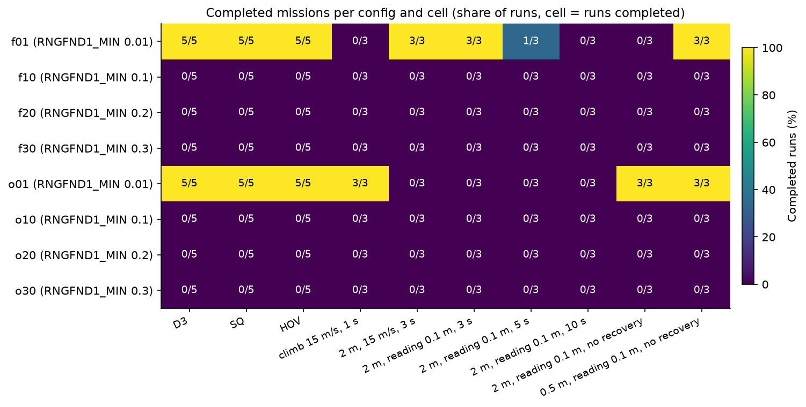
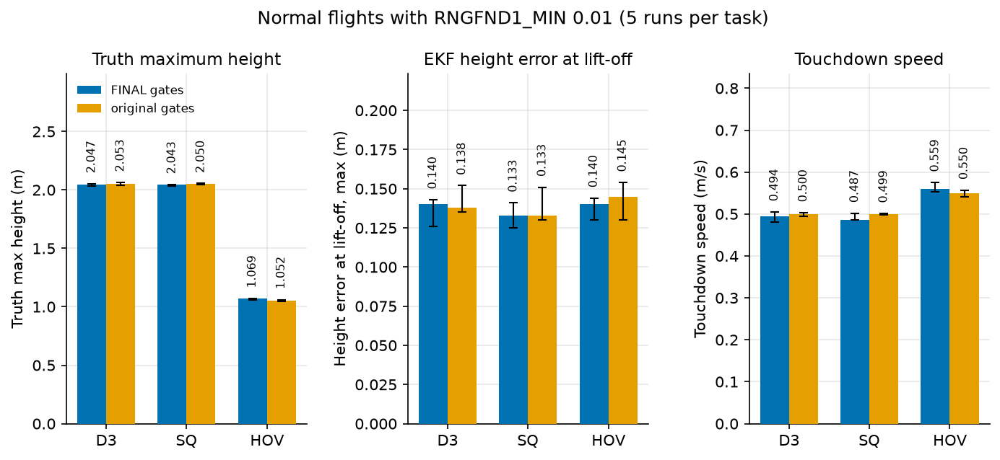
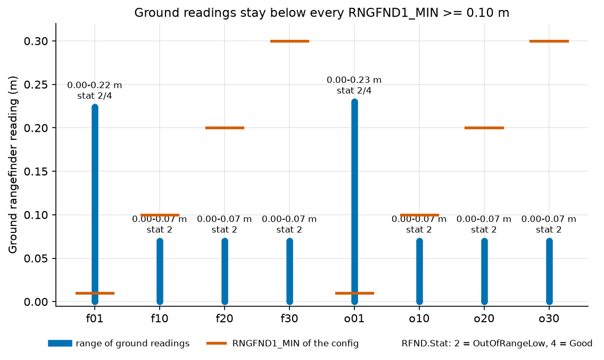
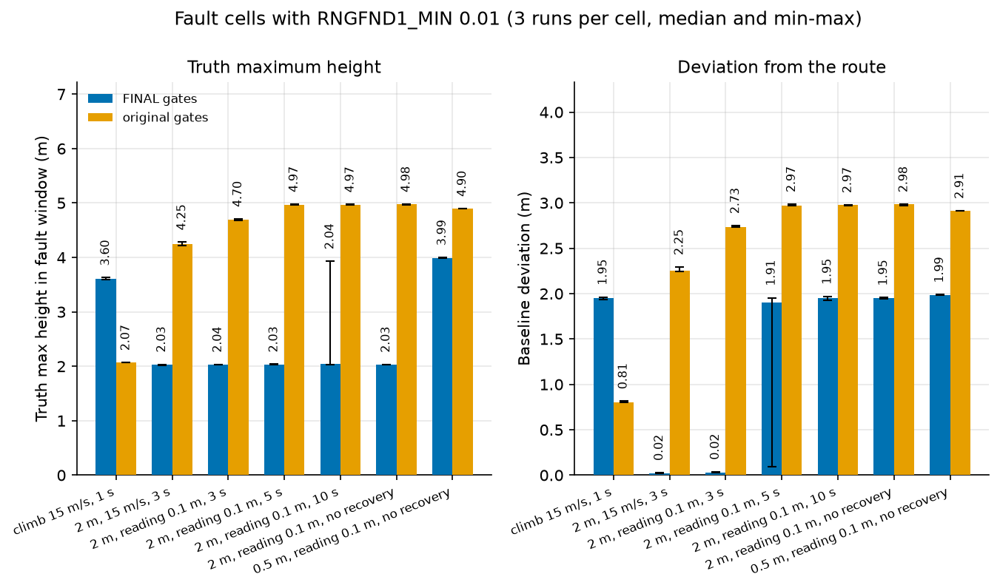
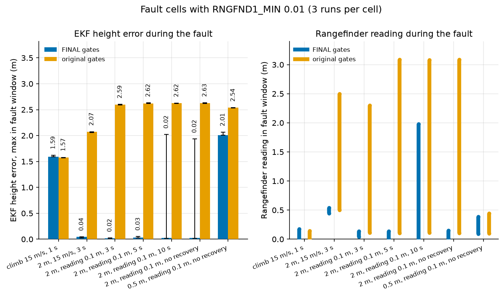

# 任务 V6：提高测距量程下限 `RNGFND1_MIN`（2026-11-20）

ArduCopter 4.7.0 SITL，工具链复用 `/home/jacky/sim/val4/`（`run_one.sh`/`batch.py`/`opt2_sim.py` 只改目录与实例 30–33；分析用 `analyze6.py` = `analyze2.py` + 测距/解锁/离地/落地细节；`dev_base6.py` = `dev_base4.py` 只改基线名与输出名）。speedup 10，基础参数 `mtf01_sitl_rng.parm`（`RNGFND1_MIN 0.01`、`EK3_SRC1_POSZ 2`）。

**8 个配置** = 两组门限 × `RNGFND1_MIN`：
- FINAL 组 `f*`：`EK3_RNG_M_NSE=0.1,EK3_HGT_I_GATE=200,SURFTRAK_MODE=0` + `FENCE_ALT_MAX=2.5,FENCE_RADIUS=4,FENCE_MARGIN=0.3,SIM_SONAR_RND=0.02,SIM_WIND_T=1`
- 原门限组 `o*`：`EK3_RNG_M_NSE=0.5,EK3_HGT_I_GATE=500,SURFTRAK_MODE=1` + 同一 REST
- `RNGFND1_MIN` = 0.01 / 0.10 / 0.20 / 0.30（写在 overlay.parm 里）

共 **288 次运行**：正常飞行 8 配置 × 3 任务 × 5 次 = 120（航向 30/150/270/90/210）；异常 8 配置 × 7 格 × 3 次 = 168（航向 30/150/270，任务 `SQ --alt 2.0 --side 2.0 --laps 1`）。全部有 `metrics.json`、`script exit 0`、`analyze.err` 全空。结束确认实例 30–33 无残留 arducopter 进程。

## 一、总表

| 配置 | 正常飞行完成数 D3/SQ/HOV（共15） | 异常完成数 a/c/g3/g5/g10/gN/h（共21） | 正常飞行关键指标中位数 [范围] | 异常关键指标中位数 [范围] | 是否符合预期 |
|---|---|---|---|---|---|
| f01 FINAL/0.01 | 5/5, 5/5, 5/5 | 0/3, 3/3, 3/3, 1/3, 0/3, 0/3, 3/3 | 真值最高 2.05 [2.03..2.05] / 2.04 [2.04..2.05] / 1.07 [1.06..1.07] m；离地高度误差 max 0.140 [0.126..0.143] / 0.133 / 0.140 m；落地前 0.5 m 误差 max 0.041 / 0.045 / 0.053 m；触地 0.49 / 0.49 / 0.56 m/s；EKF variance 0/15 | dev_base 1.95 / 0.02 / 0.02 / 1.91 / 1.95 / 1.95 / 1.99 m；EKF 高度误差 max 1.59 / 0.04 / 0.02 / 0.03 / 0.02 / 0.02 / 2.01 m | 正常飞行：符合（无异常全通过）；异常：与 V4 的 a/c 结论一致（a 围栏、c 通过） |
| f10 FINAL/0.10 | 0/5, 0/5, 0/5 | 0/3 ×7 | **无飞行数据**（未解锁） | 无飞行数据 | 不符合：无法解锁 |
| f20 FINAL/0.20 | 0/5, 0/5, 0/5 | 0/3 ×7 | **无飞行数据**（未解锁） | 无飞行数据 | 不符合：无法解锁 |
| f30 FINAL/0.30 | 0/5, 0/5, 0/5 | 0/3 ×7 | **无飞行数据**（未解锁） | 无飞行数据 | 不符合：无法解锁 |
| o01 orig/0.01 | 5/5, 5/5, 5/5 | 3/3, 0/3, 0/3, 0/3, 0/3, 3/3, 3/3 | 真值最高 2.05 / 2.05 / 1.05 [1.05..1.06] m；离地误差 max 0.138 / 0.133 / 0.145 m；落地前 0.5 m 误差 max 0.040 / 0.037 / 0.059 m；触地 0.50 / 0.50 / 0.55 m/s；EKF variance 0/15 | dev_base 0.81 / 2.25 / 2.73 / 2.97 / 2.97 / 2.98 / 2.91 m；EKF 高度误差 max 1.57 / 2.07 / 2.59 / 2.62 / 2.62 / 2.63 / 2.54 m | 正常飞行：符合；异常：与 V4 的 a/c 结论一致（a 通过、c 围栏） |
| o10 orig/0.10 | 0/5, 0/5, 0/5 | 0/3 ×7 | **无飞行数据**（未解锁） | 无飞行数据 | 不符合：无法解锁 |
| o20 orig/0.20 | 0/5, 0/5, 0/5 | 0/3 ×7 | **无飞行数据**（未解锁） | 无飞行数据 | 不符合：无法解锁 |
| o30 orig/0.30 | 0/5, 0/5, 0/5 | 0/3 ×7 | **无飞行数据**（未解锁） | 无飞行数据 | 不符合：无法解锁 |

（异常格顺序：a 爬升 dn15 1 s / c 2 m dn15 3 s / g3 塌 0.1 m 3 s / g5 5 s / g10 10 s / gN 不恢复 / h 0.5 m 塌 0.1 m 不恢复。）

*Figure 1. 每个配置 × 每个任务格的完成次数（格内为“完成次数/总次数”，颜色为完成比例）：`RNGFND1_MIN ≥ 0.10` 的 6 个配置全部 0 次完成（未解锁）。来源：results.csv；脚本：make_figures.py。*

**一句话**：把 `RNGFND1_MIN` 抬到 0.10 m 及以上（高于地面读数 0.03–0.07 m）时，飞机在地面就拿不到位置估计，**完全无法解锁**，8 个配置里有 6 个（min 0.10/0.20/0.30）根本没有飞行数据；清单设想的"空中读数变成超量程、EKF 退气压计、偏离远小于 min 0.01"在本配置下无法验证。

## 二、逐项说明

### 2.1 正常飞行（清单 2）

| 配置 | 任务 | 完成/5 | 结局 | 真值最高 m | 离地高度误差max m | 落地前0.5 m 误差max m | 触地 m/s | 上锁 | EKF variance | RFND.Stat 地面/空中 |
|---|---|---|---|---|---|---|---|---|---|---|
| FINAL/0.01 | D3 | 5/5 | 完成x5 | 2.05 [2.03..2.05] | 0.140 [0.126..0.143] | 0.041 [0.040..0.045] | 0.49 [0.48..0.51] | 5/5 | 0/5 | [2,4]/[4] |
| FINAL/0.01 | SQ | 5/5 | 完成x5 | 2.04 [2.04..2.05] | 0.133 [0.125..0.141] | 0.045 [0.034..0.047] | 0.49 [0.49..0.50] | 5/5 | 0/5 | [2,4]/[4] |
| FINAL/0.01 | HOV | 5/5 | 完成x5 | 1.07 [1.06..1.07] | 0.140 [0.130..0.144] | 0.053 [0.051..0.056] | 0.56 [0.55..0.58] | 5/5 | 0/5 | [2,4]/[] |
| FINAL/0.10 / 0.20 / 0.30 | D3,SQ,HOV | 0/5 ×9 | 未解锁 x5（每格） | 无 | 无 | 无 | 无 | 0/5 | 0/5 | [2]/[] |
| orig/0.01 | D3 | 5/5 | 完成x5 | 2.05 [2.04..2.06] | 0.138 [0.135..0.152] | 0.040 [0.034..0.041] | 0.50 | 5/5 | 0/5 | [2,4]/[4] |
| orig/0.01 | SQ | 5/5 | 完成x5 | 2.05 [2.05..2.06] | 0.133 [0.130..0.151] | 0.037 [0.034..0.039] | 0.50 | 5/5 | 0/5 | [2,4]/[4] |
| orig/0.01 | HOV | 5/5 | 完成x5 | 1.05 [1.05..1.06] | 0.145 [0.130..0.154] | 0.059 [0.048..0.061] | 0.55 | 5/5 | 0/5 | [2,4]/[] |
| orig/0.10 / 0.20 / 0.30 | D3,SQ,HOV | 0/5 ×9 | 未解锁 x5（每格） | 无 | 无 | 无 | 无 | 0/5 | 0/5 | [2]/[] |

*Figure 3. `RNGFND1_MIN 0.01` 两个配置在 D3 / SQ / HOV 正常飞行上的真值最高高度（左）、离地时 EKF 高度误差 max（中）、触地速度（右），条为 5 次中位数、须为 5 次最小-最大范围。来源：results.csv；脚本：make_figures.py。*

- **解锁**：`RNGFND1_MIN 0.01` 两组 15/15 正常解锁；`RNGFND1_MIN ≥ 0.10` 六组 90/90 次解锁被拒，STATUSTEXT 原文每次都是 `Arm: Need Position Estimate` 紧跟 `Arm: Fence requires position`（15 次重试全部拒绝，`runs/v6_*_f10_r1/run.log` 等）。
- **测距状态**：地面静止读数 0.030–0.070 m（`v6_sq_f10_r1`，858 个 RFND 样本，**全部 `RFND.Stat=2` OutOfRangeLow**）；`min 0.01` 时地面读数 0.000–0.178 m（Stat 混合 2/4，150/151 为 4 = Good）；空中 2 m 时读数 1.85–2.11 m（Stat=4）。

*Figure 2. 各配置地面静止时的测距读数范围（蓝竖条，含每次运行的最小-最大）与该配置的 `RNGFND1_MIN`（橙横线）：`min ≥ 0.10` 的 6 个配置读数（0.00–0.07 m）始终低于自己的下限，`RFND.Stat` 只有 2（OutOfRangeLow）。来源：results.csv；脚本：make_figures.py。*
- **离地**：两个 min 0.01 组离地瞬间 EKF 高度误差 max 0.125–0.154 m（离地时刻测距刚离下限，读数还在 0.05 m 附近）。
- **落地**：落地前 0.5 m 内 EKF 高度误差 max 0.034–0.061 m，触地速度 0.48–0.58 m/s，落地后正常上锁（5/5，`Disarming motors`）。
- **HOV 低空悬停**（`--alt 0.5`）：悬停窗真值 0.48–0.51 m，`hov_alt_rms` 0.003–0.007 m，`hov_hgt_est_rms` 0.008–0.010 m，漂移 ≤0.042 m，EKF variance 0/10。全程真值最高 1.05–1.07 m（起飞段过冲，非悬停窗）。
- **机理（源码）**：`AP_NavEKF3_PosVelFusion.cpp:1221-1225`——主高度源为 RANGEFINDER 时，只有 `rangeFinderDataIsFresh`（500 ms 内有样本）才把 `activeHgtSource` 置为 RANGEFINDER；而坏样本在 `AP_NavEKF3_Measurements.cpp:47` 就被丢弃（只存 `status()==Good`），所以地面（读数 0.03–0.07 < 下限）永远不 fresh → `activeHgtSource` 保持 NONE → `:1280-1295` 的 `fallback_to_baro` 只在"曾经是 RANGEFINDER 后丢失"时生效，此处不生效 → EKF 无高度 → 无位置估计 → 解锁被拒。

### 2.2 异常（清单 3–4）

`min ≥ 0.10` 的 6 个配置：所有异常格都是**未解锁、零飞行**，注入后飞机一直停在地面。因此下表只有 `f01`/`o01` 两行有数据（其余 42 格指标不适用）。

| 配置 | 格 | 完成/3 | 结局 | dev_base m | 真值最高 m | EKF 高度误差 max m | 注入期读数 m | RFND.Stat | 注入到切 LAND s | 触地 m/s | 落点偏差 m |
|---|---|---|---|---|---|---|---|---|---|---|---|
| FINAL/0.01 | 爬升 dn15 1s | 0/3 | Max Alt fence breached | 1.95 [1.94..1.96] | 3.60 [3.60..3.63] | 1.59 [1.59..1.62] | 0.0-0.153 / 0.0-0.151 / 0.0-0.177 | [2,4] | 6.1 | 0.89 [0.50..0.89] | 0.05 / 0.26 / 0.07 |
| FINAL/0.01 | 2m dn15 3s | 3/3 | 完成 | 0.02 [0.02..0.03] | 2.03 [2.02..2.04] | 0.04 [0.03..0.05] | 0.443-0.52 / 0.461-0.533 / 0.451-0.542 | [4] | 37.1 | 0.49 | 0.33 / 0.25 / 0.43 |
| FINAL/0.01 | 2m 塌 0.1m 3s | 3/3 | 完成 | 0.02 [0.02..0.04] | 2.04 | 0.02 [0.02..0.03] | 0.056-0.134 / 0.042-0.131 / 0.052-0.131 | [4] | 36.9 | 0.49 | 0.55 / 0.69 / 0.72 |
| FINAL/0.01 | 2m 塌 0.1m 5s | 1/3 | 2 次 EKF variance→Failsafe Land，1 次完成 | 1.91 [0.09..1.95] | 2.03 | 0.03 | 0.012-0.139 / 0.037-0.131 / 0.043-0.138 | [4] | 4.9 [3.8..40.8] | 0.50 [0.49..1.63] | 3.16 / 0.05 / 2.37 |
| FINAL/0.01 | 2m 塌 0.1m 10s | 0/3 | 2 次 EKF variance→Failsafe Land，1 次 fence | 1.95 [1.92..1.97] | 2.04 [2.03..3.93] | 0.02 [0.02..2.02] | 0.0-0.456 / 0.041-1.977 / 0.0-0.478 | [2,4]/[4]/[2,4] | 4.0 [3.5..15.2] | 0.50 | 3.37 / 1.96 / 3.77 |
| FINAL/0.01 | 2m 塌 0.1m 不恢复 | 0/3 | 3 次 EKF variance→Failsafe Land | 1.95 | 2.03 | 0.02 [0.02..1.94] | 0.011-0.127 / 0.065-0.147 / 0.045-0.127 | [4] | 3.6 [3.3..5.3] | 0.51 | 3.04 / 5.48 / 3.99 |
| FINAL/0.01 | 0.5m 塌 0.1m 不恢复 | 3/3 | 完成 + EKF variance（真值爬到 4 m） | 1.99 | 3.99 [3.99..4.00] | 2.01 [2.01..2.06] | 0.112-0.343 / 0.152-0.386 / 0.093-0.329 | [4] | 40.1 | 0.53 | 0.60 / 0.93 / 1.61 |
| orig/0.01 | 爬升 dn15 1s | 3/3 | 完成 | 0.81 [0.81..0.82] | 2.07 | 1.57 [1.57..1.58] | 0.0-0.092 / 0.0-0.138 / 0.0-0.145 | [2,4] | 40.9 | 0.50 | 0.23 / 0.24 / 0.24 |
| orig/0.01 | 2m dn15 3s | 0/3 | Max Alt fence breached | 2.25 [2.24..2.29] | 4.25 [4.22..4.28] | 2.07 | 0.513-2.355 / 0.502-2.408 / 0.519-2.496 | [4] | 3.6 | 0.38 | 0.98 / 1.05 / 1.07 |
| orig/0.01 | 2m 塌 0.1m 3s | 0/3 | Max Alt fence breached | 2.73 | 4.70 | 2.59 | 0.12-2.237 / 0.113-2.298 / 0.111-2.293 | [4] | 3.6 | 0.28 | 1.01 / 1.11 / 0.65 |
| orig/0.01 | 2m 塌 0.1m 5s | 0/3 | Max Alt fence breached | 2.97 | 4.97 | 2.62 | 0.122-3.073 / 0.11-3.077 / 0.103-3.089 | [4] | 5.4 | 0.43 | 2.01 / 1.34 / 1.98 |
| orig/0.01 | 2m 塌 0.1m 10s | 0/3 | Max Alt fence breached | 2.97 | 4.97 | 2.62 | 0.114-3.072 / 0.114-3.081 / 0.117-3.08 | [4] | 10.8 | 0.61 | 1.96 / 2.01 / 2.08 |
| orig/0.01 | 2m 塌 0.1m 不恢复 | 3/3 | 完成 + EKF variance | 2.98 | 4.98 | 2.63 | 0.104-3.088 / 0.116-3.07 / 0.114-3.084 | [4] | 37.0 | 0.51 | 0.57 / 0.67 / 0.15 |
| orig/0.01 | 0.5m 塌 0.1m 不恢复 | 3/3 | 完成 + EKF variance | 2.91 | 4.90 | 2.54 | 0.098-0.32 / 0.172-0.442 / 0.18-0.446 | [4] | 39.7 | 0.50 | 0.26 / 0.20 / 0.10 |

*Figure 4. `RNGFND1_MIN 0.01` 两个配置在各异常格上的故障窗口真值最高高度（左）与基线偏离 `dev_base`（右），条为 3 次中位数、须为 3 次最小-最大范围。来源：results.csv；脚本：make_figures.py。*

*Figure 5. 各异常格的故障窗口 EKF 高度误差 max（左，条为 3 次中位数）与注入期实测测距读数范围（右，每格 3 次运行的最小-最大）。来源：results.csv；脚本：make_figures.py。*

- **a、c 格与 V4 复现一致**：FINAL 组 a 格 0/3（真值 3.60–3.67 m，围栏）、c 格 3/3（dev 0.02）；orig 组 a 格 3/3（dev 0.81）、c 格 0/3（真值 4.23–4.29 m，围栏）。与 `val4/report.md` 第一节数字一致。
- **g 格（2 m 处读数塌到 0.1 m，`SIM_SONAR_POS_Z=1.9`）**：注入期实测读数 FINAL 组 0.04–0.14 m（Stat 全部 4=Good），orig 组 0.10–3.09 m（读数随真值升高而升高）。
  - FINAL 组：3 s 无影响（dev 0.02，EKF 高度误差 0.02）；5 s 起 2/3 报 `EKF variance`→`EKF Failsafe: changed to Land Mode`；10 s 3/3 未完成；不恢复 3/3 报 variance 后降落（落点偏差 3.0–5.5 m）。
  - orig 组：3 s / 5 s / 10 s 全部 0/3，坏读数被立即接受，EKF 高度估计塌到 0.1 m 量级，飞机爬到 4.70–4.97 m 越围栏（`Max Alt fence breached`）；不恢复 3/3 记为"完成 + EKF variance"，真值 4.97–4.98 m。
- **h 格（爬升约 0.5 m 时读数塌到 0.1 m 且不恢复）**：注入手段与实测见下节。FINAL 组 3/3 完成但真值爬到 3.99 m（dev 1.99，EKF 高度误差 2.01 m，注入期读数 0.093–0.386 m）；orig 组 3/3 完成 + EKF variance，真值 4.90 m（dev 2.91，EKF 误差 2.54 m，读数 0.098–0.446 m）。
- **注入到切 LAND 时间**：FINAL 组 g5/g10/gN = 3.3–5.3 s（variance→Failsafe→Land），orig 组 g3/g5 = 3.6–5.4 s（围栏触发），c/a 格 = 3.5–41.5 s。

### 2.3 h 格的注入手段与实测读数（清单 3 要求核对）

- **可用参数**：`RNGFND1_TYPE=100`（`AP_RangeFinder.h:201` `Type::SIM`）走 `AP_RangeFinder_SITL` → `AP::sitl()->get_rangefinder()` → `SIM_Aircraft.cpp:1117-1122` `rangefinder_m = rangefinder_range()`；读数 = 真值 − `SIM_SONAR_POS_Z` + `SIM_SONAR_RND` 噪声。`SIM_SONAR_SCALE`（m/V）只作用于模拟电压通路（`AP_HAL_SITL/sitl_rangefinder.cpp:43`），本配置不经过该通路，**不能用来按比例缩小读数**。故唯一可用手段是改 `SIM_SONAR_POS_Z`。
- **做法**：`SIM_SONAR_POS_Z` 是固定偏移，读数随爬升增大；故按 f01 基线真值曲线用 7 条 `--fault` 阶梯标定：`2.5s→0.53, 3.0s→0.81, 3.5s→1.04, 4.0s→1.29, 4.5s→1.53, 5.0s→1.77, 5.5s→1.93`（之后不再恢复）。注入时刻（fault 时钟 2.5 s ≈ AUTO+3.45 s）真值 ≈0.63 m。
- **实测**：注入期读数范围 FINAL 组 **0.093–0.386 m**、orig 组 **0.098–0.446 m**，而不是台标的 0.05–0.25 m——因为 `min 0.01` 下 EKF 被小读数骗过、飞机爬到 4–5 m，固定偏移跟不上真值。**`RFND.Stat` 在注入期全部为 4（Good）**：读数 0.09–0.45 m 都大于 `RNGFND1_MIN 0.01`，所以在这个"现状"配置里它们仍被融合——这正是任务要验证的现象。

## 三、失败、超时、可疑运行

- **脚本失败 / 超时 / 缺 metrics / analyze 报错：0 次**（288/288 有 `metrics.json`，`script exit 0`，`analyze.err` 全空）。结束确认无残留 arducopter 进程。
- **未解锁运行 216 次**（6 个 `min ≥ 0.10` 配置 × 正常飞行 3 任务 × 5 次 = 90，加异常 7 格 × 3 次 = 126）：这不是脚本失败，是配置本身的效果——`RNGFND1_MIN ≥ 0.10` 时 EKF 在地面拿不到高度 → `Arm: Need Position Estimate` / `Arm: Fence requires position`。这些运行的 dev_base、真值最高、EKF 误差、注入到切 LAND 等指标**不适用**（表 2 中已标"无飞行数据"）。
- **可疑 / 边际（原样列出）**：
  - `v6_f01_g5_r3`：触地 1.63 m/s（同格另两次 0.49–0.50），同时 EKF variance→Failsafe Land、落点偏差 2.37 m。
  - `v6_f01_g10_r2`：真值最高 3.94 m 且 `Max Alt fence breached`，同格另两次真值 2.35–2.36 m、无围栏文本（不一致）。
  - `v6_f01_a_r3`：触地 0.50 m/s，同格 r1/r2 为 0.89 m/s（围栏降落速率不一致）。
  - `v6_o01_gN_r1..3`、`v6_o01_h_r1..3`、`v6_f01_h_r1..3`：真值最高 3.99–4.98 m（远超 2 m 目标、也超过围栏触发线 2.8 m），但结果记为"完成"，且 `msgs` 里**没有** `Max Alt fence breached`；只有 `EKF variance` / `EKF Failsafe: changed to Land Mode`。按记录原样保留。
  - `v6_f01_a_r1..3`：围栏降落后落点偏差 0.05–0.26 m（围栏 LAND 触发早，落点尚在场地内）。
  - 正常飞行 HOV 组：全程真值最高 1.05–1.07 m（起飞过冲），悬停窗真值 0.48–0.51 m。
  - `v6_f01_g10_r2` 注入期读数上限 1.977 m（其余两次 0.456 / 0.478 m）——该次飞机先被坏读数骗高。
- 3 次 smoke/probe 运行（`v6_smoke_*`、`v6_probe_*`）已删除，不计入 288 次。

## 四、没做的

- **min 0.2–0.3 的核心假设无法验证**：6 个 `min ≥ 0.10` 配置在地面就解锁失败，没有飞行，因此"空中读数判为超量程→EKF 退气压计→真值偏离远小于 min 0.01"这一条**没有实测数据**。没有为此改配置（不改高度源、不加 GPS、不改解锁检查）。
- 没有测 `min 0.01` 与 `0.10` 之间的临界值（清单未要求，且属于调参找"更好"的值）。
- 没有叠加"苛刻扰动"（风/光流噪声）——清单未要求。
- 正常飞行的 5 次只覆盖航向 30/150/270/90/210，无 `SIM_WIND_DIR` 变化（无风）。
- 异常格每格 3 次（航向 30/150/270），未扩展时长/幅值；`dev_base` 沿用 V4 口径（注入后 15 s 固定窗，基线 = 同航向 `v6_sq_r<n>`）。
- 逐帧的 RFND/EKF 内部量（`XKF4.SH` 检验比、P 阵）只做了汇总，未逐帧分析；`EKF variance` 未做方差分解。
- 清单第 3 项的"h 格持续保持 0.05–0.25 m"未完全达成（实测 0.09–0.45 m，见 2.3），原因已写明。

## 五、文件

- `report.md`（本文件）、`agg6_table.txt`（两张表的原文）、`results.csv`（288 行 + 表头，每次运行一行）、`dev_base6.json`（逐次 dev_base）
- 脚本：`gen6.py`（生成 `jobs_v6_normal.txt` 120 行、`jobs_v6_g.txt` 96、`jobs_v6_h.txt` 24、`jobs_v6_ac.txt` 48）、`batch.py`/`run_one.sh`（实例 30–33）、`analyze6.py`、`dev_base6.py`、`agg6.py`
- `runs/<tag>/`：`cmd.txt`、`overlay.parm`、`run.log`、`sitl.log`、`metrics.json`、`analyze.err`、dataflash `logs/*.BIN`；基线 `runs/v6_sq_r1..r5`
- 批次日志：`batch_v6_normal.log`、`batch_v6_fault.log`
