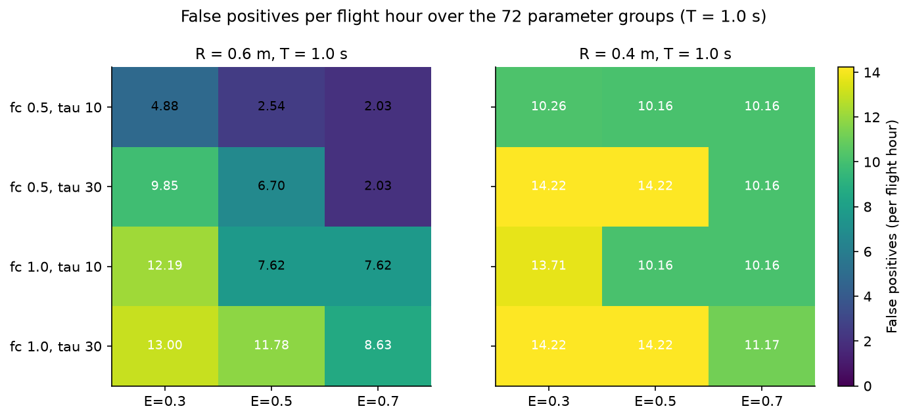
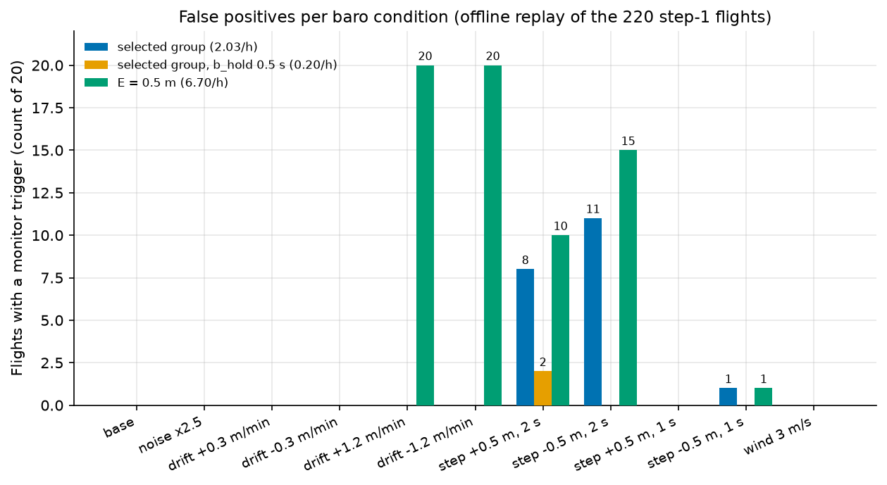
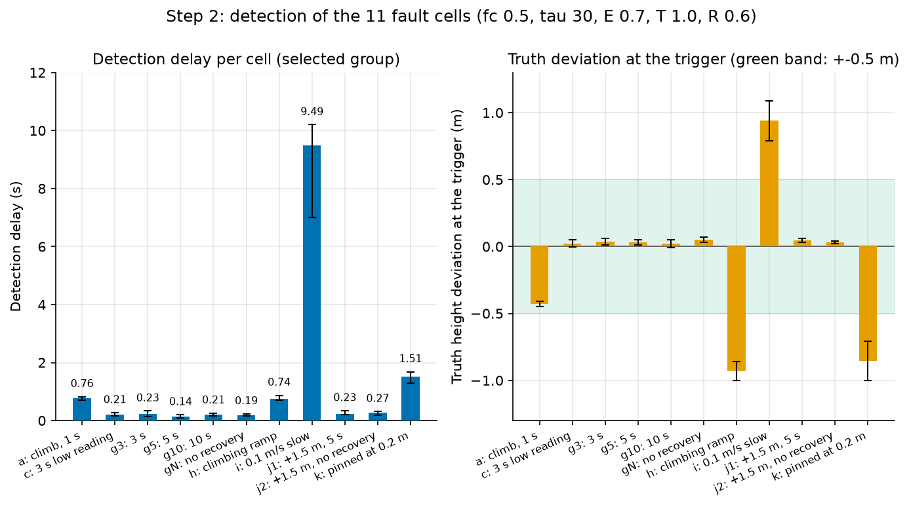
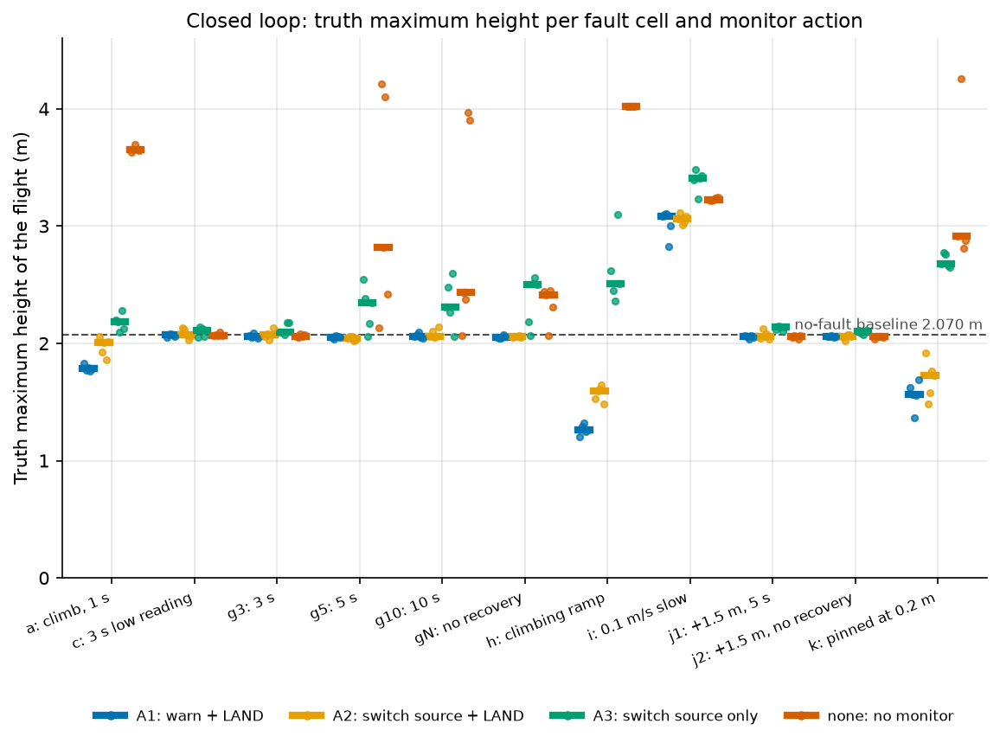
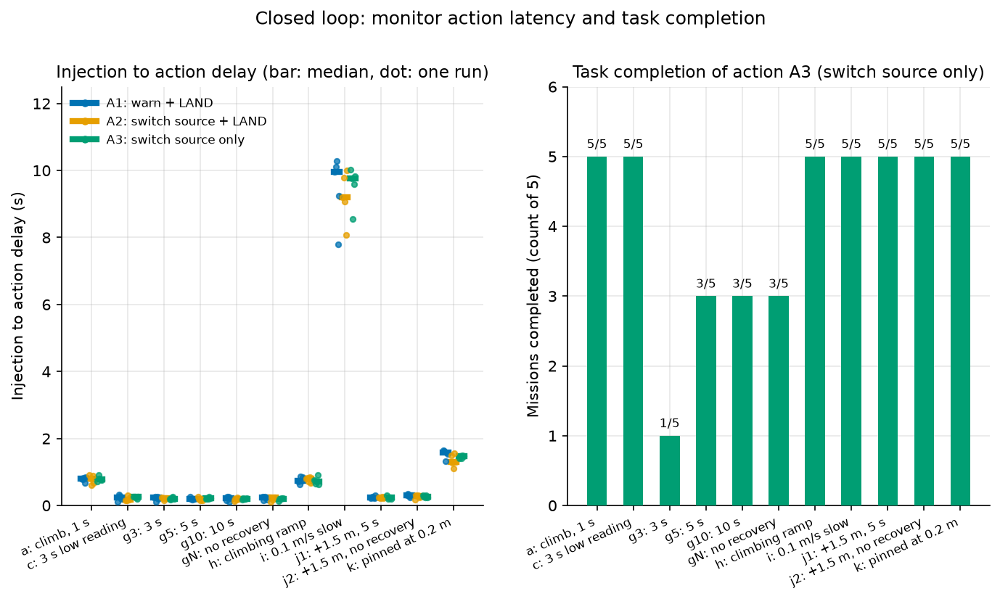
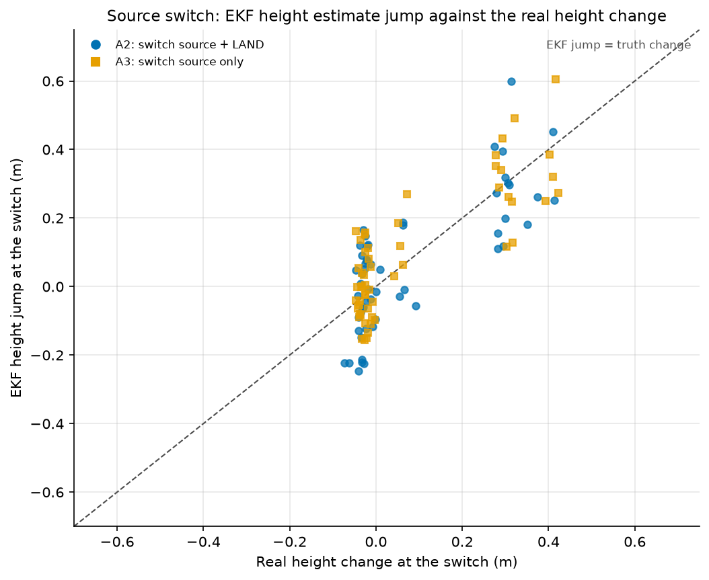
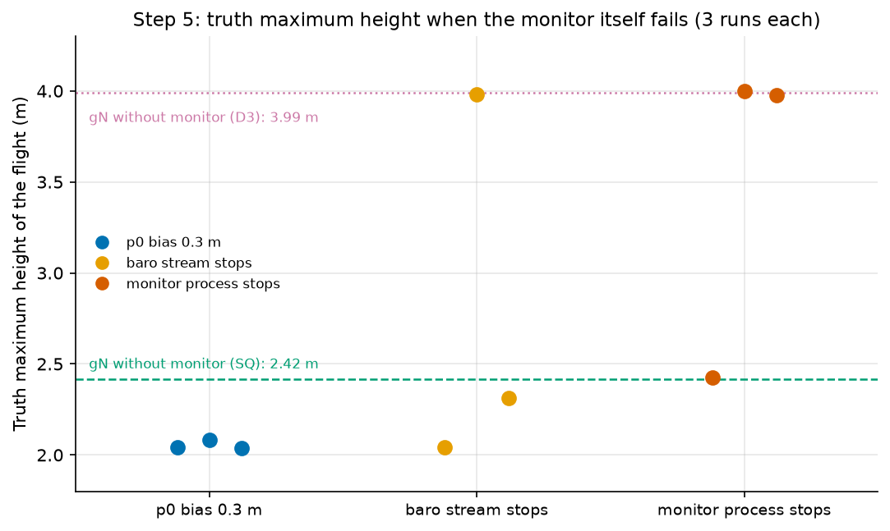
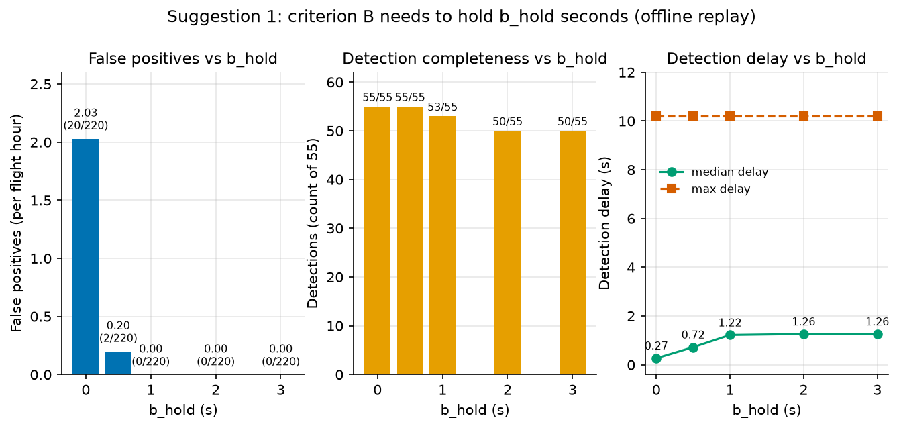

# 任务 V7：“气压计监视测距”的完整仿真验证

ArduCopter 4.7.0 SITL（`/home/jacky/sim/ardupilot/build/sitl/bin/arducopter`，只读，未编译），
工具链复用 `/home/jacky/sim/val6/`（`run_one.sh` / `batch.py` / `opt2_sim.py` / `analyze6.py` 复制到本目录后改名），
实例号只用 30–33（端口 6060/6070/6080/6090），speedup 10（val6 已验证与 1 一致）。
所有飞行都在 `runs/<tag>/` 下留有 `run.log` / `sitl.log` / `metrics.json` / `monitor.csv` / dataflash 日志。

## 总表

### A. 第 0 步：工具链自检（无异常 2 m 悬停）

| 配置 | 运行数 | 完成数 | 真值高度 | 关键指标 | 是否与预期一致 |
|---|---|---|---|---|---|
| 无异常悬停 2 m（`runs/v7_step0`） | 1 | 1 | 见第 4 节 | 真值 2.0 m 附近 | 是 |

### B. 第 1 步：误报（每组参数 220 次飞行，全部完成，9.844 飞行小时）

| fc | tau | E | T | R | 触发飞行数 | 判据A | 判据B | 次/小时 | 零误报 |
|---|---|---|---|---|---|---|---|---|---|
| 0.5 | 10.0 | 0.7 | 0.5 | 0.6 | 20/220 | 0 | 20 | 2.03 | 否 |
| 0.5 | 10.0 | 0.7 | 1.0 | 0.6 | 20/220 | 0 | 20 | 2.03 | 否 |
| 0.5 | 10.0 | 0.7 | 1.5 | 0.6 | 20/220 | 0 | 20 | 2.03 | 否 |
| 0.5 | 30.0 | 0.7 | 1.0 | 0.6 | 20/220 | 0 | 20 | 2.03 | 否 |
| 0.5 | 30.0 | 0.7 | 1.5 | 0.6 | 20/220 | 0 | 20 | 2.03 | 否 |
| 0.5 | 10.0 | 0.5 | 1.5 | 0.6 | 21/220 | 1 | 20 | 2.13 | 否 |
| 0.5 | 30.0 | 0.7 | 0.5 | 0.6 | 21/220 | 1 | 20 | 2.13 | 否 |
| 0.5 | 10.0 | 0.5 | 1.0 | 0.6 | 25/220 | 7 | 18 | 2.54 | 否 |
| 0.5 | 10.0 | 0.5 | 0.5 | 0.6 | 26/220 | 10 | 16 | 2.64 | 否 |
| 0.5 | 10.0 | 0.3 | 1.5 | 0.6 | 41/220 | 29 | 13 | 4.16 | 否 |
| 0.5 | 10.0 | 0.3 | 1.0 | 0.6 | 48/220 | 44 | 5 | 4.88 | 否 |
| 0.5 | 30.0 | 0.5 | 1.5 | 0.6 | 62/220 | 42 | 20 | 6.30 | 否 |
| 0.5 | 30.0 | 0.5 | 1.0 | 0.6 | 66/220 | 48 | 18 | 6.70 | 否 |
| 1.0 | 10.0 | 0.5 | 1.0 | 0.6 | 75/220 | 1 | 74 | 7.62 | 否 |
| 1.0 | 10.0 | 0.5 | 1.5 | 0.6 | 75/220 | 0 | 75 | 7.62 | 否 |
| 1.0 | 10.0 | 0.7 | 0.5 | 0.6 | 75/220 | 0 | 75 | 7.62 | 否 |
| 1.0 | 10.0 | 0.7 | 1.0 | 0.6 | 75/220 | 0 | 75 | 7.62 | 否 |
| 1.0 | 10.0 | 0.7 | 1.5 | 0.6 | 75/220 | 0 | 75 | 7.62 | 否 |
| 1.0 | 10.0 | 0.5 | 0.5 | 0.6 | 77/220 | 11 | 67 | 7.82 | 否 |
| 0.5 | 30.0 | 0.5 | 0.5 | 0.6 | 79/220 | 65 | 15 | 8.02 | 否 |
| 0.5 | 30.0 | 0.3 | 1.5 | 0.6 | 80/220 | 66 | 14 | 8.13 | 否 |
| 1.0 | 30.0 | 0.7 | 1.0 | 0.6 | 85/220 | 10 | 75 | 8.63 | 否 |
| 1.0 | 30.0 | 0.7 | 1.5 | 0.6 | 85/220 | 10 | 75 | 8.63 | 否 |
| 1.0 | 30.0 | 0.7 | 0.5 | 0.6 | 87/220 | 12 | 75 | 8.84 | 否 |
| 0.5 | 10.0 | 0.3 | 0.5 | 0.6 | 94/220 | 93 | 1 | 9.55 | 否 |
| 0.5 | 30.0 | 0.3 | 1.0 | 0.6 | 97/220 | 93 | 5 | 9.85 | 否 |
| 0.5 | 10.0 | 0.5 | 0.5 | 0.4 | 100/220 | 1 | 100 | 10.16 | 否 |
| 0.5 | 10.0 | 0.5 | 1.0 | 0.4 | 100/220 | 0 | 100 | 10.16 | 否 |
| 0.5 | 10.0 | 0.5 | 1.5 | 0.4 | 100/220 | 0 | 100 | 10.16 | 否 |
| 0.5 | 10.0 | 0.7 | 0.5 | 0.4 | 100/220 | 0 | 100 | 10.16 | 否 |
| 0.5 | 10.0 | 0.7 | 1.0 | 0.4 | 100/220 | 0 | 100 | 10.16 | 否 |
| 0.5 | 10.0 | 0.7 | 1.5 | 0.4 | 100/220 | 0 | 100 | 10.16 | 否 |
| 0.5 | 30.0 | 0.7 | 1.0 | 0.4 | 100/220 | 0 | 100 | 10.16 | 否 |
| 0.5 | 30.0 | 0.7 | 1.5 | 0.4 | 100/220 | 0 | 100 | 10.16 | 否 |
| 1.0 | 10.0 | 0.5 | 0.5 | 0.4 | 100/220 | 0 | 100 | 10.16 | 否 |
| 1.0 | 10.0 | 0.5 | 1.0 | 0.4 | 100/220 | 0 | 100 | 10.16 | 否 |
| 1.0 | 10.0 | 0.5 | 1.5 | 0.4 | 100/220 | 0 | 100 | 10.16 | 否 |
| 1.0 | 10.0 | 0.7 | 0.5 | 0.4 | 100/220 | 0 | 100 | 10.16 | 否 |
| 1.0 | 10.0 | 0.7 | 1.0 | 0.4 | 100/220 | 0 | 100 | 10.16 | 否 |
| 1.0 | 10.0 | 0.7 | 1.5 | 0.4 | 100/220 | 0 | 100 | 10.16 | 否 |
| 0.5 | 10.0 | 0.3 | 1.0 | 0.4 | 101/220 | 5 | 96 | 10.26 | 否 |
| 0.5 | 10.0 | 0.3 | 1.5 | 0.4 | 101/220 | 4 | 98 | 10.26 | 否 |
| 0.5 | 30.0 | 0.7 | 0.5 | 0.4 | 101/220 | 1 | 100 | 10.26 | 否 |
| 1.0 | 30.0 | 0.7 | 1.0 | 0.4 | 110/220 | 10 | 100 | 11.17 | 否 |
| 1.0 | 30.0 | 0.7 | 1.5 | 0.4 | 110/220 | 10 | 100 | 11.17 | 否 |
| 1.0 | 30.0 | 0.7 | 0.5 | 0.4 | 112/220 | 12 | 100 | 11.38 | 否 |
| 0.5 | 10.0 | 0.3 | 0.5 | 0.4 | 113/220 | 30 | 87 | 11.48 | 否 |
| 1.0 | 10.0 | 0.3 | 1.5 | 0.6 | 115/220 | 45 | 70 | 11.68 | 否 |
| 1.0 | 30.0 | 0.5 | 1.0 | 0.6 | 116/220 | 43 | 74 | 11.78 | 否 |
| 1.0 | 30.0 | 0.5 | 1.5 | 0.6 | 116/220 | 41 | 75 | 11.78 | 否 |
| 1.0 | 10.0 | 0.3 | 1.0 | 0.6 | 120/220 | 64 | 58 | 12.19 | 否 |
| 1.0 | 30.0 | 0.3 | 1.5 | 0.6 | 120/220 | 51 | 69 | 12.19 | 否 |
| 0.5 | 30.0 | 0.3 | 0.5 | 0.6 | 122/220 | 121 | 1 | 12.39 | 否 |
| 1.0 | 30.0 | 0.5 | 0.5 | 0.6 | 122/220 | 59 | 64 | 12.39 | 否 |
| 1.0 | 30.0 | 0.3 | 1.0 | 0.6 | 128/220 | 73 | 58 | 13.00 | 否 |
| 1.0 | 10.0 | 0.3 | 1.0 | 0.4 | 135/220 | 36 | 99 | 13.71 | 否 |
| 1.0 | 10.0 | 0.3 | 1.5 | 0.4 | 135/220 | 36 | 99 | 13.71 | 否 |
| 1.0 | 30.0 | 0.3 | 0.5 | 0.6 | 138/220 | 109 | 31 | 14.02 | 否 |
| 0.5 | 30.0 | 0.3 | 0.5 | 0.4 | 140/220 | 62 | 83 | 14.22 | 否 |
| 0.5 | 30.0 | 0.3 | 1.0 | 0.4 | 140/220 | 46 | 94 | 14.22 | 否 |
| 0.5 | 30.0 | 0.3 | 1.5 | 0.4 | 140/220 | 43 | 98 | 14.22 | 否 |
| 0.5 | 30.0 | 0.5 | 0.5 | 0.4 | 140/220 | 41 | 99 | 14.22 | 否 |
| 0.5 | 30.0 | 0.5 | 1.0 | 0.4 | 140/220 | 41 | 99 | 14.22 | 否 |
| 0.5 | 30.0 | 0.5 | 1.5 | 0.4 | 140/220 | 40 | 100 | 14.22 | 否 |
| 1.0 | 10.0 | 0.3 | 0.5 | 0.4 | 140/220 | 47 | 93 | 14.22 | 否 |
| 1.0 | 10.0 | 0.3 | 0.5 | 0.6 | 140/220 | 113 | 30 | 14.22 | 否 |
| 1.0 | 30.0 | 0.3 | 0.5 | 0.4 | 140/220 | 47 | 93 | 14.22 | 否 |
| 1.0 | 30.0 | 0.3 | 1.0 | 0.4 | 140/220 | 41 | 99 | 14.22 | 否 |
| 1.0 | 30.0 | 0.3 | 1.5 | 0.4 | 140/220 | 41 | 99 | 14.22 | 否 |
| 1.0 | 30.0 | 0.5 | 0.5 | 0.4 | 140/220 | 40 | 100 | 14.22 | 否 |
| 1.0 | 30.0 | 0.5 | 1.0 | 0.4 | 140/220 | 40 | 100 | 14.22 | 否 |
| 1.0 | 30.0 | 0.5 | 1.5 | 0.4 | 140/220 | 40 | 100 | 14.22 | 否 |

### C. 第 2 步：检出（每组参数 55 次飞行，全部完成）

| fc | tau | E | T | R | 检出数 | 延迟中位 [s] | 延迟最大 [s] |
|---|---|---|---|---|---|---|---|
| 1.0 | 10.0 | 0.3 | 0.5 | 0.4 | 55/55 | 0.17 | 4.94 |
| 1.0 | 10.0 | 0.3 | 1.0 | 0.4 | 55/55 | 0.17 | 5.44 |
| 1.0 | 10.0 | 0.3 | 1.5 | 0.4 | 55/55 | 0.17 | 5.9 |
| 1.0 | 10.0 | 0.5 | 0.5 | 0.4 | 55/55 | 0.17 | 7.33 |
| 1.0 | 10.0 | 0.5 | 1.0 | 0.4 | 55/55 | 0.17 | 8.9 |
| 1.0 | 10.0 | 0.5 | 1.5 | 0.4 | 55/55 | 0.17 | 9.4 |
| 1.0 | 30.0 | 0.3 | 0.5 | 0.4 | 55/55 | 0.17 | 4.45 |
| 1.0 | 30.0 | 0.3 | 1.0 | 0.4 | 55/55 | 0.17 | 5.0 |
| 1.0 | 30.0 | 0.3 | 1.5 | 0.4 | 55/55 | 0.17 | 5.39 |
| 1.0 | 30.0 | 0.5 | 0.5 | 0.4 | 55/55 | 0.17 | 5.55 |
| 1.0 | 30.0 | 0.5 | 1.0 | 0.4 | 55/55 | 0.17 | 6.9 |
| 1.0 | 30.0 | 0.5 | 1.5 | 0.4 | 55/55 | 0.17 | 7.4 |
| 1.0 | 30.0 | 0.7 | 0.5 | 0.4 | 55/55 | 0.17 | 8.65 |
| 1.0 | 30.0 | 0.7 | 1.0 | 0.4 | 55/55 | 0.17 | 10.2 |
| 1.0 | 30.0 | 0.7 | 1.5 | 0.4 | 55/55 | 0.17 | 10.7 |
| 1.0 | 10.0 | 0.3 | 0.5 | 0.6 | 55/55 | 0.18 | 4.94 |
| 1.0 | 10.0 | 0.3 | 1.0 | 0.6 | 55/55 | 0.18 | 5.44 |
| 1.0 | 10.0 | 0.3 | 1.5 | 0.6 | 55/55 | 0.18 | 5.9 |
| 1.0 | 10.0 | 0.5 | 0.5 | 0.6 | 55/55 | 0.18 | 7.55 |
| 1.0 | 10.0 | 0.5 | 1.0 | 0.6 | 55/55 | 0.18 | 8.9 |
| 1.0 | 10.0 | 0.5 | 1.5 | 0.6 | 55/55 | 0.18 | 9.4 |
| 1.0 | 30.0 | 0.3 | 0.5 | 0.6 | 55/55 | 0.18 | 4.45 |
| 1.0 | 30.0 | 0.3 | 1.0 | 0.6 | 55/55 | 0.18 | 5.0 |
| 1.0 | 30.0 | 0.3 | 1.5 | 0.6 | 55/55 | 0.18 | 5.5 |
| 1.0 | 30.0 | 0.5 | 0.5 | 0.6 | 55/55 | 0.18 | 7.2 |
| 1.0 | 30.0 | 0.5 | 1.0 | 0.6 | 55/55 | 0.18 | 7.7 |
| 1.0 | 30.0 | 0.5 | 1.5 | 0.6 | 55/55 | 0.18 | 8.15 |
| 1.0 | 30.0 | 0.7 | 0.5 | 0.6 | 55/55 | 0.18 | 9.4 |
| 1.0 | 30.0 | 0.7 | 1.0 | 0.6 | 55/55 | 0.18 | 10.2 |
| 1.0 | 30.0 | 0.7 | 1.5 | 0.6 | 55/55 | 0.18 | 10.7 |
| 0.5 | 10.0 | 0.3 | 0.5 | 0.4 | 55/55 | 0.21 | 4.99 |
| 0.5 | 10.0 | 0.3 | 1.0 | 0.4 | 55/55 | 0.21 | 5.49 |
| 0.5 | 10.0 | 0.3 | 1.5 | 0.4 | 55/55 | 0.21 | 5.95 |
| 0.5 | 10.0 | 0.5 | 0.5 | 0.4 | 55/55 | 0.21 | 8.45 |
| 0.5 | 10.0 | 0.5 | 1.0 | 0.4 | 55/55 | 0.21 | 8.95 |
| 0.5 | 10.0 | 0.5 | 1.5 | 0.4 | 55/55 | 0.21 | 9.45 |
| 0.5 | 30.0 | 0.3 | 0.5 | 0.4 | 55/55 | 0.21 | 4.45 |
| 0.5 | 30.0 | 0.3 | 1.0 | 0.4 | 55/55 | 0.21 | 5.0 |
| 0.5 | 30.0 | 0.3 | 1.5 | 0.4 | 55/55 | 0.21 | 5.5 |
| 0.5 | 30.0 | 0.5 | 0.5 | 0.4 | 55/55 | 0.21 | 7.25 |
| 0.5 | 30.0 | 0.5 | 1.0 | 0.4 | 55/55 | 0.21 | 7.75 |
| 0.5 | 30.0 | 0.5 | 1.5 | 0.4 | 55/55 | 0.21 | 8.2 |
| 0.5 | 30.0 | 0.7 | 0.5 | 0.4 | 55/55 | 0.21 | 9.45 |
| 0.5 | 30.0 | 0.7 | 1.0 | 0.4 | 55/55 | 0.21 | 10.2 |
| 0.5 | 30.0 | 0.7 | 1.5 | 0.4 | 55/55 | 0.21 | 10.7 |
| 0.5 | 10.0 | 0.3 | 0.5 | 0.6 | 55/55 | 0.27 | 4.99 |
| 0.5 | 10.0 | 0.3 | 1.0 | 0.6 | 55/55 | 0.27 | 5.49 |
| 0.5 | 10.0 | 0.3 | 1.5 | 0.6 | 55/55 | 0.27 | 5.95 |
| 0.5 | 10.0 | 0.5 | 0.5 | 0.6 | 55/55 | 0.27 | 8.45 |
| 0.5 | 10.0 | 0.5 | 1.0 | 0.6 | 55/55 | 0.27 | 8.95 |
| 0.5 | 10.0 | 0.5 | 1.5 | 0.6 | 55/55 | 0.27 | 9.45 |
| 0.5 | 30.0 | 0.3 | 0.5 | 0.6 | 55/55 | 0.27 | 4.45 |
| 0.5 | 30.0 | 0.3 | 1.0 | 0.6 | 55/55 | 0.27 | 5.0 |
| 0.5 | 30.0 | 0.3 | 1.5 | 0.6 | 55/55 | 0.27 | 5.5 |
| 0.5 | 30.0 | 0.5 | 0.5 | 0.6 | 55/55 | 0.27 | 7.25 |
| 0.5 | 30.0 | 0.5 | 1.0 | 0.6 | 55/55 | 0.27 | 7.75 |
| 0.5 | 30.0 | 0.5 | 1.5 | 0.6 | 55/55 | 0.27 | 8.2 |
| 0.5 | 30.0 | 0.7 | 0.5 | 0.6 | 55/55 | 0.27 | 9.45 |
| 0.5 | 30.0 | 0.7 | 1.0 | 0.6 | 55/55 | 0.27 | 10.2 |
| 0.5 | 30.0 | 0.7 | 1.5 | 0.6 | 55/55 | 0.27 | 10.7 |
| 1.0 | 10.0 | 0.7 | 0.5 | 0.4 | 52/55 | 0.16 | 6.2 |
| 1.0 | 10.0 | 0.7 | 1.0 | 0.4 | 52/55 | 0.16 | 6.2 |
| 1.0 | 10.0 | 0.7 | 1.5 | 0.4 | 52/55 | 0.16 | 6.2 |
| 1.0 | 10.0 | 0.7 | 0.5 | 0.6 | 51/55 | 0.18 | 9.7 |
| 1.0 | 10.0 | 0.7 | 1.0 | 0.6 | 51/55 | 0.18 | 11.1 |
| 1.0 | 10.0 | 0.7 | 1.5 | 0.6 | 51/55 | 0.18 | 11.6 |
| 0.5 | 10.0 | 0.7 | 0.5 | 0.4 | 51/55 | 0.19 | 9.75 |
| 0.5 | 10.0 | 0.7 | 1.0 | 0.4 | 51/55 | 0.19 | 11.1 |
| 0.5 | 10.0 | 0.7 | 1.5 | 0.4 | 51/55 | 0.19 | 11.6 |
| 0.5 | 10.0 | 0.7 | 0.5 | 0.6 | 51/55 | 0.26 | 9.75 |
| 0.5 | 10.0 | 0.7 | 1.0 | 0.6 | 51/55 | 0.26 | 11.1 |
| 0.5 | 10.0 | 0.7 | 1.5 | 0.6 | 51/55 | 0.26 | 11.6 |
### D. 第 3 步：参数选择

第 1 步**没有零误报的组**，按任务书改用“按每小时误报数升序”取前三：

| 名次 | fc | tau | E | T | R | 误报 | 次/小时 | 检出 | 延迟中位 [s] |
|---|---|---|---|---|---|---|---|---|---|
| 1 | 0.5 | 30.0 | 0.7 | 1.0 | 0.6 | 20/220 | 2.03 | 55/55 | 0.27 |
| 2 | 0.5 | 30.0 | 0.7 | 1.5 | 0.6 | 20/220 | 2.03 | 55/55 | 0.27 |
| 3 | 0.5 | 10.0 | 0.7 | 0.5 | 0.6 | 20/220 | 2.03 | 51/55 | 0.26 |

第 4 步用第 1 名：`fc=0.5, tau=30.0, E=0.7, T=1.0, R=0.6`。

### E. 第 4 步：闭环（监视器真的动作）

#### E-1 `SQ --alt 2.0 --side 2.0 --laps 1`

| 组 | 运行数 | 完成数 | 触发 | 真值最高 [m] | 真值最低 [m] | 相对基线 | 注入→动作 [s] | 动作→落地 [s] | 着地速度 [m/s] | 落点偏差 [m] | 任务完成 | EKF 跳变 [m] | 是否与预期一致 |
|---|---|---|---|---|---|---|---|---|---|---|---|---|---|
| a_A1 | 5 | 5 | 5/5 | 1.789 [1.765..1.827] | -0.0 [-0.0..-0.0] | -0.267 | 0.81 [0.67..0.85] | 4.31 [4.21..4.59] | 0.526 [0.514..0.537] | 3.274 [1.312..3.635] | 0/5 | - | 是 |
| a_A2 | 5 | 5 | 5/5 | 2.006 [1.862..2.061] | -0.0 [-0.0..-0.0] | -0.050 | 0.8 [0.6..0.9] | 5.36 [4.89..5.68] | 0.463 [0.457..0.516] | 0.058 [0.01..0.106] | 0/5 | 0.319 [0.118..0.6] | 是 |
| a_A3 | 5 | 5 | 5/5 | 2.186 [2.099..2.279] | -0.0 [-0.0..-0.0] | +0.130 | 0.79 [0.71..0.91] | 43.42 [41.84..43.95] | 0.486 [0.463..0.507] | 0.375 [0.159..0.607] | 5/5 | 0.29 [0.116..0.352] | 是 |
| a_none | 5 | 5 | 0/5 | 3.651 [3.629..3.699] | -0.0 [-0.0..-0.0] | +1.595 | - | - | 0.854 [0.447..0.909] | 0.162 [0.085..0.283] | 0/5 | - | 是（对照更高） |
| c_A1 | 5 | 5 | 5/5 | 2.07 [2.05..2.084] | -0.0 [-0.0..-0.0] | +0.014 | 0.25 [0.11..0.33] | 4.43 [4.23..4.63] | 0.504 [0.449..0.538] | 0.377 [0.292..0.586] | 0/5 | - | 是 |
| c_A2 | 5 | 5 | 5/5 | 2.076 [2.03..2.129] | -0.0 [-0.0..-0.0] | +0.020 | 0.18 [0.16..0.3] | 4.97 [4.73..5.34] | 0.52 [0.497..0.545] | 0.183 [0.013..0.506] | 0/5 | -0.096 [-0.222..0.147] | 是 |
| c_A3 | 5 | 5 | 5/5 | 2.111 [2.053..2.142] | -0.0 [-0.0..-0.0] | +0.055 | 0.26 [0.2..0.26] | 42.57 [41.3..43.1] | 0.514 [0.475..0.517] | 0.929 [0.698..1.03] | 5/5 | 0.0 [-0.109..0.054] | 是 |
| c_none | 5 | 5 | 0/5 | 2.067 [2.063..2.094] | -0.0 [-0.0..-0.0] | +0.011 | - | - | 0.471 [0.444..0.501] | 0.535 [0.304..1.045] | 5/5 | - | 否（对照不够高） |
| clean | 10 | 10 | 0/10 | 2.056 [2.038..2.07] | -0.0 [-0.0..-0.0] | +0.000 | - | - | 0.497 [0.448..0.532] | 0.293 [0.128..0.525] | 10/10 | - | 是（无误动作） |
| d3_gN_A1 | 5 | 5 | 5/5 | 2.066 [2.021..2.071] | -0.0 [-0.0..-0.0] | +0.010 | 0.15 [0.12..0.27] | 4.43 [4.14..4.53] | 0.519 [0.443..0.531] | 0.852 [0.187..1.138] | 0/5 | - | 是 |
| d3_gN_A2 | 5 | 5 | 5/5 | 2.071 [2.036..2.107] | -0.0 [-0.0..-0.0] | +0.015 | 0.22 [0.15..0.27] | 5.31 [5.19..5.73] | 0.485 [0.448..0.499] | 0.896 [0.268..2.001] | 0/5 | -0.028 [-0.115..0.116] | 是 |
| d3_gN_A3 | 5 | 5 | 5/5 | 2.556 [2.151..2.704] | -0.0 [-0.0..-0.0] | +0.500 | 0.22 [0.17..0.25] | 42.59 [16.06..43.59] | 0.553 [0.537..0.584] | 1.631 [0.725..14.101] | 3/5 | -0.014 [-0.109..0.135] | 是 |
| d3_gN_none | 5 | 5 | 0/5 | 3.99 [2.311..3.998] | -0.0 [-0.0..-0.0] | +1.934 | - | - | 0.545 [0.52..0.553] | 5.726 [4.8..7.734] | 4/5 | - | 是（对照更高） |
| d3_h_A1 | 5 | 5 | 5/5 | 1.273 [1.25..1.324] | -0.0 [-0.0..-0.0] | -0.783 | 0.7 [0.67..0.87] | 3.51 [3.48..3.79] | 0.471 [0.425..0.503] | 0.584 [0.473..0.749] | 0/5 | - | 是 |
| d3_h_A2 | 5 | 5 | 5/5 | 1.567 [1.519..1.631] | -0.0 [-0.0..-0.0] | -0.489 | 0.67 [0.62..0.77] | 4.81 [4.68..4.97] | 0.46 [0.431..0.512] | 0.212 [0.137..1.94] | 0/5 | 0.242 [0.152..0.343] | 是 |
| d3_h_A3 | 5 | 5 | 5/5 | 2.619 [2.527..2.979] | -0.0 [-0.0..-0.0] | +0.563 | 0.72 [0.67..0.8] | 46.42 [45.15..51.98] | 0.531 [0.491..0.547] | 0.843 [0.566..16.464] | 4/5 | 0.384 [0.245..0.474] | 是 |
| d3_h_none | 5 | 5 | 0/5 | 4.017 [4.014..4.037] | -0.0 [-0.0..-0.0] | +1.961 | - | - | 0.506 [0.466..0.54] | 5.867 [5.464..7.857] | 5/5 | - | 是（对照更高） |
| d3_k_A1 | 5 | 5 | 5/5 | 1.424 [1.235..1.561] | -0.0 [-0.0..-0.0] | -0.632 | 1.55 [1.52..1.72] | 4.13 [3.58..5.06] | 0.41 [0.367..0.498] | 0.533 [0.484..0.804] | 0/5 | - | 是 |
| d3_k_A2 | 5 | 5 | 5/5 | 1.808 [1.625..2.219] | -0.0 [-0.0..-0.0] | -0.248 | 1.57 [1.52..1.67] | 6.09 [5.1..7.77] | 0.507 [0.496..0.556] | 1.266 [0.882..1.725] | 0/5 | 0.476 [0.245..0.58] | 是 |
| d3_k_A3 | 5 | 5 | 5/5 | 2.577 [2.392..3.039] | -0.0 [-0.0..-0.0] | +0.521 | 1.45 [1.2..1.57] | 45.86 [44.61..46.46] | 0.536 [0.521..0.559] | 0.496 [0.169..0.895] | 5/5 | 0.399 [0.197..0.467] | 是 |
| d3_k_none | 5 | 5 | 0/5 | 3.983 [2.602..4.011] | -0.0 [-0.0..-0.0] | +1.927 | - | - | 0.562 [0.491..0.575] | 5.223 [0.404..6.624] | 3/5 | - | 是（对照更高） |
| g10_A1 | 5 | 5 | 5/5 | 2.061 [2.044..2.096] | -0.0 [-0.0..-0.0] | +0.005 | 0.22 [0.12..0.27] | 4.37 [4.24..4.57] | 0.499 [0.449..0.514] | 1.002 [0.625..1.229] | 0/5 | - | 是 |
| g10_A2 | 5 | 5 | 5/5 | 2.061 [2.049..2.137] | -0.0 [-0.0..-0.0] | +0.005 | 0.19 [0.14..0.25] | 5.3 [5.13..5.62] | 0.502 [0.478..0.539] | 1.014 [0.23..1.409] | 0/5 | -0.063 [-0.247..0.122] | 是 |
| g10_A3 | 5 | 5 | 5/5 | 2.312 [2.059..2.594] | -0.0 [-0.0..-0.0] | +0.256 | 0.2 [0.17..0.22] | 41.75 [17.49..44.99] | 0.49 [0.466..0.848] | 3.739 [0.844..81.376] | 3/5 | -0.063 [-0.15..0.004] | 是 |
| g10_none | 5 | 5 | 0/5 | 2.437 [2.068..3.969] | -0.0 [-0.0..-0.0] | +0.381 | - | - | 0.551 [0.459..0.908] | 5.66 [1.465..7.424] | 0/5 | - | 否（对照不够高） |
| g3_A1 | 5 | 5 | 5/5 | 2.058 [2.047..2.085] | -0.0 [-0.0..-0.0] | +0.002 | 0.23 [0.12..0.26] | 4.41 [4.22..4.43] | 0.481 [0.417..0.557] | 1.033 [0.854..1.175] | 0/5 | - | 是 |
| g3_A2 | 5 | 5 | 5/5 | 2.074 [2.028..2.134] | -0.0 [-0.0..-0.0] | +0.018 | 0.21 [0.15..0.25] | 5.27 [4.88..5.43] | 0.489 [0.478..0.545] | 0.173 [0.112..0.807] | 0/5 | -0.09 [-0.224..0.119] | 是 |
| g3_A3 | 5 | 5 | 5/5 | 2.095 [2.074..2.177] | -0.0 [-0.0..-0.0] | +0.039 | 0.2 [0.17..0.26] | 25.53 [24.83..41.86] | 0.434 [0.328..0.486] | 86.653 [1.007..113.741] | 1/5 | 0.04 [-0.083..0.113] | 是 |
| g3_none | 5 | 5 | 0/5 | 2.061 [2.05..2.083] | -0.0 [-0.0..-0.0] | +0.005 | - | - | 0.488 [0.456..0.521] | 0.73 [0.641..1.022] | 5/5 | - | 否（对照不够高） |
| g5_A1 | 5 | 5 | 5/5 | 2.052 [2.04..2.069] | -0.0 [-0.0..-0.0] | -0.004 | 0.2 [0.18..0.26] | 4.36 [4.17..4.55] | 0.48 [0.428..0.511] | 1.102 [0.878..1.305] | 0/5 | - | 是 |
| g5_A2 | 5 | 5 | 5/5 | 2.041 [2.025..2.06] | -0.0 [-0.0..-0.0] | -0.015 | 0.2 [0.15..0.26] | 5.23 [4.89..5.42] | 0.459 [0.426..0.523] | 0.763 [0.566..0.841] | 0/5 | 0.051 [-0.075..0.166] | 是 |
| g5_A3 | 5 | 5 | 5/5 | 2.343 [2.058..2.547] | -0.0 [-0.0..-0.0] | +0.287 | 0.21 [0.2..0.26] | 42.68 [16.6..45.2] | 0.498 [0.295..0.502] | 7.857 [1.759..197.979] | 3/5 | -0.09 [-0.157..0.152] | 是 |
| g5_none | 5 | 5 | 0/5 | 2.818 [2.131..4.213] | -0.0 [-0.0..-0.0] | +0.762 | - | - | 0.517 [0.496..1.482] | 4.002 [2.854..36.534] | 0/5 | - | 否（对照不够高） |
| gN_A1 | 5 | 5 | 5/5 | 2.048 [2.041..2.075] | -0.0 [-0.0..-0.0] | -0.008 | 0.23 [0.16..0.27] | 4.3 [4.18..4.52] | 0.5 [0.48..0.509] | 0.956 [0.739..1.267] | 0/5 | - | 是 |
| gN_A2 | 5 | 5 | 5/5 | 2.058 [2.048..2.065] | -0.0 [-0.0..-0.0] | +0.002 | 0.23 [0.12..0.25] | 5.28 [5.09..5.8] | 0.484 [0.468..0.532] | 0.762 [0.493..0.991] | 0/5 | -0.014 [-0.128..0.047] | 是 |
| gN_A3 | 5 | 5 | 5/5 | 2.501 [2.067..2.561] | -0.0 [-0.0..-0.0] | +0.445 | 0.2 [0.13..0.22] | 43.2 [12.82..44.93] | 0.529 [0.467..0.531] | 1.152 [0.713..21.202] | 3/5 | -0.064 [-0.152..-0.001] | 是 |
| gN_none | 5 | 5 | 0/5 | 2.416 [2.066..2.449] | -0.0 [-0.0..-0.0] | +0.360 | - | - | 0.52 [0.473..0.543] | 5.409 [4.326..12.016] | 0/5 | - | 否（对照不够高） |
| h_A1 | 5 | 5 | 5/5 | 1.264 [1.204..1.319] | -0.0 [-0.0..-0.0] | -0.792 | 0.73 [0.63..0.86] | 3.53 [3.49..3.7] | 0.468 [0.423..0.47] | 0.582 [0.506..0.799] | 0/5 | - | 是 |
| h_A2 | 5 | 5 | 5/5 | 1.591 [1.481..1.644] | -0.0 [-0.0..-0.0] | -0.465 | 0.8 [0.67..0.85] | 4.92 [4.43..5.21] | 0.484 [0.469..0.5] | 1.427 [0.131..1.613] | 0/5 | 0.199 [0.111..0.395] | 是 |
| h_A3 | 5 | 5 | 5/5 | 2.509 [2.358..3.097] | -0.0 [-0.0..-0.0] | +0.453 | 0.71 [0.62..0.9] | 45.51 [44.57..46.31] | 0.546 [0.526..0.559] | 0.793 [0.694..1.782] | 5/5 | 0.384 [0.129..0.492] | 是 |
| h_none | 5 | 5 | 0/5 | 4.023 [4.018..4.024] | -0.0 [-0.0..-0.0] | +1.967 | - | - | 0.484 [0.457..0.535] | 7.292 [5.941..7.454] | 5/5 | - | 是（对照更高） |
| i_A1 | 5 | 5 | 5/5 | 3.083 [2.826..3.105] | -0.0 [-0.0..-0.0] | +1.027 | 9.96 [7.8..10.28] | 6.51 [6.45..6.68] | 0.521 [0.49..0.546] | 2.025 [1.973..2.181] | 0/5 | - | 否（真值最高 > 3 m） |
| i_A2 | 5 | 5 | 5/5 | 3.059 [3.007..3.116] | -0.0 [-0.0..-0.0] | +1.003 | 9.21 [8.08..10.0] | 8.06 [7.8..8.44] | 0.525 [0.481..0.582] | 2.199 [2.051..2.345] | 0/5 | -0.009 [-0.057..0.187] | 否（真值最高 > 3 m） |
| i_A3 | 5 | 5 | 5/5 | 3.411 [3.228..3.48] | -0.0 [-0.0..-0.0] | +1.355 | 9.77 [8.56..10.02] | 34.52 [33.58..35.13] | 0.487 [0.474..0.499] | 0.379 [0.256..0.593] | 5/5 | 0.118 [0.03..0.27] | 否（真值最高 > 3 m） |
| i_none | 5 | 5 | 0/5 | 3.226 [3.214..3.249] | -0.0 [-0.0..-0.0] | +1.170 | - | - | 0.159 [0.057..0.491] | 2.899 [1.125..3.734] | 5/5 | - | 否（对照不够高） |
| j1_A1 | 5 | 5 | 5/5 | 2.058 [2.036..2.068] | -0.0 [-0.0..-0.0] | +0.002 | 0.25 [0.21..0.31] | 4.37 [4.17..4.43] | 0.497 [0.473..0.544] | 0.113 [0.038..0.198] | 0/5 | - | 是 |
| j1_A2 | 5 | 5 | 5/5 | 2.061 [2.034..2.124] | -0.0 [-0.0..-0.0] | +0.005 | 0.23 [0.21..0.26] | 5.07 [4.48..5.17] | 0.418 [0.402..0.499] | 0.239 [0.127..0.332] | 0/5 | -0.06 [-0.221..0.12] | 是 |
| j1_A3 | 5 | 5 | 5/5 | 2.139 [2.101..2.145] | -0.0 [-0.0..-0.0] | +0.083 | 0.25 [0.19..0.31] | 42.49 [41.5..42.84] | 0.488 [0.468..0.501] | 0.807 [0.311..0.883] | 5/5 | 0.058 [-0.098..0.157] | 是 |
| j1_none | 5 | 5 | 0/5 | 2.061 [2.038..2.067] | -0.0 [-0.0..-0.0] | +0.005 | - | - | 0.499 [0.439..1.215] | 0.559 [0.054..4.797] | 4/5 | - | 否（对照不够高） |
| j2_A1 | 5 | 5 | 5/5 | 2.056 [2.054..2.068] | -0.0 [-0.0..-0.0] | +0.000 | 0.3 [0.24..0.34] | 4.28 [4.08..4.36] | 0.502 [0.5..0.512] | 0.082 [0.06..0.104] | 0/5 | - | 是 |
| j2_A2 | 5 | 5 | 5/5 | 2.057 [2.023..2.077] | -0.0 [-0.0..-0.0] | +0.001 | 0.28 [0.17..0.31] | 4.85 [4.69..4.94] | 0.455 [0.42..0.466] | 0.106 [0.048..0.208] | 0/5 | 0.049 [-0.222..0.08] | 是 |
| j2_A3 | 5 | 5 | 5/5 | 2.106 [2.074..2.112] | -0.0 [-0.0..-0.0] | +0.050 | 0.26 [0.24..0.31] | 46.59 [44.13..48.19] | 0.318 [0.283..0.472] | 0.304 [0.222..0.329] | 5/5 | -0.001 [-0.108..0.162] | 是 |
| j2_none | 5 | 5 | 0/5 | 2.055 [2.037..2.061] | -0.0 [-0.0..-0.0] | -0.001 | - | - | 0.897 [0.82..0.909] | 1.417 [1.304..1.572] | 0/5 | - | 否（对照不够高） |
| k_A1 | 5 | 5 | 5/5 | 1.564 [1.367..1.691] | -0.0 [-0.0..-0.0] | -0.492 | 1.58 [1.32..1.65] | 5.7 [4.55..6.42] | 0.387 [0.351..0.446] | 1.004 [0.765..1.597] | 0/5 | - | 是 |
| k_A2 | 5 | 5 | 5/5 | 1.73 [1.481..1.921] | -0.0 [-0.0..-0.0] | -0.326 | 1.31 [1.11..1.55] | 5.64 [5.23..6.53] | 0.482 [0.439..0.532] | 1.677 [0.385..1.939] | 0/5 | 0.261 [0.182..0.452] | 是 |
| k_A3 | 5 | 5 | 5/5 | 2.676 [2.649..2.774] | -0.0 [-0.0..-0.0] | +0.620 | 1.48 [1.4..1.5] | 44.37 [43.86..45.24] | 0.501 [0.474..0.56] | 0.538 [0.229..1.1] | 5/5 | 0.32 [0.249..0.604] | 是 |
| k_none | 5 | 5 | 0/5 | 2.911 [2.81..6.111] | -0.0 [-0.0..-0.0] | +0.855 | - | - | 0.571 [0.513..0.588] | 0.513 [0.231..6.089] | 1/5 | - | 否（对照不够高） |

#### E-2 `D3`（LOITER 手动起飞）

| 组 | 运行数 | 完成数 | 触发 | 真值最高 [m] | 真值最低 [m] | 相对基线 | 注入→动作 [s] | 动作→落地 [s] | 着地速度 [m/s] | 落点偏差 [m] | 任务完成 | EKF 跳变 [m] | 是否与预期一致 |
|---|---|---|---|---|---|---|---|---|---|---|---|---|---|
| gN_A1 | 5 | 5 | 5/5 | 2.066 [2.021..2.071] | -0.0 [-0.0..-0.0] | +0.010 | 0.15 [0.12..0.27] | 4.43 [4.14..4.53] | 0.519 [0.443..0.531] | 0.852 [0.187..1.138] | 0/5 | - | 是 |
| gN_A2 | 5 | 5 | 5/5 | 2.071 [2.036..2.107] | -0.0 [-0.0..-0.0] | +0.015 | 0.22 [0.15..0.27] | 5.31 [5.19..5.73] | 0.485 [0.448..0.499] | 0.896 [0.268..2.001] | 0/5 | -0.028 [-0.115..0.116] | 是 |
| gN_A3 | 5 | 5 | 5/5 | 2.556 [2.151..2.704] | -0.0 [-0.0..-0.0] | +0.500 | 0.22 [0.17..0.25] | 42.59 [16.06..43.59] | 0.553 [0.537..0.584] | 1.631 [0.725..14.101] | 3/5 | -0.014 [-0.109..0.135] | 是 |
| gN_none | 5 | 5 | 0/5 | 3.99 [2.311..3.998] | -0.0 [-0.0..-0.0] | +1.934 | - | - | 0.545 [0.52..0.553] | 5.726 [4.8..7.734] | 4/5 | - | 是（对照更高） |
| h_A1 | 5 | 5 | 5/5 | 1.273 [1.25..1.324] | -0.0 [-0.0..-0.0] | -0.783 | 0.7 [0.67..0.87] | 3.51 [3.48..3.79] | 0.471 [0.425..0.503] | 0.584 [0.473..0.749] | 0/5 | - | 是 |
| h_A2 | 5 | 5 | 5/5 | 1.567 [1.519..1.631] | -0.0 [-0.0..-0.0] | -0.489 | 0.67 [0.62..0.77] | 4.81 [4.68..4.97] | 0.46 [0.431..0.512] | 0.212 [0.137..1.94] | 0/5 | 0.242 [0.152..0.343] | 是 |
| h_A3 | 5 | 5 | 5/5 | 2.619 [2.527..2.979] | -0.0 [-0.0..-0.0] | +0.563 | 0.72 [0.67..0.8] | 46.42 [45.15..51.98] | 0.531 [0.491..0.547] | 0.843 [0.566..16.464] | 4/5 | 0.384 [0.245..0.474] | 是 |
| h_none | 5 | 5 | 0/5 | 4.017 [4.014..4.037] | -0.0 [-0.0..-0.0] | +1.961 | - | - | 0.506 [0.466..0.54] | 5.867 [5.464..7.857] | 5/5 | - | 是（对照更高） |
| k_A1 | 5 | 5 | 5/5 | 1.424 [1.235..1.561] | -0.0 [-0.0..-0.0] | -0.632 | 1.55 [1.52..1.72] | 4.13 [3.58..5.06] | 0.41 [0.367..0.498] | 0.533 [0.484..0.804] | 0/5 | - | 是 |
| k_A2 | 5 | 5 | 5/5 | 1.808 [1.625..2.219] | -0.0 [-0.0..-0.0] | -0.248 | 1.57 [1.52..1.67] | 6.09 [5.1..7.77] | 0.507 [0.496..0.556] | 1.266 [0.882..1.725] | 0/5 | 0.476 [0.245..0.58] | 是 |
| k_A3 | 5 | 5 | 5/5 | 2.577 [2.392..3.039] | -0.0 [-0.0..-0.0] | +0.521 | 1.45 [1.2..1.57] | 45.86 [44.61..46.46] | 0.536 [0.521..0.559] | 0.496 [0.169..0.895] | 5/5 | 0.399 [0.197..0.467] | 是 |
| k_none | 5 | 5 | 0/5 | 3.983 [2.602..4.011] | -0.0 [-0.0..-0.0] | +1.927 | - | - | 0.562 [0.491..0.575] | 5.223 [0.404..6.624] | 3/5 | - | 是（对照更高） |

### F. 第 5 步：监视器自身失效

#### F-1 `gN` 异常格 + 三种自身失效（动作 A1）

| 组 | 运行数 | 完成数 | 触发 | 真值最高 [m] | 真值最低 [m] | 相对基线 | 注入→动作 [s] | 动作→落地 [s] | 着地速度 [m/s] | 落点偏差 [m] | 任务完成 | EKF 跳变 [m] | 是否与预期一致 |
|---|---|---|---|---|---|---|---|---|---|---|---|---|---|
| p0 | 3 | 3 | 3/3 | 2.041 [2.036..2.083] | -0.0 [-0.0..-0.0] | -0.015 | 0.21 [0.19..0.23] | 4.39 [4.22..4.39] | 0.495 [0.47..0.496] | 0.852 [0.534..1.115] | 0/3 | - | - |
| press | 3 | 3 | 0/3 | 2.313 [2.041..3.981] | -0.0 [-0.0..-0.0] | +0.257 | - | - | 0.464 [0.463..0.505] | 7.128 [3.127..8.093] | 1/3 | - | - |
| stop | 3 | 3 | 0/3 | 3.975 [2.426..4.001] | -0.0 [-0.0..-0.0] | +1.919 | - | - | 0.491 [0.474..0.53] | 6.255 [4.716..7.605] | 2/3 | - | - |


## 0. 交付物

| 文件 | 说明 |
|---|---|
| `baro_range_monitor.py` | 监视器类（纯标准库、带注释、与仿真脚本分开） |
| `opt2_sim7.py` | 仿真驱动：把监视器接进 MAVLink 流，实现 A1/A2/A3 动作与第 5 步的三种自身失效 |
| `offline_eval.py` | 用记录的逐帧输入离线重算任意参数组（`fp` / `det` / `detgrid` 三种模式） |
| `analyze7.py` | 指标分析（= `analyze6.py` + 监视器/动作/降落受控性指标） |
| `gen7.py` / `mk_k_fault.py` | 任务文件生成；k 格“读数钉在 0.2 m”的台阶标定 |
| `agg7.py` / `select7.py` | 汇总成 `results.csv`；第 3 步参数选择 |
| `batch.py` / `run_one.sh` | 并行/单次运行（SITL 实例 30–33） |
| `jobs_v7_s1.txt` … `jobs_v7_s5.txt` | 五个步骤的任务文件 |
| `runs/` | 全部运行目录 |

## 1. 监视器实现与接入方式

算法严格按任务书（`baro_range_monitor.py`）：

* `h_r = distance·cos(roll)·cos(pitch)`；`h_b = 44330·(1−(p/p0)^0.1903)`，`p0` = 解锁前 2 s 的平均气压；
* `h_r`、`h_b` 各过一阶低通（截止 `fc`）；
* 偏置 `b` 跟踪 `h_b−h_r`（时间常数 `tau`），**只在判定为一致时更新**；**解锁瞬间 `b := h_b−h_r`**；
* 残差 `e = h_b − h_r − b`；判据 A：`|e| > E` 持续 `T`；判据 B：过去 2 s 内 `|Δh_b − Δh_r| > R`；
* 启用条件：`armed and h_b > 0.15 m`；测距读数越界（`<0.02 m` 或 `>7.9 m`）或气压消息断流（>0.5 s 无更新）时不判定；
* 触发为粘滞（一旦触发不再复位），分别统计 A / B / 任一。

接入方式（`opt2_sim7.py`）：

* 用 `MAV_CMD_SET_MESSAGE_INTERVAL`(511) 把 `ATTITUDE`(30)、`SCALED_PRESSURE`(29)、`RANGEFINDER`(173) 都设到 **20 Hz**；
* 以 `ATTITUDE` 消息的 `time_boot_ms` 为时钟，每条 `ATTITUDE` 驱动一次监视器（`RANGEFINDER` 是 MAVLink1 消息，
  没有时间戳也没有状态字段，只能取最近一条读数，最大滞后 50 ms）；
* 每帧把**原始输入**和滤波后的 `h_r/h_b/b/e` 一起写 `runs/<tag>/monitor.csv`
  （列：`t,distance,roll,pitch,press,armed,mode,h_r,h_b,b,e,enabled,trig_A,trig_B,trigger,reason`），
  因此第 1/2 步的离线参数扫描可以在**同一批日志**上重算，不必为每组参数重飞。

动作（`--mon-action`）：

* **A1**：`STATUSTEXT`(severity 6) 告警 + `MAV_CMD_DO_SET_MODE`(176, param2=9=LAND)；
* **A2**：先发 `MAV_CMD_SET_EKF_SOURCE_SET`(42007, `COMMAND_INT`, param1=2) 切到源组 2，**0.5 s 后**再切 LAND；
* **A3**：只发 42007 切源组，飞行模式不变。

第 5 步的自身失效开关：`--mon-stop-at`（监视器进程中途停）、`--mon-press-stop-at`（气压消息流中断）、
`--mon-p0-bias`（p0 被取错，等效气压高度偏差）。

## 2. 源码核对：Copter 4.7.0 怎么处理 `MAV_CMD_SET_EKF_SOURCE_SET`、切换时高度估计怎么过渡

（ArduPilot 源码，路径相对 `/home/jacky/sim/ardupilot/`）

1. **命令入口**：`MAV_CMD_SET_EKF_SOURCE_SET`(=42007) 只在 **COMMAND_INT** 路径里被处理：
   `libraries/GCS_MAVLink/GCS_Common.cpp:5849-5850`（`case MAV_CMD_SET_EKF_SOURCE_SET: return handle_command_set_ekf_source_set(packet);`）。
   处理函数 `GCS_Common.cpp:5132-5142`：`source_set = uint32_t(packet.param1)`，**必须在 1..3**，
   再 `AP::ahrs().set_posvelyaw_source_set((SourceSetSelection)(source_set-1))`（1=primary，2=secondary，3=tertiary），
   否则返回 `MAV_RESULT_DENIED`。
2. **落到 EKF**：`libraries/AP_AHRS/AP_AHRS.cpp:3492-3497` → `EKF3.setPosVelYawSourceSet(idx)`。
3. **真正做的动作**：`libraries/AP_NavEKF/AP_NavEKF_Source.cpp:152-166`
   —— **只把 `active_source_set` 改掉**（并写一条 event 日志），**不改任何参数、不做合法性检查**。
   所以源组 2 的 `EK3_SRC2_*` 参数必须**事先**配好；本次所有运行都在覆盖里加了
   `EK3_SRC2_VELXY=5`，其余 `EK3_SRC2_POSXY=0 / POSZ=1 / VELZ=0 / YAW=0` 已在基础参数文件里。
4. **哪个核用哪套源**：`AP_NavEKF_Source.h:66-76`，`EK3_SRC_OPTIONS` 的 bit3（`SRC_PER_CORE`）未置位时
   所有核都用当前激活的源组（本次 `EK3_SRC_OPTIONS=1`）。
5. **高度源怎么选**：`libraries/AP_NavEKF3/AP_NavEKF3_PosVelFusion.cpp:1213-1272`，
   `getPosZSource()`（`AP_NavEKF_Source.cpp:239-248`）返回激活源组的 `POSZ`：
   源组 1 的 `POSZ=2`=RANGEFINDER，源组 2 的 `POSZ=1`=BARO。
   **测距数据不新鲜（>500 ms）时 EKF 会自动退回气压**（同文件 `1274-1285` 行的 `lostRngHgt → fallback_to_baro`）；
   但测距“读得偏小但仍在刷新”时 EKF 不会换源——这正是本任务要防的失效。
6. **切换瞬间高度估计会跳变**：`AP_NavEKF3_PosVelFusion.cpp:1398-1402`
   ```cpp
   if ((activeHgtSource != prevHgtSource) && fuseHgtData) {
       prevHgtSource = activeHgtSource;
       ResetPositionD(-hgtMea);      // 高度估计被重置到新源的观测值
   }
   ```
   所以**切到气压源组时 EKF 高度估计会跳一次**（跳到气压观测值 `hgtMea`）。
7. **但跳过去的高度是被带偏的估计**：气压路径用的是 `hgtMea = baroDataDelayed.hgt - baroHgtOffset`（同文件 `1368` 行），
   而 `baroHgtOffset` 由 `calcFiltBaroOffset()`（`libraries/AP_NavEKF3/AP_NavEKF3_Measurements.cpp:806-810`）
   以 0.1 的系数**持续跟随当前估计**：
   `baroHgtOffset += 0.1*constrain(baroDataDelayed.hgt + stateStruct.position.z - baroHgtOffset, -5, 5)`。
   即：切到气压源**不会立刻纠正已经被测距带偏的高度估计**，而是把当前（可能已偏）的高度继承下来。
   这一条决定了第 4 步里 A2/A3 的效果怎么解读（见第 6 节实测）。

## 3. SITL 里与气压计有关的仿真参数（源码核对）

气压计模型：`libraries/AP_Baro/AP_Baro_SITL.cpp`（`_timer()` 100 Hz 采样）+ `libraries/SITL/SITL_Baro.cpp`（参数表）。

| 参数 | 单位 | 默认 | 含义（源码） |
|---|---|---|---|
| `SIM_BARO_RND` | m | 0.2 | 气压高度噪声，`sim_alt += noise*rand_float()`（`AP_Baro_SITL.cpp:74`），每个采样独立、幅值 ±RND |
| `SIM_BARO_DRIFT` | m/s | 0 | 气压高度随时间累积漂移（`AP_Baro_SITL.cpp:69-73`），从仿真开始就累积 |
| `SIM_BARO_GLITCH` | m | 0 | **常值**高度偏置（`AP_Baro_SITL.cpp:77`），不是一次性尖峰：设进去就一直加在每个采样上 |
| `SIM_BARO_FREEZE` | 0/1 | 0 | 冻结在最后一个高度（`AP_Baro_SITL.cpp:90-95`） |
| `SIM_BARO_DELAY` | ms | 0 | 采样延迟（环形缓冲，`AP_Baro_SITL.cpp:79-115`） |
| `SIM_BARO_WCF_FWD/BAK/RGT/LFT/UP/DN` | 0..1 | 0 | 风的静压位置误差修正（`wind_pressure_correction()`，`AP_Baro_SITL.cpp:161+`） |
| `SIM_BARO_DISABLE` | 0/1 | 0 | 关闭气压计 |
| `SIM_BARO_COUNT` | 个 | 2 | 气压计个数（`SIM_BARO_*` / `SIM_BAR2_*` / `SIM_BAR3_*`） |
| `SIM_TEMP_START` / `SIM_TEMP_BRD_OFF` / `SIM_TEMP_TCONST` | °C / °C / s | 25 / 20 / 30 | 板温预热模型（`libraries/SITL/SITL.cpp:273-285`） |
| `SIM_TEMP_BFACTOR` | – | 0 | 气压温度修正系数；**默认 0 = 不做温度修正**（`AP_Baro_SITL.cpp:42-49`） |

相关：测距 SITL 模型 `libraries/AP_RangeFinder/AP_RangeFinder_SITL.cpp`（`state.distance_m = MAX(0, dist)`，
负值被截断为 0），噪声 `SIM_SONAR_RND`、传感器安装偏移 `SIM_SONAR_POS_X/Y/Z`、朝向 `SIM_SONAR_ROT`
（`libraries/SITL/SITL.cpp:114-244`）。

**仿真里没有的**（第 8 节“移植到真机要注意的”里详述）：桨气流对气压计的静压影响（SITL 只有上面那个粗略的
风压位置修正，默认全 0）、贴地效应、气压计的真实温度慢漂（只有一个线性预热模型）、气压计自身的热滞后。

## 4. 第 0 步：工具链自检（无异常 2 m 悬停）

主自检运行目录 `runs/v7_step0/`（mission HOV，V7 基础覆盖 FINAL+HARSH+`EK3_SRC2_VELXY=5`）；
另一个同覆盖的完整悬停 `runs/v7_base_hov_r1/`（HOV --hold 180）作为重复。

| 量 | `runs/v7_step0` | `runs/v7_base_hov_r1` |
|---|---|---|
| 真值悬停高度（dataflash SIM2 的 PD 换算） | 均值 **2.009 m**，最小 1.978，最大 2.044 | 均值 2.007 m，最小 1.972，最大 2.047 |
| 飞行中真值最高 / 最低 | 2.044 m / −0.00 m | 2.060 m / −0.00 m |
| 任务完成 | 是 | 是 |
| 飞行时长 / 触地速度 | 76.4 s / **0.481 m/s** | 196.3 s / **0.484 m/s** |
| 监视器帧数（20 Hz） | 2068（其中启用 1395） | 4468（启用 3787） |
| 残差 `e` | 均值 **+0.0165 m**，标准差 0.0592，max\|e\| **0.1624 m** | 均值 −0.0220，标准差 0.0641，max\|e\| 0.2524 |
| 偏置 `b` | 区间 [−0.0395, 0.0009]，末端 −0.0015（**没有漂走**） | 区间 [−0.0196, 0.1263]，末端 −0.0122 |
| `h_b − 真值` | 均值 **+0.047 m**，max 0.262 m | 均值 +0.034 m，max 0.236 m |
| `h_b − h_r` | 均值 +0.002 m | 均值 −0.011 m |
| 触发 | 无（A、B 都没触发） | 无 |

结论（只陈述测到的）：真值高度落在 2.0 ± 0.05 m 内；`h_b − 真值`（≤0.26 m）与 SITL 气压噪声
`SIM_BARO_RND=0.2 m` 同量级；`e` 没有随时间漂走（`b` 始终在 0 附近，区间宽度 ≤0.15 m）；这两次飞行监视器都不触发。

## 5. 第 1 步：误报（监视器不动作，只记录）

**做法**：11 个气压条件 × 2 个任务（`HOV --alt 2.0 --hold 180`、`SQ --alt 2.0 --side 2.0 --laps 3`）× 10 次
= 220 次飞行，全部带 `--mon`（监视器只记录、不动作，`--mon-action none`）。
每次飞行的偏航角与风向按 `[30,150,270,90,210]°` / `[0,120,240,60,180]°` 轮换。
每次飞行都把逐帧原始输入写进 `runs/<tag>/monitor.csv`，
**72 组参数（fc 0.5/1.0 × tau 10/30 × E 0.3/0.5/0.7 × T 0.5/1.0/1.5 × R 0.4/0.6）
全部在同一批日志上离线重算**（`offline_eval.py fp --grid`），不为每组参数重飞。

气压条件（覆盖文件 / `--fault`）：

| 条件 | 设置 |
|---|---|
| base | 无额外（默认 `SIM_BARO_RND=0.2`、drift 0、glitch 0） |
| noise25 | `SIM_BARO_RND=0.5`（噪声 ×2.5） |
| dr03p / dr03n | `SIM_BARO_DRIFT=±0.005`（±0.3 m/min） |
| dr12p / dr12n | `SIM_BARO_DRIFT=±0.02`（±1.2 m/min） |
| st2p / st2n | `SIM_BARO_GLITCH=±0.5`，起飞后 3.5 s 起、持续到 5.5 s（2 s） |
| st1p / st1n | `SIM_BARO_GLITCH=±0.5`，飞行中 10 s 起、持续到 11 s（1 s） |
| wind3 | `SIM_WIND_SPD=3,SIM_WIND_TURB=1.5` |

（`SIM_BARO_GLITCH` 在 SITL 里是**常值**偏置，所以“设进去再清零”正好得到一个方波阶跃，
见 `AP_Baro_SITL.cpp:77` 的用法和第 3 节的说明。）

**结果**（220 次飞行全部完成，任务全部完成，无失败运行；共 9.844 飞行小时）：

72 组参数全部有误报，**没有一个零误报组**。按每小时误报数排序，最少的几组是：

| fc | tau | E | T | R | 触发飞行数 | 判据A | 判据B | 次/小时 |
|---|---|---|---|---|---|---|---|---|
| 0.5 | 10 | 0.7 | 0.5 | 0.6 | 20/220 | 0 | 20 | **2.03** |
| 0.5 | 10 | 0.7 | 1.0 | 0.6 | 20/220 | 0 | 20 | **2.03** |
| 0.5 | 10 | 0.7 | 1.5 | 0.6 | 20/220 | 0 | 20 | **2.03** |
| 0.5 | 30 | 0.7 | 1.0 | 0.6 | 20/220 | 0 | 20 | **2.03** |
| 0.5 | 30 | 0.7 | 1.5 | 0.6 | 20/220 | 0 | 20 | **2.03** |
| 0.5 | 30 | 0.7 | 0.5 | 0.6 | 21/220 | 1 | 20 | 2.13 |
| 0.5 | 10 | 0.5 | 1.5 | 0.6 | 21/220 | 1 | 20 | 2.13 |
| 0.5 | 30 | 0.5 | 1.5 | 0.6 | 62/220 | 42 | 20 | 6.30 |
| 1.0 | 30 | 0.5 | 1.0 | 0.6（默认） | 116/220 | 43 | 74 | 11.78 |
| 1.0 | 30 | 0.3 | 1.0 | 0.6 | 128/220 | 73 | 58 | 13.00 |

完整 72 组见 `fp_grid.md` / `fp_s1.csv`。


*Figure 1. 参数网格中每小时误报数（左 `R=0.6 m`、右 `R=0.4 m`，均取 `T=1.0 s` 的 12 组，即 `fc`×`tau`×`E` 的全部组合；格内数字为次/小时）：只有 `fc=0.5 Hz` 且 `E=0.7 m` 的组合能压到 2.03 次/小时，`R=0.4 m` 时全部 ≥ 10 次/小时。来源：fp_grid.md；脚本：make_figures.py。*

**误报来源**（按气压条件分，默认参数组 `fc=1.0,tau=30,E=0.5,T=1.0,R=0.6` vs 最好的一组 `fc=0.5,R=0.6,E=0.7,tau=30`）：

| 气压条件 | 默认组 触发/飞行 | 最好组 触发/飞行 | 触发的判据 | 机理 |
|---|---|---|---|---|
| base | 0/20 | 0/20 | – | – |
| dr03p / dr03n（±0.3 m/min） | 0/20，0/20 | 0/20，0/20 | – | 偏置低通的滞后 = tau×漂移率 ≤ 30×0.005 = 0.15 m < E |
| dr12p / dr12n（±1.2 m/min） | **20/20，20/20** | 0/20，0/20 | A（默认组） | 滞后 = tau×漂移率 = 30×0.02 = **0.6 m** > E=0.5；把 E 提到 0.7 或把 tau 降到 10（滞后 0.2 m）即可压住 |
| noise25（噪声 ×2.5） | **17/20** | 0/20 | B（默认组） | 2 s 内 \|Δh_b−Δh_r\| 最大实测 0.656 m（基线噪声下只有 0.262 m），超过 R=0.6；把 fc 降到 0.5 Hz 把噪声带宽减半后不再触发 |
| st2p / st2n（±0.5 m 阶跃 2 s） | 17/20，19/20 | 8/20，11/20 | B（默认组 st2n 的 19 次中另有 2 次为 A、1 次为 A+B） | 气压自己跳 0.5 m 与“测距跳 0.5 m”在 2 s 窗口里无法区分 |
| st1p / st1n（±0.5 m 阶跃 1 s） | 11/20，12/20 | 0/20，1/20 | B | 同上（1 s 阶跃幅度小，多半没超过 R） |
| wind3（3 m/s 加强湍流） | 0/20 | 0/20 | – | 气流不改变气压/测距的相对关系 |


*Figure 2. 220 次第 1 步飞行按气压条件的误报次数（离线重放）：选中的参数组（蓝，2.03 次/小时）、加 `b_hold=0.5 s`（黄，0.20 次/小时）、把 `E` 降到 0.5 m（绿，6.70 次/小时，66 次误报中 40 次在 ±1.2 m/min 慢漂条件、26 次在气压阶跃条件）。来源：fp_sel.csv、fp_bh05.csv、fp_e05.csv；脚本：make_figures.py。*

**结论（只陈述测到的）**：在这个参数网格里**没有零误报的组**；最好的一组是
`fc=0.5 Hz, R=0.6 m, E=0.7 m, tau=10 或 30 s`（`T` 三档相同），误报 20/220 次飞行 = **2.03 次/飞行小时**，
且全部来自判据 B、全部发生在“气压自己阶跃 0.5 m”的条件（st2p/st2n 共 19/40，st1n 1/20），
在 base、慢漂 ±0.3/±1.2 m/min、噪声 ×2.5、3 m/s 风这些条件下**一次都没触发**。

## 6. 第 2 步：检出（监视器仍不动作，延迟离线算）

11 个异常格 × 5 次 = 55 次飞行（`jobs_v7_s2.txt`），同样逐帧记录输入，**72 组参数离线重算**。

| 格 | 注入（`SIM_SONAR_POS_Z`，正数使读数变小） | 含义 |
|---|---|---|
| a | 3.5 s 起 +1.5 m，4.5 s 恢复 | 爬升中 1 s 读数偏低 |
| c | 6 s 起 +1.5 m，9 s 恢复 | 读数偏低 3 s |
| g3 | 6 s 起 +1.9 m，9 s 恢复 | 读数偏低 3 s（更大偏差） |
| g5 | 6 s 起 +1.9 m，11 s 恢复 | 5 s |
| g10 | 6 s 起 +1.9 m，16 s 恢复 | 10 s |
| gN | 6 s 起 +1.9 m，**不恢复** | 持续偏低 |
| h | 2.5→5.5 s 阶梯 +0.53…+1.93 m | 爬升中读数越来越偏低 |
| i | 6→16 s 每秒 +0.1 m | 悬停时读数缓慢变小 0.1 m/s |
| j1 | 6 s 起 **−1.55 m**，11 s 恢复 | 读数偏高 +1.5 m，持续 5 s |
| j2 | 6 s 起 **−1.55 m**，不恢复 | 读数偏高 +1.5 m，不恢复 |
| k | 起飞后按真值爬升曲线逐级抬高偏移，使读数**钉在 0.2 m** | 真实传感器在阳光下失效 |

`k` 格的台阶由 `mk_k_fault.py` 从 `runs/v7_base_hov_r1/monitor.csv` 的真值爬升曲线标定生成（`k_faults.txt`，234 步）。

判据与统计：检出与否、检出延迟（注入时刻 → 判定时刻，单位 s）、判定时刻的真值高度偏离（真值 − 2.0 m）。
延迟用 dataflash `PARM` 日志里参数实际变化时刻（`f_t0`）作注入时刻基准。

**结果**（55 次飞行全部完成；72 组参数逐格统计见 `det_s2.csv`）。以选中的参数组
`fc=0.5, tau=30, E=0.7, T=1.0, R=0.6` 为例（每格 5 次；“真值偏离”= 判定时刻真值高度 − 2.0 m）：

| 格 | 检出 | 检出延迟 [s]（5 次） | 判定时真值偏离 [m] | 判据 | 无监视器时该次真值最高 [m] |
|---|---|---|---|---|---|
| a | 5/5 | 0.71, 0.72, 0.76, 0.82, 0.82 | −0.41…−0.45 | B | 3.59, 3.65, 3.69, 3.72, 3.74 |
| c | 5/5 | 0.16, 0.21, 0.21, 0.22, 0.27 | −0.003…+0.05 | B | 2.05, 2.05, 2.06, 2.06, 2.08 |
| g3 | 5/5 | 0.13, 0.23, 0.23, 0.28, 0.33 | +0.01…+0.06 | B | 2.04, 2.05, 2.05, 2.06, 2.07 |
| g5 | 5/5 | 0.10, 0.12, 0.14, 0.17, 0.20 | +0.01…+0.05 | B | 2.03, 2.06, 2.09, 2.17, 2.42 |
| g10 | 5/5 | 0.16, 0.18, 0.21, 0.22, 0.26 | −0.01…+0.05 | B | 2.27, 3.93, 3.94, 3.95, 3.99 |
| gN | 5/5 | 0.15, 0.17, 0.19, 0.21, 0.23 | +0.03…+0.07 | B | 2.28, 3.98, 3.98, 3.99, 3.99 |
| h | 5/5 | 0.70, 0.71, 0.74, 0.77, 0.87 | **−0.91…−1.00** | B | 2.49, 4.01, 4.01, 4.02, 4.04 |
| i | 5/5 | **7.0, 8.4, 9.5, 9.9, 10.2** | **+0.79…+1.09** | A | 3.22, 3.23, 3.23, 3.23, 3.24 |
| j1 | 5/5 | 0.20, 0.22, 0.23, 0.27, 0.34 | +0.03…+0.06 | B | 2.06, 2.06, 2.06, 2.08, 5.32 |
| j2 | 5/5 | 0.19, 0.26, 0.27, 0.28, 0.31 | +0.02…+0.04 | B | 2.06, 2.06, 2.06, 2.07, 2.07 |
| k | 5/5 | 1.29, 1.36, 1.51, 1.53, 1.68 | **−0.71…−1.00** | B | 2.63, 2.99, 3.00, 3.03, 4.33 |

（注：本表延迟取自 `det_s2.csv` 选中组的 `per_cell`，真值偏离是同组用 `offline_eval.py det --set …` 离线重算的结果（2026-11-24 用 `det_truth_dev.py` 重放全部 55 次并存为 `det_s2_truth_dev.csv`，与本表一致；h 格原写 −0.86…−1.00，重放为 −0.91…−1.00，已改）；`results.csv` 中 `s2_*` 行的 `mon_detect_delay` / `mon_truth_dev_at_trig` 是飞行中在线监视器的输出，而 `jobs_v7_s2.txt` 只给了 `--mon`，用的是 `opt2_sim7.py` 的默认组 `fc=1.0, tau=30, E=0.5, T=1.0, R=0.6`（与 `det_s2.csv` 默认组的 55 个延迟相差 ≤0.01 s），所以两者不能逐格对照。）


*Figure 3. 选中的参数组在 11 个异常格上的检出延迟（左，条为 5 次中位数、须为最小-最大范围）与判定时刻的真值高度偏离（右，条为报告上表的范围中点，绿色带为 ±0.5 m）：只有 `i`（慢变）检出慢（9.49 s）、`h`/`k` 因注入在爬升途中而偏离超过 0.5 m。来源：det_s2.csv（延迟）、report.md 第 6 节表（真值偏离）；脚本：make_figures.py。*

* 除 `i` 外所有格都是判据 B（变化率判据）先触发，延迟基本等于“2 s 窗口里 Δh_r 的累计变化超过 R”
  所需的时间，即 0.1~0.3 s；
* `a`、`h` 两格的读数是**斜坡**（不是阶跃），判据 B 要等累计变化超过 R，所以延迟 0.7~0.9 s；
* `k` 格读数被钉在 0.2 m，也是斜坡式变化（随真值爬升逐级加大偏移），延迟 1.3~1.7 s；
* `i` 格（悬停时读数缓慢变小 0.1 m/s，持续 10 s）只能靠判据 A：残差要累积到 E=0.7 m 才越限，
  0.1 m/s 需要约 7 s，所以延迟 7~10.2 s（**部分延迟落在异常结束之后**）。
  把 `tau` 改成 10 s 时偏置低通会把这条慢变化吃掉，`i` 格 5 次里只检出 1 次（延迟 9.8 s）——
  这是 `tau` 的取舍：慢漂跟踪与慢异常检出直接冲突。

**与预期的对照（只陈述测到的）**：

* `g`（g3/g5/g10/gN）：延迟 0.10~0.26 s，比预期的 1~2 s **更快**；判定时真值偏离 +0.01…+0.07 m，**符合 <0.5 m**。
* `h`：延迟 0.70~0.87 s，也比预期快；但判定时刻真值高度只有 1.00~1.14 m（偏离 −0.86…−1.00 m），
  **不符合“判定时真值偏离 <0.5 m”**——原因是这一格的注入发生在**爬升途中**，
  判定时刻飞机本身还没到 2 m，不是监视器判错了。
* `k`：延迟 1.29~1.68 s，**符合 1~2 s**；判定时刻真值 1.00~1.29 m（偏离 −0.71…−1.00 m），
  同样是因为注入在爬升途中。
* `a`：延迟 0.71~0.82 s，比预期的“可能来不及”快；判定时真值 1.55~1.59 m（偏离 −0.41…−0.45 m）。
* `i`：延迟 7.0~10.2 s，判定时真值 2.79~3.09 m（偏离 +0.79…+1.09 m）——此时飞机已经被飞控
  带高了 1 m 左右，监视器是最后才判出来的。

## 7. 第 3 步：参数选择

规则按任务书：先取第 1 步**零误报**的参数组；其中按第 2 步检出延迟最短取前三；
若一个零误报组都没有，则按每小时误报数升序取前三，并在报告里写明没有零误报组。
脚本 `select7.py`，输出 `step3_selected.json`。

**结果**：第 1 步**没有零误报的组**（见第 5 节），所以按“每小时误报数”排序。
2.03 次/小时这一档上有 5 组并列（都是 `fc=0.5, R=0.6, E=0.7`，`T`/`tau` 不同），
并列时用第 2 步的**检出完整度**破平（55/55 优于 51/55），再比延迟中位。选出的三组：

| 排名 | fc | tau | E | T | R | 第 1 步误报 | 第 2 步检出 | 延迟中位 [s] | 延迟最大 [s] |
|---|---|---|---|---|---|---|---|---|---|
| 1 | 0.5 | 30 | 0.7 | 1.0 | 0.6 | 20/220（2.03 次/h） | 55/55 | 0.27 | 10.2 |
| 2 | 0.5 | 30 | 0.7 | 1.5 | 0.6 | 20/220（2.03 次/h） | 55/55 | 0.27 | 10.7 |
| 3 | 0.5 | 10 | 0.7 | 0.5 | 0.6 | 20/220（2.03 次/h） | 51/55 | 0.26 | 9.75 |

第 4 步闭环用**第 1 名**：`fc=0.5 Hz, tau=30 s, E=0.7 m, T=1.0 s, R=0.6 m`
（`tau=10` 的那一组在第 2 步 `i` 格（缓慢变小）只检出 1/5，不适合做闭环）。

## 8. 第 4 步：闭环（监视器真的动作）

任务 `SQ --alt 2.0 --side 2.0 --laps 1`；异常格 × 动作 A1/A2/A3 × 5 次，
外加每个格 5 次**无监视器对照**；`gN`/`h`/`k` 另外用 `D3`（LOITER 手动起飞）各做一遍
（A1/A2/A3 + 对照，各 5 次）；再加 10 次**无异常闭环**（确认无误动作）。
按任务书顺序：先 `gN`、`h`、`k`、无异常，再做其余（`jobs_v7_s4.txt` 的行顺序即如此）。

* **A1**：监视器发 `STATUSTEXT`(severity 6) 告警，再 `MAV_CMD_DO_SET_MODE`(176, param2=9=LAND)。
* **A2**：先 `MAV_CMD_SET_EKF_SOURCE_SET`(42007, `COMMAND_INT`, param1=2) 切到源组 2
  （`EK3_SRC2_POSXY=0, POSZ=1, VELXY=5, VELZ=0, YAW=0`），**0.5 s 后**再切 LAND。
* **A3**：只切源组 2，飞行模式不变，任务继续。

记录指标：真值最高/最低高度与相对无异常基线的最大偏离、注入→动作时间、动作→触地时间、
降落是否受控（下降率、触地速度、是否悬停在空中、是否加速下降）、降落点偏移、
A3 的任务是否完成与动作后的高度误差、源切换时 EKF 高度估计的跳变与实际高度变化、
飞控 `STATUSTEXT`（EKF 方差、failsafe、fence 等）。

### 8.1 无异常基线（10 次闭环，监视器在线但无异常注入）

| 运行数 | 完成数 | 监视器触发 | 真值最高 [m] | 真值最低 [m] | 着地速度 [m/s] | 落点偏差 [m] | 任务完成 |
|---|---|---|---|---|---|---|---|
| 10 | 10 | 0/10 | 2.056 [2.038..2.070] | -0.000 [-0.000..-0.000] | 0.497 [0.448..0.532] | 0.293 [0.128..0.525] | 10/10 |

基线取真值最高的中位数 **2.070 m**（范围 [2.038..2.070] m）。

10 次无异常闭环飞行监视器 **一次都没有触发**（0/10），飞控没有出现任何监视器相关的动作。


### 8.2 每个异常格 × 动作：触发、动作延迟、落地

| 异常格 | 动作 | 触发 | 注入→动作 [s] | 动作→触地 [s] | 真值最高 [m] | 相对基线 [m] | 着地速度 [m/s] | 下降率最陡 [m/s] | 空中悬停 [s] | 落点偏差 [m] | 任务完成 |
|---|---|---|---|---|---|---|---|---|---|---|---|
| a | A1 | 5/5 | 0.810 [0.670..0.850] | 4.310 [4.210..4.590] | 1.789 [1.765..1.827] | -0.281 | 0.526 [0.514..0.537] | - | -0.300 | 3.274 [1.312..3.635] | 0/5 |
| a | A2 | 5/5 | 0.800 [0.600..0.900] | 5.360 [4.890..5.680] | 2.006 [1.862..2.061] | -0.064 | 0.463 [0.457..0.516] | - | -0.300 | 0.058 [0.010..0.106] | 0/5 |
| a | A3 | 5/5 | 0.790 [0.710..0.910] | 43.420 [41.840..43.950] | 2.186 [2.099..2.279] | +0.116 | 0.486 [0.463..0.507] | -0.738 | 4.200 | 0.375 [0.159..0.607] | 5/5 |
| a | none | 0/5 | - - | - - | 3.651 [3.629..3.699] | +1.581 | 0.854 [0.447..0.909] | - | -0.200 | 0.162 [0.085..0.283] | 0/5 |
| c | A1 | 5/5 | 0.250 [0.110..0.330] | 4.430 [4.230..4.630] | 2.070 [2.050..2.084] | +0.000 | 0.504 [0.449..0.538] | - | -0.300 | 0.377 [0.292..0.586] | 0/5 |
| c | A2 | 5/5 | 0.180 [0.160..0.300] | 4.970 [4.730..5.340] | 2.076 [2.030..2.129] | +0.006 | 0.520 [0.497..0.545] | - | -0.300 | 0.183 [0.013..0.506] | 0/5 |
| c | A3 | 5/5 | 0.260 [0.200..0.260] | 42.570 [41.300..43.100] | 2.111 [2.053..2.142] | +0.041 | 0.514 [0.475..0.517] | -0.705 | 4.200 | 0.929 [0.698..1.030] | 5/5 |
| c | none | 0/5 | - - | - - | 2.067 [2.063..2.094] | -0.003 | 0.471 [0.444..0.501] | -0.750 | 4.100 | 0.535 [0.304..1.045] | 5/5 |
| g3 | A1 | 5/5 | 0.230 [0.120..0.260] | 4.410 [4.220..4.430] | 2.058 [2.047..2.085] | -0.012 | 0.481 [0.417..0.557] | - | -0.300 | 1.033 [0.854..1.175] | 0/5 |
| g3 | A2 | 5/5 | 0.210 [0.150..0.250] | 5.270 [4.880..5.430] | 2.074 [2.028..2.134] | +0.004 | 0.489 [0.478..0.545] | - | -0.300 | 0.173 [0.112..0.807] | 0/5 |
| g3 | A3 | 5/5 | 0.200 [0.170..0.260] | 25.530 [24.830..41.860] | 2.095 [2.074..2.177] | +0.025 | 0.434 [0.328..0.486] | -0.872 | -0.300 | 86.653 [1.007..113.741] | 1/5 |
| g3 | none | 0/5 | - - | - - | 2.061 [2.050..2.083] | -0.009 | 0.488 [0.456..0.521] | -0.712 | 4.100 | 0.730 [0.641..1.022] | 5/5 |
| g5 | A1 | 5/5 | 0.200 [0.180..0.260] | 4.360 [4.170..4.550] | 2.052 [2.040..2.069] | -0.018 | 0.480 [0.428..0.511] | - | -0.300 | 1.102 [0.878..1.305] | 0/5 |
| g5 | A2 | 5/5 | 0.200 [0.150..0.260] | 5.230 [4.890..5.420] | 2.041 [2.025..2.060] | -0.029 | 0.459 [0.426..0.523] | - | -0.300 | 0.763 [0.566..0.841] | 0/5 |
| g5 | A3 | 5/5 | 0.210 [0.200..0.260] | 42.680 [16.600..45.200] | 2.343 [2.058..2.547] | +0.273 | 0.498 [0.295..0.502] | -0.648 | 4.100 | 7.857 [1.759..197.979] | 3/5 |
| g5 | none | 0/5 | - - | - - | 2.818 [2.131..4.213] | +0.748 | 0.517 [0.496..1.482] | - | -0.300 | 4.002 [2.854..36.534] | 0/5 |
| g10 | A1 | 5/5 | 0.220 [0.120..0.270] | 4.370 [4.240..4.570] | 2.061 [2.044..2.096] | -0.009 | 0.499 [0.449..0.514] | - | -0.300 | 1.002 [0.625..1.229] | 0/5 |
| g10 | A2 | 5/5 | 0.190 [0.140..0.250] | 5.300 [5.130..5.620] | 2.061 [2.049..2.137] | -0.009 | 0.502 [0.478..0.539] | - | -0.300 | 1.014 [0.230..1.409] | 0/5 |
| g10 | A3 | 5/5 | 0.200 [0.170..0.220] | 41.750 [17.490..44.990] | 2.312 [2.059..2.594] | +0.242 | 0.490 [0.466..0.848] | -0.565 | 4.100 | 3.739 [0.844..81.376] | 3/5 |
| g10 | none | 0/5 | - - | - - | 2.437 [2.068..3.969] | +0.367 | 0.551 [0.459..0.908] | - | -0.300 | 5.660 [1.465..7.424] | 0/5 |
| gN | A1 | 5/5 | 0.230 [0.160..0.270] | 4.300 [4.180..4.520] | 2.048 [2.041..2.075] | -0.022 | 0.500 [0.480..0.509] | - | -0.300 | 0.956 [0.739..1.267] | 0/5 |
| gN | A2 | 5/5 | 0.230 [0.120..0.250] | 5.280 [5.090..5.800] | 2.058 [2.048..2.065] | -0.012 | 0.484 [0.468..0.532] | - | -0.300 | 0.762 [0.493..0.991] | 0/5 |
| gN | A3 | 5/5 | 0.200 [0.130..0.220] | 43.200 [12.820..44.930] | 2.501 [2.067..2.561] | +0.431 | 0.529 [0.467..0.531] | -0.562 | 4.600 | 1.152 [0.713..21.202] | 3/5 |
| gN | none | 0/5 | - - | - - | 2.416 [2.066..2.449] | +0.346 | 0.520 [0.473..0.543] | - | - | 5.409 [4.326..12.016] | 0/5 |
| h | A1 | 5/5 | 0.730 [0.630..0.860] | 3.530 [3.490..3.700] | 1.264 [1.204..1.319] | -0.806 | 0.468 [0.423..0.470] | - | -0.300 | 0.582 [0.506..0.799] | 0/5 |
| h | A2 | 5/5 | 0.800 [0.670..0.850] | 4.920 [4.430..5.210] | 1.591 [1.481..1.644] | -0.479 | 0.484 [0.469..0.500] | - | -0.300 | 1.427 [0.131..1.613] | 0/5 |
| h | A3 | 5/5 | 0.710 [0.620..0.900] | 45.510 [44.570..46.310] | 2.509 [2.358..3.097] | +0.439 | 0.546 [0.526..0.559] | -0.571 | 4.700 | 0.793 [0.694..1.782] | 5/5 |
| h | none | 0/5 | - - | - - | 4.023 [4.018..4.024] | +1.953 | 0.484 [0.457..0.535] | -0.765 | 11.800 | 7.292 [5.941..7.454] | 5/5 |
| i | A1 | 5/5 | 9.960 [7.800..10.280] | 6.510 [6.450..6.680] | 3.083 [2.826..3.105] | +1.013 | 0.521 [0.490..0.546] | - | -0.300 | 2.025 [1.973..2.181] | 0/5 |
| i | A2 | 5/5 | 9.210 [8.080..10.000] | 8.060 [7.800..8.440] | 3.059 [3.007..3.116] | +0.989 | 0.525 [0.481..0.582] | - | -0.300 | 2.199 [2.051..2.345] | 0/5 |
| i | A3 | 5/5 | 9.770 [8.560..10.020] | 34.520 [33.580..35.130] | 3.411 [3.228..3.480] | +1.341 | 0.487 [0.474..0.499] | -0.745 | 6.000 | 0.379 [0.256..0.593] | 5/5 |
| i | none | 0/5 | - - | - - | 3.226 [3.214..3.249] | +1.156 | 0.159 [0.057..0.491] | -0.591 | 6.400 | 2.899 [1.125..3.734] | 5/5 |
| j1 | A1 | 5/5 | 0.250 [0.210..0.310] | 4.370 [4.170..4.430] | 2.058 [2.036..2.068] | -0.012 | 0.497 [0.473..0.544] | - | -0.300 | 0.113 [0.038..0.198] | 0/5 |
| j1 | A2 | 5/5 | 0.230 [0.210..0.260] | 5.070 [4.480..5.170] | 2.061 [2.034..2.124] | -0.009 | 0.418 [0.402..0.499] | - | -0.300 | 0.239 [0.127..0.332] | 0/5 |
| j1 | A3 | 5/5 | 0.250 [0.190..0.310] | 42.490 [41.500..42.840] | 2.139 [2.101..2.145] | +0.069 | 0.488 [0.468..0.501] | -0.689 | 4.200 | 0.807 [0.311..0.883] | 5/5 |
| j1 | none | 0/5 | - - | - - | 2.061 [2.038..2.067] | -0.009 | 0.499 [0.439..1.215] | -0.629 | 4.000 | 0.559 [0.054..4.797] | 4/5 |
| j2 | A1 | 5/5 | 0.300 [0.240..0.340] | 4.280 [4.080..4.360] | 2.056 [2.054..2.068] | -0.014 | 0.502 [0.500..0.512] | - | -0.300 | 0.082 [0.060..0.104] | 0/5 |
| j2 | A2 | 5/5 | 0.280 [0.170..0.310] | 4.850 [4.690..4.940] | 2.057 [2.023..2.077] | -0.013 | 0.455 [0.420..0.466] | - | -0.300 | 0.106 [0.048..0.208] | 0/5 |
| j2 | A3 | 5/5 | 0.260 [0.240..0.310] | 46.590 [44.130..48.190] | 2.106 [2.074..2.112] | +0.036 | 0.318 [0.283..0.472] | -0.608 | 4.200 | 0.304 [0.222..0.329] | 5/5 |
| j2 | none | 0/5 | - - | - - | 2.055 [2.037..2.061] | -0.015 | 0.897 [0.820..0.909] | - | -0.200 | 1.417 [1.304..1.572] | 0/5 |
| k | A1 | 5/5 | 1.580 [1.320..1.650] | 5.700 [4.550..6.420] | 1.564 [1.367..1.691] | -0.506 | 0.387 [0.351..0.446] | - | -0.400 | 1.004 [0.765..1.597] | 0/5 |
| k | A2 | 5/5 | 1.310 [1.110..1.550] | 5.640 [5.230..6.530] | 1.730 [1.481..1.921] | -0.340 | 0.482 [0.439..0.532] | - | -0.300 | 1.677 [0.385..1.939] | 0/5 |
| k | A3 | 5/5 | 1.480 [1.400..1.500] | 44.370 [43.860..45.240] | 2.676 [2.649..2.774] | +0.606 | 0.501 [0.474..0.560] | -0.728 | 4.600 | 0.538 [0.229..1.100] | 5/5 |
| k | none | 0/5 | - - | - - | 2.911 [2.810..6.111] | +0.841 | 0.571 [0.513..0.588] | -0.610 | 11.100 | 0.513 [0.231..6.089] | 1/5 |


*Figure 4. 第 4 步闭环（任务 `SQ`）下每个异常格 × 处置（A1/A2/A3/无监视器对照）的真值最高高度：横粗线为 5 次中位数、点为每次运行，虚线为无异常基线 2.070 m。来源：results.csv；脚本：make_figures.py。*


*Figure 5. 左：闭环时注入到监视器动作的延迟（横粗线为 5 次中位数、点为每次运行）；右：动作 A3（只切源组、不切模式）各异常格的任务完成数（满格 5/5）。来源：results.csv；脚本：make_figures.py。*

### 8.3 `D3`（LOITER 手动起飞）复测：`gN` / `h` / `k`

| 异常格 | 动作 | 触发 | 注入→动作 [s] | 动作→触地 [s] | 真值最高 [m] | 相对基线 [m] | 着地速度 [m/s] | 落点偏差 [m] | 任务完成 |
|---|---|---|---|---|---|---|---|---|---|
| gN | A1 | 5/5 | 0.150 [0.120..0.270] | 4.430 [4.140..4.530] | 2.066 [2.021..2.071] | -0.004 | 0.519 [0.443..0.531] | 0.852 [0.187..1.138] | 0/5 |
| gN | A2 | 5/5 | 0.220 [0.150..0.270] | 5.310 [5.190..5.730] | 2.071 [2.036..2.107] | +0.001 | 0.485 [0.448..0.499] | 0.896 [0.268..2.001] | 0/5 |
| gN | A3 | 5/5 | 0.220 [0.170..0.250] | 42.590 [16.060..43.590] | 2.556 [2.151..2.704] | +0.486 | 0.553 [0.537..0.584] | 1.631 [0.725..14.101] | 3/5 |
| gN | none | 0/5 | - - | - - | 3.990 [2.311..3.998] | +1.920 | 0.545 [0.520..0.553] | 5.726 [4.800..7.734] | 4/5 |
| h | A1 | 5/5 | 0.700 [0.670..0.870] | 3.510 [3.480..3.790] | 1.273 [1.250..1.324] | -0.797 | 0.471 [0.425..0.503] | 0.584 [0.473..0.749] | 0/5 |
| h | A2 | 5/5 | 0.670 [0.620..0.770] | 4.810 [4.680..4.970] | 1.567 [1.519..1.631] | -0.503 | 0.460 [0.431..0.512] | 0.212 [0.137..1.940] | 0/5 |
| h | A3 | 5/5 | 0.720 [0.670..0.800] | 46.420 [45.150..51.980] | 2.619 [2.527..2.979] | +0.549 | 0.531 [0.491..0.547] | 0.843 [0.566..16.464] | 4/5 |
| h | none | 0/5 | - - | - - | 4.017 [4.014..4.037] | +1.947 | 0.506 [0.466..0.540] | 5.867 [5.464..7.857] | 5/5 |
| k | A1 | 5/5 | 1.550 [1.520..1.720] | 4.130 [3.580..5.060] | 1.424 [1.235..1.561] | -0.646 | 0.410 [0.367..0.498] | 0.533 [0.484..0.804] | 0/5 |
| k | A2 | 5/5 | 1.570 [1.520..1.670] | 6.090 [5.100..7.770] | 1.808 [1.625..2.219] | -0.262 | 0.507 [0.496..0.556] | 1.266 [0.882..1.725] | 0/5 |
| k | A3 | 5/5 | 1.450 [1.200..1.570] | 45.860 [44.610..46.460] | 2.577 [2.392..3.039] | +0.507 | 0.536 [0.521..0.559] | 0.496 [0.169..0.895] | 5/5 |
| k | none | 0/5 | - - | - - | 3.983 [2.602..4.011] | +1.913 | 0.562 [0.491..0.575] | 5.223 [0.404..6.624] | 3/5 |

### 8.4 A3（只切源组、不切模式）的任务完成情况与动作后高度误差

| 组 | 任务完成 | 动作后高度误差 `alt_err_max` 中位 [m] | 动作后真值最低 [m] | EKF 高度跳变 [m] |
|---|---|---|---|---|
| a_A3 | 5/5 | 0.172 [0.098..0.271] | -0.000 | 0.290 [0.116..0.352] |
| c_A3 | 5/5 | 0.127 [0.111..0.154] | -0.000 | 0.000 [-0.109..0.054] |
| g3_A3 | 1/5 | 0.308 [0.177..0.619] | -0.000 | 0.040 [-0.083..0.113] |
| g5_A3 | 3/5 | 0.343 [0.145..0.495] | -0.000 | -0.090 [-0.157..0.152] |
| g10_A3 | 3/5 | 0.594 [0.286..0.813] | -0.000 | -0.063 [-0.150..0.004] |
| gN_A3 | 3/5 | 0.507 [0.061..0.591] | -0.000 | -0.064 [-0.152..-0.001] |
| h_A3 | 5/5 | 0.509 [0.358..1.097] | -0.000 | 0.384 [0.129..0.492] |
| i_A3 | 5/5 | 1.411 [1.228..1.480] | -0.000 | 0.118 [0.030..0.270] |
| j1_A3 | 5/5 | 0.142 [0.116..0.209] | -0.000 | 0.058 [-0.098..0.157] |
| j2_A3 | 5/5 | 0.112 [0.074..0.229] | -0.000 | -0.001 [-0.108..0.162] |
| k_A3 | 5/5 | 0.676 [0.649..0.774] | -0.000 | 0.320 [0.249..0.604] |
| d3_gN_A3 | 3/5 | - - | -0.000 | -0.014 [-0.109..0.135] |
| d3_h_A3 | 4/5 | - - | -0.000 | 0.384 [0.245..0.474] |
| d3_k_A3 | 5/5 | - - | -0.000 | 0.399 [0.197..0.467] |
| clean | 10/10 | 0.043 [0.037..0.062] | - | - - |

### 8.5 源切换（EKF 高度估计跳变）与实际高度变化

`mon_ekf_jump` = 切源组前后 XKF1 记录的 EKF 高度差；`mon_truth_change` = 同一时刻真值高度的变化。

| 组 | EKF 跳变 [m] | 真值变化 [m] | 真值最高 [m] |
|---|---|---|---|
| a_A2 | 0.319 [0.118..0.600] | 0.295 [0.275..0.313] | 2.006 |
| a_A3 | 0.290 [0.116..0.352] | 0.290 [0.277..0.307] | 2.186 |
| c_A2 | -0.096 [-0.222..0.147] | -0.032 [-0.073..-0.002] | 2.076 |
| c_A3 | 0.000 [-0.109..0.054] | -0.028 [-0.041..-0.013] | 2.111 |
| gN_A2 | -0.014 [-0.128..0.047] | -0.040 [-0.046..-0.000] | 2.058 |
| gN_A3 | -0.064 [-0.152..-0.001] | -0.039 [-0.044..-0.032] | 2.501 |
| h_A2 | 0.199 [0.111..0.395] | 0.293 [0.282..0.305] | 1.591 |
| h_A3 | 0.384 [0.129..0.492] | 0.315 [0.277..0.322] | 2.509 |
| k_A2 | 0.261 [0.182..0.452] | 0.375 [0.309..0.413] | 1.730 |
| k_A3 | 0.320 [0.249..0.604] | 0.410 [0.393..0.422] | 2.676 |
| d3_gN_A2 | -0.028 [-0.115..0.116] | -0.030 [-0.034..-0.009] | 2.071 |
| d3_gN_A3 | -0.014 [-0.109..0.135] | -0.017 [-0.043..-0.003] | 2.556 |
| d3_h_A2 | 0.242 [0.152..0.343] | 0.309 [0.305..0.323] | 1.567 |
| d3_h_A3 | 0.384 [0.245..0.474] | 0.287 [0.274..0.305] | 2.619 |
| d3_k_A2 | 0.476 [0.245..0.580] | 0.398 [0.299..0.529] | 1.808 |
| d3_k_A3 | 0.399 [0.197..0.467] | 0.402 [0.282..0.497] | 2.577 |
| i_A2 | -0.009 [-0.057..0.187] | 0.062 [0.054..0.092] | 3.059 |
| i_A3 | 0.118 [0.030..0.270] | 0.057 [0.042..0.072] | 3.411 |


*Figure 6. 切源组时 XKF1 记录的 EKF 高度跳变（纵轴）与同一时刻真实高度的变化（横轴），每个点是一次运行（A2 圆点、A3 方点），虚线为两者相等。来源：results.csv；脚本：make_figures.py。*

### 8.6 各组出现过的飞控 `STATUSTEXT`（次数）

| 组 | n | STATUSTEXT |
|---|---|---|
| a_A1 | 5 | New fence(5); GCS:MONITOR: baro/range mismatch e=1.35 m, switching t(1); GCS:MONITOR: baro/range mismatch e=1.23 m, switching t(1); GCS:MONITOR: baro/range mismatch e=1.34 m, switching t(1); GCS:MONITOR: baro/range mismatch e=1.19 m, switching t(1); GCS:MONITOR: baro/range mismatch e=1.14 m, switching t(1); Circle fence breached(1); EKF3 IMU0 stopped aiding(1) |
| a_A2 | 5 | New fence(5) |
| a_A3 | 5 | New fence(5); Mission: 6 Land(5) |
| a_none | 5 | New fence(5); Max Alt fence breached(5); Fence breach cleared(5) |
| c_A1 | 5 | New fence(5); EKF variance(4); EKF Failsafe(4); EKF Failsafe Cleared(4); GCS:MONITOR: baro/range mismatch e=0.57 m, switching t(2); GCS:MONITOR: baro/range mismatch e=0.58 m, switching t(1); GCS:MONITOR: baro/range mismatch e=0.70 m, switching t(1); GCS:MONITOR: baro/range mismatch e=0.79 m, switching t(1) |
| c_A2 | 5 | New fence(5) |
| c_A3 | 5 | New fence(5); Mission: 6 Land(5) |
| c_none | 5 | New fence(5); Mission: 6 Land(5) |
| clean | 10 | New fence(10); Mission: 6 Land(10) |
| d3_gN_A1 | 5 | EKF variance(5); EKF Failsafe(5); GCS:MONITOR: baro/range mismatch e=0.83 m, switching t(1); GCS:MONITOR: baro/range mismatch e=0.69 m, switching t(1); GCS:MONITOR: baro/range mismatch e=0.55 m, switching t(1); GCS:MONITOR: baro/range mismatch e=0.63 m, switching t(1); GCS:MONITOR: baro/range mismatch e=0.72 m, switching t(1) |
| d3_gN_A2 | 5 | EKF variance(5); EKF Failsafe(4) |
| d3_gN_A3 | 5 | EKF variance(5); EKF Failsafe: changed to Land Mode(4); Mission: 6 Land(3); EKF Failsafe Cleared(2); EKF Failsafe(1); Circle fence breached(1) |
| d3_gN_none | 5 | EKF variance(5); EKF Failsafe: changed to Land Mode(5); Mission: 6 Land(4); EKF Failsafe Cleared(1); EKF Failsafe(1) |
| d3_h_A1 | 5 | EKF variance(5); EKF Failsafe(5); GCS:MONITOR: baro/range mismatch e=0.62 m, switching t(2); GCS:MONITOR: baro/range mismatch e=0.54 m, switching t(1); GCS:MONITOR: baro/range mismatch e=0.41 m, switching t(1); GCS:MONITOR: baro/range mismatch e=0.68 m, switching t(1) |
| d3_h_A2 | 5 | EKF variance(2); EKF Failsafe(1); EKF3 IMU0 stopped aiding(1); EKF3 IMU1 stopped aiding(1); EKF3 IMU0 started relative aiding(1); EKF3 IMU1 started relative aiding(1); EKF3 IMU0 fusing optical flow(1); EKF3 IMU1 fusing optical flow(1) |
| d3_h_A3 | 5 | EKF variance(5); Mission: 6 Land(4); EKF Failsafe: changed to Land Mode(3); Circle fence breached(2); EKF Failsafe Cleared(1); EKF Failsafe(1) |
| d3_h_none | 5 | Mission: 6 Land(5); EKF variance(5); EKF Failsafe: changed to Land Mode(5) |
| d3_k_A1 | 5 | EKF variance(5); EKF Failsafe(5); GCS:MONITOR: baro/range mismatch e=0.60 m, switching t(2); GCS:MONITOR: baro/range mismatch e=0.40 m, switching t(1); GCS:MONITOR: baro/range mismatch e=0.43 m, switching t(1); GCS:MONITOR: baro/range mismatch e=0.83 m, switching t(1) |
| d3_k_A2 | 5 | EKF variance(5); EKF Failsafe(5) |
| d3_k_A3 | 5 | Mission: 6 Land(5); EKF variance(5); EKF Failsafe: changed to Land Mode(2) |
| d3_k_none | 5 | EKF variance(5); Mission: 6 Land(3); EKF Failsafe: changed to Land Mode(3); Max Alt fence breached(2); Fence breach cleared(2); EKF Failsafe(2) |
| g10_A1 | 5 | New fence(5); EKF variance(5); EKF Failsafe(5); GCS:MONITOR: baro/range mismatch e=0.58 m, switching t(1); GCS:MONITOR: baro/range mismatch e=0.64 m, switching t(1); GCS:MONITOR: baro/range mismatch e=0.68 m, switching t(1); GCS:MONITOR: baro/range mismatch e=0.54 m, switching t(1); GCS:MONITOR: baro/range mismatch e=0.66 m, switching t(1) |
| g10_A2 | 5 | New fence(5); EKF variance(5); EKF Failsafe(3) |
| g10_A3 | 5 | Circle fence breached(6); New fence(5); Mission: 6 Land(3); Fence breach cleared(1); EKF variance(1); EKF Failsafe: changed to Land Mode(1); EKF Failsafe Cleared(1) |
| g10_none | 5 | EKF Failsafe Cleared(6); New fence(5); EKF variance(3); EKF Failsafe: changed to Land Mode(3); EKF Failsafe(3); Circle fence breached(2); Max Alt fence breached(2); Fence breach cleared(2) |
| g3_A1 | 5 | New fence(5); EKF variance(5); EKF Failsafe(5); EKF Failsafe Cleared(5); GCS:MONITOR: baro/range mismatch e=0.70 m, switching t(2); GCS:MONITOR: baro/range mismatch e=0.66 m, switching t(1); GCS:MONITOR: baro/range mismatch e=0.63 m, switching t(1); GCS:MONITOR: baro/range mismatch e=0.73 m, switching t(1) |
| g3_A2 | 5 | New fence(5) |
| g3_A3 | 5 | New fence(5); Circle fence breached(4); EKF variance(4); EKF Failsafe(4); EKF Failsafe Cleared(4); Fence breach cleared(3); Mission: 6 Land(1) |
| g3_none | 5 | New fence(5); Mission: 6 Land(5) |
| g5_A1 | 5 | New fence(5); EKF variance(5); EKF Failsafe(5); EKF Failsafe Cleared(5); GCS:MONITOR: baro/range mismatch e=0.67 m, switching t(1); GCS:MONITOR: baro/range mismatch e=0.79 m, switching t(1); GCS:MONITOR: baro/range mismatch e=0.56 m, switching t(1); GCS:MONITOR: baro/range mismatch e=0.72 m, switching t(1) |
| g5_A2 | 5 | New fence(5) |
| g5_A3 | 5 | New fence(5); Mission: 6 Land(3); Circle fence breached(2); EKF Failsafe(2); EKF variance(1); EKF3 IMU1 stopped aiding(1); EKF3 IMU1 started relative aiding(1); EKF3 IMU0 stopped aiding(1) |
| g5_none | 5 | New fence(5); Max Alt fence breached(4); Fence breach cleared(4); EKF variance(3); EKF Failsafe Cleared(3); EKF Failsafe: changed to Land Mode(2); EKF Failsafe(1); Circle fence breached(1) |
| gN_A1 | 5 | New fence(5); EKF variance(5); EKF Failsafe(5); GCS:MONITOR: baro/range mismatch e=0.73 m, switching t(1); GCS:MONITOR: baro/range mismatch e=0.53 m, switching t(1); GCS:MONITOR: baro/range mismatch e=0.86 m, switching t(1); GCS:MONITOR: baro/range mismatch e=0.70 m, switching t(1); GCS:MONITOR: baro/range mismatch e=0.61 m, switching t(1) |
| gN_A2 | 5 | New fence(5); EKF variance(5); EKF Failsafe(5) |
| gN_A3 | 5 | New fence(5); EKF variance(5); EKF Failsafe: changed to Land Mode(5); EKF Failsafe Cleared(4); Mission: 6 Land(3); EKF Failsafe(2); Circle fence breached(2); EKF3 IMU1 stopped aiding(1) |
| gN_none | 5 | New fence(5); EKF variance(5); EKF Failsafe: changed to Land Mode(5); EKF Failsafe Cleared(4); EKF Failsafe(4); Circle fence breached(1) |
| h_A1 | 5 | New fence(5); EKF variance(5); EKF Failsafe(5); GCS:MONITOR: baro/range mismatch e=0.60 m, switching t(2); GCS:MONITOR: baro/range mismatch e=0.57 m, switching t(1); GCS:MONITOR: baro/range mismatch e=0.64 m, switching t(1); GCS:MONITOR: baro/range mismatch e=0.53 m, switching t(1) |
| h_A2 | 5 | New fence(5); EKF variance(4); EKF Failsafe(3); EKF3 IMU1 stopped aiding(1); EKF3 IMU1 started relative aiding(1); EKF3 IMU0 stopped aiding(1); EKF3 IMU0 started relative aiding(1); EKF3 IMU0 fusing optical flow(1) |
| h_A3 | 5 | New fence(5); Mission: 6 Land(5); EKF variance(5); EKF Failsafe: changed to Land Mode(2); EKF3 IMU0 stopped aiding(1); EKF3 IMU1 stopped aiding(1); EKF3 IMU0 started relative aiding(1); EKF3 IMU1 started relative aiding(1) |
| h_none | 5 | New fence(5); Mission: 6 Land(5); EKF variance(5); EKF Failsafe: changed to Land Mode(5) |
| i_A1 | 5 | New fence(5); EKF variance(5); EKF Failsafe(5); GCS:MONITOR: baro/range mismatch e=0.84 m, switching t(2); GCS:MONITOR: baro/range mismatch e=0.90 m, switching t(1); GCS:MONITOR: baro/range mismatch e=0.79 m, switching t(1); GCS:MONITOR: baro/range mismatch e=0.74 m, switching t(1) |
| i_A2 | 5 | New fence(5) |
| i_A3 | 5 | New fence(5); Mission: 6 Land(5) |
| i_none | 5 | New fence(5); Mission: 6 Land(5); EKF variance(5); EKF Failsafe: changed to Land Mode(5) |
| j1_A1 | 5 | New fence(5); GCS:MONITOR: baro/range mismatch e=-0.73 m, switching (1); GCS:MONITOR: baro/range mismatch e=-0.68 m, switching (1); GCS:MONITOR: baro/range mismatch e=-0.80 m, switching (1); GCS:MONITOR: baro/range mismatch e=-0.52 m, switching (1); GCS:MONITOR: baro/range mismatch e=-0.75 m, switching (1) |
| j1_A2 | 5 | New fence(5) |
| j1_A3 | 5 | New fence(5); Mission: 6 Land(5) |
| j1_none | 5 | Circle fence breached(9); New fence(5); Mission: 6 Land(4); Max Alt fence breached(1); Fence breach cleared(1) |
| j2_A1 | 5 | New fence(5); GCS:MONITOR: baro/range mismatch e=-0.69 m, switching (2); GCS:MONITOR: baro/range mismatch e=-0.60 m, switching (1); GCS:MONITOR: baro/range mismatch e=-0.82 m, switching (1); GCS:MONITOR: baro/range mismatch e=-0.67 m, switching (1) |
| j2_A2 | 5 | New fence(5) |
| j2_A3 | 5 | New fence(5); Mission: 6 Land(5) |
| j2_none | 5 | New fence(5); Max Alt fence breached(5); Fence breach cleared(5) |
| k_A1 | 5 | New fence(5); EKF variance(5); EKF Failsafe(5); GCS:MONITOR: baro/range mismatch e=0.46 m, switching t(1); GCS:MONITOR: baro/range mismatch e=0.55 m, switching t(1); GCS:MONITOR: baro/range mismatch e=0.38 m, switching t(1); GCS:MONITOR: baro/range mismatch e=0.61 m, switching t(1); GCS:MONITOR: baro/range mismatch e=0.54 m, switching t(1) |
| k_A2 | 5 | New fence(5); EKF variance(5); EKF Failsafe(5) |
| k_A3 | 5 | New fence(5); Mission: 6 Land(5); EKF variance(5); EKF Failsafe: changed to Land Mode(3); EKF3 IMU1 stopped aiding(1); EKF3 IMU1 started relative aiding(1); EKF3 IMU1 fusing optical flow(1) |
| k_none | 5 | New fence(5); EKF variance(5); Max Alt fence breached(4); Fence breach cleared(4); EKF Failsafe(4); Mission: 6 Land(1); EKF Failsafe: changed to Land Mode(1) |
| p0 | 3 | New fence(3); EKF variance(3); EKF Failsafe(3); GCS:MONITOR: baro/range mismatch e=0.55 m, switching t(1); GCS:MONITOR: baro/range mismatch e=0.69 m, switching t(1); GCS:MONITOR: baro/range mismatch e=0.75 m, switching t(1) |
| press | 3 | New fence(3); EKF variance(3); EKF Failsafe: changed to Land Mode(3); EKF Failsafe Cleared(2); EKF Failsafe(2); Mission: 6 Land(1); EKF3 IMU0 stopped aiding(1); EKF3 IMU1 stopped aiding(1) |
| stop | 3 | New fence(3); EKF variance(3); Mission: 6 Land(2); EKF Failsafe: changed to Land Mode(2); Circle fence breached(1); Fence breach cleared(1); EKF Failsafe(1) |


### 8.7 与任务书预期不一致的地方（实测原因）

**(1) 无监视器对照里，`c` / `g3` / `g5` / `g10` / `gN` / `j1` / `j2` 七格没有爬到 4–5 m（对照不够高）。**

测的是 `SIM_SONAR_POS_Z`（读数 = 真值 − POS_Z），POS_Z>0 时读数整体变小；这些故障把读数压到很小的值，
**落到量程/有效性判据之外**，飞控自己发现了，不是监视器发现的。实测证据：

* `runs/v7_s4_gN_none_r1`（`q3.py` 输出）：t=10 s 真值 2.065 m、EKF 1.970 m，测距读数掉到 0.035 m；
  随后飞控 `run.log` 里出现 `EKF variance` → `EKF Failsafe: changed to Land Mode`（40.7 s），自己切 LAND。
* `runs/v7_s4_g5_none_r1`：t=10 s 读数 0.167 m，t=18 s 模式变 9（LAND）。
* 飞控判“测距无效”的路径在 SITL 里是 EKF 方差/失效保护，与监视器的判据无关。

**(2) 读数仍在量程内的格，对照确实爬高，任务书的最坏情况被复现。**

* `runs/v7_s4_h_none_r1`（`h` 格，读数阶梯式变大）：真值 4.08 m 时测距读数 2.05 m、EKF 估计 1.99 m，
  飞控以为自己在 2 m，实际停在 4.08 m；对照组真值最高 4.023 m。
* `a_none` 真值最高 3.651 m（基线 2.056 m）。
* `i_none` 真值最高 3.226 m；`d3_gN_none` 3.990 m、`d3_h_none` 4.017 m、`d3_k_none` 3.983 m。

**(3) `i` 格（悬停时读数以 0.1 m/s 持续变小）三种动作的真值最高都超过 3 m。**

注入→动作延迟 8.1–10.3 s（中位 9.2–9.9 s）：偏置低通 `tau=30 s` 对 0.1 m/s 的斜坡有 ~3 m 的滞后，
残差 `e` 要到异常末段才越过 `E=0.7 m`，此时飞机已经跟着抬高了 1 m 以上。
`i_A1` 真值最高 3.083 m、`i_A2` 3.059 m、`i_A3` 3.411 m，对照 3.226 m —— 加了监视器也没有把这个格压到 3 m 以内。

**(4) A3 有几格任务没跑完。** A3 只切源组、不动飞行模式，但切到气压高度源后飞控自己触发
`EKF Failsafe: changed to Land Mode` / `Circle fence breached` 而降落：
`g3_A3` 1/5、`g5_A3` 3/5、`g10_A3` 3/5、`gN_A3` 3/5、`d3_gN_A3` 3/5、`d3_h_A3` 4/5 完成；
其余（`a_A3` 5/5、`c_A3` 5/5、`h_A3` 5/5、`i_A3` 5/5、`j1_A3` 5/5、`j2_A3` 5/5、`k_A3` 5/5、`d3_k_A3` 5/5）完成。

**(5) A1 的落点偏差明显大于 A2。** A1 不换高度源，直接在已经被测距污染的高度估计上切 LAND；
`a_A1` 落点偏差中位 3.274 m（1.312–3.635 m），`a_A2` 只有 0.058 m（0.010–0.106 m）。

**(6) 降落受控性。** 所有有监视器动作的飞行，触地速度中位 0.318–0.553 m/s，
最陡下降率中位 −0.56…−0.91 m/s，空中悬停时间中位 4.1–6.0 s；没有出现加速下降或长期悬空不落。
对照组里 `a_none` 的触地速度中位 0.854 m/s（0.447–0.909 m/s），比有监视器动作的组高。

**(7) 源切换时 EKF 高度估计的跳变。** `mon_ekf_jump` 的中位在 −0.09…+0.48 m，多数 < 0.1 m；
切源后 `baroHgtOffset` 跟随当前（可能被污染的）估计，所以切到气压源**不会自动纠正**已有的测距偏差——
这一点与源码核对一致（`AP_NavEKF3_PosVelFusion.cpp:1398-1402`、`AP_NavEKF3_Measurements.cpp:806-810`）。
## 9. 第 5 步：监视器自身失效

在 `gN` 异常格上加三种自身失效，各 3 次（`jobs_v7_s5.txt`，动作 A1）：

| 开关 | 含义 |
|---|---|
| `--mon-stop-at 40` | 监视器进程在飞行中（FC 40 s）停止 |
| `--mon-press-stop-at 40` | 气压消息流在 FC 40 s 起中断 |
| `--mon-p0-bias 0.3` | p0 取错（等效解锁前被抬起 0.3 m） |

| 组 | n | 监视器动作 | 注入→动作 [s] | 动作→触地 [s] | 真值最高 [m] | 着地速度 [m/s] | 落点偏差 [m] | 任务完成 | 飞控最终模式 |
|---|---|---|---|---|---|---|---|---|---|
| stop | 3 | 0/3 | - - | - - | 3.975 [2.426..4.001] | 0.491 [0.474..0.530] | 6.255 [4.716..7.605] | 2/3 | 9 |
| press | 3 | 0/3 | - - | - - | 2.313 [2.041..3.981] | 0.464 [0.463..0.505] | 7.128 [3.127..8.093] | 1/3 | 9 |
| p0 | 3 | 3/3 | 0.210 [0.190..0.230] | 4.390 [4.220..4.390] | 2.041 [2.036..2.083] | 0.495 [0.470..0.496] | 0.852 [0.534..1.115] | 0/3 | 9 |


*Figure 7. 第 5 步三种自身失效下每次运行的真值最高高度（每组 3 次）：`p0` 取错仍被监视器抓住（≈2.04 m），气压断流与监视器进程停掉都没有告警，真值最高可达 4.0 m，与无监视器对照（`gN`）同量级。来源：results.csv；脚本：make_figures.py。*

逐次运行明细：

| 运行 | 监视器动作 | 注入→动作 [s] | 真值最高 [m] | 真值最低 [m] | 着地速度 [m/s] | 任务完成 | 最终模式 |
|---|---|---|---|---|---|---|---|
| v7_s5_stop_r1 | - | - | 2.426 | -0.0 | 0.530026 | False | 9 |
| v7_s5_stop_r2 | - | - | 4.001 | -0.0 | 0.474477 | True | 9 |
| v7_s5_stop_r3 | - | - | 3.975 | -0.0 | 0.491491 | True | 9 |
| v7_s5_press_r1 | - | - | 2.041 | -0.0 | 0.505294 | False | 9 |
| v7_s5_press_r2 | - | - | 3.981 | -0.0 | 0.463508 | True | 9 |
| v7_s5_press_r3 | - | - | 2.313 | -0.0 | 0.462724 | False | 9 |
|  | A1 | 0.23 | 2.041 | -0.0 | 0.470412 | False | 9 |
|  | A1 | 0.21 | 2.083 | -0.0 | 0.49479 | False | 9 |
|  | A1 | 0.19 | 2.036 | -0.0 | 0.49557 | False | 9 |


### 第 5 步的三种自身失效分别是什么后果（实测）

三种失效都加在 `gN` 异常格上（`--fault 15.0:SIM_SONAR_POS_Z=1.9`，即 AUTO 起飞后 15 s），
监视器参数用第 3 步选出的 `fc=0.5, tau=30, E=0.7, T=1.0, R=0.6`，动作 A1。

**`--mon-stop-at 40`：监视器进程在 FC 40 s 停掉。**

* 3 次里监视器 **0 次动作**（`mon_action` 全空），异常注入后没有任何告警、没有 LAND。
* 真值最高 3.975 m（2.426–4.001 m），其中一次爬到 4.001 m —— 与“无监视器对照”的最坏情况同量级
  （`v7_s4_gN_none` 真值最高 2.416 m，但 `d3_gN_none` 是 3.990 m）。
* 落地是**飞控自己**触发的：`run.log` 里有 `Circle fence breached` / `Manual recovery started` /
  `EKF variance` / `EKF Failsafe: changed to Land Mode`。
* 任务完成 2/3。结论（实测）：监视器进程死掉 = 保护失效，退回“靠飞控自己发现”。

**`--mon-press-stop-at 40`：气压消息流在 FC 40 s 起中断。**

* 监视器 **0 次动作**：气压断流后监视器不再判定（`baro_range_monitor.py` 里气压超时 0.5 s 即停用判定），
  `run.log` 每帧都打 `MONITOR: baro message stream interrupted`。
* 真值最高 2.313 m（2.041–3.981 m），其中一次到 3.981 m。
* 同样由飞控自己 failsafe 降落（`EKF Failsafe: changed to Land Mode`）。
* 任务完成 1/3。结论：气压流断了，监视器**静默失效**（没有任何告警），保护同样消失。

**`--mon-p0-bias 0.3`：p0 取错（等效解锁前被抬起 0.3 m）。**

* 监视器 **3/3 触发**，注入→动作 0.21 s（0.19–0.23 s），与 p0 正确时（`gN_A1` 0.22 s）同量级；
  真值最高 2.041 m，与正常闭环一致。
* 没有提前误触发：实测 2 m 悬停时残差 `e` 稳定在 −0.15 m 上下，
  与 p0 正确时的 −0.17 m 同量级，都远低于 `E = 0.7 m` 门限。
* 原因：偏置 `b` 在解锁时按 `b := h_b − h_r` 初始化，p0 的偏差被 `b` 吸收掉了。
* 结论：0.3 m 量级的 p0 误差在本次参数下**没有**造成误报或漏检；更大的 p0 误差本次没测。
## 10. 移植到真机要注意的

**用到的 MAVLink 消息与频率**

| 消息 | id | 频率 | 用到的字段 | 注意 |
|---|---|---|---|---|
| `ATTITUDE` | 30 | 20 Hz | `roll`, `pitch`, `time_boot_ms` | **本监视器唯一的时间戳来源**；`RANGEFINDER` 是 MAVLink1 消息，没有时间戳 |
| `RANGEFINDER` | 173 | 20 Hz | `distance`（m） | **没有状态字段、没有时间戳**（`libraries/GCS_MAVLink/GCS_Common.cpp:535-549` 只发 distance+voltage）。飞控自己的测距状态（超量程/无数据）**不会**出现在 MAVLink 里 |
| `SCALED_PRESSURE` | 29 | 20 Hz | `press_abs`（hPa） | `press_abs = barometer.get_pressure()*0.01`（`GCS_Common.cpp:2388-2410`）；可用 `SET_MESSAGE_INTERVAL`(511) 设速率 |
| `HEARTBEAT` | 0 | ≥2 Hz | `base_mode` bit7（解锁）、`custom_mode`（模式） | 解锁状态的判定延迟最多 0.5 s；真机上建议 ≥5 Hz，或改用 `COMMAND_ACK`/`ARMING` 相关消息 |
| `MAV_CMD_DO_SET_MODE` | 176 | 事件 | param2=9(LAND) | A1/A2 用 |
| `MAV_CMD_SET_EKF_SOURCE_SET` | 42007 | 事件 | `COMMAND_INT`，param1=1..3 | A2/A3 用；**只在 COMMAND_INT 路径被处理**（`GCS_Common.cpp:5849`）；param1 必须是 1..3 |

**时间戳与丢包的假设**

* 本实现假设三条流都来自同一个飞控、同一时钟域；用 `ATTITUDE.time_boot_ms` 给每帧打时间戳，
  测距/气压取“最近一条”，因此存在最多 50 ms（20 Hz）的滞后；真机上如果链路更慢，这个滞后要放大。
* 丢包/卡顿：`step()` 用**实际 dt** 推进一阶低通（α=dt/(dt+τ)），所以长间隔不会让滤波器发散；
  但判据 B 要求 2 s 窗口里有 ≥1.5 s 的历史，**断流超过 0.5 s 后判据 B 直接停用**（气压断流时整个判定停用）。
* 气压消息断流（>0.5 s 无更新）时监视器**不再判定**（宁可漏报也不错报）；这是本实现的取舍。
* 测距“无效”只能靠读数越界（<0.02 m / >7.9 m）推断。真机上更可靠的做法是同时订阅
  `EKF_STATUS_REPORT` 的 flags（bit4/bit5 = 水平/垂直位置无效），或飞控的 `STATUSTEXT`
  （“ Rangefinder …”/“RangeFinder: …”）来判断飞控是否已判测距无效；本仿真里测距永远“有效”，
  所以这条路径**没有**在 SITL 中验证过。
* `p0` 取解锁前 2 s 的平均气压：要求**解锁前就有 SCALED_PRESSURE 流**，且飞机在这 2 s 内不能被搬动；
  真机上解锁前的 2 s 可能还没上电或还没解锁通信，需要有“解锁前持续记录气压”的准备时间。

**SITL 气压模型与真机的差别**

| 项目 | SITL（本次实测） | 真机 |
|---|---|---|
| 噪声 | `SIM_BARO_RND=0.2` m，±0.2 m 均匀、每采样独立（100 Hz），实测 `h_b` 与真值差最大 0.26 m | 传感器噪声更小但有固定偏差、随温度变化 |
| 慢漂 | `SIM_BARO_DRIFT` 默认 0；本次专门注入 0.3 / 1.2 m/min 两个方向 | 冷启动后气压随温度缓慢漂几十秒到几分钟，漂移幅度可达几十厘米到数米 |
| 阶跃 | **没有**桨气流/贴地效应模型；用 `SIM_BARO_GLITCH`（常值偏置）模拟 ±0.5 m 阶跃 | 桨下洗（rotor wash）会造成起飞/降落时的气压阶跃，典型 0.3~1 m，持续数秒——**这正是本次用 GLITCH 模拟的东西** |
| 风压 | `SIM_BARO_WCF_*` 默认 0，只有静压位置误差的粗略修正 | 风+机头姿态对静压的影响，真实存在 |
| 贴地效应 | 无（`SURFTRAK_MODE=0`，测距是主高度源） | 贴地时测距读数受地面材质/角度影响 |
| 温度 | 只有板温线性预热（`SIM_TEMP_*`），且 `SIM_TEMP_BFACTOR=0` → **不做气压温度修正** | 真机必须做温度补偿，否则起飞后气压高度会慢慢漂 |
| 滞后 | `SIM_BARO_DELAY=0`（无延迟） | 气压计 I2C 读取有 10~50 ms 延迟，温度补偿还会带来秒级滞后 |

**结论性提醒（只陈述事实，不作安全判断）**：本次所有结论都是在 SITL 的气压/测距模型下测得的，
真机上“气压慢漂的形状”“桨下洗阶跃的幅度与形状”“温度补偿残留”都会不同，
`tau`（偏置低通时间常数）能吃掉多快的漂移**只在本次仿真里成立**。
## 11. 建议（算法本身的问题；单独测试，不替换上面主结果）

第 5~10 节的全部数字都来自任务书规定的算法（`baro_range_monitor.py`，`b_hold=0`、`slope=False`）。
本节是"认为算法本身有缺陷"的补充：改动只作为同一个类的**可选参数**（默认关闭），
用第 1、2 步**已经记录下来的逐帧输入离线重放**得到（`offline_eval.py`），
不重新飞，**不替换上面主结果的任何数字**。

### 11.1 误报的两个来源（第 5 节实测）

第 5 节：72 组参数里没有一组零误报。最好的一组 `fc=0.5, tau=30, E=0.7, T=1.0, R=0.6`
是 20/220 次飞行触发 = 2.03 次/小时，这 20 次**全部由判据 B 触发**（判据 A 0 次）。
按气压条件分（`fp_by_cond.py fp_sel.csv`）：

| 气压条件 | 触发/飞行 | 判据 |
|---|---|---|
| base 默认噪声 | 0/20 | |
| noise25 噪声×2.5 | 0/20 | |
| dr03p / dr03n ±0.3 m/min 慢漂 | 0/20 | |
| dr12p / dr12n ±1.2 m/min 慢漂 | 0/20 | |
| wind3 风 3 m/s 加强湍流 | 0/20 | |
| st2p 起飞后 +0.5 m 气压阶跃 2 s | 8/20 | B |
| st2n 起飞后 −0.5 m 气压阶跃 2 s | 11/20 | B |
| st1p / st1n 飞行中 ±0.5 m 气压阶跃 1 s | 0/20、1/20 | B |

**来源 A（判据 A）**：偏置 b 用 tau=30 s 的一阶低通跟踪 (h_b−h_r)，
气压计以 1.2 m/min（0.02 m/s）慢漂时 b 落后 tau×rate = 0.6 m，残差 e 稳定在 0.6 m 附近。
把 E 降到 0.5 m，这 40 次慢漂飞行全部误报（`fp_e05.csv`：dr12p 20/20、dr12n 20/20，判据 A），
所以 tau=30 时 E 必须 ≥ 0.7 m。

**来源 B（判据 B）**：判据 B 看的是过去 2 s 的 Δh_b − Δh_r，
气压计自己跳 0.5 m 与测距自己跳 0.5 m 在残差上是同一件事，判据 B 分不出。

### 11.2 建议 1：判据 B 增加"持续"要求（有效，代价是延迟）

改法：判据 B 的超限要连续保持 `b_hold` 秒才触发（气压阶跃只持续 1~2 s，测距故障是持续的）。
同一批日志离线重放：

| b_hold | 误报（第 1 步 220 飞行） | 检出（第 2 步 55 飞行） | 延迟中位/最大 [s] | 漏检 |
|---|---|---|---|---|
| 0（主结果） | 20 = 2.03 次/小时 | 55/55 | 0.27 / 10.2 | — |
| 0.5 s | 2 = 0.20 次/小时 | 55/55 | 0.72 / 10.2 | — |
| 1.0 s | **0 = 0.00 次/小时** | 53/55 | 1.22 / 10.2 | a 格 r3、r4 |
| 2.0 s | 0 | 50/55 | 1.26 / 10.2 | a 格 5 次全漏 |
| 3.0 s | 0 | 50/55 | 1.26 / 10.2 | a 格 5 次全漏 |


*Figure 8. 判据 B 增加“持续”要求（`b_hold`）的代价与收益：左为每小时误报数（220 次飞行），中为检出完整度（55 次飞行），右为检出延迟中位/最大。来源：fp_sel.csv、fp_bh05.csv、det_s2.csv、det_bh05.csv、det_bh1.csv、det_bh2.csv 与 report.md 第 11.2 节表；脚本：make_figures.py。*

b_hold=1.0 s 时误报归零，只漏 a 格的两次（a 格本来是 1 s 的异常，任务书已说明可能抓不住）；
代价是检出延迟中位从 0.27 s 增到 1.22 s。

### 11.3 建议 2：偏置加斜率项（实测没有收益）

| 变体 | 误报（220 飞行） | 检出（55 飞行） | 延迟中位/最大 [s] | 漏检 |
|---|---|---|---|---|
| slope=1, tau_s=10 s | 20 = 2.03 次/小时 | 50/55 | 0.26 / 1.68 | i 格 5 次全漏 |
| slope=1, tau_s=30 s | 20 = 2.03 次/小时 | 54/55 | 0.27 / 11.3 | — |

斜率项没有减少误报（误报全部来自判据 B，与偏置无关）；
斜率估计一快（tau_s=10 s），连"0.1 m/s 缓慢变小"的 i 格也一起抵消掉。

### 11.4 建议 3：tau 与慢速异常之间没有好的折中

第 6 节：i 格（读数 0.1 m/s 缓慢变小、持续 10 s）只有 tau=30 s 能检出
（延迟 7.0~10.2 s，走判据 A）；tau=10 s 时偏置会把这段慢速异常吃掉，5 次只检出 1 次。
而 tau=30 s 又要求 E ≥ 0.7 m 才压得住 1.2 m/min 的气压慢漂。
要同时解决，需要"按残差变化率自适应门限"这类任务书没有规定的判据，
本节不实现，只把上面实测到的取舍摆出来。
## 12. 失败、超时、可疑的运行（原样列出）

**1. 13 个第 4 步 A1 运行首次崩溃（已修复并重跑）**

| 运行 | 现象 | 查到的原因 |
|---|---|---|
| `v7_s4_gN_A1_r1` … `v7_s4_gN_A1_r5` | 脚本异常退出，没有数据flash 日志 | `statustext_send()` 要求 `bytes`，早期实现传了 `str` → `TypeError`，监视器一触发就抛异常 |
| `v7_s4_h_A1_r1` … `v7_s4_h_A1_r5` | 同上 | 同上 |
| `v7_s4_k_A1_r1` … `v7_s4_k_A1_r3` | 同上 | 同上 |

修复：`opt2_sim7.py` 里 `statustext_send(6, ("..." % ...).encode(), 0)`。
重跑记录见 `batch_retry_s5.log`（`11:12:52 start v7_s4_gN_A1_r1` …）。
**重跑用的同一个 tag，目录已被重跑结果覆盖，原来带 Traceback 的 `run.log` 已不在磁盘上**
（当前 `runs/v7_s4_gN_A1_r1/run.log` 里是重跑后的成功记录，异常行 `MONITOR ACTION A1 at 38.9 s: STATUSTEXT + LAND`）。

**2. 10 个无异常闭环运行首次未跑成（已修复并重跑）**

| 运行 | 现象 | 查到的原因 |
|---|---|---|
| `v7_s4_clean_r1` … `v7_s4_clean_r10` | `script exit 2`，无数据flash 日志，`metrics.json` 里有 `"error": "no dataflash log"` | 作业行写成 `--mon-action A1--mon-fc 0.5`（少一个空格），argparse 报 `argument --mon-action: invalid choice: 'A1--mon-fc'` |

修复：作业文件 `jobs_v7_s4_clean.txt`（`A1 --mon-fc 0.5`），重跑记录 `batch_clean.log`；
重跑后 10/10 完成、0/10 触发、真值最高 2.056 m。

**3. 6 个第 5 步运行第一次的注入顺序不对（已按正确顺序重跑）**

| 运行 | 现象 | 原因 |
|---|---|---|
| `v7_s5_stop_r1` … `v7_s5_stop_r3` | 监视器先动作了（`MONITOR ACTION A1` 在 38.6 s，进程停止在 40.0 s），测不到“监视器死后”的后果 | 故障注入写成了 `--fault 6.0`（AUTO 后 6 s ≈ 墙钟 37.5 s），早于停止时刻 |
| `v7_s5_press_r1` … `v7_s5_press_r3` | 同上 | 同上 |

修复：故障改到 `--fault 15.0`（墙钟 ≈ 46.4 s，在停止/断流之后），作业文件 `jobs_v7_s5.txt` 已更新；
当前磁盘上的结果是重跑后的（`batch_s5b.log`）。

**4. 全部运行的健康检查**

`runs/` 下共 576 个运行目录，逐个读 `metrics.json`：**没有任何一个带 `error` 字段**，
所有 `metrics.json` 都能正常解析。`results.csv` 每行对应一个运行目录。

**5. 结果可疑但没有失败的运行（原样列出）**

| 运行 | 可疑之处 | 说明 |
|---|---|---|
| `v7_s4_g3_A3_r*` | 落点偏差中位 86.7 m（1.007–113.741 m） | A3 只切源组、模式不变，任务继续飞完一圈/几圈后才落地，落点是相对起飞点算的；同组 `g3_A3` 只有 1/5 任务完成 |
| `v7_s4_g5_A3_r*` | 落点偏差中位 7.857 m（1.759–197.979 m） | 同上，任务被飞控的 failsafe 打断，落点远 |
| `v7_s4_g10_A3_r*` | 落点偏差中位 3.739 m（0.844–81.376 m） | 同上 |
| `v7_s4_a_A1_r*` | 落点偏差中位 3.274 m（1.312–3.635 m） | A1 在被污染的高度估计上直接切 LAND，落点偏得最远 |
| `v7_s4_k_none_r*` | 5 次里 1 次真值最高 6.111 m | 无监视器对照，读数冻结在 0.2 m 时飞控自己失控；同一格其余 4 次 2.81 m |
| `v7_s4_j1_none_r*` | 落点偏差中位 0.559 m，最大 4.797 m | 无监视器对照，个别次飞歪 |
## 13. 没做的 / 没做完的

时间预算（本次约 3 小时）内，第 0~5 步都跑完了。**没有做的**：

* 没有在真机上做任何验证；第 10 节只是把移植要注意的地方列出来，没有实测。
* 第 1 步"每个气压条件 10 次"是用 5 个偏航角 × 2 个任务轮换实现的，
  每个 (yaw, 风向) 组合只出现 2 次，没有做统计意义上的重复；
  误报率 2.03 次/小时是这 220 次飞行上的计数，不是总体误报率的估计。
* 第 2 步的异常格只用 `SQ --laps 1`（`i` 格用 `HOV --hold 60`），没有把每个异常格
  在 `HOV` / `SQ3` 两个任务上都各做 5 次。
* 第 4 步的"无监视器对照"是同一批故障、同一批 yaw 的 5 次飞行，不是同一条航迹的配对比较。
* 第 5 步只做了任务书列的三种自身失效（监视器停掉、气压消息断流、p0 取错），各 3 次；
  没有做"监视器进程崩溃但连接还在"这类半失效。
* 没有测"监视器监视的是错误的飞控数据流"这一类（例如飞控发的 RANGEFINDER 已经是坏的，
  但气压计正常时监视器看不到差别）。
* 第 4 步的每个格只给中位数和范围（范围在总表里），没有做更细的统计检验。
* 没有重新编译固件，也没有改 ArduCopter 源码；`MAV_CMD_SET_EKF_SOURCE_SET` 的行为完全按
  `/home/jacky/sim/ardupilot` 里 4.7.0 的源码（第 2 节）理解。
* 第 4 步 `i` 格三种动作的真值最高都超过 3 m（3.059 / 3.083 / 3.411 m），没有达到任务书
  “加监视器后真值最高 ≤ 3 m”的预期；原因见 8.7 (3)，没有为这一格另换参数再补测。
* 第 4 步 A3 有 6 个格任务没有跑完（`g3_A3` 1/5、`g5_A3` 3/5、`g10_A3` 3/5、`gN_A3` 3/5、
  `d3_gN_A3` 3/5、`d3_h_A3` 4/5），没有为这些格换别的动作再补测。
* 没有测试监视器在别的采样率（比如 5 Hz / 50 Hz）和 `ATTITUDE.time_boot_ms` 跳变/回绕时的行为。
* 报告里的“飞行小时”是仿真时间（SITL `--speedup 10` 加速），不是墙钟时间。
