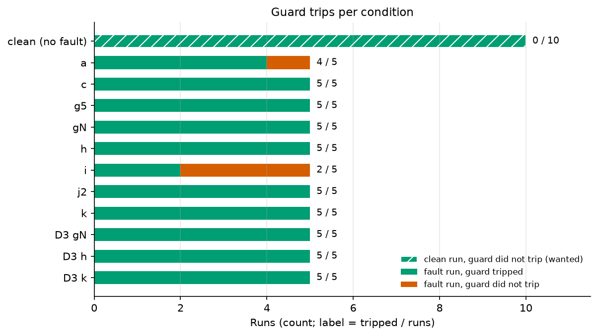
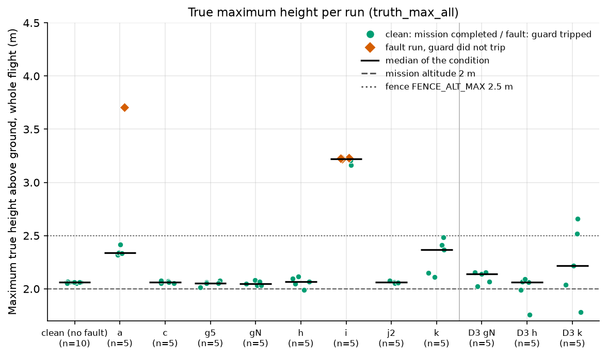
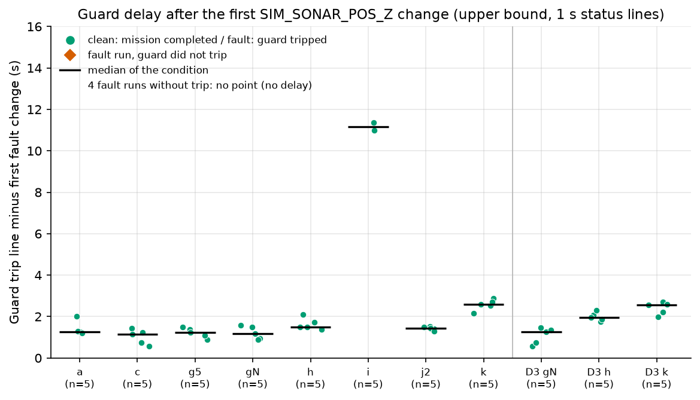
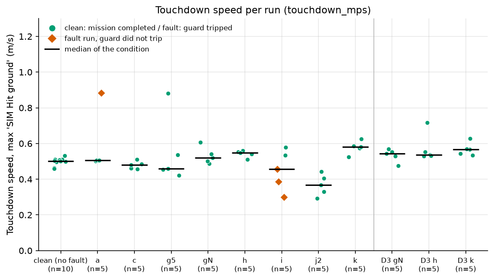
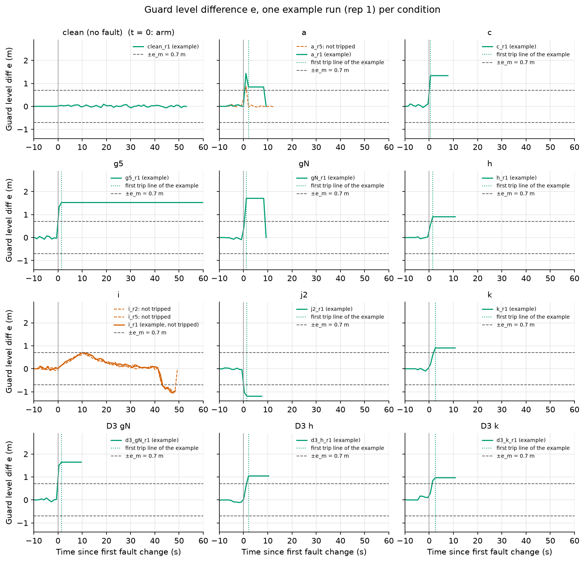

# V8 — 真实 HeightGuard 的 SITL 验证

本目录用 ArduCopter SITL 验证**机载电脑侧真实 HeightGuard**（`companion/height_guard.py`，commit b3a6691）在下视测距给出错误读数时的行为：监视器发现测距与气压高度对不上时切高度源组或落地。

**结果已经收集**：65 次运行（12 个条件）的汇总在 `results.csv` 与 `guard_status.csv`，下面的数字与图都由 `make_figures.py` 从这两个表算出（运行 `python make_figures.py` 会同时打印本文引用的全部数字）。`runs/` 目录与各次的 `metrics.json`、`hg.log` 不在仓库里，由 `collect.py` 汇总成这两个表。

## 目录里有什么

| 文件 | 作用（据脚本自身说明） |
| --- | --- |
| `hg_loop.py` | 以飞控的**第二个 MAVLink 端口**作为独立客户端连上 SITL，只申请 `RANGEFINDER` / `ATTITUDE` / `SCALED_PRESSURE` 三条流，以 20 Hz 驱动真实 `HeightGuard`，让 guard 自己发出切源组和 LAND。运行中的任务脚本（`opt2_sim7.py`）自带监视器此时是关闭的。 |
| `opt2_sim7.py` | 飞控侧任务脚本：任务 `D1/D2/D3/HOV/SQ`，`--alt/--side/--laps/--hold/--settle/--seconds/--thr-auto` 等参数；`--fault T:NAME=VAL` 表示进入 AUTO 后 T 个仿真秒把参数 NAME 改成 VAL（可重复），本目录用它注入 `SIM_SONAR_POS_Z` 测距故障；最后打印 JSON 摘要，指标由日志分析脚本给出。 |
| `analyze7.py` | 分析一次运行，产出 `metrics.json`：真值高度与离航线最大偏差、任务是否完成、着陆速度、起降误差、地面/空中测距统计与距离范围、故障窗口内的真值高度与测距范围等。 |
| `baro_range_monitor.py` | “气压计监视测距”一致性监视器（机载电脑侧，纯标准库）：用气压高度为测距作证，两者持续偏差过大或 2 s 内相对变化过大即判测距不可信，由调用方报警并切 LAND / 切气压高度源组。 |
| `batch.py` | 按任务清单批量跑，最多 4 个 SITL 实例（30..33）并行；已有 `metrics.json` 的任务默认跳过（`FORCE=1` 强制重跑）。 |
| `run_one.sh` | 单次运行：起 SITL（实例 30..33，端口 6060..6090）并写入 `overlay.parm`，启动 `hg_loop.py`，跑 `opt2_sim7.py`，结束后用 `analyze7.py` 生成 `metrics.json`。 |
| `mtf01_sitl_rng.parm` | 本批任务使用的基础参数文件（与 ArduCopter `copter.parm` 默认值一起作为 `--defaults`）。 |
| `jobs_v8.txt` | 65 条任务（12 个条件）。 |
| `jobs_smoke.txt` | 1 条冒烟任务（`h` 条件的故障阶梯）。 |
| `collect.py` | 把各次运行的 `metrics.json` 与 `hg.log` 汇总成 `results.csv`、`guard_status.csv`。 |
| `results.csv` | 每次运行一行（65 行）：`metrics.json` 的标量字段 + guard 摘要（`guard_tripped`、`guard_first_trip_log_t`、`guard_reason`、`guard_e_abs_max`、`guard_disarm_log_t`、`guard_cfg`）。 |
| `guard_status.csv` | guard 打印的每一条状态行（约 1 Hz）：`t`、`active`、`tripped`、`reason`、`e`、`mode`、`rng`。 |
| `make_figures.py` | 读取 `jobs_v8.txt`、`mtf01_sitl_rng.parm`、`results.csv`、`guard_status.csv`，生成下面的图并打印数字（无参数运行，输出到 `figures/`）。 |

任务清单每行格式：

```
tag|parm|speedup|home_yaw|overlay(K=V,K=V,...)|opt2_sim7.py 参数
```

`overlay` 里固定写有 `EK3_RNG_M_NSE=0.1`、`EK3_HGT_I_GATE=200`、`SURFTRAK_MODE=0`、`FENCE_ALT_MAX=2.5`、`FENCE_RADIUS=4`、`FENCE_MARGIN=0.3`、`SIM_SONAR_RND`、`SIM_FLOW_RND=0.15`、`FLOW_FXSCALER=50`、`SIM_WIND_SPD=1.5`、`SIM_WIND_TURB=1.0`，以及每条任务各自的 `SIM_WIND_DIR`。

## 故障条件（全部来自 `jobs_v8.txt` 的 `--fault` 参数）

| 条件 | `SIM_SONAR_POS_Z` 设定值（`--fault`） | 备注 |
| --- | --- | --- |
| `clean` | 不注入 | 对照组 |
| `a` | 3.5 s → 1.5 m，4.5 s → −0.05 m | 两步阶跃 |
| `c` | 6.0 s → 1.5 m，9.0 s → −0.05 m | 两步阶跃 |
| `g5` | 6.0 s → 1.9 m，11.0 s → −0.05 m | 两步阶跃 |
| `gN` | 6.0 s → 1.9 m 后保持 | 保持型错误读数 |
| `h` | 2.5…5.5 s 共 7 步，0.53 m → 1.93 m | 逐级抬高读数 |
| `i` | 6…16 s 共 11 步，0.05 m → 1.05 m | 逐级抬高读数 |
| `j2` | 6.0 s → −1.55 m 后保持 | 读数低于地面 |
| `k` | 1.7…59.95 s 共 234 步，−0.02 m 起爬到约 1.9 m 后小幅抖动 | 长时间阶梯 |

`d3_gN` / `d3_h` / `d3_k` 与 `gN` / `h` / `k` 注入完全相同，只是任务用 `D3` 而不是 `SQ`（两者都是方形航点，`--laps 1`）。除 `clean` 外每个条件 5 次（5 个航向），`clean` 10 次（每个航向 2 次）。

任务高度 `--alt 2.0` m；围栏 `FENCE_ALT_MAX = 2.5` m（任务清单 overlay 与参数文件一致）。guard 配置（65 次相同，`guard_cfg`）：水平差阈值 `e_m = 0.7` m、`t_s = 0.5` s、`blind_s = 1.0` s；已跳闸的 51 次原因全部是 `level`。

## 结果

下表由 `results.csv` 计算（`make_figures.py` 打印同样的行）。“最大高度”是整次飞行真值高度最大值 `truth_max_all`；“着陆速度”是 `touchdown_mps`（日志里 `SIM Hit ground` 的最大值）；“完成任务”是 `mission_complete`（飞到了任务的 Land 项）。

| 条件 | 运行数 | guard 跳闸 | 完成任务 | 最大高度中位数 (m) | 最大高度最差 (m) | 着陆速度中位数 (m/s) |
| --- | --- | --- | --- | --- | --- | --- |
| `clean` | 10 | 0 | 10 | 2.06 | 2.06 | 0.50 |
| `a` | 5 | 4 | 0 | 2.34 | 3.70 | 0.51 |
| `c` | 5 | 5 | 0 | 2.06 | 2.08 | 0.48 |
| `g5` | 5 | 5 | 0 | 2.06 | 2.08 | 0.46 |
| `gN` | 5 | 5 | 0 | 2.05 | 2.08 | 0.52 |
| `h` | 5 | 5 | 0 | 2.07 | 2.11 | 0.55 |
| `i` | 5 | 2 | 3 | 3.22 | 3.23 | 0.46 |
| `j2` | 5 | 5 | 0 | 2.06 | 2.08 | 0.37 |
| `k` | 5 | 5 | 0 | 2.37 | 2.48 | 0.58 |
| `d3_gN` | 5 | 5 | 0 | 2.14 | 2.16 | 0.54 |
| `d3_h` | 5 | 5 | 0 | 2.06 | 2.09 | 0.54 |
| `d3_k` | 5 | 5 | 0 | 2.22 | 2.66 | 0.57 |

合计：故障 55 次中 guard 跳闸 51 次；`clean` 10 次全部不跳闸且全部完成任务（`guard_e_abs_max` 最大 0.139 m）。

### 图


*Figure 1. 各条件的 `SIM_SONAR_POS_Z` 设定值时间线（横轴：进入 AUTO 后的仿真时间 s；纵轴：`--fault` 写入的参数值 m；D3 条件与 SQ 条件使用相同阶梯故以虚线叠加）。这是任务清单里的计划，不是实测。来源：jobs_v8.txt；脚本：make_figures.py。*



*Figure 2. 各条件 guard 是否跳闸的次数（条后标注“跳闸/运行数”）。绿色：故障运行中 guard 跳闸；斜线绿色：clean 运行中 guard 未跳闸（期望结果）；橙色：故障运行中 guard 未跳闸（`a` 1 次、`i` 3 次）。来源：results.csv；脚本：make_figures.py。*



*Figure 3. 每次运行的真值最大高度 `truth_max_all`（点：单次运行；黑线：条件中位数；虚线：任务高度 2.0 m；点线：围栏 2.5 m）。绿色圆点：clean 完成任务 / 故障运行 guard 跳闸；橙色菱形：故障运行 guard 未跳闸。竖线左侧为 SQ 任务，右侧为 D3 任务。来源：results.csv；脚本：make_figures.py。*



*Figure 4. guard 跳闸延迟：首次出现 `tripped=1` 的状态行时刻 − 第一次 `SIM_SONAR_POS_Z` 改动时刻。两个时钟的对齐方法见 `make_figures.py` 文件头：用同一次解锁→上锁事件的 `guard_disarm_log_t − s1` 得到偏移（56 次运行，范围 −0.115…0.170 s，中位数 0.022 s），对所有运行扣除中位偏移。状态行约 1 Hz，所以这是**上界，粒度约 1 s**；延迟从阶梯的**第一步**算起，不是从读数偏差超过阈值那一刻算起。未跳闸的 4 次没有点。来源：results.csv；脚本：make_figures.py。*



*Figure 5. 每次运行的着陆速度 `touchdown_mps`（点：单次运行；黑线：条件中位数）。颜色含义同 Figure 3。来源：results.csv；脚本：make_figures.py。*



*Figure 6. guard 水平差 `e` 随时间变化（每个条件取第 1 次重复作示例；横轴：自第一次改写测距参数起的时间 s，`clean` 为自解锁起；点线：示例运行的首次跳闸状态行；虚线：±`e_m` = 0.7 m）。`a`、`i` 子图中橙色线为 guard 未跳闸的运行（`i` 的 3 次都未跳闸，示例 `i_r1` 本身即是）。状态行约 1 Hz，短脉冲的峰值可能被漏掉。来源：guard_status.csv、results.csv；脚本：make_figures.py。*

### 数据显示了什么

- **跳闸**：`clean` 10 次 guard 全部不跳闸，故障 55 次中 51 次跳闸；`c`、`g5`、`gN`、`h`、`j2`、`k` 与 3 个 D3 条件 5/5 跳闸，`a` 4/5，`i` 2/5（Figure 2）。
- **延迟**：51 次跳闸的延迟为 0.57…11.37 s，中位数 1.49 s（上界，约 1 s 粒度）。`i` 的两次跳闸约 11 s；`k` 与 `D3 k` 条件中位数约 2.6 s；其余条件中位数 1.15…1.95 s（Figure 4）。
- **高度**：8 次运行真值最大高度超过 2.5 m 围栏：`a` 1 次（未跳闸的 `a_r5`）、`i` 5 次（3.16…3.23 m，其中 2 次 guard 跳闸、3 次未跳闸）、`d3_k` 2 次（2.52、2.66 m，guard 均跳闸）。其余条件最大值：`c`、`g5`、`gN`、`j2`、`d3_gN`、`d3_h` 不超过 2.16 m，`h` 2.11 m，`k` 2.48 m，`a` 跳闸的 4 次不超过 2.42 m（Figure 3）。
- **着陆速度**：各条件中位数 0.37…0.58 m/s；单次最大 0.88 m/s（`a_r5` 与 `g5_r3`）（Figure 5）。
- **`a` 与 `i` 中 guard 未跳闸的运行**（`results.csv`、`guard_status.csv` 所示，下文不推测原因）：
  - `a_r5`：故障脉冲持续约 1 s（`f_dur` = 1.0 s）。状态行里 `e` 只有一行达到 0.871 m（故障后 1.0 s），下一行回到约 0；之后测距读数在状态行里从 1.77 m 升到 3.74 m，真值最大高度 3.70 m（其余 4 次 `a` 为 2.32…2.42 m）。模式在故障后约 6 s 变为 LAND（`left_auto_at` = 12.7 s），未完成任务；着陆速度 0.88 m/s，是 `a` 中最大。
  - `i_r1`、`i_r2`、`i_r5`：`e` 在故障后约 10…11 s 达峰，状态行里的峰值分别为 0.709、0.658、0.695 m，随后下降；这 3 次真值最大高度 3.22…3.23 m，任务走完（`mission_complete` = True），解锁后约 51.3…51.7 s 进入 LAND 模式（`left_auto_at`）。进入 LAND 后 `e` 降到 −1.06…−0.99 m，但 guard 仍未跳闸（`guard_e_abs_max` 的 0.987…1.059 m 来自这一段，不是故障段）。
  - 同条件里跳闸的 `i_r3`、`i_r4`：状态行里跳闸前 `e` 峰值 0.730 m 与 0.657 m，在故障后约 11 s 处跳闸。1 Hz 的 `e` 峰值不能区分跳闸与未跳闸的 `i` 运行（0.657 m 跳闸，0.709 m 未跳闸）。
- **时钟**：`guard_first_trip_log_t` 与仿真时钟的对齐只靠上面的偏移估计，没有独立的第二个对时来源。

### 数据没有显示什么

- 没有解释 `a_r5` 与 `i` 三次不跳闸的原因，也没有解释这几次的 LAND 是谁触发的：`results.csv` 里没有触发 LAND 的来源；`msgs` 在汇总表里只保留了条数。
- `g5` 有 4 次 `disarmed` = False（`flight_s` ≈ 123 s，最终模式 LAND，着陆速度正常），表里没有说明原因；另有 `d3_*`、`k` 的几次 `guard_disarm_log_t` 与 `s1` 对不上或缺失，这些运行没有用于对时。
- 延迟只到 1 s 粒度，且从第一步改动算起；没有给出“读数错到超过阈值”之后的延迟。
- 没有与 `../val7/report.md` 的闭环数字比较（本次未核对两边指标定义）。
- `clean` 之外每个条件只有 5 次（5 个航向），`a`、`i` 的未跳闸比例（1/5、3/5）只是这 5 次的计数，不是概率估计。
