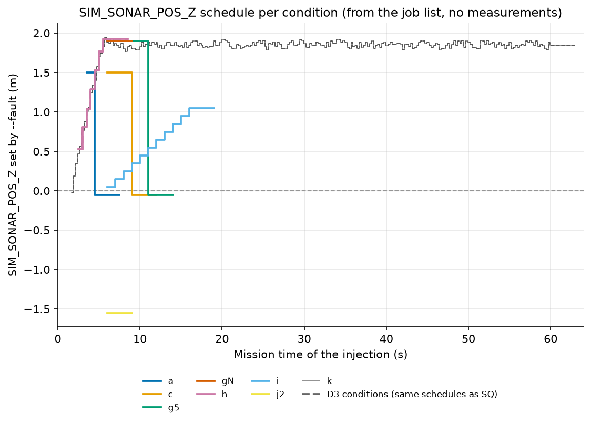

# V8 — 真实 HeightGuard 的 SITL 验证

本目录用 ArduCopter SITL 验证**机载电脑侧真实 HeightGuard**（`companion/height_guard.py`，commit b3a6691）在下视测距给出错误读数时的行为：监视器发现测距与气压高度对不上时切高度源组或落地。

**本目录目前只有脚本与任务清单，没有结果文件**（没有 `results.csv`、没有 `runs/` 目录、没有 `metrics.json`）。因此本 README 里的图描述的是**计划中的实验**（各条件注入什么测距故障），不是实测结果。

## 目录里有什么

| 文件 | 作用（据脚本自身说明） |
| --- | --- |
| `hg_loop.py` | 以飞控的**第二个 MAVLink 端口**作为独立客户端连上 SITL，只申请 `RANGEFINDER` / `ATTITUDE` / `SCALED_PRESSURE` 三条流，以 20 Hz 驱动真实 `HeightGuard`，让 guard 自己发出切源组和 LAND。运行中的任务脚本（`opt2_sim7.py`）自带监视器此时是关闭的。 |
| `opt2_sim7.py` | 飞控侧任务脚本：任务 `D1/D2/D3/HOV/SQ`，`--alt/--side/--laps/--hold/--settle/--seconds/--thr-auto` 等参数；`--fault T:NAME=VAL` 表示进入 AUTO 后 T 个仿真秒把参数 NAME 改成 VAL（可重复），本目录用它注入 `SIM_SONAR_POS_Z` 测距故障；最后打印 JSON 摘要，指标由日志分析脚本给出。 |
| `analyze7.py` | 分析一次运行，产出 `metrics.json`：真值高度与离航线最大偏差、任务是否完成、着陆速度、起降误差、地面/空中测距统计与距离范围、故障窗口内的真值高度与测距范围等。 |
| `baro_range_monitor.py` | “气压计监视测距”一致性监视器（机载电脑侧，纯标准库）：用气压高度为测距作证，两者持续偏差过大或 2 s 内相对变化过大即判测距不可信，由调用方报警并切 LAND / 切气压高度源组。 |
| `batch.py` | 按任务清单批量跑，最多 4 个 SITL 实例（30..33）并行；已有 `metrics.json` 的任务默认跳过（`FORCE=1` 强制重跑）。 |
| `run_one.sh` | 单次运行：起 SITL（实例 30..33，端口 6060..6090）并写入 `overlay.parm`，启动 `hg_loop.py`，跑 `opt2_sim7.py`，结束后用 `analyze7.py` 生成 `metrics.json`。 |
| `mtf01_sitl_rng.parm` | 本批任务使用的基础参数文件（与 ArduCopter `copter.parm` 默认值一起作为 `--defaults`）。 |
| `jobs_v8.txt` | 65 条计划任务（12 个条件）。 |
| `jobs_smoke.txt` | 1 条冒烟任务（`h` 条件的故障阶梯）。 |
| `make_figures.py` | 读取 `jobs_v8.txt` 生成下面的图（无参数运行，输出到 `figures/`）。 |

任务清单每行格式：

```
tag|parm|speedup|home_yaw|overlay(K=V,K=V,...)|opt2_sim7.py 参数
```

`overlay` 里固定写有 `EK3_RNG_M_NSE=0.1`、`EK3_HGT_I_GATE=200`、`SURFTRAK_MODE=0`、`FENCE_ALT_MAX=2.5`、`FENCE_RADIUS=4`、`FENCE_MARGIN=0.3`、`SIM_SONAR_RND`、`SIM_FLOW_RND=0.15`、`FLOW_FXSCALER=50`、`SIM_WIND_SPD=1.5`、`SIM_WIND_TURB=1.0`，以及每条任务各自的 `SIM_WIND_DIR`。

## 故障条件（全部来自 `jobs_v8.txt` 的 `--fault` 参数）

| 条件 | `SIM_SONAR_POS_Z` 设定值（`--fault`） | 备注 |
| --- | --- | --- |
| `clean` | 不注入 | 对照组 |
| `a` | 3.5 s → 1.5 m，4.5 s → −0.05 m | 两步阶跃 |
| `c` | 6.0 s → 1.5 m，9.0 s → −0.05 m | 两步阶跃 |
| `g5` | 6.0 s → 1.9 m，11.0 s → −0.05 m | 两步阶跃 |
| `gN` | 6.0 s → 1.9 m 后保持 | 保持型错误读数 |
| `h` | 2.5…5.5 s 共 7 步，0.53 m → 1.93 m | 逐级抬高读数 |
| `i` | 6…16 s 共 11 步，0.05 m → 1.05 m | 逐级抬高读数 |
| `j2` | 6.0 s → −1.55 m 后保持 | 读数低于地面 |
| `k` | 1.7…59.95 s 共 234 步，−0.02 m 起爬到约 1.9 m 后小幅抖动 | 长时间阶梯 |

`d3_gN` / `d3_h` / `d3_k` 与 `gN` / `h` / `k` 注入完全相同，只是任务用 `D3` 而不是 `SQ`（两者都是方形航点，`--laps 1`）。除 `clean` 外每个条件 5 次（5 个航向），`clean` 10 次（每个航向 2 次）。

## 图



*Figure 1. 各条件的 `SIM_SONAR_POS_Z` 设定值时间线（横轴：进入 AUTO 后的仿真时间 s；纵轴：`--fault` 写入的参数值 m；D3 条件与 SQ 条件使用相同阶梯故以虚线叠加）。这是任务清单里的计划，不是实测。来源：jobs_v8.txt；脚本：make_figures.py。*
