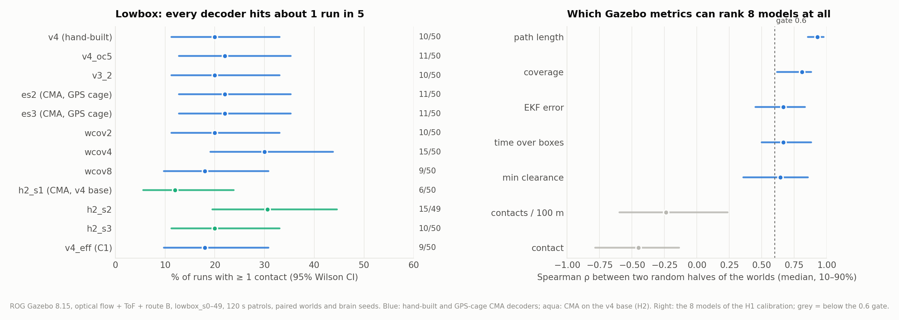
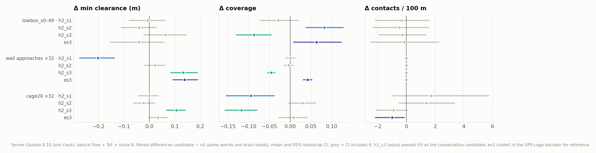
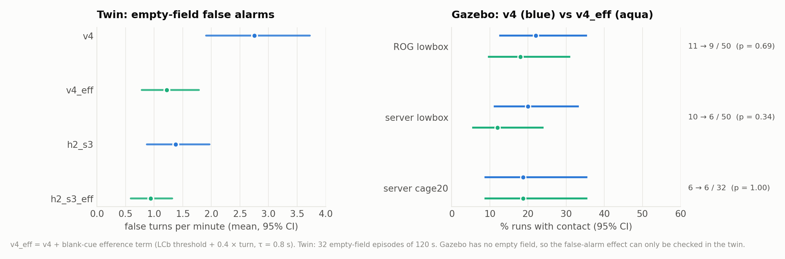

# 报告五：硬件对齐——按真机传感器配置重做 RL 管线

> 分支 `ecps295-sim` · 代码在 [`ecps295/rl/`](../rl/) · 2026-10-07 … 10-13 · Gazebo 在 ROG 笔记本（8.15，锁步）和云服务器
> （8.10 + 仿真时钟）上运行，快仿真在 Mac mini M4 和 Jetson AGX Orin 上运行 · H0–H3 与 C1 已完成 ·
> 图表由 [`make_figures_hw.py`](make_figures_hw.py) 生成，数字见 [`hw_stats.txt`](hw_stats.txt) ·
> English: [05_hardware_alignment.en.md](05_hardware_alignment.en.md)

## 摘要

报告四的解码器是在 GPS 网笼里、用真值快仿真训练和验收的。真机没有 GPS，靠 Matek 3901-L0X（光流 + ToF）和路线 B 导航，
基座是 v4 模型，场地里有矮箱子和 1.1 m 箱垛。按这个设置复测（ROG，`lowbox_s0–29`），**没有一个 RL 解码器优于手调版本**。
因此在所有阶段之前插入了硬件对齐：用真机传感器配置的验收门（H0）、按 Gazebo 校准过光流误差模型的快仿真（H1）、在 v4
基座上加硬约束重新优化（H2），以及与 v4 的同机配对验收（H3）。有两个发现决定了后续方向：

1. **lowbox 上的接触对解码器不敏感。** 12 个解码器（手调或优化）在 50 个世界中都有 6–15 次接触。77% 的接触发生在
   1.1 m 箱垛上、逃逸过程中，且逃逸开始时距离箱垛的中位数只有 0.06 m：飞机是从相机看不到的方向蹭上箱垛的。
   Gazebo 本身无法按接触给模型排序（分半信度 ρ < 0），连续指标（覆盖率、EKF 误差、越箱时间、最小间隙）则可以。
2. **一个 H2 种子作为保守版通过。** `h2_s3` 的 lowbox 接触不变，墙体和 cage20 上最小间隙增加 0.11–0.13 m
   （p < 0.001），代价是覆盖率低 0.05–0.12。blank 线索的传出副本（C1）在快仿真里把空场误转向减半，Gazebo 上不变差，
   因此 **`v4_eff` 成为新的默认版本**。

## 1. GPS 网笼和真机之间的差别

| 方面 | 10-07 之前的 RL 管线 | 真机（以及之后的设置） |
|---|---|---|
| 导航 | 快仿真：真值；Gazebo：GPS | 无 GPS；EKF3 用光流 + ToF；路线 B 由机载计算机提供离地高度 |
| 基座模型 | v3_2（无腹侧通路） | v4：LCv → MDN 后退、高度看门狗、路线 B |
| 世界 | 程序化网笼、网边箱垛 | lowbox：6–10 个 0.2–0.75 m 矮箱子 + 距起点 1.0–2.3 m 的 1.1 m 箱垛；墙体接近；cage20 |
| 越过矮箱子 | 快仿真里没有后果 | ToF 读数骤降，EKF 高度和速度被拉偏 |
| 后退 | 快仿真里精确执行 | 后方没有视觉，光流导航下会漂移 |

ROG 的 `fx_*` 矩阵（1,209 次 Gazebo 运行）中，GPS 网笼选出的解码器撞 1.1 m 箱垛的次数是 v4 的 2–4 倍，大多发生在扫视
后退中，EKF 误差也是 v4 的两倍。快仿真对同样 30 个世界给出了相反的排序。

## 2. H0：真机传感器配置的 Gazebo 验收门

服务器上的 `~/sim/hw/ecps295` 使用光流 + ToF + 路线 B，并用仿真时钟（`gz_batch.py --hw`）。在同样 50 个 lowbox 世界上
与 ROG 做跨机检查：v4、v3_2、es2、es3 有接触的运行分别为 4/4、4/4、7/6、5/6（相差 ≤ 1 次），覆盖率、越箱时间、EKF
误差和最小间隙都接近，所以服务器上 RTF 0.15 的运行仍然有效。墙体和 cage20 上 RL 解码器不比 v4 差（es2/es3 在墙体上
间隙 +0.13 m，p < 0.001），问题只出在 lowbox。

## 3. H1：校准快仿真，以及 Gazebo 能测出什么

快仿真新增了光流导航模型（EKF 速度高估、地形滞后、随机游走，遥测给估计位置）、10 Hz ToF、气压计和 lowbox 风格的程序化
世界。原定门槛是“快仿真复现 Gazebo 对 8 个模型的 lowbox 排序（Spearman ρ ≥ 0.6）”。9 组设置全部不通过，而原因在
Gazebo 一侧：

*图 1. 左：lowbox_s0–49 上有接触的运行（ROG）。右：各指标在 8 个校准模型上的分半信度——把 50 个世界随机分成两半，
计算两半里各模型均值的相关。*

- 每个解码器大约每 5 次运行就有 1 次接触（6–15/50）。按接触排序时，两半之间的相关不只是弱，而是负的
  （ρ ≈ −0.45；每 100 m 接触 −0.24）：50 个世界下接触排序就是噪声。航程（0.93）、覆盖率（0.81）、EKF 误差和越箱
  时间（0.67）、最小间隙（0.64）可以复现。
- 因此门槛在 10-08 事后修订（已如实记录）为四个可靠指标（越箱时间、定位误差、覆盖率、最小间隙）ρ 的均值 ≥ 0.6。
  逐回合随机化的光流误差模型（地形滞后 0.5–4 s、随机游走 0.02–0.06、巡航 0.8 ± 0.1 m；`rl.twin.flow_dr`）在 s0–29
  上通过（ρ 0.64），在留出的 s30–49 上不通过（0.36）。快仿真的绝对越箱时间约为 Gazebo 的三分之一。
- **lowbox 接触为什么对解码器不敏感**（ROG 400 次飞行）：77% 的接触在 1.1 m 箱垛上，接触率随世界里的箱垛数量上升
  （0 个 0.08 → 3 个 0.35），与具体世界几乎无关（ICC ≈ 0.09）。77% 发生在逃逸中（后退 46%、原地转向 42%、前进 12%），
  40% 在逃逸开始后 1 s 内。在箱垛 1 m 内开始的 1,589 次逃逸里，最终撞上的 96 次开始时距离中位数只有 **0.06 m**，
  没撞上的 1,493 次为 0.55 m；在 ≥ 0.2 m 处开始的逃逸只有 1% 撞上。
- 服务器上对逃逸结构做消融（去掉扫视后退 / 去掉腹侧后退 / 两者都去掉，169 次）没有证实“后退导致撞箱垛”
  （10/50 → 12、8、5/49；p = 0.27）。结论：飞机**发现箱垛太晚或根本没看见**，解码器调参在 lowbox 上已经到顶。结构性
  改动（不向看不见的方向移动、短时空间记忆、侧后向 ToF）已列入备选，按决定暂缓。
  *10-14 更新：这些改动已在 10-13 完成，之后又加了 ToF 测距安全层，见[报告七](07_range_sensing_shield.zh.md)。*

## 4. H2 / H3：在 v4 基座上重新优化，并与 v4 配对验收

H2 在 `v4hw` 空间（v4 参数加硬约束：扫视 1.2–2.0 s、后退 ≤ 0.3 × 0.6 s、不应期 ≤ 3 s，再加腹侧参数）中优化，适应度 v3
（后退距离和定位误差代价，覆盖率下限 0.35），使用随机化光流模型，训练世界一半是 lowbox；3 个 CMA 种子，20 代 × 12 候选
× 12 回合，按留出集最优代导出为 `minifly/h2_s1..3.yaml`。快仿真里没有一个候选比 v4 接触更少，提升来自覆盖率。

*图 2. 服务器上的 H3：在 lowbox_s0–49、32 次墙体接近和 cage20 × 32 上与 v4 的配对差值。*

| 候选 | lowbox 有接触的运行（服务器） | 墙体：Δ 最小间隙 | cage20：有接触的运行、Δ 间隙 | 结论 |
|---|---|---|---|---|
| h2_s1 | 10 → 6/49（p = 0.42） | **−0.20 m**（变差） | 6 → 6，±0 | 淘汰 |
| h2_s2 | 10 → 5/50（p = 0.30） | +0.02 m | 6 → 11，擦过更多（p = 0.03） | 淘汰（ROG 上也更差：15/49） |
| **h2_s3** | 9 → 5/48（p = 0.39） | **+0.13 m**（p < 0.001） | 6 → 1，**+0.11 m**（p < 0.001），近失 0.75 → 0.16 | **通过，“保守版”** |

预注册规则：接触不显著变差，**且**每 100 m 接触或最小间隙至少一项显著改善。h2_s3 靠间隙通过，代价是覆盖率低
0.05–0.12。ROG 上独立复跑 lowbox 的结果一致（h2_s3 10 → 10，越箱时间更短、EKF 误差更小；h2_s2 10 → 15，显著更差），
也说明两台机器上 lowbox 接触差异的方向会翻转——再次说明 50 个世界下的接触计数主要是噪声。

## 5. C1：blank 线索的传出副本

空网笼里 v4 每分钟有 2.75 次误转向。把 DNp03 的输入拆开后，81% 来自 blank 线索（LCb），其中 58% 发生在转向后 1 s 内：
转头把视野扫到无纹理区域，基线来不及适应。looming 的传出副本（a、b）几乎无效；blank 项有效：转向后 LCb 门限按
c × 转向量抬高，再按 τ 衰减（`vision.ecps_efference`，默认关闭）。

*图 3. 左：快仿真空场（32 × 120 s）。右：Gazebo，v4 与 v4_eff 在相同世界和种子上配对。*

- `v4_eff`（c = 0.4，τ = 0.8 s）在快仿真里把误转向减半（2.75 → 1.22 次/分），在 Gazebo 里没有任何一项变差：lowbox
  11 → 9/50（ROG）、10 → 6/50（服务器），cage20 6 → 6/32，墙体接近都没有接触。lowbox 合计 21 → 15/100，不显著。
  **从现在起作为默认版本。**
- 在 `v4hw_eff`（26 维，适应度 v4 = v3 − 0.1 × 每分钟虚警）上做 CMA，大多数种子把 c 留在下界附近，因为这个惩罚相对
  回合噪声太小；一个种子（c1_s3）学到 c ≈ 0.20、τ ≈ 1.1 s、a = 0，独立找到了与手设方案一致的解。从 v4_eff 热启动的
  c1b_s1 保留了 blank 项（c = 0.36），但用接触换覆盖率（接触比例 0.42 对 0.17），未采用。
- `h2_s3_eff`（h2_s3 加同样的 blank 项）不比 h2_s3 好，已淘汰。

## 6. 硬件对齐之后的状态

| 阶段 | 状态 | 结论 |
|---|---|---|
| H0 验收门 | ✅ | 服务器与 ROG 相差不超过 1 次；问题只在 lowbox |
| H1 快仿真校准 | ✅（门槛修订） | Gazebo 中接触无法排序；随机化快仿真在 s0–29 上通过修订后的门槛，在 s30–49 上不通过 |
| H2 / H3 | ✅ | h2_s3 作为保守版通过；没有候选能降低 lowbox 接触 |
| C1 传出副本 | ✅ | v4_eff 成为默认版本 |
| lowbox 结构性改动 | ✅（10-13） | 见[报告七](07_range_sensing_shield.zh.md)：测距安全层，Gazebo lowbox 0/50 |

之后在这个设置下重做了连接组问题的对照臂，见[报告六](06_connectome_controls_ood.zh.md)。

## 7. 数据与复现

- Gazebo 运行：[`rl/results/gazebo/hw_runs.csv`](../rl/results/gazebo/hw_runs.csv)（`fx_*` 为 ROG 的 H0/H1，
  `h0low_* / h0cage_* / h0wall_*` 为服务器，`mc1_*` 为 ROG 的 C1）。
- CMA 运行（不含逐回合日志，留在各台机器上）：[`rl/results/twin/hw/`](../rl/results/twin/hw/)。
- 快仿真测试：[`rl/results/twin/hw/tests.csv.gz`](../rl/results/twin/hw/tests.csv.gz)（`rl.hw_arms`、`--conds`、`rl.ood`）。
- `cd ecps295 && python reports/make_figures_hw.py` 重新生成图 9–16 和 `hw_stats.txt`。
- 本代码树上 `python -m rl.gates all` 12/12 通过（感觉门控、闭环冒烟测试，以及 Mac mini、服务器、ROG、Jetson 上逐位
  一致的锚点）。
