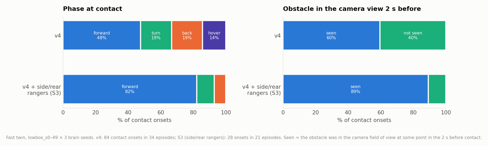
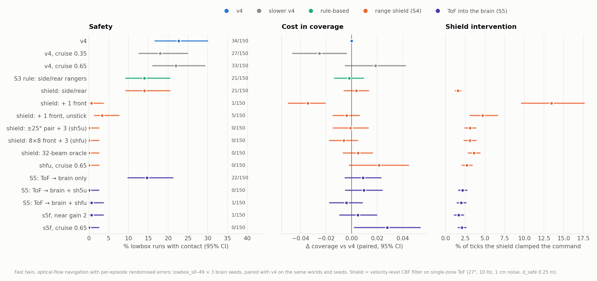
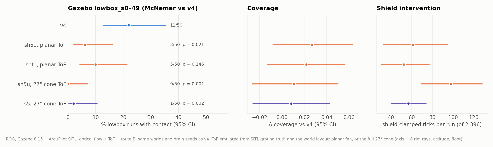
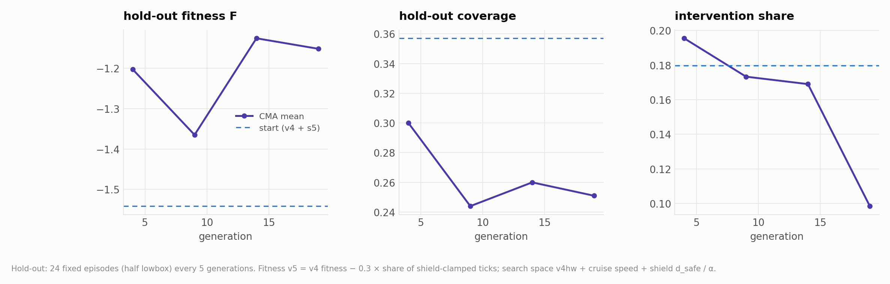

# Report 7 — Range sensing and a safety shield: closing the lowbox gap

> Branch `ecps295-sim` · code in [`ecps295/`](..) and [`ecps295/rl/`](../rl/) · 2026-10-13 … 10-14 · fast twin on the
> desktop and the Mac mini, Gazebo on the ROG laptop (8.15, lockstep), CMA-ES on the Mac mini and the Jetson ·
> figures from [`make_figures_n.py`](make_figures_n.py), numbers in [`n_stats.txt`](n_stats.txt) ·
> 中文版：[07_range_sensing_shield.zh.md](07_range_sensing_shield.zh.md)

## Abstract

Reports 5–6 left one problem open: on lowbox (low boxes plus a 1.1 m stack, optical-flow navigation, no GPS) every
decoder — hand-built, CMA-optimised, intact or bypass — hits something in roughly one run in five, and the H1 cause
analysis showed the drone mostly does not see the obstacle in time. We therefore stopped tuning readout parameters
and changed the structure instead.

1. **Rules without new sensors are not enough.** Never moving backwards into unseen space (S1) does nothing; a
   short-term spatial memory (S2) helps in direction but not significantly, in the twin or in Gazebo. Side/rear ToF
   rangers (S3) cut lowbox contact runs by 38 %. What is left is 82 % "flying forward into an obstacle the camera
   had seen".
2. **Five single-zone ToF sensors plus a velocity-level safety filter remove lowbox contacts.** In the twin
   (sh5u: two front rangers at ±25° plus right/rear/left): **34/150 → 0/150 runs with contact, coverage unchanged** —
   the same as an ideal 32-beam ring. Flying slower does not buy the same safety.
3. **The same readings into the brain (S5) share the work.** Feeding the ranges into the retina's `near` (LCn) grids
   keeps 0/150 and lowers shield interventions by 30 % (p = 0.0001).
4. **Gazebo + ArduPilot SITL confirm it.** With the ToF modelled as the real 27° cone, sh5u goes from 11/50 to
   **0/50** lowbox runs with contact (McNemar p = 0.001); s5 to 1/50 (p = 0.002) with 42 % fewer shield
   interventions. The one s5 contact came from optical-flow position drift, not a missed obstacle.
5. **Optimising with the shield in the loop (N3) did not help yet.** The first seed raised its fitness by flying
   less (coverage 0.36 → 0.25). The second seed and a larger Gazebo sample are still running.

## 1. Why the decoder was the wrong knob

From reports 5–6, on lowbox with flow navigation: v4 hits something in 34/150 twin episodes and 11/50 Gazebo runs;
no intact CMA seed beat v4; bypass seeds did (median 2.5/50 in Gazebo) but lost the edge without texture. Three
things stacked up:

- **Blind spots.** 77 % of the H1 contacts happened during escapes (backing 46 %, turning in place 42 %), against
  sides the camera could not see.
- **Evaluation noise.** At a 20 % contact rate, 12 episodes per CMA candidate give a standard error of about 0.115 —
  as large as the effect being searched for. Gazebo cannot rank models by contacts even with 30 worlds (split-half
  ρ ≈ 0), so CMA effectively climbed on coverage.
- **Safety bought with caution.** The only intact candidate that was safer (h2_s3) paid with 0.05–0.12 coverage.

The literature (three parallel searches, about 150 queries) points the same way: the small drones that come close
to zero collisions use range sensors (ETH's Crazyflie with two 8×8 VL53L5CX: 0/20 at 0.5 m/s), a safety filter that
is on during training works better than one added afterwards — provided its interventions are penalised — and
dense safety proxies (clearance, time inside a safety radius, filter interventions) make better optimisation targets
than rare contact counts.

## 2. Structural fixes without a forward sensor (S1–S3)

Code: [`ecps_struct.py`](../ecps_struct.py) (`StructGuard`, off by default), configured under `ecps_pilot.struct`;
the twin gained `TwinDrone.side_ranges()` (rear/left/right, 10 Hz, 1 cm noise, own random stream). Default runs
stay bit-identical.

- **S1** never back off into unseen space: saccades only turn in place.
- **S2** short-term spatial memory: each escape stores a threat point in the flow-EKF frame for 20 s; forward or
  backward motion towards a stored point within 0.5 m and ±60° becomes a hover. Uses only what the real drone has.
- **S3** side/rear ToF (needs hardware): no backing when the rear reads < 0.45 m, push away from a side < 0.35 m.

Twin screen (desktop, lowbox 150 paired episodes, cage20 32, empty field 32; the raw episodes are still on the
desktop, the table is from its log):

| Variant | lowbox runs with contact /150 | contacts / 100 m | lowbox coverage | cage20 /32 | empty-field false turns /min |
|---|---|---|---|---|---|
| v4 | 34 | 4.33 | 0.379 | 6 | 2.75 |
| S1 no back-off | 37 (p = 0.73) | 5.00 | 0.369 | 6 | 2.94 |
| S2 memory | 26 (p = 0.17) | 3.59 | 0.364 | 5 | 2.63 |
| S2 wide memory | 24 (p = 0.11) | 2.77 | **0.340** (p < 0.001) | 8 | 2.75 |
| **S3 side/rear rangers** | **21 (p = 0.019)** | **1.16** (p < 0.001) | 0.377 | **1** | 2.75 |
| S2 + S3 | 20 (p = 0.013) | 1.19 | 0.357 (p = 0.03) | 1 | 2.63 |

- Gazebo re-check of S2 (desktop, two instances): S2 12 → 8/48 (p = 0.45), coverage −0.019 (n.s.); wide S2
  10 → 15/45, coverage −0.087 (p = 0.013). S2 was dropped.
- Under the stage-D out-of-distribution modes S3 still helps, most of all without texture and in wind (lowbox
  notex 10 → 2/50, wind 33 → 18/50), but not when obstacles are invisible (ghost 32 → 29/50), because S3 has no
  forward sensor.



*Figure 1. What the contacts look like, twin lowbox, 150 episodes per model (`rl/diag_contacts.py`). S3 removes the
backing, turning and hovering contacts. What remains is forward flight into an obstacle that was in view: it is
seen too late, not missed.*

## 3. A range shield (S4) and range input to the brain (S5) — twin screen

**S4** ([`ecps_struct.RangeShield`](../ecps_struct.py)): each beam *i* at body bearing *b_i* with reading *d_i*
constrains the commanded velocity, v·u_i ≤ α(d_i − d_safe) with d_safe 0.25 m and α 1/s, and pushes back when
d_i < d_safe. Yaw and throttle are untouched. A 1 s "unstick" rule turns towards the more open side when forward
motion stays clamped. Sensors are single-zone VL53L1X-like cones (27°, 10 Hz, 1 cm noise) unless noted.

**S5** ([`ecps_retina.py`](../ecps_retina.py), `vision.ecps_tof`): beams within ±60° of the nose also drive the
`near` grids of the retina (LCn pathway): proximity = clip(1 − d / 0.8 m, 0, 1), left beams to the left eye, right
beams to the right eye. The brain's own saccade then turns away; the shield is the backstop.

Screen: [`rl/shield_screen.py`](../rl/shield_screen.py), lowbox_s0–49 × 3 brain seeds and cage20 × 32, paired with v4
on the same worlds, seeds and randomised flow errors (3,638 episodes, 0 errors; desktop and Mac mini agree bit for
bit).



*Figure 2. Safety, coverage cost and shield intervention for each configuration, fast twin.*

| Configuration | lowbox runs with contact /150 | Δ coverage | cage20 /32 | shield-clamped ticks |
|---|---|---|---|---|
| v4 | 34 | — | 6 | — |
| v4 at cruise 0.35 (just slower) | 27 (p = 0.34) | **−0.025** | 3 | — |
| side/rear shield only | 21 (p = 0.024) | +0.004 | 1 | 1.6 % |
| + one front ranger | 1 | **−0.034** (stalls) | 0 | 13.4 % |
| + one front ranger, unstick | 5 | −0.004 | 0 | 4.7 % |
| **sh5u: ±25° front pair + R/rear/L, unstick** | **0** | −0.001 | **0** | 3.1 % |
| **shfu: 8×8 front array + R/rear/L** | **0** | −0.006 | 1 | 3.1 % |
| 32-beam oracle ring | 0 | +0.005 | 0 | 3.6 % |
| shfu at cruise 0.65 | 0 | +0.021 (p = 0.10) | 0 | 2.7 % |
| s5n: ToF → brain only, no shield | 22 (p = 0.029) | +0.009 | 2 | — |
| **s5: ToF → brain + sh5u** | **0** | **+0.010** | **0** | **2.2 %** |
| s5f: ToF → brain + shfu | 1 | −0.004 | 0 | 2.0 % |

- **The shield reaches zero without being cautious.** sh5u and shfu: 0/150 (one-sided 95 % upper bound 2.0 %), coverage
  unchanged, minimum clearance +0.03–0.06 m. Five cheap single-zone sensors match the ideal ring.
- **Geometry matters.** A single front beam only cancels the forward component, so the drone stalls in front of a
  box (coverage −0.034). Two beams at ±25° let the projection slide the drone past the obstacle.
- **Slower is not safer enough.** Cruise 0.35 removes 7 contact runs (n.s.) and costs coverage; cruise 0.65 with the
  shield keeps 0 contacts and gains coverage — room for optimisation (N3).
- **The brain uses the extra sense.** ToF into LCn alone removes a third of the contact runs. With the shield, s5
  needs 30 % fewer shield interventions than sh5u (75 → 52 ticks per run, p = 0.0001; s5f vs shfu −35 %). Empty-field
  false turns are unchanged.

## 4. Gazebo acceptance (N1, ROG)

ArduPilot SITL + Gazebo, flow navigation + route B, 0.5 m/s cruise, 120 s patrol; lowbox_s0–49 plus cage20 × 8,
paired by world and brain seed with the ROG v4 runs. Ranges come from SITL ground truth and the world layout in
[`mavlink_twin.py`](../mavlink_twin.py): first as a planar fan (3 rays per beam, as in the twin), then as the full
27° cone (axis + 8 rim rays, rotated with the SITL attitude, floor included; `ECPS_TOF_CONE3D=1`). 232 runs,
0 failures.



*Figure 3. Gazebo lowbox, paired with v4 on the same 50 worlds and brain seeds.*

| Configuration | lowbox runs with contact /50 | McNemar p | contacts / 100 m | Δ coverage | cage20 /8 | shield ticks / run |
|---|---|---|---|---|---|---|
| v4 | 11 | — | 2.50 | — | 1 | — |
| sh5u, planar ToF | 3 | 0.021 | 0.76 | +0.027 (n.s.) | 0 | 61 |
| shfu, planar ToF | 5 | 0.15 | 0.66 | +0.022 (n.s.) | 0 | 52 |
| **sh5u, 27° cone** | **0** | **0.001** | **0** | +0.011 (n.s.) | **0** | 98 |
| **s5, 27° cone** | **1** | **0.002** | **0.23** | +0.008 (n.s.) | **0** | **57** |

- **Planar ToF leaves the low box tops.** Classifying each contact onset by which box it touched: runs with a side
  contact went 9/50 → 0/50 with sh5u (p = 0.004). The remaining contacts all grazed the top of a low box 0–3 cm below
  the airframe — v4 has three of those too. A planar fan cannot see them; the twin never produces them because its
  altitude is fixed per episode.
- **The real cone sees them.** Rotating the 27° cone with the attitude removes every contact: 0/58 runs across lowbox
  and cage20 (one-sided 95 % upper bound 5.0 %). Price: 60 % more shield interventions than the planar model, because
  box tops 5–15 cm below are now seen at about 0.4 m and the drone slows down over them. This depends on the chip
  reporting the near part of a partly filled cone; a bench test must confirm it.
- **Brain plus shield holds in Gazebo.** s5 needs 42 % fewer shield interventions than sh5u (98 → 57 ticks, p = 0.013;
  twin −30 %), keeps coverage, and widens the cage20 minimum clearance from 0.049 to 0.140 m (p = 0.023). s5 vs sh5u
  contacts (1 vs 0) are not different (p = 1).
- **The single s5 contact is localisation drift.** In lowbox_s41, during the last 4 s the flow-EKF position error grew
  to 1.6–1.9 m; the geofence turn uses the estimate and did not fire, and the drone grazed the boundary net (1.9 cm)
  while the shield was backing off — in EKF coordinates. Position errors above 1 m also occur for v4 (3/50) and
  sh5u (1/50). A shield based on the range rate (directly measured closing speed) would not depend on the EKF.

## 5. Optimising with the shield in the loop (N3) — first seed

[`rl/cmaes_run.py`](../rl/cmaes_run.py) `--shield <cond> --fitness v5 --space v4hw_sh`: every candidate flies with the
shield, the search space is v4hw plus cruise speed and the shield's d_safe and α, and fitness v5 subtracts
0.3 × the share of shield-clamped ticks so the brain cannot lean on the filter.



*Figure 4. Mac mini, seed 1 with the s5 shield, 20 generations × 14 candidates × 16 episodes.*

- Hold-out F rose from −1.54 (v4 + s5) to −1.13, but by flying less: path 13.4 → 7.6 m, coverage 0.36 → 0.25, which
  lowered the intervention share 0.18 → 0.10. Contacts stayed at 0 on the hold-out. This is the same "safety by
  caution" trade as before, now on the shield cost, so this point is not adopted. The coverage floor (0.35) is too
  soft against a 0.3 intervention weight; the next seeds need a hard coverage constraint (e.g. augmented-Lagrangian
  CMA) instead of a penalty.
- Seed 1 with the sh5u shield is running on the Jetson (generation 15 of 20 on 10-14 00:30).

## 6. What this changes

- **The safety claim moves to the architecture "brain decides, shield constrains".** With five VL53L1X sensors
  (about 2.5 g on the Orange Pi's I²C), lowbox contacts go to zero in the twin and in Gazebo. The connectome claim is
  still answered by C0/C2/C4 and the OOD tests (report 6); in N3 the bypass arm will also get the shield, to ask
  whether the connectome still matters once safety is handled.
- **Caveats.** Both simulators compute ranges from geometry: no nets, black or specular boxes, multipath or crosstalk.
  The ToF bench test (net and black-box detection, readings when a box top is 1–15 cm below the sensor) has to come
  before the real drone.
- **Still running (10-14):** a second v4 brain seed on the same worlds (done: lowbox 8/50, cage20 5/8) and s5 on the
  same set (ROG, pauses 01:00–07:00 PT, done around 08:00), which brings s5 to 116 pairs; N3 sh5u seed on the Jetson.
- **Next:** N3 with a hard coverage constraint and ≥ 5 seeds; N4 stress tests (search for worst layouts, add altitude
  variation and flow-drift injection to the twin); N5 pre-registered Gazebo acceptance (59 runs with 0 contacts or
  93 with ≤ 1 to show < 5 % at 95 % confidence); N6 bench test and the real drone.

## 7. Data and reproduction

- Twin: [`rl/results/twin/n/tests.csv.gz`](../rl/results/twin/n/tests.csv.gz) (`s4_screen`, `s5_screen`, `diag`,
  `ood_struct`), contact onsets in [`diag_events.csv`](../rl/results/twin/n/diag_events.csv).
- Gazebo: [`rl/results/gazebo/hw_runs.csv`](../rl/results/gazebo/hw_runs.csv), groups `msh_*` (planar), `msh3_sh5u`
  (cone), `ms5_s5` (S5), `mb_v4` (v4, brain seeds + 100), `st_*` (desktop S2); v4 pairs `mc1_v4` and `md_v4`.
  New columns: shield clamp / retreat / unstick ticks, `tof_cone3d`, `tof_retina`.
- CMA: [`rl/results/twin/hw/n3s5_s1/`](../rl/results/twin/hw/n3s5_s1/).
- Configs: [`minifly/s1_noback`, `s2_mem`, `s2_memw`, `s3_rng`, `s23`, `s12`](../minifly/) (twin), `sh5u`, `shfu`, `s5`
  (Gazebo); the twin shield conditions are defined in `rl/shield_screen.py`.
- Commands:

  ```bash
  python -m rl.hw_arms --conds s1_noback s2_mem s3_rng s23 --out rl/out/struct.jsonl   # S1-S3 screen
  python -m rl.shield_screen --seed-from rl/out/struct.jsonl --out rl/out/shield.jsonl  # S4 / S5 screen
  python -m rl.diag_contacts --conds v4 s3_rng --out rl/out/diag_contacts.jsonl        # contact diagnosis
  python -m rl.cmaes_run --run n3s5_s1 --space v4hw_sh --fitness v5 --shield s5 --arm intact \
      --base minifly/v4.yaml --nav flow --flow dr --lowbox-frac 0.5 --gens 20 --k 16 --popsize 14
  ECPS_TOF_CONE3D=1 python run_g4.py --mode patrol --pilot ecps --decoder ecps --config minifly/s5.yaml ... # Gazebo, cone ToF
  python reports/make_figures_n.py                                                      # figures 17-21
  ```
- `python -m rl.gates all` passes 12/12 on this tree (anchors bit-identical; all new options are off by default).
