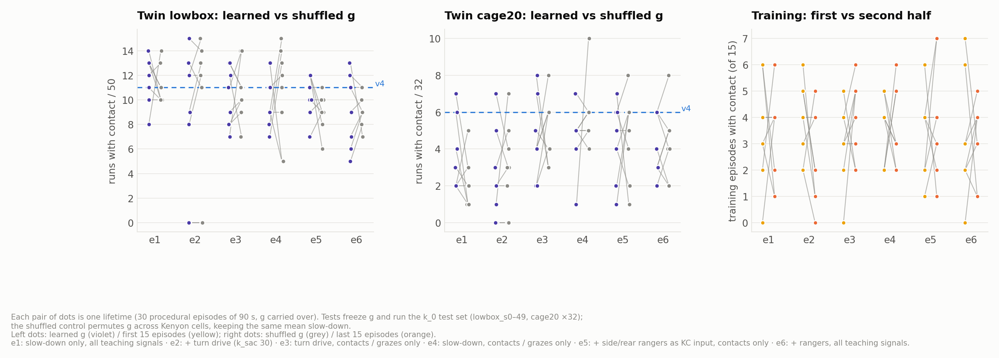

# Report 8 — Mushroom-body plasticity (stage E): a negative result

> Branch `ecps295-sim` · code [`mb.py`](../mb.py), [`rl/mb_life.py`](../rl/mb_life.py), [`rl/e_screen.sh`](../rl/e_screen.sh) ·
> 2026-10-13 · fast twin on the Mac mini and the Jetson · figure from [`make_figures_n.py`](make_figures_n.py),
> numbers in [`n_stats.txt`](n_stats.txt) · 中文版：[08_mushroom_body.zh.md](08_mushroom_body.zh.md)

## Abstract

Stage E asked whether a fly-style learning circuit — a mushroom body with dopamine-gated plasticity on top of the
fixed MiniFly connectome — can learn, during a "lifetime" of flights, which scenes precede contacts and avoid them.
We tried six settings (48 lifetimes, 10,944 frozen-weight test episodes). **None learned scene-specific avoidance**:
the learned weights performed no better than the same weights shuffled across Kenyon cells, and contacts did not fall
from the first to the second half of training. Where contacts fell relative to v4, the shuffled control fell just as
much, so the gain came from slowing down overall. The stage is closed as a negative result for the paper.

## 1. Design

[`mb.py`](../mb.py) (shared by the twin and `run_g4.py`; with all weights at 1 it is bit-identical to the plain model):

- **Kenyon cells (KC).** 300 cells, each summing 4–7 random encoder inputs (adaptive z-scores of the input rates the
  pilot feeds the brain: flow, looming, blank, near, ventral, haltere). Global inhibition as k-winners-take-all keeps
  5 % active.
- **MBON.** One approach output m = mean of the weights g over active KCs. g ∈ [0, 1] only depresses and recovers to 1
  with τ = 900 s. When m < 1 the forward command is scaled by 1 − k_fwd (1 − m) and, if k_sac > 0, both DNp03
  read-outs get k_sac (1 − m) Hz of saccade drive.
- **Learning.** Eligibility trace τ = 2 s on KC activity; phasic dopamine = teaching signal − slow baseline − threshold.
  PPL1 (punishment) from contacts (1 s) and from near misses, governor take-overs and fence turns (0.3 s); PAM (reward)
  from entering a new coverage cell. No hand-written taxis term.
- **Training and test** ([`rl/mb_life.py`](../rl/mb_life.py)). One lifetime = 30 consecutive 90 s episodes on procedural
  worlds never used for testing (seeds from 5000), g carried over. Test: g frozen, the k_0 test set of report 6
  (lowbox_s0–49, cage20 × 32, empty × 32), against two references — the same g permuted across KCs (same mean slowing,
  no scene specificity) and v4 (g = 1).

| Setting | Changes from the default |
|---|---|
| e1 | default: slow-down only (k_fwd 0.6), all teaching signals |
| e2 | + saccade drive k_sac = 30 |
| e3 | saccade drive, punishment only from contacts and grazes (no governor / fence) |
| e4 | slow-down, punishment only from contacts and grazes |
| e5 | + S3 rear / left / right rangers as KC input (proximity 1 − d / 0.6 m, each repeated 40×, ~13 % of KC input), m also slows backing; contacts and grazes only |
| e6 | as e5 with all teaching signals |

The smoke test explained e3/e4: in a 90 s episode there are 5–8 s of punishment, mostly from fence turns and governor
take-overs, so g gets pushed down everywhere rather than in dangerous scenes. e5/e6 (added 10-13) gave the KCs a
direct proximity sense, in case the visual encoders alone could not separate dangerous scenes.

## 2. Results



*Figure 1. Left and middle: runs with contact per lifetime, learned g vs shuffled g (8 lifetimes per setting, frozen
test). Right: training episodes with contact in the first vs the second half of each lifetime.*

| Setting | lowbox /50 learned · shuffled (p) | cage20 /32 learned · shuffled (p) | first → second half of training |
|---|---|---|---|
| v4 (g = 1) | 11 | 6 | — |
| e1 | 12.5 · 10.5 (0.35) | 2.5 · 2.0 (0.20) | 3.50 → 3.25 |
| e2 | 10.5 · 12.0 (0.22) | 2.0 · 3.0 (0.79) | 3.88 → 2.38 (p = 0.14) |
| e3 | 10.0 · 10.5 (0.74) | 4.0 · 5.0 (0.74) | 3.00 → 4.00 |
| e4 | 9.0 · 11.5 (0.60) | 5.0 · 5.5 (0.32) | 3.50 → 3.62 |
| e5 | 10.5 · 9.0 (0.21) | 4.5 · 5.5 (0.73) | 3.38 → 3.88 |
| e6 | 10.0 · 9.0 (0.73) | 3.5 · 4.5 (0.64) | 3.12 → 3.12 |

Medians over 8 lifetimes; p = paired Wilcoxon, learned vs shuffled. Training columns: mean number of the 15 episodes
with a contact.

- **No scene specificity.** In no setting does the learned g beat its own shuffle on lowbox or cage20.
- **What did help was being slower.** On cage20 e1/e2 hit less than v4 (2–2.5 vs 6), but the shuffled g hits just as
  little: with g < 1 on average, the drone simply flies slower. In e2 two lifetimes collapsed to g ≈ 0.2 and almost
  stopped moving (coverage 0.07) — a degenerate solution.
- **No learning curve.** Training contacts in the second half are not lower than in the first in any setting.
- **Range input did not change this** (e5/e6), even though the same rangers as a hard-wired rule (S3, report 7) cut
  contacts by 38 %.

## 3. Reading

The plasticity rule is tied to dense but weakly informative punishment, and contacts are rare (about one episode in
four has one, with seconds of signal in hours of flight). With 300 KCs and 5 % sparsity, the KC code apparently does
not separate "about to hit the stack" from ordinary flight well enough for a 2 s eligibility trace to assign blame.
We did not tune further: the route review (report 7) showed that the lowbox problem is perception and reaction time,
which a range sensor and a safety layer solve directly. For the paper this is a clean negative control: under the
same twin, data and test set, a learned mushroom-body modulation adds nothing over a fixed connectome.

## 4. Data and reproduction

- Frozen-g tests: [`rl/results/twin/mb/tests.csv.gz`](../rl/results/twin/mb/tests.csv.gz) (file e1–e6, tag
  `eN_L<life>_<learned|shuffled>`); lifetimes with the final g and the per-episode training log:
  [`lives.jsonl`](../rl/results/twin/mb/lives.jsonl); screen logs `e1.log` … `e6.log`.
- The v4 reference is the k_0 subset of `rl/results/twin/hw/tests.csv.gz` (`seeds_a.jsonl`).
- Commands:

  ```bash
  bash rl/e_screen.sh 10 10 e1:'{}' e2:'{"k_sac": 30}' e4:'{"teach_ovr": false}'   # train 8 lifetimes + test
  python -m rl.mb_life --tag e1 --report --base rl/out/seeds_a.jsonl
  python reports/make_figures_n.py                                                 # figure 20
  ```
